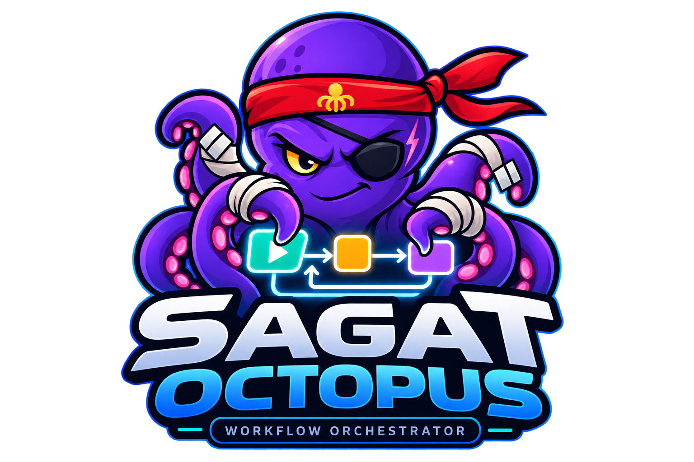

<p align="center">
  
</p>

# Sagat Octopus Orchestrator — Durable Workflow Platform (Spec Kit)

> **Status:** specification with implementation in progress: features 001 (platform foundation), 002 (durable execution), 003 (sagas and compensations, apart from the SDK DSL, Studio screens and dashboards, which belong to other features), 004 (triggers, webhooks and messaging, apart from OIDC/mTLS webhook profiles, outbound broker producers and Studio screens), 005 (inline TypeScript and Python scripts in a sandbox, apart from C#, dependency installation and the Studio editor) 006 (the TypeScript, Go, Python, C# and Java SDKs, apart from publishing and signing the packages and an OpenTelemetry exporter), 007 (the Studio: workflow builder, script editor, run graph and operator actions, apart from showing step data, a screen-reader test by a person, the visual direction recorded in its `design/` folder, which is not built, and the gaps of its research) 008 (traces, metrics, logs and alerts derived from the journal, the operator actions and the audit read, apart from exemplars, pager integrations, OTLP over protobuf and the Studio screens for alerts and drains) 009 (security and multi-tenant governance, apart from a Helm chart, which belongs to another feature) and 011 (immutable versions with approvals, the history of the active version, promotion and rollback, and the `sagat` command line, apart from retention, Studio screens and a packaged binary) are built and tested (see [`docs/traceability.md`](docs/traceability.md)); the other features are still only specified. **Name:** provisional. **Language:** English (en). **Date:** 2026-10-07.

## Mission

Self-hosted and potentially SaaS platform to orchestrate durable workflows and Sagas, with development via SDKs, inline scripts without traditional deployment, visual Studio, webhooks, messaging, end-to-end observability and high availability.

Inspired by **Temporal** (history and recovery), **Restate** (journal and durable invocations), **Inngest** (event-driven primitives) and **Windmill** (script IDE/execution and visual flows). It does not assume reuse of code from those projects.

## Fixed decisions

- **Backend:** Rust (Tokio, Axum, tonic, SQLx), domain modules independent of libraries. Modular monolith with separately deployable processes when justified.
- **V1 durability:** PostgreSQL as source of truth; transactional log and outbox. NATS JetStream is transport/notification, not the source of truth for execution state.
- **Studio:** React/TypeScript, React Flow, Monaco, with the definition graph and the runtime graph kept separate.
- **Official SDKs:** TypeScript, Go, Python, C#/.NET and Java, common semantic contract via gRPC/Protobuf and REST/JSON.
- **Inline script:** compilation/build of immutable artifacts, process/container isolation; progressive support for TypeScript, Python, C#, Go and Java.
- **Integrations:** inbound and outbound HTTP/webhooks, Kafka, NATS and AWS SQS; inbox/outbox, backpressure and DLQ.
- **Security:** tenant/namespace isolation, RBAC, auditing and explicit egress/secrets policy.
- **Observability:** OTel + auditable journal + execution timeline and DAG.

## Build, test and run (features 001, 002, 003, 004, 005, 008, 009 and 011)

```sh
cargo test --workspace --locked          # needs Docker: integration tests start PostgreSQL 16
scripts/smoke-compose.sh                 # builds the images, starts PostgreSQL + NATS + API + engine, checks health
# baseline benchmark of feature 002 (10k suspended runs), on purpose:
SAGAT_PERF_REPORT=tests/performance/reports/durable-execution.md \
  cargo test -p sagat-tests --test perf_durable_execution --release -- --ignored --nocapture
# the security battery of feature 009 (cross-tenant, secret leak, quota racing, SSRF on the egress guard):
cargo test -p sagat-tests --test contract_rest_security_multitenancy --test e2e_security_multitenancy --test integration_security_multitenancy --test fault_security_multitenancy
# sagas, compensations and reconciliation (feature 003): stories, PostgreSQL, contracts, failure injection:
cargo test -p sagat-tests --test e2e_sagas_compensations --test integration_sagas_compensations --test contract_rest_sagas_compensations --test contract_grpc_sagas_compensations --test fault_sagas_compensations
# events, webhooks and messaging (feature 004): signed webhooks, triggers and waits, cron, Kafka/SQS/NATS in containers, outbound deliveries:
cargo test -p sagat-tests --test e2e_events_webhooks_messaging --test integration_events_webhooks_messaging --test contract_rest_events_webhooks_messaging --test contract_asyncapi_events_webhooks_messaging --test fault_events_webhooks_messaging
# observability and operations (feature 008): traces, alerts, operator actions, the audit read, the projection and the monitor at their edges:
cargo test -p sagat-tests --test e2e_observability_operations --test integration_observability_operations --test contract_observability_operations --test contract_rest_observability_operations --test fault_observability_operations
# versions, approvals, promotion, rollback and the `sagat` command line (feature 011): stories, PostgreSQL, contracts, failure injection:
cargo test -p sagat-tests --test e2e_gitops_versioning --test integration_gitops_versioning --test contract_rest_gitops_versioning --test contract_manifest_gitops_versioning --test fault_gitops_versioning
cargo test -p sagat-cli                  # the command line's parser and manifest reader
# inline scripts (feature 005): registry, signing and leases on PostgreSQL; the sandbox in real containers; the stories through the runner:
cargo test -p sagat-tests --test integration_inline_code_sandbox --test integration_inline_code_sandbox_containers --test e2e_inline_code_sandbox --test contract_rest_inline_code_sandbox --test fault_inline_code_sandbox
```

The full procedure, the environment variables and what is not built yet are in
[`specs/001-platform-foundation/quickstart.md`](specs/001-platform-foundation/quickstart.md);
operating the control plane is in [`docs/runbooks/control-plane.md`](docs/runbooks/control-plane.md) and the
execution engine (worker gRPC API, scheduler, NATS outbox) in
[`docs/runbooks/execution-engine.md`](docs/runbooks/execution-engine.md); the validation flow of feature 002 is
in [`specs/002-durable-execution/quickstart.md`](specs/002-durable-execution/quickstart.md). Operating the
security controls (quotas and their ceilings, worker bindings, the secret store, the egress policy, TLS
on the worker API) is in [`docs/runbooks/security-governance.md`](docs/runbooks/security-governance.md);
the validation flow and the security review of feature 009 are in
[`specs/009-security-multitenancy/quickstart.md`](specs/009-security-multitenancy/quickstart.md). Operating sagas (what happens when a step fails, the runs that wait for a person, the circuit breaker) is in
[`docs/runbooks/sagas.md`](docs/runbooks/sagas.md); the validation flow and review of feature 003 are in
[`specs/003-sagas-compensations/quickstart.md`](specs/003-sagas-compensations/quickstart.md); `examples/payment-saga.workflow.json` is a saga you can publish. Receiving and sending events (signed webhooks and how to sign them, triggers, waits for events, cron, Kafka/SQS/NATS connectors, outbound webhooks, dead letters and redrive) is in
[`docs/runbooks/events.md`](docs/runbooks/events.md); the design is [ADR-0012](docs/adr/ADR-0012-events-pass-through-a-durable-inbox-and-delivery-table.md), the message policy [`docs/event-schema-evolution.md`](docs/event-schema-evolution.md), and the validation flow and review of feature 004 are in
[`specs/004-events-webhooks-messaging/quickstart.md`](specs/004-events-webhooks-messaging/quickstart.md). Writing, trying and publishing scripts, the sandbox runner and what a script can and cannot do is in [`docs/runbooks/scripts.md`](docs/runbooks/scripts.md); the design is [ADR-0013](docs/adr/ADR-0013-scripts-run-in-containers-the-control-plane-never-touches.md) and the validation flow and review of feature 005 are in [`specs/005-inline-code-sandbox/quickstart.md`](specs/005-inline-code-sandbox/quickstart.md).
Seeing and operating a running platform (feature 008): traces, the metrics and the alerts, the operator actions on a run, draining a worker and reading the audit trail are in [`docs/runbooks/observability.md`](docs/runbooks/observability.md) and [`docs/runbooks/alerts.md`](docs/runbooks/alerts.md); `docker compose -f infra/docker/compose.yaml -f infra/docker/compose.observability.yaml --env-file infra/docker/.env up -d --build` adds a Collector, Jaeger, Prometheus and Grafana; the design is [ADR-0017](docs/adr/ADR-0017-telemetry-is-derived-from-the-journal-and-conditions-are-found-by-looking.md), the benchmark [`tests/performance/reports/observability-operations.md`](tests/performance/reports/observability-operations.md), and the validation flow and reviews [`specs/008-observability-operations/quickstart.md`](specs/008-observability-operations/quickstart.md).

Publishing, approving, promoting and rolling back (feature 011): a manifest kept in Git and the `sagat` command line (`cargo build -p sagat-cli --release`) validate, diff, publish, promote and roll back workflows; production asks for an approval by default; the active version has a history that nothing can rewrite; how to use it is [`docs/runbooks/gitops.md`](docs/runbooks/gitops.md), the design [ADR-0018](docs/adr/ADR-0018-publishing-is-one-transaction-the-pointer-has-a-history-and-an-approval-is-of-a-document.md), the benchmark [`tests/performance/reports/gitops-versioning.md`](tests/performance/reports/gitops-versioning.md), and the validation flow and reviews [`specs/011-gitops-versioning/quickstart.md`](specs/011-gitops-versioning/quickstart.md).
Workflow: Gitflow branches and Conventional Commits (see `AGENTS.md`).

## Folders

```text
.specify/memory/constitution.md   Architecture and product constitution (principles I–VIII)
.specify/                       Spec Kit 1.1.2 (Claude integration): templates, scripts, workflow
.claude/skills/speckit-*/       The /speckit-* commands
specs/001..012/                 Spec Kit features: spec.md, plan.md, tasks.md, ...
docs/architecture/              Cross-cutting architecture and semantic contracts
docs/adr/                       Architectural Decision Records
docs/roadmap.md                 Phases, dependencies and exit criteria
docs/traceability.md            Traceability of requirements and deliverables
docs/test-strategy.md           Failure, load, contract and security tests
docs/runbooks/                  Operational procedures
AGENTS.md                       Instructions for implementation agents
crates/ apps/ tests/            Rust workspace: domain, application, adapters, control plane, test suites
infra/docker/                   Local environment (Docker Compose) and the control-plane and execution-engine images
scripts/                        Architecture-rule checker and the compose smoke test
```

## Usage with GitHub Spec Kit

Spec Kit is initialized in this repository (`.specify/`, Claude integration). The constitution at
`.specify/memory/constitution.md` was derived from `AGENTS.md`, the ADRs and the Constitution Check that
every plan already carried; it is **version 1.0.0 with the ratification date still to be confirmed by the
maintainers** (see the comment at the top of the file).

1. Read `.specify/memory/constitution.md`, then the `spec.md`, `plan.md` and `tasks.md` of the feature you work on.
2. Evolve one feature per branch (`feature/<spec-id>-<slug>`, see `AGENTS.md`) with `/speckit-clarify`, `/speckit-plan`, `/speckit-checklist`, `/speckit-tasks`, `/speckit-analyze`, `/speckit-implement` and `/speckit-converge`. A new feature starts with `/speckit-specify` and continues the numbering from 013.
3. Spec Kit finds the active feature through `.specify/feature.json` (per checkout, git-ignored) or `SPECIFY_FEATURE_DIRECTORY`, not through the branch name, so the Gitflow branch names do not conflict with it.
4. For features 001, 002, 003 and 009 the checked tasks in `tasks.md` record what is built and its evidence; the other features' plans and tasks are still **initial proposals** and do not represent existing code.
5. Before implementing, validate the ADRs, test the protocol against a real worker and run the indicated quality gates.

**Spec Kit note:** there are 12 independent features ordered by dependency, not a single monolithic spec. Spec Kit has no place for cross-cutting material, so it stays in `docs/` (architecture, ADRs, runbooks, glossary, roadmap, traceability, test strategy), and the constitution points to it; initial canonical contracts are in `specs/001-platform-foundation/contracts/`.

## Guarantees and limits

- The database confirms state transitions atomically; workers receive tasks at-least-once. External side effects do **not** receive a universal exactly-once guarantee.
- Suspended workflows do not hold threads or execution containers.
- There is no arbitrary automatic migration of running workflows to a new version.
- The graphical editor is a faithful representation of the **declarative** DSL/IR. Arbitrary imperative code is not always convertible to a static graph; Studio merges the planned graph and the actual execution.
- Throughput and latency targets are **benchmark criteria to verify**, not commercial promises.
- A saga undoes what it did by asking the provider to (a compensation), which is not a rollback: an effect that cannot be undone ends the run `PARTIAL`, and a compensation that keeps failing waits for a person instead of being assumed done. An attempt whose outcome is unknown is looked up before it is repeated. The platform asks at least once with stable keys; a provider that does not deduplicate by them can still do an effect twice. What is not built (the SDK DSL, Studio screens, dashboards) is in [`specs/003-sagas-compensations/research.md`](specs/003-sagas-compensations/research.md).
- Tenant isolation, quotas, worker bindings, the secret store and the egress policy are enforced and tested (feature 009). **Not yet built:** quotas for storage/logs, a KMS behind the secret key ring, and a Helm chart with network policies. The list, with the reason for each, is in [`specs/009-security-multitenancy/research.md`](specs/009-security-multitenancy/research.md).

- Events: an event the platform answered `202` for is durable and is deduplicated by tenant, namespace, source and id for a window; each run it starts and each wait it wakes is started or woken once per admission, however the dispatcher is interrupted. There is **no ordering** between events, and delivery to and from the outside is at-least-once: outgoing webhooks carry a stable delivery id and a receiver that keeps it can drop a repeat. A webhook is trusted by its signature, which covers the type, subject and correlation key as well as the payload. Not built: OIDC/mTLS webhook profiles, producers to customers' Kafka/SQS/NATS, a per-address ingress limit and an inbox size quota. The list, with the reasons, is in [`specs/004-events-webhooks-messaging/research.md`](specs/004-events-webhooks-messaging/research.md).

- Scripts: a script runs in a container of its own (no network, read-only root, no capabilities, hard limits) started by a runner that holds the container engine and no database; what it builds is a signed, content-addressed artifact and a workflow pins its digest, so a newer version changes nothing for a run that pinned the old one. A step runs **at least once** (a lost lease runs it again elsewhere); the idempotency key a script is given is the same on every attempt. The sandbox is as strong as the runtime under it, and **the runner is a host that must hold nothing else** (it has the engine's socket). Not built: C#/Go/Java, installing dependencies (a lockfile that pins a package is refused), key rotation, a runner shared between tenants and the Studio editor. The list, with the reasons, is in [`specs/005-inline-code-sandbox/research.md`](specs/005-inline-code-sandbox/research.md).

- Studio: a React single-page app served by the control plane under `/studio/` (same origin, strict content security policy, the token held in memory only). It builds and publishes workflows (the platform validates the draft as publish would and compares it with the active version, naming the changes that can break callers), edits and test-runs scripts in the sandbox, and follows a run live by journal sequence (a stream, a polling fallback), with a table and a timeline as first-class alternatives to the graph, and lets an operator retry or give up on a compensation with a reason that is recorded. It shows no step input or output (the journal carries none). Checked by unit tests, journeys in a real browser against the real platform (the four user stories, the whole chain from drawing a saga to inspecting its journal, axe-core, a security journey, sign-in with an identity provider against a stand-in), two rounds of independent security and correctness reviews and a benchmark of a 1 000-node canvas and a run of 9 991 nodes; **not** tested with a real identity provider, by a person using a screen reader, or in a browser other than Chromium. The list, with the reasons, is in [`specs/007-workflow-studio/research.md`](specs/007-workflow-studio/research.md); how to run and operate it is in [`docs/runbooks/studio.md`](docs/runbooks/studio.md) and [`frontend/README.md`](frontend/README.md).

## Reading order

1. `.specify/memory/constitution.md`
2. `docs/architecture/overview.md` and `docs/architecture/execution-semantics.md`
3. `docs/architecture/sagas.md`, `storage-and-events.md`, `security-and-sandbox.md`
4. `specs/001-platform-foundation/spec.md`, `plan.md`, `tasks.md`
5. `docs/roadmap.md` and the other features

## Sources and references

- [GitHub Spec Kit](https://github.com/github/spec-kit) and [official templates](https://github.com/github/spec-kit/tree/main/templates)
- [Temporal Event History](https://docs.temporal.io/encyclopedia/event-history)
- [Inngest Durable Primitives](https://www.inngest.com/docs/durable-execution/primitives)
- [Restate GitHub](https://github.com/restatedev/restate)
- [Windmill GitHub](https://github.com/windmill-labs/windmill)
