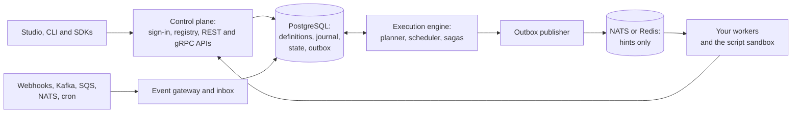
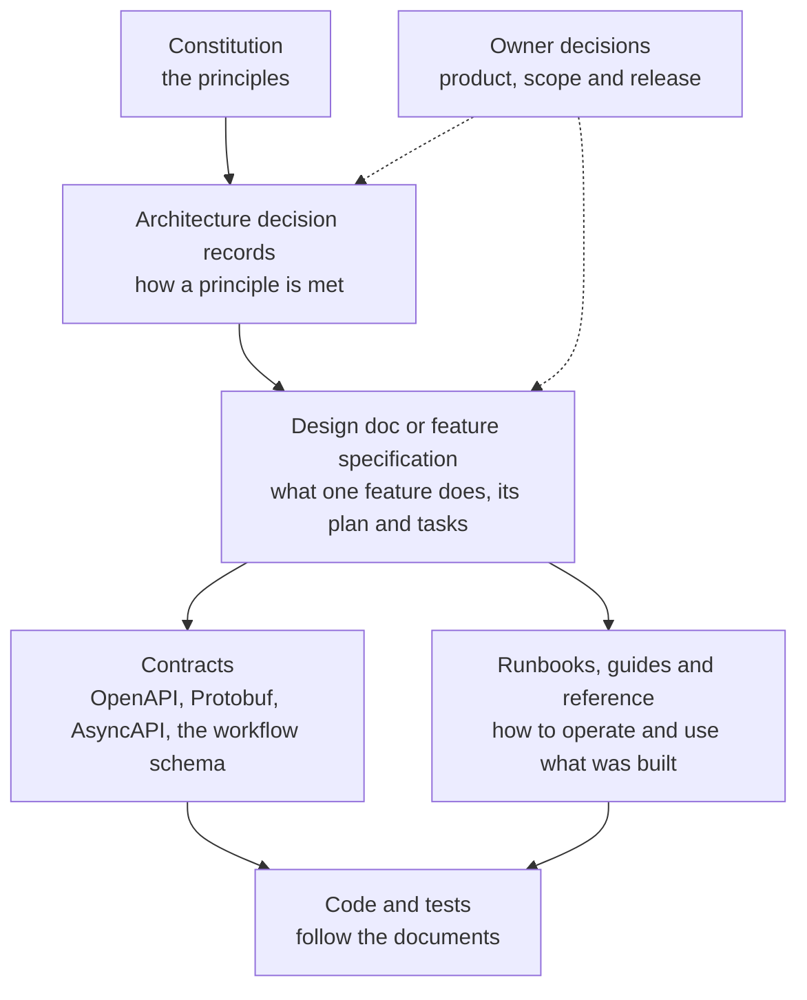

# Documentation

This folder holds the documents of Sagat Octopus Orchestrator: what the platform must do, how it is built, how to run
it, and why each decision was taken. Start here.

## What the platform is

Sagat Octopus Orchestrator is a self-hosted platform for durable workflows, sagas and event-driven automation. You
build a workflow in the Studio (a web editor) or with an SDK in TypeScript, Go, Python, C#, Java or Rust. Your own
workers run the activities; inline scripts run in isolated containers. The Studio shows each run's history, its retries
and its compensations.

PostgreSQL is the source of truth. A message broker (NATS JetStream by default, or Redis Streams) only carries hints
that wake the workers; losing a hint loses nothing. External effects, such as a payment, happen at least once, so they
need an idempotency key and reconciliation.

The server is one Rust program split into modules (a modular monolith): 18 library crates and 6 applications in
[`Cargo.toml`](../Cargo.toml). The current release is 0.2.0 ([release notes](releases/0.2.0.md)).

Sources: the [repository README](../README.md) and the [architecture overview](architecture/overview.md).



The diagram is logical, after the one in the [architecture overview](architecture/overview.md): workers claim and report
work through the worker API, not by writing to the database.

## Where do I find...

| You are | You want | Read |
|---|---|---|
| An operator | to install, configure, upgrade or recover the platform | the [runbooks](runbooks/README.md), the [release notes](releases/README.md), the [CLI reference](reference/cli.md), [observability and service levels](architecture/observability-slo.md) |
| A workflow author | to write and run a first workflow | the [quickstarts](quickstarts/README.md), the [workflow document reference](reference/workflow-document.md), the [guides](guides/README.md), the [glossary](glossary.md) |
| An SDK user | to serve activities from your own code | the [SDK contract](architecture/sdk-contract.md), the [SDK compatibility table](sdk-compatibility.md), the [SDK runbook](runbooks/sdks.md), the shared semantics in [`sdks/SPEC.md`](../sdks/SPEC.md) |
| A contributor | to change the platform | [`AGENTS.md`](../AGENTS.md), the [engineering guide](engineering/README.md), the [design docs](designs/README.md), the [architecture decision records](adr/README.md), the [test strategy](test-strategy.md), the [traceability table](traceability.md) |
| The owner | to see decisions, scope and releases | the [owner decisions](owner-decisions.md), the [roadmap](roadmap.md), the [parity assessment](roadmap-assessment-2026-11-11.md), the [constitution](constitution.md) and its [amendment records](governance/README.md) |

## How the documents relate

A higher document outranks a lower one. When two disagree, the higher one wins and the lower one is corrected
([constitution](constitution.md), Governance).



- The **constitution** holds the principles. It changes only by a versioned amendment with a record in
  [`governance/`](governance/README.md).
- An **architecture decision record** in [`adr/`](adr/README.md) says how a principle is met when the choice is hard to
  reverse.
- A **design doc** in [`designs/`](designs/README.md) describes one feature: what it does, its plan and its tasks. Older
  features keep the same content in [`../specs/`](../specs/README.md) (`spec.md`, `plan.md`, `tasks.md`) until they are
  converted. Each feature's decisions, gaps and open questions live in its `specs/<feature>/research.md`.
- The **contracts** under `../specs/<feature>/contracts/` are what the code and the tests are held to.
- **Runbooks**, **guides** and the **reference** describe what was built, for the people who run and use it.
- **Owner decisions** settle product, scope, budget and release questions. Only the owner takes them.

## The life of a run

```mermaid
sequenceDiagram
  participant Client as Client (Studio, CLI, SDK)
  participant API as Control plane
  participant DB as PostgreSQL
  participant Engine as Execution engine
  participant Hint as NATS or Redis
  participant Worker as Worker
  Client->>API: start a run of a published version
  API->>DB: one transaction: the run and its first ready steps
  Engine->>Hint: publish a hint from the outbox
  Hint-->>Worker: there is work
  Worker->>API: claim ready work
  API->>DB: lease the step (attempt, generation, lease token)
  Worker->>Worker: run the activity
  Worker->>API: complete the step (lease token, idempotency key, output)
  API->>DB: one transaction: the journal, the step's state, the next steps, timers, the outbox
  Note over DB: a lost hint is found again by reconciliation;<br/>an expired lease goes to review, not silently back to ready
```

Sources: [durable execution semantics](architecture/execution-semantics.md), the
[worker protocol](architecture/worker-runtime-protocol.md), the key invariants of the
[architecture overview](architecture/overview.md) and the rule "one transaction per transition" in the
[architecture principles](engineering/architecture-principles.md).

## The folders

| Folder | What it holds |
|---|---|
| [`adr/`](adr/README.md) | Architecture decision records: one structural decision per file, numbered, with the options that lost |
| [`architecture/`](architecture/README.md) | How the system is built: the overview, execution semantics, sagas, storage, security, the worker protocol, the SDK contract |
| [`designs/`](designs/README.md) | Design docs: one feature per file, with its plan, its tasks and the record of its review |
| [`engineering/`](engineering/README.md) | How this repository is built by people and agents: the design workflow, the architecture checks, agent configuration |
| [`governance/`](governance/README.md) | The record of every constitution amendment (Sync Impact Reports) and the plans that change the repository's rules |
| [`guides/`](guides/README.md) | Task-oriented guides for one capability, such as connecting an Apache Iceberg catalog |
| [`quickstarts/`](quickstarts/README.md) | From nothing to a running workflow, in minutes |
| [`reference/`](reference/README.md) | The REST API, the `sagat` command and the workflow document, generated from the code |
| [`releases/`](releases/README.md) | Release notes, and the changes waiting for the next release |
| [`runbooks/`](runbooks/README.md) | How to operate each part of the platform: settings, alerts, failures, recovery |
| [`validation/`](validation/README.md) | The protocol for human acceptance and its results template |

## The files at the top of this folder

| File | What it holds |
|---|---|
| [constitution.md](constitution.md) | The principles every other document and all code follow |
| [owner-decisions.md](owner-decisions.md) | Every decision only the owner could take, newest first |
| [roadmap.md](roadmap.md) | The order of the features, their gates and their dependencies |
| [roadmap-assessment-2026-11-11.md](roadmap-assessment-2026-11-11.md) | An assessment of parity with Temporal and Windmill, and of the path to better scale and resilience (2026-11-11) |
| [traceability.md](traceability.md) | Which test proves which requirement, feature by feature |
| [test-strategy.md](test-strategy.md) | How the platform is tested, and what the CI runs for a pull request and for a release |
| [sdk-compatibility.md](sdk-compatibility.md) | Which SDK version speaks which worker protocol version |
| [event-schema-evolution.md](event-schema-evolution.md) | How the messages the platform sends and receives may change without breaking readers |
| [glossary.md](glossary.md) | The words the documents use: workflow, version, run, step, attempt, activity and the rest |
| [hero.png](hero.png) | The picture at the top of the repository README |

## The features

Each feature has a number. A newer feature is described by a design doc in [`designs/`](designs/README.md); an older one
by its specification in [`../specs/`](../specs/README.md). "Tasks ticked" counts the ticked boxes of its task list on
the `develop` branch: `tasks.md` for a specification, the design doc itself for a design. A ticked task names the
evidence that closes it. "Its record says" quotes the status the feature's own document gives; where two documents
disagree, see [Where the documents disagree](#where-the-documents-disagree).

| Number | Feature | Described in | Tasks ticked | Its record says | Runbooks |
|---|---|---|---|---|---|
| 001 | Platform foundation and contracts | [specification](../specs/001-platform-foundation/spec.md) | 41 of 41 | Delivered: every task ticked with its evidence | [control plane](runbooks/control-plane.md) |
| 002 | Durable execution engine and scheduler | [specification](../specs/002-durable-execution/spec.md) | 41 of 41 | Delivered: every task ticked with its evidence | [execution engine](runbooks/execution-engine.md) |
| 003 | Native sagas and compensations | [specification](../specs/003-sagas-compensations/spec.md) | 35 of 35 | Delivered: every task ticked with its evidence | [sagas](runbooks/sagas.md) |
| 004 | Triggers, webhooks, messaging and correlation | [specification](../specs/004-events-webhooks-messaging/spec.md) | 44 of 44 | Delivered: every task ticked with its evidence | [events](runbooks/events.md) |
| 005 | Script registry, code editor and inline execution | [specification](../specs/005-inline-code-sandbox/spec.md) | 45 of 45 | Delivered: every task ticked with its evidence | [scripts](runbooks/scripts.md) |
| 006 | TypeScript, Go, Python, C# and Java SDKs | [specification](../specs/006-sdk-multilanguage/spec.md) | 42 of 42 | Delivered: every task ticked with its evidence | [SDKs](runbooks/sdks.md), [packaging](runbooks/sdk-packaging.md) |
| 007 | Visual Studio, Monaco and runtime graph | [specification](../specs/007-workflow-studio/spec.md) | 58 of 58 | Delivered: every task ticked with its evidence | [Studio](runbooks/studio.md) |
| 008 | Distributed observability and operations | [specification](../specs/008-observability-operations/spec.md) | 36 of 36 | Delivered: every task ticked with its evidence | [observability](runbooks/observability.md), [alerts](runbooks/alerts.md) |
| 009 | Security, isolation and multi-tenant governance | [specification](../specs/009-security-multitenancy/spec.md) | 40 of 40 | Delivered: every task ticked with its evidence | [security and governance](runbooks/security-governance.md) |
| 010 | Performance, scalability and high availability | [specification](../specs/010-scalability-ha/spec.md) | 40 of 40 | Delivered: every task ticked with its evidence | [scaling](runbooks/scaling.md), [disaster recovery](runbooks/disaster-recovery.md) |
| 011 | GitOps, versioning and definition promotion | [specification](../specs/011-gitops-versioning/spec.md) | 36 of 36 | Delivered: every task ticked with its evidence | [GitOps](runbooks/gitops.md) |
| 012 | CLI, quickstarts, local testing and documentation | [specification](../specs/012-developer-experience/spec.md) | 35 of 35 | Delivered: every task ticked with its evidence | [developer experience](runbooks/developer-experience.md) |
| 013 | Federated login | no document in this checkout | | the roadmap: "Draft specification only" | |
| 014 | Durable workflow primitives and practical SDK examples | [specification](../specs/014-workflow-primitives/spec.md) | 43 of 45 | Architecture accepted; runtime implementation partial | [workflow primitives](runbooks/workflow-primitives.md) |
| 015 | OpenTelemetry and OpenBao | no document in this checkout | | the roadmap: "Draft specification only" | |
| 016 | Per-field payload classification | [specification](../specs/016-payload-classification/spec.md) | 65 of 65 | Implemented; release gates passed; merged into 0.2.0 | [payload classification](runbooks/payload-classification.md) |
| 017 | Database connections, OpenBao secrets and shared execution | [specification](../specs/017-database-connections/spec.md) | 25 of 25 | Implemented and locally verified on 2026-10-17 | [database connections](runbooks/database-connections.md), [database runner](runbooks/database-runner.md), [OpenBao](runbooks/openbao.md), [database recovery](runbooks/database-recovery.md) |
| 018 | Schedules and bulk run operations | [specification](../specs/018-schedules-bulk-operations/spec.md) | 61 of 81 | Approved for implementation by the owner on 2026-10-29 | [schedules](runbooks/schedules.md), [batch operations](runbooks/batch-operations.md), [business identifiers](runbooks/business-ids.md), [run reset](runbooks/run-reset.md), [instance registry](runbooks/instance-registry.md) |
| 019 | Worker deployments and dispatch | [specification](../specs/019-worker-deployments-dispatch/spec.md) | 0 of 68 | Approved for implementation by the owner on 2026-11-11; not implemented | |
| 020 | Run visibility, analytics and archival | [specification](../specs/020-visibility-analytics-archival/spec.md) | 0 of 62 | Approved for implementation by the owner on 2026-11-11; not implemented | |
| 021 | Integration resources, managed operations, variables and triggers | [specification](../specs/021-integration-resources-triggers/spec.md) | 0 of 80 | Approved for implementation by the owner on 2026-11-11; not implemented | |
| 022 | Flow control and step policies | [specification](../specs/022-flow-control-step-policies/spec.md) | 0 of 107 | Approved for implementation by the owner on 2026-11-11; not implemented | |
| 023 | Additional script languages | [specification](../specs/023-script-languages/spec.md) | 0 of 66 | Approved for implementation by the owner on 2026-11-11; not implemented | |
| 024 | Data engines and pipelines | [specification](../specs/024-data-engines-pipelines/spec.md) | 0 of 69 | Approved for implementation by the owner on 2026-11-11; not implemented | |
| 025 | AI agents and MCP | [specification](../specs/025-ai-agents-mcp/spec.md) | 0 of 81 | Approved for implementation by the owner on 2026-11-11; not implemented | |
| 026 | Invocation and human-interaction surfaces | [specification](../specs/026-invocation-human-surfaces/spec.md) | 0 of 68 | Approved for implementation by the owner on 2026-11-11; not implemented | |
| 027 | Internal apps | [specification](../specs/027-internal-apps/spec.md) | 0 of 61 | Approved for implementation by the owner on 2026-11-11; not implemented | |
| 028 | Developer tooling | [specification](../specs/028-developer-tooling/spec.md) | 0 of 74 | Approved for implementation by the owner on 2026-11-11; not implemented | |
| 029 | Custom roles, groups, folders and per-operation access lists | [specification](../specs/029-custom-roles-folders/spec.md) | 0 of 69 | Approved for implementation by the owner on 2026-11-11; not implemented | |
| 030 | Cross-namespace service operations | [specification](../specs/030-cross-namespace-services/spec.md) | 0 of 70 | Approved for implementation by the owner on 2026-11-11; not implemented | |
| 031 | Client-side payload encryption | [specification](../specs/031-client-side-encryption/spec.md) | 0 of 69 | Approved for implementation by the owner on 2026-11-11; not implemented | |
| 032 | Multi-region replication and active-passive failover | [specification](../specs/032-multi-region-failover/spec.md) | 0 of 64 | Approved for implementation by the owner on 2026-11-11; not implemented | |
| 033 | Redis Streams for internal notifications and outbound callbacks | [specification](../specs/033-redis-streams/spec.md) | 6 of 7 | no Status line; the roadmap places it in release 0.3 | [events, Redis Streams section](runbooks/events.md#redis-streams-v03) |
| 034 | Official Rust SDK | [specification](../specs/034-rust-sdk/spec.md) | 7 of 7 | no Status line; its title says release 0.3 | [packaging](runbooks/sdk-packaging.md) |
| 035 | Apache Iceberg writes and step-output destinations | [specification](../specs/035-iceberg-write-steps/spec.md) | 20 of 129 | Draft, specified, clarified and planned; in implementation | [database runner](runbooks/database-runner.md); guides: [Iceberg connections](guides/iceberg-connections.md), [Iceberg type mapping](guides/iceberg-type-mapping.md) |
| 036 | Elastic scaling driven by telemetry | [specification](../specs/036-elastic-scaling/spec.md) | 0 of 94 | Approved for implementation by the owner on 2026-11-11; not implemented | |
| 037 | Explicit compensation failure and uncertain effects | [specification](../specs/037-compensation-safety/spec.md) | 32 of 34 | Delivery 1 approved on 2026-11-01 | [sagas](runbooks/sagas.md) |
| 038 | Claim and transition efficiency | [design doc](designs/038-claim-transition-efficiency.md) | 0 of 11 | Draft | |
| 039 | Nested collections and the capacity program | [design doc](designs/039-nested-collections.md) | 0 of 1 | Draft | |
| 040 | OCSF as the standard schema for security and audit events | [design doc](designs/040-ocsf-event-standard.md) | 0 of 1 | Draft | |
| 041 | Step logs per run | [design doc](designs/041-step-logs.md) | 2 of 32 | Approved | |
| 042 | Stream operators | [design doc](designs/042-stream-operators.md) | 0 of 53 | Draft | |
| 043 | Run input validation | [design doc](designs/043-run-input-validation.md) | 24 of 28 | Approved | [run input validation](runbooks/run-input-validation.md) |

Feature numbers are shared by every branch. A number missing here (013, 015) may be in use on another branch; take the
next one from `python3 scripts/next-feature-id.py`. The [release runbook](runbooks/release.md) applies to every feature, and the
[runbooks index](runbooks/README.md) lists the runbooks that belong to no single feature.

## Where the documents disagree

Found while writing this index. Each is listed, not resolved here: the owner of the document decides which one is
right, and the wrong one is corrected (constitution, Governance). Seven disagreements found on 2026-11-20 were
corrected the same day, each toward its authority: owner decisions over the roadmap, a design doc over the roadmap,
ticked tasks and their evidence over a status line, and `Cargo.toml` over prose. One is still open:

- [Owner decisions](owner-decisions.md) cite an architecture decision record numbered 0091; no such file is in
  [`adr/`](adr/README.md) on `develop`. It arrives with pull request #226.

## How this folder is kept in order

- Every folder has a `README.md`, its index, and the index links every file in the folder with one line on what it
  holds. This page links every folder. `python3 scripts/check-docs-index.py` fails when a page is missing from its index
  or a link points nowhere.
- A new page goes in the folder of its kind (the table above), and into that folder's index in the same commit.
- Write for people: plain language, short sentences, words in full, a diagram where it helps more than prose.
- Every statement can be traced to the code or to another document; link the source.
- A review report goes in `designs/<design>.reviews/<date>/`. It is the reviewers' own record and needs no index.
- A change of behaviour changes its document before, or together with, the code.
