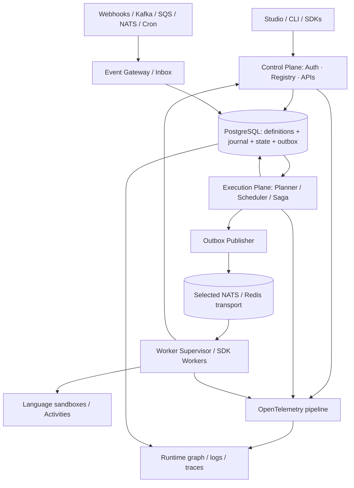

# System architecture — overview

## Context and boundaries

**Actors:** Workflow Author, Platform Operator, Security Admin, API Client, Human Approver, SDK Worker and Connector Provider.

**Layers/planes**

The diagram is **logical**: workers claim and report through the worker API, whose application services own persistence in the orchestration database. No implemented privileged worker adapter for direct orchestration-database writes was identified. A managed database-runner connects to a configured business database under a separate capability; that is not permission to access the orchestration store.

## Bounded contexts

| Context | Logical owner | Main interface | Data |
|---|---|---|---|
| Identity/Workspace | control-plane | RBAC, namespaces | tenants, users, roles |
| Definition Registry | control-plane | draft/publish/version | workflow_versions |
| Execution | engine | commands, state, journal | runs, steps, attempts, events |
| Saga | engine | compensation policy | saga_entries, saga_runs |
| Scheduler | engine | ready timers and leases | timers, queues, leases |
| Event Gateway | integration plane | inbox, correlations | events, subscriptions |
| Script Registry | control-plane | build, publish, digest | scripts, artifacts |
| Worker Supervisor | execution plane | register, lease, heartbeat | workers, capabilities |
| Connector Registry | integration plane | credentials, subscriptions | connectors, deliveries |
| Observability | read-side | projection, query, OTel | execution read models |

## Key invariants

1. A published `WorkflowVersion` is immutable and every Run references a single version.
2. A step command (`step_id`, `attempt`) is accepted once per generation/fencing token.
3. A RUNNING→WAITING transition persists the subscription/timer in the same transaction.
4. The selected NATS/Redis transport carries hints/references, never the sole record of a task. Redelivery is normal; the worker API grants execution authority (ADR-0069).
5. A reconciliation loop re-emits outbox and detects READY tasks without delivery.
6. Runtime DAG is event-projected; the definition graph is a blueprint and may omit branches not taken.

## Current repository map

[`Cargo.toml`](../../Cargo.toml) is the authority for server workspace membership: 17 crates,
six applications and the test crate at this revision. The applications are `control-plane`,
`execution-engine`, `sandbox-runner`, `database-runner`, `cli` and development-only `dev-idp`.

Domain rules live in `crates/domain`, use cases in `crates/application`, scheduling in
`crates/scheduler`, and adapters in the `api-*`, `infra-*` and `telemetry` crates. The adapters
include PostgreSQL, managed databases, blobs, NATS/Redis transports, connectors, egress, secrets, expressions, IR,
sandbox and schema validation. Saga coordination and event rules remain domain/application
code, not separate `saga` or `events` crates (ADR-0010, ADR-0012).

`frontend/apps/studio` contains the UI. The six SDKs live under `sdks/{typescript,go,python,dotnet,java,rust}`;
the Rust SDK has its own manifest and is not one of the server workspace members.
The gRPC build consumes [worker.proto](../../specs/001-platform-foundation/contracts/worker.proto).
Infrastructure lives in `infra/docker` and `infra/helm`; validation suites live under `tests`.

Earlier plans used `apps/worker-supervisor`, separate saga/event/script-registry crates and a
root `proto/` tree. Those names describe historical decomposition ideas, not missing modules
that must be created. The sandbox runner and adapters implement those responsibilities where
needed. Git history preserves the earlier layout proposal.

## V1 vertical slice

Publish declarative JSON definition → start Run via REST → persist journal → enqueue task → test worker executes → complete step → update state → view graph and audit log → kill and restart worker with safe retry.

## Explicit scope left for later releases

Generic low-code style application designer, public connector marketplace, WASM as a mandatory runtime, multi-region active-active, bidirectional conversion of arbitrary imperative code and global distributed transactions.
