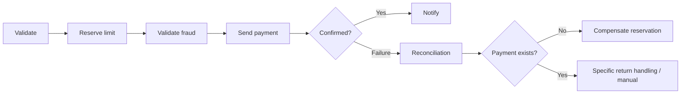

# Formal model of Sagas, compensation and reconciliation

## Concepts

- `SagaRun`: business scope associated with a Run (may include sub-Sagas).
- `ForwardAction`: operation with an external effect, confirmation contract and idempotency.
- `CompensationAction`: new operation that attempts to neutralize/compensate the previous one; it is not an ACID rollback.
- `CompensationPlan`: stack ordered by dependency in reverse topological order, and not just a reversal of an array for parallel branches.
- `CompensationOutcome`: COMPLETED, PARTIAL, FAILED, NOT_POSSIBLE, MANUAL_REVIEW.

## Mandatory rules

1. Record the intent and the compensation handle before considering the action confirmed (or in the same transaction as the success checkpoint).
2. If an external action is left in an ambiguous state, run reconciliation before compensating or advancing; never assume it did not occur.
3. Each compensation receives a `compensation_idempotency_key` stable per Run/Step/Action.
4. Compensation failure allows a separate retry with backoff and limit; when exceeded, `COMPENSATION_FAILED` and audited human intervention.
5. In parallel branches, compensations of independent branches may run in parallel if dependencies allow; conflicts require serialization.
6. On cancellation, policy `ABORT_NO_COMPENSATION`, `COMPENSATE_COMPLETED`, `WAIT_IN_FLIGHT_THEN_COMPENSATE`; recommended default `COMPENSATE_COMPLETED`, respecting irreversible effects.
7. For settled payments, 'compensating' may open a distinct return process and not mark success until confirmation is obtained from the domain.

## Example



## Proposed DSL (illustrative API, no existing implementation)

```typescript
saga('corporate-payment').step('reserve', {
  execute: reserveLimit,
  compensate: releaseLimit,
  idempotencyKey: ({runId}) => `reserve:${runId}`,
  retry: { maxAttempts: 4, backoff: 'exponential', jitter: true }
}).step('submit', {
  execute: submitPayment,
  reconcile: lookupPaymentStatus,
  compensate: requestReturnIfSupported,
  irreversibleAfter: 'settled'
});
```

## Example with C# (illustrative API)

```csharp
var reservation = await saga.StepAsync(
    "reserve-limit", ct => limits.ReserveAsync(request, ct),
    compensate: ct => limits.ReleaseAsync(request.IdempotencyKey, ct));
await saga.StepAsync(
    "send-payment", ct => payments.SubmitAsync(request, ct),
    reconcile: ct => payments.GetStatusAsync(request.IdempotencyKey, ct));
```

## Minimum test scenarios

- failure in the second step → compensation of the first;
- failure after executing and before saving the response → reconciliation before retry;
- compensation failure → backoff and intervention;
- parallel with join and compensation of one branch;
- cancellation during an in-flight activity;
- operator requests retry/skip with `reason` and approval; no change to the past journal.

## As implemented (feature 003)

Decisions: `specs/003-sagas-compensations/research.md` (D59–D70) and [ADR-0010](../adr/ADR-0010-compensations-are-derived-steps.md). Operating it: [`docs/runbooks/sagas.md`](../runbooks/sagas.md). The DSL above is still illustrative (SDKs are feature 006); what exists is the IR it will generate, and `examples/payment-saga.workflow.json` is the reference.

**Vocabulary.** `SagaRun` is a `saga` node of the IR and its row in `run_sagas`; `ForwardAction` is an `activity` with `compensateWith` / `reconcileWith`; `CompensationAction` and the lookup are the derived steps `<id>~c` and `<id>~r`; `CompensationPlan` is `saga_plans` / `saga_plan_entries` (per version) and `run_saga_entries` (per run). The outcomes of the model map as: COMPLETED → `COMPENSATED`; PARTIAL → `PARTIAL`; FAILED → `COMPENSATION_FAILED`; NOT_POSSIBLE → a step marked `irreversible` (reported as `PARTIAL`); MANUAL_REVIEW → the run status `MANUAL_REVIEW` while a step waits for a person (it then ends in one of the three).

**Mandatory rules, and where each is enforced**

| Rule | Enforced by |
|---|---|
| 1. Record the intent and the compensation handle before the action is confirmed | The plan (with `compensation_id`) is stored at publish, before any run exists; the step's completion and the saga's bookkeeping are one transaction (`PgRunTx::persist`) |
| 2. Ambiguous state: reconcile before compensating or advancing | A lost lease, a timeout or `OUTCOME_UNKNOWN` makes the step wait on its lookup; the saga does not plan while a lookup is pending (`crates/domain/src/execution/sagas.rs::abort`); never assumed either way (`reconciliation.unknown` goes to a person) |
| 3. `compensation_idempotency_key` stable per Run/Step/Action | `compensation:{compensation_id}:{run}` (D62), the same on every attempt and restart |
| 4. A failing compensation retries with backoff and a limit; beyond it, a person, audited | `RetryPolicy::COMPENSATION`, `onCompensationFailure`, `MANUAL_REVIEW`, the three decisions of D67 and their audit records |
| 5. Independent branches may compensate in parallel; conflicts serialise | The plan waits only for the nearest entries downstream, so `parallel` branches have no edge between them; two compensations with an edge never overlap |
| 6. Cancellation policy | `cancelPolicy`: `compensate_completed` (default), `wait_in_flight_then_compensate`, `abort_no_compensation`; irreversible effects make the outcome `PARTIAL` |
| 7. A settled payment: a distinct return process, no success until the domain confirms | `compensateWith` names whatever process the author wants (`payment.return.request` in the example); the saga does not end until it reports, and a person can decide when it cannot |

**What is not in the model above and was needed.** The circuit breaker per provider operation (D68); the reserved worker code `OUTCOME_UNKNOWN` and the lookup's verdict (D64, D65); the statuses of a run and what a stop does to a saga (D66); the plan being a function of what actually completed (D61).

**Minimum test scenarios, and the test that proves each**

| Scenario | Test |
|---|---|
| Failure in the second step → compensation of the first | `reserve_completed_and_submit_failed_for_good_compensates_the_reservation` (domain), `compensation::a_permanent_failure_after_a_reservation...` (PostgreSQL), `us02` (REST and gRPC) |
| Failure after executing and before saving the response → reconciliation before retry | `an_attempt_with_an_unknown_outcome_is_reconciled_before_anything_else`, `reconcile::a_lost_response_is_reconciled...`, `us03_after_an_engine_restart...`, `provider::a_provider_that_accepts_before_it_times_out...` |
| Compensation failure → backoff and intervention | `a_compensation_that_exhausts_its_retries_waits_for_an_operator`, `review::*`, `us04` |
| Parallel with join and compensation of one branch | `branches_of_a_parallel_node_are_independent_in_the_plan`, `independent_branches_are_compensated_at_the_same_time`, `a_saga_in_a_branch_that_loses_the_join_compensates_what_it_did` |
| Cancellation during an in-flight activity | `cancelling_compensates_what_completed_and_ends_cancelled`, `stopping::*`, `children::*` |
| The operator requests retry/skip with `reason` and approval; no change to the past journal | `us04_an_operator_asks_for_another_attempt...` (the journal before is a prefix of the journal after), `us04_giving_up_on_a_release_is_an_administrators_decision...` |

