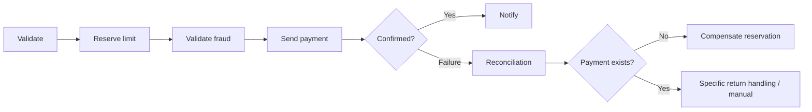

# Formal model of Sagas, compensation and reconciliation

## Concepts

- `SagaRun`: business scope associated with a Run (may include sub-Sagas).
- `ForwardAction`: operation with an external effect, confirmation contract and idempotency.
- `CompensationAction`: new operation that attempts to neutralize/compensate the previous one; it is not an ACID rollback.
- `CompensationPlan`: stack ordered by dependency in reverse topological order, and not just a reversal of an array for parallel branches.
- `CompensationOutcome`: COMPLETED, PARTIAL, FAILED, NOT_POSSIBLE, MANUAL_REVIEW.

## Mandatory rules

1. Record the intent and the compensation handle before considering the action confirmed (or in the same transaction as the success checkpoint).
2. Every leased `Activity` is external-capable. An ambiguous original effect is reconciled or held for review before advancing, retrying or compensating; an ambiguous compensation is held for review. `highRisk: false` or an absent risk label does not relax this rule.
3. Each compensation receives a `compensation_idempotency_key` stable per Run/Step/Action.
4. Compensation failure retries with backoff and a limit. `manual_review` (the default) retains the recovery obligation across cancellation, deadline and restart. Explicit `fail` applies only to a known permanent/non-retryable failure, lets independent compensations settle, suppresses blocked dependants, and then ends `COMPENSATION_FAILED` with no active post-terminal recovery queue.
5. In parallel branches, compensations of independent branches may run in parallel if dependencies allow; conflicts require serialization.
6. On cancellation, policy `ABORT_NO_COMPENSATION`, `COMPENSATE_COMPLETED`, `WAIT_IN_FLIGHT_THEN_COMPENSATE`; recommended default `COMPENSATE_COMPLETED`, respecting irreversible effects.
7. For settled payments, 'compensating' may open a distinct return process. Completion requires a final-domain assertion or an authorized human resolution with distinct provenance; provider acceptance or pending status is not success.

## Example



## Proposed DSL (illustrative API, no existing implementation)

```typescript
saga('corporate-payment').step('reserve', {
  execute: reserveLimit,
  compensate: releaseLimit,
  idempotencyKey: ({runId}) => `reserve:${runId}`,
  retry: { maxAttempts: 4, backoff: 'exponential', jitter: true }
}).step('submit', {
  execute: submitPayment,
  reconcile: lookupPaymentStatus,
  compensate: requestReturnIfSupported,
  irreversibleAfter: 'settled'
});
```

## Example with C# (illustrative API)

```csharp
var reservation = await saga.StepAsync(
    "reserve-limit", ct => limits.ReserveAsync(request, ct),
    compensate: ct => limits.ReleaseAsync(request.IdempotencyKey, ct));
await saga.StepAsync(
    "send-payment", ct => payments.SubmitAsync(request, ct),
    reconcile: ct => payments.GetStatusAsync(request.IdempotencyKey, ct));
```

## Minimum test scenarios

- failure in the second step → compensation of the first;
- failure after executing and before saving the response → reconciliation before retry;
- compensation failure → backoff and intervention;
- parallel with join and compensation of one branch;
- cancellation during an in-flight activity;
- operator resolves or skips with `reason` and approval; no change to the past journal.

## Implemented explicit sagas (feature 003)

Decisions: `specs/003-sagas-compensations/research.md` (D59–D70) and [ADR-0010](../adr/ADR-0010-compensations-are-derived-steps.md). Operating it: [`docs/runbooks/sagas.md`](../runbooks/sagas.md). The DSL above is still illustrative (SDKs are feature 006); what exists is the IR it will generate, and `examples/payment-saga.workflow.json` is the reference.

**Vocabulary.** `SagaRun` is a `saga` node of the IR and its row in `run_sagas`; `ForwardAction` is an `activity` with `compensateWith` / `reconcileWith`; `CompensationAction` and the lookup are the derived steps `<id>~c` and `<id>~r`; `CompensationPlan` is `saga_plans` / `saga_plan_entries` (per version) and `run_saga_entries` (per run). The outcomes of the model map as: COMPLETED → `COMPENSATED`; PARTIAL → `PARTIAL`; FAILED → `COMPENSATION_FAILED`; NOT_POSSIBLE → a step marked `irreversible` (reported as `PARTIAL`); MANUAL_REVIEW → the run status `MANUAL_REVIEW` while a step waits for a person (it then ends in one of the three).

**Mandatory rules, and where each is enforced**

| Rule | Enforced by |
|---|---|
| 1. Record the intent and the compensation handle before the action is confirmed | The plan (with `compensation_id`) is stored at publish, before any run exists; the step's completion and the saga's bookkeeping are one transaction (`PgRunTx::persist`) |
| 2. Ambiguous external effect | Lease expiry, timeout or `OUTCOME_UNKNOWN` takes precedence over retry, cancellation and explicit failure. An original uses its reconciler or review; `NotApplied` is non-final and reviews as `RECONCILIATION_NOT_FINAL`; an unknown compensation reviews directly. Only originals known to have succeeded are normal compensation candidates. |
| 3. `compensation_idempotency_key` stable per Run/Step/Action | `compensation:{compensation_id}:{run}` (D62), the same on every attempt and restart |
| 4. Compensation failure policy | `RetryPolicy::COMPENSATION` and `onCompensationFailure`: `manual_review` waits for an audited outcome-bearing decision and survives stop/deadline; `fail` is restricted to known failure and reaches terminal `COMPENSATION_FAILED` only after independent work and dependency suppression quiesce. |
| 5. Independent branches may compensate in parallel; conflicts serialise | The plan waits only for the nearest entries downstream, so `parallel` branches have no edge between them; two compensations with an edge never overlap |
| 6. Cancellation policy | `cancelPolicy`: `compensate_completed` (default), `wait_in_flight_then_compensate`, `abort_no_compensation`; irreversible effects make the outcome `PARTIAL` |
| 7. A settled payment: distinct return process and truthful provenance | `compensateWith` names whatever process the author wants (`payment.return.request` in the example); `CompleteStep` asserts a final domain result, while an authorized human resolution retains actor/reason and is never presented as provider proof |

### Collection and loop compensation (feature 014)

Collections and loops can own compensation scopes. Their durable bookkeeping includes
`scope_sagas` and `scope_saga_entries`; it is additional to the explicit saga tables above.
After drain, compensation runs in reverse dependency order within an iteration; independent
collection iterations have no ordering dependency, while loop iterations compensate last-first.
The planner bounds collection compensation concurrency. The stable compensation ID includes the
structural execution path for scoped work, so two iterations of the same node do not share an
effect key; retries of one instance retain its key.

Feature 037 applies the same safe default to scoped work as to explicit sagas: an unknown original
is not a compensation candidate and an unknown compensation is not repeated. Stop/deadline preserves
the review obligation. Known succeeded originals still compensate in reverse dependency order, and
known failed compensations still follow the declared retry/failure policy. See
[scope planner](../../crates/domain/src/execution/scoped_sagas.rs),
[instance keys](../../crates/application/src/execution.rs),
[source tests](../../crates/domain/tests/scoped_compensation.rs), and the
[feature 003 scope extension](../../specs/003-sagas-compensations/spec.md).

**What is not in the model above and was needed.** The circuit breaker per provider operation (D68); the reserved worker code `OUTCOME_UNKNOWN` and the lookup's verdict (D64, D65); the statuses of a run and what a stop does to a saga (D66); the plan being a function of what actually completed (D61).

**Minimum test scenarios, and the test that proves each**

| Scenario | Test |
|---|---|
| Failure in the second step → compensation of the first | `reserve_completed_and_submit_failed_for_good_compensates_the_reservation` (domain), `compensation::a_permanent_failure_after_a_reservation...` (PostgreSQL), `us02` (REST and gRPC) |
| Failure after executing and before saving the response → reconciliation before retry | `an_attempt_with_an_unknown_outcome_is_reconciled_before_anything_else`, `reconcile::a_lost_response_is_reconciled...`, `us03_after_an_engine_restart...`, `provider::a_provider_that_accepts_before_it_times_out...` |
| Compensation failure → backoff and intervention | `a_compensation_that_exhausts_its_retries_waits_for_an_operator`, `review::*`, `us04` |
| Parallel with join and compensation of one branch | `branches_of_a_parallel_node_are_independent_in_the_plan`, `independent_branches_are_compensated_at_the_same_time`, `a_saga_in_a_branch_that_loses_the_join_compensates_what_it_did` |
| Cancellation during an in-flight activity | `cancelling_compensates_what_completed_and_ends_cancelled`, `stopping::*`, `children::*` |
| The operator resolves/skips with `reason` and approval; no change to the past journal | `review::*` and the REST/gRPC operator-operation contract suites preserve actor, reason and the journal prefix |


## Feature 037 delivery 1 — implementation in verification

The rules and enforcement table above are the delivery-1 contract being verified. `CompleteStep`
is the handler's assertion of a final domain result, not proof supplied by the platform or provider;
accepted or pending work must report `OUTCOME_UNKNOWN`. A negative lookup is observation rather than
proof of permanent absence and therefore reviews as `RECONCILIATION_NOT_FINAL`. Direct retry of an
unknown original or compensation is a state conflict even for an administrator: an authorized
`RESOLVE_STEP` records outcome, actor and reason first, without promising an in-place retry after
resolution. A human success resolution can yield `COMPENSATED`, but remains human provenance and
must not be presented as provider confirmation.

This is a refinement of the behavior and rationale recorded by
[feature 003](../../specs/003-sagas-compensations/spec.md) and
[feature 014](../../specs/014-workflow-primitives/spec.md), not a rewrite of their historical record.
[ADR-0076](../adr/ADR-0076-compensation-failure-and-uncertain-effects.md) remains **PROPOSED** until
formal adoption and acceptance evidence. Delivery 1 adds no qualified-provider exception; US04 has
no selected or qualified provider. See the [feature 037 specification](../../specs/037-compensation-safety/spec.md)
and its validation report for status. Until those gates are recorded, this document makes no claim
that the implementation or a real integration has been validated.
