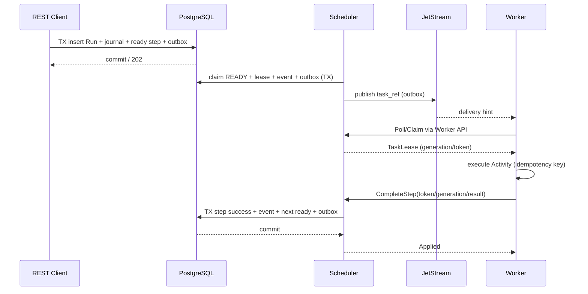

# Worker, leasing and fencing protocol — details

## Session and capabilities

`RegisterWorker` authenticates the machine/namespace identity, negotiates `protocol_version`, capabilities (`activity_names`, `languages`, `pools`, `max_inflight`) and returns a session with TTL. A worker does not execute a task that declares a capability it lacks.

## Claim

NATS delivery is a **hint**. The worker calls `PollTasks`/stream, which performs a transactional claim in Postgres; the response carries an opaque `lease_token`, `generation`, `attempt`, `deadline` and `idempotency_key`. A NATS callback does not constitute authority to execute without a valid lease.

## Worker loop

```text
connect → register → request credits → claim one or more tasks
for each task:
  validate protocol/tenant scope, deadline, capabilities
  start heartbeat loop (lease renewal)
  execute Activity or Script in isolated executor with deadline
  upload large result to object storage (hash verified)
  CompleteStep or FailStep with token+generation+idempotency_key
  if STALE_ATTEMPT: ignore persisted result, stop executor, emit metric
  ack local delivery; read next tasks respecting max_inflight
```

## Lease settings

- Proposed default parameters: `lease_ttl=30s`, `heartbeat_interval<=lease_ttl/3`, `max_lease_renewal` per step timeouts.
- Heartbeats do not persist the full journal per heartbeat; they renew the row via a lightweight update with fencing.
- A worker that lost its connection may continue the side effect; a stale token prevents the **internal commit**, but does not undo the side effect. The SDK recommends cancel + idempotency for external APIs.
- Task released again after expiration with `generation+1`. An old response receives `STALE_ATTEMPT`.
- Long polling/backoff avoids busy-looping; gRPC streaming can be added without changing semantics.

## Failing step

- `retryable=true`: consume retry budget and schedule `next_attempt_at` with backoff/jitter.
- `retryable=false`: progression to the onError branch, saga compensation or fail policy.
- `deadline_expired`: best-effort cancel and persisted temporal state; if the external effect is unknown, reconciliation is mandatory for a critical connector.
- `fail` and `complete` with the same repeated key return the previously recorded outcome; different request hash under the same key = conflict.

## Flow control

- Local credit control per worker and global quotas per tenant/queue/connector.
- Expose `max_inflight` and capacity dynamically; the scheduler cannot trust in-memory counters after failover.
- Distribution by capability without a subject per run, for bounded queue cardinality.

## Success flow



## Warning: double grant

The diagram above illustrates claim and delivery in the same chain; the implementation must ensure that the lease is delivered **logically only once**, via one canonical operation. Recommended option: the scheduler only creates the READY/outbox hint, and the worker API performs the READY→LEASED transition under lock. Do not implement a prior claim by the scheduler and a second claim by the worker simultaneously. If opting for pre-assignment, write an ADR and corresponding fencing tests.

### Final V1 decision

**The V1 choice is:** the engine writes `READY` + outbox; NATS wakes the worker; the Worker API grants `LEASED` under row lock/CAS and returns the token. The worker executes, renews the heartbeat and confirms. The reconciler re-notifies READY without an active hint and releases expired leases. The "SCH claim READY" step in the diagram above must be interpreted as scheduler validation, not as a lease grant prior to the worker API.

## As implemented (feature 002)

The V1 decision above is what the engine does. The details that the diagrams leave open are fixed by `specs/001-platform-foundation/contracts/worker.proto`, which the Rust server (`crates/api-grpc`) and every SDK are generated from, and by `specs/002-durable-execution/research.md` (D27, D31, D32, D34).

- **Identity.** Every call carries `authorization: Bearer <jwt>`; the token is verified exactly as for the REST API and the caller must be a member of the tenant with the `worker` role (or `admin`). `RegisterWorker` returns a session token (stored hashed, bound to the identity that opened it, expiring when idle); `PollTasks` needs it. There is one live session per worker name and identity: registering again under the same name replaces the session (the old token stops working, so a worker that reconnects registers again), and an identity holds at most 32 sessions (`RESOURCE_EXHAUSTED` beyond that). `languages` and `pools` take at most 16 entries of 1 to 64 letters, digits or `. _ - : +`.
- **Connections.** The server closes a connection that sends nothing for 10 s after it is opened (or whose TLS handshake takes longer than 10 s), closes an established one that is silent for 300 s, asks every connection to finish its calls and reconnect after 30 minutes, and lets one address (an IPv6 peer counts as its /64) hold at most 256 connections. A client must therefore treat `UNAVAILABLE` on a connection that was idle as "reconnect and retry", not as an outage, and must not open a connection before it has something to say. Every limit is an environment variable of the engine (`docs/runbooks/execution-engine.md`).
- **Task identity.** `task_id` is `run/node/generation`. A report names the task, the run, the step id, the attempt, the generation and the lease token; all of them must be current. The lease token is a random 256-bit secret shown once in `TaskLease` and stored only as a SHA-256.
- **Errors.** gRPC status plus a stable code in the `x-sagat-error` trailer: `UNAUTHENTICATED`; `PERMISSION_DENIED` (`FORBIDDEN`); `INVALID_ARGUMENT`; `ABORTED` with `STALE_ATTEMPT` (stop, do not retry) or `IDEMPOTENCY_KEY_REUSED`; `RESOURCE_EXHAUSTED` with `retry-after-ms`; `UNAVAILABLE` (retry with the same key). A report about a run of another tenant is indistinguishable from a stale one.
- **Idempotency.** `CompleteStep` and `FailStep` take a key (8 to 160 printable ASCII). The same key and report replays the original answer with `already_applied = true`; the same key with a different report is refused. `output_sha256`, when sent, is checked against the bytes received. `output_blob_ref` is refused until a blob store exists (G19); an empty `output_json` means "no value".
- **Sizes.** An output or signal payload is at most 256 KiB, and a run retains at most 4 MiB of them (the completion that would exceed it fails the step with `RUN_DATA_LIMIT`, not retried). A `PollTasks` response stops growing at 8 MiB, so it is at most 8 MiB plus the last task, and a task carries the outputs its run retains: **a client must accept messages of at least 16 MiB** (the default of most gRPC libraries is 4 MiB) or it will fail on a large run. What does not fit stays claimable.
- **Authority (feature 009).** `worker:execute` makes an identity a worker; a *binding* says which activities of which namespace it may serve. Registration is refused (`PERMISSION_DENIED`, `x-sagat-error: NOT_BOUND`) for any activity no binding of that identity covers, and the binding is re-checked on every heartbeat, completion, failure and secret resolution, so removing one stops a worker that already holds a lease. Removing or narrowing a binding closes the sessions it no longer covers and releases their attempts to the scheduler.
- **Secrets (feature 009).** `ResolveSecrets` returns the values of the secrets the step's definition declares (`secrets` on the activity node), for the attempt the lease belongs to. The lease is the capability: it must be current, the identity still bound, and the publisher of the workflow version still allowed to use every secret. All or nothing; audited in the transaction that read the values; `PERMISSION_DENIED` with `x-sagat-error: SECRET_NOT_USABLE` when a secret is gone or its publisher lost access. Values are credentials: call it only over TLS, never log or persist them, drop them when the attempt ends. A completion whose output contains a value the step was given fails the step with `SECRET_IN_OUTPUT`. The generated message type prints its value as `<redacted>`.
- **Transport (feature 009).** The engine can terminate TLS and require client certificates (`SAGAT_GRPC_TLS_*`); a deployment with secrets must have TLS here or in front of it. The server sheds calls when it is full: `PollTasks` and `RegisterWorker` first, `Heartbeat`, `CompleteStep`, `FailStep` and `ResolveSecrets` last, with `RESOURCE_EXHAUSTED` and `retry-after-ms`.
- **Cancellation.** There is no server push: a cancellation reaches a running attempt through the next `Heartbeat` (`cancel_requested`), and the worker then reports the attempt as stopped.
- **Hints.** NATS subjects are `sagat.v1.task.ready.<tenant>.<activity>` and `sagat.v1.run.finished.<tenant>`; messages carry identifiers only (run, node, activity, trace id), never payloads or tokens. A worker that receives one still has to claim through `PollTasks`.

## As implemented (feature 003)

Protocol 1.2 adds three fields to `TaskLease` and no rpc. They are additive: a worker that ignores them runs a compensation as the ordinary activity it names (checked against a message declared as protocol 1.0 in `tests/contract/003-sagas-compensations/grpc/protocol.rs`).

- **Task kinds.** `task_kind` is `FORWARD` (an empty value means this), `COMPENSATION` (undo a step; the activity is the one the workflow declared in `compensateWith`) or `RECONCILIATION` (find out whether a step happened; the activity is `reconcileWith`). `task_id` is `run/node/generation` as before, with the node `reserve~c` or `reserve~r`; every other rpc takes it unchanged.
- **Target.** For a compensation or a lookup, `target_node` is the forward step it is about and `target_idempotency_key` the key that step's own attempts carried, which is what identifies the *effect* at the provider ("undo the payment you know as this"). `idempotency_key` is the key of this compensation (`compensation:{compensation_id}:{run}`) or this lookup (`reconciliation:{run}:{forward}`): the same on every attempt and every restart. Send it to the provider; a provider that deduplicates by key then performs the effect once, however often the platform asks. The input (`input_json`) is the same document as for forward work, so a compensation reads the output of the step it undoes under `steps.<node>.output`.
- **A compensation must be idempotent and must tolerate an effect that never happened.** The platform compensates a step whose outcome stayed unknown, because not undoing a payment that happened is worse than undoing one that did not (G53). It cannot check this; it is the author's contract.
- **A lookup answers a verdict.** Complete the `RECONCILIATION` task with `{"effect": "applied" | "not_applied" | "unknown", "output": <json, optional>}` and nothing else. `applied` completes the step it is about, with `output` as its output (which later steps read); `not_applied` lets the platform retry it, with the same key; `unknown` hands the decision to a person. A body of another shape fails the lookup for good (`RECONCILIATION_ANSWER_INVALID`); the report itself is acknowledged.
- **`OUTCOME_UNKNOWN`.** A worker that sent a request and cannot tell whether it was applied (a timeout after the connection was made, a response that did not arrive) reports `FailStep` with `error_code = OUTCOME_UNKNOWN` and `retryable = false`. It is reserved: the platform then looks the step up if it has a `reconcileWith`, and does not retry it blindly. A failure code that is not a code (free text) is recorded as `WORKER_ERROR`, never as a reserved one.
- **Cancellation does not reach a compensation.** `Heartbeat` answers `cancel_requested = false` for a compensation or a lookup even when the run is being cancelled: undoing what was done is not work to abandon. The attempts of the *forward* work of the saga are asked to stop as before (policy `compensate_completed`).
- **Back-pressure.** A compensation whose provider keeps failing is held back by the circuit breaker (`docs/runbooks/sagas.md`, per tenant, namespace and activity name): `PollTasks` simply does not return it until the breaker allows a probe. Nothing is lost; the step stays `READY`. The `task.ready` hint of a held-back compensation is announced a bounded number of times, so a worker must not rely on hints alone: it polls (G63).
- **A compensation's output is discarded.** It is not stored, not shown to later steps and not counted against the 4 MiB a run retains (G65).

