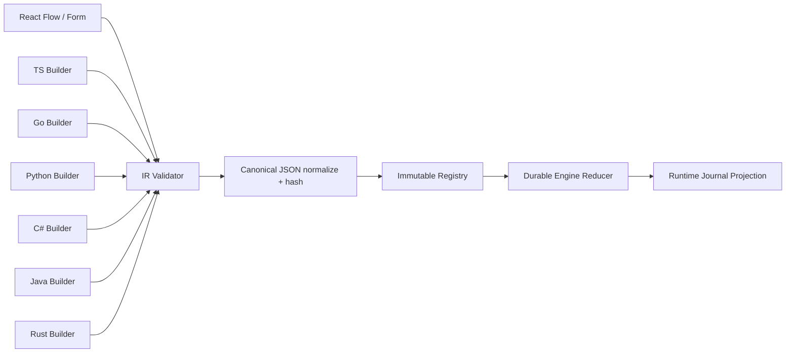

# Authoring model: IR, SDK, inline scripts and execution graph

## Three experiences, a single engine

| Experience | Flow definition | Orchestration logic executor | Executes arbitrary code | Rendering |
|---|---|---|---|---|
| Visual-first | JSON IR via Studio | Rust engine | Yes, in isolated Activity/Script nodes | Complete static graph + execution |
| Declarative code-first | SDK builder compiles/publishes JSON IR | Rust engine | Yes, BYO worker Activities or Script | Complete static graph + execution |
| Workflow as code (release 0.3.0, design 044, being built) | A workflow function in one of the six SDK languages, published as a *code version* that names the digest of its code and declares its envelope | The function decides commands in the tenant's SDK worker, replayed against the run's journal; the Rust engine executes every command as an IR node | The workflow function itself (deterministic, replayed, no effects); effects only in activities and steps | Observed graph of the commands a run made (`Code-orchestrated`), no blueprint |

The first two modes are built. Workflow as code enters release 0.3.0 (Owner decision 2026-11-24-3) under
constitution principle IV (version 5.0.0, worded for the pin and the deferred terminal command by version 5.1.0, Owner
decision 2026-11-25-3):

- the workflow function runs in an SDK worker, never in a platform process;
- it proposes commands; the server checks each against the version's envelope (activities, secrets, signals, child
  workflows, scripts, approvals), the current authorization and the quotas, and commits the completion under a
  lease and a fencing token in one transaction, all or nothing (journal, steps, timers, waits, outbox and the next
  workflow task); a command that ends the run while an obligation is open or an event is unseen is deferred and the
  rest of the completion commits (constitution 5.1.0);
- the worker's memory is a cache that replay rebuilds;
- a replay that diverges from the journal stops with a typed non-determinism error and commits nothing;
- a run's pin names exactly one version at any moment and changes only by a verified move (an explicit, authorized
  request per run, applied with the run locked and no workflow task leased, while the run has not completed an
  activation past the one verified, only after the server finds that a replay of its own history against the target
  code matches); the version the run started on stays its identity origin; version markers in a later version let it
  branch for older histories.

[Design 044](../designs/044-workflow-as-code.md) and its Architecture decisions 0103 to 0109 hold the mechanism. It
starts with a determinism study per language, and the mode ships in an SDK only after that study and the shared replay
conformance scenarios pass; an SDK without it says so in its capabilities. The declarative graph stays a first-class
model beside it.

## Workflow as code

Approved in design 044 and being built; nothing below exists on `develop` until the task named for it lands. The
sections of the design ("Technical Plan" followed by a number) hold the details; this section is the map an engineer
follows into the code.

### The code version

A code version is a workflow document of the additive v1 schema whose top-level `code` object replaces `entrypoint`,
`nodes` and `bodies` (the schema is a `oneOf`: a graph document or a code document, never both; Requirement 044-001,
Technical Plan 3.1, schema change by Task 044-2). It names:

- the **workflow type** (1 to 48 characters, unique in the namespace, kept by every code version of the workflow), the
  language and the **code digest**: the SHA-256 of the RFC 8785 canonical JSON of the language, the runtime with its full
  version, the SDK's name and version, the workflow type and the hash of the code with its dependencies. The SDK
  computes it and writes it into a *manifest*; the platform never receives the code (Technical Plan 3.2);
- the **capability envelope**: activity entries (an exact name or a prefix ending in `.*`; only an exact entry may list
  `secrets`; each entry owns its input and output schemas, risk metadata, approval rule and flow control), script
  entries by digest, child workflows with their versions, event types with their largest look-back, and named approval
  policies;
- the workflow task timeout, the cancellation grace, buffered signals, declared state and queries, code updates and
  worker queries.

Publication goes through `definitions.publishCode(manifest, envelope)` of each SDK, which saves the code document as the
workflow's draft and publishes it through today's route under `definition:publish`, refused `422
CAPABILITY_NOT_ACTIVE` until the operator records the instance registry requirement `code-workflows-v1`
([instance-registry runbook](../runbooks/instance-registry.md); Task 044-3). Publication approval reviews the
document (envelope, declarations, digest), not the code.

### The decider

The function is a *decider*. The engine leases the run's reserved workflow-task step (`~workflow`) to a worker of the
run's current code digest; that lease, a *workflow task*, delivers the visible events of the activation window. The
worker runs the function on them until it yields, then answers with a *completion* (a list of commands) or a *failure*
(a cause). The completion commits in one run transaction. A worker that does not hold the run in its cache rebuilds it
by replaying the function from the start against the run's history, without issuing the commands already recorded.
The workflow task, the activation window and the pending rule are in
[execution-semantics.md](execution-semantics.md#workflow-as-code-design-044); the wire is in
[worker-runtime-protocol.md](worker-runtime-protocol.md#workflow-as-code-design-044); the SDK surface is in
[`sdks/SPEC.md`](../../sdks/SPEC.md) section 12 (Architecture decisions 0103 and 0104).

### Commands are IR nodes in a code profile

Every command that does work is a node of this IR, so the engine runs it with the code that runs graph nodes (leases and
fences, retries, compensation as derived steps, the uncertain-effect rules of feature 037, gates, step logs,
classification). A *work command* carries a **fragment**: the JSON of an IR node of its kind, without `id` and `next`,
canonicalized by the SDK (RFC 8785), in the **code profile** of that kind (Technical Plan 5.1):

| Kind | The fragment sets | From the envelope entry | Refused in the fragment |
|---|---|---|---|
| `activity` | the activity name, `retry`, `timeoutMs`, the literal keys of flow control, the saga scope, a literal `input` | secrets, risk metadata, output schema, approval rule, flow-control policies | `idempotencyTemplate`, `destinations`, `onError` |
| `script` | the artifact digest, `retry`, a literal `input` | language, secrets, output schema, `compensateWith` | as for an activity |
| `timer` | `durationMs` | none | none |
| `waitEvent` | the event type, `timeoutMs`, `lookbackMs`, a literal correlation key | none | `correlationExpr`, `onTimeout`, `outputSchema` |
| `child` | the workflow, `cancelPolicy`, a literal `input` and business identifier | the version and the output schema | an expression `input`, `version` |
| `approval` | the policy name, a literal subject | the policy and its timeout | an inline `policy` and the routing fields |

The profile refuses every expression, template, routing and publisher-only field: a fragment may repeat a publisher
field of its entry but never change it. A fragment is parsed by the publication parser of its kind (`IrCodec`, a
code-profile parse in `crates/infra-ir`, Task 044-5), so every limit of a graph node applies to it. The other commands
are typed messages: cancel a timer or a step, open, close and abort a saga scope, record a marker (patch or side
effect), set the declared state, accept, reject and complete an update, consume signals, complete, fail, continue as
new and acknowledge a cancellation (Requirement 044-012). The `database`, `icebergWrite`, `forEach`, `while`,
`repeatUntil` and `parallel` nodes are not commands in 0.3.0; a graph child covers them (Gap 044-003). There are no local
activities (Architecture decision 0107).

### The code definition

The engine reads every node through `WorkflowDefinition`. A code version parses to a definition whose graph is
`DefinitionGraph::Code`, and every loader of a code run composes it with the run's **node overlay**
(`WorkflowDefinition::compose_code`, table `code_step_nodes`) or fails closed (Requirement 044-034, Technical Plan 2,
Task 044-4 and Task 044-31). The composed definition answers:

- `~workflow`, the workflow-task node (`NodeKind::WorkflowTask`, built from the step row and the pin, never an activity);
- `c-<n>` for the work command numbered `n`, with its derived companions `c-<n>~c` and `c-<n>~r`;
- `s-<n>`, a saga scope opened by command `n`.

The overlay is a projection of the journal: the node spec of each accepted work command (its canonical fragment without
literal values, merged with the entry's publisher fields, at most 1 KiB, never a payload) is carried by the command's
record and frozen at acceptance with the version that accepted it, so a move never changes what an accepted step means.
A source-text check counts every call site of the definition's methods against an allowlist
(`apps/execution-engine/tests/code_definition_sites.rs`, [architecture principles](../engineering/architecture-principles.md)).

### Versions of a code run

A code run's **start version** is the version it was created with (`runs.workflow_version_id`); it never changes and is
its identity origin: step, journal-instance and compensation identities derive from it. Its **current code version**
(`code_run_pins.code_version_id`) is the one version its workflow tasks run, equal to the start version until a person's
verified move (Technical Plan 7, Architecture decision 0105). A code change is always a new code version; `patched(id)`
lets the new code replay older histories, and it reaches a running run only through a verified move. Continue-as-new
starts a new run that pins the current code version, or the workflow's active version when the command asks for it.

## Compilation pipeline



The SDK pipeline may run client-side and publish IR to the server. It must not execute business side effects during compilation. JSON canonicalization defines stable sorting of objects, ordered preservation of arrays and explicit representation of decimals.

## v1 node kinds

| Node | Essential input | Semantics | Error/limit |
|---|---|---|---|
| `activity` | activity ref, input mapping | durable external task | retry, timeout, idempotency |
| `script` | artifact digest | sandbox via worker | build version / quotas |
| `condition` | safe CEL expression | decides edge | expression without side effects |
| `parallel` | branches, join policy | fanout with barrier | concurrency/fairness |
| `forEach` | collection expression, named body, result | executes a bounded collection body | maxItems/maxConcurrency and publication-shape limits |
| `while` / `repeatUntil` | condition, body, initial/carry state | bounded sequential iteration | maxIterations and publication-shape limits |
| `timer` | delay/until | creates temporal subscription | timezone when scheduled |
| `waitEvent` | type/key/timeout | waits on subscription | race with deadline |
| `child` | workflow id+version policy | starts child run | cancel propagation |
| `saga` | start, compensation policy | compensation domain | irreversible actions |
| `approval` | eligible subjects/roles, outcome routes | one authorized committed decision | expiry and initiator-exclusion policy |
| `database` | pinned connection revision, typed operation | dedicated managed PostgreSQL executor | root-only supported graph shape; one attempt, ambiguous writes need review |
| `end` | output mapping | terminal closure | output validation |

**Acceptance layers:** schema recognition is not execution support. The legacy names `foreach`
and `humanApproval` remain in the schema but the converter rejects them as non-executable
placeholders. The structured parser can map more shapes than the production publication path
accepts. Production parsing selects restricted collection/loop/continuation/state paths; the
database node has additional root-only constraints. This table is an overview, not an exhaustive
capability matrix. Consult the [schema](../../specs/001-platform-foundation/contracts/workflow.schema.json),
[parser gates](../../crates/infra-ir/src/lib.rs) and [converter](../../crates/infra-ir/src/convert.rs)
before treating a graph as publishable. Do not enable a placeholder merely because it appears in
the schema.

## TypeScript builder model (design API)

```typescript
const flow = workflow('procure-to-pay')
  .trigger.webhook('erp/invoice.created')
  .step('validate', activity('invoice.validate'))
  .saga('settlement', saga => saga
     .step('reserve', activity('limits.reserve'), {
        compensate: activity('limits.release'),
        reconcile: activity('limits.lookup')
     })
     .step('send', activity('payments.submit'), {
        reconcile: activity('payments.getStatus'),
        compensate: activity('payments.requestReturn')
     }))
  .waitForEvent('payment.confirmed', { key: '$.input.paymentId', timeout: '5m' })
  .step('notify', script('customer-notification@sha256:...'));
await client.definitions.publish(flow.compile());
```

## C# builder (design API)

```csharp
var flow = Workflow.Define("procure-to-pay")
   .Trigger(Trigger.Webhook("erp/invoice.created"))
   .Activity("validate", "invoice.validate")
   .Saga("settlement", saga => saga
       .Activity("reserve", "limits.reserve", compensateWith: "limits.release")
       .Activity("send", "payments.submit", reconcileWith: "payments.getStatus"))
   .WaitForEvent("payment.confirmed", "$.input.paymentId", TimeSpan.FromMinutes(5))
   .Activity("notify", "customer.notify");
await client.PublishAsync(flow.Compile(), cancellationToken);
```

## Canvas consistency

- Editor and builder generate the same normalized IR form; differences only in layout metadata.
- A script code change generates a new artifact digest; a definition change generates a new version.
- The runtime graph includes dynamically generated steps, retry attempts and compensations even if they are not in the blueprint.
- Reprocessing a node does not edit the historical run: it generates a new attempt in the same Run when legal, or a new Run explicitly.
- If a feature is not expressible in visual IR (for example arbitrary imperative control), the UI displays `Code-orchestrated`, with runtime observation and explicit limitations.

## Compilation and validation

1. Parse schema and resolve typed inputs/outputs.
2. Verify existing `entrypoint`, unique IDs, valid targets, no dangling edges.
3. Validate cycles only inside a declared `forEach`/loop with an iteration limit and stable checkpoint.
4. Verify Saga compensations/reconcile for operations marked `external_effect`.
5. Define capability/secret/egress and validate RBAC of dependencies.
6. Normalize IR, compute digest, sign the version and publish atomically.
