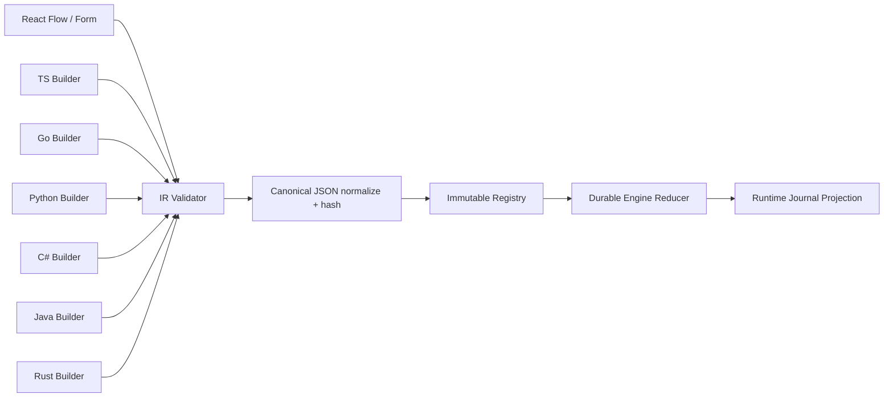

# Authoring model: IR, SDK, inline scripts and execution graph

## Three experiences, a single engine

| Experience | Flow definition | Orchestration logic executor | Executes arbitrary code | Rendering |
|---|---|---|---|---|
| Visual-first | JSON IR via Studio | Rust engine | Yes, in isolated Activity/Script nodes | Complete static graph + execution |
| Declarative code-first | SDK builder compiles/publishes JSON IR | Rust engine | Yes, BYO worker Activities or Script | Complete static graph + execution |
| Procedural code-first (later phase) | Workflow function with deterministic commands | SDK worker + engine journal | Yes, strictly side-effect steps | Observed dynamic graph, partial blueprint |

The V1 goal is the first two modes. The procedural mode requires a formal determinism spike per language; it is not a hidden V1 requirement.

## Compilation pipeline



The SDK pipeline may run client-side and publish IR to the server. It must not execute business side effects during compilation. JSON canonicalization defines stable sorting of objects, ordered preservation of arrays and explicit representation of decimals.

## v1 node kinds

| Node | Essential input | Semantics | Error/limit |
|---|---|---|---|
| `activity` | activity ref, input mapping | durable external task | retry, timeout, idempotency |
| `script` | artifact digest | sandbox via worker | build version / quotas |
| `condition` | safe CEL expression | decides edge | expression without side effects |
| `parallel` | branches, join policy | fanout with barrier | concurrency/fairness |
| `forEach` | collection expression, named body, result | executes a bounded collection body | maxItems/maxConcurrency and publication-shape limits |
| `while` / `repeatUntil` | condition, body, initial/carry state | bounded sequential iteration | maxIterations and publication-shape limits |
| `timer` | delay/until | creates temporal subscription | timezone when scheduled |
| `waitEvent` | type/key/timeout | waits on subscription | race with deadline |
| `child` | workflow id+version policy | starts child run | cancel propagation |
| `saga` | start, compensation policy | compensation domain | irreversible actions |
| `approval` | eligible subjects/roles, outcome routes | one authorized committed decision | expiry and initiator-exclusion policy |
| `database` | pinned connection revision, typed operation | dedicated managed PostgreSQL executor | root-only supported graph shape; one attempt, ambiguous writes need review |
| `end` | output mapping | terminal closure | output validation |

**Acceptance layers:** schema recognition is not execution support. The legacy names `foreach`
and `humanApproval` remain in the schema but the converter rejects them as non-executable
placeholders. The structured parser can map more shapes than the production publication path
accepts. Production parsing selects restricted collection/loop/continuation/state paths; the
database node has additional root-only constraints. This table is an overview, not an exhaustive
capability matrix. Consult the [schema](../../specs/001-platform-foundation/contracts/workflow.schema.json),
[parser gates](../../crates/infra-ir/src/lib.rs) and [converter](../../crates/infra-ir/src/convert.rs)
before treating a graph as publishable. Do not enable a placeholder merely because it appears in
the schema.

## Flow-control declarations: `concurrency` and `rateLimit` (feature 022)

Two optional, additive fields of IR v1 (ADR-0032), each allowed at the top level of a definition (it gates the run's
start) and on a root `activity` or `script` node (it gates each attempt of the step). A definition may declare either,
both, or neither; one without them publishes and runs as before.

| Field | Shape | What it bounds |
|---|---|---|
| `concurrency` | `{limit, key?, group?, queueTimeoutMs?}` | at most `limit` holders of the key at once: running runs at the top level, attempts on a node |
| `rateLimit` | `{limit, per, key?, group?, queueTimeoutMs?}`, `per` one of `second`, `minute`, `hour` | at most `limit` grants of the key in any interval of `per` on the database clock: run starts at the top level, leased attempts on a node |

- `key` is a bounded expression: over `input` at the top level, over the run's data on a node; its canonical value is at
  most 256 bytes. Without a key every run (or every step of the node) shares one key. A key that reads only the run's
  identity (run id, business id, idempotency key) is refused at publication (`FLOW_CONTROL_KEY_UNBOUNDED`); one that
  reads a field classified `secret` is refused, `pii` is warned (FR-022-056, FR-022-057).
- `group` names the key's semaphore or window. The default is derived from the workflow (top level) or the workflow and
  node; an explicit group is shared by every definition of the namespace that names it at the same level. Two
  definitions that share a group with different `limit` or `per` are warned (`CONCURRENCY_LIMIT_MISMATCH`,
  `RATE_LIMIT_MISMATCH`); each acquirer then applies its own pinned values.
- The effective `limit`, `per` ceiling and `queueTimeoutMs` are the lowest of the declaration, the namespace's policy and
  the deployment ceiling (the ceilings table of the
  [plan](../../specs/022-flow-control-step-policies/plan.md), "Ceilings, revised"); zero refuses.
- Publication refuses an invalid policy (`CONCURRENCY_POLICY_INVALID`, `RATE_LIMIT_POLICY_INVALID`), either field inside a
  body (`UNSUPPORTED_NODE` with `SCOPED_CONCURRENCY` or `SCOPED_RATE_LIMIT`) and either field with `continueAsNew`
  (`FLOW_CONTROL_COMBINATION`). The codes are in
  [`contracts/errors.md`](../../specs/022-flow-control-step-policies/contracts/errors.md).
- Each field is a capability enabled on its own (`concurrencyKeys` by `SAGAT_FLOW_CONTROL_CONCURRENCY_KEYS_ENABLED`,
  `rateLimits` by `SAGAT_FLOW_CONTROL_RATE_LIMITS_ENABLED`, both off by default) and activated for the fleet through the
  instance-capability registry. A definition that uses one before its activation is refused before a version exists
  (`FLOW_CONTROL_ACTIVATION_PENDING`); one whose capability is switched off is refused at publication and at start
  (`CAPABILITY_DISABLED`), while runs already admitted drain. The operator's steps are in the
  [flow-control runbook](../runbooks/flow-control.md).

What the engine does with them (the readiness gate, the grant and timeout routines, the transactions) is in
[execution semantics](execution-semantics.md#flow-control-gates-feature-022-release-030). The worker protocol does not
change: a worker never sees a gate, only a step that is already granted.

The six SDK builders of the two fields (tasks T022-048 to T022-052, T022-067 and T022-083) and the Studio's fields
(T022-054, T022-085) are not built in this tree; until they are, a definition declares them in its JSON document. The
shared conformance scenarios `flow-concurrency` and `flow-rate-limit` will hold the six languages to one canonical IR
(FR-022-050).

## TypeScript builder model (design API)

```typescript
const flow = workflow('procure-to-pay')
  .trigger.webhook('erp/invoice.created')
  .step('validate', activity('invoice.validate'))
  .saga('settlement', saga => saga
     .step('reserve', activity('limits.reserve'), {
        compensate: activity('limits.release'),
        reconcile: activity('limits.lookup')
     })
     .step('send', activity('payments.submit'), {
        reconcile: activity('payments.getStatus'),
        compensate: activity('payments.requestReturn')
     }))
  .waitForEvent('payment.confirmed', { key: '$.input.paymentId', timeout: '5m' })
  .step('notify', script('customer-notification@sha256:...'));
await client.definitions.publish(flow.compile());
```

## C# builder (design API)

```csharp
var flow = Workflow.Define("procure-to-pay")
   .Trigger(Trigger.Webhook("erp/invoice.created"))
   .Activity("validate", "invoice.validate")
   .Saga("settlement", saga => saga
       .Activity("reserve", "limits.reserve", compensateWith: "limits.release")
       .Activity("send", "payments.submit", reconcileWith: "payments.getStatus"))
   .WaitForEvent("payment.confirmed", "$.input.paymentId", TimeSpan.FromMinutes(5))
   .Activity("notify", "customer.notify");
await client.PublishAsync(flow.Compile(), cancellationToken);
```

## Canvas consistency

- Editor and builder generate the same normalized IR form; differences only in layout metadata.
- A script code change generates a new artifact digest; a definition change generates a new version.
- The runtime graph includes dynamically generated steps, retry attempts and compensations even if they are not in the blueprint.
- Reprocessing a node does not edit the historical run: it generates a new attempt in the same Run when legal, or a new Run explicitly.
- If a feature is not expressible in visual IR (for example arbitrary imperative control), the UI displays `Code-orchestrated`, with runtime observation and explicit limitations.

## Compilation and validation

1. Parse schema and resolve typed inputs/outputs.
2. Verify existing `entrypoint`, unique IDs, valid targets, no dangling edges.
3. Validate cycles only inside a declared `forEach`/loop with an iteration limit and stable checkpoint.
4. Verify Saga compensations/reconcile for operations marked `external_effect`.
5. Define capability/secret/egress and validate RBAC of dependencies.
6. Normalize IR, compute digest, sign the version and publish atomically.
