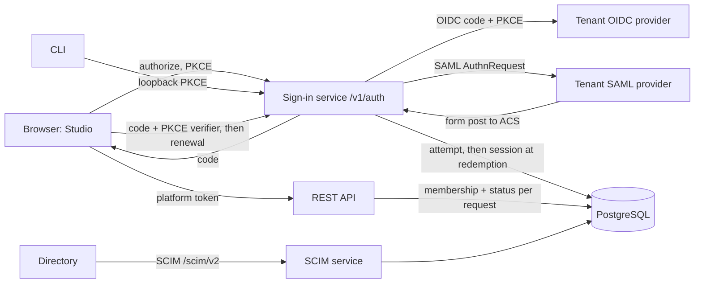

# Federated login: each organization signs in through its own OIDC or SAML provider

*   **Author:** Claude Code, for the owner
*   **Status:** Draft
*   **Date:** 2026-11-24

--------------------------------------------------------------------------------

## Overview

Today a deployment has one identity provider. The operator configures one OIDC issuer; its tokens name the tenant in a
`tenant` claim and the person in `sub`, and the API reads the person's built-in role from the membership row on every
request. A tenant cannot bring its own provider, nobody can add a member through the product (feature 016, Gap 290),
and nothing removes a person when they leave the company.

From release 0.3.0 each tenant (an organization) connects its own identity providers:

- **OIDC and SAML 2.0 connections per tenant.** An administrator adds a connection (Okta, Entra ID, Google Workspace,
  Keycloak, any standard provider), tests it by signing in through it, and activates it. People of the organization
  sign in to the Studio, the CLI and embedded apps through it.
- **The control plane brokers the sign-in and issues its own short-lived tokens**
  ([Architecture decision 0140](../adr/ADR-0140-the-control-plane-brokers-federated-sign-in-and-issues-short-lived-platform-tokens-the-tenant-comes-from-the-connection.md)).
  The connection decides the tenant; nothing the provider or the browser sends can. The API verifies one token format
  whatever the protocol.
- **SAML is verified by the platform's own strict-profile verifier** in memory-safe code, held to `xmlsec1` as an
  oracle in tests
  ([Architecture decision 0141](../adr/ADR-0141-saml-responses-are-verified-by-the-platforms-own-strict-profile-verifier-in-memory-safe-code-with-xmlsec-as-the-test-oracle.md)).
- **Provisioning**: just-in-time on first sign-in, and SCIM 2.0 for users and groups, so a person removed from the
  company's directory loses access within seconds. Groups arrive as durable rows that feature 029 assigns roles and
  folder access to, and a connection may map groups to the built-in role
  ([Architecture decision 0142](../adr/ADR-0142-a-federated-person-is-a-member-linked-to-external-identities-and-provisioning-and-groups-arrive-as-durable-rows-claims-never-authorize.md)).
- **Session security**: server-side sessions with absolute and idle expiry, five-minute access tokens renewed from the
  session, revocation that every process honours within ten seconds, sign-out at the provider, a required
  authentication context (for example multi-factor) per connection, and "sign-in through our provider only" with a
  guard against locking the organization out and an audited break-glass path.
- **Member management** in the API and the Studio: list, pre-provision, change a role, pin it, suspend, remove, link
  identities, see and end sessions.

The deployment issuer keeps working as it does today, beside federation, for deployments that federate upstream and
for break-glass. `apps/dev-idp` grows a development OIDC provider and a development SAML provider, so every flow runs
on a laptop and in CI with no external service.

### Terms

- **Connection.** A tenant's configured identity provider: its protocol (OIDC or SAML), its endpoints and keys, its
  claim or attribute mapping, its provisioning policy and its state (`DRAFT`, `TESTED`, `ACTIVE`, `DISABLED`).
- **Sign-in service.** The control plane's routes under `/v1/auth/`: an OpenID provider for the platform's own clients
  and a relying party or service provider toward the connections.
- **Platform issuer.** `<public origin>/v1/auth`, the `iss` of the tokens the sign-in service issues.
- **Deployment issuer.** The OIDC issuer configured for the whole deployment today (`AuthConfig`).
- **External identity.** (tenant, connection, the provider's stable identifier) linked to one membership subject.
- **Sign-in session.** A row that a browser or a CLI holds through a cookie or a refresh token, from which access
  tokens are issued.
- **Client.** One of the platform's own applications that signs in through the sign-in service: `studio`, `cli`,
  `apps` (the apps origin of feature 027).
- **Break-glass.** Signing in through the deployment issuer to a tenant that requires federated sign-in, by a subject
  the operator named, audited and alerted.

## The Problem

Read from `develop` at 2026-11-24:

- `crates/api-http/src/auth/config.rs` holds one `issuer`, one `audience`, one `jwks_uri` and one `tenant_claim`.
  `TokenVerifier` trusts the claim to name the tenant; `IdentityService::authenticate` resolves the slug and the
  membership `(tenant_id, subject)`.
- `memberships` has `tenant_id`, `subject`, `role` and `created_at`; no status, no profile, no link to an external
  identity. Members are created by `control-plane provision-tenant` and `seed-dev` only; the REST API has no member
  resource (Gap 290 of feature 016).
- The Studio signs in with authorization code and PKCE against the configured issuer (`src/auth/oidc.ts`), keeps the
  token in memory and signs out at its expiry; its content security policy allows `connect-src` to the issuer's origin
  only (`crates/api-http/src/studio.rs`).
- `apps/dev-idp` issues ES256 tokens from a JSON request for any subject and tenant (development only); it has no
  authorization endpoint, no ID token and no SAML.
- Feature 029 refuses group claims and wrote the contract a group source must meet; it waits for this design (its
  Owner question 1440). Feature 027's embedded sign-in assumes the issuer accepts the apps origin's redirect (its Gap
  1364).

What is missing for an organization that adopts the platform:

1. **Its own provider.** Each tenant needs its own OIDC or SAML connection without the operator.
2. **Offboarding.** Removing a person from the company directory must remove their access. Today a membership lives
   until an operator runs SQL.
3. **Groups.** Access by team, managed where the company manages people.
4. **Control of sessions.** Short tokens, sign-out everywhere, a required second factor.

Temporal Cloud offers SAML single sign-on per account and SCIM; Windmill's enterprise edition offers OIDC and SAML
single sign-on, SCIM and group sync. Both are hosted or enterprise-only; this design brings the same to every
deployment of this platform, with the tenant boundary, the audit trail and the revocation the rest of the platform
already has.

## Requirements

### Functional

**Connections**

- **Requirement 013-001** A tenant administrator (new permission `identity:manage`, built-in `admin` only, reserved
  and administrator-equivalent in feature 029's catalog) MUST be able to create, change, test, activate, disable and
  delete identity connections of protocol `OIDC` or `SAML`, at most 8 per tenant. A connection MUST pass from `DRAFT`
  to `TESTED` only by a completed test sign-in through it by an administrator, and to `ACTIVE` only from `TESTED`; a
  change of its endpoints (other than the immutable issuer or entity identifier), client authentication or mapping
  MUST return it to `DRAFT` unless it is `DISABLED`, and revoke its sessions (Requirement 013-019); a signing-key
  rotation does not (Requirement 013-004). *Acceptance:* the
  integration tests of each transition and of a change that resets an active connection to draft (refused while it is
  the only active connection of a tenant that requires federated sign-in, Requirement 013-021).
- **Requirement 013-002** A token issued through a connection MUST name that connection's tenant; no claim,
  attribute, parameter, header or path segment from the provider or the browser MAY choose or change the tenant.
  *Acceptance:* the contract test that a provider asserting `tenant: other` still yields the connection's tenant, and
  that a callback for connection A with state of a sign-in through connection B is refused.
- **Requirement 013-003** An OIDC connection MUST name an `https` issuer whose discovery document, key set and token
  endpoint the control plane fetches through the identity egress guard (Requirement 013-024), a client identifier, a
  client authentication of `client_secret_basic`, `client_secret_post` or `private_key_jwt` with a key the platform
  generates for the connection and publishes at the connection's key set, and its subject claim from a closed list:
  `sub`, or `oid` with `tid` for Entra ID. A multi-tenant issuer template (`{tenantid}`, Entra ID's `common` and
  `organizations`) MUST be refused; a known shared issuer (Google, `accounts.google.com`) MUST name a tenant
  restriction (`hd`) that every ID token is checked against, and activation MUST be refused without it. The issuer
  MUST be immutable: a new provider is a new connection. *Acceptance:* integration tests per authentication method
  against the development provider; refusal tests for a template issuer, a shared issuer without `hd`, an ID token
  with another `hd` or `tid`, and a change of issuer.
- **Requirement 013-004** A SAML connection MUST hold the provider's entity identifier (immutable, as the OIDC issuer),
  its single sign-on address (HTTP-Redirect binding), one to three signing keys with their certificates (RSA of at
  least 2,048 bits or ECDSA P-256), the subject as the persistent name identifier format or a configured immutable
  attribute (the formats `emailAddress`, `unspecified` and `transient` MUST be refused as the subject), and the
  attribute names for e-mail, display name and groups; it MAY be created from the provider's metadata document
  (uploaded, or fetched once through the identity egress guard). Adding or removing a signing key while at least one
  stays valid MUST leave the connection's state unchanged, audited. The platform MUST publish the service provider's
  metadata for the connection (entity identifier, assertion consumer service, optional request-signing certificate).
  *Acceptance:* the metadata round trip with the development SAML provider; a key under 2,048 bits and an
  `emailAddress` subject are refused at activation; a key rotation of the only active connection of a federated-only
  tenant succeeds.

**Sign-in**

- **Requirement 013-005** The sign-in service MUST be an OpenID provider for the clients `studio`, `cli` and `apps`:
  discovery, key set, authorization endpoint and token endpoint under `/v1/auth/`. The authorization endpoint MUST
  require PKCE with S256, a `state`, and a redirect URI registered for the client exactly: the Studio's callback path,
  the CLI's loopback redirect (`http` to the literal `127.0.0.1` or `[::1]`, any port, an exact path; RFC 8252
  sections 7.3 and 8.3), the apps origin's callback; it MUST refuse anything else without redirecting. An
  authorization code MUST be stored as a hash, live 60 seconds, be bound to its `client_id`, redirect URI and PKCE
  challenge, and be usable once; a second use revokes the session it produced. A code of the `apps` client MUST be
  redeemable only in process by feature 027's session creation; `POST /v1/auth/token` MUST refuse it. No `/v1/auth/`
  route MAY answer a cross-origin request with CORS headers. *Acceptance:* contract tests for each refusal;
  `no_route_returns_a_platform_token_to_the_apps_origin`; `a_second_use_of_a_code_revokes_its_session`.
- **Requirement 013-006** A person MUST be able to start a sign-in by the organization's slug or by an e-mail address
  whose domain the tenant verified (Requirement 013-022); with several active connections the person chooses one.
  For an unknown organization or domain, discovery and the authorization endpoint MUST answer exactly as for a known
  organization without an active connection. What the redirect to a provider reveals (that an active connection
  exists, and its provider's host and display name on the chooser) is accepted and stated (Gap 013-007).
  *Acceptance:* the contract test that unknown and unconfigured answers are byte-identical on both routes.
- **Requirement 013-007** An OIDC sign-in MUST use authorization code with PKCE (S256) toward the provider, a `state`
  and a `nonce` bound to the sign-in attempt, the `iss` callback parameter when the provider sends it (RFC 9207), and
  MUST validate the ID token: signature by a key of the provider's key set with RS256, PS256 or ES256 (the algorithm
  taken from the key and the token header, PS256 not mapped to RS256), `iss` exactly, `aud` containing the client
  identifier, `azp` when there are several audiences, `exp`, `iat` within the tolerance, `nonce`, the tenant
  restriction of Requirement 013-003, and a non-empty subject claim. The identity MUST come from the ID token;
  `userinfo` MAY add display claims only. *Acceptance:* one refusal test per check with the development provider
  configured to break it.
- **Requirement 013-008** A SAML sign-in MUST be service-provider-initiated and verified by Architecture decision
  0141's strict profile. An unsolicited response MUST NOT sign anyone in and MUST NOT redirect by itself: it answers a
  page with a button that starts a service-provider-initiated sign-in through that connection. *Acceptance:* the corpus
  of Architecture decision 0141 and the oracle test.
- **Requirement 013-009** A sign-in attempt MUST be bound to the browser that started it by a short-lived
  `__Host-sagat_login` cookie (10 minutes, `Secure`, `HttpOnly`, `SameSite=None` so that a SAML form post carries it)
  whose hash is stored with the attempt, and the callback or the assertion consumer service MUST refuse an attempt of
  another browser, a used attempt and an expired one. The callback MUST NOT create a session or set the session
  cookie: it records the verified identity on the attempt and redirects with a code; the session is created, and its
  cookie set, only when the client redeems the code with its PKCE verifier (Requirement 013-018). *Acceptance:*
  `a_response_injected_into_another_browser_is_refused`, `a_sign_in_started_by_another_site_establishes_no_session`.
- **Requirement 013-010** A connection MUST be able to require authentication context values (OIDC `acr`, SAML
  `AuthnContextClassRef`); a sign-in without one of them MUST be refused with a reason the person can act on. Raising
  the requirement MUST revoke, in its transaction, the connection's sessions whose recorded context does not meet it.
  *Acceptance:* refusal and acceptance tests with the development providers; the revocation on a raised requirement.

**Identities and provisioning**

- **Requirement 013-011** A federated identity MUST be (tenant, connection, the provider's stable identifier) linked to
  exactly one membership subject (Architecture decision 0142); the platform MUST NOT link identities by e-mail. A link
  to an existing subject MUST be made only inside a sign-in by that subject, who confirms it (or by a test sign-in of
  the administrator for their own subject); the member routes MAY unlink and pre-provision, never attach an identity to
  a subject that already has one or to an `admin` subject. *Acceptance:* `two_connections_with_one_email_make_two_members`,
  `an_administrator_cannot_attach_an_identity_to_another_member`.
- **Requirement 013-012** A connection MAY enable just-in-time provisioning with a default role of `viewer` (the
  default), `operator` or `developer`, never `admin`, optionally limited to e-mail addresses of the tenant's verified
  domains, read only from a verified e-mail (`email_verified: true`, or the provider's verified-domain claim; Entra ID's
  `email` claim is never used for it). On a shared issuer it MUST be refused without the tenant restriction of
  Requirement 013-003. The first completed sign-in then creates the membership (subject `federated:<uuid>`), its external
  identity, its profile and its role in one transaction with the session. Without it, an unknown identity is refused
  and the refusal is audited. A test sign-in through a `DRAFT` or `TESTED` connection provisions nobody and produces no
  session usable for the API. *Acceptance:* integration tests for each case, including a crash after the membership
  insert (nothing remains).
- **Requirement 013-013** A connection MAY map provider groups to the built-in role with up to 32 ordered rules (a
  group value, a role). A connection's rules MUST match only groups sourced from that connection, and only the
  membership's owning connection (the connection through which it was provisioned, or the one an administrator names)
  MAY change its role or status by mapping or SCIM; other linked connections can sign the person in and nothing more.
  The mapped role MUST be computed from SCIM-sourced groups, or, without SCIM, from assertion groups, in which case it
  is stored with its source and the sign-in session that produced it, and the effective role, computed in the one
  membership expression every read uses (Technical Plan 13), is the lower of that role and the connection's default
  once those groups stop conferring; the expiry is never stored as a role change, so it revokes no custom grant. A
  change of the rules or of the default MUST recompute every member the connection owns, as a bounded audited job in
  subject order. The highest role a rule gives MUST win, the default role applies when none does, and an administrator's
  pin MUST keep a member's role unchanged by mapping. A computed role that differs from the stored one MUST change it
  with an audit record and feature 029's revocation of custom grants. *Acceptance:* the property test of Architecture
  decision 0142, a two-connection test, a test that an assertion-mapped `admin` falls back after its session ends on
  every caller family, `a_direct_assignment_survives_two_sign_ins_with_the_same_groups` and
  `a_removed_admin_rule_demotes_its_members`.
- **Requirement 013-014** Groups MUST arrive as feature 029 external groups through the two source kinds of
  Architecture decision 0142 (SCIM and sign-in assertion) under the amended group-source contract, and confer nothing
  until an assignment or a folder entry names them. *Acceptance:* the group tests named under Architecture decision
  0142.
- **Requirement 013-015** A tenant MUST be able to enable SCIM 2.0 (RFC 7643, RFC 7644) for a connection: `/Users` and
  `/Groups` with create, read, replace, patch (add, remove and replace of members, `active`, `displayName`, `emails`,
  `name`), delete, the filter `eq` on `userName`, `externalId` and `displayName` (a closed grammar, at most 256 bytes),
  `/ServiceProviderConfig`, `/ResourceTypes` and `/Schemas`; no bulk, sort or `/Me`; `roles` and `entitlements` are
  ignored. A SCIM user MUST be matched to the connection's sign-in identity by `externalId` or a configured immutable
  attribute equal to the provider's stable identifier (Requirement 013-003 or 013-004); the matching attribute MUST be
  immutable once set: a replace or patch that changes it is refused with the SCIM error `mutability` and changes no
  link. Uniqueness conflicts are scoped to (tenant, connection); group members resolve only within the token's
  connection. *Acceptance:* a conformance run of the requests Okta and Entra ID send (recorded fixtures), the error
  format of RFC 7644 section 3.12, and `a_scim_replace_that_changes_the_match_changes_no_link`.
- **Requirement 013-016** `active: false` MUST suspend the membership and revoke, in the same transaction, its sign-in
  sessions and every grant that feature 029 revokes on a built-in role change (direct assignments, local group
  memberships, folder and list entries) and its reveal grants and secret access entries, so that a later reactivation
  restores nothing nobody renewed; delete MUST remove the membership with feature 029's cascades and keep the
  external identity, marked deprovisioned, for the audit trail. A suspended membership MUST confer nothing on any path
  that reads a membership for authority: the guarantee lives in the schema, so the 013 migration redefines
  `public.sagat_lock_memberships` (the share-locked re-check of the secret, managed-secret, worker, schedule,
  reveal-grant, payload-disclosure, event-payload, execution, database, reset and admission stores) to read
  `ACTIVE` memberships only, the three plain reads (`identity.rs`, `approval_progress.rs`, `declared_operations.rs`)
  gain the same predicate, and an architecture rule refuses any other read of `memberships` outside
  `crates/infra-postgres/src/identity.rs` and the migrations. Feature 027 app sessions, feature 018 schedules acting for
  `authorizedBy` and feature 026 links reach a membership through those reads and so refuse a suspended one on their
  next action; a feature 027 app session's check joins the membership read and its sign-in session the same way, so a
  SCIM deactivation never writes an app-session row (Technical Plan 4, lock order). Writes to `memberships` go through
  narrow `SECURITY DEFINER` functions, because the runtime role holds only `SELECT` on it (Technical Plan 13). *Acceptance:*
  `a_scim_deactivation_refuses_the_next_request_and_every_live_token`, one integration test per caller family of
  `sagat_lock_memberships`, and, once features 026 and 027 exist, the same refusal for an app session and a link
  submission; `a_reactivated_member_has_no_old_grants`.
- **Requirement 013-017** A SCIM endpoint MUST authenticate by a bearer token of 32 random bytes per connection, shown
  once, stored as SHA-256, at most two in force for rotation, and MUST take the tenant and the connection from the
  token only (a path that names another connection answers `404`); it MUST be rate-limited per connection and bounded
  (1 MiB per request, 1,000 member operations per patch). *Acceptance:* the cross-tenant battery entries, a rotation
  test and the limit tests.

**Sessions and tokens**

- **Requirement 013-018** Redeeming a code with its PKCE verifier MUST create the session row (absolute expiry 12
  hours by default, at most 24; idle expiry 2 hours by default) and, for the `studio` client only, set a
  `__Host-sagat_signin` cookie (`Secure`, `HttpOnly`, `SameSite=Lax`, path `/`) whose value is stored only as a hash; a
  live session cookie of another tenant or subject MUST NOT be replaced silently (the Studio asks the person first).
  Access tokens MUST be ES256 JSON web tokens with `typ` `at+jwt`, `aud` the API's resource identifier, `client_id`,
  `iss`, `tenant`, `sub`, `sid`, `jti`, `iat` and `exp`, at most 300 seconds, a bound the platform verifier enforces
  itself. The sign-in service issues no other kind of token with its access-token key. The Studio MUST renew through
  `POST /v1/auth/session/token`, which needs the cookie, the Studio's exact `Origin` and the header `X-Sagat-Renew`, and
  only after the person's activity in the idle window (an idle tab is not renewed); the
  Studio MUST refuse a renewed token whose tenant differs from the organization the person chose, show the tenant it
  is signed in to, and keep tokens in memory only. *Acceptance:* contract tests for each condition of the renewal; the
  Studio test that a reload renews without a redirect while the session lives.
- **Requirement 013-019** Revocation: a suspended or removed membership MUST be refused on its next request
  (Requirement 013-016); a revoked or expired session MUST stop renewing at once and its access tokens MUST be refused
  on their next request: the per-request membership read for a platform token joins its session by (`tenant`, `sid`)
  in the same statement and refuses a revoked or expired one, so revocation needs no poll and no new round trip
  (Decision 013-003); a long-lived stream MUST carry the issuer kind and `sid` into its re-check, re-check at most every
  10 seconds for a platform token, and end when its token or its session ends; the Studio resumes it with
  `Last-Event-ID` (a stream reconnects at least every five minutes with 300-second tokens). Disabling, deleting or resetting a connection MUST
  revoke its sessions in the same transaction. Renewal, refresh and the silent path of the authorization endpoint MUST
  re-check that the connection is `ACTIVE`, the session's context meets the connection's requirement, the membership is
  `ACTIVE`, and the tenant's federated-only setting allows it. *Acceptance:* the revocation tests of Architecture
  decision 0140: `a_revoked_session_is_refused_on_its_next_request` (a barrier holds a request after its membership read
  while the revocation commits: that request completes, the next one is refused), `a_stream_ends_within_ten_seconds_of_its_session`
  (measured), `a_stream_resumes_with_last_event_id`.
- **Requirement 013-020** Member management: `GET /members` (with role, status, owning connection, last sign-in),
  `POST /members` (pre-provision an external identity of a connection with a role), `PATCH /members/{subject}` (role,
  pin, status, owning connection), `DELETE /members/{subject}`, `DELETE /members/{subject}/identities/{id}` (unlink,
  audited), `GET /members/{subject}/sessions` and `DELETE /members/{subject}/sessions` (end all), each under
  `membership:manage`; `GET /auth/sessions` and `DELETE /auth/sessions/{sid}` for the caller's own. *Acceptance:*
  integration tests per route and role; the cross-tenant battery.
- **Requirement 013-021** A tenant MAY require federated sign-in: then the deployment issuer is refused for its human
  members (built-in roles `admin`, `developer`, `operator`, `viewer`; machine members keep the deployment issuer)
  except the break-glass subjects the operator names with `control-plane identity break-glass`. Break-glass bypasses
  the required authentication context; each use is audited once per token (`jti`) and raises an alert, and a failed
  audit write refuses the request. Enabling federated-only MUST be refused unless an active connection exists and the
  enabling administrator's current session came through an active connection of the tenant and is recent (signed in
  within the last 10 minutes); disabling or deleting the last active connection MUST be refused while it is required.
  The same recent sign-in is required to create a SCIM token; a silent sign-in keeps the session's original
  authentication time and is not recent. No change (SCIM, a mapping result, the member routes) MAY leave the tenant
  without an active `admin` member (`LOCKOUT_GUARD`). Each of these checks runs under the tenant's identity-settings row
  lock (Technical Plan 13). *Acceptance:* the lockout tests, with a barrier for each racing pair;
  `a_silent_sign_in_is_not_recent`; `the_last_admin_cannot_be_suspended_by_scim`.
- **Requirement 013-022** A tenant MAY verify e-mail domains by a DNS TXT record `_sagat-challenge.<domain>` holding a
  value the platform generated. Creating a challenge MUST always succeed; a domain already verified by another tenant
  MUST be refused only at verification, after the record proved control, audited in the claiming tenant (the operator
  decides). A verified domain is re-checked every 24 hours and becomes unverified after three failed checks.
  *Acceptance:* tests with the test resolver; the cross-tenant battery case.
- **Requirement 013-023** Sign-out: `POST /v1/auth/logout` MUST revoke the session and clear the cookie; for an OIDC
  connection whose discovery has `end_session_endpoint`, and a SAML connection with a single logout address, the
  Studio MUST offer to sign out at the provider too (front-channel redirect). *Acceptance:* tests with the development
  providers.
- **Requirement 013-024** Every outbound call to a provider (discovery, key set, token endpoint, metadata, userinfo)
  MUST go through a new identity egress guard in `crates/infra-egress` (Technical Plan 4): `https` on port 443 (or a
  port the deployment lists), any name, and every resolved address classified by the existing `classify` and refused
  unless it is a global address, except hosts the deployment lists in `SAGAT_IDENTITY_ALLOWED_HOSTS`, which may
  resolve to private ranges but never to loopback, link-local or metadata addresses; no redirect is followed; timeouts
  and sizes are bounded. Discovery documents and key sets MUST be cached per connection with a minimum refresh
  interval, so that no request can make the control plane fetch on demand more often. A refused destination MUST be a
  typed problem on the connection. *Acceptance:* the server-side request forgery tests (loopback, private ranges,
  link-local, metadata, a redirect, a DNS answer that changes, a random `kid` flood).
- **Requirement 013-025** Identity secrets (connections' client secrets, the platform's token-signing keys, the
  connections' `private_key_jwt` keys, the service provider's request-signing keys) MUST live in a separate OpenBao
  mount and policy that no feature 017 secret reference and no execution capability can name, written through the
  connection API by the intent, write, verify, activate protocol of Architecture decision 0035 decision 7, and never
  returned. The signing keys MUST follow the lifecycle of Architecture decision 0140 decision 7: created and rotated by
  an audited operator command, the active key version recorded in PostgreSQL, a new public key published to every
  replica's key set for one key-set refresh interval before any replica signs with it. The token-signing key SHOULD be
  an OpenBao Transit key that never leaves OpenBao; where Transit is not configured the key lives in the identity mount
  and is read by the control plane only. The platform issuer's key set and the connections' client keys MUST be
  disjoint, and the API MUST never verify a token with a connection key. An OpenBao outage stops sign-in and renewal
  (people are signed out as their tokens expire, within five minutes) and raises `IDENTITY_SIGNING_UNAVAILABLE`;
  verification keeps working from the in-process key set.
  *Acceptance:* the canary test that no secret appears in a response, log, span, audit record or error; a test that a
  workflow secret reference cannot name the identity mount.
- **Requirement 013-026** The CLI MUST sign in with `sagat login --org <slug>` through the loopback redirect, receive an
  access token and a refresh token (one use, rotated on every refresh by compare-and-set on its generation, the new
  token signed before the commit; a reuse of the immediately previous generation within 30 seconds is refused without
  revoking, which covers two CLI processes and a lost response; any other reuse revokes the session and is audited; the
  CLI holds a file lock around a refresh; CLI sessions absolute 7 days, idle 24 hours), and store them in the operating system's key store, or a file
  with mode `0600` where none exists; a CLI sign-in sets no session cookie in the browser. The CLI's token sources are,
  in order, `--token-file`, `SAGAT_TOKEN`, then the key store (refining Architecture decision 0019 decision 2). *Acceptance:* CLI tests
  against the test composition; the reuse test; `two_concurrent_refreshes_keep_the_session`;
  `a_lost_refresh_response_keeps_the_session`.
- **Requirement 013-027** The Studio MUST offer sign-in by organization or e-mail, the connection chooser, and tenant
  screens for connections (with a guided setup per protocol and provider, the service provider's metadata, the test
  sign-in and activation), domains, SCIM tokens, mapping rules, members, sessions and the federated-only setting; every
  control the person cannot use is shown unavailable with the permission it needs. *Acceptance:* component tests and
  the journey of Success criterion 013-001.

**Cross-cutting**

- **Requirement 013-028** Audit: connection created, changed, tested, activated, disabled and deleted; sign-in
  succeeded; sign-in refused (collapsed per connection, reason and five minutes); member provisioned (just in time,
  SCIM, pre-provisioned), role changed (reason `mapping`, `administrator`, `scim`), suspended, removed; identity linked
  and unlinked; session ended (reason); SCIM token created and revoked; domain verified and lost; federated sign-in
  required and released; break-glass used. No token, assertion, secret or claim value beyond the subject enters an
  audit record.
- **Requirement 013-029** Observability: spans for each sign-in step, provider call, SCIM request and renewal;
  metrics with closed labels (`protocol`, `step`, `outcome`, closed reasons), never a tenant, connection, subject or
  group; logs without tokens, codes, assertions, cookies or claim values.
- **Requirement 013-030** Errors reuse the closed `Error.code` set with `details.reason` values of Technical Plan 11;
  the sign-in pages show a sentence and a reference (the trace identifier), never the provider's error text verbatim,
  and the sign-in service never forwards a provider's `error` or `error_description` to a client redirect (it sends
  a closed reason and the trace identifier; the Studio stops printing `error_description`).
- **Requirement 013-031** Ceilings: 8 connections per tenant, 3 certificates per SAML connection, 32 mapping rules, 256
  group values per sign-in assertion, 1,000 external groups per connection, 10,000 members per group, 20 sessions per
  member (the oldest is ended), 2 SCIM tokens per connection, 16 verified domains per tenant; effective = minimum of
  request, tenant setting and deployment ceiling; zero refuses.
- **Requirement 013-032** Compatibility and activation: federation is off until the deployment enables it. A process
  lists the instance-registry capability `identity-federation-v1` only when its configuration enables federation (the
  control plane and the execution engine); an operator activates the requirement by the audited command of
  Architecture decision 0082 decision 1, refused while a live process lacks it; until it is recorded, connection
  creation, SCIM, member suspension and the federated-only setting are refused (`FEDERATION_NOT_ACTIVATED`), and design
  050's names `identity.federation` and `identity.scim` are derived from it (this design builds the registry derivation of
  Architecture decision 0143 decision 2 if no earlier feature has). A binary below the requirement cannot serve
  a deployment that recorded it (the registry's closed gate); rolling back below it is unsupported. The deployment
  issuer, existing memberships and existing clients are unchanged; the migration refuses, with a named error, while a
  membership already has a subject starting `federated:`; its `down` refuses while a membership is `SUSPENDED` or any
  federation row exists. *Acceptance:* the older-replica test (activation refused while a replica without the
  capability is live; such a replica answers `503` after activation); the migration refusal tests.
- **Requirement 013-033** `apps/dev-idp` MUST serve a development OIDC provider (authorization code with PKCE, ID
  tokens with a configurable subject, e-mail, groups and `acr`, discovery, key set, end session) and a development SAML
  provider (signed responses, metadata, a switch per test that breaks one check), and MUST keep refusing to start
  outside `SAGAT_ENV=dev`. *Acceptance:* the dev-idp tests; the production image check that it is absent.

### Non-functional

- **Non-functional requirement 013-001 (security)** Release-blocking: a token for a tenant other than the
  connection's; a sign-in completed in a browser that did not start it; a SAML response accepted outside the profile;
  an identity linked by e-mail; a request to a private address on behalf of a connection; a secret, token, code or
  assertion in a log, span, audit record, response or error; a suspended member served after its next request; a
  revoked session's token served on a request that began after the revocation committed, or a stream of it alive more
than one re-check interval (10 seconds) after; a platform token reaching
  apps-origin script; a session created by a sign-in that another site started.
- **Non-functional requirement 013-002 (durability)** A provisioning, a role change, a suspension and a session
  revocation commit with their audit in one transaction; a crash leaves the previous state; a repeated SCIM request
  has no second effect.
- **Non-functional requirement 013-003 (performance)** Token verification for platform tokens costs no network and no
  database read beyond today's membership read; the sign-in latency, the renewal latency and the SCIM request latency
  are measured on a declared environment. No figure is promised.
- **Non-functional requirement 013-004 (compatibility)** Existing deployments, tokens, memberships, SDKs, workers and
  Studio builds work unchanged until federation is enabled, and after it for the deployment issuer.
- **Non-functional requirement 013-005 (accessibility)** The sign-in pages and the identity screens meet WCAG 2.2 AA
  as the rest of the Studio (design 050, Requirement 050-022).

### Success criteria

- **Success criterion 013-001** In the test composition, an administrator configures an OIDC connection and a SAML
  connection against the development providers, tests and activates both, maps a group to `operator`, enables SCIM,
  and a person pushed by SCIM signs in through each protocol and starts a run; deactivating the person by SCIM refuses
  their next request at once, including the request of a live token.
- **Success criterion 013-002** The SAML corpus is refused case by case with its reason, and the oracle agrees with
  `xmlsec1` on every accepted document.
- **Success criterion 013-003** The interoperability run against Keycloak (a pinned image, started by the tests)
  passes for OIDC and SAML.
- **Success criterion 013-004** The cross-tenant battery covers every new route with zero findings, and the canary
  scan finds no secret, token, code or assertion anywhere it looks.

### User stories

- **User story 013-01** As a tenant administrator, I connect my company's identity provider, test it and turn it on,
  without the operator (CUJ 1).
- **User story 013-02** As a person of the organization, I sign in with my company account to the Studio and the CLI
  (CUJ 2).
- **User story 013-03** As an administrator, when someone leaves the company their access ends without my doing
  anything in the platform (CUJ 3).
- **User story 013-04** As an administrator, I give teams access through the groups my directory already has (CUJ 4).
- **User story 013-05** As an administrator, I require our provider and a second factor, and I cannot lock us out by
  mistake (CUJ 5).

## Goals

- Each tenant brings its own OIDC or SAML provider, self-served and audited.
- One token format for the API, a tenant binding the platform owns, and offboarding within seconds.
- Groups and roles from the directory, as durable rows feature 029 can use.
- No C XML code in the control plane, and a SAML verifier that refuses everything outside a narrow profile.
- Every flow testable on a laptop and in CI with the development providers and a pinned Keycloak.

## Non-Goals

- Being a general identity provider for other applications. The sign-in service issues tokens for the platform's own
  clients only.
- Encrypted SAML assertions, SAML artifact binding, IdP-initiated sign-in without a service-provider round trip,
  WS-Federation, LDAP and Kerberos (Gap 013-004).
- Passwords, magic links, social sign-in other than through an OIDC connection, and multi-factor authentication run
  by the platform. The provider authenticates; the platform can require its context (Requirement 013-010).
- OIDC back-channel logout in 0.3.0 (Gap 013-005); SCIM deactivation and the session check of every request cover offboarding.
- Machine identities (workers, runners) through federation. They keep their tokens from the deployment issuer and
  their bindings (feature 009).
- One person across tenants. A person in two tenants is two members.
- Approval eligibility by group (feature 029, Gap 1448, keeps it out).

## Open Questions

None open. The questions of this design were decided by the agent the coordinating session briefed, under Owner
decision 2026-11-24-4, each weighed over its options and recorded below as "delegate (OD-2026-11-24-4)".

### Decisions

- **Decision 013-001 — Broker in the control plane.** See Architecture decision 0140 (options: a multi-issuer resource
  server, an external broker, opaque sessions).
- **Decision 013-002 — SCIM is in 0.3.0.** Options: just-in-time provisioning only; SCIM too. Chosen: SCIM. Without it,
  leaving the company does not end access until a person's token expires and an administrator remembers to remove
  them, groups can only come from sign-in snapshots, and an enterprise buyer's security review fails (Temporal Cloud
  and Windmill's enterprise edition both offer it). Its cost is bounded by the subset of Requirement 013-015.
- **Decision 013-003 — Access tokens of five minutes, revoked through the membership read.** Options: one-hour tokens
  (today's maximum); five-minute tokens with a per-process poll of a revocation table (the first draft); opaque tokens
  read on every request; five-minute tokens whose session is joined into the membership read every request already
  makes. Chosen: the join, settling Major 4 of the architecture review of 2026-11-25. Every API request already reads the
  membership (`IdentityService::authenticate`); for a platform token the same statement joins `signin_sessions` by
  (`tenant`, `sid`) and refuses a revoked or expired session, so revocation is effective on the next request with no new
  round trip, no poller, no fail-closed mode and no revocation table. The five-minute lifetime still bounds a stolen
  token's use when the database is unreachable, which then serves nothing anyway.
- **Decision 013-004 — The Studio renews through a cookie-authenticated, same-origin call.** Options: refresh tokens in
  the browser (exposed to script); a hidden frame with `prompt=none` (the Studio is unframeable, `frame-ancestors
  'none'`); a same-origin renewal call. Chosen: the renewal call, for the `studio` client only, protected by
  `SameSite=Lax`, the Studio's exact `Origin`, a custom header that forces a preflight, and no CORS answer on any
  `/v1/auth/` route, so a cross-site page cannot pass. The apps origin never renews: when its app session ends, the app
  runtime opens the sign-in popup again (feature 027), and no platform token ever reaches its script.
- **Decision 013-005 — The subject of a new federated member is `federated:<uuid>`.** Options: the provider's `sub`; the
  e-mail; a platform identifier. Chosen: a platform identifier (Architecture decision 0142).
- **Decision 013-006 — Just-in-time provisioning never makes an administrator.** Options: any default role; never
  `admin`. Chosen: never `admin`; a mapping rule may give `admin` to a group, which an administrator wrote and the
  audit trail shows.
- **Decision 013-007 — SCIM groups do not expire by silence; assertion groups do.** See Architecture decision 0142,
  option 5. Feature 029's contract is amended.
- **Decision 013-008 — SAML through the platform's own verifier.** See Architecture decision 0141.
- **Decision 013-009 — Feature 029's Owner question 1440 and 1442 are answered by this design.** Identity-provider
  groups come from design 013 (both source kinds) and member management is design 013's (Requirement 013-020); see the
  readiness pass of feature 029.
- **Decision 013-010 — Keycloak as the interoperability target in tests.** Options: recorded fixtures only; a live
  provider account (an account the owner would have to create); a pinned Keycloak container started by the tests.
  Chosen: the container, plus recorded SCIM fixtures of Okta and Entra ID; it runs in CI under the repository's
  infrastructure rule (AGENTS.md rule 16). A live Okta or Entra ID run is the owner's to arrange (an account).
- **Decision 013-011 — Domain verification by DNS TXT, one tenant per domain.** Options: no domains (slug only); e-mail
  domain claimed without proof; DNS proof. Chosen: DNS proof, because discovery by e-mail and the just-in-time domain
  limit both depend on the domain being the tenant's.
- **Decision 013-012 — The session is created at code redemption, not at the provider callback.** Options: create it
  at the callback (fewer steps); create it when the client redeems the code with its PKCE verifier. Chosen: at
  redemption, settling Blocker 1 of the security review of 2026-11-25: a sign-in that another site started through a
  connection its administrator controls can then end in a code nobody redeems, never in a session cookie in the
  victim's browser.
- **Decision 013-013 — One owning connection per member.** Options: every linked connection may change the role and
  the status; one owning connection does. Chosen: one, settling Major 9 of the same review: a less-trusted connection
  linked to a member (a contractor provider) must not be able to promote or suspend them.
- **Decision 013-014 — The issuer and the entity identifier are immutable.** Options: allow a change with links kept;
  re-key the identities by issuer; immutable. Chosen: immutable (a new provider is a new connection, and an
  administrator moves people by their own sign-ins through the new one), the simplest rule that cannot attach one
  provider's subject to another provider's member (Major 8 of the same review).
- **Decision 013-015 — The token-signing key in OpenBao Transit where configured.** Options: a key read from key-value
  storage by every process; a Transit key that never leaves OpenBao. Chosen: Transit, with the read key only where a
  deployment has no Transit engine; a signature per token costs one OpenBao call, at five-minute token lifetimes and
  only at issuance and renewal, never on verification. The development overlay configures the identity mount without
  Transit, so every flow still runs on a laptop.
- **Decision 013-016 — The execution engine accepts the deployment issuer only.** Options: the engine accepts platform
  tokens too (the session join and the registry capability there, and a person's token on the worker channel); it does
  not. Chosen: it does not. Workers are machine identities (feature 009: a `worker` membership and its bindings), which
  keep the deployment issuer in a federated-only tenant; a federated developer runs a worker with a machine identity an
  administrator creates and binds, or with the development provider locally (Gap 013-008). Mixing a person's
  five-minute token into long-lived task streams would buy nothing the binding model does not already give.
- **Decision 013-017 — External groups are rows of feature 029's `access_groups`.** Options: tables owned by this design
  (the first draft, which an assignment could not name); 029 amending its keys; this design adding columns to 029's
  tables. Chosen: the columns (`source_kind`, `connection_id`, `external_value`, `generation`, freshness) on
  `access_groups` and `access_group_members`, so 029's assignments, folder entries and evaluator name them unchanged;
  029's migration lands first. Deleting a connection is refused while any of its external groups is named by an
  assignment, an entry or an operation list; disabling it is always allowed (Major 8 of the same review).
- **Decision 013-018 — The sign-in service stays in the control plane for 0.3.0.** Options: a separate least-privilege
  process with its own database role for the anonymous surface (authorize, the SAML consumer service, SCIM) and token
  minting; the control plane. Chosen: the control plane, because the SAML parser is memory-safe Rust under a narrow
  profile (Architecture decision 0141), the identity secrets are in their own mount and policy, and a second process
  doubles the operated surface before any measurement shows a need. Revisit when a parser advisory affects the SAML
  stack, when SCIM load is measured to disturb the API, or when design 048's topology gives the control plane a
  network position that the anonymous surface should not share.
- **Decision 013-019 — What this design builds in other features' code.** For 0.3.0 this design owns only the identity
  mount and the signing key, behind ports feature 015 may re-home when it is designed; it adds the external-group
  columns to feature 029's tables (Decision 013-017), the `ACTIVE` predicate to the membership reads every feature uses
  (Requirement 013-016), and the in-process redemption port that feature 027's session creation calls (Technical Plan
  4). Recorded as OD-2026-11-24-717, which the tasks that touch those features cite in an `Owner-gate:` line.

### Gaps

- **Gap 013-001** A provider that reuses a `sub` for a new person after deleting the old one makes the new person the
  old member; the platform cannot detect it. The runbook tells administrators to use providers with immutable
  identifiers and SCIM deletion.
- **Gap 013-002** Front-channel sign-out at the provider depends on the browser following the redirect; a closed tab
  leaves the provider's session open (the platform's is revoked).
- **Gap 013-003** A stolen platform token can act for up to its five-minute lifetime only while the database cannot be
  read, when the process serves nothing anyway; otherwise the membership read refuses a revoked session at once.
- **Gap 013-004** No encrypted assertions, artifact binding or IdP-initiated sign-in (Non-Goals).
- **Gap 013-005** No OIDC back-channel logout in 0.3.0.
- **Gap 013-006** The interoperability run uses Keycloak and recorded fixtures; no live run against Okta, Entra ID or
  Google Workspace is part of CI.
- **Gap 013-007** Discovery cannot hide that an organization has an active connection: the redirect to its provider
  shows it, with the provider's host, and the chooser shows connection display names. Unknown and unconfigured
  organizations answer the same; nothing else is revealed.
- **Gap 013-008** A federated developer in a federated-only tenant cannot run a worker with their own sign-in
  (Decision 013-016); an administrator creates and binds a machine identity for it.
- **Gap 013-009** When feature 032 is built, sign-in sessions and platform tokens must carry or check the region epoch,
  so that a failover that may have lost a revocation invalidates every session issued before it (constitution 5.0.0,
  "Regions").

## Owner decisions needed

None for the build. The scope is Owner decision 2026-11-24-1 ("federated login (013)"); the questions above, the
acceptance of Architecture decisions 0140 to 0142 and the settlement of review findings are delegated by Owner decision
2026-11-24-4. A live interoperability run against a commercial provider needs an account, which only the owner can
create (Decision 013-010); it is not a gate of this design.

## Critical User Journeys (CUJs)

### CUJ 1: An administrator connects Entra ID (User story 013-01)

*   **Given**: a tenant `acme` on a deployment with federation enabled, and its administrator signed in through the
    deployment issuer.
*   **When**: she adds an OIDC connection, follows the Entra ID guide (redirect URI and key set address to copy into
    Entra), enters the issuer and the client identifier, chooses `private_key_jwt`, saves, runs "Test sign-in" in a new
    window and signs in with her company account, then activates the connection.
*   **Then**: the discovery and key set were fetched through the identity egress guard; the test linked her company
    identity to her existing member (she confirmed the link); the connection is `ACTIVE`; every step is in the audit
    log.

### CUJ 2: A developer signs in (User story 013-02)

*   **Given**: the connection above with just-in-time provisioning to `developer` limited to `acme.com`, and a verified
    domain `acme.com`.
*   **When**: a developer opens the Studio, types `dev@acme.com`, is sent to Entra ID, signs in, and later runs `sagat
    login --org acme` in a terminal.
*   **Then**: the first sign-in created the member `federated:<uuid>` with role `developer`; the Studio holds a five-minute
    token it renews from the session; the CLI got its own session and stores its refresh token in the key store.

### CUJ 3: A person leaves (User story 013-03)

*   **Given**: SCIM enabled on the connection, and the developer above with an open Studio and a running CLI command.
*   **When**: the company's directory deactivates the person and Entra ID sends `PATCH /Users/{id}` with
    `active: false`.
*   **Then**: the membership is suspended and both sessions revoked in one transaction; the next API request of either
    is refused; the live access token is refused on its next request; the run the person started
    keeps running (runs belong to the namespace, not to the session).

### CUJ 4: Teams through groups (User story 013-04)

*   **Given**: SCIM pushes the group `payments-oncall` with five members; feature 029 is enabled.
*   **When**: the administrator assigns the custom role `release-manager` to the external group in namespace `payments`,
    and later the directory removes one member from the group.
*   **Then**: the five gain the role on their next request; the removed member loses it on the next request after the
    SCIM change commits.

### CUJ 5: Require the provider and a second factor (User story 013-05)

*   **Given**: one active connection, the administrator signed in through the deployment issuer.
*   **When**: she tries to require federated sign-in; then signs in through the connection, sets the required
    authentication context to the multi-factor value, and requires federated sign-in.
*   **Then**: the first attempt is refused ("sign in through an active connection first"); afterwards a person whose
    sign-in lacks the second factor is refused with a reason; the operator's break-glass subject can still sign in
    through the deployment issuer, and its use raises an alert.

## Technical Plan (Architecture)

### 1. Shape

Everything runs in the control plane process; provider calls leave through the identity egress guard. Nothing runs in
the engine.

### 2. Placement

| Concern | Path |
|---|---|
| Connection, mapping rules, owning connection, provisioning policy, session policy, SCIM patch semantics; the OIDC claim rules (`iss`, `aud`, `azp`, `nonce`, the tenant restriction, the subject claim) and the SAML profile's rules over parsed values (pure) | `crates/domain/src/federation.rs`, `crates/domain/src/federation/{oidc,saml}.rs` |
| The identity egress policy (any name, global addresses only, allowlisted hosts never to loopback, link-local or metadata, port 443 unless listed) | `crates/domain/src/egress.rs`, beside `EgressPolicy`, with unit tests |
| Sign-in use cases (begin, complete OIDC, complete SAML, redeem, renew, logout), provisioning (just in time, SCIM users and groups), connection and member administration, domain verification, the redemption port for feature 027 (`PlatformSignIn::redeem_for_app`); ports `FederationStore`, `OidcProvider`, `SamlVerifier`, `TokenSigner`, `IdentitySecrets`, `DomainResolver` | `crates/application/src/federation/` |
| `EgressClient` with no redirects under the identity policy; the DNS TXT resolver beside `NameResolver` | `crates/infra-egress` |
| `TokenSigner` (Transit or the identity mount) and `IdentitySecrets` (the identity mount, with the intent, write, verify, activate protocol of Architecture decision 0035 decision 7), on the existing OpenBao client | `crates/infra-secrets` |
| The OIDC client; the SAML parser, canonicalization and signature check; `JwksCache` moved here behind its fetcher trait and used by both the deployment verifier and the connections' key sets | `crates/infra-federation` (new adapter crate) |
| Tables, stores, the redefined `sagat_lock_memberships`, the session join of the membership read | `crates/infra-postgres` (migration `<ts>_federated_login`, `src/federation.rs`, `src/identity.rs`) |
| Routes `/v1/auth/*`, `/scim/v2/*`, `/identity/*`, `/members*`; the multi-issuer verifier; `Core::authenticate` widened to take the issuer kind, `sid` and `jti` | `crates/api-http/src/routes/{signin,scim,identity_admin,members}.rs`, `crates/api-http/src/auth/issuers.rs`, `crates/api-http/src/core.rs` |
| Configuration, the `identity-federation-v1` capability, the operator commands `identity signing-key create|rotate` and `identity break-glass`, the start-up refusals (a deployment issuer equal to the platform issuer; origins that break Architecture decision 0062 decision 8) | `apps/control-plane` |
| The leased maintenance passes (Technical Plan 6) | `crates/scheduler/src/identity.rs`, run by the execution engine under the engine lease `identity-maintenance`, only once `identity-federation-v1` is recorded |
| Development OIDC and SAML providers on their own paths | `apps/dev-idp` |
| `sagat login`, key store | `apps/cli` |
| Sign-in by organization, renewal; identity screens | `frontend/apps/studio/src/auth/`, `frontend/apps/studio/src/features/identity/` |

`scripts/check-architecture.py` gains three rules, each with a negative fixture in `scripts/tests/`: no server crate
depends on `libxml`, `xmlsec` or a crate that links them; `VerifiedClaims` is consumed only by `authenticate_bearer`,
and `IdentityService::authenticate` is the only caller of `Membership::principal` outside the domain; no SQL reads
`memberships` outside `crates/infra-postgres/src/identity.rs` and the migrations.

### 3. Data model

Every table carries `tenant_id` in its key and composite tenant foreign keys, except the deployment-wide signing-key
table.

| Table | Holds | Notes |
|---|---|---|
| `tenants` (gains columns) | `federated_only` (boolean, default false) | read with the membership, so the deployment-issuer path stays one read |
| `tenant_identity_settings` | session lifetimes, per-tenant ceilings | one row per tenant that sets them |
| `identity_break_glass_subjects` | tenant, subject, written by, written at | only `control-plane identity break-glass` (schema-owning role) writes it |
| `identity_break_glass_uses` | tenant, `jti` or (`sub`, `iat`) when the token has no `jti`, first use | unique; the once-per-token audit |
| `identity_signing_keys` | key version, public key, state (`PUBLISHED`, `ACTIVE`, `RETIRED`), published at, activated at, the Transit key or identity-mount reference | deployment-wide; the operator command writes it |
| `identity_connections` | tenant, global id, slug, protocol, the revision a test sign-in verified, issuer or entity identifier (immutable), state, display name, settings revision (immutable revisions in `identity_connection_revisions`), subject claim or attribute, tenant restriction (`hd`, `tid`), provisioning policy, required authentication context, the client secret reference and its protocol state | a change writes a revision; delete refused while one of its external groups is named (Decision 013-017) |
| `identity_connection_keys` | tenant, connection, SAML signing keys and certificates, at most 3 | public data |
| `identity_mapping_rules` | tenant, connection, position, group value, role | at most 32 |
| `external_identities` | tenant, connection, provider subject, membership subject, created, last sign-in, deprovisioned at | unique (tenant, connection, provider subject); a connection's deletion keeps them, deprovisioned |
| `member_profiles` | tenant, subject, display name, e-mail (display only), role pinned, owning connection (`ON DELETE SET NULL`), mapped role, its source and the `sid` that produced it | `memberships` gains `status` (`ACTIVE`, `SUSPENDED`; default `ACTIVE`), so the per-request read stays one row |
| `signin_attempts` | tenant, id, connection, client, browser binding hash, the client's PKCE challenge and redirect URI, state, nonce, the provider-side verifier, SAML request id, the verified identity once the callback completed, created, expires (10 minutes), used at | at most 100,000 rows in the deployment (a new attempt is refused with `503` beyond it); purged at expiry |
| `signin_codes` | tenant, code hash, attempt, the verified identity copied from the attempt, client, redirect URI, PKCE challenge, expires (`min(60 seconds, the attempt's expiry)`), redeemed at, the session it produced | consumed by a conditional `UPDATE` first; a second redemption revokes that session; attempts are purged only after their codes |
| `signin_sessions` | tenant, id, subject, connection, client, cookie hash (Studio) or refresh token hash and its generation (CLI), created, last renewed, absolute and idle expiry, authentication context and time, revoked at and reason | joined by the per-request membership read of a platform token |
| `saml_assertion_replays` | tenant, connection, assertion id, expires | an accepted `NotOnOrAfter` is capped at 10 minutes; purged after expiry |
| `scim_tokens` | tenant, connection, hash, created, last used, revoked | at most 2 in force |
| `scim_resources` | tenant, connection, kind, SCIM id, the immutable matching value, the membership subject or external group, version (for `ETag`) | |
| `verified_domains` | tenant, domain, challenge, state, last checked, failures | unique (domain) across tenants among verified rows |
| `access_groups`, `access_group_members` (feature 029's, gain columns) | `source_kind` (`LOCAL`, `SCIM`, `ASSERTION`), `connection_id`, `external_value`, `generation`; on assertion members, the writing `sid` and the 24-hour bound | Decision 013-017; 029's migration lands first; 029's unique name becomes unique among `LOCAL` rows only, and external rows are unique by (tenant, connection, `external_value`) |

Storage classification: settings, profiles and group values are `content`; hashes, key references and session
metadata `protected_system`. The runtime role gets per-table grants. The migration redefines
`public.sagat_lock_memberships` to read `ACTIVE` memberships only and its `down` restores the old body; the `down`
refuses while a membership is `SUSPENDED` or any federation row exists; the `up` refuses, with a named error, while a
membership already has a subject starting `federated:` (compared case-insensitively). `Subject::parse` does not reserve
the prefix, because it also reads stored subjects back (memberships, schedules' `authorizedBy`, approvers, receipts,
reveal grants, worker sessions); the refusal lives only in `authenticate_bearer`, for deployment-issuer tokens, and is
case-insensitive.

### 4. Sign-in flows

**Begin.** The Studio's sign-in page starts the flow itself: `startLogin` gains the optional `organization` and
`login_hint` parameters and keeps making `state` and PKCE in the page, then navigates to
`GET /v1/auth/authorize?client_id=studio&redirect_uri=…&code_challenge=…&code_challenge_method=S256&state=…&organization=acme`
(or `login_hint=dev@acme.com`; there is no discovery form post, so the Studio's `form-action 'self'` is not crossed).
The service resolves the tenant by slug or verified domain, picks the active connections (a chooser page when there
are several), creates a `signin_attempts` row with the client's challenge and redirect URI, sets `__Host-sagat_login`
(Requirement 013-009) and redirects to the provider: OIDC with its own PKCE, `state` and `nonce`; SAML with an
`AuthnRequest` whose `ID` is stored, by HTTP-Redirect binding, `RelayState` the attempt id. When a live session of that
tenant exists for this browser (`__Host-sagat_signin`), the client is `studio`, and the re-checks of Requirement
013-019 pass, it issues a code at once without a provider round trip; redeeming that code renews the existing session
(no new row, its authentication time and context kept), so a reload is never a recent sign-in.

**Complete.** `GET /v1/auth/callback/oidc/{connectionId}` or `POST /v1/auth/callback/saml/{connectionId}` (the global
identifier) checks the attempt (this browser, unused, unexpired, same connection), verifies the provider's answer
(Requirement 013-007 or Architecture decision 0141), checks the tenant restriction and the required authentication
context, records the verified identity, its groups and its context on the attempt, and redirects to the client's
redirect URI with a one-use code (Requirement 013-005). It writes no membership, no session and no cookie. Provider
error text is never forwarded (Requirement 013-030).

**Redeem.** `POST /v1/auth/token` with `grant_type=authorization_code`, the code and the PKCE verifier (`studio` and
`cli`; the `apps` client's codes only in process by feature 027's session creation) first consumes the code by a
conditional `UPDATE ... SET redeemed_at = now() WHERE hash = $1 AND redeemed_at IS NULL RETURNING ...` (Architecture
decision 0050 slot 2, so duplicates serialize before any aggregate; no row back revokes the session the code produced),
checks its client, redirect URI and challenge, signs the access token (a token for an uncommitted `sid` is refused by
the session join, so signing before the commit is safe and an OpenBao failure leaves the code unspent), then in the
same transaction: resolves or creates the external identity and membership (just in time),
stores the assertion's groups (assertion source), computes the mapped role for the owning connection, creates the
session, marks the code redeemed, writes the audit. It returns the access token (and for `cli` a refresh token) and,
for `studio`, sets `__Host-sagat_signin`. When the browser already holds a live session of another tenant or subject,
the Studio has asked the person before redeeming, and the old session is ended, not overwritten silently.
`grant_type=refresh_token` (`cli` only) rotates the refresh token; a reuse of a spent one revokes the session.

**Renew.** `POST /v1/auth/session/token` (`studio` only): cookie, the Studio's exact `Origin`, header
`X-Sagat-Renew: 1`, no CORS; the re-checks of Requirement 013-019; extends the idle expiry and returns a new access
token; refuses after the absolute expiry.

**Verify.** `crates/api-http/src/auth/issuers.rs` reads `iss` from the unverified token only to select the verifier:
the deployment issuer's `TokenVerifier` (whose rules do not change; the new refusal of a subject starting `federated:`
is applied after it, in `authenticate_bearer`) or the platform issuer's verifier, with the in-process key set read from
`identity_signing_keys` (every `PUBLISHED` and `ACTIVE` key, refreshed every 30 seconds), `typ` `at+jwt`, the API
audience, a `client_id` and a maximum lifetime of 300 seconds of its own. After verification, `Core::authenticate`
receives the issuer kind, `sid` and `jti`, and the request path resolves, in one statement that merges today's two
reads (`find_tenant_by_slug`, `find_membership`), the tenant and its `federated_only` flag, the membership with its
status and its effective role (Technical Plan 13), and, for a platform token, its session by (`tenant`, `sid`); a
suspended member or a revoked or expired session is refused with `401` and the reason `MEMBER_SUSPENDED` or
`SESSION_REVOKED`. The execution engine verifies the deployment issuer only (Decision 013-016).

**Signing keys.** `control-plane identity signing-key create` (and `rotate`) writes a new key as `PUBLISHED`; every
replica's key set holds it within one refresh interval; the command then marks it `ACTIVE` after at least two refresh
intervals and the previous key `RETIRED`. A replica's key set holds every `PUBLISHED`, `ACTIVE` and `RETIRED` key until
the next key's activation plus the token lifetime, one refresh interval and the leeway, refreshes on an unknown `kid`
(at most once per refresh interval), and stops signing when its set is older than two intervals. The serving process
never creates a key. The rotation test drives the refreshes by a controlled clock.

**Lock order.** Every write transaction of this design follows Architecture decision 0050's slots: redemption takes
the tenant's membership row in slot 4a (`memberships` before the 029 access fence, both in slot 4a) and the session,
code and attempt rows after it; a SCIM user request takes the membership, then the fence; a SCIM group request takes
the affected memberships in subject order (slot 4a, first), then the 029 tenant access fence exclusively (slot 4a,
after memberships, as Architecture decision 0050 orders them), then the group's rows; a connection's disable or raised
context takes the connection row, then its sessions. No transaction of this design writes a feature 027 app-session
row (slot 1). Assertion groups are written at redemption without the exclusive fence, a recorded deviation from the
group-source contract's "one delivery under the exclusive fence": taking it at every sign-in would serialize a
tenant's sign-ins against all its sensitive decisions. What the fence adds for a narrowing (a decision already in
flight sees the old or the new state as a whole) still holds, because each evaluation reads its facts in one
statement, and feature 029's rule that a committed change governs every request authorized after it holds by
construction; a decision admitted before the sign-in committed may finish with the wider set, as feature 029 accepts
for every change (its User story 029-01, scenario 3). The paths are added to `tests/support/lock_order.rs` and feature 029's
`lock_order.rs`.

**Break-glass.** With federated sign-in required, `IdentityService::authenticate` refuses a deployment-issuer token
for a human member of that tenant unless the subject is in the tenant's break-glass list, which only `control-plane
identity break-glass` (schema-owning role) writes; machine members (`worker`, `runner`, `database-runner`) are exempt by
their membership role. Each use is audited once per token `jti`, raises the alert `IDENTITY_BREAK_GLASS_USED`, and is
refused when its audit write fails.

### 5. SAML verifier

As Architecture decision 0141. `crates/infra-federation/src/saml/`: the request body bounded (256 KiB) before base64
decoding; a `roxmltree` parse with the limits (no DTD, entities refused by the parser's configuration and checked
again); an exclusive canonicalization over the parsed tree for the signed element (transforms allowed: enveloped
signature and exclusive canonicalization with an optional inclusive namespace prefix list; the `#WithComments` forms
refused by name); SHA-256 digest; RSA PKCS#1 v1.5 SHA-256 (keys of at least 2,048 bits) or ECDSA P-256 SHA-256
verification with the RustCrypto crates the workspace already uses through `jsonwebtoken`, by the keys configured on
the connection only (`KeyInfo` and embedded certificates are ignored). The structural rules: at most one `Signature`
per element, each an immediate child of the element it signs with `Reference` `#` plus that element's `ID`; when both
the Response and the Assertion are signed, both verify; a signed Response's Assertion is its direct child. The verified
element is returned by handle. The domain rules (`crates/domain/src/federation/saml.rs`) then check, over values read
from the verified Assertion: its `Issuer` equal to the connection's entity, the audience, `NotBefore` and
`NotOnOrAfter` (accepted at most 10 minutes ahead), an `AuthnStatement`, the subject confirmation `Method` `bearer`
with `Recipient`, `InResponseTo` and `NotOnOrAfter` and no `NotBefore`, the subject (persistent name identifier or the
configured attribute) and the attributes, as text content only. The unsigned Response values the profile reads are
exactly three, compared by equality and never used for anything else: `StatusCode` (`Success`), `Destination` (the
assertion consumer service) and `InResponseTo` (the pending request, equal to the subject confirmation's), and the
Response `Issuer` when present (equal to the Assertion's). The replay store keeps assertion ids until their
`NotOnOrAfter`.

### 6. Provisioning, groups and roles

- **Just in time** (Requirement 013-012): in the redemption transaction, under the tenant's membership lock order
  (Architecture decision 0050, slot 4a: memberships) and the tenant quota for members. The connection that provisions a
  member is its owning connection.
- **SCIM** (`crates/api-http/src/routes/scim.rs`, `crates/application/src/federation/scim.rs`): each request is one
  transaction in the lock order of Technical Plan 4; users map to external identities and memberships; only the owning
  connection's SCIM changes a member's status or role; groups map to feature 029's `access_groups` rows of source
  `SCIM` (Decision 013-017) with `generation` incremented per accepted change; `ETag` from the resource version; `If-Match` honoured. A repeated
  request is idempotent by its effect (adding an existing member, removing an absent one, replacing with the same set
  change nothing).
- **Assertion groups**: the full set of a sign-in replaces the person's assertion memberships for that connection;
  they confer nothing once the session that wrote them ends (revoked or expired), and at most 24 hours after the
  sign-in (Architecture decision 0142); a group removed at the provider is therefore removed here at the next sign-in
  or when the session ends, which is why the runbook recommends SCIM where timely removal matters.
- **Role mapping**: the owning connection's rules over that connection's groups only (Requirement 013-013), computed
  at redemption and after each SCIM group change for the affected members. A role mapped from assertion groups is
  stored with its source and the `sid` that produced it, and every membership read returns the lower of it and the
  connection's default once those groups stop conferring (Technical Plan 13), so no request acts with an expired
  mapped role and no expiry is stored as a role change. A role from SCIM groups stays until the next SCIM change. A
  change of the rules or the default recomputes every member the connection owns, as a bounded, audited job in
  subject order.
- **Maintenance passes**: one leased loop (`crates/scheduler/src/identity.rs`, engine lease `identity-maintenance`,
  running only once `identity-federation-v1` is recorded) audits each expired mapped role once, re-checks verified domains
  every 24 hours, purges expired attempts, codes, replays and ended sessions in bounded batches, and raises the
  informational alert `IDENTITY_SCIM_SILENT` after 7 days without a request on a SCIM connection.
- **The amended contract**: `specs/029-custom-roles-folders/contracts/group-source.md` is updated in the readiness
  pass of feature 029 to the two source kinds (generations per group for both; freshness per kind).

### 7. Sessions, cookies and content security policy

| Cookie | Attributes | Value | Lifetime |
|---|---|---|---|
| `__Host-sagat_login` | `Secure`, `HttpOnly`, `SameSite=None`, path `/` | 32 random bytes; hash in `signin_attempts` | 10 minutes |
| `__Host-sagat_signin` | `Secure`, `HttpOnly`, `SameSite=Lax`, path `/`; set only at a `studio` redemption | 32 random bytes; hash in `signin_sessions` | the session's absolute expiry |

`/studio/config.json` gains the shape `{"issuers": [{"kind": "platform", "issuer": …, "clientId": "studio"},
{"kind": "deployment", "issuer": …, "clientId": …}]}` (the old `oidc` object kept while older Studios exist, a contract
test on both), and the policy's `connect-src` keeps the deployment issuer's origin while it is offered. The sign-in
service is same-origin and the Studio starts the flow by navigation, not by a form post; redemption and renewal use
`credentials: 'same-origin'` (today's `finishLogin` sends `'omit'`, which would discard the cookie). The sign-in service's own pages (the chooser, the neutral page, the
unsolicited-response page) are served with `default-src 'none'; style-src 'self'; img-src 'self'; form-action 'self'
<the connection's single sign-on origin>; frame-ancestors 'none'` and no script. A development deployment on plain
`http` loopback uses the same names without `__Host-` (browsers refuse the prefix without `Secure`); the configuration
refuses that outside `SAGAT_ENV=dev`. A CLI sign-in sets no cookie in the browser.

**Origins.** The platform issuer is the Studio origin: `SAGAT_PUBLIC_ORIGIN` MUST equal it (the `__Host-` cookies and
the same-origin renewal need it) and differ from the apps, component sandbox and public-forms origins; `/v1/auth/*` is
served on the Studio origin only and answers `404` on the others. The sign-in pages are platform-authored, carry no
author or anonymous user content, and are the one exception to Architecture decision 0062 decision 8's rule against
anonymous pages on the Studio origin, recorded there. Start-up refuses a configuration that breaks these, with a test.

### 8. Discovery and domains

The authorization endpoint resolves an organization slug or an e-mail domain itself (Technical Plan 4). Its
unauthenticated traffic is limited per address and globally; a per-tenant limit, when one is configured, admits first
the requests that carry a live attempt cookie or session, so that nobody can exhaust a tenant's sign-ins from outside.
Domain verification: `POST /identity/domains` always returns a challenge; `POST /identity/domains/{domain}/verify`
resolves `_sagat-challenge.<domain>` through the configured resolver with a 3-second timeout, and only then refuses a
domain verified by another tenant (`DOMAIN_CLAIMED`); a background check (leased, bounded) re-verifies every 24 hours.

### 9. Development and test providers

`apps/dev-idp` keeps `/token` (JSON only, at most 4 KiB) for `sagat dev token` and gains, on separate paths, a
development OIDC provider (`/oidc/authorize`, `/oidc/token`, `/oidc/userinfo`, `/oidc/end-session`, its discovery and
key set) and a development SAML provider (`/saml/sso`, `/saml/metadata`), configured by a JSON file of test people
(subject, e-mail, groups, `acr`) and a per-request switch that breaks one check (a wrong `aud`, an old assertion, a
second assertion) for the refusal tests. The browser routes accept navigation and form posts, so they keep the
provider's other protections (Architecture decision 0019 decision 3: development only, loopback unless explicitly
exposed, known `Host` authorities, bounded bodies) and issue tokens only for the configured test people (Architecture
decision 0140 decision 8). It keeps its start-up refusal outside `SAGAT_ENV=dev`, and the production image check keeps
it out. Keycloak, a pinned image, is started by `tests/support` for the interoperability suite only; `xmlsec1` runs in
a disposable container for the oracle test. The development overlay `infra/docker/compose.database.yaml`, which
already runs OpenBao, gains the identity mount and its policy in its bootstrap (no Transit), documented in its
runbook; `infra/docker/compose.yaml` gains nothing for production.

### 10. Studio

- **Sign-in** (`src/auth/`): `config.json` names the platform issuer when federation is on; the sign-in page asks for
  the organization or an e-mail address; `startLogin` gains `organization` and `login_hint` and keeps `state` and PKCE
  in the page; the session store renews 60 seconds before expiry and on reload, refuses a renewed token of another
  tenant than the one chosen, and shows the tenant in the shell; sign-out calls `/v1/auth/logout` and offers the
  provider sign-out; the callback page no longer prints the provider's `error_description`. The organization slug may
  be remembered in local storage (a convenience; never a token).
- **Identity screens** (`features/identity/`, tenant level): connections (list, guided setup for Entra ID, Okta, Google
  Workspace, Keycloak and generic OIDC and SAML, the values to copy into the provider, test sign-in in a new window,
  activate, disable), domains, SCIM (tokens shown once, last request, error counts), mapping rules, members (list,
  filter, pre-provision, role, pin, suspend, remove, identities, sessions), the federated-only setting with its guard.
  Built on the interface module of Architecture decision 0101.

### 11. Contracts and errors

- `specs/001-platform-foundation/contracts/openapi.yaml`: the `/v1/auth/*` operations that return JSON (discovery, key
  set, token, renewal, logout), `/identity/*` and `/members*`, their schemas and errors, `x-implemented:
  '013'`; the SCIM routes in a separate fragment `specs/013-federated-login/contracts/scim.openapi.yaml` (SCIM's own
  media type and error format).
- `details.reason` values (new): `CONNECTION_NOT_ACTIVE`, `CONNECTION_STATE`, `SIGNIN_ATTEMPT_INVALID`,
  `SIGNIN_PROVIDER_REFUSED`, `SIGNIN_TOKEN_INVALID`, `SAML_PROFILE_VIOLATION`, `AUTH_CONTEXT_REQUIRED`,
  `IDENTITY_NOT_PROVISIONED`, `IDENTITY_LINK_CONFLICT`, `FEDERATION_REQUIRED`, `LOCKOUT_GUARD`,
  `PROVIDER_DESTINATION_DENIED`, `DOMAIN_CLAIMED`, `DOMAIN_UNVERIFIED`, `REFRESH_TOKEN_REUSED`, `SESSION_REVOKED`,
  `MEMBER_SUSPENDED`, `ISSUER_IMMUTABLE`, `TENANT_RESTRICTION_REQUIRED`, `SUBJECT_FORMAT_REFUSED`,
  `CODE_CLIENT_MISMATCH`, `RECENT_SIGN_IN_REQUIRED`, `NOT_OWNING_CONNECTION`, `FEDERATION_NOT_ACTIVATED`,
  `CONNECTION_GROUPS_NAMED`. Each has a remediation row. Alerts: `IDENTITY_BREAK_GLASS_USED`,
  `IDENTITY_SIGNING_UNAVAILABLE`, `IDENTITY_SCIM_SILENT`, each with a rule test.
- `docs/runbooks/federated-login.md`: enabling federation, the public origin, keys and their rotation, provider
  guides, SCIM setup, break-glass, revocation, the alerts.
- `docs/architecture/security-and-sandbox.md`: the sign-in service, the token issuers, the SAML profile.

### 12. Rollout

1. Deploy 0.3.0 with federation off: nothing changes.
2. The operator sets `SAGAT_PUBLIC_ORIGIN` and the identity mount, enables federation in the configuration of every
   control plane and engine, runs `control-plane identity signing-key create`, and, once every live process lists
   `identity-federation-v1`, activates the requirement (Architecture decision 0082 decision 1). The Studio's
   `config.json` then offers the platform issuer beside the deployment issuer.
3. Each tenant adds its connections. Requiring federated sign-in is per tenant.

Rollback: turning federation off in the configuration is refused while the requirement is recorded; the operator first
releases every tenant's federated-only setting (each audited), then removes the requirement, which the registry allows
only when no tenant requires federated sign-in. Federated members (subjects `federated:<uuid>`) cannot sign in while
federation is off, because only the platform issuer issues their subjects; the runbook says so and tells the operator
to keep federation on until those members have deployment-issuer identities linked, if ever. A binary rollback below
the requirement is unsupported. Federation rows stay.

### 13. Concurrency, grants and edge rules

- **Grants.** The runtime role keeps only `SELECT` on `memberships` (migration `20261008000200`, "the runtime
  deliberately cannot change memberships"). Every write goes through a `SECURITY DEFINER` function owned by the
  migration role, each with its predicate and its audit in the same call: `sagat_member_insert` (just in time, SCIM,
  pre-provision), `sagat_member_set_status`, `sagat_member_set_role` (mapping, administrator, SCIM),
  `sagat_member_delete`. They lock the row `FOR NO KEY UPDATE`, re-check status and owning connection after the lock,
  and enforce the last-administrator guard. `member_profiles`, the sign-in tables and the SCIM tables get `SELECT`,
  `INSERT`, `UPDATE` (and `DELETE` where purged); `runtime_privileges` fails if `sagat_app` gains a write on
  `memberships`.
- **One membership expression.** A definer function `sagat_effective_membership(tenant, subject)` returns status and
  the effective role (the stored role, or, when the mapped role came from assertion groups whose session has ended or
  whose 24 hours passed, the lower of it and the owning connection's default). `sagat_lock_memberships`, the
  per-request read, `find_membership` and the two plain reads (moved into `crates/infra-postgres/src/identity.rs`, so
  the architecture rule has no exception) all use it; one red test per caller family serves an expired mapped role as
  the default.
- **Assertion groups and sessions.** Assertion rows carry the `sid` that wrote them; a redemption replaces that
  session's rows only; the evaluator's membership query and the expression above count the rows of the person's live
  sessions (not revoked, not past their absolute or idle expiry) for that connection, unioned, within 24 hours of each
  sign-in. So a Studio and a CLI session through one connection each keep their own set, and signing out of one does
  not remove the other's. The maintenance pass only audits an expired mapped role once and purges ended rows; it never
  stores a role change, so an expiry revokes no custom grant (feature 029's FR-029-024 is amended to exclude external
  memberships and computed fallbacks).
- **Lock order additions.** In slot 4a, before `memberships`: the tenant's identity-settings row, then the connection
  row. Redemption, refresh, renewal and every SCIM request take both `FOR SHARE` and re-check the connection's state
  and required context after the lock; a disable, reset, raised context or federated-only change takes the settings
  row and the connection row `FOR UPDATE`, so a sign-in racing a disable either commits first and has its session
  revoked by the disable, or sees the disabled state. Write skew between federated-only, connection states and the
  last administrator is excluded by the settings row lock. Ceilings (sessions per member, SCIM tokens, connections) are
  counted under the membership or connection lock that their writer holds.
- **SCIM group writes.** A request reads the group's `generation`, takes the affected memberships, the fence and the
  group row, re-reads `generation` and retries the whole transaction (at most three times) if it moved, so a `PUT`
  never undoes a concurrent `PATCH` without recomputing its member.
- **One identity at a time.** Resolving an external identity (redemption, SCIM `POST`, pre-provision) takes a
  transaction advisory lock on (tenant, connection, provider subject) first. A SCIM `POST` for a person who already
  signed in just in time adopts the existing identity (a `scim_resources` row, no `409`). After a SCIM delete the
  deprovisioned identity row is re-pointed to a new `federated:<uuid>` membership on the next provisioning, so old
  schedules, approver entries and grants naming the old subject do not come back; a suspension keeps the subject.
- **Owning connection.** Deleting it sets the owner to none (`ON DELETE SET NULL`); a member without an owner keeps its
  stored role and is changed by administrators only. While the owning connection is disabled its SCIM is refused, and
  the alert `IDENTITY_OWNER_DISABLED` lists how many members it owns. An ownership change recomputes the role from the
  new owner's groups in the same transaction.
- **Testing and activating a connection.** A test sign-in records the connection revision it ran against; `TESTED` is
  set by compare-and-set on that revision, and `ACTIVE` only if the revision is unchanged since `TESTED`.
- **Linking an existing subject.** The link flow starts from an authenticated Studio session, whose subject the
  attempt records; the callback records the verified identity; a confirmation `POST /v1/auth/links/{attempt}` with the
  renewal protections (cookie, exact `Origin`, `X-Sagat-Renew`, no CORS) writes the link and its audit under the
  membership lock. A test sign-in by an administrator is this flow for their own subject, and its `TESTED` write is
  part of the same confirmation. Positive test: `an_administrator_links_their_identity_and_tests_the_connection`.
- **Typed conflicts.** Every new unique constraint is named in `classify` and answered as a typed conflict
  (`DOMAIN_CLAIMED`, a slug conflict, SCIM `uniqueness`), never a `500`; each race has a barrier test.
- **Break-glass uses.** `INSERT ... ON CONFLICT DO NOTHING` on the use row; the audit record and the alert are written
  only by the inserting transaction, in that transaction.
- **Activation window.** A writer that needs the `identity-federation-v1` requirement checks it in its own transaction
  through a definer function that reads the epoch under a shared lock, as feature 029's guard does (its note on Gap
  2001), so a removal and an enable cannot pass each other; replicas learn an activation at their next beat (about 12
  seconds), during which some answer `FEDERATION_NOT_ACTIVATED`; the runbook says to wait for the beat.

## Risks and Mitigations

| Risk | Mitigation |
|---|---|
| A tenant's provider signs someone into another tenant | The tenant comes from the connection (Requirement 013-002); contract test |
| SAML signature wrapping or canonicalization defects | The strict profile and verified-element handle (Architecture decision 0141); corpus; oracle |
| Login cross-site request forgery, response injection | Browser-bound attempts (Requirement 013-009) |
| Server-side request forgery through an issuer address | The identity egress policy: global addresses or an operator allowlist, no redirects (Requirement 013-024) |
| Account takeover by e-mail linking | No e-mail linking (Requirement 013-011) |
| An organization locks itself out | The lockout guard and break-glass (Requirement 013-021) |
| A flapping directory changes roles back and forth | Roles change only on a stored change; pins; every change audited |
| A stale SCIM connection | An informational alert after 7 days without a request; groups do not expire (Decision 013-007) |
| The signing key leaks | Keys in the identity mount or Transit, five-minute tokens, operator rotation with overlap, revocation of sessions |
| An older or federation-off replica ignores federated-only or a suspension | The `identity-federation-v1` requirement; suspension enforced in the schema's membership reads (Requirements 013-016, 013-032) |
| OpenBao is unavailable | Sign-in and renewal stop with `IDENTITY_SIGNING_UNAVAILABLE`; verification continues; people are signed out within five minutes (Requirement 013-025) |

## Constitution Check

| Principle | Result | Evidence |
|---|---|---|
| I. State and retry semantics are explicit and durable | Pass | Provisioning, role changes, suspensions and revocations commit with their audit in one transaction; no run state is touched |
| II. Modular domain, ports and adapters | Pass | Rules in the domain; use cases and ports in `application`; one new adapter crate (`infra-federation`) for provider protocols, XML and keys; no new edge into the domain; an architecture rule keeps C XML libraries out |
| III. External effects are at-least-once; sagas compensate | n/a | Provider calls are reads and token exchanges for a sign-in, not workflow effects |
| IV. Compatibility is versioned and pinned | Pass | Off by default; additive migrations and routes; the deployment issuer unchanged; no IR, worker-protocol or SDK change |
| V. Code, tenant boundary and secrets are isolated | Pass with conditions (Complexity Tracking) | The tenant from the connection; secrets in the secret provider, never returned; guarded egress; a new trust boundary (the platform signs tokens), justified below |
| VI. Observability and audit are part of the feature | Pass | Audit of every change and sign-in outcome; closed-label metrics; no token, code or assertion in logs |
| VII. Events are redeliverable; inbox and outbox are the contract | Pass | SCIM requests are idempotent by effect; no message is added |
| VIII. Failure is tested and contracts are verified, honestly | Pass | Corpus, oracle, cross-site request forgery, server-side request forgery, revocation and crash tests; interoperability with a pinned Keycloak; the live commercial-provider gap stated (Gap 013-006) |
| Delivery Constraints | Pass | The development providers stay development-only and out of the production image; no new runtime technology beyond a Rust crate set reviewed under the dependency rules |

## Complexity Tracking

| Addition | Why it is needed | Simpler alternative rejected |
|---|---|---|
| The platform signs its own tokens | One token format for two protocols; the tenant binding is the platform's | Accepting each provider's tokens (no SAML, provider-chosen subjects) |
| A SAML verifier of our own | No C XML code in the control plane; a narrow profile | `samael` with `xmlsec1` and `libxml2` |
| SCIM | Offboarding and groups from the directory | Just-in-time only (no offboarding) |
| A session join in the per-request membership read | Revocation on the next request, without a new round trip | A per-process poll of a revocation table (the first draft); opaque tokens |
| Two cookies | Browser binding of an attempt across a cross-site form post; a renewable session | Refresh tokens in script |

## Alternatives Considered

- **A multi-issuer resource server**, **an external broker**, **opaque sessions**: Architecture decision 0140.
- **`samael`**, **a sidecar verifier**, **OIDC only**: Architecture decision 0141.
- **The provider's subject as the platform subject**, **e-mail linking**, **claims on each request**: Architecture
  decision 0142.
- **One-hour tokens; a revocation poll**: Decision 013-003.

## Non-Functional Requirements

Non-functional requirements 013-001 to 013-005 above. Their tests: the security suites of Task 013-16 (001); the crash
and duplicate tests of Tasks 013-9 and 013-11 (002); the benchmark of Task 013-18 (003); the existing suites unchanged
with federation off and on (004); axe on the sign-in pages and identity screens (005).

--------------------------------------------------------------------------------

## Detailed Implementation Plan

Documents first: Task 013-1 lands before code. Tests are seen failing first. The new targets are
`integration_federated_login`, `contract_federated_login`, `security_federated_login`, `fault_federated_login` and
`e2e_federated_login`. Two builders can work in parallel after Task 013-2: the server builder (Tasks 013-3 to 013-13
and 013-17; `crates/`, `apps/control-plane`, `apps/dev-idp`) and the clients builder (Tasks 013-14 and 013-15;
`apps/cli`, `frontend/apps/studio/src/auth/`, `features/identity/`), which works against the contract of Task 013-2
and the development providers of Task 013-3.

- [ ] T013-1 Documents: `docs/architecture/security-and-sandbox.md` (the sign-in service, the issuers, the SAML profile),
  `docs/runbooks/federated-login.md` (enabling, the identity mount, the signing-key commands, provider guides, SCIM,
  break-glass, rollback), the remediation rows, `docs/glossary.md` (connection, external identity, sign-in session),
  the refinement of Architecture decision 0062 decision 8 (the sign-in pages on the Studio origin), feature 015's
  roadmap row (this design owns the identity mount and the signing key behind ports, Decision 013-019), and the rows
  of `docs/engineering/architecture-principles.md` for the three new rules.
  Verification: the docs checks; a reviewer reads each page against this design.
  Refs: Requirement 013-001, Requirement 013-014, Requirement 013-030
- [ ] T013-2 Contracts: the OpenAPI operations and schemas of Technical Plan 11 with `x-access` on each (the sign-in
  routes public, SCIM by its token, the rest tenant), the SCIM fragment, the `config.json` shape, `schema.d.ts`
  regenerated, the cross-tenant battery entries, the capability names.
  Red tests: `contract_federated_login::the_operations_of_design_013_exist_with_their_errors`,
  `the_studio_configuration_offers_both_issuers`.
  Refs: Requirement 013-005, Requirement 013-015, Requirement 013-020, Requirement 013-032
- [ ] T013-3 `apps/dev-idp`: the development OIDC and SAML providers on their own paths, with their break switches;
  `/token` unchanged for `sagat dev token`.
  Red tests: `cargo test -p sagat-dev-idp`; `the_json_token_route_still_refuses_a_form_post`;
  `the_production_image_has_no_dev_idp`.
  Refs: Requirement 013-033
- [ ] T013-4 Domain: connections, revisions and states, mapping rules, owning connection, provisioning and session
  policies, SCIM patch semantics, the OIDC claim rules, the SAML rules over parsed values, the identity egress policy in
  `egress.rs`, `identity:manage` and the reserved `federated:` prefix in `identity.rs`.
  Red tests: `a_change_returns_an_active_connection_to_draft`, `the_highest_mapped_role_wins_in_any_order` (property),
  `a_pinned_role_is_never_mapped`, `jit_never_defaults_to_admin`, `a_scim_patch_is_idempotent_by_effect`,
  `a_shared_issuer_needs_a_tenant_restriction`, `the_identity_policy_refuses_loopback_link_local_and_metadata`,
  `a_federated_subject_cannot_be_parsed_from_a_deployment_token`.
  Refs: Requirement 013-001, Requirement 013-003, Requirement 013-012, Requirement 013-013, Requirement 013-024
- [ ] T013-5 Migration and stores (`crates/infra-postgres`): the tables of Technical Plan 3 with tenant keys,
  `memberships.status`, `tenants.federated_only`, the redefined `sagat_lock_memberships`, the three plain reads, the
  session join of the membership read, grants, storage classification, the `up` and `down` refusals; the architecture
  rule on reads of `memberships`.
  Red tests: migration up and down (the `down` refused while a member is suspended); `runtime_privileges`; the
  classification manifest test; one suspended-member refusal per caller family of `sagat_lock_memberships`;
  `the_up_migration_refuses_an_existing_federated_subject`, `a_platform_token_for_a_federated_subject_authenticates_and_its_schedule_fires`,
  `an_expired_mapped_role_is_served_as_the_default_on_every_caller_family`, `the_runtime_role_cannot_write_memberships`,
  `an_external_group_named_like_a_local_group_is_accepted`.
  Refs: Requirement 013-011, Requirement 013-016, Requirement 013-018, Requirement 013-032
- [ ] T013-6 `crates/infra-egress`: `EgressClient` under the identity policy with no redirects; the DNS TXT resolver.
  Red tests: `a_private_address_is_never_fetched`, `a_redirect_is_never_followed`, `a_changing_dns_answer_is_refused`.
  Refs: Requirement 013-022, Requirement 013-024
- [ ] T013-7 The SAML verifier of Architecture decision 0141 in `crates/infra-federation`, with its corpus and oracle.
  Red tests: the corpus (each case its reason, every structural rule of Technical Plan 5),
  `the_oracle_agrees_with_xmlsec_on_every_accepted_document`.
  Refs: Requirement 013-008
- [ ] T013-8 The OIDC client with `JwksCache` moved into `crates/infra-federation`; `TokenSigner` and
  `IdentitySecrets` in `crates/infra-secrets`; the signing-key commands; the development overlay's identity mount.
  Red tests: `a_random_kid_flood_fetches_at_most_once_per_interval`, `a_workflow_secret_reference_cannot_name_the_identity_mount`,
  `no_replica_signs_with_a_key_another_replica_has_not_loaded`, `a_client_secret_write_follows_intent_write_verify_activate`.
  Refs: Requirement 013-007, Requirement 013-025
- [ ] T013-9 Sign-in use cases and routes: authorize (with discovery by slug or domain), callbacks, redemption,
  renewal, logout; browser binding; just-in-time provisioning; assertion groups; mapping; sessions; origins and the
  start-up refusals; the lock order of Technical Plan 4.
  Red tests: `a_response_injected_into_another_browser_is_refused`,
  `a_sign_in_started_by_another_site_establishes_no_session`, `a_provider_cannot_choose_the_tenant`,
  `unknown_and_unconfigured_discovery_answers_are_identical`, `a_crash_after_the_membership_insert_leaves_nothing`,
  `a_reload_renews_without_a_redirect`, `renewal_needs_the_origin_and_the_header`,
  `no_route_returns_a_platform_token_to_the_apps_origin`, `a_second_use_of_a_code_revokes_its_session`,
  `an_unsolicited_saml_response_does_not_redirect`, `a_public_origin_unequal_to_the_studio_refuses_start_up`, the slot
  order tests, and barrier tests for `two_redemptions_of_one_code_produce_one_session`,
  `a_sign_in_racing_a_disable_ends_without_a_live_session`, `a_scim_post_racing_a_first_sign_in_makes_one_member`,
  `two_sign_ins_of_one_person_do_not_deadlock`.
  Refs: Requirement 013-002, Requirement 013-005, Requirement 013-006, Requirement 013-009, Requirement 013-012, Requirement 013-018
- [ ] T013-10 Verification and revocation: the multi-issuer verifier (`at+jwt`, audience, `client_id`, 300 seconds,
  `federated:` refused from the deployment issuer, equal issuers refused at start-up), `Core::authenticate` with the
  issuer kind, `sid` and `jti`, the session join, the `identity-federation-v1` capability and its activation, the
  session revocation of a disabled or reset connection and of a raised context, streams ending with their session,
  break-glass.
  Red tests: `a_suspended_member_is_refused_on_the_next_request`,
  `a_revoked_session_is_refused_on_its_next_request` (a barrier holds a request while the revocation commits),
  `an_id_token_is_refused_as_an_access_token`, `a_disabled_connection_ends_its_sessions`,
  `a_deployment_token_is_refused_when_federation_is_required`, `break_glass_is_audited_once_per_token`, the older-replica
  activation test, `a_stream_resumes_with_last_event_id`.
  Refs: Requirement 013-019, Requirement 013-021, Requirement 013-032
- [ ] T013-11 SCIM: users, groups (on 029's `access_groups`), tokens, limits, error format, the recorded Okta and Entra ID
  fixtures.
  Red tests: one per fixture; `a_deactivation_suspends_and_revokes_in_its_transaction`; `a_repeated_request_changes_nothing`;
  `the_tenant_comes_from_the_token`; `a_scim_replace_that_changes_the_match_changes_no_link`;
  `another_connections_scim_cannot_suspend_a_member_it_does_not_own`, `a_put_never_undoes_a_concurrent_patch` (barrier),
  `a_scim_post_adopts_a_just_in_time_member`, `a_reprovisioned_person_gets_a_new_subject`.
  Refs: Requirement 013-014, Requirement 013-015, Requirement 013-016, Requirement 013-017
  Owner-gate: OD-2026-11-24-717
- [ ] T013-12 Administration routes: connections (with test sign-in and activation; delete refused while a group is
  named), domains, members, identities, sessions, the federated-only setting and its guard.
  Red tests: one per route and role; `enabling_federation_only_needs_a_recent_session_through_an_active_connection`;
  `the_last_active_connection_cannot_be_disabled_while_required`; `a_key_rotation_keeps_an_active_connection_active`;
  `a_domain_is_verified_by_one_tenant`; `a_challenge_never_reveals_another_tenant`;
  `an_administrator_cannot_attach_an_identity_to_another_member`; `a_test_sign_in_provisions_nobody`;
  `an_administrator_links_their_identity_and_tests_the_connection`; `a_change_during_a_test_is_not_activated` (barrier);
  `federated_only_and_a_disable_cannot_both_pass` (barrier); `a_rule_change_recomputes_owned_members`;
  `a_deleted_owner_leaves_members_with_their_role`.
  Refs: Requirement 013-020, Requirement 013-021, Requirement 013-022
- [ ] T013-13 The maintenance passes of Technical Plan 6 (`crates/scheduler/src/identity.rs`, lease `identity-maintenance`).
  Red tests: `an_expired_mapped_role_is_never_served`, `the_pass_stores_the_default_role_with_its_audit`,
  `a_silent_scim_connection_raises_its_alert`, `the_purges_are_bounded`.
  Refs: Requirement 013-013, Requirement 013-022
- [ ] T013-14 Studio: sign-in by organization, renewal with `credentials: 'same-origin'`, the tenant shown and checked,
  sign-out at the provider, no `error_description` printed; the identity screens.
  Red tests: component tests per screen and role; `the_token_never_reaches_storage`;
  `a_renewed_token_of_another_tenant_is_refused`.
  Refs: Requirement 013-018, Requirement 013-023, Requirement 013-027
- [ ] T013-15 CLI: `sagat login`, the key store, the source order, rotation and reuse.
  Red tests: `a_reused_refresh_token_revokes_the_session`, `the_token_file_wins_over_the_key_store`.
  Refs: Requirement 013-026
- [ ] T013-16 Security and cross-cutting suites: cross-site request forgery, server-side request forgery, replay, the
  canary scan, required authentication context, the cross-tenant battery; the audit vocabulary test (every action of
  Requirement 013-028 written with a closed reason and no value); the metric label test (closed sets, no tenant,
  connection, subject or group); one ceiling test per row of Requirement 013-031.
  Refs: Requirement 013-010, Requirement 013-028, Requirement 013-029, Requirement 013-031, Non-functional requirement 013-001
- [ ] T013-17 The other features' parts (Decision 013-019): the in-process `PlatformSignIn::redeem_for_app` port that
  feature 027's session creation calls, with app sessions bound to the sign-in session's lifetime and revocation; the
  external-group columns on feature 029's tables after its migration; the app-session and link refusal tests once
  features 027 and 026 exist.
  Red tests: `an_app_session_ends_with_its_sign_in_session` (with 027), `an_external_group_can_be_named_by_an_assignment`
  (with 029).
  Refs: Requirement 013-005, Requirement 013-014, Requirement 013-016
  Owner-gate: OD-2026-11-24-717
- [ ] T013-18 Interoperability with Keycloak (OIDC and SAML), the journey of Success criterion 013-001, and the benchmark
  of sign-in, renewal and SCIM latency on a declared environment.
  Verification: `cargo test -p sagat-tests --test e2e_federated_login --locked -- --ignored`, recorded with its result.
  Refs: Non-functional requirement 013-003

#### Follow-up tasks

None yet.

### Verification Plan

- Unit and property tests in `crates/domain` (mapping, policies, SCIM patch semantics) and `crates/infra-federation`
  (SAML corpus, canonicalization, OIDC validation).
- Oracle: `xmlsec1` in a disposable container agrees with the verifier on every accepted document.
- Integration on real PostgreSQL: sign-in, provisioning, revocation, SCIM, administration; with
  `SAGAT_TEST_AS_RUNTIME_ROLE=1`.
- Fault: a crash at each statement of provisioning, role change, suspension and revocation.
- Security: the suites of Task 013-16; the cross-tenant battery.
- Interoperability: Keycloak (pinned) for OIDC and SAML; recorded Okta and Entra ID SCIM fixtures.
- End to end: the journey of Success criterion 013-001 in a real browser.
- Gates: `cargo fmt`, `clippy -D warnings`, `python3 scripts/check-architecture.py`, the Studio's npm gates, the docs
  checks. Results are recorded as run, with failures and skips.
