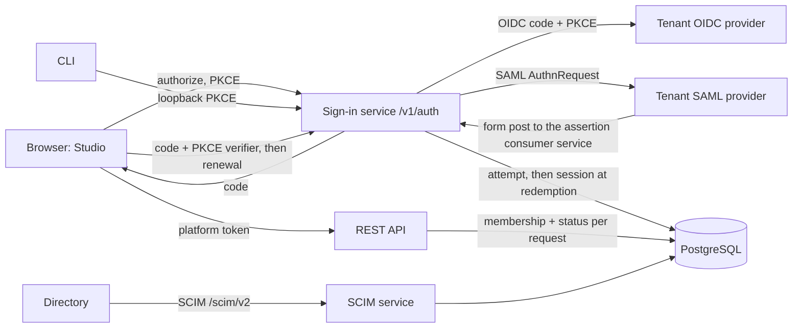

# Federated login: each organization signs in through its own OIDC or SAML provider

*   **Author:** Claude Code, for the owner
*   **Status:** Draft
*   **Date:** 2026-11-24

--------------------------------------------------------------------------------

## Overview

Today a deployment has one identity provider. The operator configures one OIDC issuer; its tokens name the tenant in a
`tenant` claim and the person in `sub`, and the API reads the person's built-in role from the membership row on every
request. A tenant cannot bring its own provider, nobody can add a member through the product (feature 016, Gap 290),
and nothing removes a person when they leave the company.

From release 0.3.0 each tenant (an organization) connects its own identity providers:

- **OIDC and SAML 2.0 connections per tenant.** An administrator adds a connection (Okta, Entra ID, Google Workspace,
  Keycloak, any standard provider), tests it by signing in through it, and activates it. People of the organization
  sign in to the Studio, the CLI and embedded apps through it.
- **The control plane brokers the sign-in and issues its own short-lived tokens**
  ([Architecture decision 0140](../adr/ADR-0140-the-control-plane-brokers-federated-sign-in-and-issues-short-lived-platform-tokens-the-tenant-comes-from-the-connection.md)).
  The connection decides the tenant; nothing the provider or the browser sends can. The API verifies one token format
  whatever the protocol.
- **SAML is verified by the platform's own strict-profile verifier** in memory-safe code, held to `xmlsec1` as an
  oracle in tests
  ([Architecture decision 0141](../adr/ADR-0141-saml-responses-are-verified-by-the-platforms-own-strict-profile-verifier-in-memory-safe-code-with-xmlsec-as-the-test-oracle.md)).
- **Provisioning**: just-in-time on first sign-in, and SCIM 2.0 for users and groups, so a person removed from the
  company's directory loses access on their next request after the directory's SCIM call reaches the platform (how
  soon the directory calls is the provider's: Gap 013-014). Groups arrive as durable rows that feature 029 assigns roles and
  folder access to, and a connection may map groups to the built-in role
  ([Architecture decision 0142](../adr/ADR-0142-a-federated-person-is-a-member-linked-to-external-identities-and-provisioning-and-groups-arrive-as-durable-rows-claims-never-authorize.md)).
- **Session security**: server-side sessions with absolute and idle expiry, five-minute access tokens renewed from the
  session, revocation that every process honours within ten seconds, sign-out at the provider, a required
  authentication context (for example multi-factor) per connection, and "sign-in through our provider only" with a
  guard against locking the organization out and an audited break-glass path.
- **Member management** in the API and the Studio: list, pre-provision, change a role, pin it, suspend, remove, link
  identities, see and end sessions.

The deployment issuer keeps working as it does today, beside federation, for deployments that federate upstream and
for break-glass. `apps/dev-idp` grows a development OIDC provider, and SAML runs against a pinned Keycloak container
(Decision 013-010), so every flow runs on a laptop and in CI with no external service.

### Terms

- **Connection.** A tenant's configured identity provider: its protocol (OIDC or SAML), its endpoints and keys, its
  claim or attribute mapping, its provisioning policy and its state (`DRAFT`, `TESTED`, `ACTIVE`, `DISABLED`).
- **Sign-in service.** The control plane's routes under `/v1/auth/`: an OpenID provider for the platform's own clients
  and a relying party or service provider toward the connections.
- **Platform issuer.** `<public origin>/v1/auth`, the `iss` of the tokens the sign-in service issues.
- **Deployment issuer.** The OIDC issuer configured for the whole deployment today (`AuthConfig`).
- **External identity.** (tenant, connection, the provider's stable identifier) linked to one membership subject.
- **Sign-in session.** A row that a browser or a CLI holds through a cookie or a refresh token, from which access
  tokens are issued.
- **Client.** One of the platform's own applications that signs in through the sign-in service: `studio` and `cli`
  (feature 027 registers `apps` for embedded apps when it is built).
- **Break-glass.** Signing in through the deployment issuer to a tenant that requires federated sign-in, by a subject
  the operator named, audited and alerted.
- **Per-request check.** The one statement that every API request with a platform token makes
  (`IdentityStore::resolve_caller`): it reads the tenant and its identity settings, the membership and, for a platform
  token, the sign-in session, its connection and the signing key's state, and refuses a revoked, expired or suspended
  one (Technical Plan 4, Verify). Also called the session join.
- **Maintenance loop.** The leased loop of the execution engine (`crates/scheduler/src/identity.rs`, lease
  `identity-maintenance`) that runs the purges, the batched session marking, the role recomputations and the alerts
  (Technical Plan 6).
- **Attempt cookie.** `__Host-sagat_login-<attempt id>`, which binds an attempt to the browser; for a sign-in it holds
  the sealed attempt, for a link or a test a random value whose hash is on the attempt row.
- **Platform token.** An access token the sign-in service issues (`iss` the platform issuer, `aud` `<public origin>/v1`,
  the platform API's resource identifier).
- **Deployment token.** An access token of the deployment issuer.
- **Issuer kind.** Which of the two issuers verified a request's token.
- **Owning connection.** The one connection whose SCIM and mapping rules may change a member's role and status
  (Decision 013-013).
- **Pin.** An administrator's mark that keeps a member's role unchanged by mapping.
- **Neutral page.** The sign-in service's answer when it cannot start a sign-in (an unknown organization, or one
  without an active connection): the same page, byte for byte, in both cases (Requirement 013-006).
- **Slot.** A position in the fixed order in which every write transaction of the platform takes its row locks, so
  that no two transactions wait for each other in a cycle
  ([Architecture decision 0050](../adr/ADR-0050-many-run-operations-admit-under-stable-keys-and-never-buffer-or-reopen.md),
  decision 7: slot 2 holds request receipts, where duplicates of one request serialize, and this design puts the
  authorization code there; slot 4a holds the tenant's authority rows, memberships and, after them, feature 029's
  access fence).
- **Access fence.** Feature 029's per-tenant row that every change of permissions takes, so that grants and their
  revocations serialize.
- **Instance registry.** The table where every server process registers what it can honour and sends a beat every 10
  to 12 seconds; an operator records a requirement there, which raises an epoch, and a process that lacks a recorded
  requirement keeps a closed gate and serves nothing it would get wrong
  ([Architecture decision 0082](../adr/ADR-0082-the-instance-registry-records-requirements-only-for-the-operator-and-a-refused-process-stays-up-with-a-closed-gate.md)).
- **Intent, write, verify, activate.** The protocol of
  [Architecture decision 0035](../adr/ADR-0035-database-connections-and-managed-execution.md) decision 7 for a secret
  written through the API: record the intent in PostgreSQL, write the secret to OpenBao, read it back, then mark it
  active, so a crash never leaves a reference to a secret that does not exist.
- **Reveal grant.** A member's permission to see one run's payloads in clear (feature 011).
- **Secret access entry.** An entry of a secret's access list (feature 017).
- **Feature 026 link.** A signed link by which a person decides an approval or submits a form (feature 026).
- **Cross-tenant battery.** The shared contract suite that calls every route with another tenant's identifiers and
  expects the answer of a missing resource.
- **Canary scan.** A test that plants marked values and searches logs, spans, audit records and responses for them.
- **Test composition.** The server, PostgreSQL, OpenBao and the development providers that `tests/support` starts for a
  suite.
- **Development overlay.** `infra/docker/compose.database.yaml`, which a developer starts on a laptop.

## The Problem

Read from `develop` at 2026-11-24:

- `crates/api-http/src/auth/config.rs` holds one `issuer`, one `audience`, one `jwks_uri` and one `tenant_claim`.
  `TokenVerifier` trusts the claim to name the tenant; `IdentityService::authenticate` resolves the slug and the
  membership `(tenant_id, subject)`.
- `memberships` has `tenant_id`, `subject`, `role` and `created_at`; no status, no profile, no link to an external
  identity. Members are created by `control-plane provision-tenant` and `seed-dev` only; the REST API has no member
  resource (Gap 290 of feature 016).
- The Studio signs in with authorization code and PKCE against the configured issuer (`src/auth/oidc.ts`), keeps the
  token in memory and signs out at its expiry; its content security policy allows `connect-src` to the issuer's origin
  only (`crates/api-http/src/studio.rs`).
- `apps/dev-idp` issues ES256 tokens from a JSON request for any subject and tenant (development only); it has no
  authorization endpoint, no ID token and no SAML.
- Feature 029 refuses group claims and wrote the contract a group source must meet; it waits for this design (its
  Owner question 1440). Feature 027's embedded sign-in assumes the issuer accepts the apps origin's redirect (its Gap
  1364).

What is missing for an organization that adopts the platform:

1. **Its own provider.** Each tenant needs its own OIDC or SAML connection without the operator.
2. **Offboarding.** Removing a person from the company directory must remove their access. Today a membership lives
   until an operator runs SQL.
3. **Groups.** Access by team, managed where the company manages people.
4. **Control of sessions.** Short tokens, sign-out everywhere, a required second factor.

Temporal Cloud offers SAML single sign-on per account and SCIM; Windmill's enterprise edition offers OIDC and SAML
single sign-on, SCIM and group sync. Both are hosted or enterprise-only; this design brings the same to every
deployment of this platform, with the tenant boundary, the audit trail and the revocation the rest of the platform
already has.

## Requirements

### Functional

#### Connections

- **Requirement 013-001** A tenant administrator (new permission `identity:manage`, built-in `admin` only, reserved
  and administrator-equivalent in feature 029's catalog) MUST be able to create, change, test, activate, disable and
  delete identity connections of protocol `OIDC` or `SAML`, at most 8 per tenant. A connection MUST pass from `DRAFT`
  to `TESTED` only by a completed test sign-in through it by an administrator (Technical Plan 4, "Test sign-in and
  link"), and to `ACTIVE` only from `TESTED`; a change of a
  `DRAFT` or `TESTED` connection returns it to `DRAFT`. A connection's issuer or entity identifier, its subject claim or attribute
  and its tenant restriction are immutable: a new provider or a new subject rule is a new connection (Decision
  013-014), so the identity a session was made from never changes under it. A change of an `ACTIVE` connection's
  sign-in path (client identifier, client authentication method, endpoints, single sign-on address, attribute names
  other than the subject) MUST be staged as a pending revision: the active revision keeps serving, a test sign-in runs
  against the pending one, and activating it replaces the active revision without revoking anything. The provisioning
  policy and the default role are applied directly, audited, and start Requirement 013-013's recomputation. Credentials MUST rotate in place, audited, with an overlap and no change of
  state: at most two client secrets in force (the new one added, then the old one removed); a new `private_key_jwt` key
  published at the connection's key set before the client signs with it; SAML signing keys as Requirement 013-004. The
  connection's answer MUST show its earliest credential expiry, and the operator's rule `IDENTITY_CREDENTIAL_EXPIRING`
  MUST fire 30 days and 7 days before a SAML certificate, or a client secret whose expiry the administrator entered,
  expires (Technical Plan 11, Alerts). *Acceptance:* the integration tests of each transition;
  `a_pending_revision_is_tested_while_the_active_one_serves`, `a_client_secret_rotation_keeps_every_session`,
  `a_private_key_jwt_key_is_published_before_use`, `an_expiring_certificate_shows_and_fires_its_rule`.
- **Requirement 013-002** A token issued through a connection MUST name that connection's tenant; the tenant MUST
  come only from the connection, and no claim, attribute, parameter, header or path segment from the provider or the
  browser can choose or change it.
  *Acceptance:* the contract test that a provider asserting `tenant: other` still yields the connection's tenant, and
  that a callback for connection A with state of a sign-in through connection B is refused.
- **Requirement 013-003** An OIDC connection MUST name an `https` issuer (except under the development relaxation of
  Requirement 013-024) whose discovery document, key set and token
  endpoint the control plane fetches through the identity egress guard (Requirement 013-024), a client identifier, a
  client authentication of `client_secret_basic`, `client_secret_post` or `private_key_jwt` with a key the platform
  generates for the connection and publishes at the connection's key set, and its subject claim from a closed list:
  `sub`, or `oid` with `tid` for Entra ID. A multi-tenant issuer template (`{tenantid}`, Entra ID's `common` and
  `organizations`) MUST be refused; a known shared issuer (Google, `accounts.google.com`) MUST name a tenant
  restriction (`hd`) that every ID token is checked against, and activation MUST be refused without it. The issuer
  MUST be immutable: a new provider is a new connection. *Acceptance:* integration tests per authentication method
  against the development provider; refusal tests for a template issuer, a shared issuer without `hd`, an ID token
  with another `hd` or `tid`, and a change of issuer.
- **Requirement 013-004** A SAML connection MUST hold the provider's entity identifier (immutable, as the OIDC issuer),
  its single sign-on address (HTTP-Redirect binding), one to three signing keys with their certificates (RSA of at
  least 2,048 bits or ECDSA P-256), the subject as the persistent name identifier format or a configured immutable
  attribute (the formats `emailAddress`, `unspecified` and `transient` MUST be refused as the subject), and the
  attribute names for e-mail, display name and groups; it MAY be created from the provider's metadata document
  (uploaded, or fetched once through the identity egress guard). Adding or removing a signing key while at least one
  stays valid MUST leave the connection's state unchanged, audited. The platform MUST publish the service provider's
  metadata for the connection (entity identifier, assertion consumer service, optional request-signing certificate).
  *Acceptance:* the metadata round trip with the development SAML provider; a key under 2,048 bits and an
  `emailAddress` subject are refused at activation; a key rotation of the only active connection of a federated-only
  tenant succeeds.

#### Sign-in

- **Requirement 013-005** The sign-in service MUST be an OpenID provider for the clients `studio` and `cli`:
  discovery, key set, authorization endpoint and token endpoint under `/v1/auth/`. The authorization endpoint MUST
  require PKCE with S256, a `state`, and a redirect URI registered for the client exactly: the Studio's callback path,
  the CLI's loopback redirect (`http` to the literal `127.0.0.1` or `[::1]`, any port, an exact path; RFC 8252
  sections 7.3 and 8.3); it MUST refuse anything else without redirecting. An authorization code MUST be stored as a
  hash, live 60 seconds, be bound to its `client_id`, redirect URI and PKCE challenge, and be usable once; a second use
  revokes the session it produced. A `/v1/auth/` route MUST NOT answer a cross-origin request with CORS headers. The
  contract that feature 027's delivery meets for embedded apps: its sign-in goes through the platform issuer as a third
  client (`apps`) registered by 027, its code is redeemed in process by 027's session creation and never at
  `POST /v1/auth/token`, and no platform token reaches the apps origin. *Acceptance:* contract tests for each refusal;
  `a_second_use_of_a_code_revokes_its_session`.
- **Requirement 013-006** A person MUST be able to start a sign-in by the organization's slug, with an optional
  `login_hint` passed through to the provider; with several active connections the person chooses one. For an unknown
  organization the authorization endpoint MUST answer exactly as for a known organization without an active connection.
  What the redirect to a provider reveals (that an active connection exists, and its provider's host and display name
  on the chooser) is accepted and stated (Gap 013-007). Discovery by e-mail domain is deferred (Gap 013-010).
  *Acceptance:* `unknown_and_unconfigured_authorize_answers_are_identical` (byte for byte).
- **Requirement 013-007** An OIDC sign-in MUST use authorization code with PKCE (S256) toward the provider, a `state`
  and a `nonce` bound to the sign-in attempt, the `iss` callback parameter when the provider sends it (RFC 9207), and
  MUST validate the ID token: signature by a key of the provider's key set with RS256, PS256 or ES256 (the algorithm
  taken from the key and the token header, PS256 not mapped to RS256), `iss` exactly, `aud` containing the client
  identifier, `azp` when there are several audiences, `exp` and `iat` within a leeway of 30 seconds (the deployment verifier's default), `nonce`, the tenant
  restriction of Requirement 013-003, and a non-empty subject claim. The identity MUST come from the ID token;
  `userinfo` MAY add display claims only. *Acceptance:* one domain unit test per claim rule; and one table-driven integration test
  that sends, through the callback, an ID token breaking each rule (`iss`, `aud`, `azp`, `exp`, `iat`, `nonce`, `hd`,
  `tid`, an empty subject, `alg`), with two rows for a staged change (an ordinary sign-in whose `aud` is the pending
  revision's client identifier, and a test sign-in whose `aud` is the active one's), signed by the development
  provider, and asserts `SIGNIN_TOKEN_INVALID` and that no code row is written (the `acr` row is milestone D's, Task
  013-20), so the wiring of the callback is proved, not only the rules.
- **Requirement 013-008** A SAML sign-in MUST be service-provider-initiated and verified by Architecture decision
  0141's strict profile. An unsolicited response MUST NOT sign anyone in and MUST NOT redirect by itself: it answers a
  page with a button that starts a service-provider-initiated sign-in through that connection. *Acceptance:* the corpus
  of Architecture decision 0141 and the oracle test.
- **Requirement 013-009** A sign-in attempt MUST be bound to the browser that started it by a short-lived cookie
  `__Host-sagat_login-<attempt>` (10 minutes, `Secure`, `HttpOnly`, `SameSite=None` so that a SAML form post carries
  it; one cookie per attempt, at most five, the oldest evicted first). The authorization endpoint MUST write nothing to
  the database: the attempt's state is sealed in that cookie (Technical Plan 4), so no anonymous request consumes
  storage. The callback or the assertion consumer service MUST refuse an attempt of another browser (no cookie), a used
  attempt (its code row exists, kept with its identity cleared until the attempt itself expires) and an expired one. The callback MUST NOT create a session or set the session
  cookie: it records the verified identity on the attempt and redirects with a code; the session is created, and its
  cookie set, only when the client redeems the code with its PKCE verifier (Requirement 013-018). *Acceptance:*
  `a_response_injected_into_another_browser_is_refused`, `a_sign_in_started_by_another_site_establishes_no_session`.
- **Requirement 013-010** A connection MUST be able to require authentication context values (OIDC `acr`, SAML
  `AuthnContextClassRef`); a sign-in without one of them MUST be refused with a reason the person can act on. A
  session whose recorded context does not meet the connection's current requirement MUST be refused on its next request
  by the per-request check. A raise is any change that removes an accepted value; with no requirement every value is accepted, so setting the
  first requirement is a raise. Raising the requirement writes only
  the connection row: it increments the connection's `session_epoch` and records the raised requirement with that
  epoch as the connection's context floor; the per-request check also refuses every session whose epoch (copied from
  the connection when the session was created) is below the floor's epoch and whose context does not meet the floor,
  so a later lowering revives no session the raise cut off. The maintenance loop marks those sessions revoked in
  bounded batches, selecting them by the floor, and clears the floor when it has marked them all; while a floor is
  set, another raise is refused with the retryable reason `CONNECTION_STATE` (a lowering is allowed).
  *Acceptance:* refusal and acceptance tests with the development providers;
  `a_raised_context_refuses_the_sessions_that_do_not_meet_it_on_their_next_request`;
  `lowering_the_context_revives_no_refused_session` (starting from no requirement);
  `a_second_raise_waits_for_the_marking_of_the_first`.

#### Identities and provisioning

- **Requirement 013-011** A federated identity MUST be (tenant, connection, the provider's stable identifier) linked to
  exactly one membership subject (Architecture decision 0142); the platform MUST NOT link identities by e-mail. A link
  to an existing subject MUST be made only by the link flow of Technical Plan 4 ("Test sign-in and link"), started and
  confirmed by that subject while signed in (a test sign-in of a connection is the same flow for the administrator's
  own subject); the member routes MAY unlink and pre-provision, and MUST NOT attach an identity to
  a subject that already has one or to an `admin` subject. *Acceptance:* `two_connections_with_one_email_make_two_members`,
  `an_administrator_cannot_attach_an_identity_to_another_member`.
- **Requirement 013-012** A connection MAY enable just-in-time provisioning with a default role of `viewer` (the
  default), `operator` or `developer`, never `admin`; its scope is the connection and its tenant restriction (an e-mail
  claim is never used to admit anyone). On a shared issuer it MUST be refused without the tenant restriction of
  Requirement 013-003. The first completed sign-in then creates the membership (subject `federated:<uuid>`), its external
  identity, its profile and its role in one transaction with the session. Without it, an unknown identity is refused
  and the refusal is audited. A test sign-in through a `DRAFT` or `TESTED` connection provisions nobody and creates no
  session row. *Acceptance:* integration tests for each case, including a crash after the membership
  insert (nothing remains).
- **Requirement 013-013** A connection MAY map provider groups delivered by its SCIM to the built-in role with up to 32
  ordered rules (a group value, a role). A connection's rules MUST match only groups sourced from that connection, and
  only the membership's owning connection (the connection through which it was provisioned, or the one an administrator
  names) MAY change its role or status by mapping or SCIM; other linked connections can sign the person in and nothing
  more. The highest role a rule gives MUST win, the default role applies when none does, and an administrator's pin
  MUST keep a member's role unchanged by mapping. A computed role that differs from the stored one MUST change it with
  an audit record and feature 029's revocation of custom grants. A change of the rules or of the default MUST recompute
  every member the connection owns, as a bounded audited job. Groups from the sign-in assertion are deferred (Gap
  013-011), so no role ever comes from a claim. *Acceptance:* the property test of Architecture decision 0142, a
  two-connection test, `a_direct_assignment_survives_two_scim_syncs_with_the_same_groups` and
  `a_removed_admin_rule_demotes_its_members`.
- **Requirement 013-014** Groups MUST arrive as feature 029 external groups through SCIM (Architecture decision 0142)
  under the amended group-source contract, and confer nothing until an assignment or a folder entry names them.
  *Acceptance:* the group tests named under Architecture decision 0142.
- **Requirement 013-015** A tenant MUST be able to enable SCIM 2.0 (RFC 7643, RFC 7644) for a connection: `/Users` and
  `/Groups` with create, read, replace, patch (add, remove and replace of members, `active`, `displayName`, `emails`,
  `name`), delete, the filter `eq` on `userName`, `externalId` and `displayName` (a closed grammar, at most 256 bytes),
  `/ServiceProviderConfig`, `/ResourceTypes` and `/Schemas`; no bulk, sort or `/Me`; `roles` and `entitlements` are
  ignored. A SCIM user MUST be matched to the connection's sign-in identity by `externalId` or a configured immutable
  attribute equal to the provider's stable identifier (Requirement 013-003 or 013-004); the matching attribute MUST be
  immutable once set: a replace or patch that changes it is refused with the SCIM error `mutability` and changes no
  link. Uniqueness conflicts are scoped to (tenant, connection); group members resolve only within the token's
  connection. *Acceptance:* a conformance run of the requests Okta and Entra ID send (recorded fixtures), the error
  format of RFC 7644 section 3.12, and `a_scim_replace_that_changes_the_match_changes_no_link`.
- **Requirement 013-016** `active: false` MUST suspend the membership and revoke, in the same transaction, its sign-in
  sessions and every grant that feature 029 revokes on a built-in role change, its reveal grants and its secret access
  entries, so that a reactivated member has only the grants an administrator gives again; delete MUST remove the membership with feature
  029's cascades and keep the external identity, marked deprovisioned, for the audit trail. A suspended membership MUST
  confer nothing on any path that reads a membership for authority, enforced in the schema (Technical Plan 13), so
  that schedules acting for it, feature 027 app sessions and feature 026 links refuse on their next action; a
  deactivation writes no app-session row. *Acceptance:*
  `a_scim_deactivation_refuses_the_next_request_and_every_live_token`, one integration test per caller family of the
  membership read functions, `a_reactivated_member_has_no_old_grants`, and, once features 026 and 027 exist, the same
  refusal for an app session and a link submission.
- **Requirement 013-017** A SCIM endpoint MUST authenticate by a bearer token of 32 random bytes per connection, shown
  once, stored as SHA-256, at most two in force for rotation, and MUST take the tenant and the connection from the
  token only, at the one base address `<public origin>/scim/v2` (a resource identifier of another connection answers
  `404`); it MUST be rate-limited per connection and bounded
  (1 MiB per request, a per-route limit above the router's default of 64 KiB; 1,000 member operations per request, whether a patch or the member list of a full `PUT` or
  `POST`, so a larger group is synced by patches, as Okta and Entra ID send them). *Acceptance:* the cross-tenant battery entries, a rotation
  test and the limit tests.

#### Sessions and tokens

- **Requirement 013-018** Redeeming a code with its PKCE verifier MUST create the session row; a `studio` session has an absolute
  expiry of 12 hours by default (8 hours on a connection without SCIM, at most 24) and an idle expiry of 2 hours by
  default, and a `cli` session's lifetimes are Requirement 013-026's. For the `studio` client only, redemption sets a
  `__Host-sagat_signin` cookie (`Secure`, `HttpOnly`, `SameSite=Lax`, path `/`) whose value is stored only as a hash. A
  browser holds at most one sign-in session. A `studio` redemption that carries a live session cookie of another tenant
  or subject MUST be refused, with `400` `invalid_request` and the reason `SESSION_CONFLICT`, unless it sends
  `replace_session=true`, which the Studio sends only after the person agrees; the old session is then revoked in the
  redemption's transaction.
  Access tokens MUST be ES256 JSON web tokens with `typ` `at+jwt`, `aud` the API's resource identifier, `client_id`,
  `iss`, `tenant`, `sub`, `sid`, `jti`, `iat` and `exp`, at most 300 seconds, a bound the platform verifier enforces
  itself. The sign-in service issues no other kind of token with its access-token key. The Studio MUST renew through
  `POST /v1/auth/session/token`, which needs the cookie, the Studio's exact `Origin` and the header `X-Sagat-Renew`, and
  only after the person's activity in the idle window, where a visible tab that follows a live run stream counts as
  activity (a hidden, idle tab is not renewed); the
  Studio MUST refuse a renewed token whose tenant differs from the organization the person chose, show the tenant it
  is signed in to, and keep tokens in memory only. *Acceptance:* contract tests for each condition of the renewal; the
  Studio test that a reload renews without a redirect while the session lives;
  `a_second_organization_needs_the_person_to_replace_the_session`. For a platform token, the blob upload path,
  which bounds a transfer by the caller's token (`crates/api-http/src/blobs.rs`; database-result reads are capped at 30
  seconds whatever the token, `crates/api-http/src/routes/database_results.rs`, and are left as they are), MUST bound it by the session's absolute expiry and re-check the session at least once every 10 seconds, as streams
  do, so a five-minute token does not cut a ten-minute upload. *Acceptance:* `a_passive_viewer_keeps_following_a_run`,
  `an_upload_outlives_its_access_token_while_the_session_lives`.
- **Requirement 013-019** Revocation: a suspended or removed membership MUST be refused on its next request
  (Requirement 013-016); a revoked or expired session MUST stop renewing at once and its access tokens MUST be refused
  on their next request: the per-request membership read for a platform token joins its session by (`tenant`, `sid`)
  and requires the session's subject and client to equal the token's `sub` and `client_id`, its connection to be
  `ACTIVE` with a required context the session's recorded context meets, and the token's signing key not to be `REVOKED`, in the
  same statement, and refuses otherwise, so revocation needs no poll and no new round trip
  (Decision 013-003); a long-lived stream MUST carry the issuer kind and `sid` into its re-check, re-check at least once
  every 10 seconds for a platform token, and end when its token or its session ends; the Studio resumes it with
  `Last-Event-ID` (a stream reconnects at least every five minutes with 300-second tokens). Disabling or deleting a connection, or raising its required context,
  MUST make the affected sessions refused at once (the statement above) and mark them revoked in bounded batches
  (Technical Plan 6). A disable increments the connection's `session_epoch` and records the new value as
  `revoked_below_epoch`, and the per-request check refuses every session whose epoch is below it, so re-enabling a
  connection revives none of its old sessions (`a_reenabled_connection_revives_no_session`). Epochs, not times, are
  compared: redemption copies the connection's epoch onto the session under its `FOR SHARE` lock of the connection
  row, which a disable or a raise takes `FOR UPDATE`, so a sign-in racing either is ordered by the lock, not by
  transaction start times. Renewal, refresh, and the re-checks of a stream and of a blob upload MUST use the
  predicate of the per-request check (`IdentityStore::resolve_caller`), so a refused session can neither renew nor
  rotate its refresh token (`a_reenabled_connections_old_session_cannot_renew`). *Acceptance:* the revocation tests of Architecture
  decision 0140: `a_revoked_session_is_refused_on_its_next_request` (a barrier holds a request after its membership read
  while the revocation commits: that request completes, the next one is refused), `a_stream_ends_within_ten_seconds_of_its_session`
  (measured), `a_stream_resumes_with_last_event_id`.
#### Members and tenant policy

- **Requirement 013-020** Member management: `GET /members` (with role, status, owning connection, last sign-in),
  `POST /members` (pre-provision an external identity of a connection with a role), `PATCH /members/{subject}` (role,
  pin, status, owning connection), `DELETE /members/{subject}`, `DELETE /members/{subject}/identities/{id}` (unlink,
  audited), `GET /members/{subject}/sessions` and `DELETE /members/{subject}/sessions` (end all), each under
  the existing permission `membership:manage` (held by the built-in `admin` only); `GET /auth/sessions` and
  `DELETE /auth/sessions/{sid}` for the caller's own, ordinary bearer routes of the REST API beside the existing
  `GET /auth/context` (Technical Plan 11 lists every route with its prefix). `POST /members` is for a person whose
  stable identifier the administrator reads from the provider's console (the Entra ID object and tenant identifiers,
  the Okta user identifier); SCIM and just-in-time provisioning are the usual paths, and the runbook's provider guides
  say where each provider shows it. *Acceptance:*
  integration tests per route and role; the cross-tenant battery.
- **Requirement 013-021** A tenant MAY require federated sign-in: then the deployment issuer is refused for its human
  members (built-in roles `admin`, `developer`, `operator`, `viewer`; machine members keep the deployment issuer)
  except the break-glass subjects the operator names with `control-plane identity break-glass`. Each break-glass use
  is audited once per token (`jti`), shown to the tenant's administrators on the identity settings
  (`breakGlassLastUsedAt` and the uses of the last 30 days) and counted for the operator's rule
  `IDENTITY_BREAK_GLASS_USED`, and a failed
  audit write refuses the request. Enabling federated-only MUST be refused unless an active connection exists and the
  enabling administrator's current session came through an active connection of the tenant and is recent (signed in
  within the last 10 minutes); disabling or deleting the last active connection MUST be refused while it is required (a
  change of it is staged and never interrupts sign-in, Requirement 013-001). The same recent sign-in is required to create a SCIM token;
  a renewal keeps the session's original authentication time and is never a recent sign-in. A change (SCIM, a mapping result, the member routes) MUST NOT
  leave the tenant without an active `admin` member (`LOCKOUT_GUARD`). Each of these checks runs under the tenant's identity-settings row
  lock, by the rule of Technical Plan 13 ("Lock order additions"). *Acceptance:* the lockout tests, with a barrier for each racing pair;
  `a_renewal_is_not_a_recent_sign_in`; `the_last_admin_cannot_be_suspended_by_scim`;
  `a_change_of_the_last_required_connection_is_staged_and_keeps_sign_in`;
  `two_scim_suspensions_of_the_last_two_admins_cannot_both_pass` (barrier);
  `a_scim_suspension_and_a_member_demotion_cannot_remove_the_last_admin` (barrier).
- **Requirement 013-022** Domain verification and discovery by e-mail domain are deferred from 0.3.0 (Decision
  013-011, Gap 013-010); a later delivery adds them without changing the slug path.
#### Sign-out

- **Requirement 013-023** Sign-out: `POST /v1/auth/logout` MUST revoke the session and clear the cookie; for an OIDC
  connection whose discovery has `end_session_endpoint`, and a SAML connection with a single logout address, the
  Studio MUST offer to sign out at the provider too (front-channel redirect). *Acceptance:* tests with the development
  providers.
#### Provider calls and identity secrets

- **Requirement 013-024** Every outbound call to a provider (discovery, key set, token endpoint, metadata, userinfo)
  MUST go through a new identity egress guard in `crates/infra-egress` (Technical Plan 2): `https` on port 443 (or a
  port the deployment lists), any name, and every resolved address classified by the existing `classify` and refused
  unless it is a global address, except hosts the deployment lists in `SAGAT_IDENTITY_ALLOWED_HOSTS`, which may
  resolve to private ranges but never to loopback, link-local or metadata addresses; no redirect is followed; timeouts
  and sizes are bounded. Discovery documents and key sets MUST be cached per connection with a minimum refresh
  interval, so that no request can make the control plane fetch on demand more often than that interval. A refused destination MUST be a
  typed problem on the connection. In a development deployment only, the setting `SAGAT_IDENTITY_DEV_INSECURE=1` also
  allows `http` and loopback addresses, so the development OIDC provider and the pinned Keycloak can be reached; the
  policy in `crates/domain/src/egress.rs` holds the relaxation, start-up refuses the setting unless `SAGAT_ENV=dev`,
  and the test composition sets both. *Acceptance:* the server-side request forgery tests (loopback, private ranges,
  link-local, metadata, a redirect, a DNS answer that changes, a random `kid` flood);
  `the_development_relaxation_is_refused_outside_development`.
- **Requirement 013-025** Identity secrets (connections' client secrets, the platform's token-signing keys, the
  attempt-sealing ring, the connections' `private_key_jwt` keys, the service provider's request-signing keys) MUST live in a separate OpenBao
  mount and policy that no feature 017 secret reference and no execution capability can name, readable by the control
  plane's identity only, written through the connection API by the intent, write, verify, activate protocol of
  Architecture decision 0035 decision 7, and never returned. The signing keys MUST follow the lifecycle of Architecture
  decision 0140 decision 7: created and rotated by an audited operator command, the active key version recorded in
  PostgreSQL, a new public key published in every replica's key set for two key-set refresh intervals (Technical Plan
  4, "Signing keys") before any replica signs with it, and an audited `identity signing-key revoke` marks a leaked key `REVOKED`, which
  every replica refuses on the next request (Requirement 013-019). The platform issuer's key set and the connections' client keys MUST be disjoint, and the API MUST never
  verify a token with a connection key. An OpenBao outage stops sign-in and renewal only in a process that must read a key
  it has not cached (a restarted process, or a rotation); there, people are signed out as their tokens expire, within
  five minutes, and the process raises `IDENTITY_SIGNING_UNAVAILABLE`; verification keeps working from the in-process key set. OpenBao Transit signing is
  deferred (Gap 013-012).
#### Clients

- **Requirement 013-026** The CLI MUST sign in with `sagat login --org <slug>` through the loopback redirect, receive an
  access token and a refresh token (`<sid>.<generation>.<key id>.<mac>`, where the MAC is an HMAC-SHA256, under a purpose key
  `cli-refresh` derived from the deployment's `KeyRing` by `KeyRing::derive_purpose_key` and never the access-token
  key, of the session id, the generation and a random value kept on the session; one use, rotated on every refresh by
  compare-and-set on its generation; the server can verify any generation by recomputing its MAC, so it stores no
  per-generation secret and its storage per session is bounded; the access token is signed with a handle obtained
  before the transaction; a session refreshes at most six times a minute, a refusal leaving the token unspent; every
  path, the grace included, first checks the presented MAC, and a token that fails is `invalid_grant` with no effect on the session and the same answer
  whether or not the session exists; a token that passes and whose generation is below the current one is a reuse
  however long ago it was rotated; a reuse, within 30 seconds of its rotation, of a generation whose later generations
  have all never been used issues a new successor and retires the unused ones, which covers a lost response, and a
  second lost response in a row (`two_lost_refresh_responses_keep_the_session`);
  any other reuse revokes the session and is audited; the CLI holds a file lock around a refresh and re-reads the key
  store under it, so a second CLI process uses the new token instead of reusing the old; CLI sessions absolute 7 days, or 24 hours on a connection without SCIM, idle 24 hours), and store them in the operating system's key store, or a file
  with mode `0600` where none exists; a CLI sign-in sets no session cookie in the browser. The CLI's token sources are,
  in order, `--token-file`, `SAGAT_TOKEN`, then the key store (refining Architecture decision 0019 decision 2). *Acceptance:* CLI tests
  against the test composition; the reuse test; `two_concurrent_refreshes_keep_the_session`;
  `a_lost_refresh_response_keeps_the_session`; `a_reuse_after_the_successor_was_used_revokes_the_session`.
- **Requirement 013-027** The Studio MUST offer sign-in by organization (with an optional e-mail address passed as
  `login_hint`), sign-in through the deployment issuer as a second choice while it is offered, the connection chooser, and tenant
  screens for connections (with a guided setup per protocol and provider, the service provider's metadata, the test
  sign-in and activation), SCIM tokens, mapping rules, members, sessions and the federated-only setting; every
  control the person cannot use is shown unavailable with the permission it needs. *Acceptance:* component tests and
  the journey of Success criterion 013-001.

#### Cross-cutting

- **Requirement 013-028** Audit: connection created, changed, tested, activated, disabled and deleted; sign-in
  succeeded; sign-in refused (collapsed per connection, reason and five minutes); member provisioned (just in time,
  SCIM, pre-provisioned), role changed (reason `mapping`, `administrator`, `scim`), suspended, removed; identity linked
  and unlinked; session ended (reason); SCIM token created and revoked; federated sign-in
  required and released; break-glass used. No token, assertion, secret or claim value beyond the subject enters an
  audit record.
- **Requirement 013-029** Observability: spans for each sign-in step, provider call, SCIM request and renewal;
  metrics with closed labels (`protocol`, `step`, `outcome`, closed reasons), never a tenant, connection, subject or
  group; logs without tokens, codes, assertions, cookies or claim values.
- **Requirement 013-030** Errors reuse the closed `Error.code` set with `details.reason` values of Technical Plan 11;
  the sign-in pages show a sentence and a reference (the trace identifier), never the provider's error text verbatim,
  and the sign-in service never forwards a provider's `error` or `error_description` to a client redirect (it sends
  a closed reason and the trace identifier; the Studio stops printing `error_description`).
- **Requirement 013-031** Ceilings: 8 connections per tenant, 3 certificates per SAML connection, 32 mapping rules,
  1,000 external groups per connection, 10,000 members per group, 20 sessions per member (the oldest is ended), 2 SCIM
  tokens per connection; effective = minimum of
  request, tenant setting and deployment ceiling; a ceiling of zero refuses every request.
- **Requirement 013-032** Compatibility and activation: federation is off until the deployment enables it. A control
  plane lists the instance-registry capability `identity-federation-v1` only when its configuration enables federation
  (the public origin and the identity mount); a 0.3.0 execution engine lists it unconditionally, because it needs no
  configuration for federation (it verifies the deployment issuer only, Decision 013-016, suspension and federated-only
  are enforced in the schema's membership reads, and its maintenance loop starts on the recorded requirement); an operator activates the requirement by the audited command of
  Architecture decision 0082 decision 1, refused while a live process lacks it; until it is recorded, connection
  creation, SCIM, member suspension and the federated-only setting are refused (`FEDERATION_NOT_ACTIVATED`), and the
  advertised capability name `identity.federation` of `GET /version` (design 050, Technical Plan 3) and the
  platform-issuer entry of `/studio/config.json` are both derived from it through one mapping. The `capabilities` field is design 050's (its Task 050-3). If Task 050-3 has not merged when
  Task 013-10 runs, Task 013-10 adds the field to `PlatformVersion` as design 050's Technical Plan 3 defines it. This
  design builds the derivation from the instance registry, the mapping of
  [Architecture decision 0143](../adr/ADR-0143-the-studio-draws-node-kinds-from-one-registry-checked-against-the-schema-and-enabled-by-the-servers-capabilities.md)
  decision 2, if no earlier feature has. A binary below the requirement cannot serve
  a deployment that recorded it (the registry's closed gate); rolling back below it is unsupported. The deployment
  issuer, existing memberships and existing clients are unchanged; the migration refuses, with a named error, while a
  membership already has a subject starting `federated:`; its `down` refuses while a membership is `SUSPENDED` or any
  federation row exists. *Acceptance:* the older-replica test (activation refused while a replica without the
  capability is live; such a replica answers `503` after activation); the migration refusal tests.
- **Requirement 013-033** `apps/dev-idp` MUST serve a development OIDC provider (authorization code with PKCE, ID
  tokens with a configurable subject, e-mail, groups and `acr`, discovery, key set, end session), and MUST keep
  refusing to start outside `SAGAT_ENV=dev`; SAML runs, on a laptop and in CI, against the pinned Keycloak of Decision
  013-010. *Acceptance:* the dev-idp tests; the new production image check that it is absent (Task 013-3).

### Non-functional

- **Non-functional requirement 013-001 (security)** Release-blocking: a token for a tenant other than the
  connection's; a sign-in completed in a browser that did not start it; a SAML response accepted outside the profile;
  an identity linked by e-mail; a request to a private address on behalf of a connection; a secret, token, code or
  assertion in a log, span, audit record, response or error; a suspended member served after its next request; a
  revoked session's token served on a request that began after the revocation committed, or a stream of it alive more
  than one re-check interval (10 seconds) after; a platform token reaching
  apps-origin script; a session created by a sign-in that another site started.
- **Non-functional requirement 013-002 (durability)** A provisioning, a role change, a suspension and a session
  revocation commit with their audit in one transaction; a crash leaves the previous state; a repeated SCIM request
  has no second effect.
- **Non-functional requirement 013-003 (performance)** Token verification for platform tokens costs no network and no
  database read beyond today's membership read; the sign-in latency, the renewal latency and the SCIM request latency
  are measured on a declared environment. No figure is promised.
- **Non-functional requirement 013-004 (compatibility)** Existing deployments, tokens, memberships, SDKs, workers and
  Studio builds work unchanged until federation is enabled, and after it for the deployment issuer.
- **Non-functional requirement 013-005 (accessibility)** The sign-in pages and the identity screens meet WCAG 2.2 AA
  as the rest of the Studio (design 050, Requirement 050-022).

### Success criteria

- **Success criterion 013-001** One journey per milestone (Decision 013-020), in the test composition, each covering
  what its milestone adds. Milestone A: an administrator configures an OIDC connection against the development
  provider, tests and activates it, enables SCIM, and a person pushed by SCIM signs in to the Studio and with
  `sagat login`, starts a run, and is listed by the member routes; deactivating the person by SCIM refuses their next
  request at once, including the request of a live token. Milestone B: the same sign-in through a SAML connection
  against the pinned Keycloak. Milestone C (with feature 029): a SCIM group mapped to `operator` gives its members the
  role on their next request. Milestone D: a raised authentication context refuses a session without it, and
  federated-only refuses the deployment issuer except the break-glass subject.
- **Success criterion 013-002** The SAML corpus is refused case by case with its reason, and the oracle agrees with
  `xmlsec1` on every accepted document.
- **Success criterion 013-003** The interoperability run against Keycloak (a pinned image, started by the tests)
  passes for OIDC and SAML.
- **Success criterion 013-004** The cross-tenant battery covers every new route with zero findings, and the canary
  scan finds no secret, token, code or assertion anywhere it looks.

### User stories

- **User story 013-01** As a tenant administrator, I connect my company's identity provider, test it and turn it on,
  without the operator (CUJ 1).
- **User story 013-02** As a person of the organization, I sign in with my company account to the Studio and the CLI
  (CUJ 2).
- **User story 013-03** As an administrator, when someone leaves the company their access ends without my doing
  anything in the platform (CUJ 3).
- **User story 013-04** As an administrator, I give teams access through the groups my directory already has (CUJ 4).
- **User story 013-05** As an administrator, I require our provider and a second factor, and I cannot lock us out by
  mistake (CUJ 5).

## Goals

- Each tenant brings its own OIDC or SAML provider, self-served and audited.
- One token format for the API, a tenant binding the platform owns, and offboarding on the next request after the
  directory's SCIM call.
- Groups and roles from the directory, as durable rows feature 029 can use.
- No C XML code in the control plane, and a SAML verifier that refuses everything outside a narrow profile.
- Every flow testable on a laptop and in CI with the development providers and a pinned Keycloak.

## Non-Goals

- Being a general identity provider for other applications. The sign-in service issues tokens for the platform's own
  clients only.
- Encrypted SAML assertions, SAML artifact binding, identity-provider-initiated sign-in without a service-provider round trip,
  WS-Federation, LDAP and Kerberos (Gap 013-004).
- Passwords, magic links, social sign-in other than through an OIDC connection, and multi-factor authentication run
  by the platform. The provider authenticates; the platform can require its context (Requirement 013-010).
- OIDC back-channel logout in 0.3.0 (Gap 013-005). SCIM deactivation and the session check of every request cover
  offboarding for a connection with SCIM; a connection without SCIM has shorter default session lifetimes and a stated
  exposure (Gap 013-013).
- Machine identities (workers, runners) through federation. They keep their tokens from the deployment issuer and
  their bindings (feature 009).
- One person across tenants. A person in two tenants is two members.
- Approval eligibility by group (feature 029, Gap 1448, keeps it out).

## Open Questions

None open. All decisions below are delegated under Owner decision 2026-11-24-4, each weighed over its options and
recorded with its reasoning. A "Stage N review" named in a decision is that stage of the egm-review of this design,
whose report and resolution are in `013-federated-login.reviews/`.

### Decisions

- **Decision 013-001 — Broker in the control plane.** Options: a resource server that trusts every provider's tokens;
  an external broker; opaque sessions; the control plane as broker issuing its own short tokens. Chosen: the broker in
  the control plane, one token format and a tenant binding the platform owns (Architecture decision 0140).
- **Decision 013-002 — SCIM is in 0.3.0.** Options: just-in-time provisioning only; SCIM too. Chosen: SCIM. Without it,
  leaving the company does not end access until a person's token expires and an administrator remembers to remove
  them, groups can only come from sign-in snapshots, and an enterprise buyer's security review fails (Temporal Cloud
  and Windmill's enterprise edition both offer it). Its cost is bounded by the subset of Requirement 013-015.
- **Decision 013-003 — Access tokens of five minutes, revoked through the membership read.** Options: one-hour tokens
  (today's maximum); five-minute tokens with a per-process poll of a revocation table (the first draft); opaque tokens
  read on every request; five-minute tokens whose session is joined into the membership read every request already
  makes. Chosen: the join, settling Major 4 of the architecture review of 2026-11-25. Every API request already reads the
  membership (`IdentityService::authenticate`); for a platform token the same statement joins `signin_sessions` by
  (`tenant`, `sid`) and refuses a revoked or expired session, so revocation is effective on the next request with no new
  round trip, no poller, no fail-closed mode and no revocation table. The five-minute lifetime bounds what a stolen access token
  can do when nobody revokes its session.
- **Decision 013-004 — The Studio renews through a cookie-authenticated, same-origin call.** Options: refresh tokens in
  the browser (exposed to script); a hidden frame with `prompt=none` (the Studio is unframeable, `frame-ancestors
  'none'`); a same-origin renewal call. Chosen: the renewal call, for the `studio` client only, protected by
  `SameSite=Lax`, the Studio's exact `Origin`, a custom header that forces a preflight, and no CORS answer on any
  `/v1/auth/` route, so a cross-site page cannot pass. The apps origin never renews: when its app session ends, the app
  runtime opens the sign-in popup again (feature 027), and no platform token ever reaches its script.
- **Decision 013-005 — The subject of a new federated member is `federated:<uuid>`.** Options: the provider's `sub`; the
  e-mail; a platform identifier. Chosen: a platform identifier (Architecture decision 0142).
- **Decision 013-006 — Just-in-time provisioning never makes an administrator.** Options: any default role; never
  `admin`. Chosen: never `admin`; a mapping rule may give `admin` to a group, which an administrator wrote and the
  audit trail shows.
- **Decision 013-007 — Groups come from SCIM only in 0.3.0.** Options: SCIM and sign-in assertions (the earlier text);
  SCIM only. Chosen: SCIM only, settling Major 2 of the Stage 5 review: assertion groups needed a role tied to session
  liveness in every membership read, a union across sessions, an expiry audit, a fence deviation and an amendment of
  feature 029, each a source of the defects the reviews found, for a result SCIM gives durably and revocably. A
  connection without SCIM gets its default role and roles administrators assign (Gap 013-011 names the providers that
  lose group sync). SCIM groups do not expire by silence (Architecture decision 0142, option 5).
- **Decision 013-008 — SAML through the platform's own verifier.** Options: `samael` with `xmlsec1` and `libxml2`; a
  sidecar verifier; OIDC only; a strict-profile verifier in memory-safe Rust with `xmlsec1` as a test oracle. Chosen:
  the last, no C XML code in the control plane and a profile narrow enough to refuse wrapping (Architecture decision
  0141).
- **Decision 013-009 — Feature 029's Owner questions 1440 and 1442 are answered by this design** (a record of scope,
  not a choice between options). Identity-provider
  groups come from design 013 (SCIM) and member management is design 013's (Requirement 013-020); see the
  readiness pass of feature 029.
- **Decision 013-010 — Keycloak as the SAML provider for development and tests, and the interoperability target.**
  Options: recorded fixtures only; a live provider account (an account the owner would have to create); a development
  SAML provider of our own; a pinned Keycloak container started by the tests and the development overlay. Chosen: the
  container, plus recorded SCIM fixtures of Okta and Entra ID; a development SAML provider of our own would need a
  second XML signature implementation or agree with the verifier by construction, and proves nothing the corpus, the
  `xmlsec1` oracle and Keycloak do not (Major 4 of the Stage 5 review); it runs in CI under the repository's
  infrastructure rule (AGENTS.md rule 16). A live Okta or Entra ID run is the owner's to arrange (an account).
- **Decision 013-011 — No domains in 0.3.0; sign-in by organization slug.** Options: DNS-proven domains for discovery by
  e-mail and a just-in-time domain limit (the earlier text); slug only. Chosen: slug only, settling Major 3 of the Stage
  5 review: the slug already routes every sign-in, a single-tenant provider authenticates only the organization's
  people, shared issuers already need a tenant restriction, and domains brought a resolver, an engine job needing DNS,
  dispute rules and more enumeration. Gap 013-010 records the deferral.
- **Decision 013-012 — The session is created at code redemption, not at the provider callback.** Options: create it
  at the callback (fewer steps); create it when the client redeems the code with its PKCE verifier. Chosen: at
  redemption, settling Blocker 1 of the security review of 2026-11-25: a sign-in that another site started through a
  connection its administrator controls can then end in a code nobody redeems, never in a session cookie in the
  victim's browser.
- **Decision 013-013 — One owning connection per member.** Options: every linked connection may change the role and
  the status; one owning connection does. Chosen: one, settling Major 9 of the security review of 2026-11-25: a less-trusted connection
  linked to a member (a contractor provider) must not be able to promote or suspend them.
- **Decision 013-014 — The issuer, the entity identifier, the subject rule and the tenant restriction are immutable.** Options: allow a change with links kept;
  re-key the identities by issuer; immutable. Chosen: immutable (a new provider is a new connection, and an
  administrator moves people by their own sign-ins through the new one), the simplest rule that cannot attach one
  provider's subject to another provider's member (Major 8 of the security review of 2026-11-25). The subject rule and
  the tenant restriction follow (Major 1 of the Stage 8 review): a changed subject rule would make every external
  identity stop matching, so just-in-time provisioning would create duplicates, and a changed tenant restriction
  changes who the provider's people are; with all four immutable, no change of a connection revokes a session.
- **Decision 013-015 — The token-signing key in the identity mount, read by the control plane only.** Options: Transit
  where configured and the mount otherwise (the earlier text, two backends with overlapping version schemes); Transit
  only; the mount only. Chosen: the mount only for 0.3.0, settling Major 6 of the Stage 5 review: one backend, the
  design's own lifecycle with the active version in PostgreSQL as the single source, the same path in development and
  production, no OpenBao call per renewal, and a policy that lets only the control plane's identity read it. Transit
  is Gap 013-012.
- **Decision 013-016 — The execution engine accepts the deployment issuer only.** Options: the engine accepts platform
  tokens too (the session join and the registry capability there, and a person's token on the worker channel); it does
  not. Chosen: it does not. Workers are machine identities (feature 009: a `worker` membership and its bindings), which
  keep the deployment issuer in a federated-only tenant; a federated developer runs a worker with a machine identity an
  administrator creates and binds, or with the development provider locally (Gap 013-008). Mixing a person's
  five-minute token into long-lived task streams would buy nothing the binding model does not already give.
- **Decision 013-017 — External groups are rows of feature 029's `access_groups`.** Options: tables owned by this design
  (the first draft, which an assignment could not name); 029 amending its keys; this design adding columns to 029's
  tables. Chosen: the columns (`source_kind`, `connection_id`, `external_value`, `generation`) on
  `access_groups` and `access_group_members`, so 029's assignments, folder entries and evaluator name them unchanged;
  029's migration lands first. Deleting a connection is refused while any of its external groups is named by an
  assignment, an entry or an operation list; disabling it is always allowed (Major 8 of the architecture review of 2026-11-25).
- **Decision 013-018 — The sign-in service stays in the control plane for 0.3.0.** Options: a separate least-privilege
  process with its own database role for the anonymous surface (authorize, the SAML consumer service, SCIM) and token
  minting; the control plane. Chosen: the control plane, because the SAML parser is memory-safe Rust under a narrow
  profile (Architecture decision 0141), the identity secrets are in their own mount and policy, and a second process
  doubles the operated surface before any measurement shows a need. Revisit when a parser advisory affects the SAML
  stack, when SCIM load is measured to disturb the API, or when design 048's topology gives the control plane a
  network position that the anonymous surface should not share.
- **Decision 013-019 — What this design builds in other features' code** (a record of scope). For 0.3.0 this design owns only the identity
  mount and the signing key, behind ports feature 015 may re-home when it is designed; it adds the external-group
  columns to feature 029's tables (Decision 013-017), the `ACTIVE` predicate to the membership reads every feature uses
  (Requirement 013-016). The in-process redemption port for feature 027's embedded apps is built by 027's delivery
  against the contract of Requirement 013-005. Recorded as Owner decision 2026-11-24-717 (a delegate's), which
  the tasks that touch those features cite in an `Owner-gate:` line.
- **Decision 013-020 — Four milestones** (a record of delivery order). Settling Major 1 of the Stage 5 review and
  Major 3 of the Stage 8 review, the plan ships in milestones, each a set of whole tasks with its own journey: **A**
  OIDC connections, the broker and platform tokens, sessions and revocation, just-in-time provisioning, the member
  routes, the CLI, slug sign-in, SCIM users (offboarding works at the end of A); **B** the SAML verifier and SAML
  connections; **C** SCIM groups, external groups and mapping rules, gated on feature 029's migration; **D** the
  required authentication context, federated-only and break-glass. Release 0.3.0 is A, B and D; C ships when feature
  029's migration lands, inside 0.3.0 if it lands before the release candidate, and otherwise in the next release.

### Gaps

- **Gap 013-001** A provider that reuses a `sub` for a new person after deleting the old one makes the new person the
  old member; the platform cannot detect it. The runbook tells administrators to use providers with immutable
  identifiers and SCIM deletion.
- **Gap 013-002** Front-channel sign-out at the provider depends on the browser following the redirect; a closed tab
  leaves the provider's session open (the platform's is revoked).
- **Gap 013-003** A stolen platform access token is usable until its session is revoked or for its five-minute
  lifetime, whichever comes first; a stolen session cookie is usable from the Studio's origin only (the renewal needs
  the exact `Origin`) until the session is revoked or expires; a stream of a revoked session runs for up to one
  re-check interval (10 seconds). Nobody is notified of a theft the platform cannot see.
- **Gap 013-004** No encrypted assertions, artifact binding or identity-provider-initiated sign-in (Non-Goals).
- **Gap 013-005** No OIDC back-channel logout in 0.3.0.
- **Gap 013-006** The interoperability run uses Keycloak and recorded fixtures; no live run against Okta, Entra ID or
  Google Workspace is part of CI.
- **Gap 013-007** The authorization endpoint cannot hide that an organization slug has an active connection: the
  redirect to its provider shows it, with the provider's host, and the chooser shows connection display names. Unknown
  and unconfigured organizations answer the same; nothing else is revealed.
- **Gap 013-008** A federated developer in a federated-only tenant cannot run a worker with their own sign-in
  (Decision 013-016); an administrator creates and binds a machine identity for it.
- **Gap 013-009** When feature 032 is built, sign-in sessions and platform tokens must carry or check the region epoch,
  so that a failover that may have lost a revocation invalidates every session issued before it (constitution 5.0.0,
  "Regions", in pull request #275).
- **Gap 013-010** No domain verification and no discovery by e-mail domain in 0.3.0 (Decision 013-011).
- **Gap 013-011** No groups from the sign-in assertion in 0.3.0 (Decision 013-007): a provider without SCIM (Keycloak
  without a SCIM extension, an OIDC-only provider, some Google Workspace setups) gives its members the connection's
  default role, and administrators assign the rest; a later design may add assertion groups.
- **Gap 013-012** No OpenBao Transit signing in 0.3.0 (Decision 013-015): the signing key is read by the control plane.
- **Gap 013-013** A connection without SCIM cannot learn that the provider disabled a person: the person keeps access
  until their session's absolute expiry (8 hours for the Studio and 24 hours for the CLI by default on such a
  connection) or until an administrator suspends them. A re-check against the provider at renewal (an OIDC refresh with
  the provider's own refresh token) or back-channel logout (Gap 013-005) is the follow-up, weighed against this case.
- **Gap 013-014** How soon a directory's change reaches the platform is the provider's: Okta pushes a deactivation when
  it happens, and Entra ID's provisioning service sends changes in cycles (about 40 minutes, by Microsoft's
  documentation). The platform's bound starts at the SCIM call; the runbook's provider guides give each provider's
  behaviour.

## Owner decisions needed

None for the build. The scope is Owner decision 2026-11-24-1 ("federated login (013)"); the questions above, the
acceptance of Architecture decisions 0140 to 0142 and the settlement of review findings are delegated by Owner decision
2026-11-24-4. A live interoperability run against a commercial provider needs an account, which only the owner can
create (Decision 013-010); it is not a gate of this design.

## Critical User Journeys (CUJs)

### CUJ 1: An administrator connects Entra ID (User story 013-01)

*   **Given**: a tenant `acme` on a deployment with federation enabled, and its administrator signed in through the
    deployment issuer.
*   **When**: she adds an OIDC connection, follows the Entra ID guide (redirect URI and key set address to copy into
    Entra), enters the issuer and the client identifier, chooses `private_key_jwt`, saves, runs "Test sign-in", which
    opens a small window, signs in there with her company account, confirms the link back in the Studio (Technical
    Plan 4, "Test sign-in and link"), then activates the connection.
*   **Then**: the discovery and key set were fetched through the identity egress guard; the test linked her company
    identity to her existing member (she confirmed the link); the connection is `ACTIVE`; every step is in the audit
    log.

### CUJ 2: A developer signs in (User story 013-02)

*   **Given**: the connection above with just-in-time provisioning to `developer`.
*   **When**: a developer opens the Studio, enters the organization `acme`, is sent to Entra ID, signs in, and later runs
    `sagat login --org acme` in a terminal.
*   **Then**: the first sign-in created the member `federated:<uuid>` with role `developer`; the Studio holds a
    five-minute token it renews from the session; the CLI got its own session and stores its refresh token in the key
    store.

### CUJ 3: A person leaves (User story 013-03)

*   **Given**: SCIM enabled on the connection, and the developer above with an open Studio and a running CLI command.
*   **When**: the company's directory deactivates the person and Entra ID sends `PATCH /Users/{id}` with
    `active: false`.
*   **Then**: the membership is suspended and both sessions revoked in one transaction; the next API request of either
    session, made with its live access token, is refused; the run the person started
    keeps running (runs belong to the namespace, not to the session).

### CUJ 4: Teams through groups (User story 013-04)

*   **Given**: SCIM pushes the group `payments-oncall` with five members; feature 029 is enabled.
*   **When**: the administrator assigns the custom role `release-manager` to the external group in namespace `payments`,
    and later the directory removes one member from the group.
*   **Then**: the five gain the role on their next request; the removed member loses it on the next request after the
    SCIM change commits.

### CUJ 5: Require the provider and a second factor (User story 013-05)

*   **Given**: one active connection, the administrator signed in through the deployment issuer, and her company
    account set up with a second factor, so her own sign-in through the connection meets the multi-factor context.
*   **When**: she tries to require federated sign-in; then signs in through the connection, sets the required
    authentication context to the multi-factor value, and requires federated sign-in.
*   **Then**: the first attempt is refused ("sign in through an active connection first"); afterwards a person whose
    sign-in lacks the second factor is refused with a reason; the operator's break-glass subject can still sign in
    through the deployment issuer, and its use raises an alert.

## Technical Plan (Architecture)

### 1. Shape

The sign-in, SCIM and administration paths run in the control plane process, and provider calls leave through the
identity egress guard; the bounded maintenance passes run in the execution engine's leased loop (Technical Plan 6).

### 2. Placement

| Concern | Path |
|---|---|
| Connection, mapping rules, owning connection, provisioning policy, session policy, SCIM patch semantics; the OIDC claim rules (`iss`, `aud`, `azp`, `nonce`, the tenant restriction, the subject claim) and the SAML profile's rules over parsed values (pure) | `crates/domain/src/federation.rs`, `crates/domain/src/federation/{oidc,saml}.rs` |
| The identity egress policy (any name, global addresses only, allowlisted hosts never to loopback, link-local or metadata, port 443 unless listed) | `crates/domain/src/egress.rs`, beside `EgressPolicy`, with unit tests |
| Sign-in use cases (begin, complete OIDC, complete SAML, redeem, renew, logout), provisioning (just in time, SCIM users and groups), connection and member administration; ports `FederationStore` (with `signing_keys()`, the published, active and retired keys with their states and versions), `OidcProvider`, `SamlVerifier`, `TokenSigner`, `IdentitySecrets` | `crates/application/src/federation/` |
| The platform key set's fetcher: maps `FederationStore::signing_keys()` to a `JwkSet` for the verifier's `JwksCache` | `crates/api-http/src/auth/issuers.rs` |
| `EgressClient` with no redirects under the identity policy; `JwksCache` and its `JwksFetcher` trait, moved here from `crates/api-http/src/auth/jwks.rs` so that `api-http` and `infra-federation` share them without `api-http` depending on the federation crate | `crates/infra-egress` |
| `TokenSigner` (the key material read from the identity mount for the active version the use case passes it, read from `FederationStore::signing_keys()`) and `IdentitySecrets` (the identity mount, with the intent, write, verify, activate protocol of Architecture decision 0035 decision 7), on the existing OpenBao client | `crates/infra-secrets` |
| The OIDC client (its connection key sets are `JwksCache` instances over a fetcher through the identity egress guard); the SAML parser, canonicalization and signature check | `crates/infra-federation` (new adapter crate) |
| Tables, stores (the `FederationStore` adapter, `signing_keys()` included), the redefined `sagat_lock_memberships`, the session join of the membership read | `crates/infra-postgres` (migration `<ts>_federated_login`, `src/federation.rs`, `src/identity.rs`) |
| Routes `/v1/auth/*`, `/scim/v2/*`, `/identity/*`, `/members*`; the multi-issuer verifier; `Core::authenticate` widened to take the issuer kind, `sid` and `jti` | `crates/api-http/src/routes/{signin,scim,identity_admin,members}.rs`, `crates/api-http/src/auth/issuers.rs`, `crates/api-http/src/core.rs` |
| Configuration, the `identity-federation-v1` capability, the operator commands of Technical Plan 12, the start-up refusals (a deployment issuer equal to the platform issuer; origins that break Architecture decision 0062 decision 8) | `apps/control-plane` |
| The leased maintenance passes (Technical Plan 6) | `crates/scheduler/src/identity.rs`, run by the execution engine under the engine lease `identity-maintenance`, only once `identity-federation-v1` is recorded |
| The development OIDC provider on its own paths (SAML runs against the pinned Keycloak) | `apps/dev-idp` |
| `sagat login`, key store | `apps/cli` |
| Sign-in by organization, renewal; identity screens | `frontend/apps/studio/src/auth/`, `frontend/apps/studio/src/features/identity/` |

`scripts/check-architecture.py` gains three rules, each with a negative fixture in `scripts/tests/`: no server crate
depends on `libxml`, `xmlsec` or a crate that links them; `VerifiedClaims` is consumed only by `authenticate_bearer`,
and `IdentityService::authenticate` is the only caller of `Membership::principal` outside the domain; no SQL reads
`memberships` outside `crates/infra-postgres/src/identity.rs` and the migrations.

### 3. Data model

Every table carries `tenant_id` in its key and composite tenant foreign keys, except the deployment-wide signing-key
table.

| Table | Holds | Notes |
|---|---|---|
| `tenant_identity_settings` | `federated_only` (boolean, default false), session lifetimes, per-tenant ceilings | one row per tenant: the migration inserts one for every existing tenant and a trigger on `tenants` inserts it for every new tenant, including one a 0.2 binary provisions, so every lock of Technical Plan 13 finds it; the membership read joins it with a left join and defaults (`federated_only` false), so a missing row never refuses anyone |
| `identity_break_glass_subjects` | tenant, subject, written by, written at | only `control-plane identity break-glass` (schema-owning role) writes it |
| `identity_break_glass_uses` | tenant, `jti` or (`sub`, `iat`) when the token has no `jti`, first use | unique; the once-per-token audit |
| `identity_signing_keys` | key version, public key, state (`PUBLISHED`, `ACTIVE`, `RETIRED`, `REVOKED`), published at, activated at, the identity-mount reference | deployment-wide; the operator command writes it |
| `identity_connections` | tenant, global id, slug, protocol, issuer or entity identifier (immutable), state, display name, the active settings and, while one is staged, a pending revision, `session_epoch` (incremented by a disable and by a
raise of the required context), `revoked_below_epoch` (set by a disable), the context floor and its epoch (set by a
raise, cleared by the maintenance loop once its sessions are marked), `settings_revision` (a counter incremented by every change) and the revision a test sign-in verified, up to two client secret references with their entered expiry, subject claim or attribute, tenant restriction (`hd`, `tid`), provisioning policy, required authentication context, the client authentication method | a change writes a revision; delete refused while one of its external groups is named (Decision 013-017) |
| `identity_connection_keys` | tenant, connection, SAML signing keys and certificates, at most 3 | public data |
| `identity_mapping_rules` | tenant, connection, position, group value, role | at most 32; a change increments the connection's `rules_revision` |
| `identity_role_recompute` | tenant, connection, subject (a member to recompute) or a job row (rules revision, subject cursor) | written in the transaction of the change that needs it; cleared by the maintenance loop by compare-and-set |
| `external_identities` | tenant, connection, provider subject, membership subject, created, last sign-in, deprovisioned at | unique (tenant, connection, provider subject); a connection's deletion keeps them, deprovisioned |
| `member_profiles` | tenant, subject, display name, e-mail (display only), role pinned, owning connection (`ON DELETE SET NULL (owning_connection_id)`, the column-list form of PostgreSQL 15 and later, so the tenant column of the composite key stays) | `memberships` gains `status` (`ACTIVE`, `SUSPENDED`; default `ACTIVE`) and `status_changed_at`, written by
`sagat_member_set_status` and read after the membership lock by the SCIM reactivation rule, so the per-request read
stays one row |
| `signin_attempts` | link and test attempts only (a sign-in attempt lives in its sealed cookie): tenant, id, connection, purpose (`LINK`, `TEST`), the subject that started it, the start address hash, browser binding hash, state, nonce, the provider-side verifier, SAML request id, the connection revision, the verified identity once the callback completed, created, expires (10 minutes), used at | created only by an authenticated caller; at most 20 live per tenant; purged at expiry |
| `signin_codes` | tenant, code hash, attempt id (unique per tenant, so a second callback of one attempt is refused), the verified identity, client, redirect URI, PKCE challenge, expires (`min(60 seconds, the attempt's expiry)`), redeemed at, the session it produced | consumed by a conditional `UPDATE` first; a second redemption revokes that session; attempts are purged only after their codes |
| `signin_sessions` | tenant, id, subject, connection, the connection's `session_epoch` at creation, client, cookie hash (Studio) or refresh token hash and its generation (CLI), and for the CLI's grace the rows of
`signin_refresh_generations` (session, generation, rotated at, used at; kept 30 seconds after their rotation, for the grace's bookkeeping only,
since any generation's MAC can be recomputed; the session keeps its random MAC value and current generation), created, last renewed, absolute and idle expiry, authentication context and time, revoked at and reason | joined by the per-request membership read of a platform token |
| `saml_assertion_replays` | tenant, connection, assertion id, expires | an accepted `NotOnOrAfter` is capped at 10 minutes; purged after expiry |
| `scim_tokens` | tenant, connection, hash, created, last used, revoked | at most 2 in force |
| `scim_resources` | tenant, connection, kind, SCIM id, the immutable matching value, the membership subject or external group, version (for `ETag`) | |
| `access_groups`, `access_group_members` (feature 029's, gain columns) | `source_kind` (`LOCAL`, `SCIM`), `connection_id`, `external_value`, `generation` | Decision 013-017; 029's migration lands first; 029's unique name becomes unique among `LOCAL` rows only, and external rows are unique by (tenant, connection, `external_value`) |

Storage classification: settings, profiles and group values are `content`; hashes, key references and session
metadata `protected_system`. The runtime role gets per-table grants. The migration redefines
`public.sagat_lock_memberships` to read `ACTIVE` memberships only and its `down` restores the old body; the `down`
refuses while a membership is `SUSPENDED` or any federation row exists; the `up` refuses, with a named error, while a
membership already has a subject starting `federated:` (compared case-insensitively). `Subject::parse` does not reserve
the prefix, because it also reads stored subjects back (memberships, schedules' `authorizedBy`, approvers, receipts,
reveal grants, worker sessions); the refusal lives only in `authenticate_bearer`, for deployment-issuer tokens, and is
case-insensitive.

### 4. Sign-in flows

#### Begin

The Studio's sign-in page starts the flow itself: `startLogin` gains the optional `organization` and
`login_hint` parameters and keeps making `state` and PKCE in the page, then navigates to
`GET /v1/auth/authorize?client_id=studio&redirect_uri=…&code_challenge=…&code_challenge_method=S256&state=…&organization=acme`
(with an optional `login_hint` passed through to the provider; there is no form post, so the Studio's
`form-action 'self'` is not crossed). The service resolves the tenant by slug, picks the active connections (a chooser page when there
are several), and writes nothing: it seals the attempt (a random attempt id, tenant, connection, client, the client's
challenge, redirect URI and `state`, the provider-side `state`, `nonce` and PKCE verifier, the SAML request `ID`, the
connection's `settings_revision`, the expiry) with AES-256-GCM by the existing `KeyRing` of `crates/infra-secrets` (its active key seals, any key of the ring opens,
with the associated data `signin-attempt`, the tenant and the connection), whose material is one entry of the identity
mount in the `id:base64` form `KeyRing::parse` reads, read at start and on the key set's refresh, sets it as `__Host-sagat_login-<attempt id>`
(Requirement 013-009) and redirects to the provider: OIDC with its own PKCE, `state` (the attempt id) and `nonce`;
SAML with an `AuthnRequest` by HTTP-Redirect binding, `RelayState` the attempt id. The authorization
endpoint always redirects to the provider. A Studio that holds a live session renews through
`POST /v1/auth/session/token` instead (on a reload, a new tab or a deep link), which keeps the session's authentication
time, so only a round trip to the provider is a recent sign-in.

#### Complete

`GET /v1/auth/callback/oidc/{connectionId}` or `POST /v1/auth/callback/saml/{connectionId}` (the global
identifier) opens the attempt (for a sign-in, the cookie named by `state` or `RelayState`; for a link or a test, its row and its
binding cookie) and checks it (this browser, unexpired, same connection), verifies the provider's answer
(Requirement 013-007 or Architecture decision 0141), checks the tenant restriction and the required authentication
context, and, for a sign-in attempt, writes the code row with the verified identity and its authentication context
(no group is read: Decision 013-007; the code row's unique attempt id refuses a second callback), clears the cookie,
and redirects to the client's
redirect URI with a one-use code (Requirement 013-005). For a link or a test attempt it redirects to the Studio's link
page instead, with no code. It writes no membership, no session and no cookie. Provider error text is never forwarded
(Requirement 013-030).

#### Test sign-in and link

Linking a provider identity to an existing member, and the test sign-in that moves a
connection to `TESTED`, are one flow, started and finished by the signed-in person, whichever issuer signed them in:

1. The Studio calls `POST /v1/auth/links` with the person's bearer token (deployment or platform), the exact `Origin`
   and `X-Sagat-Renew`, naming the connection and the purpose (`LINK`, or `TEST` with `identity:manage`). The service
   creates an attempt that records the caller's tenant and subject and returns a one-use start address that lives 60
   seconds.
2. The Studio opens the start address in a small window. Its first navigation binds the attempt to the browser
   (`__Host-sagat_login-<attempt id>`, its hash stored on the row) and redirects to the provider; a second navigation of the address is refused.
3. The callback verifies the provider's answer as for a sign-in, records the verified identity on the attempt and
   redirects the small window to the Studio's link page, which says the sign-in is done and closes. The Studio's
   pages carry `Cross-Origin-Opener-Policy: same-origin` (`crates/api-http/src/studio.rs`), so the small window and
   the opening window end in different browsing-context groups and cannot message each other; the opening window
   therefore polls `GET /v1/auth/links/{attempt}` (every 2 seconds, until the attempt is verified or expired) and the
   policy stays as it is. The poll needs the bearer token and `X-Sagat-Renew` (a browser sends no `Origin` on a
   same-origin `GET`); it answers only when the bearer's tenant and subject are the attempt's and the request
   carries the attempt's binding cookie (the opening window shares the browser with the small window), and anything
   else, another tenant or another browser included, gets the same `404` as a missing attempt; the answer holds only the attempt's state and,
   once verified, the provider identity, with `Cache-Control: no-store`.
4. The opening window shows the identity to be linked and, when the person confirms, calls
   `POST /v1/auth/links/{attempt}` with the same bearer token, `Origin` and header; the browser sends
   the attempt's binding cookie with it. The service checks that the token's tenant and subject are the attempt's, that the
   binding cookie is the attempt's, and that the attempt is verified, unused and unexpired; then it takes the locks in
   redemption's order: the advisory lock on (tenant, connection, provider subject); the connection row (`FOR UPDATE`
   for a test, `FOR SHARE` for a link), its state and revision re-checked; the membership. It writes the link
   (refused with `IDENTITY_LINK_CONFLICT` when the provider identity is linked to another member) and its audit, and
   for a test sets `TESTED` by compare-and-set on the connection revision the attempt ran against, on the row it
   already holds. The path is in `tests/support/lock_order.rs`, with the barrier test
   `a_test_confirmation_racing_a_redemption_of_the_same_subject_does_not_deadlock`.

No session row is created and no code is issued, so a link or a test never signs anyone in. A cross-site page can start
nothing (step 1 needs the bearer token) and confirm nothing (step 4 needs it again).

#### Redeem

`POST /v1/auth/token` with `grant_type=authorization_code`, the code and the PKCE verifier (`studio` and
`cli`) is one transaction, in this order:

Before the transaction, the code row is read without a lock and its client, redirect URI and PKCE verifier are
checked, every mismatch answered with the same `invalid_grant` as a spent code; only then, for `studio`, is the
browser's session cookie compared: a live session of another tenant or subject without `replace_session=true` is
refused with `SESSION_CONFLICT` and the code stays unspent, so the
Studio can resend the same code with `replace_session=true` after the person agrees; if the code has expired by then,
the Studio starts a new sign-in and keeps the person's choice (`a_second_organization_needs_the_person_to_replace_the_session`
redeems one code twice: refused, then accepted).

1. Consume the code: `UPDATE ... SET redeemed_at = now() WHERE hash = $1 AND redeemed_at IS NULL RETURNING ...`
   (slot 2, so two redemptions of one code serialize before any other lock; when no row comes back the code was
   spent, and the session it produced is revoked in a transaction of its own). The code is marked once, here.
2. Check its client, redirect URI and PKCE challenge (no lock).
3. Take the transaction advisory lock on (tenant, connection, provider subject) (Technical Plan 13).
4. Slot 4a, in order: the tenant's identity-settings row `FOR SHARE`, the connection row `FOR SHARE` (its state and
   required context re-checked), the membership (inserted just in time, or locked, through the definer functions of
   Technical Plan 13), and feature 029's access fence only when the transaction writes a role.
5. For `studio` with `replace_session=true`, revoke the old session; insert the session row with its authentication
   context; write the audit.
6. Sign the access token for the new `sid` (the `cli` refresh token carries an HMAC under its own purpose key, never a signature of the access-token key,
   Requirement 013-026) with
   the signing handle obtained before
   `BEGIN`, then commit. Before the transaction starts, the use case asks the `TokenSigner` for a handle (a fresh view
   of the active key, the key in memory); if it cannot get one, the request is refused with
   `IDENTITY_SIGNING_UNAVAILABLE` before any lock is taken and the code stays unspent. Inside the transaction signing
   is CPU work only, never a network call, so no OpenBao or pool latency is held under the advisory lock, the
   settings and connection rows or the fence. A token for an uncommitted `sid` is refused by the session join, so
   signing before the commit is safe. The refresh grant does the same
   (`signing_inside_a_transaction_does_no_io`).

It returns the access token (and for `cli` a refresh token) and, for `studio`, sets `__Host-sagat_signin`.
`grant_type=refresh_token` (`cli` only) rotates the refresh token by compare-and-set on its generation; the grace for a
lost response and the revocation on any other reuse are Requirement 013-026's.

#### Renew

`POST /v1/auth/session/token` (`studio` only): cookie, the Studio's exact `Origin`, header
`X-Sagat-Renew: 1`, no CORS; the re-checks of Requirement 013-019; extends the idle expiry and returns a new access
token; refuses after the absolute expiry.

#### Verify

`crates/api-http/src/auth/issuers.rs` reads `iss` from the unverified token only to select the verifier:
the deployment issuer's `TokenVerifier` (whose rules do not change; the new refusal of a subject starting `federated:`
is applied after it, in `authenticate_bearer`) or the platform issuer's verifier, whose key set is a `JwksCache` over a `JwksFetcher` that reads
`identity_signing_keys` (one cache, one set of fault tests), `typ` `at+jwt`, the API
audience, a `client_id` and a maximum lifetime of 300 seconds of its own. After verification, `Core::authenticate`
receives the issuer kind, `sid` and `jti` (its signature becomes `authenticate(&self, caller: &VerifiedCaller)`, with
`VerifiedCaller { tenant, subject, issuer: IssuerKind, sid, jti, iat, client_id }`, both verifiers filling `jti` and
`iat` (today `VerifiedClaims` carries `subject`, `tenant` and `expires_at`; the deployment verifier's rules stay), in all five implementations:
`crates/api-http/src/core.rs`, `exec.rs`, `governance.rs`, `routes/declared_operations.rs`, `routes/primitives.rs`;
`Core::verifier` returns the `IssuerVerifiers` of `auth/issuers.rs`, which the execution engine builds deployment-only,
so its worker gRPC path refuses a platform token).

The request path then resolves, through one new store method
`IdentityStore::resolve_caller(slug, subject, session: Option<SessionRef>) -> Option<CallerRow>`, in one statement that
merges today's two reads (`find_tenant_by_slug`, `find_membership`), the tenant and its identity-settings row (with `federated_only`), the membership with its
status and its effective role (Technical Plan 13), and, for a platform token, its session by (`tenant`, `sid`) with the session's subject and client equal to the
token's, its connection `ACTIVE` with a required context the session's recorded context meets, the session's epoch not below
the connection's `revoked_below_epoch` and, if below the context floor's epoch, its context meeting the floor, and
the token's `kid` not `REVOKED` (primary-key
lookups in the same statement); a suspended member or a revoked or expired session is refused with `401` and the reason `MEMBER_SUSPENDED` or
`SESSION_REVOKED`.

For a deployment token every failure keeps today's single answer; a platform token's caller has
already proved who they are, so its two reasons tell the Studio and the CLI to sign in again, and the test
`authenticate_gives_the_same_answer_for_every_kind_of_failure` is narrowed to deployment tokens.

A stream's `Who`
(`crates/api-http/src/routes/execution.rs`) gains the issuer kind and `sid`, and `StreamLimits`
(`crates/api-http/src/streams.rs`) re-checks a platform token's stream every 10 seconds and keeps 30 seconds for a
deployment token. The execution engine verifies the deployment issuer only (Decision 013-016).

#### Signing keys

The platform key set is a `JwksCache` whose three settings are named here and not inherited from
the deployment cache (whose time to live is 600 seconds): time to live and minimum refresh interval both equal the
refresh interval, a control-plane setting of 30 seconds by default, and no staleness window: a replica whose last
successful read is older than two intervals stops signing (the signer records the time of its view of the active key)
and refreshes on the next lookup. The leeway is 30 seconds. `control-plane identity signing-key
create` (and `rotate`) writes a new key as `PUBLISHED`, waits two refresh intervals, printing that it waits, then marks
it `ACTIVE` and the previous key `RETIRED` in one transaction; interrupted, a second run finds the `PUBLISHED` key and
waits only for what remains. The fetcher returns every `PUBLISHED` and `ACTIVE` key, and a `RETIRED` key until its
successor's activation plus two refresh intervals (the longest a replica may still sign with it), 300 seconds (the
longest token lifetime) and the leeway, 390 seconds at the defaults; it never returns a `REVOKED` key, and the
per-request statement refuses a token whose `kid` is `REVOKED` at once, on every replica.
`control-plane identity signing-key revoke` (audited) is the emergency path for a leaked key: it activates a new key at
once without waiting and marks the leaked key `REVOKED`; a replica whose view is still fresh may hold a handle of the
revoked key for up to two intervals, so redemption, renewal and refresh check, inside their transaction, that the
handle's `kid` is not `REVOKED` (a primary-key lookup) and otherwise roll back with `IDENTITY_SIGNING_UNAVAILABLE`,
the code unspent; replicas may refuse tokens of the new key until their next refresh, at most one minimum interval; and the runbook's emergency page lists the steps. The cache's
existing rules refresh it on an unknown `kid` (at most once per minimum interval). The serving process
never creates a key. The rotation test drives the refreshes by a controlled clock.

#### Lock order

Every write transaction of this design follows the slots of Architecture decision 0050 (Terms):
redemption as its steps above (the code in slot 2; then the settings row, the connection row, the membership and the
fence in slot 4a; the session and attempt rows after them); a SCIM user request takes, after the settings and connection rows that every SCIM request
takes `FOR SHARE` (Technical Plan 13), the membership, then the fence; a SCIM group request takes, after those two
rows, the affected memberships in subject order, then the 029 tenant access fence (slot 4a, after
memberships, as Architecture decision 0050 orders them), then the group's rows. A SCIM request takes the fence
exclusively only when its change can alter authority: a member added to or removed from a group that an assignment or
a folder entry names, or a built-in role or status change; otherwise it takes the fence shared, so a directory's
initial sync does not queue the tenant's run admissions behind it (an assignment that would name the group takes the
fence exclusively and so waits for the request to commit). A request recomputes at most 100 members' roles in its own
transaction and records the rest durably for the maintenance loop (Technical Plan 6, Role mapping). Whether the group
is named by an assignment or a folder entry is read again after the shared fence is taken; if it now is, the request
rolls back and restarts with the exclusive fence (`an_assignment_naming_the_group_mid_request_forces_the_exclusive_fence`,
a barrier test); a connection's disable, activation or raised context takes the
settings row and the connection row only (its sessions are refused by the per-request check and marked later in
batches). No transaction of this design writes a feature 027 app-session
row (slot 1). A writer that takes the access fence exclusively sets `lock_timeout` to 2 seconds, as feature 029's
writers do, and answers a timeout as a retryable `503`. In `tests/support/lock_order.rs`, a writer that checks the federation requirement reads
`Slot::RegistryEpoch` first; the code is `Slot::Receipt`; the settings row and the connection row are the first rows of
`Slot::Authority`, in that order, before memberships; the advisory lock is a new variant `Slot::IdentityAdvisory`,
placed in the enum right before `Slot::Authority`. The paths are added to `tests/support/lock_order.rs` and feature 029's
`lock_order.rs`.

#### Break-glass

With federated sign-in required, `IdentityService::authenticate` refuses a deployment-issuer token
for a human member of that tenant unless the subject is in the tenant's break-glass list, which only `control-plane
identity break-glass` (schema-owning role) writes; machine members (`worker`, `runner`, `database-runner`) are exempt by
their membership role. Each use is audited once per token `jti`, counted by `identity_break_glass_uses_total`, and is
refused when its audit write fails.

### 5. SAML verifier

As Architecture decision 0141. `crates/infra-federation/src/saml/`: the request body bounded (256 KiB, a per-route limit above the router's default of 64 KiB, as
`EXEC_MAX_BODY_BYTES` is) before base64
decoding; a `roxmltree` parse with the limits (no DTD, entities refused by the parser's configuration and checked
again); an exclusive canonicalization over the parsed tree for the signed element (transforms allowed: enveloped
signature and exclusive canonicalization with an optional inclusive namespace prefix list; the `#WithComments` forms
refused by name); SHA-256 digest; RSA PKCS#1 v1.5 SHA-256 (keys of at least 2,048 bits) or ECDSA P-256 SHA-256
verification with the RustCrypto crates the workspace already uses through `jsonwebtoken`, by the keys configured on
the connection only (`KeyInfo` and embedded certificates are ignored). The structural rules: at most one `Signature`
per element, each an immediate child of the element it signs with `Reference` `#` plus that element's `ID`; when both
the Response and the Assertion are signed, both verify; a signed Response's Assertion is its direct child. The verified
element is returned by handle. The domain rules (`crates/domain/src/federation/saml.rs`) then check, over values read
from the verified Assertion: its `Issuer` equal to the connection's entity, the audience, `NotBefore` and
`NotOnOrAfter` (accepted at most 10 minutes ahead), an `AuthnStatement`, the subject confirmation `Method` `bearer`
with `Recipient`, `InResponseTo` and `NotOnOrAfter` and no `NotBefore`, the subject (persistent name identifier or the
configured attribute) and the attributes, as text content only. The unsigned Response values the profile reads are
exactly three, compared by equality and never used for anything else: `StatusCode` (`Success`), `Destination` (the
assertion consumer service) and `InResponseTo` (the pending request, equal to the subject confirmation's), and the
Response `Issuer` when present (equal to the Assertion's). The replay store keeps assertion ids until their
`NotOnOrAfter`.

### 6. Provisioning, groups and roles

- **Just in time** (Requirement 013-012): in the redemption transaction, under the tenant's membership lock order
  (Architecture decision 0050, slot 4a: memberships), charged to the tenant's durable-content quota
  (`TenantContentBytes`, as `memberships_quota_delta` charges memberships today); a sign-in or a SCIM request that
  would exceed it is refused with `QUOTA_EXCEEDED` (SCIM: `403` with that reason in `detail`). The connection that provisions a
  member is its owning connection.
- **SCIM** (`crates/api-http/src/routes/scim.rs`, `crates/application/src/federation/scim.rs`): each request is one
  transaction in the lock order of Technical Plan 4; users map to external identities and memberships; only the owning
  connection's SCIM changes a member's status or role; groups map to feature 029's `access_groups` rows of source
  `SCIM` (Decision 013-017) with `generation` incremented per accepted change; `ETag` from the resource version; `If-Match` honoured, so a provider that sends it never overwrites a newer state.
  A repeated request is idempotent by its effect (adding an existing member, removing an absent one, replacing with the
  same set change nothing). A late or reordered request without `If-Match` applies as the provider's latest word for
  the attributes it names; it converges at the provider's next change of that resource, which carries its current
  state, and the audit trail shows each change. One exception keeps offboarding safe: a request without `If-Match`
  that would move a member from `SUSPENDED` to `ACTIVE` within 10 minutes of the suspension is refused with SCIM `409`
  and audited, so a retried request that was overtaken by a deactivation cannot reactivate a leaver; a genuine
  reactivation is sent again after that window, by the provider's next cycle (Entra ID) or by the administrator's push
  (Okta), as the runbook says. The refusal does not count toward `scimFailing`. The recorded fixtures show which
  provider sends `If-Match` and what each does after a `409`.
- **Role mapping**: the owning connection's rules over that connection's SCIM groups only (Requirement 013-013),
  computed after each SCIM group change for the affected members and after a rule or default change for every member
  the connection owns. Work left for later is recorded durably in the transaction of the change that needs it
  (constitution principle I): a SCIM group change that recomputes more than 100 members writes a row per remaining
  member in `identity_role_recompute` (tenant, connection, subject, rules revision); a rule or default change
  increments the connection's `rules_revision` and writes one job row (tenant, connection, rules revision, subject
  cursor). The maintenance loop works through both in subject order in bounded batches, always under the connection's
  current rules: a per-member row is recomputed and then cleared by compare-and-set on the revision it carries; a job
  row clears itself by compare-and-set on its revision when its cursor reaches the end, and restarts from the first
  subject when the revision moved; a job row of a newer revision makes the older per-member rows of that connection
  unnecessary, and the loop deletes them. A demotion therefore applies within one maintenance interval per batch of 100, and a crash loses nothing
  (`a_crash_after_a_large_group_change_still_demotes_everyone`, a fault test;
  `a_rule_change_during_the_job_recomputes_everyone_under_the_new_rules`). Within one change, promotions are applied before demotions, so a handover in one change never meets the guard. A
  recomputed demotion that the last-administrator guard still refuses is skipped and audited, and recorded durably as
  an `identity_role_recompute` row marked guarded and shown on the connection (the count of guarded members); the
  group change itself commits, so the provider's request succeeds and SCIM keeps working; every pass of the
  maintenance loop retries the tenant's guarded rows (at most a few per tenant), so the demotion applies as soon as
  another administrator exists (`removing_the_last_admin_from_its_group_keeps_scim_working`,
  `an_admin_handover_in_one_scim_change_demotes_the_old_admin`, `a_guarded_demotion_applies_once_another_admin_exists`).
  Nothing is mapped from a sign-in assertion.
- **Maintenance passes**: one leased loop (`crates/scheduler/src/identity.rs`, engine lease `identity-maintenance`,
  running only once `identity-federation-v1` is recorded) purges expired attempts, codes (a code row past its 60 seconds has its identity columns cleared and is kept until
  the attempt's own expiry, so its unique attempt id still refuses a second callback), replays and
  ended sessions in
  bounded batches, marks revoked in bounded batches the sessions of a disabled or deleted connection and those
  below a context floor (selected by the floor, already refused by the per-request check), clears a floor once its
  sessions are marked, runs the recomputation jobs, updates the
  expiry and owner gauges and the gauge `identity_connections_scim_failing` from each connection's `scimFailing`,
  which a connection's health row (`identity_connection_health`: consecutive refused SCIM requests, last success)
  sets after ten consecutive refused SCIM requests; the row is written after the SCIM request's transaction, never
  under the connection row that sign-ins share (a quiet
  directory sends nothing, so silence is not a fault)
- **The amended contract**: `specs/029-custom-roles-folders/contracts/group-source.md` is updated in the readiness
  pass of feature 029 and again on 2026-11-26 (no silence alert; the writer `lock_timeout` of 2 seconds): SCIM is the source kind built in 0.3.0; the assertion kind is deferred (Gap 013-011).

### 7. Sessions, cookies and content security policy

| Cookie | Attributes | Value | Lifetime |
|---|---|---|---|
| `__Host-sagat_login-<attempt id>` | `Secure`, `HttpOnly`, `SameSite=None`, path `/`; at most five, the oldest evicted first | a sign-in: the sealed attempt; a link or a test: 32 random bytes, hash in `signin_attempts` | 10 minutes |
| `__Host-sagat_signin` | `Secure`, `HttpOnly`, `SameSite=Lax`, path `/`; set only at a `studio` redemption | 32 random bytes; hash in `signin_sessions` | the session's absolute expiry |

`/studio/config.json` gains the shape `{"issuers": [{"kind": "platform", "issuer": …, "clientId": "studio",
"scope": "openid"}, {"kind": "deployment", "issuer": …, "clientId": …, "scope": …}]}`, built on each request from the process's in-memory view of the registry (no query per request), so that the
platform entry follows the recorded requirement (today `crates/api-http/src/studio.rs` serializes it and
builds the policy once, at start-up) (the old `oidc` object kept while older Studios exist, a contract
test on both), and the policy's `connect-src` keeps the deployment issuer's origin while it is offered. The sign-in
service is same-origin and the Studio starts the flow by navigation, not by a form post; redemption and renewal use
`credentials: 'same-origin'` (today's `finishLogin` sends `'omit'`, which would discard the cookie). The sign-in service's own pages (the chooser, the neutral page, the
unsolicited-response page) are served with `default-src 'none'; style-src 'self'; img-src 'self'; form-action 'self'
<the connection's single sign-on origin>; frame-ancestors 'none'` and no script. A development deployment on plain
`http` loopback uses the same names without `__Host-` (browsers refuse the prefix without `Secure`); the configuration
refuses that outside `SAGAT_ENV=dev`. A CLI sign-in sets no cookie in the browser.

**Origins.** The platform issuer is the Studio origin: `SAGAT_PUBLIC_ORIGIN` MUST equal it (the `__Host-` cookies and
the same-origin renewal need it) and differ from the apps, component sandbox and public-forms origins once features
027 and 026 add those settings (each check is added with its setting); the sign-in
service's routes (the `/v1/auth/` routes of Technical Plan 11's first table) are served on the Studio origin only and
answer `404` on the others; the REST routes `GET /auth/context` and `/auth/sessions` share the prefix and are ordinary
bearer routes. The sign-in pages are platform-authored, carry no
author or anonymous user content, and are the one exception to Architecture decision 0062 decision 8's rule against
anonymous pages on the Studio origin, recorded there. Start-up refuses a configuration that breaks these, with a test.

### 8. Discovery

The authorization endpoint resolves an organization slug itself (Technical Plan 4); `login_hint` is passed through to
the provider. Its unauthenticated traffic is limited per address and globally; the endpoint writes nothing (the attempt is
sealed in its cookie), so a flood costs CPU and the rate limits, never storage, and cannot stop another tenant's
sign-ins by filling a shared table; a per-tenant limit, when configured, refuses only that tenant's new attempts. Domain verification and discovery by e-mail are deferred (Gap 013-010).

### 9. Development and test providers

`apps/dev-idp` keeps `/token` (JSON only, at most 4 KiB) for `sagat dev token` and gains, on separate paths, a
development OIDC provider (`/oidc/authorize`, `/oidc/token`, `/oidc/userinfo`, `/oidc/end-session`, its discovery and
key set), with its own issuer `<dev-idp base>/oidc`, its own ES256 key generated at start (never the key of the
deployment issuer's `/token`), discovery at `/oidc/.well-known/openid-configuration` and its key set at
`/oidc/jwks.json`, configured by the file that `SAGAT_DEV_IDP_PEOPLE` names: a JSON list of test people (`subject`,
`email`, `name`, `groups`, `acr`, optional `hd` and `tid`). The browser routes accept
navigation and form posts, so they keep the provider's other protections (Architecture decision 0019 decision 3:
development only, loopback unless explicitly exposed, known `Host` authorities, bounded bodies) and issue tokens only
for the configured test people (Architecture decision 0140 decision 8). Most OIDC refusal cases are unit tests over
the pure claim rules in `crates/domain/src/federation/oidc.rs`; the integration refusals use the switch `break` of
`/oidc/authorize`, a query parameter carried into the code and applied when the ID token is made, with a closed list
of values (`alg`, `nonce`, `acr`) and one override, `claims:<json>`, that sets only the claims the table of Requirement 013-007 breaks
(`iss`, `aud`, `azp`, `exp`, `iat`, `nonce`, `hd`, `tid`, and `sub` only as empty), at most 2 KiB, refused otherwise,
and accepted only when the provider runs with `SAGAT_DEV_IDP_TEST_OVERRIDES=1`, which `tests/support` sets and a
developer's laptop does not; tokens are still issued only for the configured test people. SAML runs against a pinned Keycloak (`quay.io/keycloak/keycloak:26.0.7`, pinned by the digest
that Task 013-3 records), started by `tests/support` for the integration and interoperability suites and by the
development overlay for a laptop, from the realm export `tests/fixtures/keycloak/realm-sagat.json` (a SAML client
template, test users with attributes, a persistent name identifier, the authentication context classes, an OIDC
client for the interoperability run); a connection's assertion consumer service names its identifier, so the test
support registers the Keycloak client through Keycloak's admin API after it creates the connection, with the service
provider's entity identifier `<public origin>/v1/auth/saml/{connectionId}/metadata`. The service listens on loopback
(`127.0.0.1:18080`) and its healthcheck reads `/health/ready` on the management port. The SAML refusals are the
corpus of Architecture decision 0141, and `xmlsec1` runs for the oracle test in a disposable container built from
`tests/support/images/xmlsec1/Dockerfile` (`debian:bookworm-slim` pinned by digest, the `xmlsec1` package pinned by
version). The development overlay `infra/docker/compose.database.yaml` gains the Keycloak service; the identity mount
and its policy (`infra/openbao/policies/identity.hcl`) are added by `infra/openbao/bootstrap-development.py`, for
production by `infra/openbao/bootstrap-kubernetes.py` and `infra/helm/templates/_openbao.tpl`, and for the suites by
`start_openbao` in `tests/support/bounded.rs`; `infra/docker/compose.yaml` gains nothing for production. The dev-idp keeps its start-up refusal outside
`SAGAT_ENV=dev`, and the new production image check (Task 013-3) keeps it out.

### 10. Studio

- **Sign-in** (`src/auth/`): `config.json` names the platform issuer when the `identity-federation-v1` requirement is recorded (the same mapping as `identity.federation`); the sign-in page asks for
  the organization (and optionally an e-mail address passed as `login_hint`), and offers "Sign in with the
  deployment's provider" as a second choice while `config.json` lists the deployment issuer; `startLogin` gains `organization` and
  `login_hint` and keeps `state` and PKCE
  in the page; the session store renews 60 seconds before expiry and on reload, refuses a renewed token of another
  tenant than the one chosen, and shows the tenant in the shell; sign-out calls `/v1/auth/logout` and offers the
  provider sign-out; the callback page no longer prints the provider's `error_description`. The organization slug may
  be remembered in local storage (a convenience; never a token).
- **Identity screens** (`features/identity/`, tenant level): connections (list, guided setup for Entra ID, Okta, Google
  Workspace, Keycloak and generic OIDC and SAML, the values to copy into the provider, test sign-in in a small window,
  activate, disable), SCIM (tokens shown once, last request, error counts), mapping rules, members (list,
  filter, pre-provision, role, pin, suspend, remove, identities, sessions), the federated-only setting with its guard.
  Built on the interface module of Architecture decision 0101 (pull request #267, Astryx).

### 11. Contracts and errors

#### Routes

`specs/001-platform-foundation/contracts/openapi.yaml`: the `/v1/auth/*` operations that return JSON (discovery, key
set, token, renewal, logout, links), `/identity/*` and `/members*`, their schemas and errors, `x-implemented:
  '013'`; the SCIM routes in a separate fragment `specs/013-federated-login/contracts/scim.openapi.yaml` (SCIM's own
  media type and error format).

  Every path below is under the public origin; the REST API's paths are under `/v1` as today. The sign-in service:

  | Method and path | Authentication | Purpose |
  |---|---|---|
  | `GET /v1/auth/.well-known/openid-configuration`, `GET /v1/auth/jwks` | none | discovery and the platform key set |
  | `GET /v1/auth/authorize` | none (PKCE, `state`) | start a sign-in (Technical Plan 4) |
  | `GET /v1/auth/callback/oidc/{connectionId}`, `POST /v1/auth/callback/saml/{connectionId}` | the attempt cookie | the provider's answer |
  | `GET /v1/auth/saml/{connectionId}/metadata` | none | the service provider's metadata |
  | `POST /v1/auth/token` | the code and PKCE verifier, or a refresh token | redemption and refresh |
  | `POST /v1/auth/session/token` | the session cookie, `Origin`, `X-Sagat-Renew` | renewal (`studio`) |
  | `POST /v1/auth/logout` | the session cookie, or the refresh token | sign-out |
  | `POST /v1/auth/links`, `POST /v1/auth/links/{attempt}` | bearer token, `Origin`, `X-Sagat-Renew` (and the attempt cookie for the confirmation) | test sign-in and link: start, confirm |
  | `GET /v1/auth/links/{attempt}` | bearer token, `X-Sagat-Renew` and the attempt cookie; the attempt's own tenant, subject and browser, otherwise `404` | test sign-in and link: poll |

  The administration routes of the REST API (bearer token; `x-access` tenant):

  | Method and path | Permission | Purpose |
  |---|---|---|
  | `GET`, `POST /identity/connections` | `identity:manage` | list, create (state `DRAFT`) |
  | `GET`, `PATCH`, `DELETE /identity/connections/{connectionId}` | `identity:manage` | read, change, delete |
  | `POST /identity/connections/{connectionId}/activate`, `.../disable` | `identity:manage` | state changes; activate also swaps in a tested pending revision |
  | `POST /identity/connections/{connectionId}/client-secrets`, `DELETE .../client-secrets/{secretId}`, `POST .../client-keys/rotate` | `identity:manage` | credential rotation with an overlap |
  | `GET`, `PUT /identity/connections/{connectionId}/mapping-rules` | `identity:manage` | the ordered rules (milestone C) |
  | `POST /identity/connections/{connectionId}/scim-tokens`, `DELETE .../scim-tokens/{tokenId}` | `identity:manage`, a recent sign-in for create | SCIM tokens |
  | `GET`, `PATCH /identity/settings` | `identity:manage` | federated-only (milestone D), session lifetimes, ceilings; `GET` also shows `breakGlassLastUsedAt` and the count of break-glass uses in the last 30 days |
  | the `/members` routes of Requirement 013-020 | `membership:manage` | member management |
  | `GET /auth/sessions`, `DELETE /auth/sessions/{sid}` | an authenticated caller, their own only | the caller's sessions |

#### Errors

`details.reason` values (new): `CONNECTION_NOT_ACTIVE`, `CONNECTION_STATE`, `SIGNIN_ATTEMPT_INVALID`,
  `SIGNIN_PROVIDER_REFUSED`, `SIGNIN_TOKEN_INVALID`, `SAML_PROFILE_VIOLATION`, `AUTH_CONTEXT_REQUIRED`,
  `IDENTITY_NOT_PROVISIONED`, `IDENTITY_LINK_CONFLICT`, `FEDERATION_REQUIRED`, `LOCKOUT_GUARD`,
  `PROVIDER_DESTINATION_DENIED`, `REFRESH_TOKEN_REUSED`, `SESSION_REVOKED`,
  `MEMBER_SUSPENDED`, `ISSUER_IMMUTABLE`, `TENANT_RESTRICTION_REQUIRED`, `SUBJECT_FORMAT_REFUSED`,
  `CODE_CLIENT_MISMATCH`, `RECENT_SIGN_IN_REQUIRED`, `NOT_OWNING_CONNECTION`, `FEDERATION_NOT_ACTIVATED`,
  `CONNECTION_GROUPS_NAMED`, `SESSION_CONFLICT`, and `IDENTITY_SIGNING_UNAVAILABLE`. Their `Error.code` and status, and
  where each is answered, are in the table below; each gets its remediation row in `crates/api-http/src/error.rs` from
  the task that first answers it.

  | Reasons | `Error.code` | Status |
  |---|---|---|
  | `SIGNIN_ATTEMPT_INVALID` | `BAD_REQUEST` | 400 |
  | `SIGNIN_PROVIDER_REFUSED`, `SIGNIN_TOKEN_INVALID`, `SAML_PROFILE_VIOLATION`, `SESSION_REVOKED`, `MEMBER_SUSPENDED` | `UNAUTHENTICATED` | 401 |
  | `AUTH_CONTEXT_REQUIRED`, `IDENTITY_NOT_PROVISIONED`, `FEDERATION_REQUIRED`, `RECENT_SIGN_IN_REQUIRED`, `NOT_OWNING_CONNECTION` | `FORBIDDEN` | 403 |
  | `CONNECTION_NOT_ACTIVE`, `CONNECTION_STATE`, `IDENTITY_LINK_CONFLICT`, `LOCKOUT_GUARD`, `FEDERATION_NOT_ACTIVATED`, `CONNECTION_GROUPS_NAMED` | `CONFLICT` | 409 |
  | `PROVIDER_DESTINATION_DENIED`, `ISSUER_IMMUTABLE`, `TENANT_RESTRICTION_REQUIRED`, `SUBJECT_FORMAT_REFUSED` | `VALIDATION_FAILED` | 422 |
  | `IDENTITY_SIGNING_UNAVAILABLE` | `UNAVAILABLE` | 503 |
  | `CODE_CLIENT_MISMATCH`, `REFRESH_TOKEN_REUSED`, `SESSION_CONFLICT` | the token endpoint's `error` (below) | 400 |

  `POST /v1/auth/token` is an OAuth token endpoint: it takes `application/x-www-form-urlencoded` and answers errors in
  the form of RFC 6749 section 5.2, `400` with `error` (`invalid_request`, `invalid_grant`, `invalid_client`,
  `unauthorized_client`) and the platform's closed reason in `error_reason` (`CODE_CLIENT_MISMATCH`,
  `REFRESH_TOKEN_REUSED`, `SESSION_CONFLICT` and the others above), with the trace identifier; every other route
  answers the platform's envelope. The sign-in pages show a sentence per reason.

#### SCIM

  SCIM is served at `<public origin>/scim/v2` (`/Users`, `/Groups`, `/ServiceProviderConfig`, `/ResourceTypes`,
  `/Schemas` below it); the token names the connection, and no path segment does.

#### Cross-tenant battery and access classes

  The cross-tenant battery treats the anonymous sign-in routes as it treats the probes (they take no tenant from the
  caller); `contract_federated_login` checks instead that a callback of connection A with the attempt of connection B
  answers `SIGNIN_ATTEMPT_INVALID`. The SCIM routes join the battery with a token of another tenant. The `x-access`
  class of each operation follows feature 029's convention when its coverage test (Task 029-015) exists; until then each
  operation's description states the intended class (`anonymous sign-in`, `SCIM token`, `tenant`), which Task 029-015
  turns into classes.

#### Alerts

  The product alerts of `AlertKind` (`crates/domain/src/operations.rs`) are namespace-scoped conditions that the
  monitor detects and resolves (`crates/scheduler/src/monitor.rs`), which fits none of this design's signals, so none
  is added. A tenant's administrator sees the conditions on the identity screens, from fields of the connection's
  answer: `scimFailing` (ten consecutive refused SCIM requests), `credentialExpiresAt` (the earliest of its
  certificates and entered client-secret expiries), and the count of members owned by a disabled connection. The
  operator gets Prometheus rules in `infra/observability/alerts.yaml` over closed-label metrics, tested with the other
  rules by `contract_observability_operations`, each with a section of `docs/runbooks/alerts.md`:
  `IDENTITY_BREAK_GLASS_USED` (a per-use counter, `identity_break_glass_uses_total`, beside the once-per-token audit
  record), `IDENTITY_SCIM_FAILING` (the gauge `identity_connections_scim_failing`, set by the maintenance loop), `IDENTITY_CREDENTIAL_EXPIRING`
  (the gauge `identity_credentials_expiring`, counted in 30-day and 7-day buckets), `IDENTITY_OWNER_DISABLED` (the
  gauge `identity_members_of_disabled_owners`) and `IDENTITY_SIGNING_UNAVAILABLE` (the gauge
  `identity_signing_available`). No metric carries a tenant, connection or subject.
#### Documents and CI

- `docs/runbooks/federated-login.md`: enabling federation, the public origin, keys and their rotation, provider
  guides, SCIM setup, break-glass, revocation, the alerts.
- `.github/workflows/ci.yml`: the OpenAPI lint step also lints `specs/013-federated-login/contracts/scim.openapi.yaml`.
- `docs/architecture/security-and-sandbox.md`: the sign-in service, the token issuers, the SAML profile.

### 12. Settings, commands and rollout

**Settings.**

| Setting | Default | Read by |
|---|---|---|
| `SAGAT_IDENTITY_FEDERATION` (`on` or `off`) | `off` | the control plane, which lists `identity-federation-v1` only when it is `on`; an execution engine lists it always |
| `SAGAT_PUBLIC_ORIGIN` | none (required when federation is on) | the control plane: the Studio origin and the platform issuer's origin |
| `SAGAT_IDENTITY_OPENBAO_MOUNT` | `sagat-identity` (KV version 2) | the control plane, with the token file of `SAGAT_IDENTITY_OPENBAO_TOKEN_FILE`, whose policy is `identity.hcl` |
| `SAGAT_IDENTITY_KEYSET_REFRESH` | 30 seconds | the control plane and the API verifier (Technical Plan 4) |
| `SAGAT_IDENTITY_ALLOWED_HOSTS`, `SAGAT_IDENTITY_DEV_INSECURE` | empty, off | the identity egress guard (Requirement 013-024) |

**Operator commands.** The commands (`apps/control-plane`, schema-owning role and the identity mount's token, each audited with
`--operator <name>`): `identity signing-key create|rotate|revoke`; `identity attempt-key rotate` (writes the attempt-sealing ring in the identity mount in two steps, as the signing
keys do: the new key is added as an opening key, and after one refresh interval it becomes the sealing key, so an
attempt sealed on an updated replica opens on every replica; keys older than one rotation plus 10 minutes, an
attempt's lifetime, are dropped; every control plane reads the ring at start and on the key set's refresh;
`an_attempt_sealed_after_a_rotation_opens_on_every_replica`); `identity break-glass add|remove --tenant <slug> --subject <subject>`; `identity federation
activate|remove`, which records or removes the `identity-federation-v1` requirement through the registry's functions
(Architecture decision 0082 decision 1), the `remove` command refusing a removal while any tenant requires federated sign-in.

**Rollout.**

1. Deploy 0.3.0 with federation off: nothing changes.
2. The operator sets `SAGAT_PUBLIC_ORIGIN` and the identity mount, enables federation in the configuration of every
   control plane, runs `control-plane identity signing-key create`, and, once every live process lists
   `identity-federation-v1`, activates the requirement (Architecture decision 0082 decision 1). The Studio's
   `config.json` then offers the platform issuer beside the deployment issuer.
3. Each tenant adds its connections. Requiring federated sign-in is per tenant.

**Rollback.** Start-up refuses a configuration that turns federation off while the requirement is recorded; the operator first
releases every tenant's federated-only setting (each audited), then removes the requirement, which the registry allows
only when no tenant requires federated sign-in. Federated members (subjects `federated:<uuid>`) cannot sign in while
federation is off, because only the platform issuer issues their subjects and a deployment token naming one is
refused; no path converts them. A tenant that must leave federation gives each such person a new membership under the
deployment issuer, and the grants, approver entries and schedules that named the old subject stay with it; the runbook
says so. A binary rollback below
the requirement is unsupported. Federation rows stay.

### 13. Concurrency, grants and edge rules

- **Grants.** The runtime role keeps only `SELECT` on `memberships` (migration `20261126000000_authority_read_locks`,
  "the runtime ... deliberately cannot change memberships"). Every write goes through a `SECURITY DEFINER` function owned by the
  migration role, each with its predicate and its audit in the same call: `sagat_member_insert` (just in time, SCIM,
  pre-provision), `sagat_member_set_status`, `sagat_member_set_role` (mapping, administrator, SCIM),
  `sagat_member_delete`. They lock the row `FOR NO KEY UPDATE`, re-check status and owning connection after the lock,
  and enforce the last-administrator guard: an administrator's or SCIM's direct request is refused with
  `LOCKOUT_GUARD`, while a recomputation caller gets a guarded outcome (no exception, nothing written for that member),
  so the rest of its transaction, the group change included, commits. `member_profiles`, the sign-in tables and the SCIM tables get `SELECT`,
  `INSERT`, `UPDATE` (and `DELETE` where purged); a trigger on `identity_connections` refuses a change of the issuer or entity identifier, the subject rule and the
  tenant restriction, and `runtime_privileges` checks it is present; `runtime_privileges` fails if `sagat_app` gains a write on
  `memberships`.
- **One membership read.** A definer function `sagat_active_membership(tenant, subject)` returns the membership's
  role and status and nothing for a suspended one; `sagat_lock_memberships`, the per-request read, `find_membership`
  and the three plain reads of a role (`declared_operations.rs`, `approval_progress.rs` and
  `reveal_grants.rs::step_log_usage_if_revealed` in `crates/infra-postgres/src`, moved into
  `crates/infra-postgres/src/identity.rs`, so the architecture rule has no exception) all use it; one red test per caller family refuses a suspended member. Because no role comes from a claim
  in 0.3.0 (Decision 013-007), the stored role is the effective role.
- **Lock order additions.** In slot 4a, before `memberships`: the tenant's identity-settings row, then the connection
  row (the order of redemption's step 4). Redemption and every SCIM request take both `FOR SHARE` and re-check the connection's state and
  required context after the lock; renewal and refresh take neither, because they apply the per-request check's predicate, which refuses a
  session whose connection is no longer `ACTIVE`, whose epoch a disable cut off, or whose context a raise cut off. A disable, an activation, a raised
  context or a federated-only change (which writes `federated_only` on the settings row) takes the settings row and the
  connection row `FOR UPDATE`, so a sign-in racing a disable either commits first with the old epoch and has its session
  refused, or sees the disabled state; the barrier test `a_sign_in_racing_a_disable_ends_without_a_live_session` also
  re-enables the connection and checks that the session stays refused. A write that can lower the set of active administrators (a suspension, a deletion, a
  demotion, a change of owning connection, a recomputation) reads the target's role first, without a lock, and chooses the settings row's lock
  strength before taking any lock: `FOR UPDATE` when the target is an active `admin`, otherwise the `FOR SHARE` that
  every SCIM request takes; a SCIM request never takes the settings row `FOR SHARE` and then `FOR UPDATE`. If the
  membership lock shows an `admin` it did not lock for, the transaction rolls back and restarts with `FOR UPDATE`.
  The barrier tests `two_scim_suspensions_of_the_last_two_admins_cannot_both_pass` and
  `a_scim_suspension_and_a_member_demotion_cannot_remove_the_last_admin` assert that exactly one request succeeds and
  the other gets `409 LOCKOUT_GUARD`, never a deadlock error.
  Write skew between federated-only, connection states and the last administrator is therefore excluded. Ceilings (sessions per member, SCIM tokens, connections) are
  counted under the membership or connection lock that their writer holds.
- **SCIM group writes.** A request reads the group's `generation`, takes the affected memberships, the fence and the
  group row, re-reads `generation` and retries the whole transaction (at most three times) if it moved, so a `PUT`
  never undoes a concurrent `PATCH` without recomputing its member.
- **One identity at a time.** Resolving an external identity (redemption, SCIM `POST`, pre-provision) takes a
  transaction advisory lock on (tenant, connection, provider subject) before any slot 4a row (in redemption, after the
  code of slot 2). A SCIM `POST` for a person who already
  signed in just in time adopts the existing identity (a `scim_resources` row, no `409`). After a SCIM delete the
  deprovisioned identity row is re-pointed to a new `federated:<uuid>` membership on the next provisioning, so old
  schedules, approver entries and grants naming the old subject do not come back; a suspension keeps the subject.
- **Owning connection.** Deleting it sets the owner to none (`ON DELETE SET NULL (owning_connection_id)`); a member without an owner keeps its
  stored role and is changed by administrators only. While the owning connection is disabled its SCIM is refused, and
  the identity screens and the gauge `identity_members_of_disabled_owners` show how many members it owns. An ownership change recomputes the role from the
  new owner's groups in the same transaction.
- **Testing and activating a connection.** A test sign-in records the connection revision it ran against; `TESTED` is
  set by compare-and-set on that revision, and `ACTIVE` only if the revision is unchanged since `TESTED`.
- **Linking an existing subject.** The flow of Technical Plan 4 ("Test sign-in and link"). Positive test:
  `an_administrator_links_their_identity_and_tests_the_connection`; refusals: `a_link_confirmed_by_another_subject_is_refused`,
  `a_link_start_address_works_once`.
- **Typed conflicts.** Every new unique constraint is named in `classify` and answered as a typed conflict
  (a slug conflict, `IDENTITY_LINK_CONFLICT`, SCIM `uniqueness`), never a `500`; each race has a barrier test.
- **Reuse.** The reveal-grant trigger `memberships_role_change_revokes_reveal_grants` is extended to `UPDATE OF role,
  status`, so a suspension revokes reveal grants by the existing mechanism; the canary scan uses
  `tests/support/canary.rs`; the platform key-set and `kid`-flood tests use the fake provider of
  `tests/support/oidc.rs`; the collapsed "sign-in refused" audit uses `AuditAction::collapses_repeats`,
  `repeat_window` and `insert_denial_once` (`crates/infra-postgres/src/identity.rs`); the identity egress guard is an
  implementation of `infra-egress`'s `Guard` trait for `EgressClient`.
- **Break-glass uses.** `INSERT ... ON CONFLICT DO NOTHING` on the use row; the audit record and the alert are written
  only by the inserting transaction, in that transaction.
- **Activation window.** A writer that needs the `identity-federation-v1` requirement checks it in its own transaction
  through a definer function that reads the epoch under a shared lock, as feature 029's guard does (its note on Gap
  2001), so a removal and an enable cannot pass each other; that in-transaction check has no lag. The Studio's offer of the
  platform issuer in `config.json` and the name `identity.federation` follow the in-memory view of the registry, which
  a replica learns at its next beat (about 12 seconds: Architecture decision 0082 decision 4, a heartbeat of 10
  seconds jittered to 12, plus the call); the runbook says to wait for the beat before expecting the Studio's offer.

## Risks and Mitigations

| Risk | Mitigation |
|---|---|
| A tenant's provider signs someone into another tenant | The tenant comes from the connection (Requirement 013-002); contract test |
| SAML signature wrapping or canonicalization defects | The strict profile and verified-element handle (Architecture decision 0141); corpus; oracle |
| Login cross-site request forgery, response injection | Browser-bound attempts (Requirement 013-009) |
| Server-side request forgery through an issuer address | The identity egress policy: global addresses or an operator allowlist, no redirects (Requirement 013-024) |
| Account takeover by e-mail linking | No e-mail linking (Requirement 013-011) |
| An organization locks itself out | The lockout guard and break-glass (Requirement 013-021) |
| A flapping directory changes roles back and forth | Roles change only on a stored change; pins; every change audited |
| A failing SCIM connection | `scimFailing` on the connection and the operator's rule `IDENTITY_SCIM_FAILING`; groups do not expire (Decision 013-007) |
| The signing key leaks | Keys in the identity mount readable by the control plane only; the per-request statement ties a token to its session's subject and client, so a minted token cannot borrow another person's session; `identity signing-key revoke` refuses the key on every replica at once (Technical Plan 4) |
| A routine credential change signs everyone out | Credentials rotate in place with an overlap; endpoint and mapping changes are staged and tested while the active revision serves (Requirement 013-001) |
| A directory's initial sync stalls run admissions | The access fence is exclusive only for changes that alter authority; recomputation is bounded per transaction; Task 013-18 measures admission latency during a replayed sync |
| A person disabled at a provider without SCIM keeps access | Shorter default lifetimes on such connections; the exposure is Gap 013-013 |
| An older or federation-off replica ignores federated-only or a suspension | The `identity-federation-v1` requirement; suspension enforced in the schema's membership reads (Requirements 013-016, 013-032) |
| OpenBao is unavailable | A process that has its key cached keeps signing; one that must read a key (restarted, or after a rotation) stops sign-in and renewal with `IDENTITY_SIGNING_UNAVAILABLE`, and its people are signed out within five minutes; verification continues (Requirement 013-025) |

## Constitution Check

| Principle | Result | Evidence |
|---|---|---|
| I. State and retry semantics are explicit and durable | Pass | Provisioning, role changes, suspensions and revocations commit with their audit in one transaction; no run state is touched |
| II. Modular domain, ports and adapters | Pass | Rules in the domain; use cases and ports in `application`; one new adapter crate (`infra-federation`) for provider protocols, XML and keys; no new edge into the domain; an architecture rule keeps C XML libraries out |
| III. External effects are at-least-once; sagas compensate | n/a | Provider calls are reads and token exchanges for a sign-in, not workflow effects |
| IV. Compatibility is versioned and pinned | Pass | Off by default; additive migrations and routes; the deployment issuer unchanged; no change of the workflow document's schema, the worker protocol or the SDKs |
| V. Code, tenant boundary and secrets are isolated | Pass with conditions (Complexity Tracking) | The tenant from the connection; secrets in the secret provider, never returned; guarded egress; two new trust boundaries, justified below: the platform signs tokens, and the internet-facing process can now write memberships through definer functions (until now only the schema owner provisioned members) |
| VI. Observability and audit are part of the feature | Pass | Audit of every change and sign-in outcome; closed-label metrics; no token, code or assertion in logs |
| VII. Events are redeliverable; inbox and outbox are the contract | Pass | SCIM requests are idempotent by effect; a late or reordered request is refused by `If-Match` when the provider sends it and otherwise converges at the provider's next change of that resource, except that a reactivation without `If-Match` within 10 minutes of a suspension is refused (Technical Plan 6); no message is added |
| VIII. Failure is tested and contracts are verified, honestly | Pass | Corpus, oracle, cross-site request forgery, server-side request forgery, revocation and crash tests; interoperability with a pinned Keycloak; the live commercial-provider gap stated (Gap 013-006) |
| Delivery Constraints | Pass | The development providers stay development-only and out of the production image; no new runtime technology beyond a Rust crate set reviewed under the dependency rules |

## Complexity Tracking

| Addition | Why it is needed | Simpler alternative rejected |
|---|---|---|
| The platform signs its own tokens | One token format for two protocols; the tenant binding is the platform's | Accepting each provider's tokens (no SAML, provider-chosen subjects) |
| A SAML verifier of our own | No C XML code in the control plane; a narrow profile | `samael` with `xmlsec1` and `libxml2` |
| SCIM | Offboarding and groups from the directory | Just-in-time only (no offboarding) |
| A session join in the per-request membership read | Revocation on the next request, without a new round trip | A per-process poll of a revocation table (the first draft); opaque tokens |
| Two kinds of cookie | Browser binding of an attempt across a cross-site form post, with its state sealed so anonymous requests write nothing; a renewable session | Refresh tokens in script; attempt rows written by anonymous requests |
| Membership writes by the serving process | Just-in-time provisioning, SCIM and the member routes must create, suspend and change members | Each write is a definer function with its predicate, its audit and the last-administrator guard; the runtime role keeps only `SELECT` on `memberships` |

## Alternatives Considered

- **A multi-issuer resource server**, **an external broker**, **opaque sessions**: Architecture decision 0140.
- **`samael`**, **a sidecar verifier**, **OIDC only**: Architecture decision 0141.
- **The provider's subject as the platform subject**, **e-mail linking**, **claims on each request**: Architecture
  decision 0142.
- **One-hour tokens; a revocation poll**: Decision 013-003.

## Non-Functional Requirements

Non-functional requirements 013-001 to 013-005 above. Their tests: the security suites of Task 013-16 (001); the crash
and duplicate tests of Tasks 013-9 and 013-11 (002); the benchmark of Task 013-18 (003); the existing suites unchanged
with federation off and on (004); axe on the sign-in pages and identity screens (005).

--------------------------------------------------------------------------------

## Detailed Implementation Plan

Documents first: Task 013-1 lands before code. Tests are seen failing first, each in the task where everything it needs
exists. Every task belongs to one milestone (Decision 013-020), so a milestone is finished when its tasks are
ticked: **A** Tasks 013-1 to 013-6, 013-8 to 013-16 and 013-18; **B** Task 013-7 and Task 013-19; **C** Task 013-17;
**D** Task 013-20. Release 0.3.0 is A, B and D; C ships when feature 029's migration lands. Each milestone closes with
its part of Success criterion 013-001.

**Targets.** New `[[test]]` entries in `tests/Cargo.toml`, made by the first task that needs each:
`integration_federated_login` (`integration/federated-login/main.rs`), `contract_federated_login`
(`contract/federated-login/main.rs`), `security_federated_login` (`security/federated-login/main.rs`, with the SAML
corpus and the oracle in `security/federated-login/saml/`), `fault_federated_login` (`fault/federated-login/main.rs`)
and `e2e_federated_login` (`e2e/federated-login/main.rs`, driving `frontend/e2e/tests/federated-login.spec.ts`, added
to `BROWSER_SUITES` of `scripts/select-test-targets.py`). Domain rules are unit tests of `sagat-domain`
(`cargo test -p sagat-domain federation` and `cargo test -p sagat-domain egress`).

**Builders.** The server builder owns `crates/`, `apps/` other than `apps/cli`, `tests/`, `infra/`, `scripts/`, the
contracts and the documents. The clients builder owns `apps/cli`, `frontend/apps/studio/` (and regenerates
`schema.d.ts` after Task 013-2) and `frontend/e2e/`. Before Tasks 013-10 and 013-9 merge, the clients builder works
against the contract with mocked answers; its end-to-end runs wait for them. Gates outside this design: Task 013-14
waits for pull request #267 (Astryx); milestone C waits for feature 029's migration; the app-session and link refusals
wait for features 027 and 026. Until feature 029 exists, the access fence step of redemption and SCIM and the
revocation of custom grants do not exist; Task 013-17 adds them with 029.

- [ ] T013-1 Server builder. Documents: `docs/architecture/security-and-sandbox.md` (the sign-in service, the issuers,
  the SAML profile), `docs/runbooks/federated-login.md` (enabling, settings, the identity mount, the commands, provider
  guides, SCIM, break-glass, the alerts, rollback), `docs/glossary.md` (connection, external identity, sign-in
  session), the refinement of Architecture decision 0062 decision 8, feature 015's roadmap row (Decision 013-019), and
  the rows of `docs/engineering/architecture-principles.md` for the three new rules.
  Verification: `python3 scripts/check-docs-index.py`, `python3 scripts/check-plain-words.py --base origin/develop`,
  `python3 scripts/check-design-docs.py`.
  Refs: Requirement 013-001, Requirement 013-014, Requirement 013-030
- [ ] T013-2 Server builder. Contracts: the operations of Technical Plan 11 marked `x-planned: '013'` and listed in
  `not_built` of the battery (each route task switches its operations to `x-implemented`), the SCIM fragment and its
  lint step, the `config.json` schema, the intended `x-access` classes; the clients builder regenerates `schema.d.ts`.
  Red tests: `the_operations_of_design_013_are_in_the_document_with_their_errors` (`contract_federated_login`, reading
  the YAML).
  Verification: `npx --yes @redocly/cli@1 lint specs/001-platform-foundation/contracts/openapi.yaml
  specs/013-federated-login/contracts/scim.openapi.yaml`; `cargo test -p sagat-tests --test contract_federated_login`;
  `(cd frontend/apps/studio && npm run check:api)`.
  Refs: Requirement 013-005, Requirement 013-015, Requirement 013-020, Requirement 013-032
- [ ] T013-3 Server builder, milestone A. `apps/dev-idp`: the development OIDC provider of Technical Plan 9, with its
  `break` switch for `alg`, `nonce`, `acr` and the `claims` override (its names, its 2 KiB bound and its setting).
  Red tests (`cargo test -p sagat-dev-idp`): `the_dev_oidc_provider_issues_an_id_token_for_a_configured_person`,
  `each_break_value_breaks_its_claim`, `the_claims_override_refuses_other_names_and_is_off_without_its_setting`, `the_dev_oidc_key_differs_from_the_deployment_key`,
  `the_json_token_route_still_refuses_a_form_post`; `the_production_image_has_no_dev_idp` (new: it builds the `control-plane` target of `infra/docker/Dockerfile` and
  checks that its filesystem holds no `dev-idp` binary; run by the CI job that builds the images).
  Verification: `cargo test -p sagat-dev-idp`.
  Refs: Requirement 013-033
- [ ] T013-4 Server builder, milestone A. Domain: connections with staged sign-in revisions, their immutable identity
  (issuer or entity identifier, subject rule, tenant restriction) and states, owning connection, provisioning and
  session policies, SCIM patch semantics, the OIDC claim rules, the identity egress policy with its development
  relaxation in `egress.rs`, `identity:manage` in `identity.rs` (`Subject::parse` unchanged).
  Red tests (`cargo test -p sagat-domain federation`): `a_change_of_an_active_connection_is_staged`,
  `a_subject_rule_or_tenant_restriction_change_is_refused`, `jit_never_defaults_to_admin`,
  `a_scim_patch_is_idempotent_by_effect`, `a_shared_issuer_needs_a_tenant_restriction`, `a_template_issuer_is_refused`,
  `the_identity_policy_refuses_loopback_link_local_and_metadata`,
  `the_development_relaxation_is_refused_outside_development`, one test per OIDC claim rule (`aud`, `azp`, `nonce`,
  `hd`, `tid`, `iss`, `exp`, algorithm).
  Refs: Requirement 013-001, Requirement 013-003, Requirement 013-007, Requirement 013-012, Requirement 013-024
- [ ] T013-5 Server builder. Migration `<ts>_federated_login` (its timestamp after the latest migration on `develop` when the
  task starts, today `20270210000100_step_logs_validate`), with a `<ts+100>_federated_login_validate` that validates
  the extended registry checks, as `20270118000100_run_input_validation_validate` does, and
  stores: the tables of Technical Plan 3, `memberships.status`, `tenant_identity_settings` with its trigger, the
  redefined `sagat_lock_memberships` and `sagat_active_membership`, the definer functions, the three plain reads moved,
  `IdentityStore::resolve_caller`, grants, the classification of every new column in
  `crates/infra-postgres/storage-classification.json` with the ALWAYS `*_quota_delta` and `*_quota_flush` triggers on
  each table that holds `content`, the `up` and `down` refusals; the registry capability
  `identity-federation-v1` (the `Capability` variant in `crates/application/src/instances.rs`, the three CHECK
  constraints extended `NOT VALID` as `20270118000000_run_input_validation` does and validated by the second migration, their `down` refusals, the removal
  guard); the architecture rule on reads of `memberships`.
  Red tests (`integration_federated_login`): migration up and down; `runtime_privileges`; the classification manifest
  test; one suspended-member refusal per caller family of `sagat_lock_memberships` (`workers.rs`, `secrets.rs`,
  `schedules.rs`, `reveal_grants.rs`, `payload_disclosure.rs`, `managed_secrets.rs`, `execution.rs`,
  `execution/resets.rs`, `execution/database.rs`, `event_payloads.rs`, `database.rs`, `database/admission.rs` under
  `crates/infra-postgres/src`) and per plain read (`declared_operations.rs`, `approval_progress.rs`,
  `step_log_usage_if_revealed`); `the_up_migration_refuses_an_existing_federated_subject`;
  `the_runtime_role_cannot_write_memberships`; `the_capability_checks_and_the_data_model_agree`;
  `a_tenant_created_by_an_old_binary_gets_its_settings_row`; the negative fixture of the architecture rule.
  Verification: `cargo test -p sagat-tests --test integration_federated_login migration`;
  `cargo test -p sagat-tests --test integration_security_multitenancy durable_quotas`;
  `cargo test -p sagat-tests --test integration_platform_foundation runtime_privileges`, each also with
  `SAGAT_TEST_AS_RUNTIME_ROLE=1`; `python3 scripts/check-architecture.py`.
  Refs: Requirement 013-011, Requirement 013-016, Requirement 013-018, Requirement 013-032
  Owner-gate: OD-2026-11-24-717
- [ ] T013-6 Server builder. `crates/infra-egress`: `EgressClient` under the identity policy with no redirects;
  `JwksCache` and `JwksFetcher` moved here with a constructor that takes no `AuthConfig`, and their users moved
  (`crates/api-http/src/auth/webhooks.rs`, `apps/control-plane/src/lib.rs`, `apps/execution-engine/src/lib.rs`,
  `tests/support/api.rs`, `tests/contract/platform-foundation/auth.rs`), the deployment verifier unchanged. `HttpJwksFetcher`
  and `install_crypto_provider` move with them; `crates/api-http/src/auth/verifier.rs` (the one direct user of
  `JwksCache`), `auth/mod.rs`, `lib.rs` (the re-exports) and `crates/api-http/tests/webhook_oidc.rs` follow. The cache's
  `usable_key` keeps a key's declared `alg` among RS256, PS256 and ES256 (today it keeps RS256 and ES256 only and pins
  an RSA key without `alg` to RS256), and an RSA key without `alg` matches a token's RS256 or PS256 by an explicit rule;
  the deployment verifier's closed list of RS256 and ES256 is unchanged.
  Red tests (`cargo test -p sagat-infra-egress`): `a_private_address_is_never_fetched`, `a_redirect_is_never_followed`,
  `a_changing_dns_answer_is_refused`, `the_development_relaxation_reaches_loopback_only_in_development`,
  `a_ps256_key_is_kept_with_its_algorithm`; the cache's behaviour is covered today through the deployment verifier by
  `fault_platform_foundation` (`provider.rs`) and `contract_platform_foundation` (`auth.rs`), which pass unchanged.
  Verification: `cargo test -p sagat-infra-egress`; `cargo test -p sagat-tests --test fault_platform_foundation --test
  contract_platform_foundation`.
  Refs: Requirement 013-024
- [ ] T013-7 Server builder, milestone B. The SAML verifier of Architecture decision 0141 in
  `crates/infra-federation` (`roxmltree`, `x509-cert` 0.2 for the certificates' key size and expiry), the architecture
  rule against `libxml` and `xmlsec`.
  Red tests (`security_federated_login`, `saml/`): the corpus (each case its reason, every structural rule of Technical
  Plan 5); `the_oracle_agrees_with_xmlsec_on_every_accepted_document`; the rule's negative fixture.
  Verification: `cargo test -p sagat-tests --test security_federated_login saml`; `python3 scripts/check-architecture.py`.
  Refs: Requirement 013-008
- [ ] T013-8 Server builder. The OIDC client in `crates/infra-federation`, its key sets being `JwksCache` instances of
  `infra-egress` over the identity egress guard; `TokenSigner` and `IdentitySecrets` in `crates/infra-secrets`; the
  identity mount and `identity.hcl` in both bootstraps, the Helm template and `start_openbao`; the commands
  `identity signing-key` and `identity attempt-key` (a `KeyRing`); the gauge and Prometheus rule of `IDENTITY_SIGNING_UNAVAILABLE`.
  Red tests (`integration_federated_login`): `a_random_kid_flood_fetches_at_most_once_per_interval`,
  `a_workflow_secret_reference_cannot_name_the_identity_mount`,
  `no_replica_signs_with_a_key_another_replica_has_not_loaded`, `a_replica_with_a_stale_view_stops_signing`,
  `a_client_secret_write_follows_intent_write_verify_activate`; the alert rule's test in
  `contract_observability_operations`.
  Verification: `cargo test -p sagat-tests --test integration_federated_login keys`;
  `cargo test -p sagat-tests --test contract_observability_operations`.
  Refs: Requirement 013-007, Requirement 013-025
  Owner-gate: OD-2026-11-24-717
- [ ] T013-10 Server builder, milestone A, before Task 013-9. Verification and revocation: `IssuerVerifiers` and the
  platform verifier (`at+jwt`, audience, `client_id`, 300 seconds, `federated:` refused from the deployment issuer,
  equal issuers refused at start-up); `VerifiedCaller` and the five `Core` implementations; the engine deployment-only
  and listing `identity-federation-v1` always; the per-request check of Requirement 013-019 over sessions the tests
  insert; `Who` and `StreamLimits`; the registry member reading the requirement set after registration and on every
  epoch change and keeping it beside its gate (unless feature 022 or 029 has merged that change first, design 050,
  Technical Plan 3); the `config.json` change in `crates/api-http/src/studio.rs` and the name `identity.federation`
  from one mapping over that kept set; the command `identity federation activate|remove`; the `capabilities` field
  when design 050 has not merged.
  Red tests (`integration_federated_login`): `a_suspended_member_is_refused_on_the_next_request`,
  `a_revoked_session_is_refused_on_its_next_request` (a barrier holds a request while the revocation commits),
  `an_id_token_is_refused_as_an_access_token`, `a_disabled_connection_ends_its_sessions`,
  `a_token_minted_for_another_subject_with_a_live_sid_is_refused`, `a_reenabled_connection_revives_no_session`, `a_revoked_key_is_refused_on_every_replica_at_once`,
  `a_stream_ends_within_ten_seconds_of_its_session` (measured), `a_deployment_stream_keeps_its_thirty_second_recheck`,
  `a_stream_resumes_with_last_event_id`, the older-replica activation test, `the_engine_refuses_a_platform_token`;
  `the_studio_configuration_offers_both_issuers` (`contract_federated_login`);
  `a_replica_started_after_an_activation_advertises_it`,
  `a_replica_started_after_an_activation_offers_the_platform_issuer`.
  The two fakes of `IdentityStore` follow: `CountingStore` (`tests/support/api.rs`) counts `resolve_caller` as its
  authentication lookup, so the throttling tests that read that count (`tests/fault/platform-foundation/limits.rs`,
  `tests/integration/workflow-primitives/api_reopen.rs`) keep meaning what they test, and `FakeStore`
  (`crates/application/tests/identity_service.rs`) gains the method.
  Verification: `cargo test -p sagat-tests --test integration_federated_login --test contract_federated_login verify`;
  `cargo test -p sagat-application --test identity_service`; `cargo test -p sagat-tests --test fault_platform_foundation
  limits`.
  Refs: Requirement 013-016, Requirement 013-019, Requirement 013-032
- [ ] T013-9 Server builder, milestone A, after Tasks 013-8 and 013-10. Sign-in: authorize with the attempt sealed by
  the `KeyRing`, the OIDC callback, redemption, the refresh grant (rotation, the grace, revocation on reuse), renewal,
  logout, the link and test flow, just-in-time provisioning, sessions, origins and the start-up refusals, the blob
  upload bounded by the session (`crates/api-http/src/blobs.rs`), the lock order of Technical Plan 4.
  Red tests (`integration_federated_login` unless named): `a_response_injected_into_another_browser_is_refused`,
  `a_sign_in_started_by_another_site_establishes_no_session`, `a_provider_cannot_choose_the_tenant`,
  `a_callback_of_one_connection_with_the_attempt_of_another_is_refused` (`contract_federated_login`),
  `unknown_and_unconfigured_authorize_answers_are_identical` (`contract_federated_login`),
  `a_crash_after_the_membership_insert_leaves_nothing` (`fault_federated_login`), `renewal_needs_the_origin_and_the_header`,
  `a_second_use_of_a_code_revokes_its_session`, `a_public_origin_unequal_to_the_studio_refuses_start_up`, the slot order
  tests, `two_redemptions_of_one_code_produce_one_session` (barrier), `a_sign_in_racing_a_disable_ends_without_a_live_session`
  (barrier), `two_sign_ins_of_one_person_do_not_deadlock` (barrier), `two_connections_with_one_email_make_two_members`,
  `a_second_organization_needs_the_person_to_replace_the_session`, `authorize_writes_nothing_to_the_database`,
  `a_second_callback_of_one_attempt_is_refused`, `two_sign_ins_in_two_tabs_both_complete`,
  `an_upload_outlives_its_access_token_while_the_session_lives`, `two_concurrent_refreshes_keep_the_session`,
  `a_lost_refresh_response_keeps_the_session`, `two_lost_refresh_responses_keep_the_session`,
  `a_reuse_an_hour_after_rotation_revokes_the_session`,
  `a_stolen_refresh_token_used_first_revokes_the_session_when_the_owner_returns`,
  `a_forged_lower_generation_does_not_revoke_the_session`, `a_forged_token_within_the_grace_gets_no_successor`,
  `refreshing_faster_than_six_a_minute_is_refused_and_leaves_the_token_unspent`,
  `a_week_of_refreshes_keeps_storage_bounded`,
  `a_reuse_after_the_successor_was_used_revokes_the_session`, `an_attempt_sealed_after_a_rotation_opens_on_every_replica`,
  `signing_inside_a_transaction_does_no_io`, `a_redemption_with_a_revoked_key_handle_rolls_back_with_the_code_unspent`,
  `a_test_confirmation_racing_a_redemption_of_the_same_subject_does_not_deadlock` (barrier),
  `a_reused_refresh_token_revokes_the_session`, `a_link_poll_by_another_subject_is_not_found`, `a_link_poll_without_the_binding_cookie_is_not_found`,
  `a_reenabled_connections_old_session_cannot_renew` (renewal and the CLI's refresh) (and the poll route in
  the cross-tenant battery), `each_broken_id_token_claim_is_refused_through_the_callback` (table-driven).
  Verification: `cargo test -p sagat-tests --test integration_federated_login --test contract_federated_login --test fault_federated_login signin`.
  Refs: Requirement 013-002, Requirement 013-005, Requirement 013-006, Requirement 013-009, Requirement 013-012, Requirement 013-018, Requirement 013-026
- [ ] T013-11 Server builder, milestone A, after Task 013-9. SCIM users at `<public origin>/scim/v2`, tokens, limits,
  error format, the recorded Okta and Entra ID fixtures.
  Red tests (`integration_federated_login`): one per fixture; `a_deactivation_suspends_and_revokes_in_its_transaction`;
  `a_scim_deactivation_refuses_the_next_request_and_every_live_token`; `a_repeated_request_changes_nothing`;
  `the_tenant_comes_from_the_token`; `a_scim_replace_that_changes_the_match_changes_no_link`;
  `another_connections_scim_cannot_suspend_a_member_it_does_not_own`, `a_scim_post_adopts_a_just_in_time_member`,
  `a_scim_post_racing_a_first_sign_in_makes_one_member` (barrier), `a_reprovisioned_person_gets_a_new_subject`,
  `the_last_admin_cannot_be_suspended_by_scim`, `two_scim_suspensions_of_the_last_two_admins_cannot_both_pass`
  (barrier), `a_full_put_over_a_thousand_members_is_refused`, `a_late_reactivation_after_a_deactivation_is_refused`, `a_reactivated_member_has_no_old_grants` (its reveal
  grants and secret access entries).
  Verification: `cargo test -p sagat-tests --test integration_federated_login scim`.
  Refs: Requirement 013-015, Requirement 013-016, Requirement 013-017
  Owner-gate: OD-2026-11-24-717
- [ ] T013-12 Server builder, milestone A, after Task 013-9. Administration routes: connections (staged sign-in
  revisions, test and activation, credential rotation, the provisioning policy applied directly), members, identities,
  sessions.
  Red tests (`integration_federated_login`): one per route and role; `an_issuer_change_is_refused`;
  `an_administrator_cannot_attach_an_identity_to_another_member`; `a_test_sign_in_provisions_nobody`;
  `an_administrator_links_their_identity_and_tests_the_connection`; `a_link_confirmed_by_another_subject_is_refused`;
  `a_link_start_address_works_once`; `a_change_during_a_test_is_not_activated` (barrier);
  `a_pending_revision_is_tested_while_the_active_one_serves`; `a_client_secret_rotation_keeps_every_session`;
  `a_private_key_jwt_key_is_published_before_use`; `a_default_role_change_applies_without_a_test_sign_in`;
  `a_connection_cannot_assert_a_subject_another_connection_owns`;
  `a_scim_suspension_and_a_member_demotion_cannot_remove_the_last_admin` (barrier);
  `a_deleted_owner_leaves_members_with_their_role`; `a_renewal_is_not_a_recent_sign_in`.
  Verification: `cargo test -p sagat-tests --test integration_federated_login admin`.
  Refs: Requirement 013-001, Requirement 013-003, Requirement 013-020
- [ ] T013-13 Server builder, milestone A, after Task 013-12. The maintenance loop of Technical Plan 6
  (`crates/scheduler/src/identity.rs`, lease `identity-maintenance`), the connection fields and the gauges it updates, and the
  Prometheus rules of Technical Plan 11 with their runbook sections.
  Red tests (`integration_federated_login`): `the_purges_are_bounded`,
  `the_sessions_of_a_disabled_connection_are_marked_in_batches`, `an_expiring_client_secret_shows_and_fires_its_rule`,
  `ten_refused_scim_requests_set_scim_failing`, `a_disabled_owner_counts_its_members`.
  Verification: `cargo test -p sagat-tests --test integration_federated_login maintenance`.
  Refs: Requirement 013-001, Requirement 013-028
- [ ] T013-14 Clients builder, milestone A, after pull request #267; its end-to-end parts after Tasks 013-9 and
  013-10. Studio: sign-in by organization and the deployment choice, renewal with `credentials: 'same-origin'` and the
  passive-viewer rule, the tenant shown and checked, sign-out at the provider, no `error_description` printed; the
  identity screens of milestone A: OIDC connections with their guides, SCIM tokens, members and sessions.
  Red tests (`src/auth/*.test.ts`, `src/features/identity/*.test.tsx`): component tests per screen and role;
  `the_token_never_reaches_storage`; `a_renewed_token_of_another_tenant_is_refused`;
  `a_passive_viewer_keeps_following_a_run`; `a_reload_renews_without_a_redirect`.
  Verification: `(cd frontend/apps/studio && npm run lint && npm run typecheck && npm test && npm run check:api)`.
  Refs: Requirement 013-018, Requirement 013-023, Requirement 013-027
- [ ] T013-15 Clients builder, milestone A; its journey after Tasks 013-9 and 013-10. CLI: `sagat login --org <slug>`
  (discovery at `<server>/v1/auth/.well-known/openid-configuration`, the loopback listener, the browser opened with
  `webbrowser` 1 or the address printed), the key store (`keyring` 3, service `sagat`, account `<server origin>|<slug>`;
  without one, `$XDG_CONFIG_HOME/sagat/credentials.json` with mode `0600`), the source order, a refresh under
  `std::fs::File::lock` with the key store read again under it, `sagat logout` (revoke, then delete the entry);
  `sagat worker dev` skips key-store tokens and says that serving activities needs a machine token (Decision
  013-016); `sagat doctor` uses the key-store token for its control-plane checks and reports the worker check as
  needing a machine identity. A command finds its organization from `--org`, then `SAGAT_ORG`, then the default that
  `sagat login` stores beside the key-store entry.
  Red tests (`cargo test -p sagat-cli`): `the_token_file_wins_over_the_key_store`,
  `a_second_process_uses_the_token_the_first_refreshed`, `the_loopback_listener_accepts_one_code_on_its_path`
  (against a stub), `logout_deletes_the_entry_after_revoking`, `worker_dev_refuses_a_key_store_token`,
  `doctor_uses_the_key_store_token_for_the_control_plane`, `a_command_finds_its_organization`.
  Refs: Requirement 013-026
- [ ] T013-16 Server builder, milestone A, after both lanes. Security and cross-cutting suites
  (`security_federated_login`): cross-site request forgery, server-side request forgery, replay, the canary scan, the
  cross-tenant battery entries; the audit vocabulary test (every action of Requirement 013-028 with a closed reason
  and no value); the metric label test; one ceiling test per row of Requirement 013-031 that milestone A uses.
  Verification: `cargo test -p sagat-tests --test security_federated_login --test contract_security_multitenancy`.
  Refs: Requirement 013-028, Requirement 013-029, Requirement 013-031, Non-functional requirement 013-001
- [ ] T013-17 Server builder with the clients builder's screen, milestone C, after feature 029's migration. SCIM groups
  on 029's `access_groups`, external groups, mapping rules and their recomputation job, and the other features' parts
  (Decision 013-019): the external-group columns on 029's tables (its unique name among local groups only), the access
  fence step of redemption and SCIM, the revocation of custom grants on a role change and a suspension,
  `identity:manage` in 029's catalog, the paths added to 029's lock-order test; the connection delete refused while a
  group is named; the Studio's mapping-rule screen; the app-session and link refusal tests once features 027 and 026
  exist; the journey of milestone C.
  Red tests (`integration_federated_login`): `an_external_group_can_be_named_by_an_assignment`,
  `an_external_group_named_like_a_local_group_is_accepted`, `a_reactivated_member_has_no_old_custom_grants`,
  `a_put_never_undoes_a_concurrent_patch` (barrier), `a_change_to_an_unnamed_group_takes_the_fence_shared`,
  `a_direct_assignment_survives_two_scim_syncs_with_the_same_groups`, `a_group_claim_confers_nothing`,
  `a_scim_group_confers_nothing_until_an_assignment_names_it`, `a_group_change_applies_on_the_next_request`,
  `the_highest_mapped_role_wins_in_any_order` (property, `sagat-domain`), `a_pinned_role_is_never_mapped`,
  `a_rule_change_recomputes_owned_members`, `a_removed_admin_rule_demotes_its_members`,
  `a_rule_change_job_recomputes_in_bounded_batches`, `a_crash_after_a_large_group_change_still_demotes_everyone`
  (`fault_federated_login`), `a_rule_change_during_the_job_recomputes_everyone_under_the_new_rules`,
  `removing_the_last_admin_from_its_group_keeps_scim_working`, `an_admin_handover_in_one_scim_change_demotes_the_old_admin`,
  `a_guarded_demotion_applies_once_another_admin_exists`,
  `an_assignment_naming_the_group_mid_request_forces_the_exclusive_fence` (barrier), the large-group fixtures of Okta and Entra ID, the ceiling tests
  of external groups and members per group.
  Verification: `cargo test -p sagat-tests --test integration_federated_login groups`.
  Refs: Requirement 013-013, Requirement 013-014, Requirement 013-016
  Owner-gate: OD-2026-11-24-717
- [ ] T013-18 Server builder with the clients builder's browser spec, milestone A. Interoperability with Keycloak
  (OIDC), the journey of milestone A of Success criterion 013-001 in `e2e_federated_login` and
  `frontend/e2e/tests/federated-login.spec.ts`, and the benchmark of sign-in, renewal and SCIM latency on a declared
  environment, with the 99th-percentile latency of run admissions in the tenant while a recorded Okta or Entra ID
  initial sync is replayed.
  Verification: `cargo test -p sagat-tests --test e2e_federated_login --locked -- --ignored`, recorded with its result.
  Refs: Non-functional requirement 013-003
- [ ] T013-19 Server builder with the clients builder's screens, milestone B, after Tasks 013-7 and 013-9. SAML: the
  pinned Keycloak with its realm export, digest, healthcheck and registration helper in `tests/support`, and the
  `xmlsec1` image; the SAML rules over parsed values in the domain; the assertion consumer service and the
  unsolicited-response page; SAML connections with their signing keys and the service provider's metadata; the
  certificate expiry alert and ceiling; the Studio's SAML guides; the journey of milestone B and the Keycloak SAML
  interoperability run.
  Red tests: `an_unsolicited_saml_response_does_not_redirect`, `a_key_rotation_keeps_an_active_connection_active`,
  `an_expiring_certificate_shows_and_fires_its_rule`, the certificate ceiling test (`integration_federated_login`); the SAML
  domain rules (`sagat-domain`).
  Verification: `cargo test -p sagat-tests --test integration_federated_login saml`;
  `cargo test -p sagat-tests --test e2e_federated_login --locked -- --ignored saml`.
  Refs: Requirement 013-004, Requirement 013-008, Requirement 013-033
- [ ] T013-20 Server builder with the clients builder's screens, milestone D, after Tasks 013-12 and 013-14. The
  required authentication context (the per-request check's context predicate, refusal and its page), federated-only
  and its guard, break-glass, the Studio's context field and federated-only setting, the journey of milestone D.
  Red tests (`integration_federated_login`): the `acr` row of the table-driven callback test,
  `a_second_raise_waits_for_the_marking_of_the_first`,
  `a_raised_context_refuses_the_sessions_that_do_not_meet_it_on_their_next_request`,
  `the_sessions_below_a_raised_context_are_marked_in_batches`,
  `lowering_the_context_revives_no_refused_session`,
  `a_break_glass_use_shows_on_the_identity_settings`,
  `enabling_federation_only_needs_a_recent_session_through_an_active_connection`,
  `the_last_active_connection_cannot_be_disabled_while_required`, `federated_only_and_a_disable_cannot_both_pass`
  (barrier), `a_change_of_the_last_required_connection_is_staged_and_keeps_sign_in`,
  `a_deployment_token_is_refused_when_federation_is_required`, `break_glass_is_audited_once_per_token`; the context
  case of `security_federated_login`.
  Verification: `cargo test -p sagat-tests --test integration_federated_login --test security_federated_login context`.
  Refs: Requirement 013-010, Requirement 013-021

#### Follow-up tasks

None yet.

### Verification Plan

- Unit and property tests in `crates/domain` (mapping, policies, SCIM patch semantics, OIDC claim rules) and
  `crates/infra-federation` (canonicalization); the SAML corpus in `security_federated_login`.
- Oracle: `xmlsec1` in a disposable container agrees with the verifier on every accepted document
  (`security_federated_login`).
- Integration on real PostgreSQL: sign-in, provisioning, revocation, SCIM, administration; with
  `SAGAT_TEST_AS_RUNTIME_ROLE=1`.
- Fault: a crash at each statement of provisioning, role change, suspension and revocation.
- Security: the suites of Task 013-16; the cross-tenant battery.
- Interoperability: Keycloak (pinned) for OIDC and SAML; recorded Okta and Entra ID SCIM fixtures.
- End to end: the journey of Success criterion 013-001 in a real browser.
- Gates: `cargo fmt`, `clippy -D warnings`, `python3 scripts/check-architecture.py`, the Studio's npm gates, the docs
  checks. Results are recorded as run, with failures and skips.
