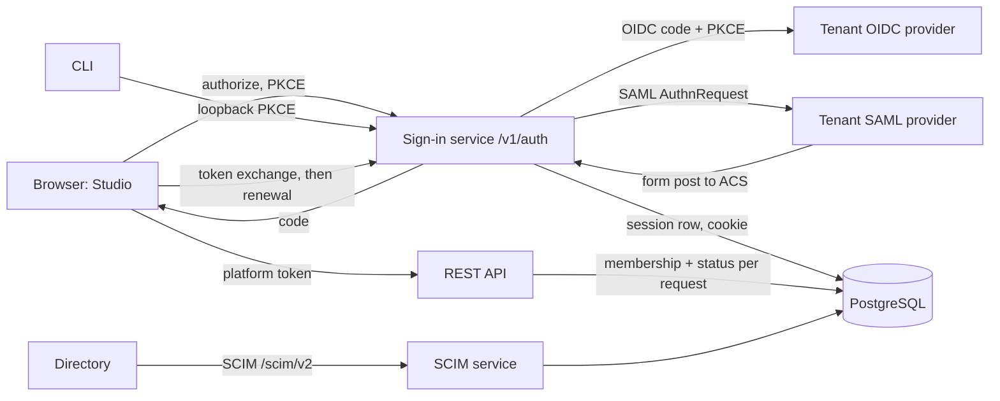

# Federated login: each organization signs in through its own OIDC or SAML provider

*   **Author:** Claude Code, for the owner
*   **Status:** Draft
*   **Date:** 2026-11-24

--------------------------------------------------------------------------------

## Overview

Today a deployment has one identity provider. The operator configures one OIDC issuer; its tokens name the tenant in a
`tenant` claim and the person in `sub`, and the API reads the person's built-in role from the membership row on every
request. A tenant cannot bring its own provider, nobody can add a member through the product (feature 016, Gap 290),
and nothing removes a person when they leave the company.

From release 0.3.0 each tenant (an organization) connects its own identity providers:

- **OIDC and SAML 2.0 connections per tenant.** An administrator adds a connection (Okta, Entra ID, Google Workspace,
  Keycloak, any standard provider), tests it by signing in through it, and activates it. People of the organization
  sign in to the Studio, the CLI and embedded apps through it.
- **The control plane brokers the sign-in and issues its own short-lived tokens**
  ([Architecture decision 0140](../adr/ADR-0140-the-control-plane-brokers-federated-sign-in-and-issues-short-lived-platform-tokens-the-tenant-comes-from-the-connection.md)).
  The connection decides the tenant; nothing the provider or the browser sends can. The API verifies one token format
  whatever the protocol.
- **SAML is verified by the platform's own strict-profile verifier** in memory-safe code, held to `xmlsec1` as an
  oracle in tests
  ([Architecture decision 0141](../adr/ADR-0141-saml-responses-are-verified-by-the-platforms-own-strict-profile-verifier-in-memory-safe-code-with-xmlsec-as-the-test-oracle.md)).
- **Provisioning**: just-in-time on first sign-in, and SCIM 2.0 for users and groups, so a person removed from the
  company's directory loses access within seconds. Groups arrive as durable rows that feature 029 assigns roles and
  folder access to, and a connection may map groups to the built-in role
  ([Architecture decision 0142](../adr/ADR-0142-a-federated-person-is-a-member-linked-to-external-identities-and-provisioning-and-groups-arrive-as-durable-rows-claims-never-authorize.md)).
- **Session security**: server-side sessions with absolute and idle expiry, five-minute access tokens renewed from the
  session, revocation that every process honours within ten seconds, sign-out at the provider, a required
  authentication context (for example multi-factor) per connection, and "sign-in through our provider only" with a
  guard against locking the organization out and an audited break-glass path.
- **Member management** in the API and the Studio: list, pre-provision, change a role, pin it, suspend, remove, link
  identities, see and end sessions.

The deployment issuer keeps working as it does today, beside federation, for deployments that federate upstream and
for break-glass. `apps/dev-idp` grows a development OIDC provider and a development SAML provider, so every flow runs
on a laptop and in CI with no external service.

### Terms

- **Connection.** A tenant's configured identity provider: its protocol (OIDC or SAML), its endpoints and keys, its
  claim or attribute mapping, its provisioning policy and its state (`DRAFT`, `TESTED`, `ACTIVE`, `DISABLED`).
- **Sign-in service.** The control plane's routes under `/v1/auth/`: an OpenID provider for the platform's own clients
  and a relying party or service provider toward the connections.
- **Platform issuer.** `<public origin>/v1/auth`, the `iss` of the tokens the sign-in service issues.
- **Deployment issuer.** The OIDC issuer configured for the whole deployment today (`AuthConfig`).
- **External identity.** (tenant, connection, the provider's stable identifier) linked to one membership subject.
- **Sign-in session.** A row that a browser or a CLI holds through a cookie or a refresh token, from which access
  tokens are issued.
- **Client.** One of the platform's own applications that signs in through the sign-in service: `studio`, `cli`,
  `apps` (the apps origin of feature 027).
- **Break-glass.** Signing in through the deployment issuer to a tenant that requires federated sign-in, by a subject
  the operator named, audited and alerted.

## The Problem

Read from `develop` at 2026-11-24:

- `crates/api-http/src/auth/config.rs` holds one `issuer`, one `audience`, one `jwks_uri` and one `tenant_claim`.
  `TokenVerifier` trusts the claim to name the tenant; `IdentityService::authenticate` resolves the slug and the
  membership `(tenant_id, subject)`.
- `memberships` has `tenant_id`, `subject`, `role` and `created_at`; no status, no profile, no link to an external
  identity. Members are created by `control-plane provision-tenant` and `seed-dev` only; the REST API has no member
  resource (Gap 290 of feature 016).
- The Studio signs in with authorization code and PKCE against the configured issuer (`src/auth/oidc.ts`), keeps the
  token in memory and signs out at its expiry; its content security policy allows `connect-src` to the issuer's origin
  only (`crates/api-http/src/studio.rs`).
- `apps/dev-idp` issues ES256 tokens from a JSON request for any subject and tenant (development only); it has no
  authorization endpoint, no ID token and no SAML.
- Feature 029 refuses group claims and wrote the contract a group source must meet; it waits for this design (its
  Owner question 1440). Feature 027's embedded sign-in assumes the issuer accepts the apps origin's redirect (its Gap
  1364).

What is missing for an organization that adopts the platform:

1. **Its own provider.** Each tenant needs its own OIDC or SAML connection without the operator.
2. **Offboarding.** Removing a person from the company directory must remove their access. Today a membership lives
   until an operator runs SQL.
3. **Groups.** Access by team, managed where the company manages people.
4. **Control of sessions.** Short tokens, sign-out everywhere, a required second factor.

Temporal Cloud offers SAML single sign-on per account and SCIM; Windmill's enterprise edition offers OIDC and SAML
single sign-on, SCIM and group sync. Both are hosted or enterprise-only; this design brings the same to every
deployment of this platform, with the tenant boundary, the audit trail and the revocation the rest of the platform
already has.

## Requirements

### Functional

**Connections**

- **Requirement 013-001** A tenant administrator (new permission `identity:manage`, built-in `admin` only, reserved
  and administrator-equivalent in feature 029's catalog) MUST be able to create, change, test, activate, disable and
  delete identity connections of protocol `OIDC` or `SAML`, at most 8 per tenant. A connection MUST pass from `DRAFT`
  to `TESTED` only by a completed test sign-in through it by an administrator, and to `ACTIVE` only from `TESTED`; a
  change of its endpoints, keys or mapping MUST return it to `DRAFT` unless it is `DISABLED`. *Acceptance:* the
  integration tests of each transition and of a change that resets an active connection to draft (refused while it is
  the only active connection of a tenant that requires federated sign-in, Requirement 013-021).
- **Requirement 013-002** A token issued through a connection MUST name that connection's tenant; no claim,
  attribute, parameter, header or path segment from the provider or the browser MAY choose or change the tenant.
  *Acceptance:* the contract test that a provider asserting `tenant: other` still yields the connection's tenant, and
  that a callback for connection A with state of a sign-in through connection B is refused.
- **Requirement 013-003** An OIDC connection MUST name an `https` issuer whose discovery document, key set and token
  endpoint the control plane fetches through the guarded egress client (Requirement 013-024), a client identifier, and
  a client authentication of `client_secret_basic`, `client_secret_post` or `private_key_jwt` with a key the platform
  generates for the connection and publishes at the connection's key set. *Acceptance:* integration tests per
  authentication method against the development provider.
- **Requirement 013-004** A SAML connection MUST hold the provider's entity identifier, its single sign-on address
  (HTTP-Redirect binding), one to three signing certificates (for rotation), the name identifier format or an
  immutable attribute for the subject, and the attribute names for e-mail, display name and groups; it MAY be created
  from the provider's metadata document (uploaded, or fetched once through the guarded egress client). The platform
  MUST publish the service provider's metadata for the connection (entity identifier, assertion consumer service,
  optional request-signing certificate). *Acceptance:* the metadata round trip with the development SAML provider; a
  metadata document with a SHA-1-only certificate is accepted for display and refused at activation.

**Sign-in**

- **Requirement 013-005** The sign-in service MUST be an OpenID provider for the clients `studio`, `cli` and `apps`:
  discovery, key set, authorization endpoint and token endpoint under `/v1/auth/`. The authorization endpoint MUST
  require PKCE with S256, a `state`, and a redirect URI registered for the client exactly (the CLI's loopback
  redirect with any port, RFC 8252); it MUST refuse anything else without redirecting. *Acceptance:* contract tests for
  each refusal; the Studio's existing OIDC code signs in against it unchanged except for the issuer it reads.
- **Requirement 013-006** A person MUST be able to start a sign-in by the organization's slug or by an e-mail address
  whose domain the tenant verified (Requirement 013-022); with several active connections the person chooses one.
  Discovery MUST NOT reveal whether a tenant, a domain or a person exists beyond what the redirect itself shows: an
  unknown organization or domain answers the same page as a known one without an active connection. *Acceptance:*
  the contract test that unknown and unconfigured answers are byte-identical.
- **Requirement 013-007** An OIDC sign-in MUST use authorization code with PKCE (S256) toward the provider, a `state`
  and a `nonce` bound to the sign-in attempt, the `iss` callback parameter when the provider sends it (RFC 9207), and
  MUST validate the ID token: signature by a key of the provider's key set with an algorithm of RS256, PS256 or ES256,
  `iss`, `aud` containing the client identifier, `azp` when there are several audiences, `exp`, `iat` within the
  tolerance, `nonce`, and a non-empty `sub`. The identity MUST come from the ID token; `userinfo` MAY add display
  claims only. *Acceptance:* one refusal test per check with the development provider configured to break it.
- **Requirement 013-008** A SAML sign-in MUST be service-provider-initiated and verified by Architecture decision
  0141's strict profile; an unsolicited response MUST NOT sign anyone in and MAY start a service-provider-initiated
  sign-in through that connection. *Acceptance:* the corpus of Architecture decision 0141 and the oracle test.
- **Requirement 013-009** A sign-in attempt MUST be bound to the browser that started it by a short-lived
  `__Host-` cookie (10 minutes, `Secure`, `HttpOnly`, `SameSite=None` so that a SAML form post carries it) whose hash
  is stored with the attempt, and the callback or the assertion consumer service MUST refuse an attempt of another
  browser, a used attempt and an expired one. *Acceptance:* the login cross-site request forgery tests (a response
  injected into another browser is refused).
- **Requirement 013-010** A connection MUST be able to require authentication context values (OIDC `acr`, SAML
  `AuthnContextClassRef`); a sign-in without one of them MUST be refused with a reason the person can act on.
  *Acceptance:* refusal and acceptance tests with the development providers.

**Identities and provisioning**

- **Requirement 013-011** A federated identity MUST be (tenant, connection, the provider's stable identifier) linked to
  exactly one membership subject (Architecture decision 0142); the platform MUST NOT link identities by e-mail.
  *Acceptance:* `two_connections_with_one_email_make_two_members`.
- **Requirement 013-012** A connection MAY enable just-in-time provisioning with a default role of `viewer` (the
  default), `operator` or `developer`, never `admin`, optionally limited to e-mail addresses of the tenant's verified
  domains; the first sign-in then creates the membership (subject `user:<uuid>`), its external identity, its profile
  and its role in one transaction with the session. Without it, an unknown identity is refused and the refusal is
  audited. *Acceptance:* integration tests for both, including a crash after the membership insert (nothing remains).
- **Requirement 013-013** A connection MAY map provider groups to the built-in role with up to 32 ordered rules (a
  group value, a role); the highest role a rule gives MUST win, the default role applies when none does, and an
  administrator's pin MUST keep a member's role unchanged by mapping. A computed role that differs from the stored one
  MUST change it with an audit record and feature 029's revocation of custom grants. *Acceptance:* the property test
  of Architecture decision 0142 and an integration test of a role change by mapping.
- **Requirement 013-014** Groups MUST arrive as feature 029 external groups through the two source kinds of
  Architecture decision 0142 (SCIM and sign-in assertion) under the amended group-source contract, and confer nothing
  until an assignment or a folder entry names them. *Acceptance:* the group tests named under Architecture decision
  0142.
- **Requirement 013-015** A tenant MUST be able to enable SCIM 2.0 (RFC 7643, RFC 7644) for a connection: `/Users` and
  `/Groups` with create, read, replace, patch (add, remove and replace of members, `active`, `displayName`, `emails`,
  `name`), delete, the filter `eq` on `userName`, `externalId` and `displayName`, `/ServiceProviderConfig`,
  `/ResourceTypes` and `/Schemas`; no bulk, sort or `/Me`. A SCIM user MUST be matched to the connection's sign-in
  identity by a configured attribute (`userName` or `externalId`) equal to the provider's stable identifier.
  *Acceptance:* a conformance run of the requests Okta and Entra ID send (recorded fixtures) and the error format of
  RFC 7644 section 3.12.
- **Requirement 013-016** `active: false` MUST suspend the membership and revoke its sessions in the same transaction;
  delete MUST remove the membership with feature 029's cascades and keep the external identity, marked
  deprovisioned, for the audit trail. *Acceptance:* `a_scim_deactivation_refuses_the_next_request_and_every_token_within_the_poll`.
- **Requirement 013-017** A SCIM endpoint MUST authenticate by a bearer token of 32 random bytes per connection, shown
  once, stored as SHA-256, at most two in force for rotation, and MUST take the tenant from the token only; it MUST be
  rate-limited per connection and bounded (1 MiB per request, 1,000 member operations per patch). *Acceptance:* the
  cross-tenant battery entries, a rotation test and the limit tests.

**Sessions and tokens**

- **Requirement 013-018** A sign-in MUST create a session row (absolute expiry 12 hours by default, at most 24; idle
  expiry 2 hours by default) and set a `__Host-sagat_signin` cookie (`Secure`, `HttpOnly`, `SameSite=Lax`, path `/`)
  whose value is stored only as a hash. Access tokens MUST be ES256 JSON web tokens of at most five minutes with `iss`,
  `aud`, `tenant`, `sub`, `sid`, `jti`, `iat` and `exp`. The Studio MUST renew them through
  `POST /v1/auth/session/token`, which needs the cookie, an exact `Origin` and the header `X-Sagat-Renew`, and MUST
  keep tokens in memory only. *Acceptance:* contract tests for each condition of the renewal; the Studio test that a
  reload renews without a redirect while the session lives.
- **Requirement 013-019** Revocation: a suspended or removed membership MUST be refused on its next request (the
  membership's status is read on every request, as the role is today); a revoked session MUST stop renewing at once
  and its access tokens MUST be refused by every serving process within the revocation poll interval (default 10
  seconds); a long-lived stream MUST end when its token or its session ends. *Acceptance:* the revocation tests of
  Architecture decision 0140.
- **Requirement 013-020** Member management: `GET /members` (with role, status, connection, last sign-in), `POST
  /members` (pre-provision an external identity of a connection with a role), `PATCH /members/{subject}` (role, pin,
  status), `DELETE /members/{subject}`, `POST /members/{subject}/identities` and `DELETE .../identities/{id}` (link and
  unlink, audited), `GET /members/{subject}/sessions` and `DELETE /members/{subject}/sessions` (end all), each under
  `membership:manage` except reading one's own sessions; `GET /auth/sessions` and `DELETE /auth/sessions/{sid}` for the
  caller's own. *Acceptance:* integration tests per route and role; the cross-tenant battery.
- **Requirement 013-021** A tenant MAY require federated sign-in: then the deployment issuer is refused for its
  members except the break-glass subjects the operator names with `control-plane identity break-glass` (audited,
  alerted). Enabling it MUST be refused unless an active connection exists and the enabling administrator's current
  session came through an active connection of the tenant; disabling or deleting the last active connection MUST be
  refused while it is required. *Acceptance:* the lockout tests.
- **Requirement 013-022** A tenant MAY verify e-mail domains by a DNS TXT record `_sagat-challenge.<domain>` holding a
  value the platform generated; a domain MUST be verified by at most one tenant of a deployment (a second claim is
  refused and the operator decides); a verified domain is re-checked every 24 hours and becomes unverified after three
  failed checks. *Acceptance:* tests with the test resolver.
- **Requirement 013-023** Sign-out: `POST /v1/auth/logout` MUST revoke the session and clear the cookie; for an OIDC
  connection whose discovery has `end_session_endpoint`, and a SAML connection with a single logout address, the
  Studio MUST offer to sign out at the provider too (front-channel redirect). *Acceptance:* tests with the development
  providers.
- **Requirement 013-024** Every outbound call to a provider (discovery, key set, token endpoint, metadata, userinfo)
  MUST go through `crates/infra-egress` with bounded timeouts and sizes, `https` only, to an address that is public or
  allowed by the deployment's `SAGAT_IDENTITY_ALLOWED_HOSTS`; a refused destination MUST be a typed problem on the
  connection, never a request to a private address. *Acceptance:* the server-side request forgery tests (loopback,
  private ranges, link-local, a redirect to a private address, a DNS answer that changes).
- **Requirement 013-025** A connection's client secret MUST be written through the connection API into the secret
  provider of feature 017 and never returned; the platform's signing keys, the connections' `private_key_jwt` keys and
  the service provider's request-signing keys MUST be held the same way and rotated with an overlap. *Acceptance:* the
  canary test that no secret appears in a response, log, span, audit record or error.
- **Requirement 013-026** The CLI MUST sign in with `sagat login --org <slug>` through a loopback redirect, receive an
  access token and a refresh token (one use, rotated on every refresh; a reused one revokes the session and is
  audited; CLI sessions absolute 7 days, idle 24 hours), and store them in the operating system's key store, or a file
  with mode `0600` where none exists. *Acceptance:* CLI tests against the test composition; the reuse test.
- **Requirement 013-027** The Studio MUST offer sign-in by organization or e-mail, the connection chooser, and tenant
  screens for connections (with a guided setup per protocol and provider, the service provider's metadata, the test
  sign-in and activation), domains, SCIM tokens, mapping rules, members, sessions and the federated-only setting; every
  control the person cannot use is shown unavailable with the permission it needs. *Acceptance:* component tests and
  the journey of Success criterion 013-001.

**Cross-cutting**

- **Requirement 013-028** Audit: connection created, changed, tested, activated, disabled and deleted; sign-in
  succeeded; sign-in refused (collapsed per connection, reason and five minutes); member provisioned (just in time,
  SCIM, pre-provisioned), role changed (reason `mapping`, `administrator`, `scim`), suspended, removed; identity linked
  and unlinked; session ended (reason); SCIM token created and revoked; domain verified and lost; federated sign-in
  required and released; break-glass used. No token, assertion, secret or claim value beyond the subject enters an
  audit record.
- **Requirement 013-029** Observability: spans for each sign-in step, provider call, SCIM request and renewal;
  metrics with closed labels (`protocol`, `step`, `outcome`, closed reasons), never a tenant, connection, subject or
  group; logs without tokens, codes, assertions, cookies or claim values.
- **Requirement 013-030** Errors reuse the closed `Error.code` set with `details.reason` values of Technical Plan 11;
  the sign-in pages show a sentence and a reference (the trace identifier), never the provider's error text verbatim.
- **Requirement 013-031** Ceilings: 8 connections per tenant, 3 certificates per SAML connection, 32 mapping rules, 256
  group values per sign-in assertion, 1,000 external groups per connection, 10,000 members per group, 20 sessions per
  member (the oldest is ended), 2 SCIM tokens per connection, 16 verified domains per tenant; effective = minimum of
  request, tenant setting and deployment ceiling; zero refuses.
- **Requirement 013-032** Compatibility: federation is off until the deployment enables it (`identity.federation`,
  and `identity.scim`, in the capability list of design 050); the deployment issuer, existing memberships and existing
  clients are unchanged; the migrations are additive with a `down` that refuses while federation rows exist.
- **Requirement 013-033** `apps/dev-idp` MUST serve a development OIDC provider (authorization code with PKCE, ID
  tokens with a configurable subject, e-mail, groups and `acr`, discovery, key set, end session) and a development SAML
  provider (signed responses, metadata, a switch per test that breaks one check), and MUST keep refusing to start
  outside `SAGAT_ENV=dev`. *Acceptance:* the dev-idp tests; the production image check that it is absent.

### Non-functional

- **Non-functional requirement 013-001 (security)** Release-blocking: a token for a tenant other than the
  connection's; a sign-in completed in a browser that did not start it; a SAML response accepted outside the profile;
  an identity linked by e-mail; a request to a private address on behalf of a connection; a secret, token, code or
  assertion in a log, span, audit record, response or error; a suspended member served after its next request; a
  revoked session's token served after the poll interval.
- **Non-functional requirement 013-002 (durability)** A provisioning, a role change, a suspension and a session
  revocation commit with their audit in one transaction; a crash leaves the previous state; a repeated SCIM request
  has no second effect.
- **Non-functional requirement 013-003 (performance)** Token verification for platform tokens costs no network and no
  database read beyond today's membership read; the sign-in latency, the renewal latency and the SCIM request latency
  are measured on a declared environment. No figure is promised.
- **Non-functional requirement 013-004 (compatibility)** Existing deployments, tokens, memberships, SDKs, workers and
  Studio builds work unchanged until federation is enabled, and after it for the deployment issuer.
- **Non-functional requirement 013-005 (accessibility)** The sign-in pages and the identity screens meet WCAG 2.2 AA
  as the rest of the Studio (design 050, Requirement 050-022).

### Success criteria

- **Success criterion 013-001** In the test composition, an administrator configures an OIDC connection and a SAML
  connection against the development providers, tests and activates both, maps a group to `operator`, enables SCIM,
  and a person pushed by SCIM signs in through each protocol and starts a run; deactivating the person by SCIM refuses
  their next request at once and their live token within the poll interval.
- **Success criterion 013-002** The SAML corpus is refused case by case with its reason, and the oracle agrees with
  `xmlsec1` on every accepted document.
- **Success criterion 013-003** The interoperability run against Keycloak (a pinned image, started by the tests)
  passes for OIDC and SAML.
- **Success criterion 013-004** The cross-tenant battery covers every new route with zero findings, and the canary
  scan finds no secret, token, code or assertion anywhere it looks.

### User stories

- **User story 013-01** As a tenant administrator, I connect my company's identity provider, test it and turn it on,
  without the operator (CUJ 1).
- **User story 013-02** As a person of the organization, I sign in with my company account to the Studio and the CLI
  (CUJ 2).
- **User story 013-03** As an administrator, when someone leaves the company their access ends without my doing
  anything in the platform (CUJ 3).
- **User story 013-04** As an administrator, I give teams access through the groups my directory already has (CUJ 4).
- **User story 013-05** As an administrator, I require our provider and a second factor, and I cannot lock us out by
  mistake (CUJ 5).

## Goals

- Each tenant brings its own OIDC or SAML provider, self-served and audited.
- One token format for the API, a tenant binding the platform owns, and offboarding within seconds.
- Groups and roles from the directory, as durable rows feature 029 can use.
- No C XML code in the control plane, and a SAML verifier that refuses everything outside a narrow profile.
- Every flow testable on a laptop and in CI with the development providers and a pinned Keycloak.

## Non-Goals

- Being a general identity provider for other applications. The sign-in service issues tokens for the platform's own
  clients only.
- Encrypted SAML assertions, SAML artifact binding, IdP-initiated sign-in without a service-provider round trip,
  WS-Federation, LDAP and Kerberos (Gap 013-004).
- Passwords, magic links, social sign-in other than through an OIDC connection, and multi-factor authentication run
  by the platform. The provider authenticates; the platform can require its context (Requirement 013-010).
- OIDC back-channel logout in 0.3.0 (Gap 013-005); SCIM deactivation and the revocation poll cover offboarding.
- Machine identities (workers, runners) through federation. They keep their tokens from the deployment issuer and
  their bindings (feature 009).
- One person across tenants. A person in two tenants is two members.
- Approval eligibility by group (feature 029, Gap 1448, keeps it out).

## Open Questions

None open. The questions of this design were decided by the agent the coordinating session briefed, under Owner
decision 2026-11-24-4, each weighed over its options and recorded below as "delegate (OD-2026-11-24-4)".

### Decisions

- **Decision 013-001 — Broker in the control plane.** See Architecture decision 0140 (options: a multi-issuer resource
  server, an external broker, opaque sessions).
- **Decision 013-002 — SCIM is in 0.3.0.** Options: just-in-time provisioning only; SCIM too. Chosen: SCIM. Without it,
  leaving the company does not end access until a person's token expires and an administrator remembers to remove
  them, groups can only come from sign-in snapshots, and an enterprise buyer's security review fails (Temporal Cloud
  and Windmill's enterprise edition both offer it). Its cost is bounded by the subset of Requirement 013-015.
- **Decision 013-003 — Access tokens of five minutes plus a revocation poll.** Options: one-hour tokens (today's
  maximum); five minutes; opaque tokens read on every request. Chosen: five minutes, a membership status read on every
  request (already a read today) and a ten-second poll of a revocation table per process. Offboarding by suspension is
  immediate; a revoked session can act for at most ten seconds; no new read on the request path.
- **Decision 013-004 — The Studio renews through a cookie-authenticated, same-origin call.** Options: refresh tokens in
  the browser (exposed to script); a hidden frame with `prompt=none` (the Studio is unframeable, `frame-ancestors
  'none'`); a same-origin renewal call. Chosen: the renewal call, protected by `SameSite=Lax`, an exact `Origin` and a
  custom header that forces a preflight a cross-site page cannot pass.
- **Decision 013-005 — The subject of a new federated member is `user:<uuid>`.** Options: the provider's `sub`; the
  e-mail; a platform identifier. Chosen: a platform identifier (Architecture decision 0142).
- **Decision 013-006 — Just-in-time provisioning never makes an administrator.** Options: any default role; never
  `admin`. Chosen: never `admin`; a mapping rule may give `admin` to a group, which an administrator wrote and the
  audit trail shows.
- **Decision 013-007 — SCIM groups do not expire by silence; assertion groups do.** See Architecture decision 0142,
  option 5. Feature 029's contract is amended.
- **Decision 013-008 — SAML through the platform's own verifier.** See Architecture decision 0141.
- **Decision 013-009 — Feature 029's Owner question 1440 and 1442 are answered by this design.** Identity-provider
  groups come from design 013 (both source kinds) and member management is design 013's (Requirement 013-020); see the
  readiness pass of feature 029.
- **Decision 013-010 — Keycloak as the interoperability target in tests.** Options: recorded fixtures only; a live
  provider account (an account the owner would have to create); a pinned Keycloak container started by the tests.
  Chosen: the container, plus recorded SCIM fixtures of Okta and Entra ID; it runs in CI under the repository's
  infrastructure rule (AGENTS.md rule 16). A live Okta or Entra ID run is the owner's to arrange (an account).
- **Decision 013-011 — Domain verification by DNS TXT, one tenant per domain.** Options: no domains (slug only); e-mail
  domain claimed without proof; DNS proof. Chosen: DNS proof, because discovery by e-mail and the just-in-time domain
  limit both depend on the domain being the tenant's.

### Gaps

- **Gap 013-001** A provider that reuses a `sub` for a new person after deleting the old one makes the new person the
  old member; the platform cannot detect it. The runbook tells administrators to use providers with immutable
  identifiers and SCIM deletion.
- **Gap 013-002** Front-channel sign-out at the provider depends on the browser following the redirect; a closed tab
  leaves the provider's session open (the platform's is revoked).
- **Gap 013-003** A revoked session's access token can act for up to the poll interval (10 seconds) on a process that
  missed one poll, up to the token's expiry (5 minutes) on a process that cannot reach the database, which serves
  nothing then anyway.
- **Gap 013-004** No encrypted assertions, artifact binding or IdP-initiated sign-in (Non-Goals).
- **Gap 013-005** No OIDC back-channel logout in 0.3.0.
- **Gap 013-006** The interoperability run uses Keycloak and recorded fixtures; no live run against Okta, Entra ID or
  Google Workspace is part of CI.

## Owner decisions needed

None for the build. The scope is Owner decision 2026-11-24-1 ("federated login (013)"); the questions above, the
acceptance of Architecture decisions 0140 to 0142 and the settlement of review findings are delegated by Owner decision
2026-11-24-4. A live interoperability run against a commercial provider needs an account, which only the owner can
create (Decision 013-010); it is not a gate of this design.

## Critical User Journeys (CUJs)

### CUJ 1: An administrator connects Entra ID (User story 013-01)

*   **Given**: a tenant `acme` on a deployment with federation enabled, and its administrator signed in through the
    deployment issuer.
*   **When**: she adds an OIDC connection, follows the Entra ID guide (redirect URI and key set address to copy into
    Entra), enters the issuer and the client identifier, chooses `private_key_jwt`, saves, runs "Test sign-in" in a new
    window and signs in with her company account, then activates the connection.
*   **Then**: the discovery and key set were fetched through the guarded egress client; the test linked her company
    identity to her existing member (she confirmed the link); the connection is `ACTIVE`; every step is in the audit
    log.

### CUJ 2: A developer signs in (User story 013-02)

*   **Given**: the connection above with just-in-time provisioning to `developer` limited to `acme.com`, and a verified
    domain `acme.com`.
*   **When**: a developer opens the Studio, types `dev@acme.com`, is sent to Entra ID, signs in, and later runs `sagat
    login --org acme` in a terminal.
*   **Then**: the first sign-in created the member `user:<uuid>` with role `developer`; the Studio holds a five-minute
    token it renews from the session; the CLI got its own session and stores its refresh token in the key store.

### CUJ 3: A person leaves (User story 013-03)

*   **Given**: SCIM enabled on the connection, and the developer above with an open Studio and a running CLI command.
*   **When**: the company's directory deactivates the person and Entra ID sends `PATCH /Users/{id}` with
    `active: false`.
*   **Then**: the membership is suspended and both sessions revoked in one transaction; the next API request of either
    is refused; the live access token is refused by every process within ten seconds; the run the person started
    keeps running (runs belong to the namespace, not to the session).

### CUJ 4: Teams through groups (User story 013-04)

*   **Given**: SCIM pushes the group `payments-oncall` with five members; feature 029 is enabled.
*   **When**: the administrator assigns the custom role `release-manager` to the external group in namespace `payments`,
    and later the directory removes one member from the group.
*   **Then**: the five gain the role on their next request; the removed member loses it on the next request after the
    SCIM change commits.

### CUJ 5: Require the provider and a second factor (User story 013-05)

*   **Given**: one active connection, the administrator signed in through the deployment issuer.
*   **When**: she tries to require federated sign-in; then signs in through the connection, sets the required
    authentication context to the multi-factor value, and requires federated sign-in.
*   **Then**: the first attempt is refused ("sign in through an active connection first"); afterwards a person whose
    sign-in lacks the second factor is refused with a reason; the operator's break-glass subject can still sign in
    through the deployment issuer, and its use raises an alert.

## Technical Plan (Architecture)

### 1. Shape

Everything runs in the control plane process; provider calls leave through the guarded egress client. Nothing runs in
the engine.

### 2. Placement

| Concern | Path |
|---|---|
| Connection, mapping rules, provisioning policy, session policy, SCIM patch semantics, the SAML profile's rules over parsed values (pure) | `crates/domain/src/federation.rs`, `crates/domain/src/federation/` |
| Sign-in use cases (begin, complete OIDC, complete SAML, exchange, renew, logout), provisioning (just in time, SCIM users and groups), connection and member administration, domain verification; ports `FederationStore`, `OidcProvider`, `SamlVerifier`, `TokenSigner`, `DomainResolver` | `crates/application/src/federation/` |
| OIDC client over `crates/infra-egress`, the SAML parser, canonicalization and signature check, the ES256 signer over the secret provider, the DNS TXT resolver | `crates/infra-federation` (new adapter crate) |
| Tables, stores, the revocation table and its poll query | `crates/infra-postgres` (migration `<ts>_federated_login`, `src/federation.rs`) |
| Routes `/v1/auth/*`, `/scim/v2/*`, `/identity/*`, `/members*`; the multi-issuer verifier; the revocation set | `crates/api-http/src/routes/{signin,scim,identity_admin,members}.rs`, `crates/api-http/src/auth/{issuers,revocations}.rs` |
| Configuration, key bootstrap, the revocation poller, `identity break-glass` | `apps/control-plane` |
| Development OIDC and SAML providers | `apps/dev-idp` |
| `sagat login`, key store | `apps/cli` |
| Sign-in by organization, renewal; identity screens | `frontend/apps/studio/src/auth/`, `frontend/apps/studio/src/features/identity/` |

`scripts/check-architecture.py` gains two rules: no server crate depends on `libxml`, `xmlsec` or a crate that links
them; only `crates/api-http/src/auth` builds a `Principal` from a token.

### 3. Data model

| Table | Holds | Notes |
|---|---|---|
| `identity_connections` | tenant, id, slug, protocol, state, display name, settings revision (immutable revisions in `identity_connection_revisions`), provisioning policy, required authentication context | composite tenant keys; a change writes a revision |
| `identity_connection_certificates` | SAML signing certificates, at most 3 | public data |
| `identity_mapping_rules` | connection, position, group value, role | at most 32 |
| `external_identities` | tenant, connection, provider subject, membership subject, created, last sign-in, deprovisioned at | unique (tenant, connection, provider subject) |
| `member_profiles` | tenant, subject, display name, e-mail (display only), role pinned, status (`ACTIVE`, `SUSPENDED`) | `memberships` gains `status` (default `ACTIVE`) instead, so the per-request read stays one row |
| `signin_attempts` | id, tenant, connection, client, browser binding hash, PKCE challenge of the client, state, nonce, the provider-side verifier, SAML request id, created, expires, used at | purged after an hour |
| `signin_sessions` | id, tenant, subject, connection, client, cookie hash or refresh token hash and its generation, created, last renewed, absolute and idle expiry, authentication context, revoked at and reason | |
| `signin_session_revocations` | session id, revoked at | read by the poll; rows older than the longest token lifetime are purged |
| `saml_assertion_replays` | tenant, connection, assertion id, expires | purged after expiry |
| `scim_tokens` | connection, hash, created, last used, revoked | at most 2 in force |
| `scim_resources` | tenant, connection, kind, SCIM id, `externalId`, the membership subject or external group, version (for `ETag`) | |
| `verified_domains` | tenant, domain, challenge, state, last checked, failures | unique (domain) across tenants among verified rows |
| `external_groups`, `external_group_members` | feature 029's external groups: source kind (`SCIM`, `ASSERTION`), connection, external value, generation, freshness | owned by this design; feature 029 reads them through its evaluator |

Storage classification: settings, profiles and group values are `content`; hashes, keys references and session
metadata `protected_system`. The runtime role gets per-table grants; the migration's `down` refuses while a connection
exists.

### 4. Sign-in flows

**Begin.** `GET /v1/auth/authorize?client_id=studio&redirect_uri=…&code_challenge=…&code_challenge_method=S256&state=…&organization=acme`
(or `login_hint=dev@acme.com`). The service resolves the tenant by slug or verified domain, picks the active
connections (a chooser page when there are several), creates a `signin_attempts` row, sets `__Host-sagat_login`
(Requirement 013-009) and redirects to the provider: OIDC with its own PKCE, `state` and `nonce`; SAML with an
`AuthnRequest` whose `ID` is stored, by HTTP-Redirect binding, `RelayState` the attempt id. When a live session for that
tenant exists for this browser (`__Host-sagat_signin`) and the client is `studio` or `apps`, it issues a code at once
without a provider round trip.

**Complete.** `GET /v1/auth/callback/oidc/{connection}` or `POST /v1/auth/callback/saml/{connection}` checks the
attempt (this browser, unused, unexpired, same connection), verifies the provider's answer (Requirement 013-007 or
Architecture decision 0141), checks the required authentication context, then in one transaction: resolves or creates
the external identity and membership (just in time), stores the assertion's groups (assertion source), computes the
mapped role, creates the session, marks the attempt used, writes the audit; then sets the session cookie and redirects
to the client's redirect URI with a one-use code (60 seconds) bound to the client's PKCE challenge.

**Exchange.** `POST /v1/auth/token` with `grant_type=authorization_code`, the code and the PKCE verifier returns the
access token (and for `cli` a refresh token). `grant_type=refresh_token` (`cli` only) rotates the refresh token; a
reuse of a spent one revokes the session.

**Renew.** `POST /v1/auth/session/token` (Studio and apps): cookie, exact `Origin` of the client, header
`X-Sagat-Renew: 1`; extends the idle expiry and returns a new access token; refuses after the absolute expiry.

**Verify.** `crates/api-http/src/auth/issuers.rs` reads `iss` from the unverified header and claims only to select the
verifier: the deployment issuer's `TokenVerifier` (unchanged) or the platform issuer's verifier with the in-process key
set (current and previous keys). After verification, the request path resolves tenant and membership as today, now
refusing a status other than `ACTIVE`, and for a platform token refuses a `sid` in the revocation set.

**Revocation set.** Each process holds the set of session ids revoked within the last token lifetime, refreshed every
10 seconds by one indexed query of `signin_session_revocations` newer than its last read. A process that cannot read
it for three intervals refuses platform tokens with `503 UNAVAILABLE` (fail closed), as it would refuse without the
database anyway.

**Break-glass.** With federated sign-in required, `IdentityService::authenticate` refuses a deployment-issuer token for
that tenant unless the subject is in the tenant's break-glass list, which only `control-plane identity break-glass`
(schema-owning role) writes; each use writes an audit record and raises the alert `IDENTITY_BREAK_GLASS_USED`.

### 5. SAML verifier

As Architecture decision 0141. `crates/infra-federation/src/saml/`: a `roxmltree` parse with the limits (no DTD,
entities refused by the parser's configuration and checked again), an exclusive canonicalization over the parsed tree
for the signed element (the transforms allowed: enveloped signature, exclusive canonicalization with an optional
inclusive namespace prefix list), SHA-256 digest, RSA PKCS#1 v1.5 SHA-256 or ECDSA P-256 SHA-256 verification with the
RustCrypto crates the workspace already uses through `jsonwebtoken`. The verified element is returned by handle; the
domain rules (`crates/domain/src/federation/saml.rs`) then check issuer, destination, recipient, `InResponseTo`,
audience and times over the values read from that element only. The replay store keeps assertion ids until their
`NotOnOrAfter`.

### 6. Provisioning, groups and roles

- **Just in time** (Requirement 013-012): in the completion transaction, under the tenant's membership lock order
  (Architecture decision 0050, slot 4a: memberships) and the tenant quota for members.
- **SCIM** (`crates/api-http/src/routes/scim.rs`, `crates/application/src/federation/scim.rs`): each request is one
  transaction under the tenant access fence of feature 029 when 029 is enabled; users map to external identities and
  memberships; groups to `external_groups` with `generation` incremented per accepted change; `ETag` from the
  resource version; `If-Match` honoured. A repeated request is idempotent by its effect (adding an existing member,
  removing an absent one, replacing with the same set change nothing).
- **Assertion groups**: the full set of a sign-in replaces the person's assertion memberships for that connection;
  they confer nothing once the session that wrote them ends (revoked or expired), and at most 24 hours after the
  sign-in (Architecture decision 0142); a group removed at the provider is therefore removed here at the next sign-in
  or when the session ends, which is why the runbook recommends SCIM where timely removal matters.
- **Role mapping**: computed from stored groups at sign-in and after each SCIM group change for the affected members;
  the change and its audit and feature 029's revocation commit together.
- **The amended contract**: `specs/029-custom-roles-folders/contracts/group-source.md` is updated in the readiness
  pass of feature 029 to the two source kinds (generations per group for both; freshness per kind).

### 7. Sessions and cookies

| Cookie | Attributes | Value | Lifetime |
|---|---|---|---|
| `__Host-sagat_login` | `Secure`, `HttpOnly`, `SameSite=None`, path `/` | 32 random bytes; hash in `signin_attempts` | 10 minutes |
| `__Host-sagat_signin` | `Secure`, `HttpOnly`, `SameSite=Lax`, path `/` | 32 random bytes; hash in `signin_sessions` | the session's absolute expiry |

The Studio's content security policy needs no change: the sign-in service is same-origin. A development deployment on
plain `http` loopback uses the same names without `__Host-` (browsers refuse the prefix without `Secure`); the
configuration refuses that outside `SAGAT_ENV=dev`.

### 8. Discovery and domains

`POST /v1/auth/discover` (a form) takes an organization slug or an e-mail address and redirects to the authorize
endpoint of the resolved tenant, or to the same neutral page for anything unresolved; it is rate-limited per address
and per tenant. Domain verification: `POST /identity/domains` returns the challenge; `POST
/identity/domains/{domain}/verify` resolves `_sagat-challenge.<domain>` through the configured resolver with a 3-second
timeout; a background check (leased, bounded) re-verifies every 24 hours.

### 9. Development and test providers

`apps/dev-idp` gains `/authorize`, `/token` (authorization code), `/userinfo`, `/end-session` and `/saml/sso`,
`/saml/metadata`, configured by a JSON file of test people (subject, e-mail, groups, `acr`) and a per-request switch
that breaks one check (a wrong `aud`, an old assertion, a second assertion) for the refusal tests. It keeps its
start-up refusal outside `SAGAT_ENV=dev`, and the production image check keeps it out. Keycloak, a pinned image, is
started by `tests/support` for the interoperability suite only; `xmlsec1` runs in a disposable container for the oracle
test. `infra/docker/compose.yaml` gains nothing for production; the development profile gains the dev-idp's new port
mapping only.

### 10. Studio

- **Sign-in** (`src/auth/`): `config.json` names the platform issuer when federation is on; the sign-in page asks for
  the organization or an e-mail address and posts to the discovery form; the existing OIDC module then runs against the
  platform issuer; the session store renews 60 seconds before expiry and on reload; sign-out calls
  `/v1/auth/logout` and offers the provider sign-out. The organization slug may be remembered in local storage (a
  convenience; never a token).
- **Identity screens** (`features/identity/`, tenant level): connections (list, guided setup for Entra ID, Okta, Google
  Workspace, Keycloak and generic OIDC and SAML, the values to copy into the provider, test sign-in in a new window,
  activate, disable), domains, SCIM (tokens shown once, last request, error counts), mapping rules, members (list,
  filter, pre-provision, role, pin, suspend, remove, identities, sessions), the federated-only setting with its guard.
  Built on the interface module of Architecture decision 0101.

### 11. Contracts and errors

- `specs/001-platform-foundation/contracts/openapi.yaml`: the `/v1/auth/*` operations that return JSON (discovery, key
  set, token, renewal, logout, discover), `/identity/*` and `/members*`, their schemas and errors, `x-implemented:
  '013'`; the SCIM routes in a separate fragment `specs/013-federated-login/contracts/scim.openapi.yaml` (SCIM's own
  media type and error format).
- `details.reason` values (new): `CONNECTION_NOT_ACTIVE`, `CONNECTION_STATE`, `SIGNIN_ATTEMPT_INVALID`,
  `SIGNIN_PROVIDER_REFUSED`, `SIGNIN_TOKEN_INVALID`, `SAML_PROFILE_VIOLATION`, `AUTH_CONTEXT_REQUIRED`,
  `IDENTITY_NOT_PROVISIONED`, `IDENTITY_LINK_CONFLICT`, `FEDERATION_REQUIRED`, `LOCKOUT_GUARD`,
  `PROVIDER_DESTINATION_DENIED`, `DOMAIN_CLAIMED`, `DOMAIN_UNVERIFIED`, `REFRESH_TOKEN_REUSED`, `SESSION_REVOKED`,
  `MEMBER_SUSPENDED`. Each has a remediation row.
- `docs/runbooks/federated-login.md`: enabling federation, the public origin, keys and their rotation, provider
  guides, SCIM setup, break-glass, revocation, the alerts.
- `docs/architecture/security-and-sandbox.md`: the sign-in service, the token issuers, the SAML profile.

### 12. Rollout

1. Deploy 0.3.0 with federation off: nothing changes.
2. The operator sets `SAGAT_PUBLIC_ORIGIN`, lets the control plane create its signing key, and enables
   `identity.federation` (and `identity.scim`). The Studio's `config.json` then names the platform issuer; people of
   tenants without a connection keep signing in through the deployment issuer, which the sign-in page offers.
3. Each tenant adds its connections. Requiring federated sign-in is per tenant.

Rollback: disable federation; the deployment issuer serves every tenant again; federation rows stay.

## Risks and Mitigations

| Risk | Mitigation |
|---|---|
| A tenant's provider signs someone into another tenant | The tenant comes from the connection (Requirement 013-002); contract test |
| SAML signature wrapping or canonicalization defects | The strict profile and verified-element handle (Architecture decision 0141); corpus; oracle |
| Login cross-site request forgery, response injection | Browser-bound attempts (Requirement 013-009) |
| Server-side request forgery through an issuer address | Guarded egress, public addresses or an operator allowlist (Requirement 013-024) |
| Account takeover by e-mail linking | No e-mail linking (Requirement 013-011) |
| An organization locks itself out | The lockout guard and break-glass (Requirement 013-021) |
| A flapping directory changes roles back and forth | Roles change only on a stored change; pins; every change audited |
| A stale SCIM connection | An informational alert after 7 days without a request; groups do not expire (Decision 013-007) |
| The signing key leaks | Keys in the secret provider, five-minute tokens, rotation with overlap, revocation of sessions |
| Revocation poll falls behind | Fail closed after three missed intervals (Technical Plan 4) |

## Constitution Check

| Principle | Result | Evidence |
|---|---|---|
| I. State and retry semantics are explicit and durable | Pass | Provisioning, role changes, suspensions and revocations commit with their audit in one transaction; no run state is touched |
| II. Modular domain, ports and adapters | Pass | Rules in the domain; use cases and ports in `application`; one new adapter crate (`infra-federation`) for provider protocols, XML and keys; no new edge into the domain; an architecture rule keeps C XML libraries out |
| III. External effects are at-least-once; sagas compensate | n/a | Provider calls are reads and token exchanges for a sign-in, not workflow effects |
| IV. Compatibility is versioned and pinned | Pass | Off by default; additive migrations and routes; the deployment issuer unchanged; no IR, worker-protocol or SDK change |
| V. Code, tenant boundary and secrets are isolated | Pass with conditions (Complexity Tracking) | The tenant from the connection; secrets in the secret provider, never returned; guarded egress; a new trust boundary (the platform signs tokens), justified below |
| VI. Observability and audit are part of the feature | Pass | Audit of every change and sign-in outcome; closed-label metrics; no token, code or assertion in logs |
| VII. Events are redeliverable; inbox and outbox are the contract | Pass | SCIM requests are idempotent by effect; no message is added |
| VIII. Failure is tested and contracts are verified, honestly | Pass | Corpus, oracle, cross-site request forgery, server-side request forgery, revocation and crash tests; interoperability with a pinned Keycloak; the live commercial-provider gap stated (Gap 013-006) |
| Delivery Constraints | Pass | The development providers stay development-only and out of the production image; no new runtime technology beyond a Rust crate set reviewed under the dependency rules |

## Complexity Tracking

| Addition | Why it is needed | Simpler alternative rejected |
|---|---|---|
| The platform signs its own tokens | One token format for two protocols; the tenant binding is the platform's | Accepting each provider's tokens (no SAML, provider-chosen subjects) |
| A SAML verifier of our own | No C XML code in the control plane; a narrow profile | `samael` with `xmlsec1` and `libxml2` |
| SCIM | Offboarding and groups from the directory | Just-in-time only (no offboarding) |
| A revocation poll per process | Revocation within seconds without a read per request | Opaque tokens read on every request |
| Two cookies | Browser binding of an attempt across a cross-site form post; a renewable session | Refresh tokens in script |

## Alternatives Considered

- **A multi-issuer resource server**, **an external broker**, **opaque sessions**: Architecture decision 0140.
- **`samael`**, **a sidecar verifier**, **OIDC only**: Architecture decision 0141.
- **The provider's subject as the platform subject**, **e-mail linking**, **claims on each request**: Architecture
  decision 0142.
- **One-hour tokens without a revocation set**: Decision 013-003.

## Non-Functional Requirements

Non-functional requirements 013-001 to 013-005 above. Their tests: the security suites of Task 013-12 (001); the crash
and duplicate tests of Tasks 013-6 and 013-8 (002); the benchmark of Task 013-14 (003); the existing suites unchanged
with federation off and on (004); axe on the sign-in pages and identity screens (005).

--------------------------------------------------------------------------------

## Detailed Implementation Plan

Documents first: Task 013-1 lands before code. Tests are seen failing first. The new targets are
`integration_federated_login`, `contract_federated_login`, `security_federated_login`, `fault_federated_login` and
`e2e_federated_login`. Two builders can work in parallel after Task 013-2: the server builder (Tasks 013-3 to 013-9;
`crates/`, `apps/control-plane`) and the clients builder (Tasks 013-10, 013-11 and 013-13; `apps/dev-idp`, `apps/cli`,
`frontend/apps/studio/src/auth/`, `features/identity/`), which works against the contract of Task 013-2 and the
development providers.

- [ ] T013-1 Documents: `docs/architecture/security-and-sandbox.md` (the sign-in service, the issuers, the SAML profile),
  `docs/runbooks/federated-login.md`, the remediation rows, the amended group-source contract of feature 029 (already in
  the readiness pass), `docs/glossary.md` (connection, external identity, sign-in session).
  Verification: the docs checks; a reviewer reads each page against this design.
  Refs: Requirement 013-001, Requirement 013-014, Requirement 013-030
- [ ] T013-2 Contracts: the OpenAPI operations and schemas of Technical Plan 11, the SCIM fragment, `schema.d.ts`
  regenerated, the cross-tenant battery entries, the capability names.
  Red tests: `contract_federated_login::the_operations_of_design_013_exist_with_their_errors`.
  Refs: Requirement 013-005, Requirement 013-015, Requirement 013-020, Requirement 013-032
- [ ] T013-3 Domain: connections, revisions and states, mapping rules, provisioning policy, session policy, SCIM patch
  semantics, the SAML rules over parsed values, `identity:manage` in `crates/domain/src/identity.rs`.
  Red tests: `a_change_returns_an_active_connection_to_draft`, `the_highest_mapped_role_wins_in_any_order` (property),
  `a_pinned_role_is_never_mapped`, `jit_never_defaults_to_admin`, `a_scim_patch_is_idempotent_by_effect`.
  Refs: Requirement 013-001, Requirement 013-012, Requirement 013-013
- [ ] T013-4 Migration and stores (`crates/infra-postgres`): the tables of Technical Plan 3, `memberships.status`,
  grants, storage classification, the `down` refusal.
  Red tests: migration up and down; `runtime_privileges`; the classification manifest test.
  Refs: Requirement 013-011, Requirement 013-018, Requirement 013-032
- [ ] T013-5 `crates/infra-federation`: the OIDC client over guarded egress, the SAML verifier of Architecture decision
  0141, the ES256 signer over the secret provider, the DNS resolver; the architecture rules.
  Red tests: the SAML corpus (each case its reason), `the_oracle_agrees_with_xmlsec_on_every_accepted_document`,
  `a_private_address_is_never_fetched`, `a_redirect_to_a_private_address_is_refused`.
  Refs: Requirement 013-007, Requirement 013-008, Requirement 013-024, Requirement 013-025
- [ ] T013-6 Sign-in use cases and routes: authorize, discover, callbacks, exchange, renewal, logout; browser binding;
  just-in-time provisioning; assertion groups; mapping; sessions.
  Red tests: `a_response_injected_into_another_browser_is_refused`, `a_provider_cannot_choose_the_tenant`,
  `unknown_and_unconfigured_discovery_answers_are_identical`, `a_crash_after_the_membership_insert_leaves_nothing`,
  `a_reload_renews_without_a_redirect`, `renewal_needs_the_origin_and_the_header`.
  Refs: Requirement 013-002, Requirement 013-005, Requirement 013-006, Requirement 013-009, Requirement 013-012, Requirement 013-018
- [ ] T013-7 Verification and revocation: the multi-issuer verifier, `memberships.status` on every request, the
  revocation set and its poll, streams ending with their session, break-glass.
  Red tests: `a_suspended_member_is_refused_on_the_next_request`, `a_revoked_session_is_refused_within_the_poll`,
  `three_missed_polls_fail_closed`, `a_deployment_token_is_refused_when_federation_is_required`,
  `break_glass_is_audited_and_alerted`.
  Refs: Requirement 013-019, Requirement 013-021
- [ ] T013-8 SCIM: users, groups, tokens, limits, error format, the recorded Okta and Entra ID fixtures.
  Red tests: one per fixture; `a_deactivation_revokes_sessions_in_its_transaction`; `a_repeated_request_changes_nothing`;
  `the_tenant_comes_from_the_token`.
  Refs: Requirement 013-015, Requirement 013-016, Requirement 013-017
- [ ] T013-9 Administration routes: connections (with test sign-in and activation), domains and their re-check,
  members, identities, sessions, the federated-only setting and its guard.
  Red tests: one per route and role; `enabling_federation_only_needs_a_session_through_an_active_connection`;
  `the_last_active_connection_cannot_be_disabled_while_required`; `a_domain_is_verified_by_one_tenant`.
  Refs: Requirement 013-020, Requirement 013-021, Requirement 013-022
- [ ] T013-10 `apps/dev-idp`: the development OIDC and SAML providers with their break switches.
  Red tests: `cargo test -p sagat-dev-idp`; `the_production_image_has_no_dev_idp`.
  Refs: Requirement 013-033
- [ ] T013-11 Studio: sign-in by organization, renewal, sign-out at the provider; the identity screens.
  Red tests: component tests per screen and role; `the_token_never_reaches_storage`.
  Refs: Requirement 013-023, Requirement 013-027
- [ ] T013-12 Security suites: cross-site request forgery, server-side request forgery, replay, the canary scan,
  required authentication context, the cross-tenant battery.
  Refs: Requirement 013-010, Non-functional requirement 013-001
- [ ] T013-13 CLI: `sagat login`, the key store, rotation and reuse.
  Red tests: `a_reused_refresh_token_revokes_the_session`.
  Refs: Requirement 013-026
- [ ] T013-14 Interoperability with Keycloak (OIDC and SAML), the journey of Success criterion 013-001, and the
  benchmark of sign-in, renewal and SCIM latency on a declared environment.
  Verification: `cargo test -p sagat-tests --test e2e_federated_login --locked -- --ignored`, recorded with its result.
  Refs: Requirement 013-028, Requirement 013-029, Requirement 013-031, Non-functional requirement 013-003

#### Follow-up tasks

None yet.

### Verification Plan

- Unit and property tests in `crates/domain` (mapping, policies, SCIM patch semantics) and `crates/infra-federation`
  (SAML corpus, canonicalization, OIDC validation).
- Oracle: `xmlsec1` in a disposable container agrees with the verifier on every accepted document.
- Integration on real PostgreSQL: sign-in, provisioning, revocation, SCIM, administration; with
  `SAGAT_TEST_AS_RUNTIME_ROLE=1`.
- Fault: a crash at each statement of provisioning, role change, suspension and revocation.
- Security: the suites of Task 013-12; the cross-tenant battery.
- Interoperability: Keycloak (pinned) for OIDC and SAML; recorded Okta and Entra ID SCIM fixtures.
- End to end: the journey of Success criterion 013-001 in a real browser.
- Gates: `cargo fmt`, `clippy -D warnings`, `python3 scripts/check-architecture.py`, the Studio's npm gates, the docs
  checks. Results are recorded as run, with failures and skips.
