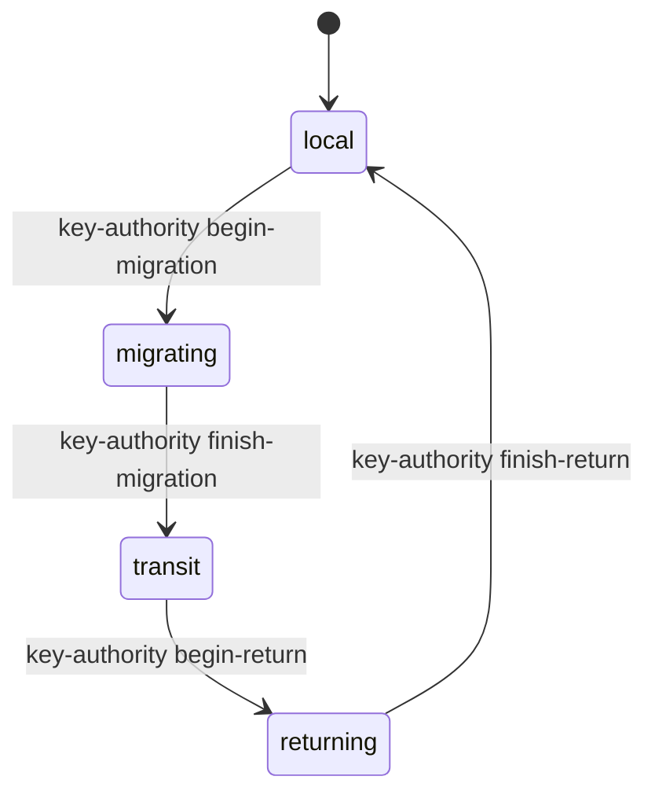

# OpenTelemetry for the three signals, and OpenBao as the key and secret authority

*   **Author:** Claude Code, for the owner
*   **Status:** Draft
*   **Date:** 2026-11-26

--------------------------------------------------------------------------------

## Overview

Two operator-facing foundations that release 0.3.0 completes (Owner decision 2026-11-24-1, roadmap row 15):

- **OpenTelemetry.** Traces, metrics and logs of every platform process reach an OpenTelemetry Collector, which the
  operator points at any backend (Grafana, Datadog, Honeycomb, Elastic, a vendor's OTLP endpoint). Today only traces do:
  metrics are a Prometheus page and logs are JSON lines on standard output. After this design the Collector scrapes the
  metrics, the processes send their logs over OTLP with the trace and span of the work they describe, and the
  production Collector configuration ships in the repository with authentication and TLS.
- **OpenBao.** OpenBao becomes the authority for the platform's three keys. Today one key ring in an environment
  variable (`SAGAT_SECRETS_KEYS`) seals the secrets stored in PostgreSQL, an Ed25519 key in another
  (`SAGAT_SCRIPT_SIGNING_KEY`) signs scripts, and a 32-byte file (`SAGAT_OPENBAO_INTENT_KEY_FILE`) binds feature 017's
  provisioning intents with no rotation; feature 017 already keeps some secret values in OpenBao's KV engine. After this
  design, with the `transit` key authority mode, those three keys live in OpenBao's Transit engine, rotate without a
  restart, and the data keys of stored secrets are separated per tenant by derivation; each custody has its mount, its
  policy and its token. The three keys' material never leaves OpenBao; the per-secret data keys do, unwrapped into the
  memory of the process that opens a secret and cached there for at most 300 seconds (Gap 015-003, accepted by the
  owner). Outside this design's scope stay: design 042's per-tenant HMAC key, which stays in the database (Owner
  decision 2026-11-26-117); feature 031's customer keys, which stay outside the platform's OpenBao; the Collector's
  ingest token, a Kubernetes Secret; and the credentials of the database, the OIDC provider and the brokers, which
  keep their own configuration.

The two halves share one design because they share one deployment story (a Collector and an OpenBao beside the
platform, both in the repository's compose files and Helm chart) and one rule: telemetry must never carry what OpenBao
guards. They are built by two lanes that touch different crates (Detailed Implementation Plan).

The decisions are [Architecture decision 0151](../adr/ADR-0151-every-signal-reaches-the-collector-and-the-platform-keeps-one-exporter-per-signal.md)
and [Architecture decision 0152](../adr/ADR-0152-openbao-transit-holds-the-platform-keys-and-each-custody-has-its-own-mount-and-token.md),
proposed with this design and accepted with its approval, under the owner's delegation (Owner decision 2026-11-24-4).
The registers are in `specs/015-opentelemetry-and-openbao/research.md`.

*Revision note.* The review reports are under `docs/designs/015-opentelemetry-and-openbao.reviews/`; what each round
changed is in the register (Decisions 015-011 to 015-017).

### Terms

- **Collector.** The OpenTelemetry Collector (contrib distribution), a separate process the operator runs.
- **Key authority mode** (the mode, for short). Where the platform's three keys live and are used: `local` (the key ring
  and key files of today) or `transit` (OpenBao Transit), and the two passages between them, `migrating` (from `local`
  to `transit`) and `returning` (back). It is recorded in `key_authority_state.mode` and changed only by the commands
  of the section Key authority modes and passages. A process does not choose the mode: its configuration only says
  which keys it can use (Technical Plan 11). "Authority" in this design means this mode and nothing else.
- **Passage.** One of the two modes `migrating` and `returning`, in which both sets of keys are in use while stored
  values move from one custody to the other.
- **Local key.** Any of the three keys of today held by a process: the ring (`SAGAT_SECRETS_KEYS`), the script-signing
  key (`SAGAT_SCRIPT_SIGNING_KEY`) and the intent key file (`SAGAT_OPENBAO_INTENT_KEY_FILE`).
- **Registry requirement** and **capability.** The instance registry of ADR-0082: a process lists capabilities, each
  only for what its configuration runs; the operator records a registry requirement (a capability every live process
  of the named kinds must list) with the schema-owning role, and the registry refuses a process of those kinds that
  lacks it. "Registry requirement" is always written in full, so that it is never confused with a requirement of this
  design (Requirement 015-010 and the others).
- **Gate.** A process's serving gate (ADR-0082 decision 3): open, it serves; closed, it stays up and answers only its
  liveness probe.
- **Heartbeat.** The registry call each control plane and engine makes every 10 seconds, jittered to 12, on its own
  connection (ADR-0082 decision 4).
- **Hand-over window.** The time between `finish-migration` and the moment the operator records the registry
  requirement `key-authority-ring-absent-v1`, during which a process may still hold a local key under `transit` but
  never uses it; and, on the way back, the time between removing that registry requirement and `begin-return`.
- **Schema-owning role.** The PostgreSQL role that owns the schema and runs migrations and operator commands, as
  `provision-tenant` does; never the runtime role `sagat_app`.
- **Custody of a secret value.** Where one secret's value is kept: `local` (sealed in PostgreSQL under the key ring,
  today), `openbao` (in OpenBao's KV engine through feature 017's provider path, today) and, new, `transit` (sealed in
  PostgreSQL under a data key that Transit wraps). The column that records a secret's custody is named
  `secrets.authority` for historical reasons; it holds a custody, not a mode.
- **Secret version** and **version row.** One value of a secret, a row of `secret_versions`, numbered 1, 2, 3 within
  its secret. **Key version.** One version of a Transit key (`sagat-secrets`, `sagat-scripts` or `sagat-intent`),
  numbered by Transit. This design always says which of the two it means; the other numbered things are named in full:
  the **sealing version** (`seal_version`, the key version new data keys are issued at), the **sealing floor**
  (`min_seal_version`, the lowest key version a stored wrapped key may have, enforced by a trigger; and its twins
  `scripts_min_version` and `intent_min_version` for the other two keys), the **wrapped key version**
  (`wrapped_key_version`, the key version of one stored wrapped key) and the **binding version** (1 for the intent key
  file, 2 for Transit).
- **Data key.** A random 256-bit AES-GCM key that seals one secret version. Stored only wrapped.
- **Wrapped data key.** A data key encrypted by the Transit key `sagat-secrets` (`vault:v<N>:<base64>`, `N` a key
  version), stored with the ciphertext, with `N` also in an integer column.
- **Derivation context.** The bytes Transit derives a per-tenant key from: `base64("sagat/secret/v1" || the tenant id's
  16 bytes)`.
- **Re-seal inventory.** The list of every table that holds sealed values, so that no passage, retirement or trim can
  forget one (Technical Plan 5).

## Key authority modes and passages

This section is the one place that says what each mode needs and how a deployment moves between them; the
requirements state outcomes and cite it, and Technical Plans 5, 6 and 10 hold only the mechanism.



`local` is the default and the state after an upgrade. Each arrow is one command, run with the schema-owning role,
which changes the mode through `key_authority_set_mode` in one transaction with its guard and its audit record
(Technical Plan 5). Both `local` and `transit` are supported in production; neither passage is ever started
automatically.

**How a process learns the mode.** A control plane or an execution engine reads `key_authority_state.mode` with a plain
`SELECT` at registration and after every successful heartbeat, and compares its configuration with it each time, so
it learns a change within one heartbeat. What it believes the mode is only picks its code path: the triggers of
Technical Plan 5 enforce the mode on every write under the state row's lock, so a seal begun under a mode that has just
changed is refused at its commit, and the writer reads the mode again and retries (at most twice). A process whose
configuration disagrees with the mode follows ADR-0082: its gate closes; it never exits. Only these two kinds take part
(the kinds of the instance registry); the secret cleanup job opens no secret, and the sandbox runners are gated by the
runner gate below.

**The keys each process needs, per mode.** The control plane holds all three local keys today (the ring, the
script-signing key and, with feature 017's provider configured, the intent key file); the execution engine holds the
ring only. "Transit" below means a Transit configuration (Technical Plan 11). A process whose configuration misses a
key of its cell keeps its gate closed; the rules are chosen so that no step of the rollout orders below closes a
serving process's gate.

| Mode | Control plane needs | Execution engine needs | Allowed, unused, with a warning |
|---|---|---|---|
| `local` | today's rules: the ring for the secret routes, the script-signing key for the script routes, the intent key file with feature 017's provider | the ring, as today | Transit: it never seals, signs or binds with it (the triggers refuse) |
| `migrating` | the ring (to open and re-seal `local` values), the script-signing key when the script routes are enabled (to publish the legacy public key until `scripts resign` reports zero), the intent key file with feature 017's provider (to verify pending intents at binding version 1), and Transit | the ring and Transit | none |
| `transit` | Transit | Transit | any local key, during the hand-over window only: it never seals, signs or binds with it, logs `key_authority.local_key_configured` once per mode change, sets `key_authority_local_key_configured{key}` to 1, and the alert `KeyAuthorityLocalKeyConfigured` fires after 24 hours; once the registry requirement `key-authority-ring-absent-v1` is recorded, a local key closes the gate |
| `returning` | a fresh ring (to re-seal under it; one holding a key id of `retired_ring_key_ids` closes the gate), the script-signing key (only the local key signs in this mode), the intent key file with feature 017's provider (new intents are bound at binding version 1), and Transit | the ring and Transit | none |

**Capabilities and registry requirements.** Each is listed only for what the configuration has (ADR-0082 decision 7):

| Capability | Control plane lists it when | Execution engine lists it when |
|---|---|---|
| `key-authority-transit-v1` | it has Transit | it has Transit |
| `key-authority-return-v1` | it has Transit, the ring and the script-signing key, and the intent key file when feature 017's provider is configured | it has Transit and the ring |
| `key-authority-ring-absent-v1` | none of the three local keys is configured | the ring is not configured |

A registry requirement is recorded with the generic `control-plane capability-activate <capability>` (refused while a
live process of the kinds lacks the capability) and removed in two phases, as ADR-0082's amendment of 2026-11-26 sets
out: first the registry requirement is set to draining, then it is removed once every live process of its kinds has
applied the drain's epoch, which its next heartbeat records (about 12 seconds).

**The transitions.**

| Transition | Command | Guard, checked in the command's transaction | Registry requirements |
|---|---|---|---|
| `local` to `migrating` | `key-authority begin-migration` | the mode is `local`; the runner gate below; the operator's attestation for stopped runners | `key-authority-transit-v1` recorded |
| `migrating` to `transit` | `key-authority finish-migration` | under the state row's lock: zero `local` values in every entry of the re-seal inventory, zero secrets of custody `local`, zero pending intents at binding version 1, zero artifacts without a Transit signature at or above `scripts_min_version` | `key-authority-transit-v1` recorded |
| `transit` to `returning` | `key-authority begin-return` | the mode is `transit` | `key-authority-return-v1` recorded; `key-authority-ring-absent-v1` not recorded |
| `returning` to `local` | `key-authority finish-return` | under the state row's lock: zero `transit` values in every inventory entry, zero secrets of custody `transit`, zero pending intents at binding version 2, zero artifacts without a local signature | `key-authority-return-v1` recorded |

Between the two commands of a passage the operator runs `reseal-secrets --to transit` (or `--to local`), which
re-seals every inventory entry, and `scripts resign`, and waits until no intent of the old binding version is pending.

**The runner gate.** A sandbox runner of 0.2.x trusts one key fetched once and would refuse every Transit signature.
Every runner of this design sends `Sagat-Runner-Trust` on each request, and the control plane records sightings per
runner identity (Requirement 015-013). `begin-migration` is refused while a runner identity's newest sighting without
`key-list-v1` (the form `absent` or `configured-v1`) is younger than 3 minutes or newer than that identity's newest
`key-list-v1` sighting, and it names those identities. A live old runner is always seen; the identity of an upgraded
one clears 3 minutes after its last old request, once it has sent a `key-list-v1` request, so the rollout needs no
day-long wait.

**The way in, in this order; no serving process's gate closes at any step:**

1. Upgrade every process to this release (mode `local`) and every sandbox runner; each runner's first request records
   a `key-list-v1` sighting.
2. Run the bootstrap of Technical Plan 7 against OpenBao, then add Transit to every control plane and execution engine
   by a rolling restart, keeping their local keys; each now lists `key-authority-transit-v1` and
   `key-authority-return-v1`.
3. Record the registry requirement `key-authority-transit-v1` for both kinds.
4. `key-authority begin-migration`. Within a heartbeat every process sees `migrating`, has what the table asks, and
   stays open.
5. `reseal-secrets --to transit`, `scripts resign`, and wait until no intent at binding version 1 is pending.
6. `key-authority finish-migration`. Every process sees `transit`; each still holds its local keys, so it stays open,
   never uses them, and warns.
7. Remove the ring, the script-signing key and the intent key file from every control plane and engine by a rolling
   restart; each now lists `key-authority-ring-absent-v1` and the warning stops.
8. Record the registry requirement `key-authority-ring-absent-v1` for both kinds. From here no process holds a local
   key: a process started with one keeps its gate closed.
9. Dispose of the old keys outside the processes. Every PostgreSQL backup taken before `finish-migration` holds
   `local` rows sealed under the ring, and a value not changed since has the same plaintext today, so the ring and an
   old backup still read current secrets outside OpenBao. Delete the Kubernetes Secret `secrets.existingSecret` (and
   the script-signing key and intent key Secrets) from the cluster; keep one copy of the ring offline, under a custody
   separate from those backups (other people's access and another location, so that no one who can reach the backup
   store also reaches the ring), for exactly as long as a backup older than `finish-migration` is retained, since only
   a restore of such a backup needs it; then destroy it and record the destruction. The archived ring is never put
   back into the cluster: the way back uses fresh keys (step 2 below). Only from here does "no platform key outside
   OpenBao" hold. Migrating does not protect a value against a ring that was already exposed: such values must be rotated at
   their source (a new password at the database, a new token at the provider), not only re-sealed.

**The way back, in this order:**

1. Remove the registry requirement `key-authority-ring-absent-v1` (both phases).
2. Generate a fresh ring, whose key id differs from every key id of the archived ring, and a fresh script-signing key
   and intent key file; never reuse the archived ring of step 9, which also opens the pre-migration backups and may
   have been exposed. After `finish-migration` no `local` row remains, so a return re-seals under any ring. Add the ring
   to every control plane and engine, and the two other keys to every control plane, by a rolling restart, keeping
   Transit; each lists `key-authority-return-v1` again and, under `transit`, stays open and warns. The database
   enforces the freshness: `reseal-secrets --to transit` records, through `key_authority_record_retired_ring_ids`
   (owner-role, in the re-seal's transaction), every ring key id it re-seals away from in
   `key_authority_state.retired_ring_key_ids`; a control plane or engine whose ring holds one of them keeps its gate
   closed in `returning`, and `reseal-secrets --to local` refuses it.
3. Record the registry requirement `key-authority-return-v1` for both kinds.
4. `key-authority begin-return`. Every process sees `returning` within a heartbeat and has what the table asks.
5. `reseal-secrets --to local`, `scripts resign`, and wait until no intent at binding version 2 is pending.
6. `key-authority finish-return`. Every process sees `local`; Transit stays configured and unused.
7. Remove the registry requirements `key-authority-return-v1` and `key-authority-transit-v1` (both phases), then, if
   the operator wishes, Transit by a rolling restart.

Task 015-18 runs both orders under load (a secret resolved every 10 milliseconds) with a rolling restart at each
configuration step, and checks that no gate closes and no resolution fails; that after step 8 of the way in a process
started with the ring is refused; that `begin-return` is refused before step 1 of the way back; and that in `returning`
a control plane without the script-signing key or the intent key file keeps its gate closed, as does a process in
`returning` whose ring reuses a key id of `retired_ring_key_ids`.

## The Problem

**Telemetry.** `crates/telemetry/src/otlp.rs` exports spans over OTLP/HTTP with JSON (`SpanSink` for live spans,
`OtlpClient::export` for spans projected from the journal) to the Collector of `infra/observability/otel-collector.yaml`,
whose only pipeline is `traces`. Metrics are rendered as a Prometheus page on each process's admin port
(`Metrics::render`) and scraped by Prometheus directly (`infra/observability/prometheus.yml`). Logs are JSON lines on
standard output (`json_log.rs`); `OtlpClient::export_log` exists but only the CLI uses it (`apps/cli/src/telemetry.rs`).
So an operator whose backend speaks OTLP must run a Prometheus and a log shipper as well, a log line cannot be followed
to its trace in the backend unless the shipper parses `trace_id` out of the line, and the Collector configuration in the
repository is local development only (no TLS, no authentication, one exporter to Jaeger).

**Keys.** `KeyRing` (`crates/infra-secrets/src/lib.rs`) seals `local` secret versions with AES-256-GCM under keys parsed
from `SAGAT_SECRETS_KEYS`; the associated data binds the tenant, namespace, name, version row id and key id
(`crates/domain/src/secrets.rs`). Rotating means adding a key to an environment variable on every process, redeploying,
running `control-plane reseal-secrets` and removing the old key. The key material sits in the environment of every
control plane and engine. The script-signing key is an Ed25519 private key in an environment variable of the control
plane; sandbox runners trust public keys given by hand (`SAGAT_RUNNER_TRUSTED_KEYS`) or fetched once from the control
plane (`/script-runner/signing-key`), and the signed message binds the tenant, the digest and the language
(`crates/application/src/script_signing.rs`). The intent key of feature 017 has "no multi-key rolling transition"
(`docs/runbooks/database-recovery.md`). Feature 017 already keeps `openbao`-custody values in KV version 2 through
`ManagedSecretService` (migration `20261122000100_openbao_secrets`), with the policies of `infra/openbao/policies/` and
an OpenBao Agent sidecar in `infra/helm`.

Temporal leaves secrets to the user; Windmill stores them encrypted in its database under one instance key. A platform
whose keys never leave a hardened key service, rotate with a command and are separated per tenant is a reason to choose
it for regulated work.

## Requirements

### Functional: OpenTelemetry

- **Requirement 015-001** Every platform process (control plane, execution engine, sandbox runner, database runner, which
  also serves lake work under ADR-0071, and the CLI) MUST be able to send its traces and its logs to a Collector over
  OTLP, configured by the standard `OTEL_*` variables, and expose its metrics for the Collector to scrape. A process with
  no endpoint configured MUST behave as today.
- **Requirement 015-002** Logs MUST be exported as OTLP log records through a bounded queue that never blocks the work
  (a full queue drops the record and counts it, as `SpanSink` does for spans), with the same scrubbing as standard
  output, the severity, the target, the structured fields, and the trace id and span id of the span the line was
  written in. Standard output MUST keep its JSON lines, so that a crash before an export leaves the line somewhere.
- **Requirement 015-003** The metrics MUST reach the Collector through its Prometheus receiver scraping each process's
  admin port, with the names, units and closed labels of today, and the shipped Collector configuration MUST export
  them over OTLP. No second metrics pipeline is added in the processes.
- **Requirement 015-004** The repository MUST ship a production Collector configuration
  (`infra/observability/otel-collector.production.yaml`) whose OTLP receiver requires TLS and a bearer token, whose
  memory limiter answers `429`/`503` before the Collector runs out of memory, which replaces with `[redacted]` the
  string value of any attribute whose name matches the sensitive-name rule of `crates/telemetry/src/redact.rs` and keeps
  numeric and boolean values, exactly as the process does (`is_sensitive_name`: a size such as `payload_bytes` carries no
  secret), as a last defense for attributes (the body of a log record is protected by the in-process scrub only), with
  one active OTLP exporter whose endpoint and credential the operator supplies (Technical Plan 3); and the Helm chart
  MUST be able to point every process at it.
- **Requirement 015-005** Every log record and span carries the resource attributes `service.name`, `service.version`,
  `service.instance.id` and `deployment.environment.name`, set by the process from the sources of Technical Plan 1
  (the Collector adds none of them, so the development and the production Collector see the same attributes); none
  carries a tenant or namespace id as a resource attribute. Metrics MUST NOT gain a tenant, namespace, run or sink
  label (Principle V).
- **Requirement 015-006** The header that authenticates a process to the Collector MUST be readable from a file
  (`OTEL_EXPORTER_OTLP_HEADERS_FILE`, an extension of the standard variables, in the format, precedence and reload rule
  of Technical Plan 1), read again when its content changes or after a `401`, and marked sensitive in the HTTP client.
  A header read from that file MUST be sent only to an `https` endpoint
  or a loopback address, unless the operator sets `SAGAT_OTEL_ALLOW_PLAINTEXT_HEADERS=true` for a Collector reached
  through a mesh that encrypts the hop; otherwise the configuration is an error and the process exports nothing while
  it logs and counts the refusal (it does not stop serving). `OTEL_EXPORTER_OTLP_HEADERS` keeps today's behaviour, so an
  upgrade stops no process that sends a header to an in-cluster `http` Collector today; with a non-loopback `http`
  endpoint and no `SAGAT_OTEL_ALLOW_PLAINTEXT_HEADERS=true` it logs a warning at start, sets the gauge
  `otel_header_plaintext` to 1, and the alert `OtelHeaderPlaintext` fires after 1 hour, so that a token crossing the
  network in clear is seen rather than only logged once. In release 0.4.0 this case becomes the same configuration
  error as for the file (the process exports nothing, logs and counts the refusal, and keeps serving), with
  `SAGAT_OTEL_ALLOW_PLAINTEXT_HEADERS=true` as the explicit opt-out; the release notes of 0.3.0 announce it. In Kubernetes the file is a Kubernetes Secret (`telemetry.headersSecret`)
  that the chart mounts into the control plane, the execution engine and the database runner; the chart has no
  sandbox-runner template, so the sandbox runner's header file is the operator's to provide. The Collector's ingest
  token is not a platform key and gets no OpenBao custody: a process holds every token it uses (Gap 015-005), so a
  custody of its own would add no guarantee.
- **Requirement 015-007** The sensitive-name rule and the value shapes of `redact.rs` MUST cover the material this design
  adds: the names `wrapped_key`, `data_key`, `plaintext`, `ciphertext`, `hmac` and the shapes `vault:v<N>:` and OpenBao
  tokens (`hvs.`, `hvb.`, `hvr.`, `s.`). The new names match as parts of a name, as the existing ones do, and this is
  accepted: a textual `data_key_issued_at` or `hmac_algorithm` is hidden too, so the platform logs the issue time as a
  number (Unix seconds) and never logs an algorithm name under such a field.

### Functional: OpenBao

- **Requirement 015-010** A deployment MUST run in one key authority mode, `local` or `transit`, or in one of the
  passages between them, recorded in PostgreSQL (`key_authority_state.mode`, one row) and changed only by the four
  commands of the section Key authority modes and passages, through functions of the schema-owning role. Both `local`
  and `transit` MUST be supported in production. A control plane or an execution engine MUST learn a change of mode
  within one heartbeat, and one whose configuration lacks a key its mode needs MUST keep its gate closed and never
  exit (ADR-0082), as that section's tables say. No passage step MAY close the gate of a correctly configured serving
  process. Once the registry requirement `key-authority-ring-absent-v1` is recorded, a process holding a local key
  under `transit` MUST keep its gate closed. The Helm chart's validation follows (Technical Plan 11).
- **Requirement 015-011** Under `migrating` and `transit`, every new secret version MUST be sealed by envelope
  encryption: a fresh data key from `transit/datakey/plaintext/sagat-secrets` at the recorded sealing version
  (`key_authority_state.seal_version`) with the tenant's derivation context, AES-256-GCM over the value, the plaintext
  data key wiped after use, and the wrapped data key, its version and the time it was issued stored with the
  ciphertext. A `transit` row has no `key_id` and no provider reference, so a binary older than this design reads it as
  corrupt and fails closed. Which custody a write takes, in each mode:

  | Mode | A write with `requiredProvider: openbao`, or to a secret whose custody is `openbao` | Any other write |
  |---|---|---|
  | `local`, feature 017's provider configured | KV, as today (`requestId` and `expectedVersion` required) | KV, as today |
  | `local`, no provider | refused with `503`, as today | `local`, as today |
  | `migrating`, `transit`, feature 017's provider configured | KV (`requestId` and `expectedVersion` required) | `transit`: `expectedVersion`, when sent, is checked in the write's transaction (`409` on a mismatch), and `requestId`, when sent, is accepted and not stored, since the write is one PostgreSQL transaction whose retry `expectedVersion` detects |
  | `migrating`, `transit`, no provider | refused with `503` (`UNAVAILABLE`), nothing written, as in `local` (`crates/api-http/src/routes/governance.rs`) | `transit`, with the field rules above |
  | `returning`, provider configured | KV (`requestId` and `expectedVersion` required) | `local`, with the same field rules as `transit` |
  | `returning`, no provider | refused with `503`, nothing written | `local`, with the same field rules as `transit` |

  Feature 017's database connection forms send `requiredProvider: openbao` (the contract requires it), so database
  credentials stay in KV. The Studio's general Secrets form sends it today on every write as well
  (`frontend/apps/studio/src/features/secrets/api.ts`) and refuses any answer whose `provider` is not `openbao`
  (`SecretForm.tsx`), which would keep every value written from the Studio out of `transit` custody: Task 015-28 makes
  that form send `requiredProvider: openbao` only when the person chooses "Keep in OpenBao KV" (offered only when the
  provider is configured, and preselected for a secret whose custody is already `openbao`), accept `local`, `transit`
  and `openbao` in the answer and show the custody, while the connection forms keep sending it. A test covers each cell.
  The associated data names the custody with the literal `transit` and the version row's id
  as today, never the key version, so that a rewrap leaves it valid. Opening MUST unwrap through Transit with
  the same context; a wrapped key moved to another tenant's row MUST fail to unwrap. Values of `openbao` custody (feature
  017) stay in KV, unchanged; `local` rows open with the ring until re-sealed.
- **Requirement 015-012** Rotation MUST need no restart and MUST never outrun the backups: a new key version of
  `sagat-secrets` MUST seal nothing until the operator attests, in an audited command, an OpenBao snapshot taken after
  Transit's own creation time of that key version (and, for a cell with standby regions, its restore at every standby;
  Task 015-32). The platform cannot read a snapshot without restoring it and its policies grant no `sys/` path, so this
  gate is the operator's recorded attestation, checked by the runbook's monthly restore drill. There is no automatic
  rotation period. Stored wrapped keys MUST be rewrappable to a newer key version without their plaintext data keys
  leaving OpenBao, and re-keyable with new data keys after a token is stolen (rewrap protects against the exposure of
  an older key version, not against data keys already unwrapped). Retiring a key version of any of the three keys
  MUST first raise a sealing floor that the database enforces on every new or changed sealed value, signature or
  binding, then count, across every entry of the re-seal inventory (and every artifact signature and pending intent),
  the stored values below it, and raise Transit's `min_decryption_version` only when that count is zero and every
  standby has replayed past it; trimming key versions MUST recount the same way. A sealing floor MUST never pass the
  sealing version. A command that changes Transit MUST leave no change unrecorded and no audit record claiming a
  change that did not happen, across a crash. The commands, their guards and their order are Technical Plan 6.
- **Requirement 015-013** Under `transit`, scripts MUST be signed by Transit (`transit/sign/sagat-scripts`, Ed25519) over
  the message `script_signing::message(tenant, digest, language)` of today (made public to the crate), never over a bare
  digest, at a key version published at least 5 minutes earlier. Sandbox runners MUST get the public keys, the minimum
  key version and, until every artifact is re-signed, the legacy local public key from the control plane's authenticated
  endpoint (`/script-runner/signing-key`, extended), never from OpenBao; refresh them every 5 minutes and when a
  signature names an unknown key version (at most once a minute; a refusal for an unknown key is retryable, never
  `Untrusted`); record in each cached artifact the key that verified it and evict it at a refresh that no longer trusts
  that key.

  *Where signatures live.* Artifact bytes stay immutable (`script_artifacts_immutable`, `ENABLE ALWAYS`, is not
  touched): every signature of an artifact is a row of a new insert-only table `script_artifact_signatures` (Technical
  Plan 5), the first one written with the artifact in its transaction, and the migration copies each existing
  artifact's own `signature` and `key_id` into it as its first row. A local signature has the signer `local`, the key
  id `key_id_of` of the public key as today (16 hexadecimal characters) and no key version; a Transit signature has the
  signer `transit`, the key version `N` parsed from Transit's `vault:v<N>:` prefix, the key id `transit-v<N>`, and the
  64 raw bytes of the Ed25519 signature. The control plane serves, from `/script-runner/artifacts/{digest}`, the newest
  signature (by `signed_at`) whose key it still publishes as trusted, in the existing `signature` and `keyId` fields,
  with the additive `signer` and `keyVersion`; the runner verifies a `local` signature by `keyId` and a `transit` one by
  `keyVersion` against the list it fetched. `script_artifacts.signature` and `key_id`, and `script_versions.key_id`,
  stay frozen as the record of the key that signed at build time; no trust decision reads them after the migration.

  `control-plane scripts resign` inserts, for every artifact that has no signature by the signer of the mode at the
  newest published version (the newest Transit version in `migrating` and `transit`, the local key in `returning`), a
  new signature row; the primary key `(tenant_id, digest, key_id)` makes a rerun or a concurrent run insert nothing
  twice (`ON CONFLICT DO NOTHING`). An artifact counts as "signed below `N`" or "signed by the local key" when it has
  no signature row that the runner would trust: retiring a script-key version and leaving either passage require that
  count to be zero. From `begin-migration` on (in `migrating` and `transit`) a new signature row is signed only by
  Transit and a trigger refuses a new row whose signer is `local`; in `returning` and `local` only the local key signs
  and the trigger refuses a new `transit` row, so the zero counts of `finish-migration` and `finish-return` cannot be
  outrun.

  *The runner gate.* A sandbox runner of 0.2.x trusts one key fetched once (trust on first use,
  `apps/sandbox-runner/src/lib.rs`) and never asks again, so it would refuse every Transit signature for good, and a
  look-back at its fetches alone cannot see it. Every request a runner of this design sends to any `/script-runner/`
  operation carries the header `Sagat-Runner-Trust`: `key-list-v1` when it trusts the control plane's list, or
  `configured-v1` when `SAGAT_RUNNER_TRUSTED_KEYS` is set; a 0.2.x runner sends none, and it polls the claim operations
  all the time it runs. The control plane records, at most once a minute per control-plane process and per (runner
  identity, form), the principal subject of the runner's `script:execute` token, the form (`key-list-v1`,
  `configured-v1` or `absent`) and the time, in `script_runner_trust_sightings` (rows older than 24 hours deleted by
  the upkeep). `begin-migration` MUST be refused while, for some runner identity, the newest sighting of the form
  `absent` or `configured-v1` is younger than 3 minutes, or newer than that identity's newest `key-list-v1` sighting
  (an identity with no `key-list-v1` sighting counts as older than any), and it names those identities. A live runner
  of the old form polls all the time, so its sighting is renewed at least every minute and the first condition always
  sees it, even when it shares its identity with upgraded runners; an identity whose old runners are all gone clears
  3 minutes after the last old request, once a `key-list-v1` request has followed it, so the rollout needs no
  day-long wait. The operator attests, in the audited command, that no stopped runner of 0.2.x or with
  hand-configured keys will be started again, the one case no sighting can show. A runner of 0.2.x that is started
  anyway refuses the Transit-signed artifacts (it fails closed) and is counted by `script_runner_legacy_requests_total`,
  with an alert.
- **Requirement 015-014** Under `transit`, feature 017's provisioning intents MUST be bound by Transit HMAC
  (`transit/hmac/sagat-intent`, `algorithm=sha2-256`, so the binding stays 32 bytes) over the intent's metadata and the
  SHA-256 of the value, never the value itself, under a binding version 2 that records the key version. A replay MUST
  read the stored intent first, outside the provider lock, and verify against its stored binding version and key
  version (the file key for binding version 1, `transit/verify` at the stored key version for binding version 2), never
  by recomputing at the newest key version. Bindings at binding version 1 are verified with the file key until no
  pending intent at binding version 1 remains. From `begin-migration` on, a new intent is bound only at binding version
  2, and a trigger refuses a new binding-version-1 row outside `local` and `returning` (in `returning`, new intents are
  bound at binding version 1 and the trigger refuses a new binding-version-2 row); a binding at a key version below
  `intent_min_version` is refused too (Technical Plan 5). The immutability trigger of `secret_provider_operations`
  covers the two new columns.
- **Requirement 015-015** A deployment MUST be able to move from `local` to `transit`, and back, without downtime, by
  the rollout orders of the section Key authority modes and passages. A passage MUST NOT finish while any value of any
  entry of the re-seal inventory, any secret's custody, any pending intent or any artifact still depends on the keys
  the passage leaves, and these guards MUST be checked in the same transaction as the change of mode. Re-sealing MUST
  be bounded, resumable and audited. Each command MUST write its audit record in its own transaction. Task 015-18 runs
  both orders under load.
- **Requirement 015-016** Each custody MUST have its own mount or path prefix and its own policy, and each process kind
  its own token per custody it uses, delivered by one OpenBao Agent per custody in its pod. The custodies and grants are
  the table of Technical Plan 7, plus the token self-paths each needs (`auth/token/lookup-self`, `renew-self`,
  `revoke-self`) and `read` on the Transit keys the control plane uses. Rotating, raising `min_decryption_version` and
  trimming run under a separate operator token (`SAGAT_OPENBAO_OPERATOR_TOKEN_FILE`, read only by the commands of
  Technical Plan 6) whose policy, `operator-keys.hcl`, allows exactly: `read` on `sagat-transit/keys/<key>` for the
  three keys (the key's metadata and public keys, never its material, so the commands' `key_info` needs no second
  token); `update` on `sagat-transit/keys/<key>/rotate` for the three keys; `update` on
  `sagat-transit/keys/<key>/config` for the three keys with only the parameter `min_decryption_version`
  (`allowed_parameters`); and `update` on `sagat-transit/keys/<key>/trim` for the three keys with only
  `min_available_version`. A test MUST refuse any other grant, any wildcard in a mount segment, any `sys/` path and any
  other `auth/` path, and any other `keys/*/config`, `keys/*/rotate`, `keys/*/trim`, `export/`, `backup/` or
  `restore/` path of Transit. The test is `scripts/check-openbao-policies.py` (Technical Plan 7). The configured mount
  names are substituted and validated by the bootstrap. The policies of other features (design 040's operator sink,
  design 047's broker) are not written by this design: the bootstrap installs every policy fragment of
  `infra/openbao/policies/<feature>/` with the allow-list file beside it, and the test reads each fragment's expected
  grants from that file, so each feature adds its own in its own delivery. Because a feature writes both its fragment
  and its allow-list, the allow-list alone cannot certify the fragment: each allow-list MUST declare the custody
  prefixes it owns, each ending with `/`; the test MUST compare paths by whole segments, never as text, and MUST refuse
  any grant not contained in them (but the token self-paths), any grant whose glob could match a path under another
  owner's prefix, and any two prefixes that overlap, between features or with the platform's own (the Transit mount
  and the KV prefix `sagat/credentials/`), so that no fragment can grant another custody's paths (Technical Plan 7). The snapshot policy of Requirement 015-020
  belongs to the operator's OpenBao installation, not to the platform, and lives outside that directory, named as such.
- **Requirement 015-017** If OpenBao cannot be reached, a secret MUST NOT be sealed or opened by any other means
  (Principle V). `KeyAuthorityError` has three kinds: `Unavailable` (retryable), `Refused` (an integrity failure: a key
  that does not open, a version below the minimum, a corrupt row; not retryable, audited, alerted) and `Denied` (the
  token's policy refused). Every reader of a secret maps them, never as "skip": delivery, the output scan of a step,
  webhook signing, inbound webhook verification (`crates/application/src/events.rs`: `Unavailable` answers the sender
  `503` with `Retry-After`, never `Refusal::NoSecret`; `Refused` and `Denied` answer the plain `401` of today, telling
  an unauthenticated sender nothing about the key service, Technical Plan 12), the managed-database reader (`crates/application/src/worker/database.rs`),
  the token broker's credentials and the connector supervisor's credentials (`crates/infra-connectors`). A check of
  `scripts/check-architecture.py` refuses a `resolve_secret` whose error is discarded (Technical Plan 4). How each kind
  reaches each surface (the `AppError` variant, the REST status and code, the gRPC status, whether it is retryable, its
  audit and its alert) is the table of Technical Plan 12, with the three catalogue entries.
  A scan that meets `Unavailable` refuses the report as retryable; one that meets `Refused` refuses the report with
  `KEY_AUTHORITY_REFUSED`, and the engine fails the attempt with that non-retryable failure: the step fails without its
  retry policy (a retry cannot cure an integrity failure), the run follows its failure path, the output is never
  stored, and an audit record and an alert name the secret's version row; a step that declares secrets and reaches a
  replica with no reader configured has its report refused as retryable. Opening MAY use an unwrapped data key held in
  a bounded in-memory cache (Technical Plan 8).
- **Requirement 015-018** Every Transit call MUST be bounded (a 2-second timeout per attempt, at most 3 attempts with
  jitter on a transport error or `5xx`, within a total budget of 5 seconds), counted by the existing family
  `secret_provider_requests_total{provider, operation, outcome}` with `provider="transit"` and one outcome set for every
  provider (`ok`, `denied`, `conflict`, `refused`, `failed`, `unavailable`, `timeout`), traced without a value, a wrapped key, a
  context or a token. The existing KV client (`crates/infra-secrets/src/openbao.rs`) moves to the same set, which
  changes its labels: today every error but `Denied` and `Conflict` is `failed`; after this design a transport failure
  is `unavailable`, the client's own timeout `timeout`, and `Configuration`, `Rejected` and `InvalidResponse` stay
  `failed` (KV never answers `refused`, which is an integrity failure of Transit). No alert or dashboard reads the
  family today; the release notes name the change. The client reads its token file on each call and caches the token's
  `lookup-self` by a digest of the file's content, looking up again after a `403`.
- **Requirement 015-019** OpenBao stays the development service of `infra/docker/compose.database.yaml` (TLS, pinned by
  digest, loopback-only, with a healthcheck, prepared by `docs/runbooks/openbao.md`); its bootstrap
  (`infra/openbao/bootstrap-development.py`, and `bootstrap-kubernetes.py` for production) MUST enable Transit, create the
  three keys and install the policies of Requirement 015-016.
- **Requirement 015-020** Under `transit`, PostgreSQL alone no longer restores a secret, so the repository MUST provide,
  for the operator's own OpenBao installation (`infra/openbao/production-values.yaml`, a snapshot job beside it and
  the runbook; the platform's chart does not deploy OpenBao), scheduled, encrypted Raft snapshots of OpenBao under an
  operator-only policy that no platform role holds (Technical Plan 7), with the custody of the unseal and recovery
  keys, and a restore procedure that pairs a PostgreSQL backup with an OpenBao snapshot taken after it (and lowers
  `min_decryption_version` when the database is older than the last rewrap). Old key versions are trimmed
  (`min_available_version`) only by `control-plane secrets trim-key-versions`, the one holder of that capability, which
  refuses below the oldest key version of the oldest database backup the operator declares retained. A restore that
  meets a row it cannot open reports it (`Refused`) and never half-opens silently.
- **Requirement 015-021** Feature 031's customer keys MUST live outside the platform's OpenBao: in a separate cluster or a
  KMS the customer administers (ADR-0066 decision 1, accepted on 2026-11-24 under Owner decision 2026-11-24-4). The policy test of
  Requirement 015-016 is defense in depth, not the separation; the chart's egress NetworkPolicy, which allows only the
  peers listed and refuses global ones, MUST NOT allow a customer key service: the operator lists those services'
  address blocks in `networkPolicy.customerKeyServices`, and the chart refuses to render when any egress `ipBlock` of
  a platform pod overlaps one of them (Technical Plan 11).
- **Requirement 015-022** A delivery and a step report MUST compare a secret's logical identity (the version row's id,
  its version number and its custody) between their two reads, never its sealed bytes, so that a rewrap, re-key or
  re-seal committed in between does not fail them.

### Non-functional

- **Non-functional requirement 015-001** With the Collector unreachable, no request, pass or step is slower by more than
  1 millisecond at the 99th percentile than with telemetry off: both queues are non-blocking (measured, Task 015-9).
- **Non-functional requirement 015-002** Opening a secret under `transit` with a cold cache adds one Transit round trip
  (the token's lookup is cached); the 99th percentile of a secret delivery with a warm cache stays within 5 percent of
  `local`, on a stated environment (Task 015-21).
- **Non-functional requirement 015-003** The rewrap pass handles at least 1,000 secret versions per second against a
  local OpenBao with batches of 250 (Transit's `batch_input`), on a stated environment (Task 015-21).
- **Non-functional requirement 015-004** No key material, wrapped key, token, context or plaintext data key appears in a
  log line, span, metric, audit record or error (canary test, Task 015-20).

### Success criteria

- **Success criterion 015-001** On the compose stack with the observability profile, one run's trace, its metrics and
  its log lines are found in the backend, each log line linked to its span by trace id and span id.
- **Success criterion 015-002** A rotation, the rewrap pass and the retirement leave every secret openable with no
  process restarted; a row the pass could not rewrap blocks the retirement; a seal held at a barrier between its data
  key and its commit while the retirement raises the sealing floor is refused at its commit and retried with a fresh key;
  a delivery held between its two reads while a rewrap commits succeeds.
- **Success criterion 015-003** A wrapped data key copied into a row of another tenant fails to unwrap, and the failure
  is a typed, audited refusal.
- **Success criterion 015-004** The `local` to `transit` migration runs under load (a secret resolved every 10
  milliseconds) with zero failed resolutions, and ends with zero rows under a local key.
- **Success criterion 015-005** With OpenBao stopped, deliveries of secrets whose data key is still cached succeed
  (with the platform's clock driven past the 239/241 and 299/301 second boundaries); every other delivery, every seal,
  every output scan of a Transit row, webhook signing, inbound webhook verification (a retryable `503` to the sender),
  the managed-database reader and the broker's and connectors' credentials fail closed with `Unavailable`; a corrupt row is `Refused`, never retried for ever; service returns when OpenBao does, with no manual
  step. A 0.2.x reader meeting a `transit` row reads it as corrupt and refuses, never scans past it.
- **Success criterion 015-006** A script signed for tenant A is refused for tenant B and for another language under
  `transit`; a retired signing-key version is refused by a running sandbox runner within its refresh.
- **Success criterion 015-007** A paired restore (a PostgreSQL backup and a later OpenBao snapshot into fresh services),
  with a rotation, a rewrap and a retirement between the two, opens every secret; an unpaired restore reports the rows it
  cannot open as `Refused` instead of half-opening silently; a script artifact run before and after a retirement is
  refused after it, from the runner's cache too.

### User stories

- **User story 015-01** As an operator, I point the platform at my Collector once and see traces, metrics and logs of
  every process in my backend, linked to one another.
- **User story 015-02** As a security officer, I keep every platform key in OpenBao, rotate it on a schedule without a
  deployment, re-key after a token compromise, and prove that a tenant's secrets cannot be opened under another
  tenant's context.
- **User story 015-03** As an operator of an existing install, I move from the environment key ring to OpenBao without
  downtime.

## Goals

- One telemetry path for all three signals, configured once, that never slows the work.
- Under `transit`, once the operator has recorded the registry requirement `key-authority-ring-absent-v1` (step 8 of
  the way in), none of the three platform keys in a process's environment variable or file; until then a process that
  still holds one warns and the alert `KeyAuthorityLocalKeyConfigured` fires after 24 hours; after step 9 the ring is
  held only offline, under a custody separate from the backups it can read. Rotation and re-keying by command.
- One rule for who may read which stored credential, enforced by OpenBao policies as well as by code.

## Non-Goals

- **Running the Collector or the backend for the operator.** The repository ships configurations and charts.
- **OTLP over gRPC or protobuf** in 0.3.0: the processes speak OTLP/HTTP with JSON (Decision 161 of feature 008); the
  Collector translates. A follow-up (Gap 015-001).
- **Moving `local` or `transit` secret values into KV.** KV stays the custody feature 017 offers for values that need
  it; ordinary values stay sealed in PostgreSQL next to their record (Owner question 015-004 below).
- **Holding feature 031's client keys** (Requirement 015-021).
- **The SDK workers' own telemetry**, which the customer exports from their processes; the platform already propagates
  `traceparent` to them.
- **TLS certificates from OpenBao's PKI engine**: a follow-up (Gap 015-002).
- **Separating custodies against a compromised process.** A process holds the tokens of every custody it uses; the
  separation is between process kinds and between code paths (Technical Plan 7).
- **Automatic rotation.** Rotation is the operator's command, gated on a snapshot (Owner question 015-006).

## Open Questions

None for the owner. Technical gaps are registered in `specs/015-opentelemetry-and-openbao/research.md` (Gap 015-001 to
Gap 015-007). The two security residual risks, Gaps 015-003 and 015-005, are accepted by the owner (Owner decision
2026-11-27-1, "Aceito os dois, cache 300 s").

## Owner decisions needed

None open. The questions this design raised are decided under Owner decision 2026-11-24-4, each a delegate row (Owner
decisions 2026-11-26-110 to 2026-11-26-117) and an entry of the research register. The revision after the
implementation-readiness read added the delegate rows Owner decisions 2026-11-27-150 to 2026-11-27-157 (the gate of
Task 015-32 on feature 032's standby list, the hand-over window, the signatures table, the runner header, the
Studio's custody choice, the error mapping, the operator-only snapshot and the lock function with `pg_monitor`), and
the revision after the design critique added Owner decisions 2026-11-27-158 to 2026-11-27-162 (the Collector header
from a Kubernetes Secret for every process, the runner gate by each identity's newest sightings, the cache key, the
sealing floors of the script and intent keys, and Transit kept over a ring delivered from KV); the security re-read
added Owner decisions 2026-11-27-163 to 2026-11-27-165 (the full output scan, the custody prefixes of the allow-lists,
and the plaintext environment header becoming an error in release 0.4.0):

| Question | Decision | Why this and not the others |
|---|---|---|
| O015-001 How metrics reach the Collector | The Collector scrapes the admin ports (Prometheus receiver); no OTLP metrics in the processes | One metrics implementation, already bounded and tested; the Collector converts to OTLP for any backend |
| O015-002 How logs reach the Collector | In-process OTLP logs, standard output kept | The process knows the span of each line; a file shipper must parse it back and depends on the container runtime's paths |
| O015-003 Is OpenBao required in production | No: `local` and `transit` are both supported; `transit` is the recommended authority | Requiring a second stateful service of every installation would cost adoption against Windmill, which needs none; offering it gives regulated customers custody, rotation and audit in a hardened service |
| O015-004 Where secret values live | Sealed in PostgreSQL under a Transit-wrapped data key (`transit` custody), beside feature 017's KV custody for the values that need it | The value commits with its record and its access rows in one transaction and is backed up with them; one read serves a delivery. KV for every value would make every write and every restore span two systems |
| O015-005 Tenant separation of keys | Transit key derivation with the tenant's context | A wrapped key copied across tenants fails to open, with one Transit key to rotate instead of one per tenant |
| O015-006 Rotation | By the operator's command only (`secrets rotate`), which advances the sealing version once a snapshot holds the new key version; no automatic rotation period; the runbook recommends every 90 days | An automatic rotation seals under a key version no backup holds yet, so losing OpenBao before the next snapshot would lose every secret sealed since |
| O015-007 Unwrapped-key cache | 4,096 data keys of current secret versions, at most 512 per tenant, each for at most 300 seconds since its unwrap, refreshed every 10 seconds once older than 240 seconds while OpenBao answers | Covers an OpenBao outage of at least 50 seconds for the hot secrets with 128 KiB of key material, keeps one tenant from evicting the others, and bounds the window after a revocation |
| O015-008 The 042 per-tenant HMAC key | Stays in the database as design 042 decides | It is used on the dispatcher's path for every event; a Transit call per event would put OpenBao on that path |

## Critical User Journeys (CUJs)

### CUJ 1: The operator connects a backend

*   **Given**: the production Collector configuration with a bearer token, and the Helm values
    `telemetry.otlpEndpoint` (an `https` URL) and `telemetry.headersSecret`, the Kubernetes Secret that holds the
    header file.
*   **When**: the operator installs the chart and starts a run.
*   **Then**: the backend shows the run's trace, the engine's `scheduler_tick_seconds`, and the engine's log lines of
    that tick, each linked to the tick's span; if the Collector is stopped, the platform keeps its latency and counts
    the dropped records.

### CUJ 2: A key rotation on a Tuesday afternoon

*   **Given**: the mode `transit` and 200,000 secret versions whose data keys `sagat-secrets` version 3 wraps.
*   **When**: the operator runs `control-plane secrets rotate`, waits for the scheduled OpenBao snapshot, runs
    `control-plane secrets advance-seal-version --to 4 --snapshot-taken-at <its time>`, then `control-plane secrets
    rewrap`, then `control-plane secrets retire-key-versions --below 4`.
*   **Then**: new versions are sealed under version 4 once the attested snapshot holds it; the pass rewraps the 200,000 wrapped
    keys (at the target of Non-functional requirement 015-003, about 200 seconds) and reports zero rows and zero
    failures below version 4; the retire command raises the sealing floor, counts zero and raises
    `min_decryption_version` to 4; every secret still opens; no process restarted and no delivery failed.

### CUJ 3: OpenBao restarts during a busy hour

*   **Given**: deliveries of the same 500 secrets every second.
*   **When**: OpenBao is unavailable for 40 seconds.
*   **Then**: the deliveries continue from the cache, whose entries the background refresh kept at most 250 seconds old
    (refreshed after 240 seconds, every 10 seconds), so each stays usable for at least 50 seconds; a new secret written in
    that window is refused with `KEY_AUTHORITY_UNAVAILABLE` (retryable) and succeeds when
    the caller retries after OpenBao returns. A step report whose declared secrets each have one retained secret
    version with a cached data key is scanned and accepted; any other (a data key not cached, or an older retained
    secret version, whose data key the cache never holds) is refused as retryable and accepted when the worker retries
    after OpenBao returns.

## Technical Plan (Architecture)

### 1. Logs over OTLP

`crates/telemetry` gains `LogSink`, the twin of `SpanSink`: `json_log::LogLayer` already builds each record and scrubs
it; when an endpoint is configured the layer also submits the record (severity, target, message, fields, and the
current span's trace id and span id) to a bounded queue (8,192 records) drained by a background task in batches of at
most 512 records or 2 seconds, through `OtlpClient::export_log`. A full queue drops and counts
(`otel_logs_total{outcome="dropped"}`); a failed batch is abandoned and counted, as live spans are. `OtlpConfig`
reads `OTEL_EXPORTER_OTLP_LOGS_ENDPOINT` (and the common endpoint), `OTEL_LOGS_EXPORTER` (`otlp` or `none`; `otlp` by
default, as the OpenTelemetry specification says), a minimum severity (`SAGAT_OTEL_LOGS_LEVEL`: `trace`, `debug`,
`info`, `warn` or `error`, `info` by default) and `OTEL_EXPORTER_OTLP_HEADERS_FILE`. Because the default is `otlp`, an
upgrade of a process that already has the common endpoint set (as `infra/docker/compose.observability.yaml` does)
starts exporting logs; a Collector without a `logs` pipeline answers `404`, which is counted as lost batches
(`otel_logs_total{outcome="lost"}`) and never slows the work; the release notes say to add the pipeline or set
`OTEL_LOGS_EXPORTER=none`. A logs-only configuration (no traces endpoint) is valid, which `from_lookup` today refuses by
returning nothing; in it no `OtlpLayer` is installed, so log records carry no span ids (said in the runbook). Any
`OTEL_LOGS_EXPORTER` value other than `otlp` or `none` is a configuration error (ADR-0017 decision 4).

The public types of `sagat-telemetry` change, and the CLI with them:

- `OtlpConfig.endpoint: String` becomes `traces_endpoint: Option<String>`, and a configuration is valid when at least
  one of the traces and logs endpoints is set; `apps/cli/src/telemetry.rs`, which reads `config.endpoint`, iterates
  over the endpoints that are set.
- `LogData.trace_id` and `span_id` become `Option<TraceId>` and `Option<SpanId>` (absent fields in the OTLP record),
  and `error: bool` becomes `severity: Severity`, an enumeration `Trace`, `Debug`, `Info`, `Warn`, `Error` mapped to
  the OpenTelemetry severity numbers 1, 5, 9, 13 and 17 and their texts; `encode_log` stops mapping a boolean.
- `Open`, the private extension `OtlpLayer` keeps on each span (`otlp.rs`), becomes `pub(crate)` with a crate-visible
  accessor of its trace id and span id, so that `json_log::LogLayer` reads the current span's ids from it.
- The headers move out of the frozen `Arc<OtlpConfig>` into `HeaderSource` (in `otlp.rs`), which holds the current
  headers of each signal behind a lock read once per batch, and which the reload task replaces.

*The header file.* `OTEL_EXPORTER_OTLP_HEADERS_FILE` names a file in the format of `OTEL_EXPORTER_OTLP_HEADERS`: one
line of comma-separated `name=value` pairs, values percent-encoded, a final newline ignored, at most 8 KiB, so that the
Kubernetes Secret and the operator's own file for a sandbox runner hold the same thing
(`Authorization=Bearer%20<token>`). The file
applies to the three signals: for each signal the headers of today (the signal's own `*_HEADERS` variable, else the
common one) are taken first, then each header the file names replaces the header of the same name, compared without
case. A process re-reads the file when its content changes, which a background task checks every 30 seconds by its
size and modification time and then the SHA-256 of its content, and at once after an answer `401` (at most once
every 5 seconds). A file that cannot be read or parsed after a good read keeps the last good headers and is counted
(`otel_header_file_reads_total{outcome="failed"}`, beside `ok`); a file that cannot be read at start is a
configuration error, so the process exports nothing and logs it (Requirement 015-006).

*The resource attributes.* `service.name` comes from `OTEL_SERVICE_NAME`, else the process's default name (today's
rule); `service.version` from the binary's version; `service.instance.id` is the instance registry's id for the
control plane and the execution engine (the identifier each generates at start and registers with) and a random
identifier made at start for the sandbox runner, the database runner and the CLI, which are not in the registry;
`deployment.environment.name` comes from `OTEL_RESOURCE_ATTRIBUTES` when it sets that key, else from `SAGAT_ENV`
(`dev`, `staging` or `prod`, `prod` by default), which all five processes read for this purpose. The default `prod` is
today's default of `SAGAT_ENV`, kept because it turns on the production checks (TLS to the database and the broker,
no development tenant) when nothing is set; the compose files already set `SAGAT_ENV=dev`
(`infra/docker/compose.yaml`), so development telemetry is labelled `dev`. Other keys of
`OTEL_RESOURCE_ATTRIBUTES` are added as the specification says, except that one of the three keys the process sets
itself is ignored with a warning at start, and a key whose name contains `tenant` or `namespace` is a configuration
error (ADR-0151 decision 4), as is a value longer than 255 characters.

The log targets of the exporter itself (`sagat_telemetry::otlp`) are kept out
of the log queue, so a failing export cannot feed itself. A header from the file with a plain `http` endpoint that is
not loopback is refused as Requirement 015-006 states, and the client marks header values sensitive. `export_log` sends one record per
request today; a batch encoder sends up to 512 per request. The drop counter follows the spans' existing one:
`otel_logs_total{outcome}` beside `otel_spans_total{outcome}`. The CLI keeps its direct
export (`apps/cli/src/telemetry.rs`), adapted to the types above. The four servers (`apps/control-plane`, `apps/execution-engine`,
`apps/sandbox-runner`, `apps/database-runner`) already initialize logging through `sagat_telemetry::init`. `redact.rs`
gains the names and shapes of Requirement 015-007 first, so that both the scrub and the Collector filter generated from
it cover them: `scrub_words` splits on `:`, so `vault:v<N>:` is matched with a lookback over the two previous words, as
`follows_scheme` does; the token shapes are bounded (`hvs.`, `hvb.`, `hvr.` followed by at least 24 characters of the
token alphabet; `s.` followed by exactly 24), so ordinary text is not scrubbed. The CLI has no admin port; its metrics
stay the gauge it already exports over OTLP.

### 2. Metrics through the Collector

No process change. Both Collector configurations add a `prometheus` receiver with one scrape job per process kind,
named as today's jobs (`sagat-control-plane`, `sagat-execution-engine`, `sagat-sandbox-runner`, and
`sagat-database-runner` in Kubernetes), so that the `job` label the alert rules read (`up{job="sagat-execution-engine"}`)
is unchanged; and a `metrics` pipeline. Each metrics store gets the series by one path only, because two paths into
one store give every series twice and the `sum`-based alert rules would count double:

- **Development (compose).** The Collector is the only scraper of the platform's processes (static targets) and
  exports to the compose Prometheus through `prometheusremotewrite`; the Prometheus of
  `infra/docker/compose.observability.yaml` gains `--web.enable-remote-write-receiver` and
  `infra/observability/prometheus.yml` loses its three platform scrape jobs (it keeps its rule files). The dashboards
  and alert rules are unchanged, and Task 015-8 checks that `up{job="sagat-execution-engine"}` is in Prometheus.
- **Production (Kubernetes).** The Collector scrapes by pod discovery (`kubernetes_sd_configs`, role `pod`, in the
  namespace given by `${env:SAGAT_COLLECTOR_NAMESPACE}`, kept by the chart's label `app.kubernetes.io/component`) and
  exports over OTLP to the operator's backend. An operator whose own Prometheus also scrapes the pods (the autoscalers
  of the worker pools read `workerPoolAutoscaling.prometheusAddress`) must not also send the Collector's metrics into
  that same Prometheus; the runbook says so. The chart does not deploy the Collector, so the operator gives the
  Collector's service account a `Role` in that namespace with `get`, `list` and `watch` on `pods` (and nothing else)
  and a `RoleBinding` to it; the observability runbook (Task 015-22) carries both manifests.

### 3. The Collector configurations

`otel-collector.yaml` (development) gains a `logs` pipeline to Loki and the debug exporter, and the `metrics` pipeline
of section 2, and stays without TLS. The compose observability profile gains a Loki service (`grafana/loki`, version 3,
pinned by digest, loopback-only, with a healthcheck, which takes OTLP logs on `/otlp`) and Grafana data sources for
Loki and Jaeger with the link from a log line's trace id to its trace, so that Success criterion 015-001 has a backend
in which to find a log line and follow it to its span.

`otel-collector.production.yaml` is new: OTLP/HTTP receiver on 4318 with TLS from a mounted certificate and the
`bearertokenauth` extension reading its token from a file; processors `memory_limiter` (limit 80 percent of the
container's memory, spike 20 percent), `batch`, and the attribute filter; one active exporter, `otlphttp`, and
commented examples of others (`prometheusremotewrite`, `loki`). It adds no resource attribute (Requirement 015-005).
Every value the operator supplies is an environment placeholder, listed at the top of the file and in the runbook:

| Placeholder | What it is |
|---|---|
| `${env:SAGAT_COLLECTOR_TLS_CERT_FILE}`, `${env:SAGAT_COLLECTOR_TLS_KEY_FILE}` | the receiver's certificate and key |
| `${env:SAGAT_COLLECTOR_BEARER_TOKEN_FILE}` | the file `bearertokenauth` reads the processes' token from |
| `${env:SAGAT_COLLECTOR_NAMESPACE}` | the namespace whose pods the `prometheus` receiver discovers |
| `${env:SAGAT_COLLECTOR_EXPORT_ENDPOINT}` | the operator's OTLP/HTTP backend |
| `${env:SAGAT_COLLECTOR_EXPORT_AUTHORIZATION}` | the `Authorization` header sent to that backend |

The attribute filter replaces string values and keeps every other type, as the process does (Requirement 015-004).
The `attributes` processor cannot do this (its `delete` matches the key whatever the value's type), so it is a
`transform` processor whose statements, for the span, span event and log contexts, are generated from the sensitive
parts of `redact.rs` into one regular expression `<pattern>` and written in this form:

```yaml
- set(cache["sensitive"], attributes)
- keep_matching_keys(cache["sensitive"], "<pattern>")
- replace_all_patterns(cache["sensitive"], "value", "^(?s).*$", "[redacted]")
- merge_maps(attributes, cache["sensitive"], "upsert")
```

`replace_all_patterns` changes string values only, so a matching number is merged back unchanged. A test generates
the statements from `redact.rs` and fails when the file in the repository differs (the drift test), and a second test
sends through the pinned Collector a span with a string `api_token` and an integer `payload_bytes` and sees the first
replaced and the second kept; if the pinned Collector does not behave so, Task 015-5 stops and this design returns to
review, with no fallback to deleting attributes.

The existing step `OpenTelemetry Collector validate` of `.github/workflows/ci.yml` runs `otelcol-contrib validate` on
both files, the production one with every placeholder of the table set to a dummy value and dummy certificate files
mounted; `infra/observability/tests/` keeps holding the promtool rule tests only.

### 4. The key authority ports

The domain port `SecretCipher` (`crates/domain/src/secrets.rs`) is synchronous and holds the ring (`seal(value, aad)`,
`open(sealed, aad)`); it stays as it is and serves `local` rows only. Envelope sealing is a second synchronous domain
port, `EnvelopeCipher` (`seal(value, aad, &DataKey) -> EnvelopeSealed`, `open(&EnvelopeSealed, aad, &DataKey)`),
implemented once over AES-256-GCM in `crates/infra-secrets`; it holds no key. `DataKey` is a domain type holding 32
bytes in `Zeroizing`, with no `Debug` of its content. The keys come from three asynchronous ports in
`crates/application`, object-safe with boxed futures as `SecretProvider` is (`secret_provider.rs`, `ProviderFuture`),
because `SecretReader` holds its readers as `Arc<dyn …>` and the authority is chosen at run time:

```rust
pub type KeyFuture<'a, T> = Pin<Box<dyn Future<Output = Result<T, KeyAuthorityError>> + Send + 'a>>;

/// Transit only: there is no local envelope key.
pub trait EnvelopeKeys: Send + Sync {
    fn new_data_key<'a>(&'a self, tenant: TenantId, version: KeyVersion) -> KeyFuture<'a, (DataKey, WrappedKey)>;
    /// `Cacheable::Current` for the version a delivery opens; `Cacheable::ScanOnly` keeps the key out of the cache.
    fn unwrap<'a>(&'a self, tenant: TenantId, wrapped: &'a WrappedKey, cache: Cacheable) -> KeyFuture<'a, DataKey>;
    /// One `batch_input` call; the outer error is a whole-call failure, the items are per row.
    fn unwrap_batch<'a>(&'a self, items: &'a [(TenantId, WrappedKey)]) -> KeyFuture<'a, Vec<Result<DataKey, KeyAuthorityError>>>;
    fn rewrap<'a>(&'a self, batch: &'a [(TenantId, WrappedKey)], to: KeyVersion) -> KeyFuture<'a, Vec<Result<WrappedKey, KeyAuthorityError>>>;
    fn key_info<'a>(&'a self, key: TransitKey) -> KeyFuture<'a, KeyInfo>;
}

/// Two adapters: the local Ed25519 key of today, and Transit `sagat-scripts`.
pub trait ScriptSigner: Send + Sync {
    fn sign<'a>(&'a self, message: &'a ScriptMessage) -> KeyFuture<'a, ScriptSignature>;
    fn public_keys<'a>(&'a self) -> KeyFuture<'a, ScriptKeys>;
}

/// Transit `sagat-intent` only (binding version 2). Version 1 stays inside `ManagedSecretService`, which HMACs
/// the value with the file key as today and verifies version-1 rows until none is pending.
pub trait IntentBinder: Send + Sync {
    fn bind<'a>(&'a self, metadata: &'a IntentMetadata, value_sha256: &'a [u8; 32]) -> KeyFuture<'a, IntentBinding>;
    fn verify<'a>(&'a self, metadata: &'a IntentMetadata, value_sha256: &'a [u8; 32], binding: &'a IntentBinding) -> KeyFuture<'a, bool>;
}
```

`ScriptMessage` is `script_signing::message(tenant, digest, language)` of today, so no signer can be handed a bare
digest. Setting `min_decryption_version`, rotating and trimming are not on these ports: they are commands of the
operator, with the operator's token. The adapters live in `crates/infra-secrets`: `LocalScriptSigner` over today's key,
and `TransitEnvelopeKeys` (which owns the unwrapped-key cache of Technical Plan 8), `TransitScriptSigner` and
`TransitIntentBinder` over one Transit client per mount, which
applies the timeouts of Requirement 015-018, disables redirects and proxies, caps responses at 64 KiB, parses the base64
`plaintext` of a data key into a type that wipes on drop, and bounds its in-flight calls (Technical Plan 8).

`StoredValue` (`crates/application/src/secrets.rs`) gains a third variant, `Transit(EnvelopeSealed)`, beside
`Local(SealedSecret)` and `OpenBao(ProviderReference)`; `EnvelopeSealed` holds the nonce, the ciphertext, the wrapped
key, its version and its issue time, and `SealedSecret` keeps its required `key_id`. `SecretReader` gains an optional
`Arc<dyn EnvelopeKeys>` and `Arc<dyn EnvelopeCipher>`; with none configured a `Transit` row is `Unavailable`, never
skipped. `SecretReader::resolve` is renamed `resolve_secret`, a name no other method of the workspace has, and gains a
batch twin, `resolve_secrets(&[StoredSecret]) -> Result<Vec<Result<SecretValue, KeyAuthorityError>>, AppError>`,
which opens `local` and cached rows directly and unwraps every other `transit` row in one `unwrap_batch` call (the
output scan of Technical Plan 8 uses it). Every `resolve_secret` caller handles the three kinds under Requirement
015-017: delivery
(`crates/application/src/worker/secrets.rs`), the output scan (`secret_in_output`, `checked_secret_report`), webhook
signing and the token broker's credentials (`crates/scheduler/src/deliveries.rs`), inbound webhook verification
(`crates/application/src/events.rs`), the managed-database reader (`crates/application/src/worker/database.rs`) and the
connector supervisor (`crates/infra-connectors/src/credentials.rs`). Five of these turn a resolve error into a skip
today (`worker/secrets.rs`, two sites of `deliveries.rs`, `events.rs`, `credentials.rs`); Task 015-10 corrects them, and
a rule of `scripts/check-architecture.py`, `secret-resolve-never-discards`, works on the text of every Rust file of
`crates/` and `apps/` outside tests. It finds each call `.resolve_secret(` or `.resolve_secrets(` (the unique names
make a text match exact; the other `.resolve(` calls of the workspace, such as `guard.rs`, `scripts.rs`, `relay.rs`
and `executor.rs`, are not matched) and refuses one whose expression, up to the end of its statement or `match`
block, contains any of: `.ok()`, `.is_err()`, `.is_ok()`, `.unwrap_or`, `.unwrap_or_default()`, `.unwrap_or_else(`,
`Err(_) =>` followed by `continue`, `break`, `None` or `Ok(`, `let _ =`, or a `map_err(|_|` closure that ignores its
argument; a site may be listed in its allow-list file with a reason. It also refuses a `fn resolve(` in
`crates/application/src/secrets.rs`, where `SecretReader` is defined, so the old name cannot come back. Negative fixtures prove each
pattern fires, and `docs/engineering/architecture-principles.md` gains its row and one for the `transit`
representation trigger. Delivery and the report path compare a secret's logical identity, not its sealed bytes
(Requirement 015-022).

### 5. Storage

- `key_authority_state`: one row (`mode` in `local`, `migrating`, `transit`, `returning`; `seal_version`, the key
  version of `sagat-secrets` new data keys are issued at; the three sealing floors, `min_seal_version` for
  `sagat-secrets`, `scripts_min_version` for `sagat-scripts` and `intent_min_version` for `sagat-intent`, each 1 at
  first; the time of the last rotation of each key and of the last rewrap; `retired_ring_key_ids text[]`, the ring key
  ids the way in re-sealed away from, which a return may not reuse). The runtime role `sagat_app` has `SELECT`
  only: the row changes only through functions owned by the schema-owning role and not executable by `sagat_app`
  (`key_authority_set_mode`, `key_authority_advance_seal`, `key_authority_raise_floor(key, n)` for any of the three
  keys, `key_authority_record_rotation`, `key_authority_record_retired_ring_ids`), which take it `FOR UPDATE` and write the command's audit record in the same
  transaction; a trigger `ENABLE ALWAYS` refuses any other change, as ADR-0082 decision 1 does for the registry.
  `key_authority_raise_floor` refuses a floor that would go down, and for `sagat-secrets` one above `seal_version`. The
  commands of section 6 run with the schema-owning role, as `provision-tenant` does. A process reads the mode with a
  plain `SELECT` (the section Key authority modes and passages), which needs no lock.
- *The lock a seal takes.* PostgreSQL requires the `UPDATE` privilege for `SELECT ... FOR SHARE`, which `sagat_app`
  must not have, so the lock is taken inside the database, not by the application: one function,
  `key_authority_share()`, owned by the schema-owning role, `SECURITY DEFINER` with `SET search_path = pg_catalog,
  pg_temp`, takes the state row `FOR SHARE` and returns its mode, `seal_version` and the three floors. `sagat_app` is
  not granted `EXECUTE` on it (it is revoked from `PUBLIC`): it is called only by the trigger functions below, which
  are `SECURITY DEFINER` too and run as their owner, as the instance registry's functions do. The lock is therefore
  taken by the first write of a sealed value in a transaction and held until that transaction ends. The order of a
  seal is: read the mode and `seal_version` with a plain `SELECT`; call Transit `datakey` at that version, outside any
  database transaction, so that no transaction is held open across a network call of up to 5 seconds; then open the
  write transaction, whose insert fires the trigger, which takes the lock and checks the row against the mode and the
  floor read under it; commit. A function that changes the row (`FOR UPDATE`) therefore waits for every seal holding
  the lock to commit, and the count it or its command makes afterwards sees their rows; a seal that starts after it
  sees the new values. A seal refused by the trigger (a mode or floor that changed after its `SELECT`) reads them again
  and starts over with a fresh data key at the `seal_version` it then reads, at most twice, after which the write
  fails `KEY_AUTHORITY_UNAVAILABLE` (retryable); a signature or a binding refused by its floor does the same with a
  newer key version.
- *Every `SECURITY DEFINER` function of this design* (`key_authority_share`, the five state functions, the two sums
  of the re-seal inventory, every count function an entry registers, and every trigger function that calls
  `key_authority_share`) sets `search_path = pg_catalog, pg_temp` and qualifies every relation and function it uses
  with its schema (`public.key_authority_state`, `public.key_authority_share()`), as the instance registry's functions
  do (`public.platform_requirement_epoch`). A trigger function runs as its owner inside the session of `sagat_app`,
  so with the session's search path a temporary table of `sagat_app` could shadow an unqualified relation; with the
  pinned path an unqualified call would not resolve at all. The privilege audit gains the rows that prove `sagat_app`
  cannot call `key_authority_share` or the five state functions, cannot write the table, and that the triggers are
  `ENABLE ALWAYS`, and one generic row that does not depend on this design's list, since later features register
  their own count functions (the re-seal inventory below): it reads `prosecdef` and `proconfig` of every function in
  the platform's schemas (`public`, and any schema a migration creates) and of every `regprocedure` listed in
  `key_authority_reseal_inventory`, wherever it lives, and fails for any `SECURITY DEFINER` one whose `proconfig` has
  no `search_path` setting, or one in which `pg_temp` is not the last entry or a schema where `sagat_app` holds
  `CREATE` appears. The functions of this design use exactly `search_path=pg_catalog, pg_temp`; the existing ones
  with `pg_catalog, public, pg_temp` pass because `sagat_app` holds only `USAGE` on `public` (migration
  `20261008000200_runtime_role_grants`), which the row checks with `has_schema_privilege` rather than assumes.
- A trigger on `secret_versions`, `BEFORE INSERT OR UPDATE OF key_id, wrapped_key, wrapped_key_version`, refuses a new or
  re-sealed `local` row unless the mode is `local` or `returning`; a new, re-sealed, re-keyed or rewrapped `transit` row
  unless the mode is `migrating` or `transit`; a `transit` row whose `wrapped_key_version` is below
  `min_seal_version`; and a `transit` row whose `wrapped_key_version` is above `seal_version`, whatever its writer, so
  that a key version no attested snapshot holds seals nothing even through a code defect, a `datakey` or `rewrap` call
  made without `key_version`, or a compromised control plane whose token permits both. A seal or re-seal therefore cannot land under a floor raised after it fetched
  its data key: it fails at its commit and is retried with a fresh key. The same lock guards the intent binding
  (Requirement 015-014: a trigger on `secret_provider_operations` refuses a binding version the mode forbids and a
  binding version 2 whose `binding_key_version` is below `intent_min_version`) and a new script signature (below: a
  `transit` signature whose `key_version` is below `scripts_min_version` is refused), so the retirement of either key
  cannot be outrun by a signature or a binding that read an older key version before the count and commits after it.
- `secrets.authority` is widened to `('local', 'openbao', 'transit')` and means the custody of the secret's new
  versions: `put_version` sets it, and it becomes `transit` when the first `transit` version commits. A re-seal (to
  `transit` or to `local`) sets it to the target custody in the same transaction as the re-seal of the secret's last
  retained version still in the other custody, so that a secret that is never written again after a full passage does
  not keep the old label; an `openbao` secret is never changed by a re-seal. `finish-migration` requires zero
  `secrets.authority = 'local'` and `finish-return` zero `secrets.authority = 'transit'`, which also keeps the `down`
  migration possible after a full return. Reading is routed by each version row's own columns.
- *The re-seal inventory.* Every table that holds values sealed by the ring or under a Transit-wrapped data key is an
  entry of one inventory, so that no passage, retirement or trim can finish while a value it would make unreadable
  remains. An entry is added by the feature that owns the table, in its own delivery, and has these parts:
  - the columns of a `transit` value beside its sealed bytes: the wrapped key, its `wrapped_key_version` and its
    `data_key_issued_at`, with the representation constraint of `secret_versions` below;
  - two counting functions owned by the schema-owning role, `<entry>_sealed_count(custody text) RETURNS bigint` (values
    in a custody) and `<entry>_count_below(key_version integer) RETURNS bigint` (`transit` values whose wrapped key
    version is below it), registered in the owner-only table `key_authority_reseal_inventory (name text PRIMARY KEY,
    sealed_count regprocedure, count_below regprocedure)`;
  - a trigger on its table that calls `key_authority_share()` and refuses a new value in the custody the mode forbids
    and a `transit` value below `min_seal_version` or above `seal_version`, as the `secret_versions` trigger does;
  - an implementation of the application trait `ResealTarget` (`crates/application/src/key_authority.rs`): `name`,
    `reseal_batch(to, limit)`, `rewrap_batch(to_key_version, limit)` and `rekey_batch(issued_before, limit)`, each
    guarded per value by its old sealed bytes and audited per batch, listed in the control plane's wiring.

  `reseal-secrets`, `secrets rewrap` and `secrets rekey` run every `ResealTarget`. Two owner-role functions sum every
  registered count: `key_authority_count_sealed(custody)`, called by `key_authority_set_mode` under its `FOR UPDATE`;
  and `key_authority_count_below(n)`, called by `retire-key-versions` after its floor is committed and by
  `trim-key-versions` in its own transaction while it holds the state row `FOR SHARE`, so that no entry, of this
  design or a later one, can be left out of a retirement or a trim. `secret_versions` is the first entry; design 040's
  `audit_sinks` columns are the second (Tasks 040-22 and 040-26). A test fails when a `ResealTarget` has no registered
  entry or a registered entry has no `ResealTarget`.
- `secret_versions` gains `wrapped_key text` (at most 1,024 characters, starting `vault:v`), `wrapped_key_version
  integer` and `data_key_issued_at timestamptz`. The representation constraint, on columns only: a `local` row has a
  ring key id, a nonce and a ciphertext and no wrapped key; a `transit` row has no key id, no provider reference, a
  nonce, a ciphertext, a wrapped key, its version and its issue time, and `wrapped_key_version` equals the number in
  `wrapped_key`'s prefix; an `openbao` row keeps feature 017's provider reference. An index on `wrapped_key_version`
  and one on `data_key_issued_at` (partial, `transit` rows) serve the passes. The associated data of a `transit` value
  puts the literal `transit` where a `local` value puts its ring key id (`crates/domain/src/secrets.rs`), so a ring key
  whose id were `transit` would make the two custodies' associated data indistinguishable; the id is therefore
  reserved. A migration cannot read `SAGAT_SECRETS_KEYS`, so the migration refuses to run when an existing row has
  `key_id = 'transit'`, and `KeyRing::parse` refuses that id afterwards; neither check is a leftover. The `down` migration refuses while any `transit` row, any
  `secrets.authority = 'transit'` or a mode other than `local` exists, because the old representation constraint cannot
  hold them.
- `script_artifact_signatures` (`tenant_id uuid`, `digest text`, `signer text` in `local` and `transit`, `key_id text`,
  `key_version integer`, `signature bytea`, `signed_at timestamptz DEFAULT clock_timestamp()`; primary key
  `(tenant_id, digest, key_id)`; foreign key to `script_artifacts (tenant_id, digest)`) holds every signature of an
  artifact (Requirement 015-013). Its constraints: `octet_length(signature) = 64`; a `local` row has
  `key_id ~ '^[0-9a-f]{16}$'` and no `key_version`; a `transit` row has `key_version >= 1` and
  `key_id = 'transit-v' || key_version`. Triggers `ENABLE ALWAYS` refuse every `UPDATE`, `DELETE` and `TRUNCATE`, as
  for `script_artifacts`, and a `BEFORE INSERT` trigger calls `key_authority_share()` and refuses a `local` row in
  `migrating` and `transit`, a `transit` row in `returning` and `local`, and a `transit` row whose `key_version` is
  below `scripts_min_version`. `sagat_app` gets `SELECT, INSERT` only. The migration inserts one row per existing
  artifact from its own `signature` and `key_id` (signer `local`). The counts are made in SQL from the state row, never
  from Transit: `finish-migration` counts artifacts with no `transit` row at or above `scripts_min_version`;
  `finish-return` counts artifacts with no `local` row; `scripts retire-key-versions --below N`, after raising
  `scripts_min_version` to `N`, counts artifacts with no `transit` row at or above `N`. An index on
  `(tenant_id, digest, signer, key_version)` serves them. The durable-quota accounting of
  `script_artifacts` (migration `20261024000000_durable_quotas`) does not count these rows: each is under 200 bytes and
  bounded by the number of signing-key versions.
- `script_runner_trust_sightings` (`subject text`, `form text` in `key-list-v1`, `configured-v1`, `absent`,
  `last_seen_at timestamptz`; primary key `(subject, form)`; rows older than 24 hours deleted by the control plane's
  upkeep) serves the runner gate of Requirement 015-013; `sagat_app` may insert, update its `last_seen_at` and delete.
- `secret_provider_operations` gains `binding_version smallint NOT NULL DEFAULT 1` and `binding_key_version integer`,
  both covered by its immutability trigger; the binding stays 32 bytes. Its new `BEFORE INSERT` trigger calls
  `key_authority_share()` and refuses a binding version the mode forbids (Requirement 015-014) and a binding version 2
  below `intent_min_version`; `intents retire-key-versions --below N`, after raising `intent_min_version` to `N`,
  counts the pending intents at binding version 2 below `N`.
- Every new variable-width column has its entry in `crates/infra-postgres/storage-classification.json`, which lists
  each such column with one of its four classes (the review's "classification registry"; ADR-0033 classifies payload
  fields, not columns, so it is not what changes). The registry gains no new class: `secret_versions.wrapped_key` is
  `protected_system`, with the measurement `protected_bound` and the evidence "bounded to 1,024 characters by the CHECK
  `secret_versions_wrapped_key`", as `key_id` and `nonce` are today; `script_artifact_signatures.signer`, `key_id` and
  `signature` are `protected_system` with their CHECKs as evidence, and `digest` as for `script_artifacts`;
  `script_runner_trust_sightings.subject` is `protected_system` (an identity subject bounded to 255 characters) and
  `form` `protected_system` (a closed set); `key_authority_state.mode` and `key_authority_reseal_inventory.name` are
  `protected_system`. The registry's exhaustiveness test fails when one is missing.
- A `transit` → `openbao` move (feature 017's `migrate`) is offered: the predicate of
  `crates/infra-postgres/src/managed_secrets.rs` that selects a migration source (`s.authority='local'`) accepts
  `'transit'` too, and `ManagedSecretService` opens the source through the full `SecretReader` (ring and Transit)
  instead of the ring-only `SecretReader::local` (`crates/application/src/managed_secrets.rs`). Task 015-31 builds it.

### 6. Commands

Every command runs with the schema-owning role, changes `key_authority_state` only through the functions of section 5,
and writes its audit record (action `key_authority.<command>`, the actor, the versions and counts, never a key, a
wrapped key or a token) in the transaction that commits its change; each new action has its row in design 040's total
mapping table (Task 015-26), whose completeness test fails otherwise.

*Tokens.* Data operations (`datakey`, `decrypt`, `rewrap`, `sign`) use the control plane's platform-keys token
(`SAGAT_OPENBAO_TRANSIT_TOKEN_FILE`); key administration (`rotate`, `config`, `trim`) and `key_info` use the
operator's token (`SAGAT_OPENBAO_OPERATOR_TOKEN_FILE`), which no serving process reads.

*A command that changes Transit.* OpenBao is not part of any PostgreSQL transaction, so each command that changes it
(`secrets rotate`, `retire-key-versions`, `trim-key-versions`, and the rotate and retire commands of the other two
keys) runs three steps: (1) it commits an audit record `key_authority.<command>.started` with the key, the expected
result (for a rotation, the version Transit will create, read with `key_info` as its latest version plus one; for a
config or trim, the value) and the actor; (2) it calls Transit; (3) it commits `key_authority.<command>.completed` with
what Transit then reports through `key_info`, and, for a rotation, `key_authority_record_rotation` with Transit's own
creation time of the new version. A crash between (1) and (3) leaves a `started` record with no `completed`, which the
next run of any command for that key reads first: for a rotation it compares `key_info` with the expected version and
records `completed` without rotating again when the version exists (a rotation is not idempotent: each call creates a
version), or rotates when it does not; a config or a trim is idempotent and is sent again. The guard of
`advance-seal-version` compares the attested snapshot time with Transit's creation time of version `N` from
`key_info`, never with the recorded time.

*Standbys.* The replay waits of `rekey` and `retire-key-versions` read, on the primary, every row of
`pg_stat_replication` and wait until each standby's `replay_lsn` has passed the position, at most 10 minutes, then
refuse. Reading `replay_lsn` needs the predefined role `pg_monitor`, which the runbook's role setup grants the
schema-owning role; when the column reads null for a connected standby the command refuses instead of skipping it. A
cell with no row skips the wait and records `standbys: none`. Feature 032's standby regions (the restore attestation
of `advance-seal-version` and the replay of each region) are added by Task 015-32 once feature 032 provides its list
(Owner decision 2026-11-27-150); until then a cell has no standby region, and the commands record so.

The four commands that change the mode, with their guards, are the table of the section Key authority modes and
passages; the commands of a passage between them:

| Command | What it does | Guard |
|---|---|---|
| `reseal-secrets --to transit` or `--to local` (existing, extended) | runs `reseal_batch` of every `ResealTarget`: re-seals the values of the custody the passage leaves, one per transaction, audited, setting `secrets.authority` as Technical Plan 5 says | the mode is `migrating` (for `--to transit`) or `returning` (for `--to local`); without `--to` it keeps today's behaviour for `local` rows |
| `scripts resign` | inserts a signature row by the signer of the mode (the newest published key version of `sagat-scripts` at or above `scripts_min_version` in `migrating` and `transit`, the local key in `returning`) for every artifact that has none | `ON CONFLICT DO NOTHING` on `(tenant_id, digest, key_id)`; the mode is `migrating`, `transit` or `returning` |

The commands of the key versions, each over every entry of the re-seal inventory where it touches stored values:

| Command | What it does | Guard |
|---|---|---|
| `secrets rotate` | rotates `sagat-secrets` in Transit with the operator's token, in the three steps above | the mode is `transit` or `migrating` |
| `secrets advance-seal-version --to N` | advances `seal_version` to key version `N` | `N` is above the current `seal_version` and exists in Transit (`key_info`); the attested snapshot time is after Transit's creation time of `N` |
| `secrets rewrap` | runs `rewrap_batch` of every `ResealTarget`: rewraps the values whose wrapped key version is below the target, batches of 250 ordered by id with an id cursor (`id > $after`) within a run, so a value that fails is counted once per run and never selected again in that run; each batch's updates, its per-value failures and its audit record in one transaction | per value `WHERE id = $id AND wrapped_key = $old`; the target is at most `seal_version`; a restart begins again from the start, which is idempotent |
| `secrets rekey --issued-before T` | runs `rekey_batch` of every `ResealTarget`: re-seals the values whose `data_key_issued_at` is before `T` with new data keys, one per transaction, audited, with an id cursor; reports the write-ahead log position of its last commit and waits for the standbys | per value `WHERE id = $id AND wrapped_key = $old AND nonce = $old_nonce` |
| `secrets retire-key-versions --below N` | raises `min_seal_version` to `N` (`key_authority_raise_floor`), then `key_authority_count_below(N)` over every inventory entry, waits for the standbys past the position read after the count, then sets Transit's `min_decryption_version`, in the three steps above | `N` is at most `seal_version` (checked again under the lock); a sum of zero over every entry and zero failures of the last rewrap below `N`, else the floor stays raised and the command exits non-zero |
| `secrets trim-key-versions --below N` | sets `min_available_version` with the operator's token, in the three steps above | `key_authority_count_below(N)` over every entry, in its own transaction holding the state row `FOR SHARE`, is zero; `N` is at most `min_decryption_version` and not above the oldest key version of the oldest retained backup the operator declares |
| `scripts rotate-key` | rotates `sagat-scripts`, in the three steps above; the new key version signs 5 minutes after its rotation (Requirement 015-013) | the mode is `migrating` or `transit` |
| `scripts retire-key-versions --below N` | raises `scripts_min_version` to `N`, counts the artifacts with no `transit` signature at or above `N`, then sets Transit's `min_decryption_version`, in the three steps above | `N` is at most the newest key version published for 5 minutes (`key_info`); a count of zero after the floor committed, else the floor stays raised and the command exits non-zero |
| `intents rotate-key` | rotates `sagat-intent`, in the three steps above; the new key version binds at once, since verification reads the stored key version | the mode is `migrating` or `transit` |
| `intents retire-key-versions --below N` | raises `intent_min_version` to `N`, counts the pending intents at binding version 2 below `N`, then sets Transit's `min_decryption_version`, in the three steps above | `N` is at most the newest key version (`key_info`); a count of zero after the floor committed, else the floor stays raised and the command exits non-zero |

The runbook's procedure after a token is stolen: revoke the token's accessor and every token issued to its role (rotate
the Kubernetes service account), then rotate, advance the sealing version, rekey (which waits for the standbys),
rewrap and retire (which waits for the standbys too). For a cell with standby regions, feature 032's key inventory
fingerprints the three keys as blocking checks (`specs/032-multi-region-failover/research.md`); under `transit` a key
held in Transit has no material to fingerprint, so the inventory reads, per region, the key's name and latest version
through `key_info` instead. That change belongs to feature 032 and is recorded as its dependency (Gap 015-006).

Task 015-11 begins by proving, against the pinned OpenBao 2.7.1, that `datakey` issues at the requested `key_version`
and that `rotate`, `config` and `trim` accept exactly the parameters above; if `datakey` ignores the version, the task
stops and this design returns to review, with no silent fallback to the latest version.

### 7. Mounts, tokens and policies

| Custody | Mount or path and grants | Control plane | Execution engine | Database runner | Token broker (047) | Operator |
|---|---|---|---|---|---|---|
| Platform keys | `sagat-transit`: `datakey`, `decrypt`, `rewrap` on `sagat-secrets`; `sign` on `sagat-scripts`; `hmac`, `verify` on `sagat-intent`; `read` on the three keys | all of these | `decrypt` on `sagat-secrets` | none | none | `read` on the three keys; `rotate` on the three keys; `config` on the three keys limited to `min_decryption_version`; `trim` on the three keys limited to `min_available_version` |
| Feature 017 values | the configured KV mount (`secret` by default), `sagat/credentials/*` | as `management.hcl` | as `runtime.hcl` | through the engine's capability | none | none |
| Other features' custodies | a policy fragment and allow-list file under `infra/openbao/policies/<feature>/`, added by that feature (design 040's `sagat/audit/` prefix, design 047's OAuth mount) | as the fragment declares | as the fragment declares | as the fragment declares | as the fragment declares | none |

The secret cleanup job keeps `cleanup.hcl` (no read of a value) and gets no Transit grant: it opens no secret. The
sandbox runner and the database runner get no OpenBao token at all: the database runner uses the shared service
account and has no Agent (`infra/helm/templates/database-runner.yaml`), and giving it one would open the path to OpenBao
that this design refuses the sandbox runner. The Collector header of every process is a Kubernetes Secret the chart
mounts (`telemetry.headersSecret`), never an OpenBao custody (Requirement 015-006). The Helm chart has no
sandbox-runner template, and its configuration (the Collector header included) is the operator's. The custody tables
are "mount or path prefix": the KV custodies share the KV mount under prefixes, each with its own policy. Each process
kind authenticates with its own Kubernetes service account; a pod that uses more than one custody (the control plane
and the engine use the platform keys and feature 017's values) runs one OpenBao Agent sidecar per custody
(`infra/helm/templates/openbao-agent.yaml`, extended), each with its role, policy and token file; in compose the
bootstrap writes one token file per (process kind, custody). A compromised process holds every token it uses; the
separation is that a code path reads only its custody's token file and that another process kind holds none of them.
The bootstrap enables the Transit engine at the configured mount (`sagat-transit` by default), substitutes and
validates the configured mount names, creates the three keys and installs the policies. Each key is created by
`POST <mount>/keys/<name>` with exactly these parameters, then configured by `POST <mount>/keys/<name>/config`:

| Key | Creation | Configuration after creation |
|---|---|---|
| `sagat-secrets` | `type=aes256-gcm96`, `derived=true` (so every `datakey`, `decrypt` and `rewrap` needs the tenant's context, and a call without it is refused), `convergent_encryption=false`, `exportable=false`, `allow_plaintext_backup=false`, `auto_rotate_period=0` | `deletion_allowed=false` |
| `sagat-scripts` | `type=ed25519`, `derived=false` (one public key per version, which the runners trust), `exportable=false`, `allow_plaintext_backup=false`, `auto_rotate_period=0` | `deletion_allowed=false` |
| `sagat-intent` | `type=hmac`, `key_size=32`, `derived=false`, `exportable=false`, `allow_plaintext_backup=false`, `auto_rotate_period=0` | `deletion_allowed=false` |

`exportable` and `allow_plaintext_backup` can only ever be turned on, so they are set at creation; `deletion_allowed`
is a configuration of an existing key. When a key already exists the bootstrap reads it and refuses to go on, with the
differing field named, unless its type, `derived`, `convergent_encryption`, `exportable`, `allow_plaintext_backup`,
`deletion_allowed` and `auto_rotate_period` are exactly those of the table; it never changes an existing key.

The policy test of Requirement 015-016 is `scripts/check-openbao-policies.py`, a checker in Python with the standard
library only, run by the continuous integration workflow beside the other checkers and by `/verify`. It reads every
`.hcl` file of `infra/openbao/policies/` and of its subdirectories, accepts only the policy subset `path "<path>" {
capabilities = [...] allowed_parameters = { "<name>" = [] } }` (a file it cannot read in that subset is refused, not
skipped), and compares the grants with the allow-list file beside each, `<policy>.allow.json`, of the form
`{"policy": "<name>", "custody": ["<prefix>", ...], "grants": [{"path": "...", "capabilities": [...],
"allowed_parameters": {"<name>": []}}]}`, exactly: a grant missing from either side fails. Mount names in paths and
prefixes are written as `{transit_mount}` and `{kv_mount}` and substituted with the configured names before any
comparison. It also applies the refusals of Requirement 015-016 to every file whatever its allow-list says, and
checks custody, which no allow-list can certify for itself:

- The policies at the top of `infra/openbao/policies/` are the platform's and declare its custody: `{transit_mount}/`,
  `{kv_mount}/data/sagat/credentials/` and `{kv_mount}/metadata/sagat/credentials/`. Each subdirectory is one
  feature, and its policies share the prefixes its allow-lists declare.
- Every path is compared as a list of segments split on `/`, after substitution, never as text. Every declared
  prefix must end with `/` and contain no wildcard; one that does not is refused.
- A grant is contained in a declared prefix only when the prefix's segments are a leading run of the grant's
  segments, each compared whole (`cred` never contains `credentials`). Every grant must be contained in one of its own
  policy's declared prefixes; the only paths allowed outside them are the three token self-paths of Requirement
  015-016.
- Two declared prefixes of different owners (two features, or a feature and the platform) overlap when the segments
  of one are a leading run of the other's; any overlap fails, whatever the capabilities.
- Every grant's path is also read as an OpenBao glob (`*` within or at the end of a segment, `+` for one whole
  segment) and refused when it could match any path under another owner's declared prefix, so a grant on
  `{kv_mount}/data/sagat/cred*` or `{kv_mount}/data/+/credentials/` is refused even though its literal segments sit
  under its own prefix.
- Negative fixtures prove each refusal, among them a feature fragment granting `update` on
  `{transit_mount}/decrypt/sagat-secrets` with that grant listed in its own allow-list (refused as outside its prefixes,
  and, if it declares `{transit_mount}/`, as overlapping the platform's), one granting `read` on
  `{kv_mount}/data/sagat/credentials/*`, one declaring the prefix `{kv_mount}/data/sagat/cred` (refused for not ending
  with `/`) and, with that prefix written `{kv_mount}/data/sagat/cred/`, granting `{kv_mount}/data/sagat/credentials/*`
  (refused as not contained) and `{kv_mount}/data/sagat/cred*` (refused as a glob that matches the platform's
  prefix), and two features declaring `{kv_mount}/data/sagat/audit/` and `{kv_mount}/data/sagat/`.

The snapshot schedule of Requirement 015-020 belongs to the operator's OpenBao installation, which the platform's chart
does not deploy (`infra/helm/values.yaml`). Its policy, `infra/openbao/operator-only/snapshot.hcl`, grants `read` on
`sys/storage/raft/snapshot` and nothing else, and is the one file of the repository that names a `sys/` path; it lives
outside `infra/openbao/policies/`, so the platform's allow-list test does not read it, and the checker instead
verifies that this directory holds exactly that grant and that no role of the bootstrap's platform role table binds
it. The snapshot job (`infra/openbao/operator-only/snapshot-cronjob.yaml`, referenced by
`infra/openbao/production-values.yaml`) runs in the OpenBao namespace under a service account of its own, logs in
through the Kubernetes auth role `sagat-operator-snapshot`, saves the snapshot with `bao operator raft snapshot save`,
encrypts it inside the pod with the operator's public key (`age`, the image pinned by digest) before it leaves, and
writes it to the destination the operator configures; the runbook gives the schedule (at least daily, and after every
rotation before `advance-seal-version`), the retention and the restore. The Collector's bearer token is
rotated with an overlap: the Collector is given the new token beside the old one, then the Kubernetes Secret
`telemetry.headersSecret` changes (the kubelet updates the mounted file and the processes read it again within 30
seconds, plus the kubelet's own sync period), then the old token is removed.

### 8. Fail closed, with a bounded cache

`TransitEnvelopeKeys` keeps an LRU of unwrapped data keys, driven by the platform's `Clock`: at most 4,096 entries and
512 per tenant, each dropped 300 seconds after its unwrap and wiped on eviction. An entry is keyed by what a rewrap
does not change and a re-key does: (tenant, inventory entry, the value's row id, its `data_key_issued_at`); for a
secret, the version row's id. A rewrap leaves the data key and the issue time as they were, so the entry stays valid
and deliveries keep hitting it; a re-key issues a new data key with a new issue time, so the old entry is never used
again and ages out. Only the data keys of current secret versions (the secret version a delivery opens,
`Cacheable::Current`) enter it; the output scan's opens of older secret versions use a key held for that scan only
(`Cacheable::ScanOnly`).

The output scan of a step report opens, for each declared secret, every retained secret version, under `transit` as
under `local` and as today (`crates/application/src/worker/secrets.rs`: "for every version of the secret that is still
stored"). It is not narrowed to the secret versions handed out to the attempt: a long-lived worker process may still
hold a value it received in an earlier attempt, and one that is still valid at its target during a rotation's overlap
must not reach the journal. The narrowing would save no round trip anyway, since Transit's `batch_input` unwraps every
retained version in the same call. The data keys of those secret versions that are not cached are unwrapped through
`SecretReader::resolve_secrets` in one `unwrap_batch` call per report (a report with more than 250 uncached secret
versions, the batch size of Non-functional requirement 015-003, makes one call per 250), so an ordinary report costs at
most one Transit round trip. During an outage a report whose data keys are all cached is scanned; any other, including
one whose older secret versions are not cached, is refused as retryable (CUJ 3), so the scan fails closed. Task 015-30
builds this.

Each Transit client bounds its calls: at most 64 in flight per process and 8 per tenant, a call beyond either waiting
at most its budget of Requirement 015-018 and then failing `Unavailable`; `transit_calls_in_flight` (a gauge) and
`transit_calls_throttled_total{scope}` (`scope` in `process`, `tenant`; no tenant label) show it, so one tenant cannot
saturate the shared OpenBao. While OpenBao answers, a background task every 10 seconds unwraps again the
entries older than 240 seconds that were used in the last 300 seconds. It never unwraps the wrapped key it unwrapped
before: it reads each due entry's current wrapped key from its row (one query per round, by row id; a row that is gone
or whose issue time changed drops the entry) and unwraps those in one `unwrap_batch`, so after a rewrap and a
retirement the refresh asks only for key versions Transit still opens and never meets `refused` on a healthy row. An
entry still cached therefore stays usable for
at least 50 seconds after OpenBao stops answering (300 seconds, less the 240 at which it is refreshed, less the 10 of
the refresh period), and at most 300 seconds after a revocation of the platform's token. Nothing else is cached: a seal,
a signature and an HMAC always call Transit.

### 9. Telemetry of OpenBao itself

`secret_provider_requests_total{provider, operation, outcome}` and `secret_provider_request_seconds{provider, operation}`
(the existing family; `provider` gains `transit`; `operation` in `datakey`, `decrypt`, `rewrap`, `sign`, `hmac`,
`verify`, `read`; `outcome` in the one set of Requirement 015-018), `key_cache_entries`, `key_cache_hits_total{outcome}`,
`secret_versions_by_custody{custody}` (sampled every 60 seconds by the control plane's metrics upkeep, since a one-shot
command is never scraped), `transit_calls_in_flight`, `transit_calls_throttled_total{scope}`,
`key_authority_local_key_configured{key}` (the hand-over window) and `script_runner_legacy_requests_total` (Requirement
015-013). Five alert rules are added to `infra/observability/alerts.yaml`, each with promtool cases in
`infra/observability/tests/key_authority_test.yaml` (which the continuous integration step runs, as it runs every
`*_test.yaml`): `KeyAuthorityUnavailable` on `secret_provider_requests_total{provider="transit",outcome="unavailable"}`
rising for 2 minutes; `KeyAuthorityRefused` on any increase of the outcome `refused`; `KeyAuthorityDenied` on any
increase of the outcome `denied` for `provider="transit"`; and `ScriptRunnerLegacy` on any increase of
`script_runner_legacy_requests_total` while the mode is not `local` (the control plane exports the mode as
`key_authority_mode{mode}`, 1 for the recorded mode); and `KeyAuthorityLocalKeyConfigured` when
`key_authority_local_key_configured` is 1 on any process for 24 hours while `key_authority_mode{mode="transit"}` is 1,
so that a hand-over window the operator never closes (step 8 of the way in) is seen. The platform dashboard gains a row: Transit calls by outcome, the
cache's hit ratio and entries, the calls in flight and throttled, and the secret versions by custody. Spans `openbao.<operation>` carry the key name and version, never a wrapped key, a
context or a token. Each server process sets `RLIMIT_CORE` to 0 at start and, on Linux, `PR_SET_DUMPABLE` to 0, through
the safe wrappers of `rustix` (the workspace forbids `unsafe` code), so that no core dump holds key material; on other
platforms (development on macOS) only `RLIMIT_CORE` is set, and the start log says so.

### 10. Rollout

`local` is the default, so an upgrade changes nothing until the operator acts. The columns and the state row are
additive. A binary older than this design reads a `transit` row as corrupt (it has no key id and no provider reference)
and fails closed on every path, the output scan included (Requirement 015-011), so a stale replica can refuse work but
never accept unscanned output. The modes, the registry requirements that gate each passage and the two rollout orders
are the section Key authority modes and passages; the secret cleanup job opens no secret and is not gated.

### 11. Configuration

The variables this design adds or reads, each validated at start (a value that is set and cannot be used is a
configuration error, ADR-0017 decision 4). Task 015-29 wires them into `apps/control-plane` and
`apps/execution-engine` and documents them in the reference of Task 015-22 before the code is written.

| Variable | Process kinds | Default | Validation |
|---|---|---|---|
| `SAGAT_OPENBAO_ADDRESS`, `SAGAT_OPENBAO_CA_FILE` (feature 017's, unchanged) | control plane, engine, the key commands | unset | an `https` origin with no credentials, path or query; a readable PEM file; both required when a Transit token file is set |
| `SAGAT_OPENBAO_TRANSIT_TOKEN_FILE` | control plane, engine, the key commands | unset: no Transit configuration | a readable file (the platform-keys Agent's sink); setting it is what gives a process a Transit configuration |
| `SAGAT_OPENBAO_TRANSIT_MOUNT` | control plane, engine, the key commands | `sagat-transit` | `^[A-Za-z0-9_-]{1,64}$` |
| `SAGAT_OPENBAO_OPERATOR_TOKEN_FILE` | the key commands of Technical Plan 6 only | unset | a readable file; set on `serve` or on the engine it is a configuration error, so no serving process holds the operator's token |
| `SAGAT_SECRETS_KEYS`, `SAGAT_SCRIPT_SIGNING_KEY`, `SAGAT_OPENBAO_INTENT_KEY_FILE` (today's local keys) | as today: the ring on the control plane and the engine, the other two on the control plane | unset | as today; which are set decides the gate and the capabilities of the section Key authority modes and passages |
| `OTEL_EXPORTER_OTLP_LOGS_ENDPOINT`, `OTEL_LOGS_EXPORTER` | the five processes | the common endpoint; `otlp` | Technical Plan 1 |
| `SAGAT_OTEL_LOGS_LEVEL` | the five processes | `info` | `trace`, `debug`, `info`, `warn` or `error` |
| `OTEL_EXPORTER_OTLP_HEADERS_FILE` | the five processes | unset | Technical Plan 1 |
| `SAGAT_OTEL_ALLOW_PLAINTEXT_HEADERS` | the five processes | `false` | `true` or `false` |
| `OTEL_RESOURCE_ATTRIBUTES`, `SAGAT_ENV` | the five processes | unset; `prod` | Technical Plan 1 |

The Transit call budgets (Requirement 015-018), the in-flight bounds and the cache bounds (Technical Plan 8) are
constants of the code, not configuration, because Owner decision 2026-11-26-116 fixed them. The wiring builds, when a
Transit configuration is present, one `TransitClient` per mount and from it `TransitEnvelopeKeys`,
`TransitScriptSigner` and `TransitIntentBinder`, and hands them to every holder of a `SecretReader` or a signer that
today is built from the ring only: `SecretService` and `ManagedSecretService`, the `WorkerService` vault, the
scheduler's deliveries, the events service and the connector supervisor in the engine, and the script service in the
control plane.

The Helm chart's values and their validation (Task 015-35):

| Value | Default | Validation |
|---|---|---|
| `openbao.transit.enabled` | `false` | requires `openbao.enabled`; renders the platform-keys Agent and `SAGAT_OPENBAO_TRANSIT_TOKEN_FILE` for the control plane and the engine |
| `openbao.transit.mount` | `sagat-transit` | a single name, as `openbao.mount` |
| `openbao.transit.roles.control-plane`, `openbao.transit.roles.execution-engine` | `sagat-platform-keys-management`, `sagat-platform-keys-runtime` | required when Transit is enabled |
| `keyAuthority.localKeys` | `present` | `present` or `absent`; `absent` requires `openbao.transit.enabled` and refuses `secrets.existingSecret`, `scripts.signingKeySecret` and `openbao.intentKeySecret`; `openbao.intentKeySecret`, required today whenever `openbao.enabled`, is required only with `present` |
| `scripts.signingKeySecret` | `""` | new: a Kubernetes Secret with the key `signing-key`, rendered as `SAGAT_SCRIPT_SIGNING_KEY` for the control plane, which the chart cannot set today and which `returning` needs (the section Key authority modes and passages) |
| `networkPolicy.customerKeyServices` | `[]` | a list of IPv4 address blocks; the chart fails when any egress `ipBlock` it renders for a platform pod (the PostgreSQL, OIDC, NATS, Redis, OpenBao, telemetry and extra peers, and `databaseRunner.targetEgress`) overlaps one of them, compared as integer intervals in the helper `sagat.networkPolicy.validateCustomerKeyServices`; an IPv6 block is refused with a message until the helper compares IPv6 (Gap 015-007) |
| `telemetry.otlpEndpoint` | `""` | an `https` origin with no credentials; sets `OTEL_EXPORTER_OTLP_ENDPOINT` for the control plane, the engine and the database runner; with `networkPolicy.enabled` it requires `telemetry.egress` |
| `telemetry.egress` | `[]` | explicit Collector peers, validated as the other egress rules; rendered for every pod that exports |
| `telemetry.logsLevel` | `info` | as `SAGAT_OTEL_LOGS_LEVEL` |
| `telemetry.headersSecret` | `""` | a Kubernetes Secret with the key `headers`, mounted as the header file (`OTEL_EXPORTER_OTLP_HEADERS_FILE`) of the control plane, the engine and the database runner |
| `databaseRunner.telemetry.tracesEndpoint`, `databaseRunner.telemetry.egress` (today's) | `""`, `[]` | kept, deprecated: rendered as today when `telemetry.otlpEndpoint` is empty; setting both forms fails |

### 12. How the three error kinds reach each surface

| Kind | `AppError` variant | REST status and code | gRPC status (worker API) | Retryable | Audit | Alert |
|---|---|---|---|---|---|---|
| `Unavailable` | `KeyAuthorityUnavailable` | `503`, `KEY_AUTHORITY_UNAVAILABLE`, `Retry-After: 5` | `UNAVAILABLE` | yes | none; counted with the outcome `unavailable` or `timeout` | `KeyAuthorityUnavailable` after 2 minutes |
| `Refused` | `KeyAuthorityRefused` | `500`, `KEY_AUTHORITY_REFUSED` | `DATA_LOSS` | no | `key_authority.refused`: tenant, the version row's id, and a reason in `unwrap_failed`, `below_minimum`, `corrupt_row`, `signature_refused` | `KeyAuthorityRefused` at once |
| `Denied` | `KeyAuthorityDenied` | `500`, `KEY_AUTHORITY_DENIED` | `FAILED_PRECONDITION` | no | `key_authority.denied`: the operation and the key's name | `KeyAuthorityDenied` at once |

Each code carries the error code in the gRPC error details, as the existing worker errors do. On the paths that do not
answer a caller: a scheduler delivery or a token-broker credential retries `Unavailable` with its own backoff and fails
the delivery non-retryably on the other two, with the code on the attempt; the connector supervisor retries
`Unavailable` and stops the connector on the other two, with the code in its status; the output scan does what
Requirement 015-017 says. Inbound webhook verification is the one surface whose caller is not authenticated, so it
does not use the table's REST column: it answers `Unavailable` with `503` and `Retry-After`, and `Refused` and
`Denied` with the same plain `401` as `Refusal::NoSecret` today (`crates/application/src/events.rs`: "not the
sender's fault and not theirs to learn"), with no code and no body, accepting nothing; the sender learns nothing about
the platform's key service, and the audit record, the error log and the alert stay on the operator's side. The three entries of `sdks/error-catalog.json`:

```json
{"code": "KEY_AUTHORITY_UNAVAILABLE", "origin": "rest", "http": [503], "grpc": "UNAVAILABLE", "retryable": true, "remediation": "The platform's key service cannot be reached: retry with the same idempotency key after Retry-After; the operator is alerted."},
{"code": "KEY_AUTHORITY_REFUSED", "origin": "rest", "http": [500], "grpc": "DATA_LOSS", "retryable": false, "remediation": "A stored secret failed its integrity check and cannot be opened: do not retry; report the trace id to the operator, who restores or rewrites the secret."},
{"code": "KEY_AUTHORITY_DENIED", "origin": "rest", "http": [500], "grpc": "FAILED_PRECONDITION", "retryable": false, "remediation": "The key service refused the platform's own credentials: do not retry; report the trace id to the operator, who checks the OpenBao policies."}
```

## Risks and Mitigations

| Risk | Mitigation |
|---|---|
| OpenBao down stops secret deliveries | Fail closed by rule; the bounded, refreshed cache rides out short outages; an alert; a three-node Raft cluster in the runbook |
| OpenBao lost | Encrypted Raft snapshots and key custody (Requirement 015-020); the paired restore test |
| A rewrap breaks every secret | The associated data never names a version (Requirement 015-011); a test opens after a rewrap |
| A rotation outruns the backups | The sealing version advances only once the operator attests, in an audited command, a snapshot taken after Transit's creation time of the new key version (Requirement 015-012); the platform cannot read a snapshot, so the check that the attestation was true is the runbook's monthly restore drill |
| A retirement or a trim forgets a table of another feature | The re-seal inventory: retire and trim sum `key_authority_count_below` over every registered entry; a test registers a second entry with one value below the key version and sees both refused |
| A retirement of the script or intent key races a signature or a binding | `scripts_min_version` and `intent_min_version` are fenced by triggers, as `min_seal_version` is; barrier tests |
| A rewrap empties the cache or a retirement makes its refresh fail | The cache is keyed by the value's row id and issue time, which a rewrap does not change, and the refresh unwraps the row's current wrapped key |
| An old replica scans past a Transit row | A `transit` row has no key id, so an older reader refuses it as corrupt |
| A retirement races a seal | The sealing floor is enforced by a trigger before Transit's minimum is raised |
| A stolen engine token unwrapped data keys | Revoke the token first; rewrap does not help; `secrets rekey --issued-before` issues new data keys |
| A Transit key is deleted or exported | `deletion_allowed=false`, `exportable=false`; the policy test refuses `keys/*/config`, `export/`, `backup/` |
| A plaintext data key leaks from memory | `Zeroizing`, no `Debug`, wiped on eviction; core dumps disabled at start |
| Logs over OTLP carry a secret | The same scrub, extended to the new names and shapes; the Collector's attribute filter; the canary test |
| A token crosses the network in clear | A header from the file is refused with a non-loopback `http` endpoint; one from `OTEL_EXPORTER_OTLP_HEADERS` is counted by `otel_header_plaintext` and alerted, and becomes the same error in release 0.4.0, with `SAGAT_OTEL_ALLOW_PLAINTEXT_HEADERS=true` as the opt-out |
| An inbound webhook sender learns about the key service | `Refused` and `Denied` answer today's plain `401`, with no code or body |
| A fragment of another feature grants a platform custody | Each allow-list declares its custody prefixes; the checker refuses a grant outside them and overlapping prefixes, the platform's included |
| A key version no snapshot holds seals a value | The trigger refuses a wrapped key version above `seal_version` |
| The ring and a pre-migration backup read current secrets | Step 9 of the way in: the ring held offline under a custody separate from those backups, destroyed with the last of them, never reused on the way back (fresh key ids, enforced by `retired_ring_key_ids`); values whose ring was exposed rotated at their source |
| A platform token reaches feature 031's keys | They live outside the platform's OpenBao (Requirement 015-021) |
| A mixed fleet cannot open Transit rows | Gated by the instance registry |
| A 0.2.x sandbox runner refuses Transit signatures for good | Every runner request carries `Sagat-Runner-Trust`; `begin-migration` is refused while an identity's newest old-form sighting is younger than 3 minutes or newer than its newest key-list sighting, and the operator attests for stopped runners; a late one fails closed and is alerted |
| A passage closes every serving process's gate | The keys each mode needs, per process kind, are chosen so that no step of either rollout order closes one (the section Key authority modes and passages); local keys leave only after `finish-migration`, through the registry requirement `key-authority-ring-absent-v1`; a test runs both orders under load |
| The hand-over window is never closed, and local keys stay in the environment under `transit` | The gauge `key_authority_local_key_configured` and the alert `KeyAuthorityLocalKeyConfigured` after 24 hours |
| A passage finishes while another feature's sealed values remain | One re-seal inventory, counted under the state row's lock by `key_authority_set_mode` |
| Re-signing breaks the immutability of artifacts | Signatures are rows of an insert-only table; artifact bytes are never updated |
| A compromised API process lowers the sealing floor or advances the sealing version | `key_authority_state` changes only through owner-role functions that `sagat_app` cannot call; the privilege audit proves it |
| `transit` is a one-way door | The `returning` passage, gated and tested like the way in |

## Constitution Check

| Principle | Result | Evidence |
|---|---|---|
| I. State and retry semantics are explicit and durable | Pass | Secret versions stay in PostgreSQL; rewrap, re-key and re-seal are idempotent per row, guarded by the old version or key id |
| II. Modular domain, ports and adapters | Pass | `SecretCipher` and `EnvelopeCipher` in the domain; the ports `EnvelopeKeys`, `ScriptSigner` and `IntentBinder` in the application; Transit and the ring as adapters in `crates/infra-secrets`; telemetry stays in `crates/telemetry` |
| III. External effects are at-least-once; sagas compensate | Pass | OpenBao is outside every PostgreSQL transaction, and a rotation is not idempotent: each command that changes Transit commits a `started` record, calls Transit, and commits a `completed` record, and a rerun consults Transit (`key_info`) before acting again (Technical Plan 6); the per-value passes (re-seal, rewrap, re-key) are idempotent, guarded by the old sealed bytes |
| IV. Compatibility is versioned and pinned | Pass | `local` stays the default; the columns are additive; `transit` gated by the instance registry, the sandbox runners by their sightings; the way back is the `returning` passage, gated the same way; the contract changes are additive (Task 015-26) |
| V. Code, tenant boundary and secrets are isolated | Pass | The three keys' material never leaves OpenBao under `transit`; after step 8 of the way in no process holds a local key, and after step 9 the ring exists only offline, under a custody separate from the pre-migration backups it can read, until it is destroyed with the last of them, and a return never reuses it; the per-secret data keys do leave it, unwrapped into the opening process's memory and cached for at most 300 seconds, a residual risk the owner accepted (Gap 015-003, Owner decision 2026-11-27-1); derivation per tenant; a mount and policy per custody and a token per process kind and custody; fail closed on every read path; the signed script message keeps its tenant; no tenant label |
| VI. Observability and audit are part of the feature | Pass | All three signals through the Collector; OpenBao calls counted and traced; every command of Technical Plan 6 audited in its own transaction, each action mapped in design 040's table; the state row writable only by the schema-owning role |
| VII. Events are redeliverable; inbox and outbox are the contract | n/a | No new message path |
| VIII. Failure is tested and contracts are verified, honestly | Pass | Outage, rotation, cross-tenant unwrap, migration under load, signature binding, paired restore and canary tests on a real OpenBao; the Collector configurations validated |
| Delivery Constraints | Pass with conditions | PostgreSQL stays the authority of state; OpenBao is a component already deployed for feature 017, now backed up with it; targets measured on a stated environment. Condition: the Regions clause is met for the standbys of a cell now (`pg_stat_replication`) and for feature 032's standby regions only once Task 015-32 lands, which is gated on feature 032's standby list (Owner decision 2026-11-27-150) |

## Complexity Tracking

| Addition | Why it is needed | Simpler alternative rejected |
|---|---|---|
| Two key authority modes | Adoption without a second stateful service, custody for those who need it | Only `transit`: every install must run OpenBao. Only `local`: no rotation by command, keys in the environment |
| Transit (the keys used inside OpenBao) instead of a ring delivered from OpenBao KV | Under `transit` the three keys' material never enters a platform process; each use of a key is a Transit call that OpenBao authorizes and records in its audit device, so a regulated customer can show who used which key and when, and revoking a token stops every new use at once | The ring, the script key and the intent key kept in KV, delivered by the Agent into files the process reloads, with per-tenant keys derived in the process by HKDF: no environment variables, rotation without a redeploy, no cache, no OpenBao call on a cold open and most of the outage design gone. It loses what regulated work buys `transit` for: the master keys sit in the memory of every control plane and engine (a memory dump or a compromised process takes every tenant's keys, for all time, not one data key for 300 seconds), OpenBao sees one read per reload and none per use, and a revoked token leaves the delivered keys usable until the next rotation. Rejected for the recommended mode, kept as the reason `local` stays supported |
| Configuration per mode and per process kind (the section Key authority modes and passages) | Each passage needs particular local keys on particular processes | One rule, "the ring and Transit": a control plane without the script-signing key in `returning` stays open and can never finish the return |
| The Delivery Constraints condition: feature 032's standby regions waited for only once Task 015-32 lands | Feature 032's standby list is not built; the standbys of a cell are waited for now | A standby list of this design's own, which would diverge from feature 032's |
| Sealing floors for the script and intent keys | A retirement of either key cannot be outrun by a signature or a binding, as for `sagat-secrets` | Counting without a fence: a signature that read the old key version before the count lands below it after |
| A third custody of values (`transit`) beside `local` and feature 017's `openbao` | Envelope encryption keeps the value with its record and the key in OpenBao | Moving every value to KV: two systems on every write and restore |
| A bounded, refreshed unwrapped-key cache | Short OpenBao outages must not stop deliveries | No cache: every delivery is a Transit call and an outage of seconds is an outage of the platform |
| One Agent sidecar per custody | A token per (process kind, custody), as design 047 needs for its broker; here two per control plane and engine (the platform keys and feature 017's values) | One token per process kind with several policies: no separation between code paths. The Collector's ingest token gets no custody of its own: a process holds every token it uses (Gap 015-005), so a third sidecar would add no guarantee, and it is a Kubernetes Secret |
| A Collector scrape of metrics instead of OTLP metrics | One metrics implementation | A second pipeline inside every process |
| A migrating mode | Moving without downtime | A stop-the-world re-seal |
| A returning mode | A customer can leave `transit` without downtime, with the same guards | Rollback unsupported: a one-way door for a security option slows its adoption |
| Three key ports instead of one | Each has a meaning under each authority; no stub adapter | One port with a local adapter that cannot wrap a key: stubs (`AGENTS.md` rule 11) |
| The registry requirement `key-authority-ring-absent-v1` and a hand-over window | A passage without downtime: local keys leave by a rolling restart after `finish-migration`, and the registry then refuses them | Closing the gate of any process with a local key under `transit`: every serving process closes at `finish-migration` |
| An insert-only table of script signatures | Re-signing without relaxing the immutability that the runner's trust rests on | A narrowed immutability trigger on `script_artifacts`: a security decision about the artifact bytes' only guard, with one more owner-role path to audit |
| A `SECURITY DEFINER` lock function called by the triggers | `FOR SHARE` needs the `UPDATE` privilege, which the runtime role must not hold | A column-level `UPDATE` grant to `sagat_app`, with the trigger as the only guard of the state row |
| A re-seal inventory | No passage finishes while another feature's sealed values remain | A list in the command's code, which a feature can forget and the database cannot check |

## Alternatives Considered

- **All secret values in OpenBao KV.** Rejected (Owner question 015-004): two systems on every write and restore.
- **The ring delivered from OpenBao KV, with per-tenant keys derived in the process by HKDF.** The strongest simpler
  alternative, weighed in Complexity Tracking: it removes the keys from the environment and allows rotation without a
  redeploy, but the master keys then live in every process's memory and OpenBao audits no use of them. Rejected for
  the recommended mode (Owner decision 2026-11-27-162).
- **Transit `encrypt` of each value.** Every value crosses the network to OpenBao on each seal and each open, and OpenBao
  is on the path of every delivery even with a cache of values, which would hold plaintext secrets instead of data
  keys. Rejected in ADR-0152 for envelope encryption, which sends only a data key and caches only a data key.
- **One Transit key per tenant.** Rotation and policy per tenant; derivation gives the same separation with one key.
- **A cloud KMS instead of OpenBao.** OpenBao is the authority the roadmap names and already deployed; a KMS can sit
  under OpenBao as its seal (auto-unseal), which the runbook describes.
- **Runners reading the signing keys from OpenBao.** It gives the host of the container engine a token and a network path
  to the key service; the control plane already serves the keys.
- **A log shipper on standard output** (the Collector's `filelog` receiver). Loses the span of each line unless parsed
  back; depends on the container runtime.
- **Logs as OCSF.** Design 040 keeps OCSF for durable records only.

## Non-Functional Requirements

See Requirements, Non-functional (Non-functional requirements 015-001 to 015-004).

--------------------------------------------------------------------------------

## Detailed Implementation Plan

Two lanes that can run at the same time; where they touch the same file the order points below say which merges first.

- **Lane A, telemetry** (`crates/telemetry`, `apps/cli/src/telemetry.rs`, the telemetry start-up of the four servers
  in `apps/control-plane`, `apps/execution-engine`, `apps/sandbox-runner` and `apps/database-runner`,
  `infra/observability`, `infra/docker/compose.observability.yaml`, `.github/workflows/ci.yml`'s Collector step, the
  telemetry values of `infra/helm`): Tasks 015-2 to 015-9.
- **Lane B, keys** (`crates/domain/src/secrets.rs`, `crates/application` secret and script-signing paths,
  `crates/infra-secrets`, `crates/infra-postgres` migrations and stores, `crates/scheduler`, `crates/infra-connectors`,
  `crates/api-http`, `apps/control-plane` commands and wiring, `apps/execution-engine` wiring, `apps/sandbox-runner`
  trust refresh, every server's start for Task 015-25, `infra/openbao`, the OpenBao and key-authority values of
  `infra/helm`, the contracts, the error catalogue and the Studio): Tasks 015-10 to 015-21 and 015-23 to 015-35.
- Order points: Task 015-2's change to `redact.rs` (lane A) merges before Task 015-20's canary test (lane B). Task 015-3
  (lane A), which changes the public types of `sagat-telemetry` and the CLI, merges before Task 015-25 (lane B), which
  edits the start of the same four servers. Task 015-35 (lane B) edits the same chart helpers as Task 015-7 (lane A)
  and merges after it. Task 015-26 adds design 040's mapping rows after design 040's mapping table is
  built. Task 015-22 closes both.

- [ ] T015-1 Write this design, decide its questions and record the delegate rows and the two architecture decisions.
  Refs: Requirement 015-001, Requirement 015-010
- [ ] T015-2 Extend `redact.rs` with the names and shapes of Requirement 015-007; add `LogSink` and the OTLP log export to
  `json_log::LogLayer`, with the trace and span ids read from `OtlpLayer`'s `Open` (made crate-visible), the bounded
  queue, drop counting and the severity floor; change `LogData` to optional ids and a `Severity` enumeration mapped to
  the OpenTelemetry severity numbers, and `encode_log` with it; unit tests for drop, scrub, correlation, a record with
  no span and each severity's number.
  Refs: Requirement 015-001, Requirement 015-002, Requirement 015-007
- [ ] T015-3 Read `OTEL_EXPORTER_OTLP_LOGS_ENDPOINT`, `OTEL_LOGS_EXPORTER` (default `otlp`), `SAGAT_OTEL_LOGS_LEVEL` and
  `OTEL_EXPORTER_OTLP_HEADERS_FILE` in `OtlpConfig::from_lookup`; make `endpoint` the optional `traces_endpoint` and
  accept a logs-only configuration; add `HeaderSource` with the file's format, precedence, 8 KiB limit and reload of
  Technical Plan 1 (content digest checked every 30 seconds, and after a `401` at most every 5 seconds) and its counter;
  adapt `apps/cli/src/telemetry.rs`; refuse a header from the file with a non-loopback `http` endpoint; for a header
  from `OTEL_EXPORTER_OTLP_HEADERS` with such an endpoint, set the gauge `otel_header_plaintext` and add the alert
  `OtelHeaderPlaintext` with its promtool cases; mark header values sensitive; tests of every refusal, of the gauge
  with and without `SAGAT_OTEL_ALLOW_PLAINTEXT_HEADERS=true`, of the precedence, of a reload after a change and after
  a `401`, and of a bad file after a good one keeping the last good headers; the release notes of Task 015-22 name
  release 0.4.0 as the one in which the environment case becomes an error.
  Refs: Requirement 015-001, Requirement 015-006
- [ ] T015-4 Set the resource attributes of Requirement 015-005 on spans and logs from the sources of Technical Plan 1
  (the registry's instance id for the control plane and the engine, a random identifier for the others, `SAGAT_ENV`
  or `OTEL_RESOURCE_ATTRIBUTES` for the environment); refuse a tenant or namespace key in `OTEL_RESOURCE_ATTRIBUTES`; a
  test per process kind of the four attributes, and a test that no resource attribute names a tenant or namespace.
  Refs: Requirement 015-005
- [ ] T015-5 Write the production Collector configuration with TLS, bearer authentication, the memory limiter, one
  `otlphttp` exporter and the placeholders of Technical Plan 3, and the `transform` attribute filter generated from
  `redact.rs`; first prove against the pinned Collector that the statement form replaces a string and keeps a number
  (stop and return the design to review if not); the drift test and that behaviour test.
  Refs: Requirement 015-004
- [ ] T015-6 Add the `logs` and `metrics` pipelines and the Prometheus receiver (today's job names) to both
  configurations; in compose make the Collector the only scraper (`prometheusremotewrite`, Prometheus's
  `--web.enable-remote-write-receiver`, the platform jobs removed from `prometheus.yml`) and add the pinned Loki service
  and the Grafana data sources; extend the step `OpenTelemetry Collector validate` of `.github/workflows/ci.yml` to
  both files, with the placeholder environment and dummy certificate files.
  Refs: Requirement 015-003, Requirement 015-004
- [ ] T015-7 Add the chart values of Technical Plan 11 for telemetry (`telemetry.otlpEndpoint`, `telemetry.egress`,
  `telemetry.logsLevel`, and `telemetry.headersSecret` mounted as the header file of the control plane, the engine and
  the database runner) to every process template, keep `databaseRunner.telemetry.*` as the deprecated form and refuse
  both forms together, with the NetworkPolicy egress to the Collector and ingress from it to the admin ports it
  scrapes; chart tests of each refusal, and one that a change of the Secret is read by a running process.
  Refs: Requirement 015-001, Requirement 015-006
- [ ] T015-8 End to end on the compose observability profile: a run's trace in Jaeger, its metrics in Prometheus with
  `up{job="sagat-execution-engine"}` present once, and its log lines in Loki, each linked to its span by trace id and
  span id (Success criterion 015-001); the observability runbook updated, with the rule of one metrics path per store.
  Refs: Success criterion 015-001
- [ ] T015-9 Measure Non-functional requirement 015-001 with the Collector stopped, on a stated environment.
  Refs: Non-functional requirement 015-001
- [ ] T015-10 Add the ports of Technical Plan 4 (`EnvelopeCipher` in the domain; `EnvelopeKeys`, `ScriptSigner` and
  `IntentBinder` with boxed futures in the application), the three error kinds, `LocalScriptSigner` over today's key,
  `StoredValue::Transit(EnvelopeSealed)`; rename `SecretReader::resolve` to `resolve_secret` and add `resolve_secrets`;
  add the `AppError` variants of Technical Plan 12 and map every `resolve_secret` caller of Technical Plan 4 as that
  table says (the five sites that skip today corrected, each with a test seen failing first; inbound webhook
  verification answering a retryable `503` on `Unavailable` and the plain `401` of today, with no code or body, on
  `Refused` and `Denied`, with a test that the body carries no key-authority code; the output scan failing the attempt
  on `Refused`); add the
  `secret-resolve-never-discards` rule to `scripts/check-architecture.py` with a negative fixture per forbidden pattern
  and a fixture proving an unrelated `.resolve(` is not matched, and its row, and the `transit` trigger's row, in
  `docs/engineering/architecture-principles.md`; delivery and the report path compare logical identity; the existing
  secret suites pass unchanged, and a test holds a delivery between its reads while a re-seal commits.
  Refs: Requirement 015-010, Requirement 015-011, Requirement 015-017
- [ ] T015-11 First prove against the pinned OpenBao 2.7.1 that `datakey` honours `key_version`, that `rotate`,
  `config` and `trim` take exactly the parameters of Requirement 015-016, that the key types and creation parameters of
  Technical Plan 7 are accepted (a derived `aes256-gcm96` key refuses a call without context; `hmac` with `key_size=32`
  gives a 32-byte binding) and that `keys/<name>` reports each version's creation time (stop and return the design to
  review if not).
  Then add `TransitEnvelopeKeys`, `TransitScriptSigner` and `TransitIntentBinder`: data keys with the derivation context
  (a golden test of its encoding), unwrap and batch unwrap, per-item rewrap, script signing over the full message,
  intent binding over metadata and a digest; the client per mount with cached lookup, per-attempt timeouts within the
  budget, the in-flight bounds per process and per tenant with their metrics, wiping types and typed errors; unit tests
  against a recorded fake.
  Refs: Requirement 015-011, Requirement 015-013, Requirement 015-014, Requirement 015-018
- [ ] T015-12 Write the migrations (`key_authority_state` with its three sealing floors, its owner-role functions not
  executable by `sagat_app` (`key_authority_raise_floor` for each of the three keys) and its `ENABLE ALWAYS` trigger;
  the floor checks of the signature and intent triggers; the `SECURITY DEFINER` function `key_authority_share()` not executable by `sagat_app`,
  and `SECURITY DEFINER` trigger functions that call it, every one with `search_path = pg_catalog, pg_temp` and
  schema-qualified objects, and the generic privilege-audit row over every `SECURITY DEFINER` function of the
  platform's schemas and every `regprocedure` of `key_authority_reseal_inventory`, with a fixture entry whose count
  function lacks the pinned path and fails the row; `retired_ring_key_ids` and its function; the `secret_versions` trigger on insert
  and on update of the sealed columns, with the floor and the ceiling; `secrets.authority` widened; `wrapped_key`, `wrapped_key_version`, `data_key_issued_at` and the
  representation constraint with no key id on a `transit` row; the intent binding version and key version under the
  immutability trigger, and the binding-version trigger of Requirement 015-014; `script_artifact_signatures` with its
  constraints, its insert-only `ENABLE ALWAYS` triggers, its signer trigger and the copy of every existing artifact's
  signature, leaving `script_artifacts` and its immutability trigger untouched; `script_runner_trust_sightings`;
  `key_authority_reseal_inventory` with `secret_versions` as its first entry; the entries of
  `storage-classification.json` of Technical Plan 5; a refusal when a row has `key_id = 'transit'`; a `down` that
  refuses while a `transit` row, a `transit` authority, a `transit` signature or a non-`local` mode exists) with the
  migration checklist and the privilege audit rows; `KeyRing::parse` refuses the id `transit`; a test runs the 0.2.x
  reader against a `transit` row and sees it refuse; a test as `sagat_app` seals a secret (proving the lock needs no
  `UPDATE` grant) and fails to call `key_authority_share()` directly; a barrier test holds a re-key between its data
  key and its commit while the floor rises and sees the commit refused, one seals and one rewraps at `seal_version + 1`
  (a key version rotated but not yet advanced) and sees both refused by the trigger, one holds a seal's transaction open while
  `key_authority_set_mode` waits for it and then counts its row, and two mirror Success criterion 015-002 for the other
  keys: a Transit signature and a binding version 2, each held at a barrier between its Transit call at key version
  `N-1` and its commit while `scripts_min_version` or `intent_min_version` rises to `N`, are refused at the commit and
  the retirement's count afterwards is zero.
  Refs: Requirement 015-011, Requirement 015-012, Requirement 015-013, Requirement 015-014
- [ ] T015-13 Add the unwrapped-key cache (4,096 data keys of current secret versions, 512 per tenant, 300 seconds,
  keyed by tenant, inventory entry, row id and `data_key_issued_at`, a refresh every 10 seconds of entries older than
  240 seconds that unwraps each row's current wrapped key read from the database, wiped on eviction, driven by the
  platform's clock) and its metrics, with the boundary tests of Success criterion 015-005; and a test that, with a warm
  cache, rewraps every row, retires the old key version and keeps delivering: no cache miss after the rewrap, no
  `refused` outcome from the refresh after the retirement, and a re-key that makes the old entry unused.
  Refs: Requirement 015-017
- [ ] T015-14 Add the commands of the section Key authority modes and passages and of Technical Plan 6
  (`key-authority begin-migration`, `finish-migration`, `begin-return` and `finish-return`, `reseal-secrets --to
  transit` and `--to local`, `secrets rotate`,
  `advance-seal-version`, `rewrap`, `rekey`, `retire-key-versions`, `trim-key-versions`, and the rotate and retire
  commands of `sagat-scripts` and `sagat-intent`) with their guards (the snapshot attestation against Transit's
  creation time, the replay waits on the standbys of `pg_stat_replication` with `standbys: none` recorded when there
  is none, `N` at most `seal_version` for retirement, the recount of trim), each command's audit record in its own
  transaction, the three steps (started, Transit call, completed) of every command that changes Transit and the rerun
  that reconciles a `started` record, and the operator's token for the key changes; `reseal-secrets`, `rewrap` and
  `rekey` over every `ResealTarget`, and retire and trim over `key_authority_count_below`; the retire commands of the
  script and intent keys raising their floors before counting; tests of every refusal, of a crash between each Transit call and its
  outcome (the rerun does not rotate twice), of a retirement refused for `N` above `seal_version`, of a count that is
  not zero leaving the floor raised, of a secret whose last version is re-sealed changing its authority, and of a
  rewrap whose 250 lowest-id values all fail per item while a rewrappable value follows them: the run rewraps that
  value, counts 250 failures once each, and ends.
  Refs: Requirement 015-012, Requirement 015-015
- [ ] T015-15 Sign scripts through Transit at a key version published 5 minutes earlier; extend `/script-runner/signing-key`
  to list the versions at or above the minimum and the legacy local key until `scripts resign` reports zero; write each
  new signature as a row of `script_artifact_signatures` (signer, key id `transit-v<N>`, key version, the 64 raw bytes)
  and serve from `/script-runner/artifacts/{digest}` the newest trusted one with `signer` and `keyVersion`; the sandbox
  runner sends `Sagat-Runner-Trust` on every request, refreshes every 5 minutes and on an unknown version (a retryable
  refusal), verifies a `transit` signature by its key version and a `local` one by its key id, records the verifying
  key in its artifact cache and evicts on refresh; record the sightings in `script_runner_trust_sightings` and gate
  `begin-migration` on them and on the operator's attestation; add `scripts resign` as an insert; tests that a
  signature for another tenant or language is refused, that a retired key version is refused without a restart, from the
  cache too (Success criterion 015-006), that `begin-migration` is refused after a request with no header or with
  `configured-v1` from an identity with no later `key-list-v1` request, and while an identity's old-form request is
  younger than 3 minutes, and is accepted once an upgraded runner of that identity has sent a `key-list-v1` request and
  3 minutes have passed, with no 24-hour wait; that a rerun of `scripts resign` inserts nothing; and that an `UPDATE`
  of an artifact or a signature is refused for every role.
  Refs: Requirement 015-013, Success criterion 015-006
- [ ] T015-16 Bind feature 017's intents with Transit HMAC (`sha2-256`) under binding version 2; verify a replay against
  the stored binding version and key version, outside the provider lock; verify binding version 1 with the file key
  until none is pending; change the
  chart's validation and environment; a test replays an intent across a rotation.
  Refs: Requirement 015-014
- [ ] T015-17 Extend the bootstrap scripts of `infra/openbao/` with Transit, the three keys and this design's policies,
  for the development OpenBao of `infra/docker/compose.database.yaml` and for Kubernetes, with the configured mount
  names validated, the keys created and configured with exactly the parameters of Technical Plan 7 and an existing key
  that differs refused, and the installation of every policy fragment of `infra/openbao/policies/<feature>/`; write
  `scripts/check-openbao-policies.py` (the exact allow-list test of Requirement 015-016, reading each `.allow.json`
  beside its policy with its declared custody prefixes, each ending with `/`, comparing paths by whole segments,
  refusing a grant not contained in them, a grant whose glob could match another owner's prefix, and overlapping
  prefixes between owners, the platform's included, with negative fixtures for each refusal, among them a fragment
  that grants `{transit_mount}/decrypt/sagat-secrets` and lists it in its own allow-list, and one declaring
  `{kv_mount}/data/sagat/cred` that grants `{kv_mount}/data/sagat/credentials/*`) and run it in the continuous integration workflow and in
  `/verify`; add the operator-only snapshot policy and job under `infra/openbao/operator-only/`, referenced from
  `infra/openbao/production-values.yaml`, which the checker verifies separately (exactly one `sys/` grant, bound by no
  platform role).
  Refs: Requirement 015-016, Requirement 015-019, Requirement 015-020
- [ ] T015-18 Add the capabilities `key-authority-transit-v1`, `key-authority-return-v1` and
  `key-authority-ring-absent-v1`, each listed per process kind exactly as the capability table of the section Key
  authority modes and passages says, to the instance registry's closed capability list for the control plane and the
  execution engine; read the mode at registration and after every heartbeat and apply that section's table of the keys
  each process needs (a closed gate, ADR-0082, or the hand-over warning and its gauge); tests of each cell of both
  tables (among them a control plane in `returning` without the script-signing key, and one without the intent key file
  with feature 017's provider configured, each with a closed gate and without `key-authority-return-v1`; and one in
  `migrating` without the intent key file), and the two rollout orders run under load with a rolling restart at each
  configuration step, no gate closing and no resolution failing, a process with the ring refused after the registry
  requirement `key-authority-ring-absent-v1` is recorded, and `begin-return` refused while it is.
  Refs: Requirement 015-010, Requirement 015-015
- [ ] T015-19 Integration tests on a real OpenBao: rotation, rewrap, recount and retire with no restart (Success
  criterion 015-002), cross-tenant unwrap refused (Success criterion 015-003), migration under load (Success criterion
  015-004), outage with the cache, the output scan, inbound webhook verification and the managed-database reader
  (Success criterion 015-005).
  Refs: Success criterion 015-002, Success criterion 015-003, Success criterion 015-004, Success criterion 015-005
- [ ] T015-20 The canary test: marked key material, tokens, contexts and wrapped keys, under ordinary and unlucky field
  names, never in a log, span, metric, audit record or error, with both authorities.
  Refs: Non-functional requirement 015-004
- [ ] T015-21 Measure Non-functional requirements 015-002 and 015-003 on a stated environment and write the dated report.
  Refs: Non-functional requirement 015-002, Non-functional requirement 015-003
- [ ] T015-22 Write the runbooks (`docs/runbooks/observability.md` for the Collector, `docs/runbooks/key-authority.md`
  for OpenBao: install, the operator-only snapshot job and key custody, rotate, rewrap, retire, rekey after a
  compromise, the two rollout orders of the section Key authority modes and passages with the disposal of the ring of
  step 9 (offline custody separate from the pre-migration backups, destruction when the last of them expires, the
  rotation at their source of values whose ring was exposed, and fresh keys on the way back, never the archived
  ring), outage, paired restore, and the role setup that grants the
  schema-owning role `pg_monitor`; and, in the observability runbook, the `Role` and
  `RoleBinding` the operator's Collector needs for pod discovery), the quickstart of CUJ 2 with the failure scenario of CUJ 3, the reference of the
  variables and chart values of Technical Plan 11 (written before the code of Tasks 015-29 and 015-35), and update
  `docs/traceability.md`, the roadmap row and the release notes (the logs export on by default, the KV outcome labels).
  Refs: Requirement 015-012, Requirement 015-015, Requirement 015-020
- [ ] T015-23 The Helm chart: one OpenBao Agent per custody where a pod needs more than one (the platform keys and
  feature 017's values on the control plane and the engine), and roles per (process kind, custody); chart tests of
  each, and one that no Agent renders a telemetry template.
  Refs: Requirement 015-016
- [ ] T015-24 The paired restore test (Success criterion 015-007) in `integration_key_authority`.
  Refs: Requirement 015-020, Success criterion 015-007
- [ ] T015-25 Disable core dumps at the start of every server process through `rustix` (`RLIMIT_CORE`, and
  `PR_SET_DUMPABLE` on Linux), with a test that reads the process's state on Linux.
  Refs: Non-functional requirement 015-004
- [ ] T015-26 The contract changes: `Secret.provider` gains `transit` and `keyId` is null for `openbao` and `transit`
  (`specs/001-platform-foundation/contracts/openapi.yaml`), with `SecretView.provider` derived from the version's
  custody instead of its key id; `SigningKey` extended additively (`keyId` and `publicKey` stay the current key; `keys`
  lists every trusted version with its publication time, `minimumVersion` and the legacy local key); `ArtifactView`
  gains `signer` and `keyVersion`; the request header `Sagat-Runner-Trust` (a shared parameter on every
  `/script-runner/` operation); the three entries of Technical Plan 12 in `sdks/error-catalog.json` and its four JSON
  copies (`sdks/go/error-catalog.json`, `sdks/rust/src/error-catalog.json`,
  `sdks/dotnet/src/SagatOctopusOrchestrator.Sdk/error-catalog.json`,
  `sdks/java/sdk/src/main/resources/dev/sagatoctopusorchestrator/sdk/error-catalog.json`), with the TypeScript and
  Python copies generated by `sdks/typescript/scripts/sync-shared.mjs` and `sdks/python/scripts/sync_shared.py`; the
  new audit actions in design 040's mapping table; contract and conformance tests, the Studio types regenerated.
  Refs: Requirement 015-011, Requirement 015-013, Requirement 015-017
- [ ] T015-27 The custody routing of Requirement 015-011 in `put_secret` for every mode, with a test of each cell of its
  table (the field rules included, and the cells with no provider configured).
  Refs: Requirement 015-011
- [ ] T015-28 The Studio's Secrets form (`frontend/apps/studio/src/features/secrets/`): send `requiredProvider: openbao`
  only when "Keep in OpenBao KV" is chosen (offered only when the provider is configured, preselected for a secret of
  `openbao` custody), accept `local`, `transit` and `openbao` in the answer and show the custody in the list; the
  connection forms keep sending it; component tests of each choice and of each custody in the answer, and the
  feature's `README.md` updated.
  Refs: Requirement 015-011
- [ ] T015-29 Wire the configuration of Technical Plan 11 into `apps/control-plane` and `apps/execution-engine`: parse
  and validate each variable (a configuration error for each bad value, and for the operator's token file on a serving
  process), build one Transit client per mount and the three adapters, and hand them to `SecretService`,
  `ManagedSecretService`, the `WorkerService` vault, the scheduler's deliveries, the events service, the connector
  supervisor and the script service; tests of each refusal and a test per holder that a `transit` row is opened
  through Transit when the configuration is present and is `Unavailable` when it is not.
  Refs: Requirement 015-010, Requirement 015-011, Requirement 015-017
- [ ] T015-30 Scan every retained secret version of a report under `transit` through `SecretReader::resolve_secrets`,
  with one `unwrap_batch` per report (one per 250 uncached secret versions beyond that); tests that a report with five
  uncached `transit` secrets of three retained secret versions each makes one Transit call, that a secret version
  older than the attempt's lease is opened and a report that contains its value is refused (the long-lived worker of
  a rotation's overlap), and that during an outage a report whose older secret versions are not cached is refused as
  retryable.
  Refs: Requirement 015-017
- [ ] T015-31 Accept `transit` as a source of feature 017's `migrate`: the predicate of
  `crates/infra-postgres/src/managed_secrets.rs` and the full `SecretReader` in `ManagedSecretService` instead of
  `SecretReader::local`; a test moves a `transit` secret to KV and opens it there, and one refuses the move with
  Transit unavailable, writing nothing.
  Refs: Requirement 015-011
- [ ] T015-32 Add feature 032's standby regions to `advance-seal-version` (`--standby-restored-at <region>=<time>` for
  every region of feature 032's list), `rekey` and `retire-key-versions` (each region's replay past the position),
  once feature 032 provides its list; tests with two standby regions, one lagging.
  Refs: Requirement 015-012
  Owner-gate: OD-2026-11-27-150
- [ ] T015-33 Move the KV client's outcomes to the one set of Requirement 015-018 (`crates/infra-secrets/src/openbao.rs`);
  add the alert rules of Technical Plan 9 with their promtool cases in `infra/observability/tests/key_authority_test.yaml`,
  the gauges `secret_versions_by_custody` (sampled every 60 seconds by the control plane's metrics upkeep) and
  `key_authority_mode`, and the dashboard row; tests of each outcome's label.
  Refs: Requirement 015-017, Requirement 015-018
- [ ] T015-34 Build the re-seal inventory of Technical Plan 5: the trait `ResealTarget` in
  `crates/application/src/key_authority.rs` with `reseal_batch`, `rewrap_batch` and `rekey_batch`, the `secret_versions`
  entry (its two count functions, registration and target), the sums `key_authority_count_sealed` and
  `key_authority_count_below` and their use in `key_authority_set_mode`, retire and trim, and the test that every
  `ResealTarget` has a registered entry and the reverse; a test registers a second entry with one `local` value left
  and sees `finish-migration` refused; another gives that entry one `transit` value whose wrapped key version is below
  `N` and sees `secrets retire-key-versions --below N` and `secrets trim-key-versions --below N` both refused, then
  sees `secrets rewrap` rewrap that value and both commands succeed.
  Refs: Requirement 015-012, Requirement 015-015
- [ ] T015-35 The chart's key-authority values of Technical Plan 11 (`openbao.transit.*`, `keyAuthority.localKeys`,
  `scripts.signingKeySecret`, `networkPolicy.customerKeyServices` with the helper `sagat.networkPolicy.validateCustomerKeyServices`) and their
  validation, rendered into the control plane and the engine; chart tests of each refusal, including an egress peer
  that overlaps a customer key service by one address and an IPv6 block.
  Refs: Requirement 015-010, Requirement 015-021

#### Follow-up tasks

None yet.

### Verification Plan

Every pull request runs `cargo fmt --check`, `cargo clippy --workspace --all-targets --locked -- -D warnings`, the three
checkers, the unit tests of the crates it changes and the suites it touches, also with `SAGAT_TEST_AS_RUNTIME_ROLE=1`
where it adds a statement. A test is seen failing for the right reason before the code that passes it.

- Lane A: `cargo test -p sagat-telemetry --locked`; the Collector validation tests; the attribute-filter drift test; the
  end-to-end check of Task 015-8 on the compose observability profile; a hand mutation (send a log record without its
  span id) that the correlation test catches.
- Lane B: `cargo test -p sagat-infra-secrets --locked`; `python3 scripts/check-openbao-policies.py`; the chart's
  contract test (`contract_scalability_ha`) with the refusals of Tasks 015-7 and 015-35; the Studio's
  `npm --prefix frontend test` for Task 015-28; a new target `integration_key_authority` that starts its own
  OpenBao container (rule 16 of `AGENTS.md`); the existing `integration_database_connections` unchanged under both
  authorities; the migrations' up, down and privilege audit; hand mutations (unwrap without the tenant context; put the
  Transit version into the associated data; sign a bare digest) that the cross-tenant, rewrap and signature tests catch.
