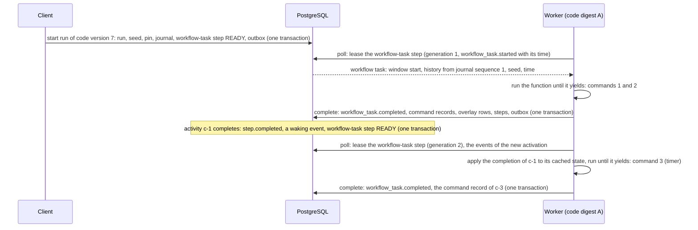

# Workflow as code

*   **Author:** Claude Code, for the owner
*   **Status:** Draft
*   **Date:** 2026-11-25

--------------------------------------------------------------------------------

## Overview

From release 0.3.0 a workflow can be a function written in any of the six SDK languages (TypeScript, Go, Python, C#,
Java, Rust) instead of a graph. The function runs in the tenant's own worker. It never touches the outside world
itself: it asks the platform to do things (run an activity, sleep, wait for an event, start a child, ask a person for
an approval, open a saga) and the platform records each request and each result in the run's journal. When the worker
that holds the function's state in memory is gone, another worker rebuilds that state by running the function again
from the start against the journal ("replay"); because the function is deterministic, it makes the same requests in
the same order, and the worker skips the ones already recorded. This is the programming model of Temporal, Cadence and
Azure Durable Functions. The owner decided that it is built in 0.3.0 in all six SDKs, starting with a determinism study
per language before any code, and that the declarative graph stays a supported model with the same guarantees beside
it (owner decision 2026-11-24-3, "Sim, entra na 0.3.0", "Yes, it goes into 0.3.0"). Constitution 5.0.0 (owner decision
2026-11-24-2) states the procedural model this design builds.

The design adds no second execution engine. The function is a *decider*: in each *workflow task* it receives the events
since its last decision and answers with a list of *commands*. Every command that does work is a node of the existing
workflow intermediate representation (IR): an activity, a timer, a `waitEvent`, a `child`, an `approval` or a `script`
node, in a restricted *code profile* of that node kind, checked by the publication parser of that kind, held in the
run's own definition (a *code definition* whose graph is the run's *node overlay*), and executed by the engine code that
runs graph workflows. So a code run gets the leases and fencing, the retries, compensation as derived steps, the
uncertain-effect rules of feature 037, the gates of feature 022, the step logs of feature 041, payload classification
and blobs that the graph engine already has. The workflow task itself is leased like a step, and its completion commits
the journal events, the scheduled steps, the timers, the subscriptions and the outbox in one transaction.

What the design does that Temporal, as of its Worker Deployment versioning and its SDK replayers, does not
(Technical Plan 17 has the comparison):

- **The code identity is computed, not chosen.** A code version names the SHA-256 digest of the code, its dependencies
  and its runtime; only a worker that declares that digest receives the run's workflow tasks.
- **Code changes under a running run only after a proof for that run.** A *move*, requested by a person, re-pins one
  run to other code only after a worker of that code has replayed the run's own history and produced the same commands,
  their bodies included.
- **The server checks determinism too.** It keeps a hash chain of the commands it accepted, their bodies included, over
  data the worker is never sent (except side-effect values, which replay returns), and refuses a completion whose
  replayed commands do not produce it.
- **A code bug never loses a run.** A nondeterminism or a repeated failure puts the run under review with its cause and
  its state intact, until an operator moves it to fixed code, retries, resets it or cancels it.
- **Compensation, approvals and unknown outcomes are the platform's.** A saga opened from code is planned and run by the
  engine with the rules of features 003 and 037; an activity that the publisher declared as needing approval is held by
  the engine until a person approves that very step.
- **Queries work without a worker**, from declared state, also after the run has ended.

The decisions, gaps and owner questions are in the register
[specs/044-workflow-as-code/research.md](../../specs/044-workflow-as-code/research.md). The architecture decisions are
[Architecture decision 0103](../adr/ADR-0103-a-code-workflow-is-a-decider-whose-commands-are-ir-nodes-committed-in-the-run-transaction.md)
(the decider, the code definition and the one transaction),
[Architecture decision 0104](../adr/ADR-0104-replay-follows-the-activation-boundary-and-the-server-holds-the-command-chain.md)
(the activation window, waking events and the command chain),
[Architecture decision 0105](../adr/ADR-0105-a-code-run-pins-a-code-digest-and-moves-only-after-a-verified-replay.md)
(pinning, verified moves, resets and continue-as-new),
[Architecture decision 0106](../adr/ADR-0106-each-sdk-runs-workflow-code-under-a-named-determinism-runtime.md) (the
runtime per language and the deterministic primitives),
[Architecture decision 0107](../adr/ADR-0107-effects-from-code-are-leased-steps-and-sagas-are-planned-by-the-engine.md)
(effects, the code profile, approvals and sagas),
[Architecture decision 0108](../adr/ADR-0108-code-queries-are-answered-from-declared-state-and-worker-queries-are-ephemeral.md)
(signals, updates, queries and what they disclose) and
[Architecture decision 0109](../adr/ADR-0109-workflow-tasks-travel-on-the-next-free-worker-protocol-minor.md) (the
protocol).

### Terms

- **Code workflow, code version, code run.** A workflow whose published version is a *code version* (Technical Plan 3),
  and a run of such a version. A *graph* workflow, version and run are what exists today.
- **Start version, current code version.** The start version is the version a code run was created with
  (`runs.workflow_version_id`); it never changes and is the run's *identity origin*: every identity derived from a
  version (step identifiers, journal instance identifiers, compensation identifiers) is derived from it. The current
  code version is the one version the run is pinned to now, whose code runs its workflow tasks
  (`code_run_pins.code_version_id`); it equals the start version until a move.
- **Code digest.** The SHA-256 that identifies the code, its dependencies and its runtime for one workflow type
  (Technical Plan 3.2). A worker declares it; the platform never sees the code.
- **Capability envelope.** The part of a code version that lists what its commands may use: activity entries (each with
  its secrets, input and output schemas, risk metadata and approval rule), script entries, child workflows and their
  versions, event types, named approval policies (Technical Plan 3.1).
- **Binding.** The record of feature 009 that lets one worker identity serve named activities of a namespace
  (`crates/domain/src/binding.rs`); for code workflows it gains a list of the workflow types the identity may serve,
  exact names only, stored in `worker_binding_workflow_types`.
- **Decider, workflow task.** The function is a decider. A workflow task is one lease of the run's reserved
  *workflow-task step*, during which a worker runs the function until it is blocked and answers with commands (a
  *completion*) or with a cause (a *failure*). As for every step, the *attempt* counts the leases of the step and the
  *generation* fences each lease; for the workflow-task step both increase with every workflow task.
- **Command, command number, command record.** One request of the function. Commands are numbered 1, 2, 3... in the
  order the function makes them over the whole run; the node of a command that creates a step is `c-<n>` where `n` is
  its command number. Every accepted command has a *command record* in the journal, an event written by the completion
  with the command's number.
- **Code definition, node overlay.** A code version parses to a code definition whose graph is the run's node overlay:
  the workflow-task node and, for every accepted work command, its node and its derived companions (Technical Plan 2).
- **Journal sequence.** The per-run sequence of `run_events` (`seq`). Every event has one.
- **Visible event, waking event.** A visible event is one the function can observe; a waking event is a visible event
  that is not a command record and not a workflow-task event, and that makes a workflow task due. Both are decided by
  the domain from the event and its origin (Technical Plan 4.2).
- **Activation, activation run.** The visible events one workflow task delivers to the function, applied one at a time in
  journal order; the activation run is the period during which the worker runs the function on them. The function
  *yields* when it is blocked waiting for the platform.
- **Replay.** Running the function from the start against the history of a run without issuing the commands that are
  already recorded.
- **Command chain.** The hash over the accepted commands of a run (Technical Plan 6.2), not to be confused with the *run
  chain* of continue-as-new (feature 014).
- **Sticky.** The worker that completed the last workflow task keeps the run's state in memory and is offered the next
  one first (a deferrable part, Task 044-14; without it every worker of the digest may take it, and a worker reuses its
  cache when the window follows what it holds).
- **Eager dispatch.** Returning a new lease in the answer to a completion, instead of announcing it for a poll.
- **Under review.** The state of a code run whose workflow-task step a person must act on (Technical Plan 6.3), using
  the step review of feature 003.
- **Move.** A person's explicit request to change the current code version of one open code run, applied only after a
  verified replay.

### What this design builds on

| Item | Where | What this design uses |
|---|---|---|
| Feature 002, durable execution | [specs/002-durable-execution/spec.md](../../specs/002-durable-execution/spec.md) | Runs, steps, leases, the 4 MiB a run retains, children |
| Feature 003, sagas and compensation | [specs/003-sagas-compensations/spec.md](../../specs/003-sagas-compensations/spec.md) | Derived compensation and reconciliation steps, `run_sagas` and `run_saga_entries`, step review, `PARTIAL` |
| Feature 006, delivery acknowledgement | branch `docs/delivery-acknowledgement`, Architecture decision 0099 | Provisional leases until acknowledged (protocol 1.8), for eager leases |
| Feature 009, secrets and bindings | [specs/009-security-multitenancy/spec.md](../../specs/009-security-multitenancy/spec.md) and `crates/domain/src/binding.rs` | Bindings, `ResolveSecrets`, the publisher's right to a secret |
| Feature 014, workflow primitives | [specs/014-workflow-primitives/spec.md](../../specs/014-workflow-primitives/spec.md) | Declared state, queries, continue-as-new and the run chain, the tree budget, `scope_sagas` |
| Feature 016, payload classification | [specs/016-payload-classification/spec.md](../../specs/016-payload-classification/spec.md) | Classified fields, redaction and reveal grants on every read |
| Feature 018, schedules, batch, business identifiers, reset | [specs/018-schedules-bulk-operations/spec.md](../../specs/018-schedules-bulk-operations/spec.md) | Batch jobs and items, business identifiers, the with-start calls, reset and its rules per event kind |
| Feature 019, worker deployments | [specs/019-worker-deployments-dispatch/spec.md](../../specs/019-worker-deployments-dispatch/spec.md) | Routing of activities; the batch action `REPIN` |
| Feature 020, visibility | [specs/020-visibility-analytics-archival/spec.md](../../specs/020-visibility-analytics-archival/spec.md) | Search attributes, added when it lands |
| Feature 022, flow control | [specs/022-flow-control-step-policies/spec.md](../../specs/022-flow-control-step-policies/spec.md) | Run-level and step-level gates |
| Feature 031, codecs | [specs/031-client-side-encryption/spec.md](../../specs/031-client-side-encryption/spec.md) | Payloads encoded by the client |
| Feature 037, uncertain effects | [specs/037-compensation-safety/spec.md](../../specs/037-compensation-safety/spec.md) | Reconciliation and review of unknown outcomes, `STORAGE_QUOTA_EXCEEDED` |
| Design 041, step logs | [docs/designs/041-step-logs.md](041-step-logs.md) | Step logs of activities; protocol 1.7 |
| Design 043, run input validation | [docs/designs/043-run-input-validation.md](043-run-input-validation.md) | The input gate and the platform's schema validator |
| Design 045, activity timeouts, and Architecture decisions 0110 and 0111 | branch `docs/temporal-parity-readiness` | Activity timeouts and per-code retry, `steps.min_protocol_minor` (protocol 1.9); the buffered-signal inbox |
| Architecture decisions 0003, 0010, 0018, 0020, 0027, 0028, 0030, 0031, 0033, 0036, 0050, 0076, 0082, 0089 | [docs/adr/](../adr/README.md) | The IR, derived steps, publication, shards, content quotas, payload inspection, run chains, result disclosure, per-field classification and its closed carrier set (refined for code runs by Architecture decision 0108), many-run operations and resets, uncertain effects, the instance registry, gated steps |
| The worker protocol | [worker.proto](../../specs/001-platform-foundation/contracts/worker.proto), [worker-runtime-protocol.md](../architecture/worker-runtime-protocol.md) | Leases, fences, the minor register |
| The rules for agents and the constitution | [AGENTS.md](../../AGENTS.md) rule 3, [docs/constitution.md](../constitution.md) | One transaction per decision; the principles |

## The Problem

The platform offers two ways to write a workflow today, a graph in the Studio and a graph built by an SDK builder, and
both produce the declarative IR that the Rust engine interprets (`docs/architecture/workflow-ir-and-sdk-modes.md`,
table "Three experiences, a single engine"). The third row of that table, "Procedural code-first (later phase)", was
never specified: `docs/architecture/execution-semantics.md` calls it "Code-orchestrated (P2)" and asks for "a registered
worker and proof of determinism"; Architecture decision 0003 says "procedural worker with determinism rules later";
`sdks/SPEC.md` says an SDK "is **not** a workflow runtime. It does not execute workflow code, replay anything, keep a
journal, or decide a transition".

What a graph cannot express, a person writing code expects to write directly: a loop whose body depends on the result
of the last activity, a retry policy that changes with business rules, a dynamic number of parallel branches, a state
machine with many signals, ordinary functions and types shared with the rest of the application, and unit tests in the
language's own test framework. The owner's goal for release 0.3.0 is to surpass Temporal and Windmill (owner decision
2026-11-24-1), which a platform without workflow as code does not do.

Temporal's model leaves these problems to the workflow author or the operator:

- **Nondeterminism found when a run reaches it.** A changed function that replays an open run makes different commands;
  the worker finds out only when it replays that run, and the run's workflow task then fails and retries until a fix is
  deployed. Worker Deployment versioning can pin a run to its build, but a run on automatic upgrade replays the new code
  without any check, and a pinned run's build must be kept running by hand.
- **Patches checked by nothing before they apply.** `patched()` and `GetVersion()` branches are only as correct as the
  author's tests; replayers exist, but nothing on the server runs one before a run takes new code.
- **Sagas by hand.** Compensation is `try` and `catch` code per workflow; an unknown outcome of a payment is the author's
  problem.
- **Queries need a live worker** and fail when none runs.

This repository has the pieces a better answer needs: an append-only journal with a per-run sequence (`run_events`,
`crates/infra-postgres/migrations/20261009000100_execution.up.sql`), one transaction that commits a step completion with
the next work and the outbox (`PgRunTx::persist`, `crates/infra-postgres/src/execution.rs`), a worker protocol with
leases and fences, immutable published versions with a canonical digest (`workflow_versions`), compensation as derived
steps (Architecture decision 0010) with the uncertain-effect rules of feature 037, the step review of feature 003,
declared state with engine-answered queries (feature 014), batch jobs and resets (feature 018) and a conformance suite
common to the SDKs (`tests/contract/sdk-conformance/`). What is missing is a determinism runtime in each SDK, a workflow
task the engine can lease and commit, a definition through which the engine finds the nodes of steps that no published
graph declares, and the versioning rules that keep code and history together.

## Requirements

### Functional

- **Requirement 044-001** A published workflow version MUST be either a graph version (today's document) or a code
  version (Technical Plan 3), never both. A code version MUST name its workflow type (1 to 48 characters,
  `^[A-Za-z][A-Za-z0-9_-]{0,47}$`, independent of `metadata.name`), its language, its code digest and its capability
  envelope, and MUST be immutable like every version; a workflow type MUST be unique in its namespace, and every code
  version of a workflow MUST keep the type of its first code version. Publication MUST be
  refused (`422 CAPABILITY_NOT_ACTIVE`, the HTTP class design 045 uses for the same condition) until an operator has recorded the instance registry requirement `code-workflows-v1`
  (Architecture decision 0082), and, for a code version that declares signals, `signal-inbox-v1` (Architecture decision
  0111); the publication MUST hold each requirement it needs for the rest of its transaction, so that removing one
  cannot commit beside it, and removing `code-workflows-v1` MUST be refused while a code version exists. Graph
  publication MUST refuse an activity name that starts with `sagat.`, except the managed names of feature 017; the
  refusal is the publication parse's (`capabilities::check_publication`), never `parse_stored`'s, so a stored version
  still restores.
  *Acceptance:* the publication tests of Task 044-3.
- **Requirement 044-002** A code run's workflow tasks MUST be offered only to a worker session that registered the
  workflow type and the code digest of the run's current code version and whose identity's binding lists that workflow
  type; every completion MUST be refused as stale when the session's digest is not the run's current digest or the
  binding no longer lists the type. *Acceptance:* `workflow_tasks_follow_the_current_digest`,
  `an_activity_binding_named_workflow_order_gives_no_workflow_authority`, `a_completion_from_a_session_of_another_digest_is_stale`,
  `a_workflow_type_revoked_between_poll_and_claim_is_not_leased`.
- **Requirement 044-003** The function MUST be driven by workflow tasks: leases of the reserved workflow-task step,
  fenced by attempt, generation and lease token, delivering the visible events of the activation window (Technical Plan
  4.3), and answered by a completion or a failure. A workflow task MUST carry no secret and MUST be refused by every
  activity RPC (`Heartbeat`, `CompleteStep`, `FailStep`, `ResolveSecrets`, `ResolveDatabase`, and `AppendStepLogs` once
  design 041 serves it). *Acceptance:* the contract tests of Task 044-8.
- **Requirement 044-004** A completion MUST commit, in one transaction with the run row and the workflow-task step locked
  and the lease fenced: the command records and other journal events of the completion, the steps, timers and waits the
  commands create, their nodes in the overlay, the projections they change, the outbox records that announce new work,
  and the state of the workflow-task step decided from the journal (Technical Plan 4.3) (`AGENTS.md` rule 3).
  *Acceptance:* the fault tests of Task 044-9 and the differential test.
- **Requirement 044-005** Activation k MUST deliver exactly the visible events whose journal sequence is after the
  `workflow_task.started` of the workflow task that produced completion k − 1 and up to the `workflow_task.started` of
  the workflow task that produces completion k (Technical Plan 4.3), to a live worker and to a replaying worker alike;
  `S(0)` is 0, so activation 1 starts with `run.started`, which carries the run's input (for a successor of
  continue-as-new, the transferred input and the carried state).
  *Acceptance:* `integration_workflow_as_code::activation_window::live_and_replayed_activations_are_equal`.
- **Requirement 044-006** Every SDK MUST detect, during replay, a command whose kind or target differs from the recorded
  one at the same command number, a recorded command the function no longer makes, and a patch marker that does not
  match, and MUST report it as a failure with cause `NONDETERMINISM`, the command number, the actual kind and target and
  the code digest, and no payload. *Acceptance:* the conformance scenario `code-nondeterminism`.
- **Requirement 044-007** The server MUST keep, per code run, the command chain of Technical Plan 6.2 over the command
  number, kind, target and SHA-256 of the canonical body of every accepted command (a work command's fragment, or a
  typed command's canonical body), and MUST refuse a completion whose replayed chain differs, with cause
  `CHAIN_MISMATCH`. *Acceptance:* `a_completion_with_a_foreign_command_chain_puts_the_run_under_review`,
  `a_changed_activity_input_on_replay_is_a_chain_mismatch`, `a_changed_set_state_on_replay_is_a_chain_mismatch`.
- **Requirement 044-008** The causes of Technical Plan 6.3 MUST behave as its table says, with the count of consecutive
  failures stored on the run. Under review, no workflow task is offered and no event releases the review; the run's
  other steps, timers and waits go on; the review is journaled with its cause and audited; and it ends only by one of
  the remedies of that table or by the run's deadline or a cancellation. *Acceptance:* one integration test per
  cause and per remedy (Task 044-11 and Task 044-12), `the_failure_count_survives_a_restart`,
  `no_waking_event_or_reconciler_pass_releases_a_review`.
- **Requirement 044-009** An uncaught exception that is not the SDK's workflow failure type MUST fail the workflow task,
  not the run. A workflow failure MUST end the run `FAILED` with the code the function gave, matching
  `^[A-Z][A-Z0-9_]{0,63}$` (another code is replaced by `WORKFLOW_FAILED`), and its message stored only as a `pii`
  payload read through feature 016's read path, never in the run resource or the journal's detail, the run ending
  through the stop drain of Requirement 044-031; an update's failure follows the same rule. *Acceptance:* the conformance scenario `code-failures`.
- **Requirement 044-010** The current time MUST be the time recorded in the `workflow_task.started` at `S(k)`, the last
  start of the activation's window, which opens the
  activation, never earlier than the previous one; random numbers MUST come from xoshiro256** seeded with the run's
  32-byte seed; identifiers MUST be version 4 UUIDs drawn from that generator (Technical Plan 1.8). The six SDKs MUST
  produce the same sequence for the same seed. A reset MUST keep the seed of its source run. *Acceptance:* the
  conformance scenario `code-deterministic-primitives`, and `a_reset_of_a_code_run_keeps_its_seed`.
- **Requirement 044-011** Each SDK MUST run workflow code under the determinism runtime of Technical Plan 1 for its
  language, MUST refuse to register workflow types when that runtime's precondition fails (Technical Plan 1.11), MUST
  stop an activation run that does not yield within 2 s with cause `ACTIVATION_DEADLINE`, and MUST declare in its
  capabilities whether it offers workflow as code. *Acceptance:* each runtime's tests in Task 044-10 and Task 044-15 to
  Task 044-19, and the scenario `code-activation-deadline`.
- **Requirement 044-012** A code run MUST execute only these commands in 0.3.0: schedule an activity, run a script,
  start and cancel a timer, wait for an event, start a child, request an approval under a named policy, open, close and
  abort a saga scope, request the cancellation of one of its own steps or children, record a marker (patch, side
  effect), set the declared state, accept, reject and complete an update, consume signals, complete, fail or continue as
  new, and acknowledge a cancellation. The function's own calls MUST make at most 256 commands with at most 48 KiB of
  command metadata per activation, besides at most 147 commands the SDK issues itself (128 update commands, since at
  most 64 updates of a run are admitted or accepted and not completed and each may be decided and completed in one
  activation; one consumption covering every signal name; one set-state; at most 16 scope closes and aborts; one
  re-emitted deferral; no fragment, at most 16 KiB): the SDK
  throws the typed `CommandBatchLimitExceeded` into the function at the call that would cross the function's share,
  at the same point live and in replay, so code can catch it or move the fan-out to a graph child (scenario
  `code-command-batch-limit`). Each work command MUST carry a fragment of the code profile of its node kind
  (Technical Plan 5.1); a fragment with a field outside that profile MUST be refused. A command that targets one of the
  run's own steps that is already terminal (a timer that fired, a step that ended) MUST be accepted as an audited no-op
  with its command record, counted and chained like any command. *Acceptance:*
  `every_command_kind_round_trips_through_its_code_profile`, one refusal test per excluded kind and per excluded field,
  and `cancelling_a_timer_that_fired_is_a_no_op_that_replays` at a barrier in both orders, with a cold replay after it.
- **Requirement 044-013** A command MUST stay within the current code version's capability envelope: an activity entry
  that covers its name (an exact entry wins over a prefix entry, a longer prefix over a shorter one; only an exact entry
  may list secrets), with only that entry's secrets, input schema, output schema, risk metadata (`irreversible`,
  `highRisk`, `compensateWith`, `reconcileWith`) and approval rule, which a fragment may repeat or omit but not change;
  the names of `compensateWith` and `reconcileWith` MUST be entries too, and a derived step MUST receive the secrets of
  its own entry; a script entry by digest, with its own secrets, schemas and risk metadata; a listed child workflow at
  its listed version; a listed event type within its look-back; a named approval policy. No activity name of a command
  or of the envelope may start with `script.` or `sagat.`. The publisher's right to each secret MUST be checked at
  publication and again at every resolution, as for a graph step. A command outside the envelope MUST put the run under
  review with cause `COMMAND_OUTSIDE_ENVELOPE`. *Acceptance:* the envelope tests of Tasks 044-3, 044-5 and 044-24.
- **Requirement 044-014** A code version MAY declare signals, each with a `maxBytes` (default 64 KiB, at most 256 KiB,
  so one sender cannot spend the run's retained bytes), in the shape of Architecture decision 0111, each
  `buffered`. Signals of a code version MUST use that inbox: accepted for a declared name whether or not the function is
  waiting, journaled once under the existing idempotency key, charged to the run's 4 MiB retained bytes, delivered in the
  next activation, and consumed only when the function's handler or wait takes them, recorded by the "consume signals"
  command, which is journaled and chained like any command and refused (`COMMAND_INVALID`) for a signal that is not a
  pending signal of this run delivered at or before the activation's start; a delivered signal not yet consumed stays
  pending and moves or is discarded as Architecture decision 0111 decides; a code run's signals never satisfy its
  wait-for-event steps. After authentication, authorization and tenant resolution, the idempotency key MUST be answered
  before any bound; then an undeclared name MUST be refused `409 SIGNAL_NOT_DECLARED`, a full inbox `409
  SIGNAL_INBOX_FULL`, and a run at the history headroom (a visible count of 50,176 or more, 3 MiB of retained bytes or
  more, or a closing window open) `409 HISTORY_HEADROOM`. Graph runs keep their rules. *Acceptance:* the conformance scenarios `code-signals` and
  `code-signal-at-return`.
- **Requirement 044-015** A code version MAY declare updates, each with a closed `argsSchema`, its `disclosure` and a
  closed `resultSchema` (Architecture decisions 0031 and 0108). An update MUST be admitted durably with its `updateKey`
  (arguments at most 256 KiB, validated and charged to the run's retained bytes), validated by the function's validator
  when its admission event is applied, journaled as accepted or rejected, handled by the function (which may issue
  commands), and completed with a result validated against its `resultSchema` or with a failure; a result outside the
  schema MUST complete the update as failed (`RESULT_SCHEMA_VIOLATION`) and leave the run alone. A request that sets
  `acceptPending: true` MUST be answered `202` with the status when the update has not completed within `waitMs` (at
  most 60,000 ms); a request without it MUST wait up to 60,000 ms and answer `200` with the result or
  `409 UPDATE_PENDING`. An `updateKey` MUST be scoped by the address the client used (the run or the chain, section 8.2)
  and the admitting principal, so that another principal's identical key is another update;
  `GET /runs/{runId}/update-receipts/{updateKey}`, `GET /chains/{chainId}/update-receipts/{updateKey}` and a repeated `POST`
  MUST answer only within that scope (a principal with `run:operate` reads the list of every principal's update under
  that key, each with its admitting principal), after authorization is checked again, and an unknown key MUST answer the
  same `404` as a missing one. An update that has not completed when the run ends or continues as new MUST be finished
  by the engine in that transaction, `REJECTED` if it was admitted and `FAILED` if it was accepted, with the reason
  `RUN_ENDED` or `RUN_CONTINUED`; an update to a run that is stopping or has ended MUST be refused
  `409 RUN_NOT_MUTABLE`, as for a graph run. At most 64 updates per run may be admitted or accepted and not completed, one principal at most a quarter of them
  (`429 UPDATE_BACKLOG`), and updates are refused at the history headroom. Update-with-Start (feature 018)
  MUST work for a code version. *Acceptance:* the conformance scenarios `code-updates` and `code-update-with-start`, and
  the tests of Task 044-21.
- **Requirement 044-016** A code version MAY declare state and queries in the IR's `state` form (feature 014). The
  function MUST be able to set the declared state by a command, validated against `state.schema`, inline and at most
  128 KiB, at most once per completion (the last set-state of an activation wins in the SDK);
  the engine MUST answer the declared queries from the committed state with no worker, also after the run ended while
  its data is retained. *Acceptance:* the conformance scenario `code-declared-state`.
- **Requirement 044-017** A code version MAY declare worker queries, each with a closed `argsSchema`, its `disclosure`
  and a closed `resultSchema`. A worker query MUST be a durable row, holding its arguments (at most 64 KiB) and its answer
  inline and charged to the tenant's content quota while it lives, claimed through `PollTasks` like any task, answered
  by a worker of the run's current digest from the function's state at its last committed completion, within the
  caller's timeout (at most 30,000 ms), without a journal event and without changing the run; the answer (at most
  256 KiB) MUST be validated against its `resultSchema` by the server before it is returned, with the journal sequence
  of that completion; a handler that issues a command MUST fail the query, not the run. *Acceptance:* the conformance
  scenario `code-worker-queries` and the tests of Task 044-29.
- **Requirement 044-018** A child started from code MUST be a run of a listed workflow at its listed version, graph or
  code, created by the existing child machinery with its cancel policy, depth and tree budget; a graph `child` node MUST
  be able to start a code version. *Acceptance:* the conformance scenario `code-graph-mixed`.
- **Requirement 044-019** Continue-as-new from code MUST be deferred (Requirement 044-031) while an activity, child or
  approval of the run is open or a saga scope aborts, and refused (`COMMAND_INVALID`) while a scope is open; once
  accepted it MUST close the workflow-task step, and feature 014's continuation pass MUST perform the handoff in its own
  transaction, in that pass's lock order (the chain, the parent's key share, then the run): cancel the run's open timers
  and waits, start the successor with a new seed and move the pending signals as Architecture decision 0111 decides.
  A handoff refused by the chain's or the tree's limits MUST end the run `FAILED` through the stop drain, as for a graph
  run; a successor input outside its `inputSchema`, a `version: active` that is not a code version of the same type, or
  a version without a `chainPolicy`, MUST be refused at the completion (`COMMAND_INVALID`). A detached child is not an
  obligation. The successor MUST pin the run's current code version unless the command asks for the workflow's active
  version, which MUST be a code version of the same workflow type. *Acceptance:* the conformance scenario `code-continue-as-new`, including a losing
  timer of a race and a run moved before it continues.
- **Requirement 044-020** A saga opened from code MUST be a compensation domain of the engine, stored in `run_sagas`
  and `run_saga_entries` and moved only by its open, close and abort commands and by engine-driven stops (the planner's
  automatic abort and completion of graph sagas MUST NOT apply to it): activities scheduled in it get the derived steps
  of Architecture decision 0010; an abort plans their compensations, step B depending on step A when A's outcome has a
  journal sequence at or before the start of the workflow task whose completion recorded B, so that independent
  compensations stay eligible; unknown outcomes follow feature 037; the function learns only the saga's outcome; an
  engine-driven stop (deadline, the cancellation deadline, a cancellation without grace, closing window, the cancellation of a run under review) applies each open scope's
  `cancelPolicy`. *Acceptance:* the conformance scenarios `code-saga` and `code-saga-uncertain`, and
  the tests of Task 044-22.
- **Requirement 044-021** The function MUST NOT run an effect itself through the platform: there are no local
  activities. A completion MAY ask for the leases of the activities it just scheduled (eager activities), granted as
  provisional leases of feature 006 through the claim's admission (quotas, breakers, pools, capacity windows, gates and
  approvals: only a step that would be `READY` is eligible), whose expiry before acknowledgement is a safe release; a
  sticky session's activity
  completion MAY ask for the run's next workflow task (eager workflow task), granted only when the session's digest and
  binding match. An idempotent replay of either answer MUST NOT return a lease. *Acceptance:* the tests of Task 044-14.
- **Requirement 044-022** A cancellation request to a code run MUST NOT stop the run: it MUST journal
  `run.cancel_requested` (a waking event) and commit the run's cancellation deadline (now plus the version's grace:
  default 60 s, from 1 s to 3,600 s) in its transaction, and reach the function in its next activation, while the run's
  steps, cleanup activities included, keep being leased; the function MUST acknowledge it by completing, failing or
  acknowledging the cancellation. If it has not done so by the deadline, a pass of the engine MUST stop the run
  (`CANCELLED`) through the stop drain; the deadline is judged by the database clock, so a completion whose transaction
  reads a time at or after the deadline is refused as stale and the pass stops the run, and one that reads an earlier
  time commits under the run lock before the pass can. A cancellation of a run whose workflow-task step is under review
  MUST stop it at once (the function cannot answer). A person with `run:operate` MUST be able to cancel without grace
  (`graceMs: 0` on the cancel operation), which stops the run at once whether or not a cooperative request was journaled
  before, journaled and audited, so forward claims stop as for a graph run; `graceMs` is part of the operation's
  idempotency fingerprint, and any value other than 0 is refused `422`. A continue-as-new accepted after `run.cancel_requested` MUST end
  the run `CANCELLED` with no handoff. A request to a run that already has a stop reason MUST journal nothing. The run deadline MUST be
  enforced by the engine without the function. Only the first cooperative cancellation request of a run is journaled,
  and a later cooperative one MUST NOT move the deadline. Every path that cancels a run (the cancel route, a chain-addressed cancel, a parent's
  `propagate` cancel policy, the source cancel of a pending reset) MUST go through one domain function that takes this
  arm for a code run. The deadline MUST be cleared when a terminal command is accepted or any stop begins; a deferred
  terminal command is not an answer, so a run whose terminal command is still deferred at the deadline ends
  `CANCELLED`. A reset whose prefix holds the request and no terminal command MUST set the new run's deadline in its
  transaction from the grace that `run.cancel_requested` carries. *Acceptance:* the conformance scenario
  `code-cancellation`, the barrier test of the grace against the acknowledgement in both orders, and the cancellation
  tests of Task 044-22.
- **Requirement 044-023** A person with `run:operate` and `version:activate` on the namespace MUST be able to move one
  open code run, and with `run:batch` as well a frozen selection of open runs (feature 018's batch job, each item a
  per-run request, the creator re-authorized when each item applies), to another published code version of the same
  workflow (so of the same workflow type, Requirement 044-001) in the same namespace that is approved for activation where the namespace requires approval. The server MUST
  re-pin a run only when a worker of the target digest replayed its history up to its last completed activation with
  the same command chain, that activation is still its last completed one, the run has no stop reason and its
  workflow-task step is neither `CLOSED` nor leased (a stopping run, a `CLOSED` step or a run under a `HISTORY_LIMIT`
  review: skipped `RUN_NOT_MUTABLE`; a
  leased step: checked again, then `RUN_BUSY`), and
  every step that can still act (section 5.2: outstanding steps, and the succeeded members of scopes not yet settled, with their derived
  entries) fits the target's envelope (the covering entry has the same secrets, schemas, risk metadata and approval
  rule); otherwise the run stays as it was and the move item records the reason. A move MUST make the step `READY` with
  a hint when it was under review or a task is pending, and be journaled and audited. No policy moves runs by itself.
  *Acceptance:* the conformance scenario `code-patch-and-move` and the tests of Task 044-13.
- **Requirement 044-024** Each SDK MUST offer `patched(id)` and `deprecatePatch(id)` with the meaning of Technical Plan
  7.2, recorded as markers. *Acceptance:* `code-patch-and-move`.
- **Requirement 044-025** Each SDK MUST ship a replayer that replays exported histories against the local code and
  reports the first mismatch, usable in a test of the language's own framework. A person with `run:read` and the new
  `history:export` (held by the admin role only) MUST be able to export a code run's history
  (`GET /runs/{runId}/history`, format version 1), every payload, fragment inputs and business literals included,
  classified by its schema and redacted by the rules of feature 016 unless the person holds the reveal rights for it,
  never a field classified `secret`; every export MUST be audited. A replayer MUST refuse an unknown format version.
  *Acceptance:* the replayer test in each SDK and the export tests of Task 044-24.
- **Requirement 044-026** A move MUST be available as a dry run that records, per run, the verdict of the replay without
  moving anything. *Acceptance:* `a_dry_run_move_records_verdicts_and_moves_nothing`.
- **Requirement 044-027** A code run's history MUST be bounded: from a visible count of 10,240 or 2.5 MiB of retained
  bytes (so a run has a window before signals are refused at 3 MiB) the function is told that continuing as new is suggested, when it is admissible (the run heads an open chain);
  every run refuses signals and updates from 3 MiB on (`HISTORY_HEADROOM`, Requirement 044-014), which for a run that
  cannot continue as new is permanent, as its SDK documentation states; at 51,200 the run goes under review with cause
  `HISTORY_LIMIT`, whose retry opens a closing window of 1,024 visible events plus three for every step that can still
  act (section 5.2: an outcome, then the workflow task that sees it), its bound never above 58,368, in which only commands that end the run, continue it as new, cancel its outstanding work,
  close or abort its sagas, record markers, set the state, consume signals, or accept, reject or complete updates are
  accepted; a completion inside the window is judged against the window's bound, not 51,200, and one that would cross
  the bound is refused and ends the run `FAILED` (`HISTORY_LIMIT`) in that transaction; when the window is
  used up, no further workflow task is offered and the engine ends the run `FAILED` (`HISTORY_LIMIT`) through the stop
  drain. *Acceptance:* `the_history_limit_suggests_then_reviews_then_closes`,
  `an_exhausted_closing_window_fails_the_run_through_the_stop_drain`.
- **Requirement 044-028** A code run MUST be listed, read and drawn like a graph run: the run view, the events, the
  observed graph of its commands, its review and its moves; and a version list MUST show, per code version, its open
  runs, the sessions of its digest and the age of its oldest run. *Acceptance:* the tests of Tasks 044-23 and 044-33.
- **Requirement 044-029** The interactions of Technical Plan 12 MUST hold, each tested when its feature is built.
  *Acceptance:* Task 044-27.
- **Requirement 044-030** An instance that does not report the capability `code-workflows-v1` MUST never open a code
  run; once an operator has recorded the requirement, an instance without it closes its gate, including one that
  registers later (Architecture decision 0082). *Acceptance:* `a_late_instance_without_the_code_capability_closes_its_gate`.
- **Requirement 044-031** A terminal or continue-as-new command MUST be deferred, without counting a failure, while a
  saga scope of the run aborts, a step of the run is under review or has an unknown outcome, or (for continue-as-new) an
  activity, child or approval is open (`OUTSTANDING_OBLIGATIONS`), and while a waking event committed after the
  activation's start is unseen (`UNHANDLED_EVENTS`): the completion's other commands commit, the deferral is recorded in
  its `workflow_task.completed` with the deferred command's kind, target and body digest, the command takes no command
  number, the SDK re-emits it last in each later activation, live or replayed, a re-emitted command that differs from
  the record puts the run under review (`CHAIN_MISMATCH`), and the run's next waking event offers the next workflow task.
  A terminal or continue-as-new command while a saga scope is open and not aborting MUST put the run under review
  (`COMMAND_INVALID`), because only the function can close the scope. After 3
  deferrals for unseen events the run refuses new signals and updates (`409 RUN_CLOSING`) until its next completion
  commits without one. An accepted terminal command MUST close the
  workflow-task step and put the run into the engine's stop drain, which cancels outstanding timers and waits, asks
  running activities to stop, applies the children's cancel policies, finishes every update that has not completed
  (Requirement 044-015), and writes `run.finished` with the function's
  outcome (a `Completed` stop reason carrying the output reference, `FAILED` or `CANCELLED`) only when no leased work is
  left or what is left has gone to feature 037's review. *Acceptance:* the tests of Task 044-22.
- **Requirement 044-032** Bounds: a code run at most 2,048 steps that can still act at a time (outstanding steps,
  timers, waits and children, and the succeeded members of scopes not yet settled, as section 5.2 counts them; cause `COMMAND_LIMIT`, counted) and at most 16 open saga scopes; a namespace at most 1,024 workflow tasks leased at once (the quota bucket
  `sagat.workflow`, a new rule of the activity-concurrency quota that a tenant cannot override for `sagat.` names), at
  most 64 worker queries in flight (at most 4 per run) and 16 replay-check tasks in flight; an API process at most 256
  update waits (at most 8 per run and 64 per tenant) and at most 512 `ReadHistory` streams (128 per tenant, 32 per
  subject), each stream ending at its lease's or token's expiry with a byte budget of the history's bytes plus one page;
  a principal at most a quarter of each namespace bound. The bounds answer `429` with
  `retry-after-ms`. *Acceptance:* one test per bound (Task 044-24).
- **Requirement 044-033** A person with `run:operate` and `worker:manage` MUST be able to pause the workflow tasks of
  every code run of a namespace (no workflow-task or query task leased or completed, runs keep their
  state) and resume them, audited; the pause MUST hold for sessions registered before it; replay checks and moves go
  on, so a busy run can be quiesced and moved. A workflow task refused or timed out because of the pause MUST NOT count
  as a failure: a completion the pause refuses ends its lease at once with a `workflow_task.failed` that records it was
  not counted, in a short transaction of its own, and a timeout during a pause records the same, so
  `verify_run` derives the same count; run deadlines and cancellation grace keep running during a
  pause; a worker query to a paused run or to one under review MUST fail at once with `QUERY_UNAVAILABLE`. *Acceptance:*
  `pausing_code_workflows_stops_a_session_registered_before_the_pause`.
- **Requirement 044-034** The engine MUST find the node of every step of a code run (`c-<n>`, its derived `~c` and `~r`
  steps, the workflow-task step, and its saga scopes `s-<n>`) through the run's code definition, in every path that
  reads a node, an entrypoint, a body, a saga or a scope today (every method of `WorkflowDefinition`); a path that cannot
  resolve a node MUST fail closed. *Acceptance:* the source-text check of Task 044-4
  and `integration_workflow_as_code::nodes::every_command_kind_runs_through_every_path`.

### Non-functional

- **Non-functional requirement 044-001 (replay cost)** Each SDK MUST replay a history at the rate of at most
  97.65625 µs per visible event on the reference worker host: 10,240 events in at most 1 s (1,000,000 µs / 10,240), 51,200
  in at most 5 s, and the largest history a function is ever asked to replay, 51,200 + 1,024 + 3 × 2,048 = 58,368 events
  (the claim refuses to lease a workflow task once the visible count reaches 51,200, whichever writer took it there,
  and puts the run under review; the one closing window's bound is capped at 58,368, whatever committed during the
  review, inside it no completion may cross the bound, and after it the run ends), in at most 5,700,000 µs = 5.7 s
  (58,368 × 97.65625 µs). Benchmark criteria on a stated host, not promises (constitution, Delivery Constraints).
- **Non-functional requirement 044-002 (commits)** Counted as the budget suite counts them (a lease is 2 transactions,
  `LEASE` in `work_budget.rs`), a code workflow that runs one activity and ends MUST cost at most 10 transactions without
  eager dispatch (the start 1, the first workflow task lease 2, its completion 1, the activity lease 2, the activity
  completion 1, the second workflow task lease 2, the final completion 1, whose stop drain finishes in the same
  transaction when nothing is outstanding) and at most 7 with eager dispatch and a sticky worker (the start 1, the first
  lease 2, the completion with the activity's provisional lease 1, its acknowledgement 1, the activity completion with
  the next workflow task lease 1, the final completion 1). A graph workflow with one activity costs 4 (the start 1, the
  lease 2, the completion 1), so the ratios are 10 / 4 = 2.5 and 7 / 4 = 1.75.
- **Non-functional requirement 044-003 (statements)** A workflow task completion MUST run at most 63 SQL statements (50 + 13), reads
  included, whatever the number of its commands up to 403: the 50 of today's `COMPLETION_WITH_A_NEXT_STEP`
  (`tests/integration/claim-transition-efficiency/work_budget.rs`), whose per-row journal, payload, step and outbox
  inserts become one batched insert each, plus at most 13: the count of the steps that can still act, the saga scope
  rows of open, close and abort commands, the overlay
  insert, the overlay read on a cache miss, the
  binding and pause read, the inbox consumption, one collapsed audit of no-op commands, the update transitions, the
  declared state, the approval rows of gated activities and approval commands, the look-back read of wait
  commands, the gate rows of feature 022, the blob-reference check of commands that name a blob. Eager leases are
  outside it (Technical Plan 5.2). A terminal completion MUST add exactly the statements of the existing stop drain; a
  continue-as-new completion adds none, because the continuation pass performs the handoff. The budget test mixes every
  command kind in one completion.
- **Non-functional requirement 044-004 (latency)** With a sticky worker (Task 044-14) and a history of at most 1,024
  visible events, the time from the commit of a signal to the commit of the workflow task that handles it MUST be at most
  50 ms at the 99th percentile on the reference environment; at most 250 ms without a sticky worker. Benchmark criteria,
  measured by Task 044-25.
- **Non-functional requirement 044-005 (memory)** The cache of a worker MUST hold at most 256 runs by default. An idle
  cached run MUST cost at most 1 MiB in TypeScript, Python, C# and Java and at most 256 KiB in Go and Rust, so a full
  default cache costs at most 256 MiB (256 × 1 MiB) or 64 MiB (256 × 256 KiB). Benchmark criteria; Gap 044-001.
- **Non-functional requirement 044-006 (bounds)** Every request message fits the worker service's existing decode limit
  of 320 KiB (`MAX_PAYLOAD_BYTES` + 64 KiB, `crates/api-grpc/src/server.rs`), which does not change: a completion carries
  at most 403 commands (256 from the function's calls and 147 the SDK issues, Requirement 044-012), at most 64 KiB of
  command metadata (fragments without their literal values) and at most 192 KiB of inline values (the declared state and
  a continue-as-new input and carried state always inline, together at most 192 KiB, the carried state at most the
  successor's `state.maxBytes` and validated against its `state.schema`, the SDK throwing the typed `InlineValuesExceeded`
  at the call that would cross it, live and in replay; any other value, a work command's input, an update result, a
  side-effect value, a terminal output, written by the SDK as a blob, largest first, whenever the message would not
  fit, at most 16 per completion, the SDK throwing `InlineValuesExceeded` at the call after which the activation's
  values could no longer be carried; a gated activity's input and an approval's subject are always inline, the SDK
  reserving the declared state's maximum (the version's `state.maxBytes`, at most 128 KiB) from the activation's start
  and throwing at the gated call that would cross 192 KiB less that reserve, and learning the gated entries from each
  workflow lease, which carries those of the run's current version), leaving 64 KiB of the decode limit for framing; a replay-check answer carries one item and at most 8,192 body digests (256 KiB), the
  worker sending successive ranges. Every response message stays below the 4 MiB that gRPC clients receive by default:
  a history page at most 1,024 events or 3 MiB, so a history of E events and B bytes takes at most
  ⌈E / 1,024⌉ + ⌈B / 3 MiB⌉ pages, at least 58,368 / 1,024 = 57 for the largest; a lease's first page at most 256 KiB;
  a run transaction reads at most 771 KiB of overlay rows (the addressed step's three rows, and the rows of at most 256
  newer work commands, 256 × 3 × 1 KiB = 768 KiB), and at most 4 MiB of blob-carried values to validate (each distinct
  blob once, by its SHA-256; a completion over 4 MiB of them is `COMMAND_INVALID`, the only refusal of this bound that
  reviews; the values are read under a per-process semaphore of 64 MiB, of which a tenant holds at most a quarter, a
  tenant above 4 MiB acquiring only while 16 MiB stays free, so a tenant under 4 MiB waits only behind other tenants
  under 4 MiB; it is acquired with a deadline of the smaller of 2 s and half the lease's remaining time, so the worker
  can retry within its lease; a full semaphore, or a tenant at
  its quarter, answers `UNAVAILABLE` with `retry-after-ms`, recorded durably on the workflow-task step
  (`steps.unavailable_at`, a one-row update fenced by the lease's attempt, generation and token hash, cleared when the
  next lease is taken), so the expiry pass of any process records that lease's expiry, and only that lease's, as not
  counted, setting `next_attempt_at` to `unavailable_at` plus the advised delay; five consecutive uncounted expiries
  count as one failure; the next attempt may name, by descriptor, an uncommitted command-value blob of an earlier lease
  of the run that is not yet released, so nothing is uploaded or charged again, and `workflow_task_validation_refusals_total{reason: semaphore_full, tenant_share}` counts the refusals; the lease token is checked read-only before the blob pre-checks, the semaphore and the chain lock), except the stop drain and the planning of a saga scope, which read the rows they act on
  (at most 6 MiB) once; a `PollTasks` answer at most 3.5 MiB in all, leaving room for framing below the clients' 4 MiB (it carries fewer
  tasks when they do not fit); a replay-check task at most 16 runs, each
  read by pages under its own capability; a registration at most 64 workflow types; a worker query's arguments at most
  64 KiB and its answer at most 256 KiB; a node specification at most 1 KiB, so an overlay read on a cache miss is at most
  3 × 2,048 × 1 KiB = 6 MiB (each of at most 2,048 steps that can still act with its two companions); a side-effect
  marker at most 64 KiB.
- **Non-functional requirement 044-007 (security)** No workflow code runs in a platform process. A workflow task holds no
  secret. Another tenant's run, history, update, query, version or key is indistinguishable from a missing one. No
  payload, secret or worker-supplied free text appears in a review cause, a nondeterminism report, a metric or a log;
  worker-supplied identifiers (an exception type, an actual target, a marker identifier) appear only after their pattern
  is checked, and are stored as `pii` where a review or the Studio shows them.

### Success criteria

- **Success criterion 044-001** The conformance scenarios of the Verification Plan pass in all six SDKs with reviewed
  goldens and no selection filter; a scenario of a deferrable task is `.json.pending` until that task lands; an SDK that
  does not declare the capability is reported as not offered, never as passed; the release needs all six offered.
- **Success criterion 044-002** No code run is lost or silently changed by a deploy: the fault suite deploys a changed
  function while 100 runs are open and observes no review caused by nondeterminism without a move; with a move, the runs
  whose replay does not match stay on their version.
- **Success criterion 044-003** The benchmark of owner decision 2026-11-24-1 reports the replay cost, the commit count,
  the statement count and the latency of Non-functional requirements 044-001 to 044-004 against Temporal on the same
  host, with its environment and failures stated.

### User stories

- **User story 044-01** As a developer, I write a workflow as a function in my language, test it with my test framework,
  publish it and run it (journey 1).
- **User story 044-02** As a developer, I change my function while runs are open, and the platform proves which runs can
  take the change before it applies it (journeys 2 and 3).
- **User story 044-03** As an operator, I see a run under review, why, and I fix it without losing it (journey 4).
- **User story 044-04** As a developer, I write a saga in code and the platform compensates it, including unknown
  outcomes (journey 5).
- **User story 044-05** As a client, I signal, update and query a code run as I do a graph run (journey 6).
- **User story 044-06** As a developer, I ask a long loop how far it has got without making it publish its progress into
  the journal at every iteration (journey 7).

## Goals

- Workflow as code in the six SDKs with one semantic contract and one conformance suite.
- No second execution engine: every effect is a node the engine already executes.
- Versioning that cannot change the code under a running run without a proof for that run.
- The guarantees of the graph mode (one transaction per decision, leases and fences, compensation, uncertain effects,
  tenant boundary, audit) for the code mode, unchanged.
- Bounded and measured costs, compared with Temporal by the benchmark of owner decision 2026-11-24-1.

## Non-Goals

- Running workflow code in a platform process, or sandboxing it as a security boundary. The function runs in the
  tenant's worker, like an activity; the determinism runtimes of Technical Plan 1 isolate for determinism, not for
  security.
- Converting code to a graph or a graph to code. The Studio draws the commands a code run made, not a blueprint.
- Local activities (effects run inside a workflow task). Technical Plan 10.3 says why.
- In 0.3.0: the `database`, `icebergWrite`, `forEach`, `while`, `repeatUntil` and `parallel` nodes as commands (Gap
  044-003, a graph child covers them), signalling or cancelling another run from code (Gap 044-004), any move policy
  (Gap 044-006), a reset of a code run to another code version (Gap 044-019), search attributes before feature 020
  lands, inline graph fragments (Gap 044-011), and a version diff of two code versions (Gap 044-022).
- Exactly-once external effects. Activities from code are at-least-once, as every activity.

## Open Questions

None open. Every product and design question of this design was decided by the coordinating session under owner
decision 2026-11-20-6 or, for security and acceptance questions, owner decision 2026-11-24-4, each recorded in the
register as delegated, with its reasoning (Owner question 044-001 to Owner question 044-018). The gaps that stay open are
registered (Gap 044-001 to Gap 044-027).

## Owner decisions needed

None. The design rests on four owner decisions of 2026-11-24, recorded in `docs/owner-decisions.md` by the pull requests
that carry them, which reach `develop` before this design's pull request: owner decision 2026-11-24-1 (the full-parity
scope of release 0.3.0, which includes buffered signals, activity timeouts and the features this design touches),
2026-11-24-2 (constitution 5.0.0 with the procedural model), 2026-11-24-3 (workflow as code in 0.3.0) and 2026-11-24-4
(the coordinating session accepts this design's architecture decisions, settles its review findings and approves it).
Every task carries an `Owner-gate:` line; those rows must name the task identifiers in their `Covers` column before a
task is ticked. The questions of the design are delegated under owner decision 2026-11-20-6.

## Critical User Journeys (CUJs)

### Journey 1: The first code workflow (User story 044-01)

*   **Given**: a TypeScript developer with a worker that serves the activities `inventory.reserve` and `payments.charge`,
    in a namespace whose operator has recorded the requirements `code-workflows-v1` and `signal-inbox-v1`.
*   **When**: she writes `async function order(ctx, input)` that reserves, charges, sleeps one day and sends a reminder
    unless a `paid` signal arrived; runs `sagat-workflows bundle` (which writes the bundle and its manifest with the
    digest); publishes the code version with `client.definitions.publishCode(manifest, envelope)`, which saves the draft
    and publishes it as today's publication does, making it active; starts her worker with the bundle; and starts a run.
*   **Then**: the run view shows the commands as nodes (two activities, a timer, a wait), the journal shows each workflow
    task, and her unit test, which runs the function in the SDK's test environment and replays the run's exported
    history, passes.

### Journey 2: A deploy while runs are open, in a compiled language (User story 044-02)

*   **Given**: a Go team whose workflow code lives in its own worker binary (the recommended topology for compiled
    languages, Technical Plan 3.2), with 3,000 open runs of code version 7 (digest A).
*   **When**: the pipeline builds the new binary (digest B), runs `myworker --sagat-manifest`, publishes it as version 8,
    and deploys the digest B workers beside the digest A ones. Nothing in the pipeline moves runs.
*   **Then**: new runs pin version 8; the 3,000 runs stay on version 7, served by the digest A workers; the version list
    shows them. If the change was only in an activity outside the workflow binary, digest B equals digest A and there is
    nothing to move.

### Journey 3: Moving long runs to fixed code (User story 044-02)

*   **Given**: the runs of journey 2 last months, and version 8 wraps its change in `patched('reminder-v2')`.
*   **When**: the operator, a person with `run:operate`, `version:activate` and `run:batch`, requests a dry-run move of the
    open runs of version 7, reads the verdicts, then requests the move of the same frozen selection.
*   **Then**: the move re-pins the 2,990 runs whose replay matches, each with a journal event and an audit record; the 10
    that took a branch the new code changed without a patch stay on version 7, and the move job lists them with the
    command number of the first difference. The digest A workers are stopped when the version list shows no run left on
    version 7.

### Journey 4: A run under review (User story 044-03)

*   **Given**: a Go worker whose function divides by zero for one input.
*   **When**: the workflow task panics five times in a row.
*   **Then**: the run is under review with cause `WORKFLOW_TASK_FAILED`; activity completions that arrive later do not
    release it; the Studio shows the cause, the panic's type name and the command number,
    `workflow_task_reviews_total{cause}` increases and an alert fires; the developer publishes a fix as a new code version
    and moves the run, which is made `READY` and resumes with the activation that failed. Nothing it had done is lost or
    repeated.

### Journey 5: A payment saga with an unknown outcome (User story 044-04)

*   **Given**: a code saga that reserves stock and charges a card; the envelope's exact entry `payments.charge` declares
    `compensateWith: payments.refund`, `reconcileWith: payments.lookup` and `requiresApproval: large-payments`.
*   **When**: the function schedules the charge; the engine holds the step and opens the approval of that step; a person
    approves it; the charge times out after the request was sent (`OUTCOME_UNKNOWN`).
*   **Then**: the engine runs the lookup; the provider says `applied`; the charge completes with the lookup's output; the
    function continues. Had the lookup answered `unknown`, the step would wait for review and the function would be
    waiting on the charge, with nothing in its code to handle the case.

### Journey 6: Signals, updates and declared queries (User story 044-05)

*   **Given**: a code run of an approval process that declares the buffered signal `cancelRequest`, the update `addLine`
    and the declared state `{lines, total}` with the query `total`.
*   **When**: a client signals before the function waits, sends `addLine` with `waitMs: 5000` and `acceptPending: true`,
    and queries `total` while every worker is stopped.
*   **Then**: the signal waits in the run's inbox and is consumed when the function's handler takes it; the update answers
    `200` with its result when a worker is up, `202 ACCEPTED` when the handler waits on an activity longer than 5 s; the
    query answers from the committed state without a worker.

### Journey 7: How far has the loop got (User story 044-06)

*   **Given**: a code run that reconciles 50,000 ledger lines in batches, keeping its counters in memory.
*   **When**: an operator sends the worker query `progress`.
*   **Then**: a worker of the digest answers from the function's state at its last committed completion within the
    timeout, with that completion's journal sequence; the answer is checked against the declared `resultSchema`; nothing
    is journaled; the loop has not had to publish its counters 50,000 times.

## Technical Plan (Architecture)

### 1. The determinism study

The function must produce the same commands in the same order every time it is replayed against the same history.
Everything it can observe besides the history must therefore be either supplied by the history (results, signals,
time) or deterministic by construction (its own code, the SDK's primitives). For each language the study says how the
SDK intercepts each source of nondeterminism (runtime), which hazards remain, what isolation exists, how a breach is
detected, the precondition, and the verdict. The claims marked *spike* were settled by throw-away programs run on
2026-11-24 on the development machine; their exact results and versions are recorded in Decisions 044-041 and 044-053
of the register, and each is reproduced as a red test of the runtime's task. They choose between designs; they are not
benchmarks.

#### 1.1 The sources of nondeterminism, for every language

| Source | What the function sees | How every SDK supplies it |
|---|---|---|
| Results of effects | Activity, child, approval and wait outcomes | From the history, applied one event at a time in journal order |
| Time | "Now" | The time of the activation's `workflow_task.started`, constant during the activation run |
| Time zone and locale | Formatting of dates, numbers, text | UTC and the root (invariant) locale: the process must run in UTC, and each runtime forces the root locale (each section below) |
| Sleep | A delay | A durable timer command |
| Randomness, identifiers | Random numbers, UUIDs | A generator seeded by the run (section 1.8) |
| Concurrency | Several branches of the function | A deterministic scheduler that runs one branch at a time in a fixed order |
| Unordered collections | Iteration order of hash sets and maps | Made deterministic (Python with a fixed hash seed), forbidden where the order differs between instances (Go maps, Rust `HashMap` with the default hasher), or documented where it depends on identity hashes (Java, C#, Python objects without their own hash) |
| Input and output | Files, network, environment, processes | Refused where the runtime can see it, flagged by an analyzer where it cannot |
| Global state | Module or static variables mutated across runs | A fresh context per run (TypeScript) or per-run objects with a documented rule (others) |
| The runtime and the dependencies | A different interpreter, library, locale data or SDK | Part of the code digest (section 3.2) |

#### 1.2 TypeScript

- **Runtime.** Each run gets its own `node:vm` context created with `vm.constants.DONT_CONTEXTIFY` (an ordinary global
  object created inside the context, not a host object), `microtaskMode: 'afterEvaluate'` and
  `codeGeneration: { strings: false, wasm: false }`. The workflow code is one bundle produced by the SDK's
  `sagat-workflows bundle` command (esbuild, pinned and hash-locked, Decision 044-012); the worker compiles the bundle
  once per digest as a `vm.Script` and runs it in each run's context. Inside the context the SDK's own code, evaluated
  there, replaces `Date` (the constructor without arguments and `Date.now`) with the workflow time, `Math.random` with
  the run's generator, `setTimeout`, `setInterval` and their `clear` functions with durable timers, and the default
  locale of `Intl` with the root locale; it removes `WeakRef`, `FinalizationRegistry`, `SharedArrayBuffer`, `Atomics`,
  `crypto`, `performance`, `process` and `queueMicrotask`'s host form.
- **Bridge.** No host function or object is placed in the context. The host calls into the context only with
  `vm.runInContext` and string arguments (the events as JSON text), and reads the commands back as a JSON string
  returned by a function defined inside the context.
- **Hazards.** Imports of built-ins with or without the `node:` prefix (`fs`, `crypto`, `net`...) and of the activity
  modules are refused by the bundler. The local-time methods of `Date` (`getHours`, `toString`, `toLocaleString`) follow
  the process time zone, which is why the process must run in UTC.
- **Concurrency.** Promises are the only concurrency. The SDK resolves the promise of one history event, then evaluates
  an empty script in the context, which drains the context's own microtask queue completely, before it applies the next
  event; so `Promise.race` and `Promise.all` resolve in journal order (*spike*).
- **Isolation.** With `DONT_CONTEXTIFY`, `this.constructor.constructor('return typeof process')()` returned `undefined`
  in the context, while an ordinary contextified object returned `"object"` (the host's `process`), even with code
  generation from strings refused (*spike*). The context is still not a security boundary (Gap 044-008): workflow code is
  the tenant's own, in the tenant's worker.
- **Detection.** The bundler's import check, the replaced globals, the activation deadline, the command comparison of
  section 6.1 and the server's command chain.
- **Precondition.** Node 22.8 or later for `DONT_CONTEXTIFY`, and a process time zone of UTC
  (`Intl.DateTimeFormat().resolvedOptions().timeZone`); the SDK's activity worker keeps Node 20.
- **Verdict:** build. The only runtime of the six that removes the nondeterministic globals and refuses imports before
  the code runs.

#### 1.3 Python

- **Runtime.** A deterministic event loop, a subclass of `asyncio.AbstractEventLoop` whose `time()` is the workflow
  time, whose `call_soon` queue is first-in first-out on one thread, whose `call_at` and `call_later` become durable
  timer commands, and whose `run_in_executor`, sockets, subprocesses and signal handlers raise. So `asyncio.sleep`,
  `asyncio.gather`, `asyncio.wait_for` and `asyncio.timeout` work unchanged and durably (*spike*: `asyncio.sleep(30)`
  and `asyncio.wait_for(..., timeout=5)` became timers of 30 s and 5 s, and two runs gave the same commands).
- **Hazards.** String hashes depend on the process's hash seed, so the iteration order of a set of strings differs
  between processes (*spike*: four orders under four seeds, one order under a fixed seed). Objects that hash by identity
  have no stable order in a set in any process. A module that the worker process has already loaded (`uuid`, `socket`,
  `os`, loaded by gRPC, asyncio or activity code) is in `sys.modules`, where an import hook never sees it.
- **Isolation.** Workflow modules are executed once per digest in a private module namespace whose `__builtins__` carry
  the SDK's own `__import__`, which resolves every import of a workflow module, already loaded or not, in three classes:
  *shared* modules (a vetted list of the standard library with no hidden input: `asyncio` through the SDK's loop,
  `dataclasses`, `enum`, `typing`, `collections`, `functools`, `itertools`, `json`, `re`, `decimal`, `math`, `abc`, `copy`,
  `inspect`, `logging` through the SDK's replay-aware logger, and the developer's own `passthrough` list for libraries
  such as pydantic) are taken from `sys.modules` as they are, their own transitive imports untouched; *restricted*
  modules (`os`, `time`, `datetime`, `random`, `uuid`, `locale`, `pathlib`) are given as views whose deterministic
  members work and whose others raise (`os.urandom`, `os.getenv`, `uuid.uuid4`, `random.random`, `time.time` returning
  the workflow time, `datetime.now` in UTC); *refused* modules (`socket`, `threading`, `subprocess`, `secrets`,
  `multiprocessing` and the others listed in the SDK) raise at import. Every other module is executed per digest in the
  private namespace. A module-level `import uuid` therefore yields the view even in a process where `uuid` is loaded,
  and `uuid.uuid4()` raises. The module set is closed when the digest's modules are loaded: an `import` statement executed
  during an activation (inside a function) goes through the same importer and may only return a module of the three
  classes already resolved for that digest; a module the load did not resolve raises, so a lazy import cannot run module
  code during an activation. Behind the guard, a PEP 578 audit hook refuses the events `open`, `socket.connect`,
  `socket.getaddrinfo`, `subprocess.Popen`, `os.system` and `time.sleep`, but only when the context variable that marks
  an activation run is set, which it is only on the activation's own thread and task, so activity threads and the
  worker's gRPC client are not affected; an audit hook cannot be removed once added (*spike*: `open()` refused by the
  hook, `import socket` and `import secrets` by a finder; the private importer replaces the finder of the spike because
  of the hazard above). The SDK decodes payloads for workflow code with at most 10,000 keys per JSON object.
- **Detection.** The guard, the audit hook, the activation deadline, the command comparison and the command chain.
- **Precondition.** Python 3.11 or later for workflow code (`asyncio.timeout`; the activity worker keeps 3.10), a process
  time zone of UTC, and a fixed `PYTHONHASHSEED` chosen by the operator and kept as a deployment secret (any value but
  `random` and `0`; Decision 044-051). The
  content hash of the digest includes the `hash()` of a fixed string under that seed, so workers with different seeds
  have different digests and never share a run. The seed has 32 bits and can be searched offline from a digest by
  anyone who can read versions; the 10,000-key cap, not the seed's secrecy, is what bounds colliding keys (Gap 044-016).
- **Verdict:** build.

#### 1.4 Go

- **Runtime.** A coroutine dispatcher on `iter.Pull`. The function and each branch started with `workflow.Go` run as
  coroutines; each SDK call yields to the dispatcher, which runs the ready coroutines one at a time in the order they
  became ready. `iter.Pull` switches between coroutines without the Go scheduler choosing (*spike*: 45 ns per round trip,
  against 241 ns for a goroutine and two channels, which is how a dispatcher built on goroutines hands control over).
- **Hazards.** Map iteration and `select` among ready channels are randomized (*spike*: eight orders in fifty ranges of
  one map; 59 of 100 choices of the first channel). The SDK provides `workflow.Channel`, `workflow.Selector`,
  `workflow.Go`, `workflow.Now` (UTC), `workflow.Sleep` and `workflow.SortedKeys`.
- **Isolation.** None at run time: Go cannot forbid a call. A native channel operation that blocks would stop the
  coroutine; the activation deadline turns it into `ACTIVATION_DEADLINE`.
- **Detection.** `sagatvet`, an analyzer of the `go/analysis` framework the SDK ships (`sdks/go/cmd/sagatvet`) and runs
  in its test helper, refuses in workflow functions native `go` statements, channels, `select`, `time.Now`, `time.Local`,
  `time.Sleep`, `math/rand`, `crypto/rand` and `range` over a map; the deadline; the command comparison; the chain.
- **Precondition.** Go 1.25 (the SDK's baseline).
- **Verdict:** build; the guarantee rests on the analyzer (Gap 044-007).

#### 1.5 C#

- **Runtime.** A single-threaded `TaskScheduler` per run with a maximum concurrency of 1, which never runs a task inline,
  and which the SDK drives until it is idle after each event. The SDK's `TaskCompletionSource` objects are created with
  `RunContinuationsAsynchronously`, so continuations are queued on the scheduler. During an activation run the SDK sets
  `CultureInfo.CurrentCulture` and `CurrentUICulture` to the invariant culture (they flow with the execution context).
- **Hazards.** `ConfigureAwait(false)` and `Task.Run` leave the scheduler (*spike*), as do `Task.Delay`, threads and
  `Parallel`; `TimeZoneInfo.Local` follows the process.
- **Isolation.** Partial: the SDK's own awaits stay on the scheduler; other code can leave it.
- **Detection.** Every SDK call checks that `TaskScheduler.Current` is the run's scheduler and fails the workflow task
  with cause `NONDETERMINISM_RISK` otherwise. The analyzer package `SagatOctopusOrchestrator.Workflows.Analyzers` flags
  `DateTime.Now`, `DateTime.UtcNow`, `Guid.NewGuid`, `new Random`, `Task.Run`, `Task.Delay`, `Thread`,
  `ConfigureAwait(false)`, `Parallel`, `TimeZoneInfo.Local` and input and output types in workflow classes.
- **Precondition.** .NET 8 or later (the SDK's baseline) and `TimeZoneInfo.Local` of UTC.
- **Verdict:** build.

#### 1.6 Java

- **Runtime.** A dispatcher that gives a single permit to one workflow coroutine at a time; each coroutine is a virtual
  thread. The JDK chooses the carrier thread, but only the coroutine holding the permit can run, so the order is the
  dispatcher's (*spike*: 4,460 ns per handoff between virtual threads, 8,869 ns between platform threads, the model of
  Temporal's Java SDK; about 1,845 bytes of heap per parked virtual thread). A custom scheduler for virtual threads is not
  public API (*spike*: refused with `InaccessibleObjectException`), so the permit is the mechanism.
- **Hazards.** `System.currentTimeMillis`, `Random`, `UUID.randomUUID`, threads and executors, `CompletableFuture`'s
  default pool, iteration over a `HashSet` of objects whose hash is their identity (enums included), the default locale
  and time zone. The SDK provides `Workflow.currentTimeMillis`, `Workflow.newRandom`, `Workflow.randomUUID`,
  `Async.function`, `Promise` and `WorkflowQueue`.
- **Isolation.** Partial: the SDK's calls are checked; other code is not.
- **Detection.** Every SDK call checks that the calling thread is the coroutine that holds the permit and fails the
  workflow task with `NONDETERMINISM_RISK` otherwise; the command comparison; the command chain. No static analyzer in
  0.3.0 (Gap 044-002).
- **Precondition.** Java 21 for the new artifact `sagat-workflows` (the core SDK stays on Java release 17; Decision
  044-014), a default time zone of UTC and a default locale of `Locale.ROOT` (both are process-wide in Java).
- **Verdict:** build; the weakest static detection of the six, closed in part by the conformance and replay tests and the
  server's command chain.

#### 1.7 Rust

- **Runtime.** A single-threaded executor that polls the function's future and its spawned branches (`ctx.spawn`, not
  `Send`) in first-in first-out order. Activation runs execute on a pool of workflow threads (one per core by default,
  at most 8), on none of which a Tokio runtime is entered, so a call to `tokio::time::sleep` or `tokio::spawn` from the
  function panics; the executor catches the panic and fails the workflow task with cause `NONDETERMINISM_RISK`
  (*spike*: an executor of 70 lines gave the same commands and result in two runs).
- **Hazards.** `HashMap` and `HashSet` with the default hasher iterate differently per instance (*spike*: 49 orders in
  fifty maps of the same keys). `SystemTime::now`, `Instant::now`, `rand`, `uuid::Uuid::new_v4`, threads.
- **Isolation.** Strong for spawned work and timers: the type system keeps branches on one thread, and the missing
  runtime turns the common escapes into a caught panic.
- **Detection.** A `clippy.toml` fragment for workflow crates with `disallowed-types` (the default-hasher `HashMap` and
  `HashSet`) and `disallowed-methods` (`SystemTime::now`, `Instant::now`, `rand::random`, `uuid::Uuid::new_v4`,
  `std::thread::spawn`); the caught panic; the command comparison; the command chain. The SDK offers `ctx.now()` (UTC),
  `ctx.random()` and `ctx.uuid()`.
- **Precondition.** Rust 1.98 (the SDK's baseline).
- **Verdict:** build.

#### 1.8 The deterministic primitives, the same in six languages

- **Time.** `ctx.now()` is the time, in microseconds, recorded in the `workflow_task.started` at `S(k)`, the last start
  of the activation's window:
  the later of the previous start's time and the database's `clock_timestamp()` in the lease transaction, so it never
  goes backwards. It does not advance during the activation run. A language whose clock type has milliseconds
  (TypeScript `Date`) truncates.
- **Seed.** Each run has a 32-byte seed drawn from the operating system's random source at the run's creation, stored
  with the run and delivered in every workflow task. A successor of continue-as-new and a child get new seeds; a reset
  keeps its source run's seed, because it replays its source's prefix. The seed is returned by no REST read except the
  history export, and `ctx.random` and `ctx.uuid` are not for secrets: their values are predictable to every holder of
  the seed (the workers bound to the type, holders of `history:export`), so every SDK says so and the analyzers of Go and
  C# flag their use in a value named like a token, key or secret.
- **Generator.** xoshiro256** whose four 64-bit state words are the seed read as four little-endian unsigned integers
  (an all-zero seed is replaced by the four words of SplitMix64 started at 0). `random()` is `(next() >> 11) × 2^-53`.
  `randomInt(n)` for 0 < n ≤ 2^32 draws `x = next()` until `x ≥ (2^64 − n) mod n` and returns `x mod n` (no bias).
  `uuid()` takes 16 bytes from two `next()` values, little-endian, sets the version nibble to 4 and the variant bits to
  `10`. The golden vectors are in the corpus of Task 044-30.
- **Why one algorithm for six languages.** Replay happens in one language, so this is not needed for determinism; it
  makes one conformance golden hold all six (Requirement 044-010) and a history readable by any SDK's replayer.

#### 1.9 Behaviour flags of the SDK

An SDK release that changes how it turns calls into commands changes the code digest (section 3.2), so it never applies
to a running run without a move. For that case the protocol reserves a list of behaviour flags in the completion; 0.3.0
records none, and the mechanism is built by the first SDK release that needs it (Gap 044-015).

#### 1.10 The activation deadline and abandoned activation runs

Every SDK stops an activation run that has not yielded within the smaller of 2 s and the version's workflow task
timeout, of wall time (configurable from 100 ms to the workflow task timeout) and fails the workflow task with cause `ACTIVATION_DEADLINE`. TypeScript's `vm` script timeout stops the
code. In Python, Go, C#, Java and Rust a stuck coroutine or thread cannot be killed: the dispatcher stops waiting,
abandons the coroutine and the run's cache entry, and counts it. When a worker holds 4 abandoned activation runs, it stops
taking workflow tasks, withdraws its workflow types and reports itself unhealthy, so that its process is restarted; in
Rust the stuck pool thread is replaced first.

#### 1.11 Verdicts

| Language | Runtime | Isolation for determinism | Detection beyond the command comparison and the chain | Precondition | Verdict |
|---|---|---|---|---|---|
| TypeScript | `vm` context per run without a host global, bundled code, drained microtasks | Strong: globals replaced, imports refused at bundling | Bundler import check | Node 22.8; UTC | Build |
| Python | Deterministic asyncio loop, private module namespace with the SDK's importer, audit hook | Strong | Importer and audit hook | Python 3.11; UTC; a fixed hash seed | Build |
| Go | `iter.Pull` coroutine dispatcher | None at run time | `sagatvet` analyzer, deadline | Go 1.25 | Build |
| C# | Single-threaded `TaskScheduler`, invariant culture | Partial: the SDK's awaits | Scheduler check per call, analyzer package | .NET 8; UTC | Build |
| Java | Virtual threads under one permit | Partial: the SDK's calls | Thread check per call | Java 21; UTC and the root locale | Build |
| Rust | Single-threaded executor on threads without a Tokio runtime | Strong for spawned work and timers | Caught panics, clippy configuration | Rust 1.98 | Build |

#### 1.12 SDK surface and packaging

| Language | Workflow package | Workflow API (each named in `sdks/SPEC.md` by Task 044-1) | Client additions |
|---|---|---|---|
| TypeScript | entry point `@sagat-octopus-orchestrator/sdk/workflows`, which checks at load that Node is 22.8 or later (the package's `engines` stays Node 20; `@types/node` in its development dependencies moves to 22); exported as `./workflows` in the `exports` of `sdks/typescript/package.json`; the bundler is a separate package `@sagat-octopus-orchestrator/workflows-bundler` in `sdks/typescript-workflows-bundler/` (its own `package.json`, `package-lock.json` and `npm test`), whose `bin` is `sagat-workflows` and whose dependency is the pinned, hash-locked esbuild | `activity`, `script`, `sleep`, `waitForEvent`, `child`, `approval`, `saga`, `onSignal`, `signal`, `onUpdate`, `setState`, `patched`, `deprecatePatch`, `sideEffect`, `now`, `random`, `randomInt`, `uuid`, `continueAsNew`, `cancellation`, `acknowledgeCancellation`, `WorkflowFailure`, `continueAsNewSuggested`, `historyLimitReached`; the replayer and the test environment | `definitions.publishCode`, `runs.moveCodeVersion`, `runs.exportHistory`, `runs.update(..., {waitMs, acceptPending})`, `runs.workerQuery` |
| Python | `sagat_octopus_orchestrator.workflows` (refuses to import below 3.11) | the same names in snake case | the same in snake case |
| Go | package `.../sdk/workflow` and `cmd/sagatvet` | the same names, `workflow.Context` first | the same |
| C# | packages `SagatOctopusOrchestrator.Workflows` and `SagatOctopusOrchestrator.Workflows.Analyzers` | the same names, `Async` suffixes | the same |
| Java | artifact `sagat-workflows` (release 21) | the same names | the same, in the core SDK |
| Rust | the SDK crate's feature `workflows` | the same names, `ctx` first | the same |

The continuous-integration jobs of the SDKs gain Node 22.8, Python 3.11 and Java 21 for the workflow packages; the
activity packages keep their baselines. The reference signatures, in TypeScript (the other languages follow their own
naming and take the same options; `sdks/SPEC.md` gives each, by Task 044-1):

```typescript
activity<T>(name: string, input: unknown, options?: { retry?: ActivityRetryPolicy; timeoutMs?: number;
  concurrencyKey?: string; rateLimitKey?: string }): Promise<T>          // fragment: activity profile
script<T>(artifactDigest: string, input: unknown, options?: { retry?: ActivityRetryPolicy; timeoutMs?: number }): Promise<T>
sleep(durationMs: number): Promise<void>                                  // timer
waitForEvent<T>(eventType: string, correlationKey: string, options?: { timeoutMs?: number; lookbackMs?: number }): Promise<T | undefined>
child<T>(workflowId: string, input: unknown, options?: { cancelPolicy?: 'propagate' | 'request_cancel' | 'detach'; businessId?: string }): Promise<T>
approval(policyName: string, subject: unknown): Promise<'approved' | 'rejected' | 'expired'>
saga<T>(options: { onCompensationFailure?: 'manual_review' | 'fail'; cancelPolicy?: 'compensate_completed'
  | 'wait_in_flight_then_compensate' | 'abort_no_compensation' }, body: (scope: SagaScope) => Promise<T>): Promise<T>
  // throws SagaCompensated | SagaPartial | SagaCompensationFailed after an abort
onSignal(name: string, handler: (payload: unknown) => void | Promise<void>): void
signal<T>(name: string): Promise<T>
onUpdate(name: string, validator: (args: unknown) => void, handler: (args: unknown) => Promise<unknown>): void
setState(state: unknown): void
patched(id: string): boolean; deprecatePatch(id: string): void
sideEffect<T>(compute: () => T): T                                        // a recorded marker, at most 64 KiB
now(): Date; random(): number; randomInt(n: number): number; uuid(): string
continueAsNew(input: unknown, options?: { version?: 'same' | 'active'; state?: unknown }): never
cancellation: { requested: boolean; promise: Promise<void> }; acknowledgeCancellation(): never
class WorkflowFailure extends Error { constructor(code: string, safeMessage: string) }
continueAsNewSuggested(): boolean; historyLimitReached(): boolean
Replayer.replay(history: AsyncIterable<string>, options: { bundlePath: string; workflowType: string }): Promise<ReplayVerdict>
// worker side: WorkerConfig gains workflowBundlePath and workflowManifestPath; the host loads the bundle into its vm
// context and registers the manifest's (workflow type, code digest) pairs
```

`ActivityRetryPolicy` is the IR's `retry` of an activity node (`maxAttempts`, `initialDelayMs`, `maxDelayMs`,
`strategy`, `jitter`) in the code profile; it is distinct from the client's HTTP
`RetryPolicy` of `sdks/typescript/src/retry.ts`. The replayer takes the bundle, not host functions, because no host
function enters the context (section 1.2).

### 2. The model

A code run is an ordinary run (`runs` row, journal, steps) whose start version is a code version. It has one reserved
*workflow-task step*: its node identifier is the reserved `~workflow`, which `NodeId::parse_stored` accepts and for which
`NodeId::is_derived` returns false and `NodeId::forward` returns nothing (the predicates themselves change, so no caller
can get it wrong); its `steps.kind` is the new `WORKFLOW_TASK`; its node in the code definition has the new kind
`NodeKind::WorkflowTask`, built from the step row and the pin, never an activity; its activity field holds the reserved
name `sagat.workflow:<type>:<hex digest>` of its current code version (the 64 hexadecimal characters without the
`sha256:` prefix: at most 15 + 48 + 1 + 64 = 128 characters, the limit of an activity name). That step is `READY` when a
workflow task is due, `LEASED` while a worker holds it, `WAITING` with kind `DECIDER` when the function is blocked and
nothing is pending, `WAITING` with kind `CLOSED` once a terminal command or continue-as-new is accepted, and under review
(`WAITING` on the operator, as any step review) when a person must act. Every other step of a code run is created by a
command, with the node `c-<n>`; derived steps keep their suffixes (`c-12~c`).

**The code definition.** The engine reads the definition through every method of `WorkflowDefinition` (`node`,
`node_for_instance`, `nodes`, `entrypoint`, `scope_body`, and the saga and scope accessors `sagas`, `saga_region`,
`enclosing_scope`, `scope_chain`, `scope_compensates`, `enclosing_parallel`), from the domain, the application,
`infra-postgres`, the scheduler and `api-http`, and from loaders that cache definitions by version
(`chain_progress.rs`, `loop_progress.rs`, `primitives.rs`, `application/src/runs/reset.rs`). A code version parses to a
`WorkflowDefinition` whose graph is a variant `DefinitionGraph::Code`, and every loader of a code run composes it with
the run's node overlay or fails closed: `node` and `node_for_instance` resolve the workflow-task node, every `c-<n>` node
with its derived companions, and every saga scope `s-<n>` (a `NodeKind::Saga` node with its `onCompensationFailure` and
`cancelPolicy`, created by the open-saga command); `entrypoint` is the workflow-task node; `scope_body` is empty; the saga
accessors answer from the scopes and the scope recorded on each `c-<n>` node; `policies` fails closed when a saga has no
node, instead of returning the defaults. The other methods answer from the code version's document or the overlay:
`name`, `limits`, `continuation_policy`, `input_schema` and `triggers` from the document; `declared_secrets` and
`script_digests` from the envelope's entries; `projected_state` from its `state`; `body`, `bodies`, `branch_regions` and
`enclosing_parallel` nothing, since a code run has no bodies or parallel regions; `warnings` none; `all_nodes`, `len`,
`total_len`, `footprint` and `is_empty` over the composed nodes; `is_structured` false. (`policies`, which the saga
code reads, is crate-private in `crates/domain/src/execution/sagas.rs`.) For a code scope the planner's automatic transitions of graph sagas
(`unhandled_failure` aborting on a failed member, `body_done` completing it, the abandoned-region rule) do not apply: only
the open, close and abort commands and an engine-driven stop move it, so a function can catch a member's failure. A
source-text check (Task 044-4, in the manner of `crates/application/tests/managed_kind_sites.rs`, with no new
dependency, hosted as a test of `apps/execution-engine`, whose dependency closure holds every crate that reads a
definition, so that the scoped selection of pull-request CI runs it whenever one of them changes; it scans that closure
only, and the apps outside it, which read no definition, are covered by the release run) has two parts. It counts, in the production code
of every file of `crates/*/src` and `apps/*/src` (up to its test module, with whitespace removed so that layout does not
hide a call), the calls `.<method>(` of the distinctive method names of `WorkflowDefinition` (`node_for_instance`,
`entrypoint`, `scope_body`, `scope_compensates`, `saga_region`, `sagas`, `enclosing_scope`, `scope_chain`,
`enclosing_parallel`, `branch_regions`, `declared_secrets`, `script_digests`, `projected_state`,
`continuation_policy`, `input_schema`, `total_len`, `footprint`, `all_nodes`, `bodies`, `is_structured`), on any
receiver, against a checked-in allowlist of `(file, method, count)` (`apps/execution-engine/tests/code_definition_sites.allow`):
a count that grows or shrinks fails until its entry is changed in a commit that states which definition the path
composes. For the generic names (`node`, `nodes`, `body`, `name`, `len`, `is_empty`, `limits`, `triggers`, `warnings`)
it holds the loaders instead. `DefinitionCache::get` (`crates/application/src/execution.rs`) is renamed `get_parsed`, a
name nothing else uses (`get_version` is taken by the definition store), and the calls of `get_parsed`, `get_or_parse`
and `get_or_parse_private` are counted per file in the same allowlist;
each caller states whether it composes the overlay with `WorkflowDefinition::compose_code(&self, overlay:
&[CodeStepNode])` (in `crates/domain/src/execution/code/`) or needs only the version's definition. Today's callers are
`crates/infra-postgres/src/execution.rs`, `chain_progress.rs`, `loop_progress.rs`, `primitives.rs` and
`leaf_certification.rs`, `crates/scheduler/src/passes.rs` (the children pass), `crates/scheduler/src/events.rs`,
`crates/application/src/runs.rs` (two), `runs/reset.rs`, `runs/pending_reset.rs` and `schedules.rs`. Every caller that
reads a run's node composes, the children pass and the pending reset included (a reset of a moved run checks the input
against its current code version); the starts, triggers and schedules need only the version's definition. It is a fitness function that makes every new site a reviewed decision, not a
call-graph proof; the fail-closed arms and `every_command_kind_runs_through_every_path` hold the behaviour; an arm that would let a missing node through (`ensure_activity_bound` returns `Ok(())`
when the node is absent, `crates/application/src/worker.rs`) fails closed for a missing node only, so known kinds of
graph runs in flight keep their behaviour. The overlay is a projection of the journal: the node spec of every accepted
work command (the RFC 8785 canonical code-profile fragment without its literal values, merged with the covering
entry's publisher fields and tagged with the IR's `apiVersion`: its activity name, options and the envelope's risk
metadata, never a payload, at most 1 KiB; decoded only through the `IrCodec` port's `parse_code_node_spec`, implemented
in `crates/infra-ir`, while `event_codec` carries the bytes opaquely) is carried by
the command's record (section 4.5) and copied into `code_step_nodes` with its derived companions, frozen at acceptance so
that a move does not change what a step already accepted means; each row records the version that accepted it
(`accepted_version_id`, also in the command record), the scope it was scheduled in (`scope`, null outside a saga) and
its outermost enclosing scope (`root_scope`), its `command_number`, the
`S(k)` of the completion that issued it (`issued_seq`) and the secrets its entry granted, so the re-check of the publisher's right at resolution finds
that version after a move or a reset. A run transaction reads its overlay from an in-process cache (bounded to 256 MiB
per process by least recent use, a tenant at most a quarter of it) keyed by the run alone, since the overlay is
append-only and frozen: a completion's rows enter it only after its commit; an entry is keyed by the command count it
was filled at; a transaction that finds a count at most 256 commands newer reads only the rows above it, and any other
difference drops the entry and reads cold. A cold read loads only the addressed step's row with its
companions; the stop drain and the planning of a scope load the rows they act on through the `root_scope` index; the
methods that walk the whole definition (`nodes`, `all_nodes`, `len`, `total_len`, `footprint`) answer for a code run from
counts or fail closed; a path that needs another terminal step's node (the history projection) reads it by key. The
bytes a run transaction reads are bounded by Non-functional requirement 044-006.

**What the engine does differently for a code run.** After a waking event the planner makes the workflow-task step
`READY` instead of following graph edges; it never ends a code run by itself except for a deadline, the cancellation
deadline, a cancellation without grace (Requirement 044-022), an exhausted closing window (Requirement 044-027) or the cancellation of a run
under review; the claim has a
workflow-task arm (section 4.1); and it applies the commands of a completion through the same command functions it uses
for graph nodes (`crates/domain/src/execution/command.rs`), persisted by a batched path of `PgRunTx` that is new code
(section 5.2). Every journal write of every run goes through one typed append function (section 4.3).



### 3. The code version

#### 3.1 The document

A code version is a workflow document of the additive v1 schema in which the top-level `code` object replaces
`entrypoint`, `nodes` and `bodies`:

```json
{
  "apiVersion": "sagat-octopus-orchestrator.io/v1",
  "kind": "Workflow",
  "metadata": { "name": "order" },
  "code": {
    "workflowType": "order",
    "language": "typescript",
    "digest": "sha256:<64 hexadecimal characters>",
    "workflowTaskTimeoutMs": 10000,
    "cancellationGraceMs": 60000,
    "envelope": {
      "activities": [
        { "name": "inventory.*" },
        { "name": "inventory.reserve", "compensateWith": "inventory.release" },
        { "name": "inventory.release" },
        { "name": "payments.charge", "secrets": ["payments-api"], "highRisk": true,
          "compensateWith": "payments.refund", "reconcileWith": "payments.lookup",
          "requiresApproval": "large-payments",
          "inputSchema": { "type": "object", "properties": { "card": { "x-sagat-classification": "pii" } } },
          "outputSchema": { "type": "object", "properties": { "card": { "x-sagat-classification": "pii" } } } },
        { "name": "payments.lookup", "secrets": ["payments-api"] },
        { "name": "payments.refund", "secrets": ["payments-api"] }
      ],
      "scripts": [],
      "children": [{ "workflowId": "shipping", "version": "active" }],
      "events": [{ "eventType": "payment.confirmed", "maxLookbackMs": 600000 }],
      "approvalPolicies": {
        "large-payments": { "policy": { "roles": ["operator"], "excludeInitiator": true }, "timeoutMs": 86400000 }
      }
    },
    "workerQueries": {
      "progress": {
        "argsSchema": { "type": "object", "properties": {}, "additionalProperties": false },
        "disclosure": "declared-business-result-v1",
        "resultSchema": { "type": "object", "properties": { "done": { "type": "integer" } },
          "additionalProperties": false } }
    }
  },
  "signals": [{ "name": "paid", "buffered": true, "maxPending": 10,
    "schema": { "type": "object", "properties": {}, "additionalProperties": false } }],
  "inputSchema": { "type": "object" },
  "outputSchema": { "type": "object" },
  "state": {
    "schema": { "type": "object", "properties": { "total": { "type": "integer" } }, "additionalProperties": false },
    "initial": "{'total': 0}",
    "queries": {}, "updates": {}
  }
}
```

- The schema change is a `oneOf` at the top level: a graph document requires `entrypoint` and `nodes`, a code document
  requires `code` and forbids `entrypoint`, `nodes` and `bodies`; every other top-level field keeps its meaning. A reader
  built before this design refuses a code document with `SCHEMA` (`a_v0_2_0_reader_refuses_a_code_document`, in the
  manner of `tests/integration/workflow-primitives/collection_operators_old_reader.rs`), which is why publication waits
  for the operator's registry requirement (Requirement 044-001).
- `envelope.activities` entries are an exact name or a prefix ending in `.*`, at most 64. An exact entry wins over a
  prefix entry and a longer prefix over a shorter one, so every name has one covering entry; only an exact entry may list
  `secrets` (constitution 5.0.0: "an envelope entry that releases a secret names its activities exactly"). An entry owns,
  for the activities it covers: the secrets (checked at publication as an activity node's are, feature 009, and again at
  every resolution), the input and output schemas with their classification annotations (feature 016), the risk metadata
  `irreversible`, `highRisk`, `compensateWith` and `reconcileWith` (whose activity names must also be entries, and whose
  own entries give the derived steps their secrets), and `requiresApproval` naming an approval policy. No entry may start
  with `script.` or `sagat.`.
- `envelope.scripts` entries are objects `{digest, secrets, inputSchema, outputSchema, compensateWith}` (exact by
  digest), each a ready artifact of the tenant and namespace, filling `workflow_version_scripts` at publication as the
  script nodes of a graph do.
- `envelope.children` lists each child workflow with its version (a number or `active`) and the `outputSchema` of its
  result; `envelope.events` lists the event types a wait may name, each with its largest look-back and the schema of its
  payload; an event type may not be the name of a declared signal.
- An activity entry also owns the step-level flow control of feature 022 (`concurrency` and `rateLimit`: limit, period,
  group, scope), which publication approval sees; a fragment supplies only the literal key value.
- `envelope.timeoutLevel` declares the level of design 045's timeout and retry fields the version's commands may use.
  Until design 045 lands, the schema admits only `"none"` (the default), publication holds nothing for it, and a fragment
  with any of design 045's fields is `COMMAND_INVALID`; Task 044-27 widens the enumeration to design 045's levels and adds
  the hold of its requirements (Gap 044-020).
- `envelope.approvalPolicies` maps a name to an IR `approvalPolicy` and its `timeoutMs`.
- `signals` has the shape of Architecture decision 0111; every signal of a code version is `buffered`, with its
  `maxPending` (1 to 1,000; at most 1,000 per run), its `maxBytes` (default 64 KiB, at most 256 KiB) and a closed
  `schema`.
- `state` keeps the IR's form (a closed `schema`, an `initial` expression); `state.updates` of a code version are the
  code variant of the IR's update: `argsSchema`, `disclosure` and `resultSchema` required; `validate`, `state` and
  `result` absent, because the function validates and handles the update (section 8.2). `state.queries` keep their
  expression form: they are the engine-answered queries.
- `triggers`, `limits` and `chainPolicy` apply as for a graph version; a run-level `concurrency` or `rateLimit` (feature
  022) gates admission.
- Publication approval (feature 011, where the namespace requires it) reviews this document: the envelope, the
  declarations and the digest. It does not review the code, which the platform never receives; the Studio says so on the
  approval screen (Gap 044-014).

#### 3.2 The code digest and the manifest

The SDK computes the digest and writes it, with the workflow type, the language and the runtime, into a *manifest*
(JSON); the publisher sends the manifest and the envelope to `publishCode`. The worker computes the same digest when it
starts and registers it. The digest is the SHA-256 of the RFC 8785 canonical JSON of
`{"language", "runtime", "sdkName", "sdkVersion", "workflowType", "content"}`, where `runtime` is the runtime's name and
its full version, with the version of its locale data where it has one (for example `"node 22.11.0 icu 75.1"`,
`"cpython 3.12.7"`, `"go 1.25.3"`, `".net 8.0.11"`, `"java 21.0.5"`, `"rustc 1.98.0"`), and `content` is the lowercase
hexadecimal SHA-256 of:

| Language | What is hashed | How the manifest is produced |
|---|---|---|
| TypeScript | The bundle file the worker loads (it holds the workflow code and every dependency it imports) | `sagat-workflows bundle` writes the bundle and the manifest |
| Python | The sorted list of `(module name, SHA-256 of the source or extension binary)` of every module the SDK's importer resolved for the workflow type, the standard library by the runtime's version, and the `hash()` of a fixed string under the process's hash seed | `python -m sagat_octopus_orchestrator.workflows manifest <module>`, with the deployment's `PYTHONHASHSEED`, without running a worker |
| Go | The executable file | `<worker binary> --sagat-manifest` prints it |
| C# | The workflow assembly and every assembly in its dependency closure from `deps.json`, sorted by name | `dotnet <worker>.dll --sagat-manifest` prints it |
| Java | Every jar and class directory of the worker's class path, sorted by name | `java -jar <worker>.jar --sagat-manifest` prints it |
| Rust | The executable file | `<worker binary> --sagat-manifest` prints it |

For the compiled languages this hashes more than the workflow code: a change of an activity in the same binary makes a
new digest. That is safe (a new digest never applies to a running run without a move) and its cost is that long runs
need a move, which matches whenever the workflow code did not change. The recommended topology for compiled languages is
therefore a worker binary for workflow code and another for activities; the quickstarts of Task 044-1 show it.

#### 3.3 Publication

`client.definitions.publishCode(manifest, envelope)` in each SDK and `sagat workflow publish-code` save the code document
as the workflow's draft and publish it through today's route (`POST /workflows/{workflowId}/publish`, Architecture
decision 0018), which publishes an immutable version and makes it active, under `definition:publish`, once the operator
has recorded `code-workflows-v1` (and `signal-inbox-v1`, for a version that declares signals). The parser of
`crates/infra-ir` validates the document; nothing runs code. Promotion of an earlier version stays under `version:activate`. Before publication a team can export recent
histories and replay them in its continuous integration, or request a dry-run move of the open runs to an approved
version (Requirement 044-026).

### 4. The workflow task

#### 4.1 Lease

- **Routing.** A session of the new protocol minor (section 13) registers workflow types as
  `(workflow type, code digest)` pairs; the server checks each against the identity's `worker_binding_workflow_types`
  rows (an activity binding, `*` or prefix included, never covers a workflow type) and adds the reserved name to the
  session. The candidate scan (`claimable_query!`, `crates/infra-postgres/src/workers.rs`, over `steps_ready_idx`) finds
  `READY` workflow-task steps by that name exactly as it finds activities, with its outbox hints and the reconciler. The
  four places that check a session's names against bindings today (registration, the stored session, every claim, and
  `ensure_activity_bound` at completion, all in `crates/application/src/worker.rs` and `worker/scoped_claims.rs`) check a
  reserved name against `worker_binding_workflow_types` instead of activity patterns; replacing a binding closes the
  sessions whose workflow types it no longer lists. A binding that lists a workflow type grants authorship of every run
  of the type, since its worker writes the runs' commands: setting `workflowTypes` needs `definition:publish` as well as
  `worker:bind`, the binding records its `bound_by`, and an approval records the issuing session's identity and that
  binder; the claim of a workflow task writes that binder into the run's `run_initiators` (section 5.1) with the
  sequence of its `workflow_task.started`, so the copy rules carry it to children, successors and resets. An activity
  registration or a binding pattern that starts with
  `sagat.workflow` (the digest form and the sticky form `sagat.workflow-sticky:` included) is refused, and a sticky name
  is honoured only for the session it names; a binding may list `workflowTypes` only for an ordinary binding of an identity with the
  `worker` role, never for a runner, a database runner or a managed binding profile. A binding that lists only workflow
  types is a binding of its own: `worker_binding_workflow_types` carries the binding's profile, constrained to the
  ordinary one, and the binding store (`crates/infra-postgres/src/bindings.rs`) reads both tables in its listing, its
  profile queries, its session-closing diff and its content-quota view; a replace with both lists empty is the unbind,
  and one with workflow types only keeps the binding. Registration checks each digest's
  form (`sha256:` and 64 lowercase hexadecimal characters) before it builds the reserved name. The claim and the
  completion refuse a step whose activity is a reserved workflow name unless its `steps.kind` is `WORKFLOW_TASK`.
- **The workflow-task arm of the claim.** Under the run lock the claim recognises the workflow-task step by its
  `steps.kind`, builds its node from the step row and the pin (never from an activity node), checks the session's digest
  against the run's current one and the namespace's pause, and skips what applies only to activities: per-activity
  quotas, breakers, pool delivery, capacity windows and the run-document input. The reserved names, the digest form and
  the sticky form alike, count in one quota bucket per namespace, `sagat.workflow` of the existing activity-concurrency quota (Requirement 044-032). A run that is
  stopping is drained like any run: its workflow-task step is not leased; cooperative cancellation does not stop the run
  (section 8.4).
- **Protocol minor.** The minor a step needs is decided per step: design 045's `steps.min_protocol_minor`, which design
  045 owns and this design depends on (Task 044-8), is the new minor for the workflow-task step and what its own kind
  needs for a `c-<n>` step; `required_worker_protocol_minor` (`RunTx`, implemented in
  `crates/infra-postgres/src/execution.rs` and `execution/path.rs`) stops raising the minor for a whole code run. So an
  activity-only worker on an older minor still leases the run's activities.
- **What is different from an activity's lease**, all because a workflow task has no external effect by construction (its
  commands act only when the server commits them):
  1. It has no heartbeat. Its time-to-live is the version's `workflowTaskTimeoutMs` (default 10,000 ms, from 1,000 to
     60,000 ms), counted from the delivery of the last history page the worker reads; reading history extends the lease,
     up to 120,000 ms in all.
  2. Its expiry does not enter reconciliation or review: every lease-expiry path (`command::expire_attempt`,
     `expire_instance`, `expire_path_instance` in the domain, the scheduler's `leases` pass that calls them
     (`crates/scheduler/src/passes.rs`), and the SQL of the maintenance passes in
     `crates/infra-postgres/src/maintenance.rs` and `crates/application/src/maintenance.rs`) treats `WORKFLOW_TASK`
     first, held by a parity test in the manner of `crates/domain/tests/outcome_unknown_parity.rs`; design 045's deadline
     on a live attempt (Architecture decision 0110) excludes it (Gap 044-020). An expired workflow task is journaled
     `workflow_task.timed_out` and counted as a failure (section 6.3).
  3. Its lease token is refused by every activity RPC (Requirement 044-003); it reads history with `ReadHistory`, reads
     blobs with `ReadBlob` only for blobs referenced by that run's history, and writes blobs with `WriteBlob` only for
     the values of Non-functional requirement 044-006 that do not fit the message (a work command's input, an update
     result, a side-effect value, a terminal output; never the declared state, a continue-as-new input or carried state,
     a gated activity's input or an approval's subject), charged at upload to the tenant's content quota only (the
     run's bound is judged at commit under the completion's rules); at most 16 such blobs of one lease (its attempt and
     generation, which the `blobs_owner_valid` arm records) are uploaded and not yet committed at once, a blob held by a
     deferral not counted, so a crashed lease's uploads never count against the next attempt, apart from the tenant's count of uploaded blobs
     (`DEFAULT_MAX_PENDING_BLOBS`), counted under a lock of the workflow-task step's row so parallel uploads cannot pass
     it; a refused upload fails the workflow task with the cause `COMMAND_VALUE_LIMIT`, counted with its backoff. Ownership and
     the `secret` refusal are checked read-only before a blob's bytes are read, and again in the transaction. A command
     may name a blob only if it was written under that run's workflow lease (a value taken from the history is uploaded
     again, canonically)
     (purpose `COMMAND_VALUE`, owned by the run's `~workflow` step at the lease's attempt and generation, a new arm of
     `blobs_owner_valid`), checked in the completion's transaction; another blob is `COMMAND_INVALID`. The completion
     commits each blob that an accepted command names; a deferral marks its blob held (`blobs.held_by_seq`, the
     deferral record's sequence), the blob-reference check accepts a blob held by the run's latest deferral record,
     acceptance commits it, and the run's end or a re-emission naming another blob releases it. A re-emission refers to
     the held blob by its descriptor alone, which the server resolves to the blob the latest deferral holds, so a cold
     worker uploads nothing and nothing is charged twice; a retained-bytes check of a re-emission that names a new blob
     nets off the held blob it releases. A blob
     whose carrier schema classifies any field `secret` is never delivered to a workflow, query or replay-check token:
     its `HistoryEvent` payload is the placeholder `EXTERNAL_CONTENT_NOT_INSPECTED`, `ReadBlob` refuses it and no
     command may name it, because the server cannot redact a blob (feature 016, FR-016-015). A blob written under a
     lease that ends without a committed command naming it is released, with its charge, by the blob pass after its
     deletion is confirmed (Architecture decision 0027); the claim releases nothing.
  4. The lease journals only `workflow_task.started` (no `step.leased`) with its time (section 1.8), the window start
     `S(k − 1)` and the two
     flags `continue_as_new_suggested` and `history_limit_reached` as they stand at the lease; the SDK answers
     `continueAsNewSuggested()` and `historyLimitReached()` from the `workflow_task.started` at `S(k)`, the last started
     event of the activation's window,
     live or replayed, never from the current lease, so a cold replay takes the same branches.
  5. `ReadHistory` streams count against the caps of Requirement 044-032 in the manner of `TaskStreams`
     (`crates/api-grpc/src/limits.rs`) and end at the lease's or token's expiry; `CompleteWorkflowTask`,
     `FailWorkflowTask`, `RespondWorkerQuery` and `RespondReplayCheck` are of class `Lease` in `Class::of`, and
     `ReadHistory` of class `Transfer`.
- **Re-checks.** The binding and the tenant membership are re-checked on every call made with the lease, before any
  answer, idempotent replays included: the completion and the failure under the run lock; each `ReadHistory` page,
  the lease's first page included, and each `ReadBlob` in a short transaction of its own that holds no run lock while
  bytes are sent; the calls of query and replay-check tasks likewise.
- **Lease kinds per RPC.** Each RPC accepts only its own kind of lease for the same run and refuses every other kind:

  | RPC | Accepts |
  |---|---|
  | `Heartbeat`, `CompleteStep`, `FailStep`, `ResolveSecrets`, `ResolveDatabase`, `AppendStepLogs` | today's activity, managed and runner leases, never a workflow, query or replay-check lease |
  | `CompleteWorkflowTask`, `FailWorkflowTask` | a workflow lease |
  | `ReadHistory` | a workflow lease, or the read token of a query or replay-check item |
  | `ReadBlob` | today's leases; a workflow lease, and the read token of a query or replay-check item, for blobs referenced by that run's history, never one whose carrier schema has a `secret` field |
  | `WriteBlob` | today's leases, and a workflow lease (purpose `COMMAND_VALUE`) for the values of Non-functional requirement 044-006 (a work command's input, an update result, a side-effect value, a terminal output); never a query or replay-check token |
  | `RespondWorkerQuery` | a query lease |
  | `RespondReplayCheck` | a replay-check lease |
  | `ReleaseSticky` | the caller's own session |

#### 4.2 Visible and waking events

The domain decides what the function sees and what makes a workflow task due from the event and its origin:
`RunEvent::is_visible()` is an exhaustive `match` over every kind with no catch-all arm, and
`RunEvent::is_waking(origin)` is false for every event a completion writes as the record or immediate bookkeeping of its
own commands and for the workflow-task events, and true for a visible event of any other origin and for a command's
immediate effect (a `waitEvent` satisfied at once by its look-back, a cancellation of a step that was still `READY`),
which the completion appends with the origin `effect`. The history projection, the export, the visible count and the
pending rule all use them.

- **Visible:** `run.started` (origin `engine`, waking: the input, the predecessor and the carried state), the command
  records, the outcomes of steps (completed, failed, timed out, cancelled, resolved after
  review), timers fired, waits satisfied or timed out, children finished, approvals of approval commands decided or
  expired, saga outcomes, signals buffered, updates admitted, `run.cancel_requested`, markers, `workflow_task.started`
  and `workflow_task.completed`. Not visible, and not waking: lease renewals, attempts and retries of an activity, hints,
  review and audit events, the events of derived steps (`~c`, `~r`) and of scope steps (`s-<n>`), whose saga's outcome
  is what the function sees, and the internals of a step's admission (a grant of feature 022, the approval decision that
  releases an activity held for approval: the function sees only the step's outcome).
- **The history a worker receives** is typed `HistoryEvent` messages (section 13), not the journal's internal JSON.
  Command records carry the command number, kind and target, never the body: the worker does not need the inputs of its
  past commands, and it must not be able to compute the command chain without running the function (section 6.2). Each
  `HistoryEvent` carries its journal sequence and its origin, never an actor subject (a signal's sender, an update's
  admitter). A visible kind added after this minor is never delivered
  to a session of an older minor, whose workflow types are then not offered such runs. The lease's first page is a
  history read like any other: its audit is collapsed per session and run within 300 s, as Architecture decision 0031
  decision 7 does for queries. `RunEvent::is_visible` and `is_waking` carry `#[deny(clippy::wildcard_enum_match_arm)]`.
- Every lease carries the window start `S(k − 1)`. A worker whose cache holds the run at exactly `S(k − 1)` applies the
  new window to its cached state; any other worker reads the visible history from journal sequence 1 with `ReadHistory`
  (the lease carries the first page, at most 256 KiB), at most 1,024 events or 3 MiB per page, replaying each page as
  it arrives, so the lease's time-to-live, counted from the last page, covers only the replay of that page. A failure, a timeout or a `REVIEW` answer drops
  the run from the worker's cache.

#### 4.3 The activation window and the pending rule

Signals, timer firings and activity completions can commit while a workflow task is started. They are journaled at once,
in their own transactions, and belong to the next activation. Let `S(k)` be the journal sequence of the
`workflow_task.started` of the workflow task that produced completion k (the last start before that completion; the
starts of tasks that failed or timed out are skipped). Activation k delivers the visible events with a journal sequence
in the interval `(S(k − 1), S(k)]`, in journal order, with `S(0) = 0`, and `ctx.now()` is the time of `S(k)`. A live worker and a
replaying worker apply the same rule, so replay sees what the live run saw (Architecture decision 0104).

**One typed append.** Every journal write of every run goes through one free function of `crates/infra-postgres`,
`append_events(conn: &mut PgConnection, run: &RunJournalRef, rows: &[JournalRow])`, callable from a
`PgRunTx` and from the paths that hold a bare transaction (`approval_progress.rs`, `loop_progress.rs`, `primitives.rs`,
`declared_operations.rs`). `RunJournalRef` names the tenant, the run, its `run_version` and whether it is a code run;
`JournalRow` holds what a row of `run_events` holds today (sequence, kind, node, attempt, detail, payload digest, actor,
trace, time, instance identity) and its origin (`EventOrigin`), so that one call can append a completion's records and
their immediate effects, and is built from a typed `RunEvent`, never from a string kind. For a graph run it issues
exactly the statement each path issues today, so the graph budgets of `work_budget.rs`, compared for equality, do not
move; for a code run the same statement is a common table expression that also moves `code_last_waking_seq` and
`code_visible_events`, followed by one statement that makes the workflow-task step `READY` with its hint when a waking
event was appended and the step was `WAITING` with kind `DECIDER`; inside a completion that statement is not issued,
because statement 6 of section 5.2 sets the step's state. The raw `INSERT INTO run_events` statements of
`execution.rs`, `execution/path.rs`, `primitives.rs`, `approval_progress.rs`, `chain_progress.rs`, `loop_progress.rs` and
`declared_operations.rs` are converted to it, and `scripts/check-architecture.py` refuses `INSERT INTO run_events` in
`crates/` and `apps/` anywhere else (test files that seed journals keep their inserts).

**Pending is derived, never set by hand.** The run row keeps two journal sequences: `code_last_waking_seq`, which the
append function moves in the same statement whenever it appends a waking event of a code run, and
`code_last_completed_start_seq`, `S` of the last completion. A workflow task is pending exactly when the first is
greater than the second. The start transaction sets the second to 0 and the first to the sequence of `run.started`,
so the first workflow task is pending by the rule. Rows that a reset re-emits with `restored: true` (Architecture
decision 0050 decision 5) count for a code run's visible count, history and chain like any row (Architecture decision
0105). So:

- A transaction that appends a waking event makes the workflow-task step `READY` (with its outbox hint) only if it was
  `WAITING` with kind `DECIDER`, in that transaction; a step under review or `CLOSED` is never woken.
- A completion decides the step's state after it has appended its own events: `CLOSED` after a terminal command or an
  accepted continue-as-new, `READY` if pending, `WAITING` with kind `DECIDER` otherwise.
- A failed or timed-out workflow task does not move `code_last_completed_start_seq`, so the activation it did not answer
  stays pending; a run moved or retried off a review is therefore made `READY` (Requirement 044-023).
- The reconciler checks each wait once, independently of the run columns: when a workflow-task step has waited with
  kind `DECIDER` for 60 s (`steps.code_wait_started_at`, set by the transaction that puts the step in that wait and read
  through a partial index on the waiting workflow-task steps) and its `code_wait_checked_at` is older than that start, it
  reads the run's journal backwards through the primary key `(tenant_id, run_id, seq)` down to
  `code_last_completed_start_seq` (and again every 3,600 s while the step waits, so a wake lost after the first check is
  repaired within an hour), filtered by the stored origin and the list `RunEvent::waking_kinds()`, which it binds
  as a parameter (`the_reconcilers_waking_kinds_equal_is_waking`, in `crates/domain/tests`, holds that list equal to
  `is_waking` over every kind and origin), makes
  the run `READY` if it finds one, counts it (`workflow_task_pending_repaired_total`) and sets `code_wait_checked_at`; at
  most 256 runs per pass; it never touches a step under review or `CLOSED`.
- The reducer of the domain has rules for the workflow-task step built from the `workflow_task.*` events and
  `is_waking`, including the review raised from `DECIDER` for `HISTORY_LIMIT`, so a replay of the journal equals the
  stored step; the run's verification (`verify_run`) compares every code column (chain, counts, sequences, failures,
  window, pin, cancellation deadline) and the overlay rows with a replay of the journal alone (section 4.5).

#### 4.4 Completion and failure

`CompleteWorkflowTask` carries the lease fence, `applied_through_seq` (the journal sequence of the last event of the
window the function has applied), the replayed command chain (section 6.2), the commands (the consumption of signals is
one of them), the deferred terminal command if any, and the number of eager activity slots it offers. The SDK sends a
terminal command only after it has applied every event of the window, and the server refuses a completion whose
`applied_through_seq` is below `S(k)`: an SDK fault, which puts the run under review at once with
`NONDETERMINISM_RISK` (a person may retry it, preferring another session). A terminal or continue-as-new command that
must wait (Requirement 044-031) is deferred: the completion commits its other commands and moves `S`, its
`workflow_task.completed` records the deferral, its cause and the deferred command's kind, target and body digest
(server-side fields, never returned), the command takes no command number, the step is `READY` if a waking event is
pending and `WAITING` with kind `DECIDER` otherwise, and the SDK keeps the command and re-emits it last at each later
activation until it is accepted. A re-emitted command whose kind, target or body digest differs from the last deferral
record puts the run under review with `CHAIN_MISMATCH`, so a later worker cannot end the run with another output. A
replaying SDK reads the deferral from the `workflow_task.completed` of its history (kind and target, never the body)
and expects the function to make that command last in that activation; another command is a mismatch
(`NONDETERMINISM`). A deferral is a success: `CompleteWorkflowTask` answers OK with the outcome `ACCEPTED_DEFERRED`
and its cause, also on an idempotent replay. `FailWorkflowTask` carries a cause from the closed
list of section 6.3 and, for a nondeterminism, the command number and the actual kind and target; for a workflow task
failure, the exception's type name, accepted only if it matches `^[A-Za-z_][A-Za-z0-9_.$]{0,127}$` and dropped
otherwise; never a message. Both are idempotent by the lease's idempotency key, looked up before any fence check and
again under the run lock; an idempotent replay of a completion answers its outcome without any eager lease, after the
re-checks, and the idempotency record stores no lease token. A completion is refused as stale while the run's stop drain
runs. Outside a closing window, a completion that would take the visible count past 51,200 is refused with
`HISTORY_LIMIT` and puts the run under review at the count it had, and the claim refuses to lease a workflow task once the
count has reached 51,200 by any writer, raising that review in the claim's transaction. Inside a window, the claim and
the completion judge against the window's bound (section 6.3), never 51,200, and only the completion's own rows count
toward crossing it (the stop drain's rows of a terminal completion do not). The check for unseen waking events excludes
the completion's own rows of origin `effect`, which still make the next workflow task pending after a non-terminal
completion.

#### 4.5 What the journal holds for a code run

The journal alone rebuilds a code run, as Architecture decision 0050 decision 5 and the rule "projections equal a replay"
require: `run.started` carries the seed; every row carries its origin (`run_events.origin`: `completion`, `effect`,
`engine`, `external`); every command record carries the command number, the node spec of a work command (at most
1 KiB, no payload), and the SHA-256 of the command's canonical body as the server received it; the consumption of
signals is a command record (`signal.consumed`, listing the sequences); a deferral is recorded in its
`workflow_task.completed` with the deferred command's kind, target and body digest; `run.cancel_requested` carries the
grace in milliseconds. The node overlay (`code_step_nodes`) is a projection of these records, and `verify_run`, a
reset and a move's first difference read the records, never the source's projections. The body digests, the specs'
risk metadata and the seed are server-side fields: no REST read, Studio view or `HistoryEvent` returns them, except the
seed in the history export, and a test holds that.

### 5. Commands and the one transaction

#### 5.1 The commands and their code profile

A work command carries a *fragment*: the JSON of an IR node of its kind, without `id` and `next`, in the *code profile*
of that kind, canonicalized by the SDK (RFC 8785). The code profile starts from the node's schema in
`workflow.schema.json`, refuses every expression, template, routing and publisher-only field, takes the publisher's
fields from the envelope, and adds the literal fields a command needs (marked "addition"):

| Kind | Fields the fragment sets | From the envelope (a fragment may repeat, never change) | Refused |
|---|---|---|---|
| Activity | `activity`, `retry`, `compensationRetry`, `compensationTimeoutMs`, `timeoutMs`, the literal keys of the entry's `concurrency` and `rateLimit` (feature 022), the saga scope; additions: literal `input` (validated against the entry's `inputSchema`); with design 045, `scheduleToStartMs`, `scheduleToCloseMs`, `heartbeatTimeoutMs`, `heartbeatFrom`, `retry.byErrorCode`, `nonRetryableErrorCodes` | `secrets`, `irreversible`, `highRisk`, `compensateWith`, `reconcileWith`, `outputSchema`, `requiresApproval`, the `concurrency` and `rateLimit` policies | `idempotencyTemplate` (the platform's step key is stable across attempts and replays), `destinations`, `onError` |
| Script | `artifactDigest`, `retry`; addition: literal `input` | `language`, `secrets`, `outputSchema`, `compensateWith` from the script entry | as for an activity |
| Timer | `durationMs` | none | none |
| Wait for event | `eventType` (an entry of `envelope.events`), `timeoutMs`, `lookbackMs` (at most the entry's); addition: literal `correlationKey` | none | `correlationExpr`, `onTimeout` (the function handles the timeout), `outputSchema` |
| Child | `workflowId`, `cancelPolicy`; additions: literal `input`, `businessId` | `version` from the `children` entry, `outputSchema` | expression `input`, `version` |
| Approval | addition: `policyName` naming an entry of `envelope.approvalPolicies`; addition: literal `subject` | the policy and its `timeoutMs` | an inline `policy`, `onApprove`, `onReject`, `onExpire`, `onError` (the function sees the decision as the step's outcome) |

A fragment is parsed through the existing codec port of the application (`IrCodec`,
`crates/application/src/definitions.rs`), extended with a fragment parse in code-profile mode implemented in
`crates/infra-ir`, so every limit of a graph node applies to the command. The business literals of a fragment (`input`,
`correlationKey`, `subject`, `businessId`, the literal keys of feature 022) are stored in `payloads`, classified by the entry's `inputSchema`, the
signal's or event's schema, or as `pii` when nothing declares them, charged to the run's retained bytes and the tenant's
content quota (Architecture decision 0027); the node spec keeps names, numbers and options only. A `c-<n>` step's lease
input is its stored literal input (`steps.input_digest`, a reference to `payloads`), never the run document; the input of
a derived compensation or lookup step is `{"input": <the forward step's input>, "output": <its output or null>}`.

An activity whose entry has `requiresApproval` is created `WAITING` with kind `APPROVAL` and its `approval_request_id`
set (the existing kind and constraint, `steps_approval_consistent`), and the engine opens, in the same transaction, an
approval of that step under the named policy, whose subject is the step's input, always inline (shown to approvers through
classification); the step becomes `READY` when the approval is decided approved, and fails with `APPROVAL_REJECTED` or
`APPROVAL_EXPIRED` otherwise, which the function sees as the step's outcome.

The *initiators* of every engine-held approval of a code run, an activity's under `requiresApproval` or an approval
command's, whom a policy with `excludeInitiator` excludes, are kept in `run_initiators (tenant_id, run_id, subject,
first_seq)`, written with `ON CONFLICT DO NOTHING` by every transaction that journals an actor of the run: the starter;
the actor of every event of origin `external` (an update's admitter, a signal's sender, the requester of
`run.cancel_requested`, the publisher of an event that satisfied one of the run's waits); the actor of every
`run.code_version_moved`, `step.retry_requested`, review resolution and reset; and the publisher and the activator of
each code version the run is pinned to, because the mover and the publisher chose the code that issues the command and the retrier,
resolver and resetter released or shaped it. Continue-as-new's handoff, a child's start and a reset copy the source's
rows into the new run with `first_seq` 0, so they always bind; a child started by any parent, graph or code, gets the
parent's starter, the parent's chain initiator and the publisher of the parent's version at `first_seq` 0, and the
resetter's row in a reset run is at 0 too. Rows are written only in trees that contain a code run (a code run, a child
of a code parent, and their descendants by copy), marked by `runs.tracks_initiators`, set at creation and carried on
`RunJournalRef`, so `append_events` writes the row of an external actor when the flag is set; a graph-only tree writes
none and keeps today's rule. Every approval of
a run that has rows, a graph approval node of a graph child of a code parent included, records `initiators_run_id` and
checks them; a null bound means every row of the run binds. Under `excludeInitiator`, a code approval also refuses the binder of the issuing
session's binding (section 4.1), and approvers are shown the issuing identity and binder, so the person who runs a type's worker cannot approve what it issued; a person who holds
the worker's credential without being its binder is outside what `excludeInitiator` can see, which
`docs/architecture/security-and-sandbox.md` states (Task 044-1). A `saga:override` action is a review resolution. A code approval records the run and the bound `S(k)` of the activation that issued it
(`approval_requests` gains `initiators_run_id` and `initiators_bound_seq`, null for graph approvals), and its decision
refuses a subject that has a row of that run with `first_seq` at or below the bound.

The other commands are typed messages:

| Command | Journal events (all command records carry the command number) | Created or changed |
|---|---|---|
| Schedule activity, run script | `step.released` for `c-<n>` | `steps` row `READY` (or `WAITING` behind a gate of feature 022 or an approval); the overlay row; the input in `payloads`; outbox hint |
| Start timer, cancel timer | `timer.started`; `step.cancelled` | `steps` row `WAITING` kind `TIMER` |
| Wait for event | `wait.started` | `steps` row `WAITING` kind `EVENT` |
| Start child | `step.released` | `steps` row with `child_run_id` reserved, started by the children pass as today |
| Request approval | `approval.opened` | as an approval node |
| Open, close, abort saga | `saga.entered` in a code variant that carries the scope `s-<n>`, its parent scope (null at the top), `onCompensationFailure` and `cancelPolicy`; `saga.completed`; `saga.aborting` | `run_sagas` and `run_saga_entries` (section 10), the scope's overlay node, and a step row `s-<n>` `WAITING` on the saga, created as a graph saga's step is, never offered to a worker and not counted among the steps that can still act, so that feature 003's saga machinery (`running`, `owned`, `advance` in `crates/domain/src/execution/sagas.rs`) drives code scopes and keeps their compensations out of a stop's wind-down. A scope nested in an open parent is part of the parent's region (`saga_region`, `scope_chain`): aborting the parent aborts its open children first and compensates the succeeded members of its closed children, as for graph sagas; closing a parent with an open child is `COMMAND_INVALID`; closing a top-level scope drops its compensations. The SDK awaits a scope's outstanding members before it issues `close saga`, and before a terminal or continue-as-new command it issues `abort saga` for every open scope, innermost first, in the same completion, so the server defers the command until they settle. Closing a scope while one of its members is not settled, and any command that names a closed, aborted or unknown scope, are `COMMAND_INVALID` |
| Request cancellation | `step.cancel_requested` | as today |
| A command on a step that is already terminal | `command.noop` | one audit record per completion for all its no-ops, with their count |
| Consume signals | `signal.consumed`, whose target is the signal name and whose body is the ascending list of the consumed sequences, each refused (`COMMAND_INVALID`) unless it is a pending signal of this run at or before the activation's start | the inbox rows marked consumed |
| Record marker | `marker.recorded` (kind `patch` or `side_effect`; a side effect's value at most 64 KiB, charged to the retained bytes) | none |
| Set state | `state.updated` | `workflow_operation_states` |
| Accept, reject, complete update (the target is the sequence of the update's `update.admitted`, which names one update whatever its key's principal) | `update.accepted`, `update.rejected`, `update.completed` | `code_update_transitions` |
| Complete, fail run | `run.stop_requested` (stop reason `Completed` with the output reference, or `Failed`), then `run.finished` from the stop drain | the stop drain (Requirement 044-031) |
| Continue as new | `run.continue_requested` in the completion (the command number, the body digest, the resolved successor version, the input and state digests; visible; reset rule `EXCLUDE`), then `run.continued` when the handoff commits | feature 014's continuation pass (Requirement 044-019) |
| Acknowledge cancellation | `run.stop_requested` (`Cancelled`) in the completion, then `run.finished` (`CANCELLED`) from the stop drain | the stop drain |

The new event kinds are `workflow_task.started`, `workflow_task.completed`, `workflow_task.failed`,
`workflow_task.timed_out`, `command.noop`, `signal.consumed`, `run.cancel_requested`, `run.continue_requested`, `update.admitted`,
`update.accepted`, `update.rejected`, `update.completed`, `marker.recorded` and `run.code_version_moved`; `StopReason` gains `Completed`, carrying the output reference that the
run's result projection reads as it reads `end.reached` for a graph run; signals use Architecture decision 0111's
`signal.buffered`; a review uses the existing `step.needs_review` and `step.retry_requested`. Each new kind gets its reset
rule in `specs/018-schedules-bulk-operations/contracts/journal-and-events.md` (Architecture decision 0050 decision 8),
which gains a column for rules that differ for code runs (section 6.3). Feature 020 adds its search-attribute command and
event when it lands (Task 044-27).

#### 5.2 The transaction of a completion

Before the transaction, outside any lock, the server parses every command, checks it against the code profile and the
envelope of the current code version (read once per version, immutable), validates fragment inputs and update results
against their schemas, and computes the SHA-256 of each command's body as received after checking it is canonical (the
new public RFC 8785 function of `crates/infra-ir`, beside the unchanged crate-private `canonical_json`, whose key order
and number printing are not RFC 8785's). Then, in one transaction:

1. Look up the idempotency key; on a hit, re-check the binding, the tenant membership and the tenant as section 4.1
   says, then answer the recorded outcome (no eager lease) and end.
2. Take the chain's lock first, as every run transaction of a chain member does (`lock_chain_for_run` in `PgRunStore`,
   `crates/infra-postgres/src/execution.rs`, which already reads `current_run_id`, `cancel_requested` and
   `final_outcome` within the 50 statements), so the continue-as-new check reads the chain within it, adding no statement, and in the lock
   order of the continuation pass; lock the run row and the workflow-task step and load the run's state and code
   definition as any run transaction does
   (the overlay from the cache, or one read); look the idempotency key up again; check tenant, namespace, session, the
   session's digest and binding against the current code version, the namespace's pause, lease token hash, attempt and
   generation, that the run is neither terminal nor in its stop drain and its cancellation deadline has not passed
   (stale: `ABORTED STALE_ATTEMPT`, nothing written); the replayed chain against `runs.code_command_chain`; that the first
   new command number is `runs.code_command_count + 1`; the count of the steps that can still act, read by one statement
   (the run's forward `c-<n>` steps that are not terminal, never their `~c` or `~r` companions, through the partial
   index `steps_code_can_act_idx`, and the succeeded forward `c-<n>` steps whose overlay `root_scope` is a scope of the run
   in its forward, aborting or compensating phase and whose compensation has not finished, through the index on
   `code_step_nodes (tenant_id, run_id, root_scope)`), against 2,048; `applied_through_seq`
   against `S(k)`. A mismatch writes the review instead of the commands (section 6.3).
3. Insert the payloads (the inputs and business literals), one batched statement.
4. Append the journal events through `append_events`: `workflow_task.completed` first, then the command records and the
   immediate effects, one batched statement, which moves `code_last_waking_seq` for any waking event it appends.
5. Insert the node specs into `code_step_nodes`, one batched statement.
6. Upsert the steps the commands create or change (timers, waits, the eager activity leases as provisional `LEASED`
   rows) and the workflow-task step itself (`CLOSED`, `READY` or `WAITING` per section 4.3), one batched statement.
7. Insert the outbox rows for the new `READY` steps; compare-and-swap the run row (`run_version`, `code_command_chain`,
   `code_command_count`, `code_last_completed_start_seq`, `code_consecutive_failures` reset to 0); mark the consumed
   inbox signals; write the idempotency record; and, only when a command needs them, the collapsed audit of no-ops, the
   declared state and the update transitions. An abort command journals only `saga.aborting`: feature 003's `advance`
   plans the compensations once every member of the scope has settled, applying the scope's `cancelPolicy` to members
   still in flight, so a member that succeeds after the abort is compensated.

The statements are the 50 of today's `COMPLETION_WITH_A_NEXT_STEP` plus at most 13 (Non-functional requirement
044-003). The eager leases of Task 044-14 are outside that budget: each goes through the claim's admission function, so
the quotas, breakers, pools, capacity windows, gates and approvals of an ordinary claim apply and only a step that would
be `READY` is eligible, and each costs at most the 38 statements of `LEASE` in `work_budget.rs`, for at most as many
leases as the slots the completion offers; Task 044-14 adds that budget entry.
The batched persistence path is new code in `PgRunTx`, held to the same rows as `persist` by a differential test (the
same commands persisted both ways produce identical rows and journal) and by its crash tests (Task 044-9). A terminal
command adds the statements of the existing stop drain; an accepted continue-as-new only closes the step, and feature
014's continuation pass performs the handoff (section 9).

#### 5.3 The transactions that wake the function

An activity completion, a timer firing, a wait satisfied or timed out, a child finished, an approval decided, a saga
settled, a reconciliation concluded, a signal buffered, an update admitted and a cancellation
request each already commit in one transaction (their own code paths). For a code run each appends its waking event
through `append_events`, which moves `code_last_waking_seq` and makes the workflow-task step `READY` with its hint when
it was `WAITING` with kind `DECIDER`, in that same transaction. A test enumerates every writer of the journal (not every
kind) and drives each through its path for a code run (Task 044-9).

### 6. Nondeterminism

#### 6.1 In the SDK

During replay the SDK compares each command the function makes with the command record at the same command number:
the kind and the target (activity name, script digest, child workflow, timer, event type, approval policy name, saga
scope identifier, marker identifier, the step a no-op targeted). A recorded command the function did not make by the time
it yields with no event left to apply, a command where the history has none, and a `patched(id)` that disagrees with the
markers are mismatches, and so is an activation whose `workflow_task.completed` records a deferral in which the
function does not make the deferred command last (section 4.4). The report (`FailWorkflowTask`, cause `NONDETERMINISM`) names the command number, the actual kind
and target and the code digest; the server takes the expected kind and target from its own record, never from the
worker, and checks the actual target against the identifier pattern of its kind; a marker identifier (patch or side
effect) matches `^[A-Za-z0-9][A-Za-z0-9_.-]{0,63}$`.

#### 6.2 On the server: the command chain

For each code run the server keeps `code_command_chain`, 32 bytes: `H(0)` is 32 zero bytes and
`H(k) = SHA-256(H(k − 1) ‖ uint32 big-endian length of d(k) ‖ d(k))`, where `d(k)` is the RFC 8785 JSON of
`{"seq": k, "kind": ..., "target": ..., "body": SHA-256 of the command's canonical body}` for command k (a work command's
fragment, a typed command's body: the state of a set-state, the result of an update, the value of a side effect, the
output of a terminal command). The domain holds the chain rule over opaque 32-byte digests behind a port of the
domain (`CommandDigester`, a trait of `crates/domain`), implemented in `crates/infra-ir` with its existing `sha2` (`digest_of`), so the domain
gains no dependency (the trait is the domain's, so the dependency points inward). A completion carries the chain the function produced up to its first new command; the server
compares it with the stored one and extends it with the new commands.

Every value field that may travel as a blob (a work command's input, an update result, a side-effect value, a terminal
output) enters the hashed body as its descriptor, `{"sha256": <64 lowercase hexadecimal characters>, "size": n}` of the
value's RFC 8785 bytes, whatever its carrier: the server computes the descriptor of an inline value itself, and checks
each named blob's stored SHA-256 and size against it in the blob-reference statement, so the digest does not depend on
the carrier and a replaying SDK computes it without uploading. A blob-carried input or update result is read before the
transaction and validated like an inline one, within the bound of Non-functional requirement 044-006.

The bytes of `d(k)`: `seq` a number; `body` 64 lowercase hexadecimal characters; `kind` and `target` per kind:

| Kind | Target |
|---|---|
| `activity`, `script` | the activity name; the script digest |
| `timer_start`, `wait_event`, `child`, `approval` | `c-<n>` of the command's own step; the event type; the child workflow identifier; the policy name (a timer's target is its own step) |
| `timer_cancel`, `step_cancel` | `c-<m>` of the targeted step |
| `saga_open`, `saga_close`, `saga_abort` | `s-<n>` |
| `marker_patch`, `marker_side_effect` | the marker identifier |
| `update_accept`, `update_reject`, `update_complete` | the decimal journal sequence of the update's `update.admitted` |
| `consume_signals` | `""` (one command whose body lists each signal name with its sequences; the list counts against the inline values, at most 1,000 sequences as the inbox holds) |
| `set_state`, `complete`, `fail`, `continue_as_new`, `acknowledge_cancellation` | `""` |

A command on a step that is already terminal keeps its own kind and target. A deferral record holds its blob until the command is accepted or the run ends, and a re-emission may name
that blob or another with the same descriptor. The history never carries a command body, so a worker can produce the
chain only by producing the same commands, their bodies included: a worker that skipped replay, an input or a state that changed between two runs of the same code (an
escaped `uuid4()`, a clock read) or an SDK bug all end as `CHAIN_MISMATCH`. A worker that reuses its cached state and
chain, whose state is corrupted but whose chain is intact, is caught when its next commands differ from what a replay
produces, by the next worker that replays the run or by a dry-run move. One value is the exception: a side-effect
marker's value is in the history, because replay returns it to the function instead of computing it again, so its chain
entry proves only that the function asked for that marker at that point, not that it computed the same value. A
deferred command is chained when it is accepted; until then its body digest is held by its deferral record (section
4.4). The plain digests are never returned on a read;
only the server compares them. The check costs one comparison and one SHA-256 per new command.

#### 6.3 Causes, review and remedies

A run goes under review by the step review of feature 003: the workflow-task step gets `step.needs_review` with the cause
as its code (stored `WAITING` on the operator, which no waking event and no reconciler pass releases), the run is listed
with the steps under review, the audit records it, and `workflow_task_reviews_total{cause}` counts it. The run's status,
steps, timers and waits go on, and their events are journaled and wait for the function. The retry is the existing review
retry of a step (`ReviewAction::Retry`, `run:operate`), which journals `step.retry_requested` from the Rust path;
skipping or resolving the workflow-task step is refused, and the rule that a stop or a deadline keeps a pending review
(`docs/engineering/architecture-principles.md`) does not hold the workflow-task step's review, so a deadline or a
cancellation still ends the run. The count of consecutive failures is `runs.code_consecutive_failures`, reset, with a
journaled reset, by every completion that commits, by a retry and by a move.

| Cause | Raised by | Behaviour | Remedies |
|---|---|---|---|
| `NONDETERMINISM` | SDK | Under review at once | Move, reset, cancel |
| `CHAIN_MISMATCH` | Server | Under review at once | Retry, move, reset, cancel |
| `NONDETERMINISM_RISK` (C# scheduler, Java thread, Rust runtime check; a completion below `S(k)`) | SDK; the server for a completion below `S(k)` | Under review at once | Retry, move, reset, cancel |
| `COMMAND_OUTSIDE_ENVELOPE` | Server | Under review at once | Move, reset, cancel |
| `COMMAND_INVALID` (a refusal that depends on mutable state, such as a `version: active` that is now a graph version, also offers a retry; a fragment outside its code profile, a malformed command, a terminal command with an open scope, a scope command on a closed scope, a blob of another run) | Server | Under review at once | Move, reset, cancel |
| `VALIDATOR_COMMAND` (an update validator issued a command) | SDK | Under review at once | Move, reset, cancel |
| `WORKFLOW_TASK_FAILED` (an uncaught exception) | SDK | The step is made `READY` again after 1, 2, 4 and 8 s (the retry pass of steps, `next_attempt_at`); the fifth consecutive failure, at least 1 + 2 + 4 + 8 = 15 s after the first, puts the run under review | Retry, move, reset, cancel |
| `ACTIVATION_DEADLINE` | SDK | Counted with `WORKFLOW_TASK_FAILED` | Retry, move, reset, cancel |
| Workflow task timeout | Server | Counted with `WORKFLOW_TASK_FAILED`, with the same backoff | Retry, move, reset, cancel |
| `COMMAND_VALUE_LIMIT` (an upload beyond a lease's 16 uncommitted command-value blobs) | Server | Counted with `WORKFLOW_TASK_FAILED` | Retry, move, reset, cancel |
| `COMMAND_LIMIT` (more than 2,048 steps that can still act) | Server | Counted with `WORKFLOW_TASK_FAILED` | Retry, move, reset, cancel |
| `OUTSTANDING_OBLIGATIONS` (a terminal command or continue-as-new while an obligation is open) | Server | Not counted; the command is deferred (section 4.4) and the step waits for the obligation's settling event | none needed |
| `UNHANDLED_EVENTS` (a waking event after the activation's start) | Server | Not counted; the command is deferred and the step is `READY` at once; after 3 deferrals new signals and updates are refused (`RUN_CLOSING`) until a completion commits without one | none needed |
| `CLOSING_WINDOW_COMMAND` (a command that the closing window does not admit) | Server | Under review at once | Move, cancel (a retry would make the same command) |
| `HISTORY_LIMIT` (visible count 51,200) | Server | Under review at once | Retry opens the closing window; cancel |
| `RETAINED_BYTES_LIMIT` (a completion that would take the run past its 4 MiB of retained bytes; a terminal output and a continue-as-new input and carried state leave the run and are judged against the tenant's content quota only, and an update result over the bound fails that update with `RETAINED_BYTES_LIMIT`) | Server | Under review at once | Move, reset, cancel (no retry: the same activation would make the same commands; the continue-as-new suggestion at 2.5 MiB is the function's warning) |
| `STORAGE_QUOTA_EXCEEDED` (the tenant's content quota refuses a completion's payloads) | Server | Counted with `WORKFLOW_TASK_FAILED`, with the same backoff | Retry, move, reset, cancel |

A cause raised at once is not retried automatically because the same code would produce it again; `CHAIN_MISMATCH` and
`NONDETERMINISM_RISK` can also come from one faulty worker, so a person may retry them (with the sticky preference of
Task 044-14, the retry prefers another session). The run's deadline and a cancellation without grace (Requirement 044-022) end a
run under review as they end any run.

The **closing window** of a `HISTORY_LIMIT` retry offers workflow tasks with the flag `historyLimitReached` for
1,024 + 3 × (steps that can still act at the retry, section 5.2) more visible events, the bound never above 58,368;
the claim leases a workflow task only when the bound leaves room for its start, its completion and one command record,
and otherwise the pass ends the run; the window's workflow-task events, command records and outcomes all count
against the window's bound, and an item whose outcome no longer fits is ended by the stop drain, which is the expected way out of
a window that is used up. There is one window per run: a `HISTORY_LIMIT` review raised inside it has no retry. Its bound
is journaled in the `step.retry_requested` that opens it, so `verify_run` derives it. A completion that would cross the
bound is refused and ends the run in its transaction; when another writer (an outcome, a timer, the lease's own
`workflow_task.started`) reaches the bound, a scheduler pass over the runs with an open window ends the run, since the
writers that hold a bare transaction run no planner. External signals and updates are refused at the headroom (from a visible count of
50,176 = 51,200 − 1,024, from 3 MiB of retained bytes, and during the window), and only the first cooperative
cancellation request of a run is journaled, so the window is the function's own; in it only commands that end the run, continue it as new, cancel
its outstanding work, close or abort its sagas, record markers, set the state, consume signals, or accept, reject or
complete updates are accepted
(`CLOSING_WINDOW_COMMAND` otherwise). When the window is used up no further workflow task is offered, and the engine ends
the run `FAILED` (`HISTORY_LIMIT`) through the stop drain.

A **reset** of a code run (feature 018) offers points only where feature 018 does (FR-018-035: a root run outside a
continuation chain), so it is not a remedy for a child or a chained code run, and it is to its current code version only (another version is Gap 044-019), in one
transaction under Architecture decision 0050, refined for code runs (Architecture decision 0105): an eligible point is
the end of the journal block of a completion where no `c-<n>` step has an attempt in flight, no outcome is unknown, no
saga scope is open, aborting or compensating, no approval or child is open, and no code update is admitted or accepted
without being completed; the workflow-task step waiting and
`READY` steps, timers and waits do not make a point ineligible, and they are rematerialized in the new run; the prefix is at most the reset ceiling of Architecture decision 0050
(default 5,000, hard 20,000 events). The new run's start version is the source's current code version, its pin is that
version, its overlay rows are rebuilt from the prefix's command records in the reset transaction, it keeps the source's
seed (from `run.started`), and its command chain is recomputed from the prefix's command records alone (section 4.5);
its inbox is rebuilt from the prefix's `signal.buffered` and `signal.consumed` (a signal buffered and not consumed
before the cut is pending in the new run), and the signals buffered after the cut are reapplied as Architecture
decision 0111 decides; when the prefix holds `run.cancel_requested` and no accepted terminal command, the reset sets
`code_cancel_deadline_at` to the reset's time plus the grace that event carries, and `verify_run` derives the deadline
the same way. The new run's `code_update_transitions` are rebuilt from the prefix's `update.*` records with their
admitting principals, its `run_initiators` are copied from the source and gain the resetter, and `reapply: UPDATES` is
refused for a code run. The rules of the new kinds: `workflow_task.*`, `command.noop`,
`signal.consumed`, `run.cancel_requested`, `marker.recorded`, `update.*` and `run.code_version_moved` are `COPY` (the
new run's pin comes from its start version, and `verify_run` derives the pin from moves that are not restored); for a
code run `saga.aborting`, `compensation.planned` and the scope's outcome events (`saga.compensated` and the partial
and failed outcomes) are `COPY` once the scope's outcome is in the prefix (a point between them is already ineligible),
and the reset rebuilds the settled scope's `run_sagas` and `run_saga_entries` rows from them;
for a code run `timer.started`, `wait.started` and the step rows of outstanding commands are `REMATERIALIZE`, the column
the registry gains for code runs: a rematerialized timer keeps its absolute fire time, and a wait keeps its absolute
deadline and the look-back measured from its original start.

### 7. Versioning

#### 7.1 Pinning

A run executes the code of its current code version (Requirement 044-002), equal to its start version until a move. A
new version never applies to an open run by itself. The version list (`GET /namespaces/{namespaceId}/workflows/
{workflowId}/code-versions`, under `definition:read`) shows, per code version, the open runs, the sessions that serve its
digest and the age of its oldest run. A run whose digest no session serves waits, counted by
`workflow_tasks_unserved{reason="no_digest"}` and alerted by the in-app alert kind `WORKFLOW_TASK_UNSERVED` (subject the
workflow type, threshold 60 s, severity warning, runbook anchor `docs/runbooks/workflow-as-code.md#unserved`;
`STEP_UNCLAIMED` excludes the reserved `sagat.workflow` names) when a run has waited more than 60 s (the tenant in the span,
not the metric).

#### 7.2 Patches

`patched(id)` returns true and records a `patch` marker the first time a run reaches it; on replay it returns true if the
marker is at that point of the history and false if the history has another command there, which is where the old code
went. `deprecatePatch(id)` records the marker and always takes the new path, for code from which the old path was
removed after every run that could take it ended. A code change is always a new code version, so a patch takes effect
on a running run only through a verified move (section 7.3), which proves per run that the patched code replays.

#### 7.3 Verified moves

- **Requests.** A move is always a person's explicit request; no policy, schedule or pipeline moves runs. Every move is a
  batch job of feature 018 with the new action `MOVE_CODE_VERSION` (`batch_jobs`, `batch_items`,
  `crates/domain/src/batch.rs`), whose selection is frozen when the job is created, so that each item is a per-run request
  of that person: `POST /runs/{runId}/code-version` with `{toVersion, dryRun, reason}` creates a job of one item under
  `run:operate` and `version:activate` (the job's `reason` is the request's, 8 to 2,000 characters as for every batch
  job; `toVersion` and `dryRun` go in its `params`, at most 1 KiB; its selector is the run; `max_items` is 1; its rate is
  the batch default), and the batch route creates one of many under `run:batch` as well. Only the apply path of a
  `MOVE_CODE_VERSION` item calls the move command, which a source-text check holds. The creator's
  permissions and membership, and that the target is still published and approved, are re-checked when each item
  applies (`FORBIDDEN` otherwise). `REPIN` (feature 019's deployment repin) is a different action and is refused for code
  runs.
- **The check.** For each item the server creates a replay-check lease (`code_replay_checks`: the job, the item's
  ordinal, the read token's hash, the expiry) claimed through `PollTasks` as a `REPLAY_CHECK` task by a session of the
  target digest, at most 16 items per task, each item leased for 300 s from its first page read (so an item queued
  behind a sibling loses no expiry), each history page read and each answer range extending the item's lease up to
  3,600 s, an expiry incrementing `expiries` and resetting `created_at`; the reconciler re-announces leases whose hint was lost;
  an item whose lease expired is offered alone in a task of its own, and after three expiries it ends `FAILED` with
  `REPLAY_CHECK_ABANDONED`; `NO_TARGET_WORKER` counts 3,600 s from the creation of the item's latest check while that
  check is unclaimed, an item whose check is leased or has a recorded verdict exempt; recording a verdict
  sets the item's `next_attempt_at` to now; a verdict is applied only if the verifying identity's binding still lists
  the type, which `sagat_move_code_run` re-reads `FOR SHARE` inside the move's transaction. While its check is
  outstanding an item is deferred with the new defer cause `REPLAY_PENDING`, which is not a refusal (it moves neither
  `attempts` nor the first refusal's time, so feature 018's exhaustion does not end it); a check-creation step creates the
  checks of up to 64 upcoming items of the job ahead of their rate slots; `code_replay_checks.created_at` measures the
  3,600 s of `NO_TARGET_WORKER`, and `busy_checks` counts the `RUN_BUSY` checks apart from `attempts`. The worker reads each
  run's history with `ReadHistory` under the item's read token and replays activations 1 to k, k being the run's last
  completed activation, without issuing commands, and answers per run `S(k)`, the chain it computed, the SHA-256 of
  each command's body (at most the run's command count of them) and, when the last completion recorded a deferral, the
  SHA-256 of the deferred command's body. The server computes the verdict itself: it compares the chain with
  `code_command_chain`, the digests with those of the command records and the deferred one with the deferral record, and
  names the first command that differs. The reason is kept on the batch item (`batch_items.reason`, its closed reason codes) and the first difference's
  command number on `code_replay_checks.first_difference`; the item's retries use `batch_items.attempts` and
  `next_attempt_at`; the end `NO_TARGET_WORKER` is counted as the item above says.
- **Applying.** In one transaction per item, the domain issues the move command and `PgRunTx` persists it: it locks the
  run and applies the move only when the run is not under a `HISTORY_LIMIT` review (its remedy is the retry that opens
  the window; reason `RUN_NOT_MUTABLE`), the chain equals `code_command_chain`, `code_last_completed_start_seq` still equals
  the replayed `S(k)`, the run has no stop reason, the workflow-task step is neither `CLOSED` nor leased (an item whose
  run is stopping ends `RUN_NOT_MUTABLE`), and every step that can still act fits the target's envelope
  (Requirement 044-023); if the step is leased or a new completion moved `S(k)`, the item is checked again later, at most
  three times, then ends `RUN_BUSY`; an operator can quiesce a busy namespace with the pause, which stops workflow tasks
  but not replay checks or moves, and then move it. Applying appends `run.code_version_moved` (both versions, the actor, `S(k)`) through
  `append_events` and calls `sagat_move_code_run` at once, before anything else is appended; it then appends, for a run
  under review, `step.retry_requested`; rewrites the workflow-task step's activity to the
  target's reserved name and clears its sticky fields; makes it `READY` with a hint if it was under review or a task is
  pending; resets the failure count; and writes the item's outcome and an audit record in that transaction.
  `sagat_move_code_run`, the only writer of `code_run_pins.code_version_id`, checks the integrity of the pin (tenant,
  namespace, workflow, workflow type and code kind of the target, the absence of any other update path), that the
  item's `code_replay_checks` row (which holds the run, its `S(k)`, the computed chain and the server's verdict) records
  a match for this run at its current `S(k)`, that the run has no stop reason, and that a `run.code_version_moved` naming
  the target is the run's last journal row when it is called; the domain command makes the same checks first, with
  typed errors. The guard holds against a defect of the application, not against the runtime role, which may write
  `code_replay_checks` and the journal. Applying an item whose run is already on the target is a
  no-op success.
- **What stays.** The start version and every identity derived from it do not change. A step accepted before the move
  keeps its overlay row, so its secrets and compensations are those of the version that accepted it; the publisher whose
  right to a secret is re-checked at resolution is the publisher of that version.
- **Dry run.** Records the verdict per item and moves nothing: a match ends the item `SUCCEEDED` with the reason
  `MATCHED`.
- **Verdicts,** in feature 018's item model: an applied move, or a dry-run match, ends `SUCCEEDED` (a dry-run match
  with the reason `MATCHED`); a replay mismatch, an envelope misfit and a stopping run or one under a `HISTORY_LIMIT`
  review end `SKIPPED` with the new skip reasons `REPLAY_MISMATCH`, `ENVELOPE_MISMATCH` and `RUN_NOT_MUTABLE`; a leased
  workflow task or a moved `S(k)` defers the item with the new defer cause `RUN_BUSY`, which ends `FAILED` with the error
  code `RUN_BUSY` after the third check; `NO_TARGET_WORKER` and `FORBIDDEN` end `FAILED` with that error code. The fit
  covers the declarations too: the target must declare every signal name with pending inbox signals and every update
  with an update not yet completed, accept the committed state against its `state.schema`, and keep the source's
  gated entries and `state.maxBytes` (on which the SDK's inline throws depend, so a different target would replay
  differently), or the item is `ENVELOPE_MISMATCH`. `sagat_move_code_run` refuses an item of a dry-run job; `BatchItem` gains an optional `firstDifference` integer for `MOVE_CODE_VERSION` items, read by
  the job's item listing and `sagat workflow move`; `code_replay_checks` rows live as long as their batch items.
  `toVersion` is a version number of the run's own workflow, and a missing or unpublished one answers the same
  `409 MOVE_TARGET_INVALID`. Read and query tokens live until their item's lease expires, are bound to the claiming
  session, are invalidated once the verdict is recorded, and `RespondReplayCheck` accepts only the next expected range.

Constitution 5.0.0 (principle IV) states this rule: a procedural run pins one version at any moment, and its pin changes
only by a verified move, an explicit request per run by a person allowed to operate it, journaled and audited, and no
policy moves runs by itself. The start version is the run's identity origin, not a second pin; constitution 5.1.0
(owner decision 2026-11-25-3) states it, answering Gap 044-021.

#### 7.4 Replay in continuous integration

`GET /runs/{runId}/history` (which answers `404` for a graph run in 0.3.0) returns a code run's visible history, with its seed and the payloads of its commands (their
inputs and literals, never their digests), as JSON lines of `HistoryEvent` under a first line `{"exportFormat": 1, "gatedEntries": [...], "stateMaxBytes": n, ...}` (the values every replay of
an activation that caught an inline throw needs), under `run:read` and `history:export`, which only
the admin role holds by default. Every payload goes through the read path of feature 016: an activity input and a
business literal are classified by the schema that declares them (or as `pii`), an output by its entry's `outputSchema`
in the version that issued the step (the `accepted_version_id` of its overlay row, so an activity or child still running
when the run moves keeps its issuing version's classification; a children entry whose `outputSchema` drops a `secret`
annotation of its listed child version is refused at publication), a signal by its declared schema; a classified field is replaced by a typed placeholder unless the reader may see it there
(each stored payload classified by the carrier of the version that accepted it: a buffered signal by the run's
current version when it was buffered, recorded in its `server_detail` (and in the inbox row, a column design 054
carries); the run input and the carried
state by the run's start version, and a signal carried across a continue-as-new handoff keeps the classification of
the version that buffered it; `payload:read-internal` for an internal field; `payload:reveal-pii` and a reveal grant for a personal one), and a field
classified `secret` is never exported; a payload encoded by a client codec (feature 031) stays encoded. The format has a
baseline file and a compatibility test; an SDK replayer refuses an unknown format version, and a replay that reads a
placeholder stops with the verdict `INCONCLUSIVE_REDACTED` at that command, never with a false mismatch. Feature 016's
carriers are closed today (workflow input and output, a node's `outputSchema`); Architecture decision 0108 adds, under a
new version of its classification rules, the carriers of a code version (an activity or script entry's `inputSchema` and
`outputSchema`, a signal's and an event entry's schema, a children entry's `outputSchema`), and every other payload of a
code run (side-effect values, the declared state, update arguments and results, a continue-as-new input without a
schema) is classified `pii` as a whole; feature 016's refusal of annotations in `state.schema`, an update's
`argsSchema` and its `resultSchema` (`CLASSIFICATION_NOT_APPLICABLE`, FR-016-004) holds for code versions too. That refines the reading of Architecture decision 0033 that a payload with no schema at all
is structure only for everyone, as Decision 302 of feature 016 did for events, and extends the closed carrier set of
Architecture decision 0036 decision 6: an operator repairing a run under review and a replayer need those values, so a
holder of the reveal grant sees them and every other reader receives structure only (Architecture decision 0108). The
classification governs the raw reads (the export, payload inspection); the answers of declared queries and updates
follow Architecture decision 0031's declared disclosure, as for a graph run. The export emits every blob as a reference
marked `EXTERNAL_CONTENT_NOT_INSPECTED` with its size only, never its content or digest, so a replay of an exported history stops with
`INCONCLUSIVE_REDACTED` at a blob-carried value; a dry-run move, which reads blobs under its token, answers for such
runs. The history a workflow lease and the export receive is one
projection of the application (`crates/application/src/code_history.rs`) parameterized by its reader, so the
placeholder rules exist once; `api-grpc` and `api-http` only encode it.
`sagat workflow history export --workflow order --last 64 --dir histories/` writes a corpus for a team's tests.

A workflow lease, by contrast, receives the run's whole history unredacted, because the function needs its data: a
binding that lists a workflow type grants that read for every run of the type. The binding screen and API say so,
`docs/architecture/security-and-sandbox.md` lists it among its disclosure boundaries (Task 044-1), and each lease's
`ReadHistory` is audited once, value-free, as are the history reads of query and replay-check tasks. A field classified
`secret` reaches the workflow lease, and the read tokens of query and replay-check items, as the export's typed
placeholder, never its value (a child's output is classified by the union of the parent's children entry and the
carrier of the child's current version, so a moved child never declassifies its output to the parent): a code run cannot route a secret
through the function, and an activity receives a secret only through its own entry's declared `secrets`, resolved at
its own lease.

### 8. Signals, updates and queries

#### 8.1 Signals

`POST /runs/{runId}/signals/{signalName}` keeps its route, permission, idempotency key and 256 KiB limit. For a code run
every declared signal is buffered in the run's inbox of Architecture decision 0111 (with its bounds, its
`signal.buffered` event and its lifecycle at continuation and at the end), whether or not the function waits. The next
activation delivers the buffered signals in journal order; the function's handler (`ctx.onSignal(name, fn)`) or wait
(`await ctx.signal(name)`) consumes them, and the completion's "consume signals" command (journaled `signal.consumed`,
chained, its sequences checked against the run's pending signals at or before the activation's start) marks them consumed
in its transaction; a delivered signal that no handler or wait has taken stays pending in the inbox, so it moves to a successor
or is discarded with its count at the end, as Architecture decision 0111 decides. Signal-with-Start creates the run and
buffers the signal in the creating transaction, in the slot order of Architecture decision 0050. A chain-addressed signal
resolves the head run and then behaves as for a run. A signal to a run inside its start delay is refused as today
(feature 018). Architecture decision 0111 requires every buffered name to be the event type of a `waitEvent` node; for a
code version the consumer is the function, which Architecture decision 0108 records as a refinement for code versions
(Gap 044-017); a code run's signals never satisfy its wait-for-event steps, whose event types are distinct from its
signal names.

#### 8.2 Updates

The lifecycle of a code version's update supersedes Architecture decision 0031 decisions 8 and 9 for code versions
(Architecture decision 0108): `ADMITTED`, then `ACCEPTED` or `REJECTED`, then `COMPLETED` or `FAILED`, each a row of the
append-only `code_update_transitions` (the receipts of graph runs, `operation_update_receipts`, stay immutable and
unchanged). `POST /runs/{runId}/updates/{operationName}` with `{updateKey, args, waitMs, acceptPending}`, under
`run:update`, admits the update: in one transaction, the `ADMITTED` transition, `update.admitted`, a waking event. When
the activation applies the `update.admitted` event, in journal order, the function's validator runs at once, before the
next event is applied (a validator that issues a command fails the workflow task with `VALIDATOR_COMMAND`), and the
completion journals `update.accepted` or `update.rejected` with a reason from a closed list; the handler then runs as a
branch of the function and may issue commands; a later completion journals `update.completed` with the result, validated
against the declared `resultSchema` by the platform's validator of design 043, or with a failure,
`RESULT_SCHEMA_VIOLATION` when the result does not fit. The `updateKey` is scoped by the address the client used (the
run, or the chain, `address_scope` and `target_id` as graph receipts have them) and the admitting principal, so a
chain-addressed key is found across the chain's segments and a retry after continue-as-new answers its receipt
(`GET /chains/{chainId}/update-receipts/{updateKey}` reads it); a code run's chain-addressed signals keep the scope
`chain.signal:{chain}`. The REST call waits up to `waitMs` (at most 60,000) by
re-reading the transitions outside any transaction, at most 64 reads in 60 s (the schedule is in the contract), counted against the
API process's 256 waits; it answers `200` with the result, or, with `acceptPending: true`, `202` with `ADMITTED` or
`ACCEPTED`, or, without it, `409 UPDATE_PENDING` after 60,000 ms; always with `Cache-Control: no-store`. A repeated
`updateKey` from the admitting principal with the same arguments returns the same answer, after authorization is checked
again; a different one `409 IDEMPOTENCY_KEY_REUSED`; another principal's identical key is another update.
`GET /runs/{runId}/update-receipts/{updateKey}` reads the status of the caller's own update; for a holder of
`run:operate` it lists every principal's update under that key, each with its admitting principal; an unknown key
answers the same `404` as a missing one. The stop drain and continue-as-new's handoff finish, in their transaction,
every update that has not completed: an `ADMITTED` one becomes `REJECTED` and an `ACCEPTED` one `FAILED`, with the reason
`RUN_ENDED` or `RUN_CONTINUED`, journaled with origin `engine`, so no receipt stays open on a finished run; an update to a
run that is stopping or has ended is refused `409 RUN_NOT_MUTABLE`, as for a graph run. Update-with-Start admits the update
in the creating transaction. A chain-addressed update resolves the head run and then behaves as for a run, except that
its key keeps the chain's scope. A graph run's
update keeps its synchronous expression form.

#### 8.3 Queries

- **Declared queries (default).** The function sets the declared state with a command; the engine answers the
  expression queries of `state.queries` from the committed state exactly as for a graph run (feature 014,
  `crates/application/src/declared_operations.rs`): no worker, no journal event, audited, on closed runs while their data
  is retained (Architecture decision 0108).
- **Worker queries (Task 044-29).** `POST /runs/{runId}/worker-queries/{queryName}` with `{args, timeoutMs}` (at most
  30,000 ms), under `run:read` and `run:query`, validates the arguments (at most 64 KiB) against the query's `argsSchema`
  and inserts a row of `code_query_requests` holding them inline (not journaled, charged to the tenant's content quota
  while it lives, deleted with its arguments and answer by the maintenance pass after the timeout plus 5 s), claimed through `PollTasks` as a `QUERY` task by a session of the run's current digest, announced by an
  outbox hint that the reconciler re-announces when lost. The worker answers from the function's state at its last
  committed completion (it waits for the answer to an in-flight completion first), with `RespondWorkerQuery`, which stores
  the answer (at most 256 KiB) inline in the row with that completion's journal sequence; the server validates it against the query's
  `resultSchema` and the waiting call, which re-reads the row, returns it with `Cache-Control: no-store`. A handler that
  issues a command fails the query with `QUERY_COMMAND`; a query to a paused run, to one under review or to one whose
  workflow-task step is `CLOSED` fails at once with `QUERY_UNAVAILABLE` (declared queries answer ended runs). The row
  records the requesting principal (`requested_by`), so the quarter bound holds across processes, and the waiting call
  re-reads it on the update waits' schedule. Audited with the caller and the outcome, not the arguments or the
  answer. Architecture decision 0108 supersedes Architecture decision 0031 decision 7 for worker queries: the snapshot is
  the function's state after a committed completion, and its journal sequence is disclosed.

#### 8.4 Cancellation

Every path that cancels a run calls one domain function, `execution::request_cancellation`, which calls
`stop_run(.., Cancelled, ..)` for a graph run, and for a code run journals nothing when the run already has a stop
reason, stops it at once when the request is without grace (`graceMs: 0`, under `run:operate`, whatever was journaled
before; it journals `run.cancel_requested` with grace 0, clears the deadline and calls `stop_run(Cancelled)`) or when
its workflow-task step is under review (the function cannot answer), and otherwise takes the code arm: the cancel route
(`crates/application/src/runs.rs`), the chain-addressed cancel (`crates/application/src/chain_progress.rs`), the children
pass for a parent's `propagate` cancel policy (`crates/scheduler/src/passes.rs`) and the source cancel of a pending reset
(`crates/application/src/runs/pending_reset.rs`, whose entry already waits for its source to end); a source-text check
holds, counting every `stop_run(` call site with whitespace removed against a short allowlist, that `stop_run` with a
cancellation has no other caller than this function and the deadline pass. The function takes a closed `CancelOrigin`:
`Request { grace }`, `WithoutGrace`, `FunctionAcknowledged`, `ContinuedAfterRequest` and `LatchedHandoff`; all but
`Request` stop the run at once and clear the deadline; `Request` and `WithoutGrace` journal `run.cancel_requested`
with their origin, and the other three journal `run.stop_requested` (`Cancelled`) with theirs. A
chain-addressed cancellation without grace passes a latched chain head to it as well. The command that
cancels one of the function's own children goes through it too, so a code child gets its grace. The code arm, in one
transaction, appends `run.cancel_requested` (visible and waking, the first cooperative request journaled once per run,
a request without grace journaling its own with grace 0, each event carrying its `CancelOrigin`, the first cooperative one's grace read by `verify_run` and the
reset, with its reset rule) and sets `runs.code_cancel_deadline_at` to now plus the version's grace; a later cooperative request
journals nothing and leaves the deadline. The code arm sets the chain or link latch its caller sets today; a continue-as-new accepted
after `run.cancel_requested`, and a handoff of a code run that meets a latch (`ChainError::CancellationRequested`,
`ChildCancellationRequested` in `crates/domain/src/execution/continuation.rs`), end the run `CANCELLED` through the stop
drain instead of the handoff. The run is not stopping, so its steps, cleanup activities
the function schedules included, keep being leased, and the function sees the request in its next activation and answers
with a terminal command or an acknowledgement. A pass of the scheduler, over an index on `code_cancel_deadline_at`, stops
a run whose deadline has passed, that has no stop reason and whose function has not answered (`stop_run(Cancelled)` and
the stop drain); the function's completion and that pass take the run row lock, and the deadline is judged by the
database clock read in each transaction: a completion that reads a time at or after the deadline is refused as stale,
one that reads an earlier time commits first. A run-level pause (feature 018's `PAUSE`) stops the run's workflow tasks like any step while the cancellation deadline,
judged by the clock, keeps running; a manual-review hold (`ReviewAction::Hold`) is refused on `~workflow`, whose reviews
come only from the causes of section 6.3. The deadline
is cleared when a terminal command is accepted and when any stop begins, so the pass never picks a run that is already
stopping. A terminal command that is still deferred at the deadline is not an answer: the run ends `CANCELLED`, and the
deferral record stays in its journal. A stop drain driven by the engine
(the run's deadline, the cancellation deadline, a cancellation without grace, an exhausted closing window, the cancellation of a run under review) closes the workflow-task step
and releases its lease at once, since it has no effect, and the run shows `CANCELLING` only for a cancellation: a
`Completed` drain keeps `RUNNING` until `run.finished`.

### 9. Children, continue-as-new and mixing

- **Children.** A child command creates the `child` node instance, and the existing children pass starts the child run,
  graph or code, at the version its `children` entry names, with its cancel policy, depth and the tree budget of 1,024
  runs and depth 8 (feature 014). The child's outcome is a `child.finished` event the function sees. A graph `child` node
  may name a code workflow.
- **Continue-as-new.** The command is deferred (`OUTSTANDING_OBLIGATIONS`, not counted, section 4.4) while an activity,
  child or approval is open or a saga scope aborts, and is `COMMAND_INVALID` while a scope is open (Requirement
  044-019); a continue-as-new accepted after `run.cancel_requested` ends the run `CANCELLED` through the stop drain, with
  no handoff (section 8.4); when accepted, the completion resolves `version: active` to a version identifier and
  journals `run.continue_requested` with it, the input and state digests, and closes the workflow-task step; feature
  014's continuation pass then performs the handoff (a continue-as-new is `COMMAND_INVALID` unless the run heads an open
  chain, a `chain_segments` row read under the chain lock, whose `max_segments` and deadline govern whatever version the
  successor pins, and unless its input is an inline JSON object) in its own transaction and lock order (Requirement 044-019), through
  a code arm in `crates/infra-postgres/src/chain_progress.rs` and `crates/scheduler/src/passes.rs`: the boundary is the
  `CLOSED` `~workflow` step; quiescence counts only the completion-time obligations (an open activity or script, an
  activity waiting for a gate or an approval, a child that is not detached, an approval, an aborting scope, a review, an unknown outcome), then the pass cancels open timers and
  waits; the chain's version is per segment for a code chain; the input is checked against the recorded version, which
  the handoff pins exactly (versions are immutable); the successor's entry is a `READY` workflow-task step with a seed
  and a pin; a latch ends the run `CANCELLED` through the stop drain; the run chain's deadline and segment limit apply,
  the transferred input is checked against the successor's `inputSchema` (design 043), the pending signals move as
  Architecture decision 0111 decides, the run's initiators are copied (section 5.1), and the successor gets a new seed and
  a history that starts with its own `run.started`, carrying the transferred input and the carried state. `version: active` pins the
  active version resolved and recorded at the completion, the usual way a long-lived workflow takes new code, and is refused unless that
  version is a code version of the same workflow type; the default `same` pins the run's current code version. Architecture decision 0105 supersedes Architecture decision 0030 decision 16 ("a
  same-version successor") for code runs.
- **Mixing.** A code workflow uses a graph child for a large fan-out: a `forEach` over 10,000 items keeps 10,000
  activities out of the code run's history, which sees one `child.finished`. Because every work command is an IR node,
  the Studio draws a code run's observed graph from its steps, its overlay and its journal with the same node pictures,
  marked `Code-orchestrated`.

### 10. Sagas and uncertain effects from code

#### 10.1 The saga scope

```typescript
await ctx.saga({ onCompensationFailure: 'manual_review', cancelPolicy: 'compensate_completed' }, async (saga) => {
  await saga.activity('inventory.reserve', input);
  await saga.activity('payments.charge', input);
});
```

`ctx.saga` issues `open saga` with a scope identifier (`s-<n>`, the command number), `onCompensationFailure`
(`manual_review` or `fail`, the values of the saga tables) and `cancelPolicy` (`compensate_completed` by default,
`wait_in_flight_then_compensate` or `abort_no_compensation`, the saga node's values). Activities scheduled through `saga`
carry the scope, and their `compensateWith` and `reconcileWith` come from their envelope entries. When the body returns,
the SDK awaits the scope's outstanding members and issues `close saga`; a top-level scope's compensations are then
dropped, as for a graph saga that completes, while a nested scope stays compensable by its parent. When the body throws
(or calls `saga.abort()`), the SDK issues `abort saga`; for a `continueAsNew`, an `acknowledgeCancellation` or a
`WorkflowFailure` thrown in the body it issues the terminal command in the same completion, which the server defers
until the scope settles, and for any other exception it raises `SagaCompensated`, `SagaPartial` or
`SagaCompensationFailed` once the scope settles; once every member
has settled the engine writes the scope's plan into the existing
run-scoped tables of feature 003: `run_sagas` (the scope `s-<n>`, its phase and outcome) and `run_saga_entries` (one row
per completed step of the scope, with its `compensation_id` and its `after` list). A graph saga's plan is a pure function
of the published definition (Architecture decision 0010 decision 3), which a code saga cannot have; Architecture decision
0107 supersedes that decision for code runs. The dependencies come from the journal: step B depends on step A when A's
outcome event has a journal sequence at or before `issued_seq` of B, the start of the workflow task whose completion
recorded B's command,
because only then had the function seen A's outcome when it decided B. `plan_entries` (`crates/domain/src/execution/sagas.rs`)
takes a dependency source: the graph arm is today's `reverse_dependencies` over edges, and the code arm reads `issued_seq`
from the overlay and each step's outcome sequence (`steps.outcome_seq` and `StepState`, set by the transaction that
journals the outcome, which `append_events` sets for a code run in its common table expression; the check
`NOT code_step OR kind <> 'FORWARD' OR status is not terminal OR outcome_seq IS NOT NULL` uses the column
`steps.code_step`, set by every statement that creates a step of a code run, so a graph node named `c-1` is untouched); it stores the linear form `(issued_seq, outcome_seq)` per
entry, carried by `PlannedEntry` and `compensation.planned`, instead of an `after` list, and `compensate` gains a code
arm that releases A's compensation once `outcome_seq(A)` is greater than the largest `issued_seq` among the entries whose
compensation has not finished (an O(n) test), so a scope of 2,048 members stores 2,048 pairs, never a quadratic list; `verify_run` rebuilds the pairs
the same way. Compensations run in reverse dependency order, and independent ones stay eligible together (principle III),
so one compensation under review does not block an independent one. Each compensation's identifier is derived as a graph
compensation's is, from the start version and the forward node (`c-<n>`), so it is the same across retries and moves; its
key includes the run, so a reset's run has its own keys, as for a graph reset. The compensations run as derived steps
with the retry, lease, fence and audit machinery of feature 003; their status is the derived steps' own. The function
waits; when the scope settles the engine journals its outcome and `ctx.saga` throws `SagaCompensated`, `SagaPartial` or
`SagaCompensationFailed`. A stop driven by the engine (the run's deadline, the cancellation deadline, a cancellation without grace, an exhausted closing
window, the cancellation of a run under review) applies each open scope's `cancelPolicy` in the stop drain, planning its compensations as an abort
does.

#### 10.2 Unknown outcomes

An activity from code that reports `OUTCOME_UNKNOWN`, times out after the attempt began or loses its lease follows
feature 037 exactly as a graph activity: its `reconcileWith` lookup runs; `applied` completes it with the lookup's output;
anything else waits for an authorized review. The function sees only the final outcome or keeps waiting. It cannot repeat
an unknown effect itself, because it has no handle on the attempt; a failure it sees is a known failure.

#### 10.3 Why no local activities

A local activity runs its effect inside the workflow task and records the result with the completion. If the worker dies
after the effect and before the completion, the effect runs again with no lease, no attempt record and no reconciliation:
an unknown outcome repeated blindly, which principle III forbids. The latency it saves is recovered by eager dispatch
(section 11.2) with every activity a leased, fenced, reconcilable step (Architecture decision 0107).

#### 10.4 Outputs and the retained bytes

The output of a `c-<n>` step is retained and charged to the run's 4 MiB as a graph step's is; so are command inputs and
business literals, side-effect values, update arguments and results, and the declared state, each also charged to the
tenant's content quota (Architecture decision 0027); a completion over either is judged by the causes
`RETAINED_BYTES_LIMIT` or `STORAGE_QUOTA_EXCEEDED` of section 6.3 (a terminal output and a continue-as-new input leave the
run and meet only the tenant's quota; when the completion's values together cross the run's bound, the update results
that do not fit fail their updates first, in ascending command number, and only what still crosses reviews the run;
the SDK tracks the activation's blob-carried bytes against the 4 MiB validation bound, failing an update locally
(`RETAINED_BYTES_LIMIT`) when its result would cross it and throwing `InlineValuesExceeded` at any other call that would,
`complete` included), and the batched path never calls
`stop_for_storage_quota` for a code completion, so the engine does not end the run. A successful
report whose output cannot be retained is recorded as the engine records it today, `STORAGE_QUOTA_EXCEEDED`
(`crates/application/src/worker/output.rs`): the effect happened and its result is unknown, so feature 037's
reconciliation or review follows, and the function keeps waiting; it is never told that the step failed. Large values
travel as blobs (claim checks). The continue-as-new suggestion fires at 2.5 MiB of retained bytes (62.5 % of 4 MiB), before
signals and updates are refused at 3 MiB, as well as at a visible count of 10,240.

### 11. Sticky cache and eager dispatch (Task 044-14, deferrable)

#### 11.1 Sticky

Without this task every session of the digest may take a workflow task, and a worker reuses its cache whenever the lease's
window start equals what it holds (section 4.2). With it, when a completion makes the workflow-task step `READY` the step
records `sticky_session_id` (the completing session) and `sticky_until` (that moment plus 1,000 ms by default, at most
5,000 ms), and its activity field holds the sticky name `sagat.workflow-sticky:<session id>`, which only that session
registers, so the candidate scan's SQL does not change; when `sticky_until` passes, or the session ends, the scheduler's
timer pass rewrites the activity to the digest name and writes its hint. The sticky fields are routing state, not
journaled, and excluded from the replay comparison as such. A failure, a timeout or a move clears them. A worker evicts
runs from its cache by least recent use beyond its cache size (default 256) and tells the server with
`ReleaseSticky(runIds)` (at most 256 identifiers), which the server applies only to steps whose `sticky_session_id` is the caller's session in the
caller's tenant. A retry of a `CHAIN_MISMATCH` or `NONDETERMINISM_RISK` review records the failing session as excluded
from the next sticky preference.

#### 11.2 Eager dispatch

Dependent on the delivery acknowledgement of feature 006 (protocol 1.8):

- **Eager activities.** A completion may offer `eager_activity_slots`. The server leases to this session, in the
  completion's transaction (statement 6 of section 5.2), up to that many of the new activity steps whose activity the
  session serves and is bound to, through the claim's admission function (quotas, breakers, pools, capacity windows,
  gates, approvals: only a step that would be `READY` is eligible), as provisional leases that the worker must acknowledge
  before it starts them; a provisional lease that expires before acknowledgement is released safely, never an unknown
  outcome.
- **Eager workflow task.** It goes through the claim's workflow-task arm (the binder's row, `workflow_task.started`, the
  window and pause checks). A sticky session's `CompleteStep` may set `accept_workflow_task`; when the completion makes the
  run's workflow-task step `READY`, that session is its sticky session, its digest is the run's current digest, its
  binding still lists the workflow type, the namespace is not paused and the `sagat.workflow` bucket has room, the answer
  carries the workflow task lease.

### 12. Interactions with other features

| Feature | Interaction |
|---|---|
| 006, delivery acknowledgement | Eager activity leases are provisional leases (section 11.2); a session on the new minor implements protocol 1.8's host procedures |
| 014, declared state and run chains | Reused as described in sections 8 and 9 |
| 016, payload classification | Inputs, business literals and outputs of `c-<n>` steps are classified by the schemas of their envelope entry, or as `pii`; every read of a code run's payloads (REST, Studio, history export) applies the redaction and reveal rules of feature 016 |
| 018, business identifiers, batch, reset | Business identifiers, the with-start calls and batch operations apply to code runs unchanged; moves are a batch action; reset as in section 6.3, with a rule per new event kind |
| 019, worker deployments | A deployment routes activities only; workflow tasks are routed by the code digest of the run's current code version; `REPIN` is refused for code runs |
| 020, visibility | Its search-attribute command and event are added by Task 044-27 when feature 020 lands |
| 022, concurrency and rate limits | Run-level gates gate a code run's admission in `PgRunStore::create` as any run's; a run-level gate with continue-as-new is refused as for a graph (Requirement 022-017). Step-level keys on an activity command hold the step `WAITING` until the grant (Architecture decision 0089); the grant makes the step `READY` and does not wake the function, which sees only the step's outcome. A run uses at most 64 distinct literal keys, so it cannot fill the namespace's live-keys ceiling alone; a command
with a 65th is `COMMAND_INVALID`. A literal key is a business literal: stored in `payloads`, classified `pii`, while the node spec, the journal and the gate rows carry only feature 022's keyed digest, and its label is shown only to a reader with the reveal rights. The workflow-task step, query tasks and replay-check tasks are never gated by keys; workflow tasks count in the namespace's `sagat.workflow` quota bucket |
| 031, codecs | The server evaluates no expression on a code run's payloads; inputs, outputs and signal payloads may be encoded as feature 031 allows for graph runs, with the same rules for validated and classified fields; declared state, update arguments and results the engine validates, and literal correlation keys stay plaintext |
| 041, step logs | Activities from code send step logs as any activity. A workflow task sends none; the function's log output goes to the worker's own logger, suppressed during replay; a session on the new minor implements protocol 1.7's host procedures |
| 043, input validation | A code run's input, a child's and a successor's are checked by the gate of design 043; activity inputs, update arguments and results, worker-query arguments and answers, and the declared state are validated by its validator |
| Draft 049, journal buckets (branch of the scale-resilience drafts) | It adds `journal_bucket` to run-owned tables and to every `run_events` statement; `append_events`, the reconciler's backward read and the new tables follow it when it lands (Gap 044-027) |
| Draft 048, high availability and rolling upgrades | Expand and contract phases, validation in a later migration and `platform_requirement_activate_v2` bind Task 044-6 and `code-workflows-v1` when it lands (Gap 044-027) |
| Draft 052, next step in the completion answer | The same idea as Task 044-14's eager workflow task; whichever lands second reuses the other's answer field (Gap 044-027) |
| 045, activity timeouts (Architecture decisions 0110 and 0111) | The activity code profile admits design 045's timeout and retry fields up to the envelope's `timeoutLevel`, for which publication holds design 045's requirements; its `steps.min_protocol_minor`, which design 045 owns, decides the minor per step; publication holds each fleet requirement through the definer function of Architecture decision 0110 decision 8, shared; its deadline on a live attempt excludes the workflow-task step (Gap 044-020); a session on the new minor implements protocol 1.9's host procedures; code signals use Architecture decision 0111's inbox (Gap 044-017) |

### 13. Protocol and contracts

#### 13.1 Worker protocol

The worker protocol gains, in the next free minor of the register in `sdks/SPEC.md` at the time the contract of Task
044-2 merges (Architecture decision 0109; 1.7 is taken by design 041, the branch of feature 006's delivery acknowledgement
reserves 1.8, and design 045 names 1.9; Gap 044-013). Minors are cumulative: a session on the new minor implements the
host procedures of 1.7, 1.8 and 1.9, so the workflow tasks of each SDK depend on designs 041 and 045 and feature 006 in
that SDK. Field numbers are the next free ones of each message, fixed by `worker.baseline.json`:

| Message or RPC | Fields |
|---|---|
| `WorkerCapabilities` | `workflow_types` (repeated `WorkflowTypeOffer{workflow_type string, code_digest string}`, at most 64), `offers_workflow_as_code bool` |
| `TaskLease.task_kind` | new values `WORKFLOW`, `QUERY`, `REPLAY_CHECK` |
| Placement | `WorkflowTaskLease`, `QueryTask` and `ReplayCheckTask` are a `oneof` of `TaskLease` beside today's fields, selected by `task_kind`, so `PollTasksResponse` and the stream frames carry them unchanged; each new RPC has its own `...Request` and `...Response` messages |
| `WorkflowTaskLease` | `run_id`, `attempt`, `generation`, `lease_token`, `expires_at_epoch_ms`, `seed bytes`, `started_at_us int64`, `window_start_seq int64`, `gated_entries repeated string` (the gated activity names of the run's current version), `state_max_bytes int64`, `first_page repeated HistoryEvent`, `visible_count int64`, `continue_as_new_suggested bool`, `history_limit_reached bool`, `traceparent` |
| `HistoryEvent` | `seq int64`, `kind HistoryEventKind` (an enumeration of the visible kinds), `origin HistoryEventOrigin`, `command_number int64`, `at_us int64`, `oneof body` (one typed message per kind: activity outcome, timer fired, wait outcome, child finished, approval decided, saga outcome, signal, update admitted, cancellation requested, marker, command record, run started with the input and the carried state, workflow task started with its two flags, workflow task completed with a deferral's kind and target), payloads as `bytes` (at most 256 KiB) or a blob reference |
| `Command` | `command_number int64`, `kind CommandKind`, `fragment_json bytes` for work commands, `oneof typed` (cancel, saga open, close, abort, marker, set state, update decision, update result, consume signals, complete, fail, continue as new, acknowledge cancellation) |
| `CompleteWorkflowTask` | request: fence fields, `idempotency_key`, `applied_through_seq`, `replayed_chain bytes`, `commands` (the consumption of signals is one of them), `deferred_command` (a `Command` without a number: the terminal or continue-as-new command the SDK re-emits), `eager_activity_slots`, reserved `behaviour_flags`; answer: outcome (`ACCEPTED`, `ACCEPTED_DEFERRED` with its cause, `REVIEW` with its cause), eager provisional activity leases |
| `FailWorkflowTask` | fence fields, `idempotency_key`, `cause WorkflowTaskFailureCause`, `command_number`, `actual_kind`, `actual_target`, `exception_type` |
| `ReadHistory` | request: lease or read token, `from_seq`; server stream of pages of `HistoryEvent` |
| `QueryTask`, `RespondWorkerQuery` | the query's name, its arguments inline (`args bytes`, at most 64 KiB), the deadline, `gated_entries` and `state_max_bytes` of the run's current version; the answer inline (`answer bytes`, at most 256 KiB) and `committed_through_seq` |
| `ReplayCheckTask`, `RespondReplayCheck` | the task: up to 16 items with run and read token, and the target version's `gated_entries` and `state_max_bytes`; each answer: one item, `from_command`, at most 8,192 `body_digests`, and with the last range `s_k`, `chain` and `deferred_body_digest` (when the last completion recorded a deferral); the server compares each range as it arrives and the verdict is its own |
| `ReleaseSticky` | `run_ids` (Task 044-14) |
| `CompleteStepRequest` | `accept_workflow_task bool`; answer: optional `WorkflowTaskLease` (Task 044-14) |

A session below the new minor is never offered a workflow-task, query or replay-check task. Everything is additive:
`worker.baseline.json` grows, nothing changes meaning. Task 044-2 adds an `UNIMPLEMENTED` stub for each new RPC, so the
tree builds while the server lane fills them in.

#### 13.2 REST routes

| Method and path | Permission | Success | Errors (besides the common ones) |
|---|---|---|---|
| `POST /runs/{runId}/operations` (existing) with `CANCEL` and `graceMs: 0` | `run:operate` | `202` | as today; `422` for any other `graceMs`; for a graph run `graceMs: 0` is today's cancel |
| `POST /runs/{runId}/code-version` with `{toVersion, dryRun, reason}` | `run:operate`, `version:activate` | `202` with the move job | `404`, `409 MOVE_TARGET_INVALID`, `422` for a reason outside 8 to 2,000 characters |
| `POST /namespaces/{namespaceId}/batch-operations` with action `MOVE_CODE_VERSION` | the above and `run:batch` | `202` with the job | the batch route's |
| `GET /runs/{runId}/history` | `run:read`, `history:export` | `200`, `application/x-ndjson`, paged by `from_seq` | `404` |
| `POST /runs/{runId}/updates/{operationName}` | `run:update` | `200` or `202` | `409 UPDATE_PENDING`, `409 IDEMPOTENCY_KEY_REUSED`, `429 UPDATE_BACKLOG`, `409 HISTORY_HEADROOM`, `409 RUN_CLOSING`, `409 RUN_NOT_MUTABLE` |
| `GET /runs/{runId}/update-receipts/{updateKey}` | `run:update` | `200`: the caller's update; for `run:operate`, the list of every principal's update under the key | `404` (also for another principal's key) |
| `GET /chains/{chainId}/update-receipts/{updateKey}` | `run:update` | `200`: the caller's update under the chain's scope, across its segments; for `run:operate`, the list of every principal's update under the key | the same `404` for an unknown key, an unknown chain, another tenant's chain or another principal's key |
| `POST /runs/{runId}/signals/{signalName}` (code runs) | `run:signal` | `202` | `409 SIGNAL_NOT_DECLARED`, `409 SIGNAL_INBOX_FULL`, `409 HISTORY_HEADROOM`, `409 RUN_CLOSING` |
| `POST /runs/{runId}/worker-queries/{queryName}` (Task 044-29) | `run:read`, `run:query` | `200` | `504 QUERY_TIMEOUT`, `422 QUERY_COMMAND`, `409 QUERY_UNAVAILABLE`, `429`; `404` for a graph run or an undeclared query |
| `PUT /namespaces/{namespaceId}/code-workflows/pause` and `DELETE` it | `run:operate`, `worker:manage` | `204` | `404` |
| `GET /namespaces/{namespaceId}/workflows/{workflowId}/code-versions` | `definition:read` | `200` | `404` |
| `getRun`, `listResetPoints` (existing) | unchanged | the workflow-task step is not a `RuntimeNode` (so `waitingOn` gains no value); a code run's view gains the additive object `codeWorkflow {state, cause, currentVersion}`; a code run's reset point is `STEP_COMPLETED` with node `~workflow` (so `ResetPoint.kind` gains no value) | unchanged |
| `PUT` of a worker binding | today's binding permission, and `definition:publish` to set `workflowTypes` | `200`; `workflowTypes` added to `SetWorkerBindingRequest` and `WorkerBinding`, `activities` may be empty when `workflowTypes` is not | today's, and `422` for a type outside the pattern of Requirement 044-001 or more than 64 |

#### 13.3 Error codes

| Code | HTTP | gRPC | Where |
|---|---|---|---|
| `CAPABILITY_NOT_ACTIVE` | `422` | `FAILED_PRECONDITION` | publication before the operator recorded the requirements |
| `SIGNAL_NOT_DECLARED`, `SIGNAL_INBOX_FULL`, `HISTORY_HEADROOM`, `RUN_CLOSING` | `409` | none | signals and updates |
| `UPDATE_PENDING` | `409` | none | updates |
| `CLOSING_WINDOW_COMMAND` | none (a review cause) | none | the closing window |
| `UPDATE_BACKLOG` | `429` | none | updates |
| `RESULT_SCHEMA_VIOLATION`, `RUN_ENDED`, `RUN_CONTINUED`, `RETAINED_BYTES_LIMIT` | none (an update's failure or rejection reason) | none | update results, and updates finished by the engine |
| `RUN_NOT_MUTABLE` (existing) | `409` | none | an update to a run that is stopping or has ended |
| `QUERY_TIMEOUT`, `QUERY_COMMAND` | `504`, `422` | none | worker queries |
| `MOVE_TARGET_INVALID` | `409` | none | moves |
| `RUN_BUSY`, `NO_TARGET_WORKER`, `FORBIDDEN` | none (batch item reasons) | none | moves |
| `UNHANDLED_EVENTS`, `OUTSTANDING_OBLIGATIONS` | none | none (the cause of an `ACCEPTED_DEFERRED` outcome of a successful answer) | completions |
| `RUN_NOT_MUTABLE` (batch item reason) | none | none | a move of a run that is stopping or under a `HISTORY_LIMIT` review |
| `REPLAY_MISMATCH`, `ENVELOPE_MISMATCH`, `MATCHED` | none (batch item skip reasons, and the reason of a dry-run success) | none | moves and dry runs |
| `REPLAY_CHECK_ABANDONED` | none (a batch item error code) | none | a replay check whose lease expired three times |
| `CommandBatchLimitExceeded`, `InlineValuesExceeded` | none (SDK errors thrown into the function) | none | an activation over the function's share of commands or metadata; a declared state and continue-as-new input over 192 KiB; values beyond 16 blobs; a gated input crossing 192 KiB less the state's reserve; a terminal output over the 4 MiB validation bound |
| `COMMAND_VALUE_LIMIT` | none (a counted workflow-task failure cause) | none | an upload beyond a lease's 16 uncommitted command-value blobs |
| `WORKFLOW_FAILED` | none (a run's failure code) | none | a workflow failure whose code is outside its pattern |
| `QUERY_UNAVAILABLE` | `409` | none | a worker query to a paused run, one under review or one whose workflow task is closed |
| `EXTERNAL_CONTENT_NOT_INSPECTED` | none (a placeholder) | none | a blob with a `secret` field, and every blob in the export |
| `STALE_ATTEMPT` | none | `ABORTED` | completions (existing) |
| `INCONCLUSIVE_REDACTED` | none (a replayer verdict) | none | SDK replayers |
| The review causes of section 6.3 | none (a review code) | none | reviews |

The error catalog `sdks/error-catalog.json` and its six embedded copies gain every code above.

### 14. Storage

One additive migration in `crates/infra-postgres/migrations`, following the repository's migration checklist
(`.claude/skills/migration`: grants to the runtime role `sagat_app`, a down that refuses data loss, storage
classification in `crates/infra-postgres/storage-classification.json`). New columns of `runs`, all null for a graph run;
a check, added `NOT VALID` and then validated, that `code_seed`, `code_command_chain`, `code_command_count`,
`code_last_waking_seq`, `code_last_completed_start_seq`, `code_visible_events`, `code_consecutive_failures` and
`code_unhandled_refusals` are all set or all null; the closed check `runs_stop_reason_valid`
(`20261011000000_sagas.up.sql`) admits the new `Completed`:

| Column | Type | Purpose |
|---|---|---|
| `code_seed` | `bytea` (32 bytes) | The run's seed |
| `code_command_chain` | `bytea` (32 bytes) | The command chain |
| `code_command_count` | `integer` | The last accepted command number |
| `code_last_waking_seq`, `code_last_completed_start_seq` | `bigint` | The pending rule (section 4.3) |
| `code_visible_events` | `integer` | The visible count, moved by `append_events` |
| `code_consecutive_failures` | `smallint` | The review count (section 6.3) |
| `code_unhandled_refusals` | `smallint` | The closing rule of Requirement 044-031 |
| `code_closing_window_until` | `integer` | The visible count at which the closing window ends, only while it is open |
| `code_cancel_deadline_at` | `timestamptz` | The cancellation grace, set in the request's transaction (or a reset's), cleared when a terminal command is accepted or a stop begins; an index on it for the deadline pass |

New tables, each with tenant scope and foreign keys within the tenant:

| Table | Holds | `sagat_app` | Classification |
|---|---|---|---|
| `code_run_pins (tenant_id, run_id, code_version_id, moved_at)`, primary key `(tenant_id, run_id)` | The current code version; at insert it must equal the run's start version (a trigger with no setting that bypasses it) | `SELECT`, `INSERT`; `EXECUTE` on `sagat_move_code_run` only, a `SECURITY DEFINER` function owned by the migration role, `REVOKE ALL ... FROM PUBLIC`, `SET search_path = pg_catalog, pg_temp`, schema-qualified names | `protected_system` |
| `code_step_nodes (tenant_id, run_id, node, command_number, accepted_version_id, scope, root_scope, issued_seq, spec bytea)`, primary key `(tenant_id, run_id, node)`, indexes on `(tenant_id, run_id, command_number)` and `(tenant_id, run_id, root_scope) WHERE root_scope IS NOT NULL` | The node overlay, a projection of the command records (at most 1 KiB per spec), append-only | `SELECT`, `INSERT` | `protected_system` (names, numbers, options; no payload) |
| `code_update_transitions (tenant_id, namespace_id, address_scope, target_id, run_id, admitted_by, update_key, state, reason, args_digest, result_digest, at)`, unique `(tenant_id, address_scope, target_id, admitted_by, update_key, state)`, `address_scope` closed by a check as `operation_update_receipts_scope` is, `run_id` the resolved run | The code update lifecycle, append-only, one row per state, keys scoped by the address the client used and the admitting principal | `SELECT`, `INSERT` | `protected_system` (references only) |
| `code_query_requests (tenant_id, namespace_id, run_id, id, query_name, args bytea, answer bytea, committed_through_seq, status, lease_token_hash, expires_at)`, arguments at most 64 KiB and answer at most 256 KiB inline | Worker queries (Task 044-29) | `SELECT`, `INSERT`, `UPDATE`, `DELETE` | `args` and `answer` `content`, measured by `octet_length` as `payloads.content` is; the other columns `protected_system` |
| `code_replay_checks (tenant_id, job_id, ordinal, run_id, s_k, computed_chain, verdict, verifying_subject, read_token_hash, lease_token_hash, created_at, expires_at, expiries, busy_checks, first_difference integer)`, primary key `(tenant_id, job_id, ordinal)` | The lease of a move item's replay check | `SELECT`, `INSERT`, `UPDATE`, `DELETE` | `protected_system` |
| `worker_binding_workflow_types (tenant_id, namespace_id, subject, workflow_type, profile, bound_by)`, primary key `(tenant_id, namespace_id, subject, workflow_type)` | The workflow types of a binding, modelled on `worker_binding_pools`, with the binding's profile constrained to the ordinary one | today's grants of `worker_binding_pools` | `protected_system` |

Other changes:

- `steps.kind` gains `WORKFLOW_TASK`, and the check that ties a kind to the node's suffix accepts `~workflow` for it
  (both constraints rewritten `NOT VALID`, then validated); `steps` gains `sticky_session_id` and `sticky_until` (Task
  044-14), `input_digest` (a reference to `payloads`: the literal input of a `c-<n>` step, read to build its lease input),
  `code_wait_started_at` and `code_wait_checked_at` (the start of the step's `DECIDER` wait and the reconciler's
  once-per-wait mark), with a partial index on `code_wait_started_at` where the kind is `WORKFLOW_TASK` and the step waits
  with kind `DECIDER`; `waiting_kind` gains `DECIDER` and `CLOSED` (`APPROVAL`
  exists, with `approval_request_id`); `min_protocol_minor` is design 045's, a prerequisite.
- `run_events` gains `origin text` (null for graph runs' existing rows; `completion`, `effect`, `engine`, `external`,
  held by a closed check added `NOT VALID` and validated), written by `append_events`.
- `steps` gains the partial index `steps_code_can_act_idx` over the steps with `code_step` and kind `FORWARD` that are not terminal,
  which the completion counts (section 5.2); no counter is kept by hand.
- `run_initiators (tenant_id, run_id, subject, first_seq)`, primary key `(tenant_id, run_id, subject)`, append-only,
  `SELECT` and `INSERT` for `sagat_app`, `protected_system`; `approval_requests` gains `initiators_run_id` and
  `initiators_bound_seq`.
- `batch_jobs.action` gains `MOVE_CODE_VERSION`.
- `namespaces` gains `code_workflows_paused boolean NOT NULL DEFAULT false`, changed only by the pause route and audited;
  `sagat_app` gets `UPDATE (code_workflows_paused)` only; a completion racing a pause either commits first or is refused
  (the advisory lock below).
- `code_query_requests` gains `requested_by`.
- `code_workflow_types (tenant_id, namespace_id, workflow_type, workflow_id)`, primary key
  `(tenant_id, namespace_id, workflow_type)`, unique `(tenant_id, workflow_id)`, inserted in the publication's
  transaction (a conflict on another workflow is refused); `workflow_versions` gains `code_workflow_type` and
  `code_digest`, set exactly for a code document (a check); `runs` gains `tracks_initiators boolean NOT NULL DEFAULT false`.
- `run_events` gains `server_detail jsonb`, the one place of the seed, the node specs with their risk metadata, the body
  digests and the deferral digests. Its readers are named: the completion, the reset (which copies `server_detail` into
  every row it re-emits), `verify_run`, a move's first difference, and the export (the seed only); no other projection
  selects it (the events route, the event stream, the outbox, payload inspection and disclosure and telemetry read
  `detail` only), which a source-text test holds.
- `blobs` gains the purpose `COMMAND_VALUE` with its arm of `blobs_owner_valid` and `held_by_seq bigint`.
- The migration is split as design 043's is: the first adds the columns, tables and checks `NOT VALID` with one `ALTER`
  per table; a second, `<timestamp>_workflow_as_code_validate`, validates them under `SHARE UPDATE EXCLUSIVE`; the
  indexes on `runs` and `steps` are built in the manner of `20261017000000_scheduler_shards.up.sql`; the runbook states the
  lock time, and the migration test runs with data present.
- The pause is read by `pg_advisory_xact_lock_shared` on the key `code-pause:{tenant}:{namespace}` in the claim and the completion (inside the
  binding and pause read), and the pause route takes the same key exclusively, so no row lock adds multitransaction
  growth; `crates/infra-postgres/src/privilege.rs` lists `run_initiators`, `code_step_nodes` and
  `code_update_transitions` among the append-only tables its startup check verifies.
- `steps` gains `code_step boolean NOT NULL DEFAULT false` (set by every statement that creates a step of a code run,
  compensations and reset rematerializations included; `verify_run` checks `every_step_of_a_code_run_has_code_step`),
  `unavailable_at timestamptz` and `outcome_seq bigint` (the journal sequence of the step's outcome); `run_saga_entries` gains
  `issued_seq` and `outcome_seq` for code scopes, whose `after` stays empty; `approval_requests` also gains
  `issuing_identity` and `issuing_binder`.
- 044's own trigger on `platform_requirements` refuses removing `code-workflows-v1` while a code version exists; design
  045's rule in Architecture decision 0098's replay-floor trigger covers its own requirements only.
- The instance registry's `Capability` enumeration (`crates/application/src/instances.rs`) and its three closed checks
  (`serving_instances_capabilities_known`, `platform_requirements_capability_known`,
  `platform_requirement_history_capability_known`, as design 043 renamed them, swapped as it did: a superset check
  added `NOT VALID` and the old one dropped in one `ALTER TABLE`) gain `code-workflows-v1`, required of `CONTROL_PLANE` and
  `EXECUTION_ENGINE`; a trigger refuses removing the requirement while a code version exists, and the publication holds
  each requirement it needs `FOR SHARE` for the rest of its transaction, so a removal cannot commit beside a
  publication. The holder is the function shared with design 045 (its file
  `docs/designs/045-activity-timeouts.md`, branch `docs/temporal-parity-readiness`): `platform_requirement_hold(capability
  text) RETURNS boolean`, `SECURITY DEFINER`, `SET search_path = pg_catalog, pg_temp`, schema-qualified names,
  `REVOKE ALL ... FROM PUBLIC` and `EXECUTE` for `sagat_app`, with no list of capabilities in its body: the closed check
  `platform_requirements_capability_known` bounds the value, so each design adds its capabilities to that check, not to
  the function (Gap 044-026 asks design 045 to drop the list from its text); it reads the requirement's own row `FOR SHARE` and returns true only when the
  requirement is recorded for both control planes and engines, which is what `code-workflows-v1` requires. The store
  calls it inside the publication's transaction under a `lock_timeout` and maps `false` to `CAPABILITY_NOT_ACTIVE` and a
  lock timeout to `UNAVAILABLE` with the reason `REQUIREMENT_BUSY`. The migration of Task 044-6 creates it only if it does
  not exist; if it exists, the migration compares `prosecdef`, `proconfig`, the owner and the body with whitespace
  normalized with this definition and fails on any difference (Decision 044-206; Gap 044-026 is a precondition of Task
  044-6); its down never drops it. Its body:

  ```sql
  CREATE FUNCTION public.platform_requirement_hold(capability text) RETURNS boolean
  LANGUAGE plpgsql SECURITY DEFINER SET search_path = pg_catalog, pg_temp AS $$
  DECLARE
      v_kinds text[];
  BEGIN
      SELECT r.kinds INTO v_kinds FROM public.platform_requirements r
       WHERE r.capability = platform_requirement_hold.capability FOR SHARE;
      RETURN FOUND AND v_kinds @> ARRAY['CONTROL_PLANE', 'EXECUTION_ENGINE']::text[];
  END;
  $$;
  ```
- The check of `workflow_versions.classification_rules` (`IN (0, 1)`, migration `20261201000000_payload_classification`)
  admits the new rules version of Architecture decision 0108 decision 5.
- The down refuses while any code run or code version exists, while `code-workflows-v1` is recorded or has history,
  while an instance lists the capability, while a `MOVE_CODE_VERSION` job or a version with the new `classification_rules`
  value exists, and while any row of the new tables remains, in the manner of design 043's down
  (`20270118000000_run_input_validation.down.sql`).

### 15. Telemetry and audit

- Metrics, closed-label enumerations in `crates/telemetry/src/metrics.rs`, with no tenant, namespace, workflow type,
  digest or run: `workflow_tasks_total{outcome: completed, failed, timed_out, refused}`,
  `workflow_task_latency_seconds{cached: true, false}`, `workflow_task_reviews_total{cause}` (the causes of section 6.3),
  `workflow_tasks_unserved{reason: no_digest, paused}`, `workflow_task_pending_repaired_total`,
  `code_moves_total{verdict: matched, mismatched, envelope_mismatch, run_busy, run_not_mutable, no_target_worker, replay_check_abandoned, forbidden}`,
  `workflow_task_validation_refusals_total{reason: semaphore_full, tenant_share}`,
  `worker_queries_total{outcome: answered, timed_out, refused}`; in each SDK `sagat_workflow_cache_runs`,
  `sagat_workflow_replay_seconds`, `sagat_workflow_nondeterminism_total` and `sagat_workflow_abandoned_activations`, with
  no labels.
- Spans: `workflow_task.lease`, `workflow_task.complete` with the run, the command count and the command number; the SDK's
  `workflow.activation` span, live or replay. Feature 008's journal-derived attempts and spans
  (`crates/application/src/telemetry.rs`) gain arms: `workflow_task.started` opens an attempt with `attempt_span_id`,
  `workflow_task.completed` closes it `succeeded`, `failed` and `timed_out` close it `failed` or `retry` with the cause,
  and the four kinds join `CONTEXT_EVENTS`; `Attempt.outcome` gains no value.
- Audit actions (`AuditAction`, `crates/domain/src/audit.rs`): publication of a code version, a review and its retry, a
  move request and each applied move, a history export, a worker query, the collapsed no-ops of a completion, the reads
  of a workflow lease's history, a pause and a resume, and every refused or cross-tenant attempt on the new routes, tasks
  and RPCs.

### 16. Rollout and compatibility

1. The operator records the instance registry's requirement `code-workflows-v1`, and `signal-inbox-v1` before the first
   version that declares signals (Architecture decision 0082, `docs/runbooks/instance-registry.md`, never a tenant's transaction) once every instance reports the
   capabilities; until then publication of a code version is refused with `CAPABILITY_NOT_ACTIVE`; after it, an instance
   that does not report the capability, including one that registers later, closes its gate, so an instance of 0.2.x
   never opens a code run; removing the requirement is refused while a code version exists. Before the requirement can
   be recorded, a scan refuses if a published graph version names an activity starting with `sagat.workflow`.
2. SDKs offer the new minor only when the application registers a workflow type; an activity-only worker keeps its minor.
3. The migration's down refuses while any code run or code version exists. The namespace pause of Requirement 044-033
   stops every code run's workflow tasks and worker queries while a problem is found; replay checks and moves go on.

### 17. Against Temporal

The comparison is with Temporal's current model: Worker Deployment versioning with the Pinned and Auto-Upgrade
behaviours, `patched()` and `GetVersion`, and the SDK replayers for continuous integration.

| Concern | Temporal | This design |
|---|---|---|
| Code identity | A build identifier the deployer chooses | A digest computed from the code, its dependencies and its runtime |
| Running runs and new code | Pinned runs keep their build; Auto-Upgrade runs replay the new code with no check | Runs keep their digest; a move, requested by a person, applies to one run only after its own history replayed on the new code with the same commands and bodies |
| Determinism check | In the SDK | In the SDK, and on the server by a command chain over bodies the worker is never sent (side-effect values excepted) |
| A workflow bug | The workflow task retries until a fix is deployed | The run goes under review with its cause and is resumed by a verified move or a retry |
| Sagas and unknown outcomes | Hand-written compensation | Engine-planned compensation with reconciliation and review of unknown outcomes |
| Approvals | Signals the code waits for | An engine-held step released only by an approved decision of a declared policy |
| Queries | Need a running worker | Declared queries answered by the engine, also after the run ends; worker queries as well |
| Fan-out | Every activity in the workflow's history | A graph child with `forEach` keeps the items out of the code run's history |
| Authority | Its own persistence and matching services | One PostgreSQL transaction per decision with the outbox; one engine for graph and code |

## Risks and Mitigations

| Risk | Mitigation |
|---|---|
| A determinism runtime has a hole a test did not find (Go, C#, Java above all) | The command chain refuses a divergent completion, bodies included; analyzers; conformance scenarios with deliberate breaches; the review keeps the run |
| A path of the engine still reads a node from the published graph | The code definition answers every method; the source-text check of every call site against its allowlist; fail-closed arms; the integration test that drives each command kind through every path |
| A writer of the journal forgets to wake the function | One typed append with an architecture check; the reconciler reads the journal, not the counters; a test over every writer |
| Compiled-language deploys change the digest | The recommended topology keeps workflow code in its own binary; moves of unchanged workflow code always match; the unserved alert |
| The cache's memory exceeds the budget | Measured per SDK in Task 044-25 before the budget is published; the cache size is configurable |
| Workers of old digests must stay up | The version list shows what still runs on each digest; `version: active` continue-as-new and moves give a way off an old digest |
| A worker forges a `match` for a move | Without the bodies it cannot produce the chain without producing the same commands; a worker of the tenant that does is harming only the tenant's own runs (Gap 044-018) |
| A workflow-type binding reads every run of its type | Stated on the binding screen and in the security documentation; audited per lease |
| The new minor collides with another feature's, or the SDKs lack 1.7 to 1.9 | Architecture decision 0109 takes the next free minor at merge; the SDK tasks depend on those minors (`Owner-gate:` lines) |
| An instance of 0.2.x meets a code run during a rolling upgrade | The operator's registry requirement closes its gate (Requirement 044-030) |
| A code workflow, or an outside sender, floods the journal | History limits with a closing window sized to the outstanding work, the headroom, the bounds of Requirement 044-032, the retained bytes and content quotas, run-level rate limits of feature 022 |
| An outside sender makes a Python activation slow with colliding keys | The hash seed is the operator's; at most 10,000 keys per decoded object; the activation deadline |
| Abandoned activation runs leak threads | The cap of 4 per worker, then the worker withdraws and reports itself unhealthy |
| The constitution amendment, Architecture decision 0111, design 045 or feature 006 changes or slips | Every task carries an `Owner-gate:` line; Gaps 044-017, 044-020, 044-021, 044-024, 044-025, 044-026 and 044-027 track the coordination; Task 044-21 builds on the inbox's own task |

## Constitution Check

The rows below are checked against version 5.0.0, merged on `develop` (owner decision 2026-11-24-2), and against
5.1.0, which the owner approved (owner decision 2026-11-25-3) to word the three clauses of Gaps 044-021, 044-024 and
044-025 as this design needs; 5.0.0 writes principle IV: a workflow is written in a graph model or a procedural model that share
one engine, one journal and one semantic contract; the procedural version names a function by the digest of its code and
declares its envelope, an entry that releases a secret naming its activities exactly; commands are checked against the
envelope and committed under principle I; a divergent replay stops with a typed, audited non-determinism error; a run's
pin changes only by a verified move requested by a person; and an SDK that does not offer the model says so. Against
version 4.7.0, on `develop` when this design was written, two clauses block it: Delivery Constraints lists "reimplementing
Temporal or Restate" as out of scope and sets a "graph-native declarative IR" baseline. Task 044-1 is gated on owner
decision 2026-11-24-2, so no code starts before 5.0.0 merges.

| Principle | Result | Evidence |
|---|---|---|
| I. State and retry semantics are explicit and durable | Pass with conditions | A completion commits the journal, the steps, timers, waits, overlay, projections, the outbox and the state of the workflow-task step in one transaction with the run row locked and the lease fenced (Technical Plan 5.2); every waking event wakes the function in its own transaction through one typed append (4.3, 5.3); a stale workflow task or one of another digest is refused; when a timer and a signal race, both are journaled, the function sees the first committed first, and a later command on the loser is an audited no-op with its own record; a terminal run never reopens (a run under review is not terminal); condition: a deferred terminal command is not
applied while the rest of its completion commits, which 5.0.0's "a completion that ends the run is refused" and
"commits all or nothing" do not yet admit; constitution 5.1.0 (owner decision 2026-11-25-3) words them so (Gap
044-024) |
| II. Modular domain, ports and adapters | Pass | The workflow task lifecycle, the code definition, the visible and waking predicates, the chain rule over opaque digests, the code profiles and the envelope checks are domain rules; the fragment parse and the canonical form are behind the application's codec port, implemented in `infra-ir`; the hashing behind `CommandDigester`, a trait of the domain implemented in `infra-ir`; the history projection in the
application, encoded by `api-grpc` and `api-http`; the storage and the batched path in `infra-postgres`; no new dependency of the domain |
| III. External effects are at-least-once; sagas compensate | Pass | Every effect from code is a leased activity with the platform's step key and the uncertain-effect rules of feature 037; risk metadata and approval rules belong to the published envelope; no local activities; a workflow task has no effect; an output that cannot be retained is an unknown outcome, never a failure; a terminal command goes through the stop drain; code sagas keep dependency order and independent compensations eligible |
| IV. Compatibility is versioned and pinned | Pass with conditions | A code version is immutable; a code run is pinned to one version at any moment and its start version is its identity origin (Complexity Tracking; Gap 044-021); a pin changes only by a verified move requested by a person, journaled and audited, and no policy moves runs; the IR change is additive behind the operator's registry requirement; the protocol change is an additive minor; the history export format is versioned with a baseline; an SDK declares whether it offers the model; conditions: Gaps 044-021, 044-024 and 044-025, answered by constitution 5.1.0 (owner decision 2026-11-25-3) |
| V. Code, tenant boundary and secrets are isolated | Pass | No workflow code runs in a platform process; a workflow task carries no secret; secrets, schemas, risk metadata and approval rules are declared per exact activity entry of the immutable version and read from the overlay; publisher-only fields are refused in fragments; business literals are classified payloads; the disclosure of a workflow lease is stated and audited; tenant scope and audit of refused attempts on every new table, route, task and RPC; bounds on every new load path |
| VI. Observability and audit are part of the feature | Pass | Closed-label metrics, spans, audit of publication, review, retry, move, history export, worker query, no-op commands, lease history reads, pause; the run graph is drawn from the journal, the steps and the overlay |
| VII. Events are redeliverable; inbox and outbox are the contract | Pass | Signals keep their idempotency key and use the inbox of Architecture decision 0111; outbox hints for workflow tasks, queries and checks through the existing hint path; the reconciler finds lost hints and pending runs from the journal |
| VIII. Failure is tested and contracts are verified, honestly | Pass | Crash tests after commit and before the answer, the differential test, duplicate completions, barrier tests of the races (timer and signal, grace and acknowledgement, move and lease, revocation and claim), lost hints, a failed compensation from code, restart with cold caches, a worker killed during a move; conformance in six SDKs with "not offered" reported as such; gaps registered |
| Delivery Constraints | Pass with conditions | Passes 5.0.0; fails 4.7.0 (out of scope: "reimplementing Temporal or Restate"; baseline: "graph-native declarative IR"); condition: Task 044-1 is gated on owner decision 2026-11-24-2 and its merge. No new server technology; esbuild enters the TypeScript SDK's build-time dependencies (Decision 044-012), `golang.org/x/tools` the Go SDK's analyzer, `Microsoft.CodeAnalysis.CSharp` the C# analyzer package, each pinned and reviewed as esbuild is, and a Java 21 artifact is added (Decision 044-014) |

## Complexity Tracking

| Addition | Why it is needed | Simpler alternative rejected |
|---|---|---|
| A code definition composed with a per-run node overlay (`code_step_nodes`) | The engine reads every step's node from the definition, and a code version has no graph; the overlay is frozen at acceptance so a move cannot change what a step meant (round 1 had dropped a per-node table that had no reader; this one is read by every run transaction) | Synthetic nodes written into the published version: a version would no longer be immutable; deriving companions at load: a move would change their secrets |
| A current code version beside the start version | Step, journal and compensation identities are derived from the start version and must not change; long-lived runs must be able to take fixed code | Re-pinning `workflow_version_id`; never moving |
| A reserved workflow-task step with its own kind, node kind and claim arm | The workflow task must be leased, fenced, hinted and reconciled like a step, without the activity rules (quota, breaker, pool, run-document input, review on expiry) | A separate table and claim path: a second copy of the lease machinery |
| A command chain on the server | Defense against an SDK, a worker or an input nondeterminism that would otherwise commit a divergent command | Trust the SDK's comparison alone, as Temporal does |
| One typed journal append for every run | About ten paths wake the function, some writing raw kinds; a missed path loses a wake for ever | A flag set by each path; a database trigger reading JSON detail |
| Asynchronous updates with an append-only transition table | A handler may need an activity; graph receipts are immutable by trigger | Only synchronous updates; changing the immutable receipts |
| Worker queries over durable short-lived rows | Some answers exist only in the function's memory (journey 7) and must not grow the journal | Journal every query; declared state only, which publishes at every iteration |
| A code profile per node kind and an envelope with exact secret entries, script entries, events, children and approval rules | Expressions, classifications, egress, secrets, risk metadata and approvals must not come from run-time code | The full node schema in fragments |
| A determinism runtime per language, analyzers for Go and C#, a Java 21 artifact, an esbuild dependency | Each language's sources of nondeterminism differ (Technical Plan 1) | One mechanism for all: none exists |

## Alternatives Considered

- **Replay in the engine (run the workflow code on the server, in a sandbox).** One place for replay, and queries
  without workers. Rejected: principle V forbids tenant code in the control plane, and it would need a server sandbox per
  language while the tenant already runs workers.
- **A second engine for code workflows (history and matching services as in Temporal).** Rejected: it would duplicate
  leases, retries, compensation and the uncertain-effect rules, and the one transaction of principle I would span two
  engines.
- **Commands as their own vocabulary instead of IR node fragments.** Smaller messages; rejected because every check,
  limit and picture of a node would exist twice and drift.
- **Temporal's automatic upgrade (runs replay on whatever code the workers run).** Rejected: it is the cause of
  nondeterminism in production the design exists to avoid.
- **A user-chosen build identifier instead of a computed digest.** Simpler for compiled languages; rejected because a
  reused identifier with different code is exactly the case that corrupts runs.
- **A move policy at each deploy.** Rejected: constitution 5.0.0 says no policy moves runs (Gap 044-006).
- **Local activities.** Rejected for principle III (Technical Plan 10.3).
- **A signal store of this design's own.** Rejected for Architecture decision 0111's inbox, so that graph and code runs
  share one buffered-signal mechanism.
- **Approvals as signals the code waits for (Temporal's model).** Rejected: nothing would bind the decision to the effect
  it guards; the engine-held step does.
- **Graph-only, with a richer IR (loops, dynamic fan-out).** Rejected by owner decision 2026-11-24-3.
- **Deterministic execution through WebAssembly for all six languages.** Rejected because WebAssembly is not a mandatory
  runtime (constitution, Delivery Constraints), and Go, Java and C# workflow code would lose its ordinary tooling.
- **Hand-written compensation in code (Temporal's model).** Possible as an author's choice; rejected as the platform's
  answer, because unknown outcomes would again be each author's problem.
- **A promotion replay check as its own mechanism.** Rejected: a promotion changes no open run; a dry-run move and the
  replay of exported histories answer the same question.

## Non-Functional Requirements

Non-functional requirements 044-001 to 044-007 are stated under Requirements. Their tests: Task 044-25 measures
Non-functional requirements 044-001, 044-002, 044-004 and 044-005 on the reference hosts (the hosts of the benchmark of
owner decision 2026-11-24-1, described in its report); the budget suite of Task 044-9 holds Non-functional requirement
044-003; the bounds of Non-functional requirement 044-006 are contract and integration tests of Task 044-8;
Non-functional requirement 044-007 is held by the security tests of Task 044-24. A revision of a budget after measurement
is a follow-up task and a new review, never an edit of the approved text.

--------------------------------------------------------------------------------

## Detailed Implementation Plan

Every task is test-first: its red tests are written and seen failing for the reason named before the code that makes
them pass, and the result is recorded in the register. Integration suites run on real PostgreSQL through Testcontainers.
The new targets are `contract_workflow_as_code` (`tests/contract/workflow-as-code/`), `integration_workflow_as_code`
(`tests/integration/workflow-as-code/`, with a `security` module for the tenant-boundary tests) and
`fault_workflow_as_code` (`tests/fault/workflow-as-code/`), added to `tests/Cargo.toml` with their figures in
`scripts/integration-suite-durations.toml` by Task 044-2; the budget suite is `integration_claim_transition_efficiency`
(`work_budget.rs`). A red test named without a target is a unit test of the crate the task names. Documents change first
(constitution, Development Workflow, "Documentation first"): Task 044-1 lands before any code.

**Core slice and deferrable tasks.** The release needs every task except the deferrable ones: Task 044-14 (sticky
preference and eager dispatch; Non-functional requirement 044-004's sticky figure and the 7-commit path of Non-functional
requirement 044-002 apply when it ships), Task 044-29 (worker queries; Requirement 044-017 and the scenario
`code-worker-queries`, kept `.json.pending` until then, apply when it ships), and Task 044-27 (each interaction when its
feature lands). Task 044-25 is core: the release publishes no budget it has not measured.

**Red tests that wait on a later task.** A test whose prerequisite is a later task lands with
`#[ignore = "green with Task 044-NN"]` (and the equivalent skip with the same text in an SDK's framework), is seen failing
with `-- --ignored` and recorded in the register, and the prerequisite task removes the attribute; the release gate
`! git grep -n 'green with Task 044-' -- tests apps crates sdks` holds that none remains.

**Test environments of the SDKs.** The conformance harness keeps `TZ=Asia/Kolkata` for activity workers and clients. A
code-workflow worker is a separate process: each SDK's `run.sh` gains the subcommand `workflow-worker <scenario>
<config>`, which the runner spawns on `registerWorkflowWorker` with `TZ=UTC` and `PYTHONHASHSEED=4242`; the runner sends
it `evictCache`, `induceDeadline` and `stop` as JSON lines on its standard input, merges the JSON lines of its standard
output into `workerLog`, takes the child's first line `{"event":"registered","protocolVersion":...}` as the answer of
`registerWorkflowWorker`, pipes the child's standard error, and kills the child when the scenario ends or the runner
exits; Java's `run.sh workflow-worker` starts the JVM with `-Duser.timezone=UTC -Duser.language= -Duser.country=` (the
protocol is written into `tests/contract/sdk-conformance/README.md` by Task 044-26); `sdks/java/workflows/pom.xml` overrides surefire's `argLine` and `TZ` with
UTC and `Locale.ROOT`; the Python workflow tests and their CI step export `PYTHONHASHSEED`, and the existing 3.12
step runs with `PYTHONHASHSEED=4242` too, since it collects `tests/workflows`; the TypeScript and C# workflow tests set
`TZ=UTC` in their test script and run settings; the tests of each refusal
run the precondition against an injected zone, locale or seed reader, or in a subprocess, never through a production
bypass.

**Crash tests.** `sagat-infra-postgres` gains a feature `test-support`, forwarded by `apps/execution-engine`'s feature of
the same name; with it, the environment variable `SAGAT_TEST_CRASH_POINT` names one point,
`completion.between_statements` (after statement 4 of section 5.2, before statement 5) or `completion.after_commit`
(after the commit, before the answer), at which the hook (`crates/infra-postgres/src/execution/crash_point.rs`) takes the
advisory lock `pg_advisory_lock(44, n)`, `n` being the point's ordinal (1 and 2), which the test holds on its own
connection, so the engine blocks there; the test polls `pg_locks` until it sees an ungranted advisory lock with
`classid = 44`, `objid = n` and `objsubid = 2`, then kills the engine with `SIGKILL`, releases its own lock and waits
until the engine's backend has left `pg_stat_activity` before it asserts, as
`tests/fault/payload-classification/process.rs` does (a backend blocked on a lock does not notice its client's death). The fault tests are
`#[ignore]` and run by `scripts/test-workflow-as-code-process-faults.sh`, which builds the engine with the feature and
passes its path in `SAGAT_TEST_EXECUTION_ENGINE`, as `scripts/test-payload-classification-process-faults.sh` does for the
control plane. After a kill between statements, nothing of the transaction is visible; after a kill past the commit, a
retried completion replays its outcome.

**The scripted decider.** The server lane's tests use `tests/support/workflow_worker.rs`, a decider written in Rust beside
`tests/support/worker.rs`: it registers workflow types over the gRPC API, leases workflow tasks, reads `ReadHistory`,
runs a function scripted per test against the history, computes the chain with `infra-ir`'s RFC 8785 function and
`CommandDigester`, and answers completions, failures and replay checks. Task 044-28 uses it for its server-side faults,
and the TypeScript SDK (after Task 044-10) for one end-to-end run.

**The interleaving generator.** Written in the test, with no new dependency: a seeded generator (the seed printed with
every failure) draws 256 schedules over the events {signal, timer fired, activity completed, child finished, update
admitted, cancellation requested, a failed or timed-out workflow task, a command's immediate effect} placed before,
during and after a workflow task, the "during" ones released at a
barrier inside the lease; the oracle is the sequence of activations a live worker recorded, compared with the activations
a replaying worker derives from `ReadHistory`.

- [ ] T044-1 Write the documents the code will follow: the code mode in `docs/architecture/workflow-ir-and-sdk-modes.md`
  (the third row becomes "Workflow as code"), `docs/architecture/execution-semantics.md` (the workflow task, the
  activation window, the pending rule, the review causes), `docs/architecture/overview.md` (invariant 1: a run is pinned
  to one version at any moment; the start version is its identity origin), `docs/engineering/architecture-principles.md`
  (the same, the typed append, the node-lookup check, the expiry parity, and in the row "Stop and deadline keep a
  pending review" the exemption of the workflow-task step, and rows with their checks for the cancellation call sites,
  the move call site, the waking-kinds parity and the node-spec baseline), `docs/architecture/security-and-sandbox.md`
  (the disclosure of a workflow lease, the authorship a workflow-type binding grants, and that `excludeInitiator` cannot
  see a holder of a worker's credential who is not its binder), `docs/architecture/worker-runtime-protocol.md` (the new task kinds and the
  cumulative minors), `sdks/SPEC.md` (a section "Workflow as code" with the exact signatures of Technical Plan 1.12; the
  opening sentence that an SDK is not a workflow runtime becomes the three modes), `sdks/AGENTS.md` (publishing a code version is an SDK operation),
  `docs/sdk-compatibility.md`,
  `docs/runbooks/instance-registry.md` (recording `code-workflows-v1`), and the quickstarts `docs/quickstarts/` (a
  workflow-as-code section in each of the five existing language pages and a new `rust.md`), with the recommended
  topology for compiled languages.
  The task cites constitution 5.1.0 (owner decision 2026-11-25-3), which answers Gaps 044-021, 044-024 and 044-025;
  it does not wait for it beyond its merge.
  Files: modify the pages named; create `docs/quickstarts/rust.md`.
  Verification: `python3 scripts/check-docs-index.py`, `python3 scripts/check-plain-words.py --base origin/develop`; a
  reviewer reads each page against this design.
  Refs: Requirement 044-001, Requirement 044-003, Requirement 044-011, Requirement 044-012
  Owner-gate: OD-2026-11-24-2, OD-2026-11-24-3
- [ ] T044-2 Contracts and their scaffolding: `workflow.schema.json` (`oneOf`, the `code` object, the envelope, the code
  profiles, the code variants of `update` and the `workerQueries` entry), `worker.proto` and `worker.baseline.json`
  (Technical Plan 13.1, the deferrable tasks' fields reserved) with an `UNIMPLEMENTED` stub per new RPC in
  `crates/api-grpc`, `openapi.yaml` (Technical Plan 13.2, each new operation `x-planned: '044'` and listed in `not_built`
  of `tests/contract/security-multitenancy/rest/battery.rs`), `events.asyncapi.yaml` (the workflow task hint, and the `CancelOrigin` of `run.cancel_requested` in its baseline test),
  `sdks/error-catalog.json` and its six copies (Technical Plan 13.3), the permission `history:export`
  (`crates/domain/src/identity.rs`, admin role, and its entry in
  `specs/029-custom-roles-folders/contracts/permission-catalog.json`, not assignable to a custom role in 0.3.0), the register row of the new minor, the reset rules of every new kind in
  `specs/018-schedules-bulk-operations/contracts/journal-and-events.md` with its code-run column, the history export
  format and its baseline (`specs/044-workflow-as-code/contracts/history-export.baseline.json`), the SDK
  copies of `worker.proto` (`sdks/typescript/proto/worker.proto`, `sdks/python/proto/worker.proto`,
  `sdks/dotnet/proto/worker.proto`, `sdks/rust/proto/worker.proto`,
  `sdks/go/proto/sagat_octopus_orchestrator/v1/worker.proto`, `sdks/java/sdk/src/main/proto/worker.proto`) and the
  catalogs regenerated by each SDK's own script (`sdks/typescript/scripts/sync-shared.mjs`,
  `sdks/python/scripts/sync_shared.py`, `sdks/java/scripts/sync-shared.sh`, `sdks/dotnet/scripts/sync-shared.sh`,
  `sdks/go/scripts/generate.sh`; the Rust SDK's `sdks/rust/src/error-catalog.json` and `sdks/rust/proto/worker.proto`
  are copied by hand and held by `sdks/rust/tests/rest.rs` and `sdks/rust/tests/protocol.rs`), whose shared-contract
  tests fail when one is not run, with
  each new code's `origin`,
  `retryable` and `remediation`, the three new targets in `tests/Cargo.toml` with their duration figures; the Studio types
  (`npm run api && npm run check:api`) and `docs/reference` (`SAGAT_DOCS_BLESS=1 cargo test -p sagat-tests --test
  contract_developer_experience`) regenerated after reading the diffs.
  Red tests: `contract_workflow_as_code::a_document_with_code_and_nodes_is_refused`,
  `contract_workflow_as_code::the_worker_protocol_change_is_additive_to_the_baseline`,
  `contract_workflow_as_code::the_openapi_routes_of_design_044_exist_with_their_errors_and_permissions`,
  `...::an_old_client_reads_a_code_run_without_new_enum_values`, `...::the_alert_kind_workflow_task_unserved_is_in_every_contract`
  (`openapi.yaml`, `events.asyncapi.yaml` and `events.baseline.json`), `...::batch_item_has_first_difference_and_the_new_reasons`
  (the `BatchItem.firstDifference` field, the skip reasons and defer cause of Technical Plan 7.3, and
  `specs/044-workflow-as-code/contracts/node-spec.baseline.json`),
  `contract_workflow_as_code::every_new_event_kind_has_a_reset_rule`, `contract_workflow_as_code::the_history_export_format_matches_its_baseline`.
  Refs: Requirement 044-001, Requirement 044-003, Requirement 044-015, Requirement 044-023, Requirement 044-025, Requirement 044-033, Non-functional requirement 044-006
  Owner-gate: OD-2026-11-24-3
- [ ] T044-30 The golden corpus: `specs/044-workflow-as-code/contracts/goldens/` with the reference workflow functions
  as pseudo-code (one per conformance scenario) and their expected commands, their histories as `HistoryEvent` JSON lines
  in the proto3 JSON mapping, the seed, primitive and RFC 8785 vectors as hexadecimal (non-BMP keys and number printing
  included), the command chain vectors; reviewed under `AGENTS.md` rule 18 (a golden changes only after reading its
  diff); and the TypeScript lane's fake server `sdks/typescript/test/fake-workflow-server.ts`, which serves `PollTasks`,
  `StreamTasks` with `WORKFLOW` leases, `ReadHistory`, `CompleteWorkflowTask` and `FailWorkflowTask` from the goldens.
  The vectors are produced by a checked-in generator with no new dependency,
  `specs/044-workflow-as-code/contracts/goldens/generate.mjs` on Node 22 (`node:crypto` for SHA-256, `BigInt` for
  xoshiro256** and SplitMix64, its own RFC 8785 serializer over `JSON.stringify` numbers with keys sorted by UTF-16
  code unit), so the goldens do not come from the Rust code they check; the Rust test recomputes them independently.
  Guard (green in this task): `contract_workflow_as_code::the_goldens_parse_and_their_chains_recompute`, with a test-local
  RFC 8785 and SHA-256 over `serde_json` and `sha2` (already in `tests/Cargo.toml`) and a check that
  `node generate.mjs --check` reproduces the checked-in vectors (the generator needs Node 20 or later; the `integration`
  job of `.github/workflows/ci.yml` gains `setup-node` 22); the red side is Task 044-5's
  `the_rfc8785_vectors_of_the_corpus_hold` and `the_chain_of_the_golden_commands_is_the_golden_hash`.
  Refs: Requirement 044-006, Requirement 044-007, Requirement 044-010
  Owner-gate: OD-2026-11-24-3
- [ ] T044-4 Domain: `DefinitionGraph::Code` and the composition with the overlay, the reserved node and the changed
  `NodeId::is_derived`, `forward` and `parse_stored`, `NodeKind::WorkflowTask`, `RunEvent::is_visible` and
  `is_waking(origin)`, the reducer rules of the workflow-task step, the code run state (lifecycle, pending rule, counts,
  review causes), the commands, the chain rule over opaque digests behind `CommandDigester`, the envelope check with entry
  precedence, the code profiles, the planner arm; in `crates/domain/src/execution/code/` (create) and
  `crates/domain/src/workflow.rs`, `execution/event.rs`, `execution/state.rs` (`StepState::outcome_seq`),
  `execution/plan.rs`, `execution/sagas.rs` (the code arm of `plan_entries`), `crates/application/src/execution.rs` (the
  cache's rename) (modify), the composer `WorkflowDefinition::compose_code`, the one cancellation
  function `execution::request_cancellation` and the move command `execution::move_code_version`
  (`crates/domain/src/execution/command.rs`); and the
  source-text check of section 2 (the distinctive method names and the definition loaders), in
  `apps/execution-engine/tests/code_definition_sites.rs` with its allowlist `code_definition_sites.allow`, and
  `apps/execution-engine/tests/code_workflow_sites.rs` for the other tree-wide source-text checks (create); the rename of
  `DefinitionCache::get` to `get_parsed`, with every caller the compiler reports, among them
  `crates/infra-postgres/src/{execution.rs, chain_progress.rs, leaf_certification.rs, loop_progress.rs, primitives.rs}`,
  `crates/infra-ir/tests/{cache.rs, private_documents.rs}`, `tests/integration/durable-execution/run_input.rs` and
  `tests/integration/database-connections/{admission.rs, cleanup_retention.rs}`; the
  `CommandDigester` trait in `crates/domain`, `fn sha256(&self, bytes: &[u8]) -> [u8; 32]` and
  `fn command_digest_input(&self, seq: u32, kind: &str, target: &str, body: [u8; 32]) -> Vec<u8>` (the RFC 8785 bytes of
  `d(k)`), the domain folding `H(k − 1) ‖ length ‖ d(k)` itself.
  Red tests (unit, `crates/domain`): `the_code_definition_resolves_every_command_node_and_its_companions`,
  `is_visible_and_is_waking_cover_every_event_kind_and_origin`, `the_workflow_task_step_is_neither_derived_nor_forwarded`,
  `the_chain_fold_prefixes_lengths_and_keeps_order` (with a recording fake digester; golden equality is Task 044-5's),
  `an_exact_entry_wins_over_a_prefix_entry`,
  `a_command_outside_the_envelope_is_refused_with_its_member`, `an_activity_command_cannot_carry_a_secret_of_another_activity_entry`,
  `a_compensation_receives_the_secrets_of_its_own_entry`, `a_code_run_never_finishes_by_routing`,
  `a_replay_of_the_journal_equals_the_workflow_task_step`,
  `pending_is_true_exactly_when_a_waking_event_follows_the_last_completed_start`; and
  `code_definition_sites::every_call_site_is_listed`, `code_definition_sites::a_new_call_fails_until_its_entry_is_added`
  (a negative fixture, however the call is laid out), `code_definition_sites::a_count_that_shrinks_fails_until_its_entry_is_changed`,
  `code_definition_sites::every_definition_loader_calls_the_composer`,
  `code_workflow_sites::only_append_events_inserts_into_run_events` (the rule of `scripts/check-architecture.py`, run on
  pull requests too, matching case-insensitively and across line breaks), `the_code_arm_of_plan_entries_orders_by_issued_seq`;
  `every_definition_loader_calls_the_composer` and `only_append_events_inserts_into_run_events` are written red here and
  turn green with Task 044-31.
  Refs: Requirement 044-004, Requirement 044-005, Requirement 044-007, Requirement 044-008, Requirement 044-013, Requirement 044-034
  Owner-gate: OD-2026-11-24-3
- [ ] T044-5 The fragment parse in code-profile mode behind the codec port (`crates/application/src/definitions.rs`,
  `crates/infra-ir`), with `parse_code_node_spec` for the overlay's specs; the public RFC 8785 function
  `sagat_infra_ir::canonical::rfc8785(value: &serde_json::Value) -> Vec<u8>` (`mod canonical` becomes `pub mod canonical`
  in `crates/infra-ir/src/lib.rs`, while `canonical_json` and `digest_of` stay `pub(crate)`) and `Sha256CommandDigester`, which implements
  the domain's `CommandDigester`, in `crates/infra-ir`; the refusal of the kinds and fields outside the profile.
  Red tests (unit, `crates/infra-ir`): `every_command_kind_round_trips_through_its_code_profile`,
  `a_database_command_is_refused_as_not_supported_in_code` and one per excluded kind, one per refused field
  (`idempotencyTemplate`, `destinations`, `onError`, `outputSchema`, `correlationExpr`, `onTimeout`, an expression child
  `input`, a child `version`, an inline approval `policy`, `onApprove`), among them
  `a_fragment_with_an_expression_field_is_refused`, `a_fragment_with_destinations_is_refused`,
  `a_fragment_with_an_output_schema_is_refused` and `an_approval_with_an_inline_policy_is_refused`;
  `a_fragment_that_changes_irreversible_is_refused`, `a_fragment_with_a_design_045_field_is_refused_until_design_045`,
  `a_fragment_that_is_not_canonical_is_refused`, `the_rfc8785_vectors_of_the_corpus_hold`,
  `a_node_spec_round_trips_through_the_codec` (against `specs/044-workflow-as-code/contracts/node-spec.baseline.json`),
  `the_chain_of_the_golden_commands_is_the_golden_hash`.
  Refs: Requirement 044-007, Requirement 044-012, Requirement 044-013
  Owner-gate: OD-2026-11-24-3
- [ ] T044-6 Migration of Technical Plan 14 with the migration checklist and the storage classification, before Task
  044-3: the code columns and tables, `run_events.origin`, the `steps` changes, the capability `code-workflows-v1` in the
  `Capability` enumeration (`crates/application/src/instances.rs`) and the three closed checks, the trigger that refuses
  removing the requirement, `platform_requirement_hold` (section 14, shared with Architecture decision 0110), the
  checks of `sagat_move_code_run`, the widened check of `workflow_versions.classification_rules`, the partial index of
  the waiting workflow-task steps, `steps_code_can_act_idx`, `run_initiators` and the two columns of
  `approval_requests`, `runs_stop_reason_valid` admitting `Completed`, the `profile` of
  `worker_binding_workflow_types`.
  Precondition: Gap 044-026 answered (design 045's hold function without a capability list in its body).
  Files: create `crates/infra-postgres/migrations/<timestamp>_workflow_as_code.up.sql` and its down, and
  `<timestamp + 100>_workflow_as_code_validate.up.sql` and its down; modify
  `crates/infra-postgres/storage-classification.json`, `crates/application/src/instances.rs`.
  Red tests: `integration_workflow_as_code::storage::the_code_columns_are_all_set_or_all_null`,
  `...::sagat_app_cannot_update_code_run_pins`, `...::a_pin_inserted_with_another_version_than_the_start_is_refused`,
  `...::the_move_function_refuses_a_version_of_another_workflow`,
  `...::the_move_function_refuses_a_pin_change_without_a_matching_replay_check`,
  `...::the_requirement_hold_raises_capability_not_active_for_a_missing_requirement`,
  `...::the_classification_rules_check_admits_the_code_version_rules`,
  `...::the_requirement_hold_is_created_once_and_never_dropped`, `...::the_migration_runs_with_data_present`,
  `...::a_graph_node_named_c_1_completes_and_validation_passes` (the `steps.code_step` column),
  `...::the_alert_kind_check_admits_workflow_task_unserved`, `...::sagat_app_may_select_and_insert_code_workflow_types`,
  `...::a_command_value_blob_is_owned_by_the_lease_and_held_by_a_deferral`,
  `...::two_publications_of_one_type_race_and_one_is_refused` (barrier), `...::sagat_move_code_run_refuses_a_dry_run_item`,
  `...::the_down_migration_refuses_while_the_requirement_or_its_history_exists`,
  `...::the_move_function_accepts_a_move_off_a_review_and_one_not_under_review`,
  `...::the_move_function_refuses_a_run_with_a_stop_reason`,
  `...::a_workflow_task_step_row_is_accepted_and_a_forward_row_named_workflow_is_refused`,
  `...::the_down_migration_refuses_while_a_code_run_exists`, `...::the_down_migration_refuses_while_a_code_version_exists`,
  `...::removing_code_workflows_while_a_code_version_exists_is_refused`, and the privilege audits
  `integration_platform_foundation::runtime_role::the_runtime_role_can_do_exactly_what_the_control_plane_needs` and
  `...::runtime_privileges::every_statement_the_stores_issue_is_within_the_runtime_roles_privileges` extended.
  Refs: Requirement 044-001, Requirement 044-002, Requirement 044-004, Requirement 044-023
  Owner-gate: OD-2026-11-24-3
- [ ] T044-3 Publication of a code version (after Tasks 044-4, 044-5 and 044-6): the `code` object, the digest form,
  the uniqueness of the workflow type in its namespace, the envelope (exact entries for secrets, precedence, schemas,
  risk metadata whose names are entries, flow control, the timeout level, approval rules, script entries, children with
  versions, events whose types are not signal names, the reserved prefixes refused), the signals in Architecture decision
  0111's shape (a version that declares signals is refused with `CAPABILITY_NOT_ACTIVE` until the capability
  `signal-inbox-v1` exists, and Task 044-21 replaces that refusal with the hold of the requirement; a code version
  without signals needs only `code-workflows-v1`), one workflow type per workflow, the code variants of updates and worker queries; the refusal until the requirements are recorded
  and their hold for the rest of the transaction; graph publication refusing `sagat.` activity names; `publishCode` over
  today's draft and publish routes.
  Files: modify `crates/infra-ir/src/lib.rs`, `crates/application/src/definitions.rs`, `crates/application/src/publishing.rs`,
  `crates/infra-postgres/src/definitions.rs`, `crates/domain/src/workflow.rs` (the reserved names).
  Red tests: `integration_workflow_as_code::publication::a_malformed_digest_is_refused`,
  `...::an_envelope_secret_the_publisher_cannot_use_is_refused`, `...::secrets_on_a_prefix_entry_are_refused`,
  `...::an_envelope_activity_with_a_reserved_prefix_is_refused`, `...::a_compensate_with_that_is_not_an_entry_is_refused`,
  `...::a_second_workflow_with_the_same_type_is_refused`, `...::a_graph_activity_named_sagat_workflow_is_refused`,
  `...::publishing_before_code_workflows_is_recorded_is_refused`,
  `...::a_version_with_signals_is_refused_until_signal_inbox_exists`,
  `...::a_code_version_with_another_workflow_type_is_refused`, `...::a_timeout_level_above_none_is_refused_until_design_045`,
  `...::a_v0_2_0_reader_refuses_a_code_document`,
  `...::recording_code_workflows_is_refused_while_a_graph_version_names_sagat_workflow`,
  `...::publication_and_removal_of_the_requirement_race_and_one_is_refused` (barrier, both orders),
  `...::a_late_instance_without_the_code_capability_closes_its_gate`, `...::a_stored_code_version_reads_back_byte_identical`,
  `...::an_event_type_named_like_a_signal_is_refused`.
  Refs: Requirement 044-001, Requirement 044-013, Requirement 044-030
  Owner-gate: OD-2026-11-24-3
- [ ] T044-31 The store's side of the code definition and the typed append: `PgRunStore` loads the overlay (one indexed
  statement on a cache miss) and composes the code definition; the free function
  `append_events(conn: &mut PgConnection, run: &RunJournalRef, rows: &[JournalRow])` of section 4.3, each row with its
  origin, replaces every raw `INSERT INTO run_events` of the seven files below, from a `PgRunTx` and from the paths that
  hold a bare transaction, and `scripts/check-architecture.py` refuses one elsewhere in `crates/` and `apps/`; the
  fail-closed arms of the call sites listed by Task 044-4.
  The arms are listed by file and function in the allowlist of Task 044-4 as they are reviewed; the one known today is
  `ensure_activity_bound` in `crates/application/src/worker.rs`, which returns a new variant `NodeMissing` of `AppError`
  for a missing node of a code run, mapped to `500 INTERNAL` (gRPC `INTERNAL`) with the reason `NODE_MISSING`, logged
  with the run and the instance, with no new catalog code; the run is left unchanged and the call fails. The loaders that
  compose are changed here: `crates/infra-postgres/src/leaf_certification.rs`, `crates/scheduler/src/passes.rs` (the
  children pass), `crates/scheduler/src/events.rs`, `crates/application/src/runs.rs` and `runs/pending_reset.rs`.
  Files: create `crates/infra-postgres/src/execution/journal.rs` (`append_events`, the one place the architecture
  check allows a journal insert); modify `crates/infra-postgres/src/execution.rs`, `execution/path.rs`, `primitives.rs`,
  `approval_progress.rs`, `chain_progress.rs`, `loop_progress.rs`, `declared_operations.rs`,
  `crates/application/src/worker.rs`, `crates/application/src/runs/reset.rs`, `crates/infra-postgres/src/leaf_certification.rs`,
  `crates/scheduler/src/passes.rs`, `crates/scheduler/src/events.rs`, `crates/application/src/runs.rs`,
  `crates/application/src/runs/pending_reset.rs`, `crates/application/src/error.rs` (`NodeMissing`),
  `crates/api-http/src/error.rs` (its `500` with `.with_reason("NODE_MISSING")`), `scripts/check-architecture.py`,
  `scripts/tests/test_check_architecture.py`.
  Red tests: `integration_workflow_as_code::nodes::every_command_kind_runs_through_every_path` (lease, completion,
  failure, retry, review, compensation, secret resolution, restore, verification), the architecture-check fixture that
  refuses a raw journal insert, `integration_workflow_as_code::nodes::an_unknown_node_fails_closed_in_ensure_activity_bound`
  (asserting `INTERNAL` with `NODE_MISSING` and the run unchanged).
  Refs: Requirement 044-004, Requirement 044-034
  Owner-gate: OD-2026-11-24-3
- [ ] T044-7 Run creation of a code run (seed, pin, workflow-task step `READY` with its reserved activity name, hint) in
  the creators of design 043's table that start a run directly (rows of the start route, triggers, schedules and batch
  starts) and row 4 (a rerun, `RERUN_AS_NEW` and batch `RERUN`, which for a code run starts on the source's current
  code version with a new seed and pin, `crates/application/src/runs.rs`); children and successors in Task 044-22,
  resets in Task 044-12, the with-start calls in Task 044-21.
  Files: modify `crates/application/src/runs.rs`, `crates/infra-postgres/src/execution.rs` (`PgRunStore` create).
  Red tests: `integration_workflow_as_code::creation::starting_a_code_run_schedules_its_first_workflow_task_in_the_creating_transaction`,
  `...::a_code_run_gets_a_fresh_32_byte_seed_and_its_pin`, `...::a_rerun_of_a_moved_code_run_starts_on_its_current_code_version`.
  Refs: Requirement 044-002, Requirement 044-010
  Owner-gate: OD-2026-11-24-3
- [ ] T044-8 The workflow task lease (`crates/application/src/worker.rs`, `worker/scoped_claims.rs`,
  `crates/infra-postgres/src/workers.rs`, `crates/api-grpc`): registration against `worker_binding_workflow_types` and
  the binding service and schemas, the four binding checks and session closing on revocation, the reserved name in the
  candidate scan, the workflow-task arm of the claim (digest, pause, no activity quota, breaker, pool or run-document
  input, the `sagat.workflow` quota bucket, the stop-reason condition), the per-step minor, the history projection and
  `ReadHistory` with the lease extension and per-page re-checks, `WriteBlob` and `ReadBlob` under the lease, the lease
  rules of Technical Plan 4.1, the expiry parity, the bounds of Non-functional requirement 044-006; the scripted decider.
  Files: create `crates/application/src/code_history.rs` (the one history projection); modify the four named,
  `crates/infra-postgres/src/bindings.rs`, `crates/domain/src/binding.rs`
  (`parse_patterns` accepts an empty activity list when workflow types are given) and `crates/api-grpc/src/limits.rs`;
  create
  `tests/support/workflow_worker.rs` and its line in `tests/support/mod.rs`.
  Red tests: `integration_workflow_as_code::lease::workflow_tasks_follow_the_current_digest`,
  `...::an_activity_binding_named_workflow_order_gives_no_workflow_authority`, `...::a_binding_lists_workflow_types_by_exact_name_only`,
  `...::a_workflow_type_revoked_between_poll_and_claim_is_not_leased`, `...::replacing_a_binding_closes_sessions_of_removed_types`,
  `...::an_activity_registration_naming_sagat_workflow_is_refused`, `...::a_workflow_task_lease_is_refused_by_every_activity_rpc`,
  `...::an_expired_workflow_task_is_counted_without_review`, `...::a_cancelled_run_leases_its_workflow_task_until_closed`,
  `...::a_session_below_the_minor_is_never_offered_a_workflow_task`, `...::an_old_minor_activity_worker_leases_the_activities_of_a_code_run`,
  `...::the_history_is_paged_at_1024_events_or_3_mib`, `...::setting_workflow_types_needs_definition_publish`, `...::reading_history_extends_the_lease_up_to_120_seconds`,
  `...::a_revoked_binding_stops_read_history`, `...::a_completion_of_404_commands_is_refused`,
  `...::a_registration_of_65_workflow_types_is_refused`, `...::a_node_spec_over_1_kib_is_refused`,
  `...::a_registration_with_the_sagat_workflow_prefix_is_refused` (the digest and sticky forms),
  `...::read_blob_with_a_replay_check_token_reads_only_blobs_of_its_run`,
  `...::a_workflow_only_binding_is_listed_profiled_and_kept_on_replace`, `crates/api-grpc`
  `the_completion_and_answer_rpcs_are_of_class_lease`,
  `...::workflow_tasks_beyond_the_namespace_bucket_wait`;
  `apps/execution-engine/tests/workflow_task_expiry_parity.rs` (it reads the scheduler and both maintenance files, so it
  lives where scoped CI selects it); `...::a_poll_answer_never_exceeds_4_mib`, `...::a_first_page_never_exceeds_256_kib`,
  `...::an_activity_rpc_still_refuses_messages_over_320_kib`; and, a guard green before and after the change, the
  existing `integration_claim_transition_efficiency::work_budget::a_lease_and_a_completion_cost_what_the_budget_says_once`.
  Refs: Requirement 044-002, Requirement 044-003, Requirement 044-032, Non-functional requirement 044-006, Non-functional requirement 044-007
  Owner-gate: OD-2026-11-24-3
- [ ] T044-9 The batched completion transaction of Technical Plan 5.2, the pending rule, the waking transactions of 5.3,
  the deferral record and its comparison, the blob-reference check, and the reconciler's journal check.
  Files: create `crates/infra-postgres/src/execution/crash_point.rs`, `crates/infra-postgres/src/execution/code_completion.rs`
  (the batched path of `PgRunTx`) and `scripts/test-workflow-as-code-process-faults.sh`; modify
  `crates/infra-postgres/src/execution.rs`, `crates/infra-postgres/src/maintenance.rs` (the reconciler),
  `crates/api-grpc/src/service.rs` (the completion handler), `crates/application/src/workflow_tasks.rs` (create: the use
  case `complete_workflow_task`, calling the new `RunTx::complete_workflow_task`), `scripts/select-test-targets.py` and
  `scripts/tests/test_select_test_targets.py` (the budget pattern gains `workflow_tasks.rs`), `crates/infra-postgres/Cargo.toml` and
  `apps/execution-engine/Cargo.toml` (the `test-support` features).
  Red tests: `fault_workflow_as_code::a_completion_killed_after_commit_replays_its_outcome`,
  `fault_workflow_as_code::a_completion_killed_between_its_statements_writes_nothing`,
  `integration_workflow_as_code::completion::the_batched_path_writes_what_persist_writes` (differential),
  `...::a_duplicate_completion_replays_its_outcome_without_eager_leases`, `...::a_stale_completion_is_refused_and_writes_nothing`,
  `...::a_completion_from_a_session_of_another_digest_is_stale`, `...::a_completion_during_the_stop_drain_is_stale`,
  `...::a_completion_below_the_window_reviews_as_nondeterminism_risk`, `...::an_immediate_effect_of_a_command_makes_the_workflow_task_ready`,
  `...::a_deferred_command_re_emitted_with_another_body_is_a_chain_mismatch`,
  `...::a_command_naming_a_blob_of_another_run_is_refused`, `...::a_deferral_answers_ok_with_its_cause`,
  `...::the_first_workflow_task_delivers_the_input_in_run_started`,
  `...::a_look_back_wait_satisfied_in_the_same_completion_is_not_unseen`,
  `...::the_overlay_cache_never_exceeds_its_byte_bound_or_a_tenants_share`,
  `...::an_outcome_after_a_completion_reads_only_the_new_overlay_rows`,
  `...::a_rolled_back_completion_leaves_no_overlay_rows_in_the_cache` (a failure injected at statement 7 by a
  test-installed `BEFORE INSERT` trigger on the outbox table that raises for the run, the idiom of
  `tests/fault/payload-classification/process.rs`),
  `...::a_thrashing_tenant_reads_at_most_771_kib_of_overlay_per_run_transaction`,
  `...::a_full_validation_semaphore_answers_unavailable_and_counts_nothing`,
  `...::a_completion_over_4_mib_of_blob_values_is_command_invalid`, `...::a_cold_re_emission_names_the_held_blob_by_descriptor`,
  `...::sixty_four_held_deferrals_do_not_block_an_activity_output_upload`,
  `...::a_history_blob_passed_to_a_command_is_uploaded_again_canonically`,
  `...::a_crashed_leases_blobs_do_not_count_against_the_next_attempt`, `...::a_tenant_at_its_semaphore_quarter_gets_unavailable`,
  `...::a_tenant_under_4_mib_passes_three_tenants_at_their_quarter`, `...::an_unavailable_of_one_lease_does_not_exempt_the_next_leases_expiry`,
  `...::every_step_writer_sets_code_step`, `...::an_unavailable_answer_survives_an_expiry_in_another_scheduler`,
  `...::a_changed_branch_after_a_deferral_uploads_sixteen_values`, `...::parallel_uploads_cannot_pass_the_leases_sixteen`,
  `...::a_republished_envelope_that_gates_an_activity_reaches_a_running_worker`,
  `...::a_cold_replay_of_a_blob_carried_input_keeps_the_chain`, `...::a_deferred_blob_output_re_emitted_by_another_worker_is_accepted`,
  `...::a_deferred_inline_output_re_emitted_as_a_blob_is_accepted`,
  `...::a_completion_naming_one_large_blob_256_times_reads_it_once_within_the_budget`,
  `integration_claim_transition_efficiency::work_budget::a_workflow_task_claim_stays_within_42_statements_and_2_transactions`
  (a new entry beside `LEASE`: its 38 statements plus the binder's row, the pause lock, the window check and the started
  event's wake),
  `...::outcome_seq_is_set_by_every_writer_of_an_outcome`, `...::replay_paths_receive_the_gated_entries_and_the_state_reserve`
  (the lease, a replay check, a worker query and an export, each replaying an activation that caught a gated throw),
  `...::update_results_over_the_validation_bound_fail_locally_in_command_order`,
  `...::five_uncounted_expiries_after_unavailable_count_as_one_failure`, `crates/domain/tests`
  `the_reconcilers_waking_kinds_equal_is_waking`,
  `integration_workflow_as_code::completion::every_journal_writer_wakes_a_code_run_in_its_transaction`, `...::no_waking_event_or_reconciler_pass_releases_a_review`,
  `...::the_reconciler_repairs_a_pending_run_from_the_journal`, `...::a_signal_committed_during_a_workflow_task_is_delivered_next`
  and `...::cancelling_a_timer_that_fired_is_a_no_op_that_replays` (both at a barrier, in both orders, with a cold
  replay), `integration_workflow_as_code::activation_window::live_and_replayed_activations_are_equal` (the generator, with an
  oracle from `run_events` and the injected events: each visible event delivered exactly once, in the window holding its
  sequence),
  and `integration_claim_transition_efficiency::work_budget::a_completion_of_403_commands_of_every_kind_stays_within_63_statements`.
  Refs: Requirement 044-004, Requirement 044-005, Requirement 044-012, Requirement 044-031, Non-functional requirement 044-003
  Owner-gate: OD-2026-11-24-3
- [ ] T044-10 The TypeScript runtime and API (`sdks/typescript`, entry point `workflows`): the bundler and manifest
  command, the context without a host global, the string bridge, the replaced globals, the UTC precondition, the
  activation loop, the cache reuse by window start, the command comparison, the primitives, the replayer, the test
  environment, the client additions, the capability declaration; the bundler package `sdks/typescript-workflows-bundler/`.
  Verification: the supply-chain review of the bundler's esbuild before merge (Gap 044-012): an exact version in its
  `package.json`, the `integrity` of its `package-lock.json` checked by `npm ci`, `npm audit signatures` for its
  provenance, and the reviewer's checklist (licence, install scripts, platform binaries, maintainers) recorded in the
  register; `scripts/check-vendor.py` covers only the vendored rskafka snapshot and is not used. `npm test` runs in
  `sdks/typescript` and in `sdks/typescript-workflows-bundler`, whose job `.github/workflows/ci.yml` gains with Node 22.8
  (and `sdks/AGENTS.md` its check); `scripts/select-test-targets.py` maps `sdks/typescript-workflows-bundler/` to its
  own entry, gating that job on pull requests (`scripts/tests/test_select_test_targets.py`). Packaging:
  `scripts/package-sdks.sh` gains a version check, a pack and a clean-consumer smoke of
  `@sagat-octopus-orchestrator/workflows-bundler`, in step with `SDK_VERSION`, with `.github/workflows/sdk-packages.yml`,
  `docs/runbooks/sdk-packaging.md` and `sdks/RELEASE_NOTES.md`.
  Red tests (`npm test`): `replay of the golden histories makes the golden commands`,
  `an import of a builtin with or without the node prefix is refused at bundling`, `the context global is not a host object`,
  `registration refuses a process time zone other than UTC`, `registration refuses Node below 22.8`,
  `date now is the workflow time`, `promise race resolves in journal order`, `an infinite loop stops at the activation deadline`,
  `a terminal command waits for the whole window`, `a cache whose state is not at the window start is dropped`,
  `a completion over its message budget moves its largest values to blobs`, `a throw inside a saga body aborts the scope first`,
  `a terminal command aborts every open scope first`, `close saga waits for outstanding members`,
  `a gated call crossing the inline budget less the state reserve throws`,
  `inline values exceeded is thrown at the same call live and in replay`, `a gated activity input is never a blob`,
  `replay of an unknown export format is refused`.
  Refs: Requirement 044-006, Requirement 044-010, Requirement 044-011, Requirement 044-025
  Owner-gate: OD-2026-11-24-1
- [ ] T044-11 Detection and report of nondeterminism and the server's review path for every cause of Technical Plan 6.3.
  Red tests: `integration_workflow_as_code::review::a_completion_with_a_foreign_command_chain_puts_the_run_under_review`,
  `...::a_changed_activity_input_on_replay_is_a_chain_mismatch`, `...::a_changed_set_state_on_replay_is_a_chain_mismatch`,
  one test per cause (`...::nondeterminism_reviews_at_once_with_the_servers_expected_command`,
  `...::command_invalid_reviews_at_once`, `...::command_outside_envelope_reviews_at_once`,
  `...::nondeterminism_risk_reviews_at_once`, `...::validator_command_reviews_at_once`,
  `...::five_consecutive_failures_review_after_the_backoff`, `...::an_activation_deadline_counts_as_a_failure`,
  `...::a_timeout_counts_with_the_backoff`, `...::outstanding_obligations_is_not_counted`),
  `...::skipping_or_resolving_the_workflow_task_step_is_refused`, `...::a_worker_supplied_detail_with_a_payload_is_dropped`.
  Files: modify `crates/domain/src/execution/code/` (the causes), `crates/application/src/workflow_tasks.rs`,
  `crates/infra-postgres/src/execution/code_completion.rs`.
  Refs: Requirement 044-006, Requirement 044-007, Requirement 044-008, Requirement 044-009, Non-functional requirement 044-007
  Owner-gate: OD-2026-11-24-3
- [ ] T044-12 The remedies: the review retry, reset of a code run (Technical Plan 6.3), cancellation of a run under review, the closing window
  of `HISTORY_LIMIT` and its exhaustion; their audit.
  Red tests: `integration_workflow_as_code::remedies::retry_ends_a_workflow_task_failed_review_and_runs_the_failed_activation`,
  `...::retry_of_a_chain_mismatch_is_allowed`, `...::retry_is_refused_for_a_nondeterminism_review`,
  `...::the_failure_count_survives_a_restart`, `...::a_reset_of_a_code_run_keeps_its_seed`,
  `...::a_reset_of_a_moved_run_starts_on_its_current_version_with_its_overlay`, `...::a_reset_point_with_an_attempt_in_flight_is_refused`,
  `...::a_reset_rematerializes_ready_steps_timers_and_waits`, `...::a_reset_point_inside_an_open_saga_scope_is_refused`,
  `...::retry_and_move_reset_the_failure_count`, `...::cancelling_a_run_under_review_stops_it_without_the_grace_and_applies_the_cancel_policies`,
  `...::the_history_limit_suggests_then_reviews_then_closes` (with a signal consumed and an update decided in the
  closing window), `...::a_cold_replay_in_the_closing_window_makes_the_same_commands`,
  `...::a_completion_over_the_runs_4_mib_reviews_as_retained_bytes_limit`, `...::an_exhausted_closing_window_fails_the_run_through_the_stop_drain`,
  `...::external_events_are_refused_at_the_headroom`, `...::a_reset_after_a_cancellation_request_re_arms_the_deadline`,
  `...::a_reset_rebuilds_the_inbox_from_the_prefix`, `...::a_reset_point_with_an_open_update_is_refused`,
  `...::a_reset_after_a_move_keeps_the_movers_as_initiators`, `...::a_reset_after_a_caught_code_abort_is_eligible`
  (reading the reset run's journal and saga rows), `...::reapply_updates_is_refused_for_a_code_run`,
  `...::a_completion_inside_the_window_is_judged_against_its_bound`,
  `...::a_window_used_up_by_another_writer_ends_the_run` (an outcome, a timer, the lease's own start),
  `...::a_history_limit_review_inside_a_window_has_no_retry`, `...::the_claim_reviews_a_run_whose_count_reached_51200`,
  `...::a_move_off_a_history_limit_review_is_refused`, `...::a_reset_keeps_a_rematerialized_timers_fire_time`,
  `...::a_window_with_2048_outstanding_items_lets_the_function_wind_down`, `...::the_window_bound_never_exceeds_58368`,
  `...::the_claim_refuses_a_lease_without_room_for_its_completion`,
  `...::a_reset_of_a_prefix_with_a_deferral_keeps_its_digest`, `...::a_reset_run_keeps_the_body_digests_and_its_chain_verifies`,
  `...::a_terminal_output_at_the_retained_bytes_edge_ends_the_run` (with the output inline and as a blob),
  `...::an_update_result_over_the_bound_fails_the_update_only`.
  Files: modify `crates/application/src/runs/reset.rs`, `crates/infra-postgres/src/execution/resets.rs`,
  `crates/scheduler/src/passes.rs` (the window pass), `crates/application/src/runs.rs` (the review retry).
  Refs: Requirement 044-008, Requirement 044-010, Requirement 044-027
  Owner-gate: OD-2026-11-24-3
- [ ] T044-13 Verified moves: the single-run route as a one-item job, the batch action with its frozen selection and
  per-item re-authorization, replay-check leases claimed by polling with per-item read tokens, the per-item transaction
  through the domain command and `sagat_move_code_run`, the envelope check, the dry run, the item deadline.
  Red tests: `integration_workflow_as_code::moves::a_move_applies_only_after_a_matching_replay`,
  `...::a_move_of_a_run_whose_last_completion_moved_is_rechecked_then_run_busy`, `...::a_move_waits_while_the_workflow_task_is_leased`,
  `...::a_move_off_a_review_with_no_new_events_runs_the_failed_activation`, `...::a_move_writes_a_hint_for_the_new_name`,
  `...::a_move_request_without_a_valid_reason_is_refused`, the source-text test
  `code_workflow_sites::only_the_move_item_path_calls_the_move_command` (in `apps/execution-engine/tests`),
  `...::a_mismatch_leaves_the_run_on_its_version_and_names_the_first_command`,
  `...::a_move_is_refused_when_a_step_that_can_still_act_does_not_fit_the_target`,
  `...::a_moved_run_keeps_its_step_and_compensation_identities`, `...::a_move_without_version_activate_is_refused`,
  `...::a_batch_move_without_run_batch_is_refused`, `...::a_batch_move_whose_creator_lost_the_permission_ends_forbidden`,
  `...::a_replay_check_is_claimed_by_polling_with_the_broker_down`, `...::an_unclaimed_replay_check_ends_no_target_worker`,
  `...::re_applying_an_item_already_on_its_target_is_a_no_op_success`, `...::a_dry_run_move_records_verdicts_and_moves_nothing`,
  `...::repin_is_refused_for_a_code_run`, `...::a_move_check_compares_the_deferred_command`,
  `...::a_move_of_a_run_in_its_stop_drain_is_refused`,
  `...::a_busy_run_is_moved_under_the_pause`, `...::a_dry_run_move_lists_the_first_difference_per_item`,
  `...::an_envelope_misfit_ends_envelope_mismatch`, `...::a_replay_check_range_out_of_order_is_refused`,
  `...::each_verdict_ends_its_item_in_its_state`, `...::a_target_that_gates_a_past_activity_is_an_envelope_mismatch`,
  `...::a_check_claimed_at_3500_s_and_still_reading_is_not_no_target_worker`, `...::a_target_that_drops_a_pending_signal_name_is_an_envelope_mismatch`,
  `...::a_move_item_waits_for_its_verdict_past_the_batch_retry_window`,
  `...::a_large_move_keeps_replay_checks_in_flight_in_parallel`,
  `...::a_replay_check_of_a_58368_event_run_fits_the_ceiling`, `...::a_replay_check_abandoned_three_times_ends_the_item`,
  `...::a_verdict_recorded_wakes_its_item_at_once`, `...::a_busy_recheck_late_in_the_hour_does_not_end_no_target_worker`,
  `...::a_long_replay_check_extends_its_lease_by_reading`, `...::a_verdict_of_a_revoked_session_is_not_applied` (a revocation at a
  barrier inside the move's transaction), and the contract
  test `contract_workflow_as_code::a_move_items_first_difference_is_in_the_batch_item`.
  Files: modify `crates/api-http/src/routes/batch.rs` and `routes/operations.rs` (the move routes),
  `crates/application/src/runs/batch_items.rs`, `crates/domain/src/batch.rs` (the action, skip reasons and defer causes),
  `crates/infra-postgres/src/batch.rs`, `crates/api-grpc/src/service.rs` (the replay-check RPCs).
  Refs: Requirement 044-023, Requirement 044-026
  Owner-gate: OD-2026-11-24-3
- [ ] T044-14 (deferrable) The sticky preference and eager dispatch on the server and in the six SDKs, after feature 006's
  delivery acknowledgement.
  Red tests: `integration_workflow_as_code::sticky::a_sticky_workflow_task_goes_to_its_session_first`,
  `...::the_timer_pass_rewrites_an_expired_sticky_name_and_writes_its_hint`, `...::release_sticky_of_another_session_changes_nothing`,
  `...::a_failure_clears_the_sticky_fields`, `...::a_move_clears_the_sticky_fields`,
  `...::an_eager_lease_respects_quotas_gates_and_approvals`, `...::eager_activity_leases_are_provisional_and_granted_in_the_completion_transaction`,
  `...::an_unacknowledged_eager_lease_expires_without_an_unknown_outcome`,
  `...::an_eager_workflow_task_is_returned_only_to_a_sticky_session_of_the_current_digest`, `...::an_idempotent_replay_returns_no_lease`.
  Refs: Requirement 044-021, Non-functional requirement 044-002, Non-functional requirement 044-004
  Owner-gate: OD-2026-11-24-1
- [ ] T044-15 The Python runtime (`sdks/python`, `sagat_octopus_orchestrator.workflows`): the deterministic loop, the
  private module namespace with the SDK's importer, the audit hook, the key cap, the hash-seed and UTC preconditions and
  the fingerprint, the manifest command, the API, the replayer, the client additions, the capability declaration; a
  `setup-python` step listing `3.11` before `3.12` (so `python3` stays 3.12 for the steps after it) in the `sdks` job of
  `.github/workflows/ci.yml`, selected when `sdks/python/` changes, running `python3.11 -m venv .venv311`, an install
  from the universal `requirements-dev.lock.txt`, and `PYTHONHASHSEED=4242 .venv311/bin/pytest tests/workflows`.
  Red tests (`pytest`): `test_registration_refuses_an_unset_or_random_hash_seed`,
  `test_a_module_level_import_of_uuid_is_refused_in_a_process_that_loaded_it`, `test_asyncio_sleep_is_a_durable_timer`,
  `test_open_is_refused_in_an_activation`, `test_an_object_of_10001_keys_is_refused_for_workflow_code`,
  `test_a_seed_of_0_is_refused`,
  `test_replay_of_the_golden_histories_makes_the_golden_commands`.
  Refs: Requirement 044-006, Requirement 044-010, Requirement 044-011, Requirement 044-025
  Owner-gate: OD-2026-11-24-1
- [ ] T044-16 The Go runtime (`sdks/go`, package `workflow`, `cmd/sagatvet`): the `iter.Pull` dispatcher, `workflow.Go`,
  `Channel`, `Selector`, `SortedKeys`, the analyzer and its test helper (on `golang.org/x/tools` at the newest release
  at least two weeks old when the task starts whose `go.mod` declares `go` at most 1.25.0, or a gap if none, per the policy of `sdks/go/README.md`, listed in its Dependencies, its
  `go/analysis`, `singlechecker` and `analysistest`, added to `sdks/go/go.mod` and reviewed as esbuild is), the manifest
  flag, the replayer, the client additions, the capability declaration.
  Red tests (`go test`): `TestSagatvetRefusesGoStatementsSelectAndMapRange`, `TestSelectorResolvesInJournalOrder`,
  `TestABlockingNativeChannelStopsAtTheActivationDeadline`, `TestReplayOfTheGoldenHistories`.
  Refs: Requirement 044-006, Requirement 044-010, Requirement 044-011, Requirement 044-025
  Owner-gate: OD-2026-11-24-1
- [ ] T044-17 The C# runtime (`sdks/dotnet`, packages `Workflows` and `Workflows.Analyzers`): the scheduler, the invariant
  culture, the UTC precondition, the per-call scheduler check, the analyzer
  (`sdks/dotnet/src/SagatOctopusOrchestrator.Workflows.Analyzers/`, `netstandard2.0`, on `Microsoft.CodeAnalysis.CSharp`
  4.11.0, with `sdks/dotnet/tests/SagatOctopusOrchestrator.Workflows.Analyzers.Tests/` on
  `Microsoft.CodeAnalysis.CSharp.Analyzer.Testing` 1.1.2, both pinned in `Directory.Packages.props`, added to
  `SagatOctopusOrchestrator.Sdk.sln` and reviewed as esbuild is; the analyzer project sets `<LangVersion>latest</LangVersion>`,
  carries `AnalyzerReleases.Shipped.md` and `AnalyzerReleases.Unshipped.md`, and its tests use the `net8.0` reference
  assemblies resolved from the NuGet cache), the manifest flag, the replayer, the client additions, the capability
  declaration. Packaging: the analyzer is its own NuGet package that `SagatOctopusOrchestrator.Workflows` references as
  an analyzer; `scripts/package-sdks.sh` packs and smoke-tests both in step with `SDK_VERSION`, with
  `docs/runbooks/sdk-packaging.md` and `sdks/RELEASE_NOTES.md`.
  Red tests (`dotnet test`): `ConfigureAwaitFalseBeforeAnSdkCallFailsTheWorkflowTask`, `TheAnalyzerFlagsDateTimeNowAndTaskRun`,
  `RegistrationRefusesALocalTimeZoneOtherThanUtc`, `ReplayOfTheGoldenHistories`.
  Refs: Requirement 044-006, Requirement 044-010, Requirement 044-011, Requirement 044-025
  Owner-gate: OD-2026-11-24-1
- [ ] T044-18 The Java runtime (`sdks/java`, new artifact `sagat-workflows` for Java 21, in the module
  `sdks/java/workflows/` with its `<module>` entry in `sdks/java/pom.xml` and `maven.compiler.release` 21 for that module
  only, the parent staying on 17): the permit dispatcher on virtual
  threads, the per-call thread check, the time zone and locale precondition, the manifest flag, the API, the replayer,
  the client additions in the core SDK, the capability declaration. The `sdks` job already runs JDK 21 and its
  `./mvnw -q verify` builds the module, so CI needs no new step. Packaging: `scripts/package-sdks.sh` packs and
  smoke-tests `sagat-workflows` in step with `SDK_VERSION`, with `docs/runbooks/sdk-packaging.md` and
  `sdks/RELEASE_NOTES.md`.
  Red tests (`./mvnw verify`): `aCallFromAForeignThreadFailsTheWorkflowTask`, `theArtifactsClassFilesAreJava21` (major
  version 65),
  `registrationRefusesADefaultTimeZoneOtherThanUtc`, `replayOfTheGoldenHistories`.
  Refs: Requirement 044-006, Requirement 044-010, Requirement 044-011, Requirement 044-025
  Owner-gate: OD-2026-11-24-1
- [ ] T044-19 The Rust runtime (`sdks/rust`, feature `workflows`): the executor on threads without a Tokio runtime, the
  caught panic, the replacement of a stuck thread, the clippy fragment, the manifest flag, the API, the replayer, the
  client additions, the capability declaration; the root, `sdks/rust`, conformance and consumer lock files updated in one
  commit.
  Red tests (`cargo test`): `a_tokio_sleep_in_a_workflow_fails_the_workflow_task`, `a_stuck_activation_thread_is_replaced_and_counted`,
  `replay_of_the_golden_histories`.
  Refs: Requirement 044-006, Requirement 044-010, Requirement 044-011, Requirement 044-025
  Owner-gate: OD-2026-11-24-1
- [ ] T044-20 Patches in the six SDKs, and the abandoned-activation cap.
  Red tests: in each SDK, under its naming (`patched is false on a history without the marker`,
  `test_patched_is_false_on_a_history_without_the_marker`, `TestPatchedIsFalseOnAHistoryWithoutTheMarker`,
  `PatchedIsFalseOnAHistoryWithoutTheMarker`, `patchedIsFalseOnAHistoryWithoutTheMarker`,
  `patched_is_false_on_a_history_without_the_marker`) and the same for "four abandoned activations withdraw the workflow
  types".
  Refs: Requirement 044-011, Requirement 044-024
  Owner-gate: OD-2026-11-24-1
- [ ] T044-21 Signals, updates and declared queries for code runs on the server, after the buffered-signals design 054
  (which takes Architecture decision 0111's inbox and its refinement for code versions, Gap 044-017) is approved and
  its inbox task built: signals through the inbox and their consumption, the hold of `signal-inbox-v1` at publication
  in place of Task 044-3's refusal, the with-start calls, the update transitions, the engine's finishing of open updates
  in the stop drain and the handoff, the wait and the read rule, argument and result validation, the declared state
  command.
  Red tests: `integration_workflow_as_code::signals::a_signal_before_the_function_waits_is_delivered_at_the_next_activation`,
  `...::an_undeclared_signal_is_refused_409`, `...::a_repeated_signal_key_is_answered_before_the_bounds`,
  `...::a_signal_at_the_headroom_is_refused_409`, `...::a_delivered_unhandled_signal_moves_to_the_successor`,
  `...::signal_with_start_buffers_the_signal_of_a_code_run`, `...::three_unhandled_refusals_close_the_run_to_new_signals`,
  `...::a_delivered_signal_is_consumed_by_the_completion`,
  `...::a_version_with_signals_publishes_once_signal_inbox_is_recorded`, the new test
  `fault_workflow_as_code::slot_order::signal_with_start_of_a_code_run_takes_the_binding_then_the_run` (in the manner of
  `tests/fault/schedules-bulk-operations/slot_order.rs`),
  `integration_workflow_as_code::updates::an_update_answers_202_only_with_accept_pending`,
  `...::an_update_without_accept_pending_answers_409_update_pending_after_60_seconds`,
  `...::a_validator_that_issues_a_command_puts_the_run_under_review`, `...::an_update_result_outside_its_schema_fails_the_update_only`,
  `...::an_update_receipt_of_another_principal_is_not_found`, `...::a_repeated_post_of_another_principal_reveals_nothing`,
  `...::a_lost_update_response_replays_after_authorization_is_checked_again`, `...::update_with_start_admits_in_the_creating_transaction`,
  `...::an_update_beyond_the_backlog_is_refused_429`, `...::update_waits_beyond_the_process_bound_are_refused`,
  `integration_workflow_as_code::state::a_declared_query_is_answered_with_no_worker`,
  `...::a_set_state_outside_its_schema_is_refused`, `...::a_consumed_sequence_beyond_the_window_is_refused`,
  `...::a_signal_into_a_full_inbox_is_refused_409`, `...::signals_are_refused_at_3_mib_of_retained_bytes`,
  `...::another_principals_identical_update_key_is_another_update`, `...::an_unknown_update_key_is_not_found`,
  `...::a_code_signal_never_satisfies_a_wait_for_event`, `...::an_open_update_fails_run_ended_when_the_run_ends` and
  `...::an_open_update_fails_run_continued_at_continue_as_new` (each at a barrier against the update's admission, in
  both orders), `...::an_update_to_a_stopping_run_is_refused_run_not_mutable`,
  `...::a_receipt_key_used_by_two_principals_lists_both_for_run_operate`,
  `...::three_unhandled_refusals_close_the_run_to_new_updates`,
  `...::a_chain_addressed_update_retried_after_continue_as_new_returns_its_receipt`,
  `...::a_chain_signal_retried_across_a_handoff_is_buffered_once`, `...::a_sixty_fifth_open_update_is_refused_429`,
  `...::one_principal_holds_at_most_a_quarter_of_a_runs_open_updates`.
  Files: modify `crates/api-http/src/routes/declared_operations.rs` and `routes/primitives.rs` (signals, updates,
  receipts), `crates/application/src/declared_operations.rs`, `crates/infra-postgres/src/declared_operations.rs`, the
  inbox files of Architecture decision 0111's own task.
  Refs: Requirement 044-014, Requirement 044-015, Requirement 044-016, Requirement 044-032
  Owner-gate: OD-2026-11-24-1, OD-2026-11-24-3
- [ ] T044-22 Children, continue-as-new and sagas from code on the server (Files: `crates/infra-postgres/src/chain_progress.rs`
  and `crates/scheduler/src/passes.rs` for the continuation pass's code arm, `crates/domain/src/execution/sagas.rs`,
  `crates/infra-postgres/src/execution.rs` for the saga rows, `crates/domain/src/execution/command.rs` for
  `CancelOrigin`): the run-scoped saga plan in `run_sagas` and
  `run_saga_entries` with dependencies from the journal, engine-driven stops of open scopes, terminal commands through the
  stop drain and the `Completed` stop reason, the cancellation deadline, outputs and the retained bytes, gated activities.
  Red tests: `integration_workflow_as_code::children::a_code_parent_starts_a_graph_child_at_its_listed_version`,
  `...::continue_as_new_with_version_active_pins_the_active_version`, `...::continue_as_new_same_pins_the_current_code_version`,
  `...::continue_as_new_with_an_open_activity_is_deferred_not_counted`, `...::continue_as_new_cancels_a_losing_timer`,
  `integration_workflow_as_code::sagas::a_sequential_saga_compensates_in_reverse_dependency_order`,
  `...::independent_code_compensations_run_while_one_is_under_review`, `...::an_unknown_outcome_in_a_code_saga_waits_for_review`,
  `...::a_deadline_applies_the_cancel_policy_of_an_open_scope`,
  `integration_workflow_as_code::terminal::a_terminal_command_with_an_open_saga_scope_reviews_as_command_invalid`,
  `...::a_terminal_command_while_a_scope_aborts_is_deferred`,
  `...::a_terminal_command_waits_for_a_leased_activity_before_run_finished`, `...::the_result_of_a_completed_code_run_is_its_output`,
  `...::the_cancellation_grace_and_the_acknowledgement_race_first_commit_wins` (barrier, both orders, and with a
  terminal command still deferred at the deadline),
  `...::a_code_step_output_beyond_the_retained_bytes_is_an_unknown_outcome`,
  `...::an_activity_requiring_approval_waits_for_its_approval_and_fails_when_rejected`,
  `...::every_kind_of_initiator_is_excluded_from_an_engine_held_approval` (one case per kind of initiator, for an
  activity under `requiresApproval` and for an approval command, and the initiators carried to a successor, a child and
  a reset run),
  `integration_workflow_as_code::cancellation::a_cancellation_request_keeps_the_run_running_until_the_grace`,
  `...::a_cleanup_activity_scheduled_in_the_grace_is_leased`, `...::the_grace_pass_stops_an_unanswering_run`,
  `...::only_the_first_cancellation_request_is_journaled`, `...::a_propagated_cancel_of_a_code_child_is_cooperative`,
  `...::a_chain_cancel_of_a_code_run_is_cooperative`, `...::a_pending_reset_cancels_its_code_source_cooperatively`,
  the source-text test `code_workflow_sites::only_the_cancellation_function_calls_stop_run_with_cancelled` (in
  `apps/execution-engine/tests`), `...::a_deferred_continue_as_new_after_a_cancellation_request_ends_cancelled` (at a
  barrier, in both orders, for a route cancel and a chain cancel), `...::a_cancel_of_a_run_already_stopping_journals_nothing`,
  `...::cancelling_a_code_child_from_code_gives_it_its_grace`,
  `...::a_continue_as_new_completion_and_a_chain_cancel_race_without_deadlock` (at a barrier, in both orders),
  `...::a_handoff_refused_by_the_chain_limit_fails_the_run`, `...::continue_as_new_without_a_chain_policy_is_command_invalid`,
  `...::a_detached_child_does_not_defer_continue_as_new`,
  `...::a_continue_as_new_after_a_version_promotion_pins_the_recorded_version` (at a barrier between the completion and
  the handoff), `...::a_refused_handoff_keeps_the_chain_verify_run_and_the_replay_equal`,
  `...::a_continue_as_new_after_a_cancelled_losing_timer_hands_off`,
  `...::a_moved_run_continuing_with_same_hands_off_on_its_current_version`,
  `...::the_deadline_pass_ignores_a_run_already_stopping`,
  `integration_workflow_as_code::sagas::a_member_failure_inside_a_code_saga_reaches_the_function`,
  `...::abort_no_compensation_and_wait_in_flight_apply_to_a_code_scope`,
  `...::closing_a_scope_with_a_member_in_flight_is_command_invalid`,
  `...::a_cancellation_deadline_during_code_compensation_lets_compensations_finish`,
  `...::an_engine_stop_aborts_an_open_code_scope_by_its_cancel_policy`,
  `...::aborting_a_code_scope_with_a_member_in_flight_compensates_it_after_it_succeeds`,
  `...::a_nested_scope_is_aborted_with_its_parent`, `...::closing_a_parent_with_an_open_child_scope_is_command_invalid`,
  `...::a_long_sequential_scope_counts_its_completed_members`, `...::a_nested_close_then_parent_abort_compensates_the_child`,
  `...::a_2048_member_sequential_saga_stores_linear_pairs` (with its budget),
  `...::cancellation_with_an_open_saga_aborts_it_and_defers_the_acknowledgement`,
  `...::the_binder_of_a_workflow_type_cannot_approve_a_gated_activity_its_session_issued`,
  `...::a_graph_only_tree_writes_no_initiators`, `...::a_binder_is_excluded_in_a_child_a_successor_a_reset_and_after_a_rebind`,
  `...::continue_as_new_of_a_run_without_a_chain_is_command_invalid` (a moved run and `version: active`),
  `...::continue_as_new_with_a_non_object_input_is_command_invalid`,
  `...::an_operator_cancel_without_grace_stops_forward_claims_at_once`,
  `...::an_acknowledgement_ends_the_run_cancelled_before_its_deadline`, `...::a_gated_activity_with_a_blob_input_is_command_invalid`,
  `...::a_cancel_without_grace_after_a_cooperative_request_stops_at_once` (the route and the chain path),
  `...::a_cancel_key_reused_with_another_grace_is_refused`, `...::an_activator_of_the_pinned_version_cannot_approve`, `...::a_manual_review_hold_on_the_workflow_task_is_refused`,
  `...::a_late_signaller_of_the_predecessor_is_excluded_in_the_successor`,
  `...::the_starter_of_a_graph_parent_is_excluded_from_a_code_childs_approval`,
  `...::a_code_parents_initiators_are_excluded_from_a_graph_childs_approval_node`,
  `...::a_deferred_terminal_command_with_an_obligation_from_the_same_completion_replays_cold`,
  `...::continue_as_new_to_a_graph_version_is_refused`.
  Refs: Requirement 044-018, Requirement 044-019, Requirement 044-020, Requirement 044-022, Requirement 044-031
  Owner-gate: OD-2026-11-24-3
- [ ] T044-23 The namespace pause and the run view: the pause route and setting checked in the claim and the completion,
  the run view of a code run (observed graph from its steps, overlay and journal, `Code-orchestrated`) and its review
  banner, the command line (`sagat workflow publish-code`, `history export`, `move`).
  The commands: `sagat workflow publish-code --manifest <file> --envelope <file>`, `sagat workflow history export
  --workflow <id> --last <n> --dir <dir>` (Technical Plan 7.4; the existing `sagat history` is unchanged) and
  `sagat workflow move (--run <id> | --selection <file>) --to-version <n> --reason <text> [--dry-run]`.
  Files: create `apps/cli/tests/workflow_code.rs`, `frontend/apps/studio/src/features/runs/CodeRunReview.tsx` and its
  test; modify `crates/api-http/src/routes/code_workflows.rs` (the pause route; the version list is Task 044-33's);
  `frontend/apps/studio/src/features/workflows/CodeVersionView.tsx` (a read-only view of a code version, its envelope,
  its gated activities and the note of Gap 044-014 for approvers); modify
  `frontend/apps/studio/src/features/workflows/documentIO.ts` (a code draft is never saved as a graph),
  `apps/cli/src/args.rs` and `apps/cli/tests/args.rs` (the grammar), `apps/cli/src/workflow.rs` and
  `apps/cli/src/export.rs` (the commands), `crates/application/src/runs.rs` (the run view's `codeWorkflow` object),
  `frontend/apps/studio/src/features/runs/RunDetailPage.tsx`.
  Red tests: `integration_workflow_as_code::pause::pausing_code_workflows_stops_a_session_registered_before_the_pause`,
  `...::a_timeout_caused_by_the_pause_is_not_counted`, `...::a_completion_racing_the_pause_at_a_barrier_commits_first_or_is_refused`,
  the Studio test `a code run under review shows its cause and its remedies` (`npm test` in `frontend/apps/studio`), the
  command-line test `history_export_writes_json_lines_the_replayers_read` (`cargo test -p sagat-cli`).
  Refs: Requirement 044-028, Requirement 044-033
  Owner-gate: OD-2026-11-24-3
- [ ] T044-24 Security tests and the server side of the history export: the export route with the redaction of feature
  016 and its format; tenant boundary on every new route, task, RPC and table; no secret in a workflow task; no payload or
  free text in a review, report, metric or log; the bounds of Requirement 044-032; the cross-tenant battery's entries
  (each operation leaves `not_built` with its `body_of` entry); the runtime role; feature 016's new rules version for
  code versions (the carriers of Architecture decision 0108 decision 5, and every other code-run payload `pii` as a
  whole).
  Red tests: `integration_workflow_as_code::security::another_tenants_run_history_is_not_found`,
  `...::an_activity_input_is_redacted_on_export_by_its_entrys_input_schema`, `...::a_secret_field_is_never_exported`,
  `...::a_side_effect_value_is_structure_only_without_the_reveal_grant_and_revealed_with_it`,
  `...::a_secret_field_reaches_the_workflow_lease_as_a_placeholder`,
  `...::a_blob_output_with_a_secret_field_is_not_readable_under_a_workflow_lease`, `...::the_export_emits_blobs_as_references_only`,
  `...::read_history_streams_beyond_the_tenant_cap_are_refused`, `...::a_second_full_history_pass_of_a_lease_is_resource_exhausted`,
  `...::a_tenant_holds_at_most_64_update_waits_of_a_process`, `...::a_completion_over_the_tenants_content_quota_is_counted_with_backoff`,
  `...::an_orphaned_lease_blob_is_released`, `...::a_literal_concurrency_key_is_a_keyed_digest_and_hidden_from_a_viewer`,
 `...::another_tenants_version_key_or_query_is_not_found`,
  `...::a_code_run_with_2049_outstanding_steps_is_refused`, `...::a_code_step_secret_is_refused_after_the_publisher_loses_it`,
  `...::the_business_literals_of_a_fragment_are_classified_payloads`, `...::a_lease_history_read_is_audited_once`,
  `...::an_activity_lease_is_refused_by_read_history`,
  `...::each_new_rpc_refuses_every_other_lease_kind`, `...::a_runner_binding_cannot_list_workflow_types`,
  `...::a_reserved_name_on_a_forward_step_is_refused_at_claim`,
  `...::a_worker_query_is_refused_while_paused_and_a_replay_check_is_served`,
  `...::sixteen_replay_check_tasks_in_flight_bound_the_seventeenth`,
  `...::a_stored_graph_version_naming_sagat_still_restores`, `...::a_move_never_declassifies_a_buffered_signals_secret_field`,
  `...::a_query_token_gets_the_secret_placeholder`, `...::a_run_uses_at_most_64_literal_keys`,
  `...::a_move_never_declassifies_an_in_flight_activity_output`, `...::a_move_never_declassifies_an_in_flight_child_output`,
  `...::a_handoff_never_declassifies_a_carried_signals_secret_field`,
  `...::a_children_entry_dropping_a_childs_secret_annotation_is_refused`, `...::a_moved_child_never_declassifies_its_output_to_the_parent`,
  `...::the_chain_receipt_route_answers_404_for_another_tenants_chain_or_another_principals_key`,
  `...::no_read_returns_a_body_digest_risk_metadata_or_the_seed`, `...::a_workflow_failure_message_never_reaches_a_viewer`,
  `...::a_signal_over_its_max_bytes_is_refused`, `...::a_classification_annotation_in_state_or_update_schemas_is_refused`,
  `...::no_history_event_carries_an_actor_subject`, and in `apps/execution-engine/tests/code_workflow_sites.rs` the
  source-text tests `server_side_fields_reach_no_projection` and `api_crates_do_not_call_the_classifier_directly`; and
  `integration_workflow_as_code::security::a_principal_holds_at_most_a_quarter_of_a_namespace_bound`,
   `...::a_fifth_worker_query_of_a_run_is_refused`,
  `...::a_ninth_update_wait_of_a_run_is_refused`, `...::an_inline_payload_over_4_mib_is_refused`,
  `...::a_side_effect_over_64_kib_is_refused`;
  `contract_rest_security_multitenancy` with the new operations; the suites `integration_workflow_as_code`,
  `integration_platform_foundation` and `integration_security_multitenancy` with `SAGAT_TEST_AS_RUNTIME_ROLE=1`.
  Files: create `crates/api-http/src/routes/code_workflows.rs` with its `mod` line in `routes/mod.rs` (the history
  export; whichever of Tasks 044-24, 044-23 and 044-33 lands first creates it, and the others add to it), modify `crates/application/src/code_history.rs`,
  `tests/contract/security-multitenancy/rest/battery.rs`.
  Refs: Requirement 044-003, Requirement 044-013, Requirement 044-025, Requirement 044-032, Non-functional requirement 044-007
  Owner-gate: OD-2026-11-24-3
- [ ] T044-33 Telemetry, audit and the version list: the metric enumerations of Technical Plan 15 in
  `crates/telemetry/src/metrics.rs`, the spans, the attempt arms of `crates/application/src/telemetry.rs`, the
  `AuditAction` variants, the version-list route (in `crates/api-http/src/routes/code_workflows.rs`) and read model, the
  alert kind `WORKFLOW_TASK_UNSERVED`.
  Files: modify `crates/telemetry/src/metrics.rs`, `crates/application/src/telemetry.rs`, `crates/domain/src/audit.rs`,
  `crates/domain/src/operations.rs` and `crates/infra-postgres/src/operations.rs` (the alert kind and its detection,
  `STEP_UNCLAIMED` excluding the reserved names), `crates/api-http/src/routes/code_workflows.rs`,
  `docs/runbooks/workflow-as-code.md` (create, the `#unserved` anchor).
  Red tests: `crates/telemetry` `the_code_metric_labels_are_closed`, `integration_workflow_as_code::telemetry::each_audit_action_is_written_once`,
  `...::the_version_list_counts_open_runs_and_sessions_per_digest`, `...::the_attempts_of_a_code_run_close_every_workflow_task`, `...::an_unserved_run_raises_the_alert_after_60_seconds`.
  Refs: Requirement 044-028
  Owner-gate: OD-2026-11-24-3
- [ ] T044-25 Measurements on the reference worker host and the database host: replay cost per SDK at 10,240, 51,200 and
  58,368 events, cache memory per SDK, latency, commits and statements; the comparison with Temporal for the benchmark of
  owner decision 2026-11-24-1.
  Verification: the report under `specs/044-workflow-as-code/evidence/` with environment, commands and failures; a budget
  the measurement contradicts becomes a follow-up task.
  Refs: Non-functional requirement 044-001, Non-functional requirement 044-002, Non-functional requirement 044-004, Non-functional requirement 044-005, Success criterion 044-003
  Owner-gate: OD-2026-11-24-1
- [ ] T044-26 The six-SDK conformance scenarios of the Verification Plan (after Tasks 044-13, 044-20, 044-21, 044-22 and
  044-24), with reviewed
  goldens: the scenario format gains `codeWorkflow` (a reference function of the corpus each runner implements, and a
  second version of it to induce a mismatch), the step operations `publishCode`, `registerWorkflowWorker`,
  `exportHistory`, `move`, `workerQuery`, `updateWithWait`, `evictCache` and `induceDeadline`, the scenario
  `code-command-batch-limit`, the code-workflow worker environment of the paragraph "Test environments of the SDKs", worker bindings with
  `workflowTypes`, the scenario `protocol-negotiation` extended with a workflow worker, and the outcome "not offered"
  read from the capability declaration (distinct from `.json.pending`,
  which keeps a scenario unregistered); changes in `tests/contract/sdk-conformance/main.rs`, `harness.rs` and the six
  `sdks/*/conformance` runners, with `maven.compiler.release` 21 for `sdks/java/conformance`.
  Verification: `cargo test -p sagat-tests --test sdk_conformance --locked -- --ignored` with no selection filter, all
  registered scenarios passing in all six SDKs.
  Refs: Requirement 044-006, Requirement 044-009, Requirement 044-010, Requirement 044-011, Requirement 044-014, Requirement 044-015, Requirement 044-016, Requirement 044-018, Requirement 044-019, Requirement 044-020, Requirement 044-022, Requirement 044-023, Requirement 044-024, Success criterion 044-001
  Owner-gate: OD-2026-11-24-3
- [ ] T044-27 (deferrable) The interactions of Technical Plan 12, each when its feature is built: the gates of feature
  022, the routing of feature 019, the search attributes of feature 020 (with their command and event), the encoded
  payloads of feature 031, the timeout fields of design 045 in the activity code profile.
  Red tests: `integration_workflow_as_code::interactions::a_concurrency_key_on_a_code_activity_waits_for_its_grant`,
  `...::a_workflow_task_is_never_gated_by_keys`, `...::a_deployment_does_not_route_workflow_tasks`,
  `...::an_encoded_signal_payload_reaches_the_function_unread_by_the_server`, `...::a_search_attribute_command_is_journaled_and_indexed`,
  `...::a_schedule_to_start_timeout_from_code_is_enforced`, `...::an_expired_attempt_deadline_never_reviews_the_workflow_task_step`.
  Refs: Requirement 044-029
  Owner-gate: OD-2026-11-24-1
- [ ] T044-28 The fault suite of Success criterion 044-002: a changed function deployed while 100 runs are open, with and
  without a move; every worker restarted with cold caches; a worker killed during a move's replay; a cold worker on a
  history of 51,200 events; the replay comparison of every code column and of the overlay rows after every scenario.
  Red tests: `fault_workflow_as_code::a_deploy_without_a_move_changes_no_run`, `fault_workflow_as_code::a_move_moves_only_matching_runs`,
  `fault_workflow_as_code::cold_caches_replay_every_run_to_the_same_commands`,
  `fault_workflow_as_code::a_cold_worker_replays_51200_events_within_its_lease`,
  `fault_workflow_as_code::every_code_column_equals_a_replay_after_every_scenario`.
  Refs: Requirement 044-023, Requirement 044-027, Success criterion 044-002
  Owner-gate: OD-2026-11-24-3
- [ ] T044-29 (deferrable) Worker queries: the route, the table, the publication check, the metric, the durable `QUERY`
  rows claimed by polling, `RespondWorkerQuery` from the committed state, argument and answer validation, the bounds, in
  the server and the six SDKs; the scenario `code-worker-queries` leaves `.json.pending`.
  Red tests: `integration_workflow_as_code::worker_queries::a_worker_query_is_answered_from_the_last_committed_completion`,
  `...::a_worker_query_expires_without_a_journal_event`, `...::a_worker_query_is_claimed_by_polling_with_the_broker_down`,
  `...::a_worker_query_answer_outside_its_schema_is_refused`, `...::a_query_handler_that_issues_a_command_fails_the_query`,
  `...::a_65th_worker_query_in_a_namespace_is_refused`, `...::a_worker_query_to_a_run_under_review_is_unavailable`,
  `...::a_worker_query_to_an_ended_run_is_unavailable`.
  Refs: Requirement 044-017, Requirement 044-032
  Owner-gate: OD-2026-11-24-3

#### Follow-up tasks

None yet.

### Verification Plan

**Build order.** Task 044-1 first, after the merge of constitution 5.0.0, then Task 044-2 and Task 044-30. Then two lanes
that share no file: the server lane (Tasks 044-4 and 044-5 together, Task 044-6 after Gap 044-026 is answered, Task 044-3, Task 044-31, Task 044-7,
Task 044-8 with the scripted decider and after design 045's `steps.min_protocol_minor`, Task 044-33's enumerations as
each task first emits them, Task 044-9, Task 044-22, Task 044-21 (after the buffered-signals design 054 is approved
and its inbox built), then Tasks 044-11, 044-12, 044-13, 044-24, 044-23) and the TypeScript
lane (Task 044-10 against the fake server of Task 044-30). Tasks 044-11, 044-12, 044-13, 044-24 and 044-23 may start
before Task 044-21, which waits for design 054 (Gap 044-017). Tasks 044-9 (the deferred terminal command) and 044-13
(moves) merge only after constitution 5.1.0 merges (owner decision 2026-11-25-3, recorded with the 5.1.0 pull request),
which words the clauses of Gaps 044-021, 044-024 and 044-025. A red test whose prerequisite is a later task (a
signal in Task 044-9's waking test, an update in Task 044-12's closing-window test when Task 044-21 has not landed) is
written red in its task and turns green when the
prerequisite lands, and the task is ticked only then.
When the tests of Task 044-9 that need no later task are green and Task 044-10 is done, the other five SDK runtimes (Task 044-15 to Task 044-19) can be built in
parallel, at most two heavy builds at a time on the shared development machine (`AGENTS.md` rule 19), then Task 044-20.
Task 044-26 after Tasks 044-13, 044-20, 044-21, 044-22 and 044-24; Task 044-28 after Task 044-13; Task 044-25 last, on a quiet machine and a
separate database host; the deferrable Tasks 044-14, 044-29 and 044-27 after the core slice or as their features land.
Each SDK runtime task needs that SDK's support of protocols 1.7 to 1.9 (designs 041 and 045, feature 006).

**Quiet machine.** The budget suite and fault target of Task 044-9, the fault suite of Task 044-28, the measurements of
Task 044-25 and the full conformance run of Task 044-26 must run alone on the machine: they measure time or they start
six language toolchains and a PostgreSQL per language.

**Conformance scenarios (all six SDKs, one golden each):**

| Scenario | What it proves |
|---|---|
| `code-run-lifecycle` | Start, two activities with `Promise.all` or its equivalent, a timer, completion; the journal and the observed graph |
| `code-deterministic-primitives` | Time, 64 numbers, 8 bounded integers and 8 UUIDs of a fixed seed equal the golden |
| `code-signals` | A signal before the function waits, a repeated key, an undeclared name refused |
| `code-signal-at-return` | A signal that arrives in the window of the activation in which the function returns is applied before the terminal command |
| `code-updates` | Validator, accept, reject, an asynchronous handler with an activity, `200`, `202` with `acceptPending` |
| `code-update-with-start` | Update-with-Start on a code version |
| `code-declared-state` | Declared queries with every worker stopped, and on the ended run |
| `code-worker-queries` | A worker query from the committed state (`.json.pending` until Task 044-29) |
| `code-graph-mixed` | A code parent, a graph child, a code grandchild |
| `code-continue-as-new` | A deferred continue-as-new while an activity is open, a losing timer cancelled, transferred state, `version: active`, a moved run continuing on its current version |
| `code-saga` | A saga that completes, one that aborts and compensates in reverse dependency order |
| `code-saga-uncertain` | An unknown outcome reconciled `applied`, and one left for review |
| `code-gated-activity` | An activity whose entry requires approval, approved and rejected |
| `code-cancellation` | Cooperative cancellation, the grace that ends the run, and an acknowledgement while a saga scope is open |
| `code-failures` | A workflow failure ends the run; an uncaught exception puts it under review after five consecutive failed workflow tasks |
| `code-nondeterminism` | A changed function on replay: the report and the review |
| `code-patch-and-move` | A patched version moved; a run that does not match stays |
| `code-cache-eviction` | A cache eviction and a replay from the start on another worker |
| `code-activation-deadline` | An infinite loop stopped with its cause |
| `code-history-paging` | A history of more than 1,024 events read in pages |
| `code-command-batch-limit` | An activation that would make a 257th command catches `CommandBatchLimitExceeded`, live and in replay |
| `code-blob-values` | A blob-carried activity input replayed cold, and a deferred blob output re-emitted by another worker |

**Failure tests (constitution principle VIII).** A kill after commit and before the answer, and between the statements of the batched path, and
the differential test (Task 044-9); duplicate completions and duplicate signals; the races at barriers, never with sleeps:
a timer and a signal at the activation window, a command on a step that ended meanwhile, the cancellation grace and the
acknowledgement, a move and a lease, a revocation and a claim (Tasks 044-8, 044-9, 044-13, 044-22); a lost workflow task
hint and a pending run found by the reconciler from the journal; a failed compensation from code (Task 044-22); every
worker restarted with cold caches while 100 runs are open, a worker killed during a move's replay, and a cold worker on a
long history (Task 044-28).

**Gates.** Run from the repository root:

- `cargo fmt --check` and `cargo clippy --workspace --all-targets --locked -- -D warnings`
- `python3 scripts/check-architecture.py && python3 scripts/check-agent-config.py && python3 scripts/check-design-docs.py`
- `python3 scripts/check-docs-index.py`, `python3 scripts/check-plain-words.py --base origin/develop` and
  `python3 scripts/check-docs-first.py --base origin/develop`
- `python3 -m pytest scripts/tests/test_select_test_targets.py scripts/tests/test_check_architecture.py`
- `cargo test -p sagat-domain -p sagat-infra-ir -p sagat-application -p sagat-telemetry -p sagat-infra-postgres -p sagat-scheduler -p sagat-api-grpc -p sagat-api-http -p sagat-execution-engine --locked`
- `scripts/test-workflow-as-code-process-faults.sh` (the crash tests, `#[ignore]`, with `SAGAT_TEST_EXECUTION_ENGINE`)
- `cargo test -p sagat-tests --test contract_workflow_as_code --test integration_workflow_as_code --test fault_workflow_as_code --locked`
- `cargo test -p sagat-tests --test integration_claim_transition_efficiency --test contract_rest_security_multitenancy --test fault_schedules_bulk_operations --test integration_platform_foundation --test contract_developer_experience --locked`
- `SAGAT_TEST_AS_RUNTIME_ROLE=1 cargo test -p sagat-tests --test integration_workflow_as_code --test integration_platform_foundation --test integration_security_multitenancy --locked`
- `(cd frontend/apps/studio && npm run api && npm run check:api && npm test)` and `cargo test -p sagat-cli --locked`
- the per-SDK checks of `sdks/AGENTS.md`
- `cargo test -p sagat-tests --test sdk_conformance --locked -- --ignored`
- for the release, `! git grep -n 'green with Task 044-' -- tests apps crates sdks`
