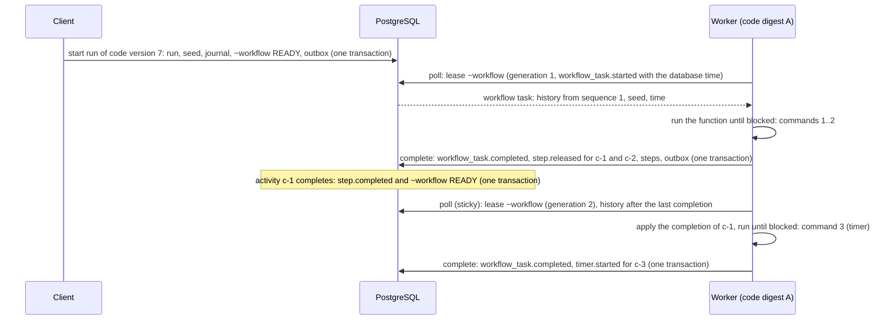

# Workflow as code

*   **Author:** Claude Code, for the owner
*   **Status:** Draft
*   **Date:** 2026-11-24

--------------------------------------------------------------------------------

## Overview

From release 0.3.0 a workflow can be a function written in any of the six SDK languages (TypeScript, Go, Python, C#,
Java, Rust) instead of a graph. The function runs in the tenant's own worker. It never touches the outside world
itself: it asks the platform to do things (run an activity, sleep, wait for an event, start a child, ask a person for
an approval, open a saga) and the platform records each request and each result in the run's journal. When the worker
that holds the function's state in memory is gone, another worker rebuilds that state by running the function again
from the start against the journal ("replay"); because the function is deterministic, it makes the same requests in
the same order, and the worker skips the ones already recorded. This is the programming model of Temporal, Cadence and
Azure Durable Functions. The owner decided it is built in 0.3.0 in all six SDKs, starting with a determinism study per
language before any code, and that the declarative graph stays a first-class model beside it (owner decision
2026-11-24-3, "Sim, entra na 0.3.0").

The design does not add a second execution engine. The function is a *decider*: in each *workflow task* it receives
the events since its last decision and answers with a list of *commands*. Every command that does work is a node of the
existing workflow IR (an activity node, a timer node, a `waitEvent`, a `child`, an `approval`, a `script`), parsed by
the same parser, checked by the same rules and executed by the same engine code that runs graph workflows. So a code
run gets, without new execution code, everything the graph engine already proves: leases and fencing, retries,
compensation as derived steps, the uncertain-effect rules of feature 037, concurrency keys and rate limits (022),
step logs (041), payload classification and blobs. The workflow task itself is leased like a step, and its completion
commits the journal events, the scheduled steps, the timers, the subscriptions and the outbox in one transaction.

Where the design goes past Temporal (Technical Plan 17 has the full comparison):

- **A deploy cannot make a run nondeterministic.** Every code run pins one published code version, which names the
  SHA-256 digest of the code. Only a worker that serves that digest receives the run's workflow tasks. Code changes
  under a running run only through an explicit *move*, which the server applies to one run only after a worker of the
  target code has replayed that run's history without a mismatch.
- **The server checks determinism too.** It keeps a hash chain of the commands it accepted for each run, and refuses a
  completion whose replayed commands do not hash to it, so a bug in an SDK's own comparison or a stale cache cannot
  corrupt a run.
- **A code bug never loses a run.** An unexpected exception or a nondeterminism holds the run with its cause, its
  state intact, until an operator moves it to fixed code, resets it or terminates it.
- **Compensation is the platform's, not hand-written.** A saga opened from code is planned and run by the engine with
  the rules of features 003 and 037 (reconciliation of unknown outcomes, review, `PARTIAL`), not by `try`/`catch`
  blocks in each workflow.
- **Queries work without a worker.** Code can publish declared state, which the engine answers with the existing
  query machinery of feature 014, also when no worker runs and after the run has ended.
- **Graph and code mix.** A graph can start a code child and a code workflow a graph child, and the Studio draws a code
  run with the same node pictures as a graph run, because its commands are IR nodes.

The decisions, gaps and owner questions are registered in
[specs/044-workflow-as-code/research.md](../../specs/044-workflow-as-code/research.md). The architecture decisions are
[ADR-0103](../adr/ADR-0103-a-code-workflow-is-a-decider-whose-commands-are-ir-nodes-committed-in-the-run-transaction.md) (the
decider and the one transaction),
[ADR-0104](../adr/ADR-0104-replay-follows-the-activation-boundary-and-the-server-holds-the-command-chain.md) (the activation boundary
and the server's command chain),
[ADR-0105](../adr/ADR-0105-a-code-run-pins-a-code-digest-and-moves-only-after-a-verified-replay.md) (pinning and verified moves),
[ADR-0106](../adr/ADR-0106-each-sdk-runs-workflow-code-under-a-named-determinism-runtime.md) (the runtime per language and the
deterministic primitives),
[ADR-0107](../adr/ADR-0107-effects-from-code-are-leased-steps-and-sagas-are-planned-by-the-engine.md) (effects and sagas),
[ADR-0108](../adr/ADR-0108-code-queries-are-answered-from-declared-state-and-worker-queries-are-ephemeral.md) (queries) and
[ADR-0109](../adr/ADR-0109-workflow-tasks-travel-on-the-next-free-worker-protocol-minor.md) (the protocol).

### Terms

- **Code workflow, code version, code run.** A workflow whose published version is a *code version* (Technical Plan
  3), and a run of such a version. A *graph* workflow, version and run are what exists today.
- **Code digest.** The SHA-256 that identifies the code a worker runs for a workflow type (Technical Plan 3.2).
- **Workflow task.** One lease of the run's reserved step `~workflow`, during which a worker runs the function until it
  is blocked and answers with commands. Its outcome is a *completion* (commands) or a *failure* (a cause).
- **Activation.** The events one workflow task delivers to the function, applied in journal order.
- **Command.** One request of the function, numbered by a per-run *command sequence* (1, 2, 3...).
- **Replay.** Running the function from the start against the history of a run without issuing commands that are
  already recorded.
- **Sticky.** The worker that completed the last workflow task keeps the run's state in memory and is offered the next
  one first.
- **Hold.** A code run that the platform has stopped offering workflow tasks for, with a recorded cause, until an
  operator acts.
- **Move.** An operator's request to re-pin one open code run to another code version, applied only after a verified
  replay.

## The Problem

The platform offers two ways to write a workflow today, a graph in the Studio and a graph built by an SDK builder, and
both produce the declarative IR that the Rust engine interprets (`docs/architecture/workflow-ir-and-sdk-modes.md`,
table "Three experiences, a single engine"). The third row of that table, "Procedural code-first (later phase)", was
never specified: `docs/architecture/execution-semantics.md` calls it "Code-orchestrated (P2)" and asks for "a registered
worker and proof of determinism"; ADR-0003 says "procedural worker with determinism rules later";
`sdks/SPEC.md` says an SDK "is **not** a workflow runtime. It does not execute workflow code, replay anything, keep a
journal, or decide a transition".

What a graph cannot express well, a person writing code expects to write directly: a loop whose body depends on the
result of the last activity, a retry policy that changes with business rules, a dynamic number of parallel branches, a
state machine with many signals, ordinary functions and types shared with the rest of the application, and unit tests
in the language's own test framework. Temporal's users write exactly this, and the owner's goal for release 0.3.0 is to
surpass Temporal and Windmill (owner decision 2026-11-24-1), which a platform without workflow as code does not do.

Workflow as code is also where Temporal's users suffer most, and the problems are well known:

- **Nondeterminism found in production.** A changed workflow function, deployed while runs are open, makes different
  commands on replay. Temporal detects it only when a worker replays an affected run, and the run's workflow task
  then fails and retries until someone deploys a fix.
- **Versioning by hand.** `patched()` / `GetVersion()` branches accumulate in the code; nothing checks that a patch
  really replays the old histories before the deploy.
- **Sagas by hand.** Compensation is `try`/`catch` code per workflow; an unknown outcome of a payment is the author's
  problem.
- **Queries need a live worker** and fail when none runs.
- **Hidden limits.** History size, payload size and the cost of fan-out from code surprise people late.

This repository has the pieces a better answer needs: an append-only journal with a per-run sequence
(`run_events`, `crates/infra-postgres/migrations/20261009000100_execution.up.sql`), one transaction that commits a step
completion with the next work and the outbox (`PgRunTx::persist`, `crates/infra-postgres/src/execution.rs`), a worker
protocol with leases and fences (`specs/001-platform-foundation/contracts/worker.proto`), immutable published versions
with a canonical digest (`workflow_versions`), compensation as derived steps (ADR-0010) with the uncertain-effect rules
of feature 037, declared state with engine-answered queries (feature 014), resets (feature 018) and a conformance suite
common to the SDKs (`tests/contract/sdk-conformance/`). What is missing is a determinism runtime in each SDK, a
workflow task the engine can lease and commit, and the versioning rules that keep code and history together.

## Requirements

### Functional

- **Requirement 044-001** A published workflow version MUST be either a graph version (today's document) or a code
  version (Technical Plan 3), never both. A code version MUST name its workflow type, its language, its code digest
  and its capability envelope; it MUST be immutable like every version. *Acceptance:* the publication tests of Task
  044-3 refuse a document with both `code` and `nodes`, a malformed digest and an envelope outside the schema, and
  accept a valid code version whose stored bytes are byte-identical when read back.
- **Requirement 044-002** A code run MUST pin exactly one code version at any moment; its workflow tasks MUST be
  offered only to a worker session that registered that version's workflow type and code digest and whose identity is
  bound to that workflow type. *Acceptance:* with two workers serving two digests of the same type, each run's workflow
  tasks are leased only by the worker of its digest (integration test `workflow_tasks_follow_the_pinned_digest`), and a
  worker without the binding is refused at registration with `NOT_BOUND`.
- **Requirement 044-003** The function MUST be driven by workflow tasks: a lease of the reserved step `~workflow` with
  attempt, generation, lease token and deadline, delivering the history since the worker's last completion (sticky) or
  from the start, and answered by a completion with commands or by a failure. A workflow task MUST carry no secret and
  MUST NOT be accepted by `ResolveSecrets`, `ResolveDatabase` or `AppendStepLogs`. *Acceptance:* contract tests of Task
  044-8 and `a_workflow_task_lease_cannot_resolve_secrets`.
- **Requirement 044-004** A completion MUST commit, in one transaction with the run row locked and the lease fenced:
  the journal events of the completion and of every command, the steps, timers and subscriptions the commands create,
  the projections they change, the outbox records that announce new work, and the scheduling of the next workflow task
  when events are pending (AGENTS rule 3). *Acceptance:* the crash test of Task 044-9 kills the engine at each
  statement of the completion and observes either nothing or all of it; the statement-budget test holds the completion
  at no more than 12 statements whatever the number of commands.
- **Requirement 044-005** Events committed while a workflow task is started MUST be delivered in the next activation,
  never in the current one, and the next workflow task MUST be scheduled by the completion that ends the current one
  (the activation boundary, Technical Plan 4.3). *Acceptance:* a property test over generated interleavings of signals,
  timer firings and completions replays every history to the same command sequence
  (`activation_boundary_replays_every_interleaving_to_the_same_commands`).
- **Requirement 044-006** Every SDK MUST detect nondeterminism during replay: a command whose kind or target differs
  from the recorded command at the same sequence number, a recorded command the function no longer makes, or a patch
  marker that does not match. It MUST report it as a workflow task failure with cause `NONDETERMINISM`, the sequence
  number, the expected and the actual kind and target, and no payload. *Acceptance:* the conformance scenario
  `code-nondeterminism` in all six SDKs.
- **Requirement 044-007** The server MUST keep, per code run, the hash chain of the descriptors of the commands it
  accepted (Technical Plan 6.2), and MUST refuse a completion whose replayed chain differs, with cause `CHAIN_MISMATCH`.
  *Acceptance:* `a_completion_with_a_foreign_command_chain_is_refused_and_holds_the_run`.
- **Requirement 044-008** A nondeterminism, a chain mismatch, a command outside the version's envelope, and five
  consecutive failed or timed-out workflow tasks MUST put the run on hold: no further workflow task is offered, the
  run's status and every outstanding step, timer and subscription stay as they are, and the hold is journaled with its
  cause and audited. A hold MUST end only by a move, a reset, a retry request or a termination by an authorized
  operator. *Acceptance:* integration tests per cause and per remedy (Task 044-12).
- **Requirement 044-009** An uncaught exception that is not the SDK's workflow failure type MUST fail the workflow task,
  not the run. A workflow failure MUST end the run `FAILED` with the code and safe message the function gave.
  *Acceptance:* conformance scenario `code-failures`.
- **Requirement 044-010** Time, randomness and identifiers MUST come from the run: the current time is the database time
  recorded when the workflow task started; random numbers come from xoshiro256** seeded with the run's 32-byte seed;
  identifiers are version 4 UUIDs drawn from that generator (Technical Plan 1.8). The six SDKs MUST produce the same
  sequence for the same seed. *Acceptance:* conformance scenario `code-deterministic-primitives` compares the first
  64 numbers, 8 bounded integers and 8 UUIDs of a fixed seed with one golden in all six SDKs.
- **Requirement 044-011** Each SDK MUST run workflow code under the determinism runtime of Technical Plan 1 for its
  language, MUST refuse to register workflow types when the runtime's precondition fails (for Python, string hash
  randomization; for Java, a runtime older than 21), and MUST stop an activation that does not yield within 2 s with
  cause `ACTIVATION_DEADLINE`. *Acceptance:* each SDK's unit tests of Task 044-15 to Task 044-20, and the scenario
  `code-activation-deadline`.
- **Requirement 044-012** A code run MUST execute only these commands in 0.3.0: schedule an activity, run a script,
  start and cancel a timer, wait for an event, start a child, request an approval, open, close and abort a saga scope,
  request the cancellation of one of its own steps or children, record a marker (patch, side effect), set the declared
  state, accept, reject and complete an update, complete, fail or continue as new, and acknowledge a cancellation.
  Each node-creating command MUST carry a canonical IR node fragment parsed and checked by the publication parser for
  that node kind. *Acceptance:* `every_command_kind_round_trips_through_the_node_parser` and a refusal test per kind
  outside the list (`database`, `icebergWrite`, `forEach`, `while`, `repeatUntil`, `parallel`).
- **Requirement 044-013** A command MUST stay within the version's capability envelope: activity names matching its
  activity patterns, secrets in its declared secret set (whose use the publisher was allowed at publication, feature
  009), child workflows and scripts in its lists, approvals only when the envelope allows them. A command outside it
  MUST hold the run with cause `COMMAND_OUTSIDE_ENVELOPE`. *Acceptance:* one test per envelope member.
- **Requirement 044-014** A code version MAY declare signals. A signal to an open code run MUST be accepted for a
  declared name whether or not the function is waiting, journaled once under the existing idempotency key, charged to
  the run's 4 MiB retained bytes, and delivered in the next activation. An undeclared name MUST be refused with
  `409 SIGNAL_NOT_DECLARED`. Graph runs keep today's rule (a signal nobody waits for is refused). *Acceptance:*
  conformance scenario `code-signals`, including a signal sent before the function waits and a repeated key.
- **Requirement 044-015** A code version MAY declare updates. An update MUST be admitted durably with its `updateKey`,
  validated by the function's validator inside an activation (a validator that issues a command fails the workflow
  task), journaled as accepted or rejected, handled by the function (which may issue commands), and completed with a
  result or a failure. `POST /runs/{runId}/updates/{name}` MUST answer `200` with the result when the update completes
  within `waitMs` (at most 60,000 ms) and `202` with the status otherwise; `GET /runs/{runId}/updates/{updateKey}`
  MUST return the current status. Update-with-Start (feature 018) MUST work for a code version. *Acceptance:*
  conformance scenarios `code-updates` and `code-update-with-start`.
- **Requirement 044-016** A code version MAY declare state and queries in the IR's `state` form (feature 014). The
  function MUST be able to set the declared state by a command; the engine MUST answer the declared queries from the
  committed state with no worker, also after the run ended while its data is retained. *Acceptance:* conformance
  scenario `code-declared-state` queries a run whose workers are all stopped.
- **Requirement 044-017** A code version MAY declare worker queries. A worker query MUST be answered by a worker of the
  run's digest, from its sticky cache or after a replay, within the caller's timeout (at most 30,000 ms), without a
  journal event and without changing the run; a query handler that issues a command MUST fail the query, not the run.
  The query and its outcome MUST be audited. *Acceptance:* conformance scenario `code-worker-queries`.
- **Requirement 044-018** A child started from code MUST be a run of any published version, graph or code, created by
  the existing child machinery with its cancel policy, depth and tree budget; a graph `child` node MUST be able to start
  a code version. *Acceptance:* conformance scenario `code-graph-mixed` (a code parent with a graph child that has a
  code child).
- **Requirement 044-019** Continue-as-new from code MUST close the run as continued and start the successor in the same
  transaction, with the transferred input and state, under the chain rules of feature 014 (quiescence, deadline,
  segment limit). The successor MUST pin the same version unless the command asks for the workflow's active version.
  *Acceptance:* conformance scenario `code-continue-as-new`, including `version: active`.
- **Requirement 044-020** A saga opened from code MUST be a compensation domain of the engine: activities scheduled in
  it with `compensateWith` or `reconcileWith` get the derived steps of ADR-0010, an abort plans their compensations in
  reverse order of completion, unknown outcomes follow feature 037 (reconciliation, review, `PARTIAL`), and the function
  learns only the saga's outcome. *Acceptance:* conformance scenarios `code-saga` and `code-saga-uncertain`.
- **Requirement 044-021** The function MUST NOT run an effect itself through the platform: there are no local
  activities. A worker that completes a workflow task MAY ask to receive, in the completion's answer, the leases of the
  activities it just scheduled and serves (eager dispatch), and a sticky worker that completes an activity MAY receive
  the run's next workflow task in the answer. *Acceptance:* the eager tests of Task 044-14 and the commit count of
  Non-functional requirement 044-002.
- **Requirement 044-022** A cancellation request MUST reach the function in its next activation; the function MUST
  acknowledge it by completing, failing or acknowledging the cancellation. If it has not done so within the version's
  cancellation grace (default 60 s, from 1 s to 3,600 s), the engine MUST end the run `CANCELLED` itself, applying the
  cancel policies of its outstanding steps, children and sagas. The run deadline MUST be enforced by the engine
  without the function. *Acceptance:* conformance scenario `code-cancellation`.
- **Requirement 044-023** An operator with `run:operate` on the namespace MUST be able to request a move of one open
  code run, or of every open run of a version, to another code version of the same workflow. The server MUST ask a
  worker of the target digest to replay the run's history, and MUST re-pin the run only when the replay matched every
  recorded command and the run's journal has not grown since the replayed sequence; otherwise the run stays as it was
  and the move item records why. Every applied move MUST be journaled and audited. *Acceptance:* conformance scenario
  `code-patch-and-move` and the integration tests of Task 044-13.
- **Requirement 044-024** Each SDK MUST offer `patched(id)` and `deprecatePatch(id)` with Temporal's meaning (Technical
  Plan 7.2), recorded as markers in the journal. *Acceptance:* `code-patch-and-move`.
- **Requirement 044-025** Each SDK MUST ship a replayer that replays exported histories against the local code and
  reports the first mismatch, usable in a test of the language's own framework. A person with the new permission
  `history:export` MUST be able to export a code run's history (`GET /runs/{runId}/history`), audited. *Acceptance:*
  the replayer test in each SDK replays the golden histories of the conformance suite.
- **Requirement 044-026** Promoting a code version MAY require a replay check: the server replays up to 64 of the most
  recent completed runs of the active version on a worker of the new digest and refuses the promotion when one does not
  match. *Acceptance:* `promotion_with_a_replay_check_refuses_a_version_that_diverges`.
- **Requirement 044-027** A code run's history MUST be bounded: from 10,240 events visible to the worker the function is
  told that continuing as new is suggested; at 51,200 visible events a workflow task completion that does not end or
  continue the run MUST be refused with `HISTORY_LIMIT` and the run held with that cause. *Acceptance:*
  `the_history_limit_suggests_then_holds`.
- **Requirement 044-028** A code run MUST be listed, read and drawn like a graph run: the run view, the events, the
  observed graph of its commands (each command is a node with its kind and target), its hold and its moves.
  *Acceptance:* the Studio test of Task 044-23 and the REST contract tests.
- **Requirement 044-029** The interactions of Technical Plan 12 MUST hold: run-level concurrency and rate limits gate a
  code run's admission as any run's; step-level keys on an activity command gate its readiness; workflow tasks are never
  gated; payloads encoded by a client codec (feature 031) stay opaque to the server; worker deployments (feature 019)
  route activities, never workflow tasks; search attributes (feature 020) are upserted by a command. *Acceptance:* one
  integration test per interaction, gated on each feature's delivery.
- **Requirement 044-030** Code versions MUST be publishable only when every running instance of the platform reports
  the capability `code-workflows` (ADR-0082's registry); an instance without it MUST never open a code run.
  *Acceptance:* `a_code_version_is_refused_until_every_instance_reports_the_capability`.

### Non-functional

- **Non-functional requirement 044-001 (replay cost)** Each SDK MUST replay a history of 10,240 visible events in at
  most 1 s and one of 51,200 in at most 5 s on the reference worker host, that is at most 97.65625 µs per event
  (1,000,000 µs / 10,240 = 97.65625 µs; 5,000,000 µs / 51,200 = 97.65625 µs). These are benchmark criteria on a stated
  host, not promises (constitution, Delivery Constraints).
- **Non-functional requirement 044-002 (commits)** A code workflow that runs one activity and ends MUST cost at most 5
  committed transactions with eager dispatch and a sticky worker: the start, the first workflow task lease, its
  completion with the eager activity lease, the activity completion with the eager next workflow task, and the final
  completion; at most 7 without the two eager paths (the activity lease and the second workflow task lease are then
  separate). A graph workflow with one activity costs 3 (start, lease, completion), so the ratio is at most
  5 / 3 ≈ 1.67 with the eager paths.
- **Non-functional requirement 044-003 (statements)** A workflow task completion MUST run at most 12 SQL statements
  whatever the number of its commands, up to the 256 commands a completion may carry.
- **Non-functional requirement 044-004 (latency)** With a sticky worker and a history of at most 1,024 events, the time
  from the commit of a signal to the commit of the workflow task that handles it MUST be at most 50 ms at the 99th
  percentile on the reference environment, and at most 250 ms without the sticky worker. Benchmark criteria.
- **Non-functional requirement 044-005 (memory)** The sticky cache of a worker MUST hold at most 256 runs by default.
  An idle cached run MUST cost at most 1 MiB in TypeScript, Python, C# and Java and at most 256 KiB in Go and Rust, so
  a full default cache costs at most 256 MiB (256 × 1 MiB) or 64 MiB (256 × 256 KiB). Benchmark criteria; Gap 044-001.
- **Non-functional requirement 044-006 (bounds)** A completion carries at most 256 commands and at most 4 MiB of inline
  command payload; a history page at most 1,024 events or 4 MiB, so a history at the hard limit is at most
  51,200 / 1,024 = 50 pages; a replay-check task at most 16 runs or 8 MiB of history; a registration at most 64
  workflow types; a worker query answer at most 256 KiB.
- **Non-functional requirement 044-007 (security)** No workflow code runs in a platform process. A workflow task holds
  no secret. Another tenant's run, history, update or query is indistinguishable from a missing one. No payload or
  secret appears in a hold cause, a nondeterminism report, a metric or a log.

### Success criteria

- **Success criterion 044-001** The conformance scenarios of the Verification Plan pass in all six SDKs with reviewed
  goldens and no selection filter.
- **Success criterion 044-002** No code run is lost or silently changed by a deploy: the fault suite deploys a changed
  function while 100 runs are open and observes 0 nondeterminism holds without a move, and, with a move, a hold only on
  the runs whose replay did not match.
- **Success criterion 044-003** The benchmark of owner decision 2026-11-24-1 reports the replay cost, the commit count,
  the statement count and the latency of Non-functional requirements 044-001 to 044-004 against Temporal on the same
  host, with its environment and failures stated.

### User stories

- **User story 044-01** As a developer, I write a workflow as a function in my language, test it with my test
  framework, publish it and run it (CUJ 1).
- **User story 044-02** As a developer, I change my function while runs are open, and the platform proves which runs can
  take the change before it applies it (CUJ 2, CUJ 3).
- **User story 044-03** As an operator, I see a held run, why it is held, and I fix it without losing it (CUJ 4).
- **User story 044-04** As a developer, I write a saga in code and the platform compensates it, including unknown
  outcomes (CUJ 5).
- **User story 044-05** As a client, I signal, update and query a code run as I do a graph run (CUJ 6).

## Goals

- Workflow as code in the six SDKs with one semantic contract and one conformance suite.
- No second execution substrate: every effect is a node the engine already executes.
- Versioning that cannot corrupt a running run, and that proves a change before applying it.
- The guarantees of the graph mode (one transaction per decision, leases and fences, compensation, uncertain effects,
  tenant boundary, audit) for the code mode, unchanged.
- Measured, bounded costs, compared with Temporal by the benchmark of owner decision 2026-11-24-1.

## Non-Goals

- Running workflow code in a platform process, or sandboxing it as a security boundary. The function runs in the
  tenant's worker, like an activity; the determinism runtimes of Technical Plan 1 isolate for determinism, not for
  security.
- Converting code to a graph or a graph to code. The Studio draws the commands a code run made, not a blueprint
  (constitution principle IV: "imperative code that cannot be converted is not promised a round trip").
- Local activities (effects run inside a workflow task). Technical Plan 10.3 says why.
- In 0.3.0: the `database`, `icebergWrite`, `forEach`, `while`, `repeatUntil` and `parallel` nodes as commands (code uses
  its own loops and concurrency; a large fan-out uses a graph child), signalling or cancelling another run from code,
  and an automatic move policy (Gap 044-003, Gap 044-004, Gap 044-006).
- Exactly-once external effects. Activities from code are at-least-once, as every activity.

## Open Questions

None open. Every product and design question of this design was decided by the coordinating session under owner
decision 2026-11-20-6, each recorded in the register as "delegate (OD-2026-11-20-6)" with its reasoning (Owner question
044-001 to Owner question 044-012). The gaps that stay open are registered (Gap 044-001 to Gap 044-012).

## Owner decisions needed

None. The scope is owner decision 2026-11-24-3; the constitution amendment that admits the procedural mode is owner
decision 2026-11-24-2. The questions of this design are delegated under owner decision 2026-11-20-6, and the acceptance
of its architecture decisions and the settlement of review findings under owner decision 2026-11-24-4.

## Critical User Journeys (CUJs)

### CUJ 1: The first code workflow (User story 044-01)

*   **Given**: a TypeScript developer with a worker that serves the activities `inventory.reserve` and `payments.charge`.
*   **When**: she writes `async function order(ctx, input)` that reserves, charges, sleeps one day and sends a reminder
    unless a `paid` signal arrived; she runs `sagat-workflows bundle`, publishes the code version with
    `client.definitions.publishCode(manifest)`, starts her worker with the bundle, and starts a run.
*   **Then**: the run view shows the commands as nodes (two activities, a timer, a wait), the journal shows each
    workflow task, and her unit test, which runs the function with the SDK's test environment and a replay of the
    run's exported history, passes.

### CUJ 2: A deploy while runs are open (User story 044-02)

*   **Given**: 3,000 open runs of code version 7 (digest A), and a new build of the worker (digest B) that changes the
    function.
*   **When**: the build is deployed beside the old one and published as version 8, and version 8 is promoted.
*   **Then**: new runs pin version 8 and go to the digest B workers; the 3,000 runs stay on version 7 and are served
    by the digest A workers; nothing is held. The version list shows 3,000 open runs on version 7, so the operator
    knows the digest A workers must stay until those runs end or move.

### CUJ 3: Moving long runs to fixed code (User story 044-02)

*   **Given**: the 3,000 runs of CUJ 2 last months, and version 8 wraps its change in `patched('reminder-v2')`.
*   **When**: the operator requests `POST /namespaces/{ns}/workflows/{workflowId}/code-moves` from version 7 to 8 for
    all open runs.
*   **Then**: digest B workers replay each history; 2,990 match and are re-pinned to version 8, each with a journal
    event and an audit record; 10 that took a branch the new code changed without a patch do not match, stay on version
    7, and the move job lists them with the sequence number and the expected and actual command.

### CUJ 4: A held run (User story 044-03)

*   **Given**: a Go worker whose function divides by zero for one input.
*   **When**: the workflow task panics five times in a row.
*   **Then**: the run is held with cause `WORKFLOW_TASK_FAILED`, the Studio shows the hold with the panic's class and the
    command sequence, `workflow_task_holds_total{cause}` increases and an alert fires; the developer deploys a fix as a
    new code version and moves the run, which resumes from where it stopped. Nothing it had done is lost or repeated.

### CUJ 5: A payment saga with an unknown outcome (User story 044-04)

*   **Given**: a code saga that reserves stock and charges a card, each with `compensateWith`, and the charge declares
    `reconcileWith: 'payments.lookup'`.
*   **When**: the charge times out after the request was sent (`OUTCOME_UNKNOWN`).
*   **Then**: the engine runs the lookup; the provider says `applied`; the charge completes with the lookup's output;
    the function continues. Had the lookup answered `unknown`, the step would wait for review, and the function would
    simply be waiting on the charge, with nothing in its code to handle the case.

### CUJ 6: Signals, updates and queries (User story 044-05)

*   **Given**: a code run of an approval process that declares the signal `cancelRequest`, the update `addLine` and the
    declared state `{lines, total}` with the query `total`.
*   **When**: a client signals before the function waits, sends `addLine` with `waitMs: 5000`, and queries `total` while
    every worker is stopped.
*   **Then**: the signal is delivered at the function's next activation; the update answers `200` with its result when
    a worker is up, `202 ACCEPTED` when the handler waits on an activity longer than 5 s; the query answers from the
    committed state without a worker.

## Technical Plan (Architecture)

### 1. The determinism study

The function must produce the same commands in the same order every time it is replayed against the same history.
Everything it can observe besides the history must therefore be either supplied by the history (results, signals,
time) or deterministic by construction (its own code, the SDK's primitives). The study below says, per language, how
the SDK intercepts each source of nondeterminism, what isolation exists, how a breach is detected, and the verdict.
Each claim marked *spike* was settled by a throw-away program run on 2026-11-24 on the development machine (macOS,
Apple silicon; Node 26.13.1, Python 3.15.2, Go 1.24.2, .NET 10.0.401, OpenJDK 23.0.2, rustc 1.100.0); the programs
were not committed, and their results are recorded in the register (Decision 044-041). The numbers are from one machine
and one run each; they choose between designs, they are not benchmarks.

#### 1.1 The sources of nondeterminism, for every language

| Source | What the function sees | How every SDK supplies it |
|---|---|---|
| Results of effects | Activity, child, approval and wait outcomes | From the history, applied one event at a time in journal order |
| Time | "Now" | The database time of the workflow task's start, constant during an activation |
| Sleep | A delay | A durable timer command |
| Randomness, identifiers | Random numbers, UUIDs | A generator seeded by the run (section 1.8) |
| Concurrency | Several branches of the function | A deterministic scheduler that runs one branch at a time in a fixed order |
| Unordered collections | Iteration order of hash sets and maps | Forbidden where the order differs between processes (Python sets, Go maps, Rust `HashMap`), or deterministic where it does not (insertion-ordered maps) |
| Input and output | Files, network, environment, processes | Refused during an activation where the runtime can see it, flagged by an analyzer where it cannot |
| Global state | Module or static variables mutated across runs | A fresh context per run (TypeScript) or per-run objects with a documented rule (others) |
| The SDK itself | How it turns calls into commands | Versioned behaviour flags recorded in the history (section 1.9) |

#### 1.2 TypeScript

- **Runtime.** Each run gets its own `node:vm` context created with `microtaskMode: 'afterEvaluate'` and
  `codeGeneration: { strings: false, wasm: false }`. The workflow code is one bundle file produced by the SDK's
  `sagat-workflows bundle` command (esbuild, pinned and hash-locked, Decision 044-012); the worker compiles the bundle
  once per digest as a `vm.Script` and runs it in each run's context. Inside the context the SDK replaces `Date`
  (constructor without arguments and `Date.now`) with the workflow time, `Math.random` with the run's generator,
  `setTimeout`, `setInterval` and their `clear*` with durable timers, and removes `WeakRef`, `FinalizationRegistry`,
  `SharedArrayBuffer`, `Atomics`, `crypto`, `performance`, `queueMicrotask`'s host version and `process`. The bundler
  refuses an import of any `node:` built-in and of the activity modules, so the function cannot reach the file system
  or the network through an import.
- **Concurrency.** Promises are the only concurrency. The SDK resolves the promise of one history event, then evaluates
  an empty script in the context, which drains the context's own microtask queue completely (that is what
  `afterEvaluate` gives), before it applies the next event. So `Promise.race` and `Promise.all` resolve in journal
  order. *Spike:* a function with `Promise.all` of two activities, a one-second sleep and a `Promise.race` of an
  activity and a timer produced the same five commands and the same result in two runs, and `Date.now()` advanced from
  1,700,000,000,000 to 1,700,000,001,000 exactly when the timer fired.
- **Isolation.** A `vm` context is not a security boundary. *Spike:* `this.constructor.constructor('return typeof
  process')()` evaluated in an empty context returned `"object"`, the host's `process`, and the same through the
  constructor of a host function passed into the context. The SDK passes into the context only objects created inside
  it (its API object is built by code evaluated in the context, and talks to the host through a single
  structured-clone message function), which closes the accidental path; a deliberate escape remains possible and is
  out of scope, because the code is the tenant's own and runs in the tenant's worker (Gap 044-008).
- **Cost.** *Spike:* a fresh context took 0.19 ms to 0.45 ms to create; the heap measurement per context was not
  reliable (Gap 044-001).
- **Detection.** The bundler's import check; the replaced globals; the command comparison of section 6.1.
- **Verdict:** feasible, strongest isolation of the six for determinism.

#### 1.3 Python

- **Runtime.** A deterministic event loop, a subclass of `asyncio.AbstractEventLoop` whose `time()` is the workflow
  time, whose `call_soon` queue is first-in first-out and runs on one thread, whose `call_at` and `call_later` become
  durable timer commands, and whose `run_in_executor`, sockets, subprocesses and signal handlers raise. So
  `asyncio.sleep`, `asyncio.gather`, `asyncio.wait_for` and `asyncio.timeout` work unchanged and durably. *Spike:* a
  loop of 80 lines ran a function with `asyncio.gather` of two activities, `asyncio.sleep(30)` and
  `asyncio.wait_for(..., timeout=5)`; the sleep became a 30 s timer, the `wait_for` a 5 s timer, and two runs gave the
  same commands and result.
- **Isolation.** Workflow modules are imported once per digest through an import hook (a `sys.meta_path` finder) that
  refuses, during an activation, the modules that reach outside (`socket`, `threading`, `subprocess`, `secrets`,
  `random`, `uuid`, `os`'s process functions and others listed in the SDK), and whose `time`, `datetime` and `random`
  views are replaced by run-bound versions through a context variable. Behind the hook, a PEP 578 audit hook refuses
  the events `open`, `socket.connect`, `socket.getaddrinfo`, `subprocess.Popen`, `os.system` and `time.sleep` while an
  activation runs; an audit hook cannot be removed once added. *Spike:* during an activation `open()` was refused by
  the audit hook, and `import socket` and `import secrets` by the finder; outside an activation `open()` worked.
  `time.time()` is not an audit event, which is why the module views are replaced as well.
- **Hash seed.** *Spike:* the same set of six strings printed in four processes with `PYTHONHASHSEED` 1 to 4 gave four
  different orders; with `PYTHONHASHSEED=0` four processes gave one order. A worker that replays on another machine
  would otherwise see a different order. The SDK therefore refuses to register workflow types unless
  `sys.flags.hash_randomization` is 0 (Decision 044-013). Hash randomization protects a dictionary from crafted
  colliding keys; the trade-off is recorded in Owner question 044-004.
- **Detection.** The finder, the audit hook, the deadline of section 1.10 and the command comparison.
- **Verdict:** feasible, strong, with one precondition on the process.

#### 1.4 Go

- **Runtime.** A coroutine dispatcher on `iter.Pull` (Go 1.23 or later; the SDK requires 1.25). The function and each
  branch started with `workflow.Go` run as coroutines; each SDK call yields to the dispatcher, which runs the ready
  coroutines one at a time in the order they became ready. `iter.Pull` switches between coroutines without the Go
  scheduler choosing. *Spike:* a round trip through `iter.Pull` cost 45 ns against 241 ns for a goroutine and two
  unbuffered channels, which is how a dispatcher built on goroutines hands control over.
- **Hazards.** *Spike:* fifty `range` loops over one map of eight keys gave eight different orders, and a `select` over
  two always-ready channels chose the first in 59 of 100 rounds. The SDK provides `workflow.Channel`,
  `workflow.Selector`, `workflow.Go`, `workflow.Now`, `workflow.Sleep` and `workflow.SortedKeys`. Native `go`
  statements, channels, `select`, `time.Now`, `time.Sleep`, `math/rand` and `crypto/rand`, and `range` over a map in a
  workflow function are refused by `sagatvet`, an analyzer of the `go/analysis` framework the SDK ships and runs in
  its test helper.
- **Isolation.** None at run time: Go has no way to forbid a call. A native channel operation that blocks would stop
  the coroutine forever; the dispatcher's deadline of section 1.10 turns it into `ACTIVATION_DEADLINE`.
- **Detection.** `sagatvet`, the deadline and the command comparison.
- **Verdict:** feasible; the guarantee rests on the analyzer (Gap 044-007).

#### 1.5 C#

- **Runtime.** A single-threaded `TaskScheduler` per run with a maximum concurrency of 1, which never runs a task inline,
  and which the SDK drives until it is idle after each event. `TaskCompletionSource` objects of the SDK are created
  with `RunContinuationsAsynchronously`, so continuations are queued on the scheduler. *Spike:* with such a scheduler,
  awaits of the SDK's tasks and `Task.WhenAll` stayed on it; `ConfigureAwait(false)` and `Task.Run` left it.
- **Detection.** Every SDK call checks that `TaskScheduler.Current` is the run's scheduler and fails the workflow task
  with cause `NONDETERMINISM_RISK` otherwise. A Roslyn analyzer package flags `DateTime.Now`, `DateTime.UtcNow`,
  `Guid.NewGuid`, `new Random`, `Task.Run`, `Task.Delay`, `Thread`, `ConfigureAwait(false)`, `Parallel` and I/O types
  in workflow classes.
- **Verdict:** feasible; strong for the SDK's own awaits, analyzer-backed for the rest.

#### 1.6 Java

- **Runtime.** A dispatcher that gives a single permit to one workflow coroutine at a time; each coroutine is a virtual
  thread. The JDK still chooses the carrier thread, but only the coroutine holding the permit can run, so the order is
  the dispatcher's. *Spike:* a handoff between two virtual threads cost 4.46 µs, against 8.87 µs between two platform
  threads (the model of Temporal's Java SDK); a parked virtual thread cost about 1,845 bytes of heap. A custom
  scheduler for virtual threads is not public API (`java.lang.ThreadBuilders$VirtualThreadBuilder` refused access
  with `InaccessibleObjectException`), so the permit is the mechanism.
- **Baseline.** Virtual threads need Java 21. The core SDK stays on release 17; the code-workflow runtime is a new
  artifact, `sagat-workflows`, compiled for release 21, and refuses to start on an older runtime (Decision 044-014).
- **Detection.** Every SDK call checks that the calling thread is the coroutine that holds the permit. There is no
  static analyzer in 0.3.0 (Gap 044-002); the SDK documents the hazards (`System.currentTimeMillis`, `Random`,
  `UUID.randomUUID`, threads and executors, `CompletableFuture`'s default pool, iteration over a `HashSet` of objects
  whose hash is their identity, enums included) and provides `Workflow.currentTimeMillis`, `Workflow.newRandom`,
  `Workflow.randomUUID`, `Async.function`, `Promise` and `WorkflowQueue`.
- **Verdict:** feasible; the weakest detection of the six, closed in part by the conformance and replay tests.

#### 1.7 Rust

- **Runtime.** A single-threaded executor that polls the function's future and its spawned branches (`ctx.spawn`, not
  `Send`) in first-in first-out order on a dedicated thread on which no Tokio runtime is entered, so a call to
  `tokio::time::sleep` or `tokio::spawn` from the function panics; the executor catches the panic and fails the
  workflow task with cause `NONDETERMINISM_RISK`. *Spike:* an executor of 70 lines with a join of two activities
  produced the same commands and result in two runs.
- **Hazards.** *Spike:* fifty `HashMap`s of the same eight keys built in one process gave 49 different iteration
  orders. The SDK ships a `clippy.toml` fragment for workflow crates with `disallowed-types` (`std::collections::HashMap`
  and `HashSet` with the default hasher) and `disallowed-methods` (`SystemTime::now`, `Instant::now`, `rand::random`,
  `uuid::Uuid::new_v4`, `std::thread::spawn`), and offers `ctx.now()`, `ctx.random()` and `ctx.uuid()`.
- **Verdict:** feasible, strong: the type system keeps branches on one thread and the missing runtime turns the common
  escapes into a caught panic.

#### 1.8 The deterministic primitives, the same in six languages

- **Time.** `ctx.now()` is the database time, in microseconds, recorded in the `workflow_task.started` event of the
  workflow task being replayed. It does not advance during an activation. A language whose clock type has milliseconds
  (TypeScript `Date`) truncates.
- **Seed.** Each run has a 32-byte seed drawn from the operating system's random source at the run's creation, stored
  with the run and delivered in every workflow task. A successor of continue-as-new, a reset and a child get new seeds.
  The seed is not a secret and `ctx.random` is not for secrets.
- **Generator.** xoshiro256** whose four 64-bit state words are the seed read as four little-endian unsigned integers
  (an all-zero seed is replaced by the four words of SplitMix64 started at 0). `random()` is `(next() >> 11) × 2^-53`.
  `randomInt(n)` for 0 < n ≤ 2^32 draws `x = next()` until `x ≥ (2^64 − n) mod n` and returns `x mod n` (no bias).
  `uuid()` takes 16 bytes from two `next()` values, little-endian, sets the version nibble to 4 and the variant bits to
  `10`.
- **Why one algorithm for six languages.** Replay happens in one language, so this is not needed for determinism; it
  makes one conformance golden hold all six (Requirement 044-010) and a history readable by any SDK's replayer.

#### 1.9 Behaviour flags of the SDK

A new SDK release can change how it turns calls into commands (for example the order in which it issues the commands of
two branches resumed by the same event). Each SDK keeps a list of numbered behaviour flags. A workflow task completion
records the flags the SDK used for the first time in this run; on replay the SDK uses a flag only if the history
recorded it, so a run started by an older SDK keeps the older behaviour. Temporal does the same with its internal
flags. An SDK upgrade also changes the code digest (section 3.2), so this matters only for moves.

#### 1.10 The activation deadline

Every SDK stops an activation that has not yielded within 2 s of wall time (configurable down to 100 ms and up to the
workflow task timeout) and fails the workflow task with cause `ACTIVATION_DEADLINE`. In TypeScript the `vm` script
timeout does it; in Python a watchdog thread interrupts the loop; in Go, C#, Java and Rust the dispatcher stops waiting
and abandons the coroutine and the run's cache entry. This catches an infinite loop and, in Go, a native channel that
blocks.

#### 1.11 Verdicts

| Language | Runtime | Isolation for determinism | Detection beyond the command comparison | Precondition | Verdict |
|---|---|---|---|---|---|
| TypeScript | `vm` context per run, bundled code, drained microtasks | Strong (globals replaced, imports refused at bundling) | Bundler import check | None beyond Node 20 | Build |
| Python | Deterministic asyncio loop, import finder, audit hook | Strong | Finder and audit hook at run time | `PYTHONHASHSEED=0` | Build |
| Go | `iter.Pull` coroutine dispatcher | None at run time | `sagatvet` analyzer, deadline | Go 1.25 | Build |
| C# | Single-threaded `TaskScheduler` | Partial (the SDK's awaits) | Scheduler check per call, Roslyn analyzer | .NET 8 | Build |
| Java | Virtual threads under one permit | Partial (the SDK's calls) | Thread check per call | Java 21 for the new artifact | Build |
| Rust | Single-threaded executor without a Tokio runtime | Strong for spawned work and timers | Caught panics, clippy configuration | Rust 1.98 | Build |

### 2. The model



A code run is an ordinary run (`runs` row, journal, steps) whose version is a code version. It has one reserved step,
`~workflow` (the `~` keeps it outside the author's id alphabet, as the derived steps `<id>~c` of ADR-0010 do). That
step is `READY` when a workflow task is due, `LEASED` while a worker holds it, and `WAITING` (kind `DECIDER`) when the
function is blocked and nothing is pending. Its attempt and generation increase with every workflow task, and its lease
token fences the completion like any step's. Every other step of a code run is created by a command, with the node id
`c-<n>` where `n` is the command's sequence number; derived steps keep their suffixes (`c-12~c`).

The engine never runs the function. What it adds for a code run is small: the planner, after any event of a code run
that the function must see (Technical Plan 4.2), schedules the `~workflow` step instead of following graph edges; it
never ends a code run by itself except for a deadline, a forced cancellation (Requirement 044-022), a termination or a
history limit; and it applies the commands of a completion by the same command functions it uses for graph nodes
(`crates/domain/src/execution/command.rs`).

### 3. The code version

#### 3.1 The document

A code version is a workflow document of the additive v1 schema in which the top-level `code` object replaces
`entrypoint` and `nodes`:

```json
{
  "apiVersion": "sagat-octopus-orchestrator.io/v1",
  "kind": "Workflow",
  "metadata": { "name": "order" },
  "code": {
    "workflowType": "order",
    "language": "typescript",
    "digest": "sha256:9f2c...e1",
    "sdk": { "name": "sagat-octopus-orchestrator", "version": "0.3.0" },
    "matching": "standard",
    "workflowTaskTimeoutMs": 10000,
    "cancellationGraceMs": 60000,
    "envelope": {
      "activities": ["inventory.*", "payments.charge", "payments.lookup", "payments.refund"],
      "secrets": ["payments-api"],
      "children": ["shipping"],
      "scripts": [],
      "approvals": false
    },
    "signals": { "paid": { "schema": { "type": "object" } } },
    "workerQueries": { "progress": { "resultSchema": { "type": "object" } } }
  },
  "inputSchema": { "type": "object" },
  "outputSchema": { "type": "object" },
  "state": { "schema": { "type": "object" }, "initial": {}, "queries": {}, "updates": {} }
}
```

- The schema change is a `oneOf` at the top level: a graph document requires `entrypoint` and `nodes`, a code document
  requires `code` and forbids them; every other top-level field keeps its meaning. A reader built before this design
  refuses a code document with `SCHEMA`, which is why publication is gated on the capability of Requirement 044-030.
- `state.updates` of a code version name the updates the function handles; their `validate` and `state` expressions
  are absent, because the function validates and handles them (Technical Plan 8.2). `state.queries` keep their CEL
  form: they are the engine-answered queries.
- `envelope.activities` are exact names or a prefix ending in `.*`; at most 64 entries in each list. A secret listed
  there is checked at publication like an activity node's `secrets` (feature 009: the publisher must be allowed to use
  it).
- `matching` is `standard` (kind and target) or `strict` (also the digest of the command's input), section 6.1.
- `triggers`, `limits` and `chainPolicy` apply as for a graph version; a run-level `concurrency` or `rateLimit` (feature
  022) gates admission.

#### 3.2 The code digest

The SDK computes the digest and the worker sends it at registration; the platform never sees the code itself. It is
the SHA-256 of the RFC 8785 canonical JSON of `{language, sdk name, sdk version, workflowType, content}` where
`content` is the SHA-256, in lowercase hexadecimal, of:

| Language | What is hashed |
|---|---|
| TypeScript | The bundle file the worker loads |
| Python | The sorted list of `(module name, SHA-256 of the source bytes)` of every module the import finder loaded for the workflow type |
| Go | The executable file |
| C# | The assembly file that holds the workflow types (deterministic builds are the default of SDK-style projects) |
| Java | The jar files of the packages that hold the workflow types, sorted by name |
| Rust | The executable file |

For the compiled languages this is stricter than the workflow code: a change of an activity in the same binary makes a
new digest. That is safe (a new digest never applies to a running run without a move) and its cost is that each such
deploy needs a move for long runs, which succeeds whenever the workflow code did not change (Owner question 044-002).

#### 3.3 Publication

`client.definitions.publishCode(manifest)` in each SDK and `sagat workflow publish-code` publish a code version through
the existing publication transaction (ADR-0018). The parser of `crates/infra-ir` validates the document; nothing runs
code. Promotion makes the version active as today; with `replayCheck: true` it first runs the replay check of
Requirement 044-026 (section 7.4).

### 4. The workflow task

#### 4.1 Lease

The `~workflow` step is offered through `PollTasks` and `StreamTasks` to sessions of the new minor (section 13) that
registered the pair (workflow type, code digest) of the run's version, under a binding that covers `workflow:<type>`
(Decision 044-028). The claim fences it as any step. Its lease differs in three ways, all because a workflow task has
no external effect by construction (its commands take effect only when the server commits them):

1. Its lease has no heartbeat; its time-to-live is the version's `workflowTaskTimeoutMs` (default 10,000 ms, from 1,000
   to 60,000 ms).
2. Its expiry does not enter reconciliation or review (feature 037 treats every leased *activity* as external-capable;
   the reserved activity name `sagat.workflow` marks the step as not an activity). An expired workflow task is
   journaled `workflow_task.timed_out` and made `READY` again with generation + 1, not sticky.
3. It gives no access to secrets, databases or step logs (Requirement 044-003).

A lease journals `workflow_task.started` with the database time sampled in the lease transaction; that time is the
function's "now" for the activation (section 1.8).

#### 4.2 History

The lease carries the history the worker needs as typed `HistoryEvent` messages (section 13), not the journal's
internal JSON. The worker-visible history is a filtered projection of the journal: the events that change what the
function can observe (command events, outcomes of steps, timers, waits, children, approvals and sagas, signals,
updates, cancellation requests, markers, `workflow_task.started` and `workflow_task.completed`). Lease renewals,
retries of an activity's attempts, hints and audit are not part of it.

- A sticky lease (section 11) carries the events after the session's last completion of this run.
- Any other lease carries the first page from sequence 1; the worker reads the rest with `ReadHistory` under the lease
  token, at most 1,024 events or 4 MiB per page.
- A sticky worker whose cache lost the run calls `ReadHistory` from 1 and replays.

#### 4.3 The activation boundary

Signals, timer firings and activity completions can commit while a workflow task is started. They are journaled at once
(they are facts) and belong to the *next* activation. On replay, activation k delivers the events with a sequence after
the `workflow_task.completed` of activation k − 1 and up to the `workflow_task.started` of activation k, then any
events between that start and its own completion are held for activation k + 1. Because the boundary is defined by two
journal events, replay sees exactly what the live run saw (ADR-0104). Every event that the function must see sets the
run's `workflow_task_pending` flag in its own transaction: if the `~workflow` step is `WAITING` it becomes `READY` (with
its outbox hint) in that transaction; if it is `LEASED`, the completion that ends the lease sees the flag and makes it
`READY` again in its own transaction.

#### 4.4 Completion and failure

`CompleteWorkflowTask` carries the lease fence, the replayed chain (section 6.2), the behaviour flags newly used, the
commands, and the number of eager activity slots it offers. `FailWorkflowTask` carries a cause and a value-free detail.
Both are idempotent by the lease's idempotency key, as `CompleteStep` and `FailStep` are.

### 5. Commands and the one transaction

#### 5.1 The commands

| Command | What it carries | Journal events | Created or changed |
|---|---|---|---|
| Schedule activity | An activity node fragment (name, input, retry, timeouts, `compensateWith`, `reconcileWith`, secrets, concurrency and rate keys, `idempotencyTemplate`, saga scope) | `step.released` for `c-n` with the fragment's digest | `steps` row `READY` (or `WAITING` behind a gate of feature 022), `code_nodes` row, outbox hint |
| Run script | A script node fragment (artifact digest) | `step.released` | as an activity |
| Start timer, cancel timer | A timer node fragment; the sequence to cancel | `timer.started`; `step.cancelled` | `steps` row `WAITING` kind `TIMER` |
| Wait for event | A `waitEvent` node fragment | `wait.started` | `steps` row `WAITING` kind `EVENT` |
| Start child | A `child` node fragment (workflow, version, input, cancel policy, business id) | `step.released` | `steps` row with `child_run_id` reserved, started by the children pass as today |
| Request approval | An `approval` node fragment | `approval.opened` | as an approval node |
| Open, close, abort saga | Scope id, policy | `saga.entered`, `saga.completed`, `saga.aborting` | `run_sagas` rows; an abort plans compensations (section 10) |
| Request cancellation | The sequence of a step or child | `step.cancel_requested` | as today |
| Record marker | Kind (`patch`, `side_effect`), id, value (side effect only, at most 64 KiB) | `marker.recorded` | none |
| Set state | The new declared state | `state.updated` | `workflow_operation_states` |
| Accept, reject, complete update | Update key; reason; result or failure | `update.accepted`, `update.rejected`, `update.completed` | `operation_update_receipts` |
| Upsert search attributes | Attributes (feature 020) | `search_attributes.upserted` | the index of feature 020 |
| Complete, fail run | Output; code and safe message | `run.finished` | run terminal |
| Continue as new | Input, state, `version: same` or `active` | `run.continued` | the successor, as feature 014's handoff |
| Acknowledge cancellation | none | `run.finished` (`CANCELLED`) | run terminal |

A node fragment is the JSON of the IR node without `id` and `next`, canonicalized by the SDK (RFC 8785) and parsed by
the server with the publication parser of that node kind (`crates/infra-ir`), so every limit and every check of a
graph node applies to the command. The new event kinds are `workflow_task.scheduled`, `workflow_task.started`,
`workflow_task.completed`, `workflow_task.failed`, `workflow_task.timed_out`, `workflow_task.held`,
`workflow_task.released`, `signal.received`, `update.admitted`, `update.accepted`, `update.rejected`,
`update.completed`, `marker.recorded` and `run.code_version_moved`; every other row reuses an existing kind
(`RunEvent`, `crates/domain/src/execution/event.rs`).

#### 5.2 The transaction of a completion

In `PgRunTx` (`crates/infra-postgres/src/execution.rs`), in one transaction, with at most 12 statements whatever the
number of commands (Non-functional requirement 044-003):

1. Lock the run row and the `~workflow` step (`FOR UPDATE`), check tenant, namespace, session, lease token hash,
   attempt and generation (stale: `ABORTED STALE_ATTEMPT`, no write).
2. Check the replayed chain against `runs.code_command_chain` and that the first new command's sequence is
   `runs.code_command_count + 1` (mismatch: hold, section 6.3).
3. Parse and check every command against the version's envelope and the IR rules, in memory, before any write.
4. Insert the payloads (one statement, multi-row).
5. Insert the journal events: `workflow_task.completed` first, then one per command (one statement).
6. Insert the `code_nodes` rows (one statement).
7. Upsert the steps the commands create or change, timers and waits included (one statement).
8. Apply sagas, declared state, update receipts and search attributes (at most one statement each, only when a command
   needs it).
9. Insert the outbox rows for the new `READY` steps and, for a terminal command, the run's finished notice (one
   statement).
10. Update the `~workflow` step: `READY` again if `workflow_task_pending` is set or an update is admitted and not yet
    accepted, otherwise `WAITING`; clear the lease.
11. Compare-and-swap the run row (`run_version`, `code_command_chain`, `code_command_count`, the visible-event count,
    `workflow_task_pending`, the terminal status if any).
12. Write the idempotency record. When eager slots were offered, the same statements 7 and 9 lease up to that many of
    the new activity steps to this session instead of announcing them.

A terminal command is refused with `UNHANDLED_EVENTS` (the workflow task is retried, not counted as a failure) when
`workflow_task_pending` is set, so a run never ends without the function having seen a signal or an update that
arrived during its last workflow task.

#### 5.3 The transactions that wake the function

An activity completion, a timer firing, a wait satisfied or timed out, a child finished, an approval decided, a saga
settled, a signal, an update admission and a cancellation request each already commit in one transaction (their own
code paths). For a code run each of them, in that same transaction, journals its event, increments the visible-event
count, and sets `workflow_task_pending`, making the `~workflow` step `READY` with its outbox hint when it was `WAITING`.

### 6. Nondeterminism

#### 6.1 In the SDK

During replay the SDK compares each command the function makes with the recorded command at the same sequence:

- `standard` matching compares the kind and the target (activity name, script digest, child workflow, timer, event type,
  approval policy name, saga scope id, marker id); `strict` also compares the SHA-256 of the canonical input.
- A recorded command the function did not make by the time it blocks with no new event to apply, a command where the
  history has none, and a `patched(id)` that disagrees with the markers are mismatches.
- The report (`FailWorkflowTask`, cause `NONDETERMINISM`) names the sequence, the expected and the actual kind and
  target, and the code digest; never an input, an output or a message of the code.

#### 6.2 On the server: the command chain

For each code run the server keeps `code_command_chain`, 32 bytes: `H_0` is 32 zero bytes and
`H_k = SHA-256(H_(k−1) ‖ uint32 big-endian length of d_k ‖ d_k)`, where `d_k` is the RFC 8785 JSON of
`{"seq": k, "kind": ..., "target": ...}` for command k. A completion carries the chain the function produced up to the
first new command; the server compares it with the stored one and extends it with the new commands. A sticky worker
sends the chain it kept. The check costs one comparison and one SHA-256 per new command, and catches what the SDK's
comparison could miss: a bug in an SDK, a corrupted cache, a worker that skipped replay (ADR-0104).

#### 6.3 The hold

A hold journals `workflow_task.held` with its cause (`NONDETERMINISM`, `CHAIN_MISMATCH`, `COMMAND_OUTSIDE_ENVELOPE`,
`COMMAND_INVALID`, `WORKFLOW_TASK_FAILED`, `HISTORY_LIMIT`), the sequence and, for a mismatch, the expected and actual
kind and target, sets the `~workflow` step `WAITING` with kind `HELD`, audits `run.code_held` and counts
`workflow_task_holds_total{cause}`. The run's status stays `RUNNING` (or `WAITING`); its steps, timers and waits go
on, and their events are journaled and wait for the function. Ordinary workflow task failures and timeouts are retried
after 1 s, 2 s, 4 s and 8 s, so the fifth consecutive failure, at least 1 + 2 + 4 + 8 = 15 s after the first, holds the
run with cause `WORKFLOW_TASK_FAILED`; a nondeterminism, a chain mismatch and a command outside the envelope hold at
once, because retrying the same code cannot help. The remedies, each audited:

- **Move** to another code version (section 7.3); the move releases the hold when it applies.
- **Retry** (`POST /runs/{runId}/workflow-task/retry`, `run:operate`): releases the hold of a `WORKFLOW_TASK_FAILED`
  run, for a failure caused by the environment.
- **Reset** (feature 018) to an earlier `workflow_task.completed`: a new run replays the prefix and continues.
- **Terminate** (the existing stop with its force form).

### 7. Versioning

#### 7.1 Pinning

A run pins the version it starts with, and therefore its code digest (Requirement 044-002). A new version never applies
to an open run by itself. The version list shows, per code version, the open runs, the sessions that serve its digest
and the age of its oldest run, so an operator knows when the workers of an old digest can stop. A run whose digest no
worker serves waits, counted by `workflow_tasks_unserved{reason="no_digest"}` with the tenant in the span, not the
metric.

#### 7.2 Patches

`patched(id)` returns true and records a `patch` marker the first time a run reaches it; on replay it returns true if
the marker is at that point of the history and false if the history has a different command there, which is where the
old code went. `deprecatePatch(id)` records the marker and always takes the new path, for code from which the old path
was removed after every run that could take it ended. These are Temporal's semantics; the difference is that the move
of section 7.3 proves, per run, that the patched code replays before it applies.

#### 7.3 Verified moves

`POST /namespaces/{namespaceId}/workflows/{workflowId}/code-moves` with `{fromVersion, toVersion, runs: "all-open" |
[runId...], dryRun}` creates a move job through the many-run operation machinery of feature 018 (ADR-0050). For each run
the server sends a `REPLAY_CHECK` task to a session of the target digest, carrying the run's history (in batches of at
most 16 runs or 8 MiB). The worker replays without issuing commands and answers `match` with the chain it computed and
the last sequence it replayed, or `mismatch` with the report of section 6.1. In one transaction per run the server
locks the run, and applies the move only when the answer is `match`, the chain equals `code_command_chain` and the
run's `run_version` still equals the replayed sequence (otherwise it re-checks the run, at most three times). Applying
means: re-pin `runs.workflow_version_id` to the target, journal `run.code_version_moved` with both versions, the actor
and the replayed sequence, audit, release a hold if any, and make `~workflow` `READY` if events are pending. A dry run
reports the verdicts and moves nothing.

The target's envelope may differ from the source's; the move is refused for a run that has an outstanding step whose
activity, secret, child or script the target's envelope does not cover.

Principle IV says there is no *automatic* migration of a running workflow: a move is an explicit request by an
authorized person, per run, verified, journaled and audited, and the run references exactly one version at any moment
(ADR-0105; Constitution Check). No move policy applies by itself in 0.3.0 (Gap 044-006).

#### 7.4 Replay in CI and at promotion

- `GET /runs/{runId}/history` returns a code run's worker-visible history as JSON lines of `HistoryEvent`, under
  `run:read` and the new `history:export`, audited, with payloads as stored (an encoded payload of feature 031 stays
  encoded; the tenant's CI has the keys). The SDK replayers read that format.
- `sagat workflow history export --workflow order --last 64 --dir histories/` writes a corpus for CI.
- The promotion replay check (Requirement 044-026) sends `REPLAY_CHECK` tasks for up to 64 of the most recent completed
  runs of the active version to a session of the new digest; a mismatch refuses the promotion with the list.

### 8. Signals, updates and queries

#### 8.1 Signals

`POST /runs/{runId}/signals/{name}` keeps its route, permission, idempotency and 256 KiB limit. For a code run the
signal is accepted for a declared name in any non-terminal state, journaled `signal.received` with its payload digest,
charged to the 4 MiB the run retains (so at most 4 MiB / 256 KiB = 16 maximal signals), and delivered at the next
activation. The SDK gives the function a handler (`ctx.onSignal(name, fn)`) and a wait (`await ctx.signal(name)`); a
signal without a handler is kept in an in-memory queue per name, rebuilt by replay. Signal-with-Start creates the run
and journals the signal in the creating transaction. A signal to a run inside its start delay is refused as today
(feature 018).

#### 8.2 Updates

`POST /runs/{runId}/updates/{name}` with `{updateKey, args, waitMs}` admits the update: in one transaction, a receipt
`ADMITTED` (`operation_update_receipts`), `update.admitted` and `workflow_task_pending`. In the next activation the
function's validator runs first (a validator that issues a command fails the workflow task with cause
`VALIDATOR_COMMAND`), and the completion journals `update.accepted` or `update.rejected` with a value-free reason; the
handler then runs and may issue commands; a later completion journals `update.completed` with the result or the
failure. The REST call waits up to `waitMs` (default 0, at most 60,000) on the receipt and answers `200` with the
result, or `202` with `ADMITTED` or `ACCEPTED`; `GET /runs/{runId}/updates/{updateKey}` reads the receipt. A repeated
`updateKey` with the same arguments returns the same receipt, a different one `409 IDEMPOTENCY_KEY_REUSED`.
Update-with-Start admits the update in the creating transaction. A graph run's update keeps its synchronous CEL form.

#### 8.3 Queries

- **Declared queries (default).** The function sets the declared state with a command; the engine answers the CEL
  queries of `state.queries` from the committed state exactly as for a graph run (feature 014,
  `crates/application/src/declared_operations.rs`): no worker, no journal event, audited, on closed runs while their
  data is retained (ADR-0108).
- **Worker queries.** `POST /runs/{runId}/worker-queries/{name}` with `{args, timeoutMs}` (at most 30,000 ms) inserts a
  row of `code_query_requests` (not journaled, expires after the timeout plus 5 s), announced by an outbox hint, leased
  by a session of the run's digest (the sticky one first) through the task stream as a `QUERY` task, answered with
  `RespondWorkerQuery` (at most 256 KiB), and returned to the caller. A handler that issues a command fails the query
  with `QUERY_COMMAND`. Expired rows are removed by the maintenance pass. Audited with the caller and the outcome, not
  the arguments or the answer.

### 9. Children, continue-as-new and mixing

- **Children.** A child command creates the `child` node instance, and the existing children pass starts the child run,
  graph or code, with its cancel policy, depth and the tree budget of 1,024 runs and depth 8 (feature 014). The child's
  outcome is a `child.finished` event the function sees. A graph `child` node may name a code workflow.
- **Continue-as-new.** The command hands off through feature 014's transaction: quiescence is required (no outstanding
  step, timer, wait, child, approval, unknown effect or compensation), the chain's deadline and segment limit apply,
  the transferred input is checked against the successor's `inputSchema` (design 043), the successor gets a new seed
  and an empty history. `version: active` pins the workflow's active version at the handoff, the usual way a long-lived
  workflow takes new code; the default `same` keeps the version.
- **Mixing.** A code workflow uses a graph child for what the engine does better than code: a `forEach` over 10,000
  items keeps 10,000 activities out of the code run's history, which sees one `child.finished`. Because every command
  is an IR node, the Studio draws a code run's observed graph with the same node pictures, marked `Code-orchestrated`.

### 10. Sagas and uncertain effects from code

#### 10.1 The saga scope

```typescript
await ctx.saga({ onCompensationFailure: 'review' }, async (saga) => {
  await saga.activity('inventory.reserve', input, { compensateWith: 'inventory.release' });
  await saga.activity('payments.charge', input, {
    compensateWith: 'payments.refund', reconcileWith: 'payments.lookup' });
});
```

`ctx.saga` issues `open saga` with a scope id (`s-<n>`, the command's sequence) and the policy; activities scheduled
through `saga` carry the scope. When the body returns, the SDK issues `close saga` and the compensations are dropped,
as for a graph saga that completes. When the body throws (or calls `saga.abort()`), the SDK issues `abort saga`; the
engine then plans the compensations of the scope's completed steps in reverse order of their completion, one at a time
(code declares no dependencies, so reverse completion order is the safe order), and runs them as derived steps with the
retry, lease, fence and audit machinery of feature 003. The function waits; when the scope settles the engine journals
its outcome and `ctx.saga` throws `SagaCompensated`, `SagaPartial` or `SagaCompensationFailed`. A run cancelled while a
scope is open follows the scope's cancel policy.

#### 10.2 Unknown outcomes

An activity from code that reports `OUTCOME_UNKNOWN`, times out after the attempt began or loses its lease follows
feature 037 exactly as a graph activity: its `reconcileWith` lookup runs; `applied` completes it with the lookup's
output; anything else waits for an authorized review. The function sees only the final outcome or keeps waiting. It
cannot retry an unknown effect itself, because it has no handle on the attempt; a failure it sees is a known failure.

#### 10.3 Why no local activities

A local activity runs its effect inside the workflow task and records the result with the completion. If the worker
dies after the effect and before the completion, the effect runs again with no lease, no attempt record and no
reconciliation: an unknown outcome repeated blindly, which principle III forbids. The latency it saves is recovered by
eager dispatch (section 11.2) with every activity a leased, fenced, reconcilable step (ADR-0107).

### 11. Sticky cache and eager dispatch

#### 11.1 Sticky

After a completion the `~workflow` step records `sticky_session_id` (the completing session) and `sticky_until` (the
database time when it next becomes `READY` plus 5,000 ms). The claim offers a sticky step to its session first; another
session can lease it only after `sticky_until` or when the sticky session has ended. A worker evicts runs from its cache
by least recent use when it holds more than its cache size (default 256), and tells the server with
`ReleaseSticky(runIds)` so their next workflow task is not delayed. The sticky lease carries only the new events.

#### 11.2 Eager dispatch

- **Eager activities.** A completion may offer `eager_activity_slots`. The server leases to this session, inside the
  completion's transaction, up to that many of the new activity steps whose activity the session serves and is bound
  to, and returns their leases in the answer; the others are announced by the outbox as usual.
- **Eager workflow task.** When the sticky session completes an activity of a code run whose `~workflow` step becomes
  `READY` in that transaction, and the session offered a free workflow slot, the answer carries the workflow task lease.

### 12. Interactions with other features

| Feature | Interaction |
|---|---|
| 022 concurrency and rate limits | Run-level gates gate a code run's admission in `PgRunStore::create` as any run's; a run-level gate with continue-as-new is refused as for a graph (FR-022-017). Step-level keys on an activity command hold the step `WAITING` until the grant (ADR-0089). The `~workflow` step and query tasks are never gated. |
| 019 worker deployments | A deployment routes activities only. Workflow tasks are routed by the code digest of the run's version; a code version is already the pin that 019 adds for activities. |
| 020 visibility | `upsert search attributes` is a command journaled `search_attributes.upserted`; the index follows the journal. Until 020 is built the command is refused with `COMMAND_INVALID`. |
| 031 codecs | The server evaluates no expression on a code run's payloads, so inputs, outputs and signal payloads may be encoded end to end. Declared state, update arguments read by the engine, search attributes and the inputs of a `waitEvent` correlation stay plaintext, as feature 031 requires. |
| 041 step logs | Activities from code send step logs as any activity. A workflow task sends none: the function's log output goes to the worker's own logger, suppressed during replay. |
| 043 input validation | A code run's input, a child's and a successor's are checked against the version's `inputSchema` by the gate of design 043. |
| 018 business ids, batch, reset | Business ids, the with-start calls and batch operations apply to code runs unchanged. A reset of a code run copies the journal prefix up to a `workflow_task.completed` into a new run pinned to the version the operator names, which is replay-checked before it starts (section 7.3). |
| 014 declared state and chains | Reused as described in sections 8 and 9. |

### 13. Protocol

The worker protocol gains, in the next free minor of the register in `sdks/SPEC.md` at the time the contract merges
(expected 1.9: 1.7 is taken by feature 041 and 1.8 is reserved by the delivery acknowledgement of feature 006, ADR-0109):

- `WorkerCapabilities.workflow_types`: up to 64 `(workflow_type, code_digest)` pairs.
- `TaskLease.task_kind` values `WORKFLOW`, `QUERY` and `REPLAY_CHECK`, and a `WorkflowTaskLease` message: run, attempt,
  generation, lease token, deadline, seed, `started_at_us`, sticky flag, the first history page, the visible-event count
  and the continue-as-new suggestion.
- RPCs `CompleteWorkflowTask`, `FailWorkflowTask`, `ReadHistory` (server stream), `RespondWorkerQuery`,
  `RespondReplayCheck`, `ReleaseSticky`.
- `HistoryEvent`: sequence, kind (an enumeration of the visible kinds), the command sequence it answers, time, and a
  `oneof` of typed bodies with payloads as inline bytes (at most 256 KiB) or blob references.
- `Command`: sequence, kind, `node_fragment_json` for node-creating commands, typed fields for the others.
- `CompleteStepResponse` gains an optional `WorkflowTaskLease` (eager workflow task); `CompleteWorkflowTaskResponse`
  carries the eager activity leases.

A session below the new minor is never offered a `~workflow`, query or replay-check task (the claim filter of
`required_worker_protocol_minor`, `crates/application/src/worker.rs`). Everything is additive: `worker.baseline.json`
grows, nothing changes meaning.

### 14. Storage

One additive migration in `crates/infra-postgres/migrations` (the `/migration` checklist: grants to `sagat_app`, a
down that refuses when code runs exist, storage classification):

- `runs`: `code_seed bytea` (32 bytes), `code_command_chain bytea` (32 bytes), `code_command_count integer`,
  `code_visible_events integer`, `workflow_task_pending boolean`; all null for graph runs, with a check that they are
  all set or all null. `workflow_version_id` becomes updatable only through the move function, which a trigger
  enforces.
- `steps`: `sticky_session_id`, `sticky_until`; `waiting_kind` gains `DECIDER` and `HELD`.
- `code_nodes (tenant_id, run_id, seq, kind, target, fragment_digest)`: the command index used to restore state and draw
  the graph; append-only.
- `worker_session_workflow_types (session, workflow_type, code_digest)`, with an index for the claim by
  `(tenant_id, namespace_id, code_digest)`.
- `code_query_requests`, `code_move_items` (the move job's items, under the batch tables of feature 018).
- Partial index on `steps (tenant_id, namespace_id, ready_at) WHERE node = '~workflow' AND status = 'READY'`, shard
  leading as the other ready indexes (ADR-0020).

### 15. Telemetry and audit

- Metrics (closed labels only): `workflow_tasks_total{outcome}`, `workflow_task_latency_seconds{sticky}`,
  `workflow_task_holds_total{cause}`, `workflow_tasks_unserved{reason}`, `code_moves_total{verdict}`,
  `worker_queries_total{outcome}`, and in each SDK `sagat_workflow_cache_runs`, `sagat_workflow_replay_seconds`,
  `sagat_workflow_nondeterminism_total`.
- Spans: `workflow_task.lease`, `workflow_task.complete` with the run, the command count and the sequence; the SDK's
  `workflow.activation` span with replay or live.
- Audit: publication and promotion of a code version, a hold and its release, a retry, a move request and each applied
  move, a history export, a worker query.

### 16. Rollout and compatibility

1. The engine, control plane and scheduler of 0.3.0 report the capability `code-workflows`; until every instance does,
   publication of a code version is refused (`CAPABILITY_NOT_READY`). An instance of 0.2.x never sees a code version.
2. SDKs offer the new minor only when the application registers a workflow type; an activity-only worker keeps its
   minor.
3. Rolling back the platform with code runs open is refused by the migration's down; the operator must first end or
   continue them as graph workflows (none exists automatically) or keep 0.3.0 (Gap 044-009).

### 17. Against Temporal

| Concern | Temporal | This design |
|---|---|---|
| Deploy with open runs | Runs replay on the new code by default; nondeterminism appears in production | Runs pin their digest; a deploy changes nothing under them |
| Versioning | `patched()` / `GetVersion` and worker versioning, unchecked before use | Patches, plus a per-run replay proof before a move and an optional replay check at promotion |
| Nondeterminism detection | In the SDK | In the SDK and on the server (command chain) |
| A workflow bug | The workflow task retries until fixed | The run is held with its cause, visible, alerted, and resumed by a verified move |
| Sagas | Hand-written compensation | Engine-planned compensation with reconciliation and review of unknown outcomes |
| Queries | Need a running worker | Declared queries answered by the engine, also after the run ends; worker queries as well |
| Fan-out | Every activity in the workflow's history | A graph child with `forEach` keeps the items out of the code run's history |
| End-to-end encryption | Codec; the server sees no payload | The same, and the same for graph workflows except the fields their expressions read |
| Authority | Its own persistence and matching services | One PostgreSQL transaction per decision with the outbox; one engine for graph and code |

## Risks and Mitigations

| Risk | Mitigation |
|---|---|
| A determinism runtime has a hole a test did not find (Go, C#, Java above all) | The server's command chain refuses a divergent completion; analyzers; conformance scenarios with deliberate breaches; the hold keeps the run |
| Strict digests for compiled languages make every deploy need a move | Moves of unchanged workflow code always match and are one request; the version list shows what still runs on each digest |
| The sticky cache's memory exceeds the budget | Measured per SDK in Task 044-25 before the budget is published; the cache size is configurable |
| Workers of old digests must stay up for months | The drain view; `version: active` continue-as-new and moves give a way off an old digest |
| A worker forges a `match` for a move | Workers are bound to the tenant; a forged verdict harms only the tenant's own runs, and the server still checks the chain; Gap 044-005 |
| The new minor collides with another feature's | ADR-0109 takes the next free minor at merge, as the register rule says |
| An instance of 0.2.x meets a code run during a rolling upgrade | Publication is gated on every instance's capability (Requirement 044-030) |
| A code workflow floods the journal | History limits (Requirement 044-027), the 4 MiB retained bytes, run-level rate limits of feature 022 |
| Python's hash-seed rule surprises a deployment | The SDK refuses at registration with a message that names the variable; the documentation and the quickstart set it |

## Constitution Check

Written against version 5.0.0 as owner decision 2026-11-24-2 states it: the declarative IR is joined by a procedural
code-first mode, and "reimplementing Temporal" leaves the out-of-scope list. The amendment is drafted in a separate pull
request; Gap 044-010 tracks that its text says what a verified move is.

| Principle | Result | Evidence |
|---|---|---|
| I. State and retry semantics are explicit and durable | Pass | A completion commits the journal, the steps, timers, waits, projections, the outbox and the next workflow task in one transaction with the run row locked and the lease fenced (Technical Plan 5.2); every event that wakes the function sets the pending flag in its own transaction (5.3); a stale workflow task is refused; the activation boundary makes the first committed of a timer and a signal the one the function sees first; a terminal run never reopens (a held run is not terminal) |
| II. Modular domain, ports and adapters | Pass | The workflow task reducer, the command chain and the command checks are pure domain code; the history projection and the wire types are in `api-grpc`; the storage in `infra-postgres`; no new dependency of the domain |
| III. External effects are at-least-once; sagas compensate | Pass | Every effect from code is a leased activity with an idempotency key and the uncertain-effect rules of feature 037; no local activities (Technical Plan 10.3); a workflow task has no effect, so its expiry is re-leased without review; sagas from code are planned by the engine |
| IV. Compatibility is versioned and pinned | Pass with conditions | A code version is immutable and a code run pins one version at any moment; the IR change is additive (`oneOf`) and a reader without it refuses at publication, behind the capability gate; the protocol change is an additive minor; a verified move changes a run's pin only on an explicit, authorized, verified, audited request per run (Complexity Tracking); the Studio draws code runs without promising a round trip |
| V. Code, tenant boundary and secrets are isolated | Pass | No workflow code runs in a platform process: replays, checks and queries run on the tenant's workers; a workflow task carries no secret; the envelope limits secrets to those checked at publication; tenant scope on every new table, route and task; another tenant's run is indistinguishable from a missing one |
| VI. Observability and audit are part of the feature | Pass | Closed-label metrics, spans, audit of publication, promotion, hold, retry, move, history export and worker query; the run graph is drawn from the journal (`code_nodes`) |
| VII. Events are redeliverable; inbox and outbox are the contract | Pass | Signals keep their idempotency key; outbox hints for workflow tasks, queries and checks; the reconciler finds a `READY` `~workflow` step whose hint was lost like any step |
| VIII. Failure is tested and contracts are verified, honestly | Pass | Crash tests at each statement of the completion, duplicate completions, the timer and signal race at the boundary, lost hints, failed compensation from code, restart with a cold cache; conformance in six SDKs; gaps registered |
| Delivery Constraints | Pass with conditions | No new server technology; esbuild enters the TypeScript SDK's build-time dependencies (Decision 044-012) and a Java 21 artifact is added (Decision 044-014); a move is not an automatic migration of code (Complexity Tracking) |

## Complexity Tracking

| Addition | Why it is needed | Simpler alternative rejected |
|---|---|---|
| A run's pin can change by a verified move (principle IV) | Long-lived runs must be able to take fixed code; Temporal's answer (patches applied to every run by every deploy) is the source of production nondeterminism | Never move: runs of months would hold their old workers for months, and a held run could only be reset or terminated |
| A reserved step `~workflow` with its own lease rules | The workflow task must be leased, fenced, hinted and reconciled like a step, without the review rule of activities | A separate table and claim path for workflow tasks: a second copy of the lease machinery |
| A server-side command chain | Defense against an SDK or cache bug that would otherwise commit a divergent command | Trust the SDK's comparison alone, as Temporal does |
| Signals journaled for code runs while graph runs refuse them | The function may not be waiting yet; a code workflow expects a signal to be kept | Refuse as for graphs: unusable for code; an inbox outside the journal: replay could not see it |
| Asynchronous updates for code runs | A handler may need an activity | Only synchronous updates: half of Temporal's update model |
| Ephemeral worker query rows | A worker query needs a worker and must not grow the journal | Journal every query: unbounded history |
| A determinism runtime per language, an analyzer for Go and C#, a Java 21 artifact, an esbuild dependency | Each language's sources of nondeterminism differ (Technical Plan 1) | One mechanism for all: none exists |
| Moves on the many-run operation machinery | Thousands of runs per request, resumable | A loop in the request: not resumable, unbounded |

## Alternatives Considered

- **Replay in the engine (run the workflow code on the server, in a sandbox).** One place for replay, and queries
  without workers. Rejected: principle V forbids tenant code in the control plane; a sandbox per language on the server
  is the cost of Windmill's model without its benefit, since the tenant already runs workers.
- **A second engine for code workflows (a "matching" and "history" service as in Temporal).** Rejected: it would
  duplicate leases, retries, compensation and the uncertain-effect rules, and the one transaction of principle I would
  span two engines.
- **Commands as their own vocabulary instead of IR node fragments.** Smaller messages; rejected because every check,
  limit and picture of a node would exist twice and drift.
- **Temporal's default (runs replay on whatever code the workers run).** Rejected: it is the cause of production
  nondeterminism the design exists to avoid.
- **A user-chosen build id instead of a computed digest.** Simpler for compiled languages; rejected because a reused id
  with different code is exactly the case that corrupts runs. The computed digest is strict and honest.
- **Local activities.** Rejected for principle III (Technical Plan 10.3).
- **Graph-only, with a richer IR (loops, dynamic fan-out).** Rejected by the owner's decision 2026-11-24-3, and it would
  still not give code's types, functions and tests.
- **Deterministic execution through WebAssembly for all six languages.** One runtime; rejected because WASM is not a
  mandatory runtime (constitution, Delivery Constraints), and Go, Java and C# workflow code would lose its ordinary
  tooling.
- **Hand-written compensation in code (Temporal's model).** Possible with the design as an author's choice; rejected as
  the platform's answer, because unknown outcomes would again be each author's problem.

## Non-Functional Requirements

Non-functional requirements 044-001 to 044-007 are stated under Requirements. Their tests: Task 044-25 measures 001,
004 and 005 on the reference worker host; the budget suite of Task 044-9 holds 002 and 003; the bounds of 006 are
contract tests of Task 044-8; 007 is held by the security tests of Task 044-24. The user stories map to the CUJs
(User story 044-01 to CUJ 1, 044-02 to CUJs 2 and 3, 044-03 to CUJ 4, 044-04 to CUJ 5, 044-05 to CUJ 6).

--------------------------------------------------------------------------------

## Detailed Implementation Plan

Every task is test-first: its red tests are written and seen failing for the reason named before the code that makes
them pass, and the result is recorded in the register. Integration suites run on real PostgreSQL through
Testcontainers. The new targets are `contract_workflow_as_code`, `integration_workflow_as_code`,
`fault_workflow_as_code` and `security_workflow_as_code` in `tests/`; the conformance scenarios are listed in the
Verification Plan. Documents change first (constitution Development Workflow, "Documentation first"): Task 044-1 lands
before any code.

- [ ] T044-1 Write the documents the code will follow: the code mode in `docs/architecture/workflow-ir-and-sdk-modes.md`
  (the third row becomes "Workflow as code"), `docs/architecture/execution-semantics.md` (the workflow task, the
  activation boundary, the hold), `docs/architecture/worker-runtime-protocol.md` (the new task kinds), `sdks/SPEC.md`
  (a section 12 "Workflow as code"; the opening sentence that an SDK is not a workflow runtime becomes the three modes),
  the register row of the new minor, `docs/sdk-compatibility.md`, and a quickstart per language under
  `docs/quickstarts/`.
  Verification: `python3 scripts/check-docs-index.py`, `python3 scripts/check-plain-words.py`; a reviewer reads each
  page against this design.
  Refs: Requirement 044-001, Requirement 044-003, Requirement 044-011, Requirement 044-012
- [ ] T044-2 Contracts: `workflow.schema.json` (`oneOf` graph or code, the `code` object), `worker.proto` and
  `worker.baseline.json` (section 13), `openapi.yaml` (code moves, worker queries, update wait and status, history
  export, workflow task retry, the new errors), `events.asyncapi.yaml` (the workflow task hint), the error catalog.
  Red tests: `contract_workflow_as_code::a_document_with_code_and_nodes_is_refused`,
  `contract_workflow_as_code::the_worker_protocol_change_is_additive_to_the_baseline`,
  `contract_workflow_as_code::the_openapi_routes_of_design_044_exist_with_their_errors`.
  Refs: Requirement 044-001, Requirement 044-003, Requirement 044-015, Requirement 044-017, Requirement 044-023, Requirement 044-025
- [ ] T044-3 Publication of a code version in `crates/infra-ir` and `crates/application/src/definitions.rs`: parse the
  `code` object, check the digest form, the envelope (secrets under feature 009's publisher check), the declared
  signals, updates and queries; the capability gate of Requirement 044-030.
  Red tests: `publication_refuses_a_malformed_digest`, `publication_refuses_an_envelope_secret_the_publisher_cannot_use`,
  `a_code_version_is_refused_until_every_instance_reports_the_capability`,
  `a_stored_code_version_reads_back_byte_identical`.
  Refs: Requirement 044-001, Requirement 044-013, Requirement 044-030
- [ ] T044-4 Domain: the code run state (the `~workflow` step's lifecycle, the pending flag, the command count, the
  visible-event count, the hold), the command types, the command chain, the envelope check, and the planner arm that
  schedules the workflow task instead of following edges; pure, in `crates/domain/src/execution/code/`.
  Red tests (unit, `crates/domain`): `the_chain_of_the_golden_commands_is_the_golden_hash`,
  `a_command_outside_the_envelope_is_refused_with_its_member`, `an_event_of_a_code_run_sets_the_pending_flag`,
  `a_code_run_never_finishes_by_routing`, `activation_boundary_replays_every_interleaving_to_the_same_commands`
  (property test).
  Refs: Requirement 044-004, Requirement 044-005, Requirement 044-007, Requirement 044-008, Requirement 044-013
- [ ] T044-5 Command parsing: each node-creating command's fragment parsed by the node parser of its kind, the control
  commands typed; the refusal of the kinds outside Requirement 044-012.
  Red tests: `every_command_kind_round_trips_through_the_node_parser`,
  `a_database_command_is_refused_as_not_supported_in_code`, one per excluded kind.
  Refs: Requirement 044-012
- [ ] T044-6 Migration of Technical Plan 14 with the `/migration` checklist.
  Red tests: `the_code_columns_are_all_set_or_all_null`, `the_version_of_a_run_changes_only_through_the_move_function`,
  `the_down_migration_refuses_while_a_code_run_exists`, the privilege audit of `integration_platform_foundation`.
  Refs: Requirement 044-002, Requirement 044-004, Requirement 044-023
- [ ] T044-7 Run creation of a code run (seed, `~workflow` `READY`, hint) in every creator of design 043's table, with
  the input gate; Signal-with-Start and Update-with-Start for code versions.
  Red tests: `starting_a_code_run_schedules_its_first_workflow_task_in_the_creating_transaction`,
  `a_code_run_gets_a_fresh_32_byte_seed`, `signal_with_start_journals_the_signal_of_a_code_run`.
  Refs: Requirement 044-002, Requirement 044-010, Requirement 044-014, Requirement 044-015
- [ ] T044-8 The workflow task lease in `crates/application/src/worker.rs` and `crates/api-grpc`: registration of
  workflow types under bindings, the claim by digest, sticky preference, the history projection and `ReadHistory`, the
  lease rules of Technical Plan 4.1, the bounds of Non-functional requirement 044-006.
  Red tests: `workflow_tasks_follow_the_pinned_digest`, `a_worker_without_the_workflow_binding_is_refused_not_bound`,
  `a_workflow_task_lease_cannot_resolve_secrets`, `an_expired_workflow_task_is_released_with_the_next_generation_without_review`,
  `a_session_below_the_minor_is_never_offered_a_workflow_task`, `the_history_is_paged_at_1024_events_or_4_mib`.
  Refs: Requirement 044-002, Requirement 044-003
- [ ] T044-9 The completion transaction of Technical Plan 5.2 and the waking transactions of 5.3.
  Red tests: `a_completion_commits_all_or_nothing_at_each_statement` (fault target, the engine killed before each
  statement), `a_duplicate_completion_replays_the_first_answer`, `a_stale_completion_is_refused_and_writes_nothing`,
  `a_terminal_command_with_pending_events_is_refused_unhandled_events`, `the_completion_runs_at_most_12_statements_for_256_commands`
  (budget suite), `an_activity_completion_of_a_code_run_makes_the_workflow_task_ready_in_its_transaction`.
  Refs: Requirement 044-004, Requirement 044-005
- [ ] T044-10 The TypeScript runtime and API (`sdks/typescript`): the bundler command, the `vm` context per run, the
  replaced globals, the activation loop, the command comparison, the primitives, the replayer, the test environment.
  Red tests: `replay_of_the_golden_histories_makes_the_golden_commands`, `an_import_of_a_node_builtin_is_refused_at_bundling`,
  `date_now_is_the_workflow_time`, `promise_race_resolves_in_journal_order`, `an_infinite_loop_stops_at_the_activation_deadline`.
  Refs: Requirement 044-006, Requirement 044-010, Requirement 044-011, Requirement 044-024, Requirement 044-025
- [ ] T044-11 Detection and report of nondeterminism in the shared conformance runner and the server's hold path for
  every cause.
  Red tests: `a_completion_with_a_foreign_command_chain_is_refused_and_holds_the_run`,
  `five_consecutive_failures_hold_after_the_backoff`, `a_nondeterminism_holds_at_once_with_the_expected_and_actual_command`,
  `a_hold_report_holds_no_payload`.
  Refs: Requirement 044-006, Requirement 044-007, Requirement 044-008, Requirement 044-009
- [ ] T044-12 The remedies: retry, reset of a code run to a workflow task boundary (feature 018's reset with the replay
  check), termination; their audit.
  Red tests: `retry_releases_a_workflow_task_failed_hold`, `retry_refuses_a_nondeterminism_hold`,
  `a_reset_of_a_code_run_replays_its_prefix_on_the_named_version`, `terminating_a_held_run_applies_the_cancel_policies`.
  Refs: Requirement 044-008
- [ ] T044-13 Verified moves: the route, the move job on feature 018's many-run machinery, `REPLAY_CHECK` tasks, the
  per-run transaction, the envelope refusal; the promotion replay check.
  Red tests: `a_move_applies_only_after_a_matching_replay`, `a_move_of_a_run_whose_journal_grew_is_rechecked`,
  `a_mismatch_leaves_the_run_on_its_version_and_records_why`, `a_move_is_refused_when_an_outstanding_step_is_outside_the_target_envelope`,
  `promotion_with_a_replay_check_refuses_a_version_that_diverges`, `a_dry_run_moves_nothing`.
  Refs: Requirement 044-023, Requirement 044-026
- [ ] T044-14 Sticky cache and eager dispatch on the server.
  Red tests: `a_sticky_workflow_task_goes_to_its_session_first_then_to_any_after_5_seconds`,
  `release_sticky_makes_the_next_workflow_task_available_at_once`, `eager_activity_leases_are_granted_in_the_completion_transaction`,
  `an_eager_workflow_task_is_returned_with_the_activity_completion_of_the_sticky_session`.
  Refs: Requirement 044-021
- [ ] T044-15 The Python runtime (`sdks/python`): the deterministic loop, the import finder, the audit hook, the hash-seed
  precondition, the API, the replayer.
  Red tests: `registration_refuses_with_hash_randomization`, `asyncio_sleep_is_a_durable_timer`, `open_is_refused_in_an_activation`,
  `replay_of_the_golden_histories_makes_the_golden_commands`.
  Refs: Requirement 044-006, Requirement 044-010, Requirement 044-011, Requirement 044-025
- [ ] T044-16 The Go runtime (`sdks/go`): the `iter.Pull` dispatcher, `workflow.Go`, `Channel`, `Selector`, `SortedKeys`,
  the `sagatvet` analyzer and its test helper, the replayer.
  Red tests: `TestSagatvetRefusesGoStatementsSelectAndMapRange`, `TestSelectorResolvesInJournalOrder`,
  `TestABlockingNativeChannelStopsAtTheActivationDeadline`, `TestReplayOfTheGoldenHistories`.
  Refs: Requirement 044-006, Requirement 044-010, Requirement 044-011, Requirement 044-025
- [ ] T044-17 The C# runtime (`sdks/dotnet`): the scheduler, the per-call scheduler check, the Roslyn analyzer package,
  the replayer.
  Red tests: `ConfigureAwaitFalseBeforeAnSdkCallFailsTheWorkflowTask`, `TheAnalyzerFlagsDateTimeNowAndTaskRun`,
  `ReplayOfTheGoldenHistories`.
  Refs: Requirement 044-006, Requirement 044-010, Requirement 044-011, Requirement 044-025
- [ ] T044-18 The Java runtime (`sdks/java`, new artifact `sagat-workflows` for release 21): the permit dispatcher on
  virtual threads, the per-call thread check, the API, the replayer.
  Red tests: `aCallFromAForeignThreadFailsTheWorkflowTask`, `theArtifactRefusesToStartBelowJava21`,
  `replayOfTheGoldenHistories`.
  Refs: Requirement 044-006, Requirement 044-010, Requirement 044-011, Requirement 044-025
- [ ] T044-19 The Rust runtime (`sdks/rust`): the executor without a Tokio runtime, the caught panic, the clippy
  fragment, the API, the replayer; the four lock files moved together.
  Red tests: `a_tokio_sleep_in_a_workflow_fails_the_workflow_task`, `replay_of_the_golden_histories`.
  Refs: Requirement 044-006, Requirement 044-010, Requirement 044-011, Requirement 044-025
- [ ] T044-20 Patches and behaviour flags in the six SDKs.
  Red tests: in each SDK `patched_is_false_on_a_history_without_the_marker` and `a_flag_is_used_only_if_the_history_recorded_it`.
  Refs: Requirement 044-024
- [ ] T044-21 Signals, updates and queries for code runs on the server: the journaled signal, the declared-name check,
  the update receipt lifecycle and wait, the declared state command, worker queries.
  Red tests: `a_signal_before_the_function_waits_is_delivered_at_the_next_activation`,
  `an_undeclared_signal_is_refused_409`, `an_update_answers_202_when_the_handler_waits_longer_than_wait_ms`,
  `a_validator_that_issues_a_command_fails_the_workflow_task`, `a_declared_query_is_answered_with_no_worker`,
  `a_worker_query_expires_without_a_journal_event`.
  Refs: Requirement 044-014, Requirement 044-015, Requirement 044-016, Requirement 044-017
- [ ] T044-22 Children, continue-as-new and sagas from code on the server; cancellation grace.
  Red tests: `a_code_parent_starts_a_graph_child_and_sees_its_outcome`, `continue_as_new_with_version_active_pins_the_active_version`,
  `an_aborted_code_saga_compensates_in_reverse_completion_order`, `an_unknown_outcome_in_a_code_saga_waits_for_review`,
  `a_cancelled_run_that_does_not_answer_ends_after_its_grace`.
  Refs: Requirement 044-018, Requirement 044-019, Requirement 044-020, Requirement 044-022
- [ ] T044-23 Studio and CLI: the run view of a code run (observed graph from `code_nodes`, `Code-orchestrated`), the
  hold banner and its remedies, the version list with open runs per digest, the moves; `sagat workflow publish-code`,
  `history export`, `move`.
  Red tests: the Studio journey `a_held_code_run_shows_its_cause_and_its_remedies`, the CLI test
  `history_export_writes_json_lines_the_replayers_read`.
  Refs: Requirement 044-028
- [ ] T044-24 Security tests: tenant boundary on every new route, task and table; no secret in a workflow task; no payload
  in a hold, report, metric or log; the runtime role.
  Red tests: `security_workflow_as_code::another_tenants_run_history_is_not_found`,
  `security_workflow_as_code::a_worker_query_of_another_tenant_is_not_found`, `security_workflow_as_code::no_payload_reaches_a_hold_report`,
  the suites with `SAGAT_TEST_AS_RUNTIME_ROLE=1`.
  Refs: Requirement 044-003, Requirement 044-013
- [ ] T044-25 Measurements on the reference worker host and the database host: replay cost per SDK, cache memory per SDK,
  latency, commits and statements; the comparison with Temporal for the benchmark of owner decision 2026-11-24-1.
  Verification: the report under `specs/044-workflow-as-code/evidence/` with environment, commands and failures; the
  budgets of Non-functional requirements 044-001 to 044-005 confirmed or revised in this design before release.
  Refs: Requirement 044-011, Requirement 044-021
- [ ] T044-26 The six-SDK conformance scenarios of the Verification Plan, with reviewed goldens.
  Verification: `cargo test -p sagat-tests --test sdk_conformance --locked -- --ignored` with no selection filter, all
  scenarios passing in all six SDKs.
  Refs: Requirement 044-006, Requirement 044-009, Requirement 044-010, Requirement 044-014, Requirement 044-015, Requirement 044-016, Requirement 044-017, Requirement 044-018, Requirement 044-019, Requirement 044-020, Requirement 044-022, Requirement 044-023, Requirement 044-024
- [ ] T044-27 The interactions of Technical Plan 12, each when its feature is built: 022 gates, 019 routing, 020
  attributes, 031 encoded payloads.
  Red tests: `a_concurrency_key_on_a_code_activity_waits_for_its_grant`, `a_workflow_task_is_never_gated`,
  `a_deployment_does_not_route_workflow_tasks`, `an_encoded_signal_payload_reaches_the_function_unread_by_the_server`.
  Refs: Requirement 044-029
- [ ] T044-28 History limits and the continue-as-new suggestion.
  Red tests: `the_history_limit_suggests_then_holds`, `continuing_as_new_at_the_limit_is_accepted`.
  Refs: Requirement 044-027

#### Follow-up tasks

None yet.

### Verification Plan

**Build order.** Tasks 044-1 and 044-2 first (documents, then contracts). Then two lanes that share no file: the server
lane (Task 044-3, then 044-4 and 044-5 together, 044-6, 044-7, 044-8, 044-9, then 044-11 to 044-14, 044-21, 044-22,
044-28) and the TypeScript lane (Task 044-10 against a fake server built from the contracts and the golden histories).
When Task 044-9 and Task 044-10 are both done, the other five SDK runtimes (Task 044-15 to Task 044-19) can be built in
parallel, two at a time on this machine (the rule of two heavy builds), then Task 044-20 in all six. Task 044-23 and
Task 044-24 after the server lane; Task 044-26 when the six runtimes exist; Task 044-25 last, on a quiet machine and a
separate database host; Task 044-27 as 019, 020, 022 and 031 land.

**Quiet machine.** Task 044-9's budget suite and fault target, Task 044-25's measurements and the full conformance run of
Task 044-26 must run alone on the machine: they measure time or they start six language toolchains and a PostgreSQL per
language.

**Conformance scenarios (all six SDKs, one golden each):**

| Scenario | What it proves |
|---|---|
| `code-run-lifecycle` | Start, two activities with `Promise.all` or its equivalent, a timer, completion; the journal and the observed graph |
| `code-deterministic-primitives` | Time, 64 numbers, 8 bounded integers and 8 UUIDs of a fixed seed equal the golden |
| `code-signals` | A signal before the function waits, a repeated key, an undeclared name refused |
| `code-updates` | Validator, accept, reject, an asynchronous handler with an activity, `200` and `202` |
| `code-update-with-start` | Update-with-Start on a code version |
| `code-declared-state` | Declared queries with every worker stopped, and on the ended run |
| `code-worker-queries` | A worker query from the sticky cache and after a replay |
| `code-graph-mixed` | A code parent, a graph child, a code grandchild |
| `code-continue-as-new` | Quiescence, transferred state, `version: active` |
| `code-saga` | A saga that completes, one that aborts and compensates in reverse order |
| `code-saga-uncertain` | An unknown outcome reconciled `applied`, and one left for review |
| `code-cancellation` | Cooperative cancellation, and the grace that ends the run |
| `code-failures` | A workflow failure ends the run; an exception holds it after five tries |
| `code-nondeterminism` | A changed function on replay: the report and the hold |
| `code-patch-and-move` | A patched version moved; a run that does not match stays |
| `code-sticky-eviction` | A cache eviction and a replay from the start on another worker |
| `code-activation-deadline` | An infinite loop stopped with its cause |
| `code-history-paging` | A history of more than 1,024 events read in pages |

**Failure tests (constitution principle VIII).** A crash at each statement of a completion (Task 044-9); duplicate
completions and duplicate signals; the race of a timer and a signal at the activation boundary (property test of Task
044-4 and an integration test with the completion held by a barrier, never a sleep); a lost workflow task hint found by
the reconciler; a failed compensation from code (Task 044-22); a restart of every worker with cold caches during 100
open runs (fault target); a worker killed during a move's replay.

**Gates.** `cargo fmt --check`, `cargo clippy --workspace --all-targets --locked -- -D warnings`,
`python3 scripts/check-architecture.py`, `python3 scripts/check-agent-config.py`, `python3 scripts/check-design-docs.py`,
the per-SDK checks of `sdks/AGENTS.md`, the four new test targets, the budget suite and the conformance suite.
