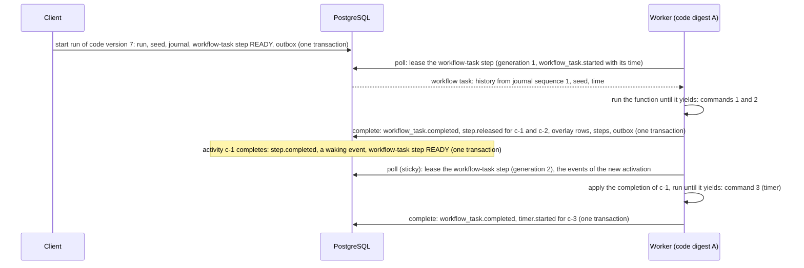

# Workflow as code

*   **Author:** Claude Code, for the owner
*   **Status:** Draft
*   **Date:** 2026-11-25

--------------------------------------------------------------------------------

## Overview

From release 0.3.0 a workflow can be a function written in any of the six SDK languages (TypeScript, Go, Python, C#,
Java, Rust) instead of a graph. The function runs in the tenant's own worker. It never touches the outside world
itself: it asks the platform to do things (run an activity, sleep, wait for an event, start a child, ask a person for
an approval, open a saga) and the platform records each request and each result in the run's journal. When the worker
that holds the function's state in memory is gone, another worker rebuilds that state by running the function again
from the start against the journal ("replay"); because the function is deterministic, it makes the same requests in
the same order, and the worker skips the ones already recorded. This is the programming model of Temporal, Cadence and
Azure Durable Functions. The owner decided that it is built in 0.3.0 in all six SDKs, starting with a determinism study
per language before any code, and that the declarative graph stays a supported model with the same guarantees beside
it (owner decision 2026-11-24-3, "Sim, entra na 0.3.0", "Yes, it goes into 0.3.0"). Constitution 5.0.0 (owner decision
2026-11-24-2) states the procedural model this design builds.

The design adds no second execution engine. The function is a *decider*: in each *workflow task* it receives the events
since its last decision and answers with a list of *commands*. Every command that does work is a node of the existing
workflow intermediate representation (IR): an activity, a timer, a `waitEvent`, a `child`, an `approval` or a `script`
node, in a restricted *code profile* of that node kind, checked by the publication parser of that kind, held in a
per-run *node overlay*, and executed by the engine code that runs graph workflows. So a code run gets the leases and
fencing, the retries, compensation as derived steps, the uncertain-effect rules of feature 037, the gates of feature
022, the step logs of feature 041, payload classification and blobs that the graph engine already has. The workflow
task itself is leased like a step, and its completion commits the journal events, the scheduled steps, the timers, the
subscriptions and the outbox in one transaction.

What the design does that Temporal, as of its Worker Deployment versioning and its SDK replayers, does not
(Technical Plan 17 has the comparison):

- **The code identity is computed, not chosen.** A code version names the SHA-256 digest of the code, its dependencies
  and its runtime; only a worker that runs that digest receives the run's workflow tasks.
- **Code changes under a running run only after a proof for that run.** A *move*, requested by a person, re-pins one
  run to other code only after a worker of that code has replayed the run's own history and produced the same commands,
  inputs included.
- **The server checks determinism too.** It keeps a hash chain of the commands it accepted, inputs included, over data
  the worker is never sent, and refuses a completion whose replayed commands do not produce it.
- **A code bug never loses a run.** A nondeterminism or a repeated failure puts the run under review with its cause and
  its state intact, until an operator moves it to fixed code, retries, resets it or terminates it.
- **Compensation and unknown outcomes are the platform's.** A saga opened from code is planned and run by the engine
  with the rules of features 003 and 037, not by `try` and `catch` blocks in each workflow.
- **Queries work without a worker**, from declared state, also after the run has ended.

The decisions, gaps and owner questions are in the register
[specs/044-workflow-as-code/research.md](../../specs/044-workflow-as-code/research.md). The architecture decisions are
[Architecture decision 0103](../adr/ADR-0103-a-code-workflow-is-a-decider-whose-commands-are-ir-nodes-committed-in-the-run-transaction.md)
(the decider, the node overlay and the one transaction),
[Architecture decision 0104](../adr/ADR-0104-replay-follows-the-activation-boundary-and-the-server-holds-the-command-chain.md)
(the activation window, waking events and the command chain),
[Architecture decision 0105](../adr/ADR-0105-a-code-run-pins-a-code-digest-and-moves-only-after-a-verified-replay.md)
(pinning, verified moves and resets),
[Architecture decision 0106](../adr/ADR-0106-each-sdk-runs-workflow-code-under-a-named-determinism-runtime.md) (the
runtime per language and the deterministic primitives),
[Architecture decision 0107](../adr/ADR-0107-effects-from-code-are-leased-steps-and-sagas-are-planned-by-the-engine.md)
(effects, the code profile and sagas),
[Architecture decision 0108](../adr/ADR-0108-code-queries-are-answered-from-declared-state-and-worker-queries-are-ephemeral.md)
(signals, updates, queries and what they disclose) and
[Architecture decision 0109](../adr/ADR-0109-workflow-tasks-travel-on-the-next-free-worker-protocol-minor.md) (the
protocol).

### Terms

- **Code workflow, code version, code run.** A workflow whose published version is a *code version* (Technical Plan 3),
  and a run of such a version. A *graph* workflow, version and run are what exists today.
- **Start version, current code version.** The start version is the version a code run was created with
  (`runs.workflow_version_id`); it never changes and is the run's *identity origin*: every identity derived from a
  version (step identifiers, journal instance identifiers, compensation identifiers) is derived from it. The current
  code version is the one version the run is pinned to now, whose code runs its workflow tasks
  (`code_run_pins.code_version_id`); it equals the start version until a move.
- **Code digest.** The SHA-256 that identifies the code, its dependencies and its runtime for one workflow type
  (Technical Plan 3.2).
- **Capability envelope.** The part of a code version that lists what its commands may use: activity entries (each with
  its secrets, input and output schemas and risk metadata), scripts, child workflows, named approval policies
  (Technical Plan 3.1).
- **Binding.** The record of feature 009 that lets one worker identity serve named activities of a namespace
  (`crates/domain/src/binding.rs`); for code workflows it gains a separate list `workflowTypes` of the workflow types the
  identity may serve, exact names only.
- **Decider, workflow task.** The function is a decider. A workflow task is one lease of the run's reserved
  *workflow-task step*, during which a worker runs the function until it is blocked and answers with commands (a
  *completion*) or with a cause (a *failure*). As for every step, the *attempt* counts the leases of the step and the
  *generation* fences each lease; for the workflow-task step both increase with every workflow task.
- **Command, command number.** One request of the function. Commands are numbered 1, 2, 3... in the order the function
  makes them over the whole run; the node of a command that creates a step is `c-<n>` where `n` is its command number.
- **Node overlay.** The per-run set of node definitions built from the run's accepted commands, through which the
  engine finds the node of a `c-<n>` step and its derived steps (Technical Plan 2).
- **Journal sequence.** The per-run sequence of `run_events` (`seq`). Every event has one.
- **Visible event, waking event.** A visible event is one the function can observe; a waking event is a visible event
  that another transaction (or a command's own immediate effect) adds and that the function has not yet seen, which
  makes a workflow task due. Both are fixed, exhaustive predicates of the domain (Technical Plan 4.2).
- **Activation, activation run.** The visible events one workflow task delivers to the function, applied one at a time in
  journal order; the activation run is the period during which the worker runs the function on them. The function
  *yields* when it is blocked waiting for the platform.
- **Replay.** Running the function from the start against the history of a run without issuing the commands that are
  already recorded.
- **Command chain.** The hash over the accepted commands of a run (Technical Plan 6.2), not to be confused with the *run
  chain* of continue-as-new (feature 014).
- **Sticky.** The worker that completed the last workflow task keeps the run's state in memory and is offered the next
  one first.
- **Eager dispatch.** Returning a new lease in the answer to a completion, instead of announcing it for a poll.
- **Under review.** The state of a code run whose workflow-task step a person must act on (Technical Plan 6.3), using
  the step review of feature 003.
- **Move.** A person's explicit request to change the current code version of one open code run, applied only after a
  verified replay.

### What this design builds on

| Item | Where | What this design uses |
|---|---|---|
| Feature 002, durable execution | [specs/002-durable-execution/spec.md](../../specs/002-durable-execution/spec.md) | Runs, steps, leases, the 4 MiB a run retains, children |
| Feature 003, sagas and compensation | [specs/003-sagas-compensations/spec.md](../../specs/003-sagas-compensations/spec.md) | Derived compensation and reconciliation steps, step review, `PARTIAL` |
| Feature 006, delivery acknowledgement | branch `docs/delivery-acknowledgement`, Architecture decision 0099 | Provisional leases until acknowledged (protocol 1.8), for eager leases |
| Feature 009, secrets and bindings | [specs/009-security-multitenancy/spec.md](../../specs/009-security-multitenancy/spec.md) and `crates/domain/src/binding.rs` | Bindings, `ResolveSecrets`, the publisher's right to a secret |
| Feature 014, workflow primitives | [specs/014-workflow-primitives/spec.md](../../specs/014-workflow-primitives/spec.md) | Declared state, queries, updates, continue-as-new and the run chain, the tree budget |
| Feature 016, payload classification | [specs/016-payload-classification/spec.md](../../specs/016-payload-classification/spec.md) | Classified fields, redaction and reveal grants on every read |
| Feature 018, schedules, batch, business identifiers, reset | [specs/018-schedules-bulk-operations/spec.md](../../specs/018-schedules-bulk-operations/spec.md) | Batch jobs and items, business identifiers, the with-start calls, reset and its rules per event kind |
| Feature 019, worker deployments | [specs/019-worker-deployments-dispatch/spec.md](../../specs/019-worker-deployments-dispatch/spec.md) | Routing of activities |
| Feature 020, visibility | [specs/020-visibility-analytics-archival/spec.md](../../specs/020-visibility-analytics-archival/spec.md) | Search attributes, added when it lands |
| Feature 022, flow control | [specs/022-flow-control-step-policies/spec.md](../../specs/022-flow-control-step-policies/spec.md) | Run-level and step-level gates |
| Feature 031, codecs | [specs/031-client-side-encryption/spec.md](../../specs/031-client-side-encryption/spec.md) | Payloads encoded by the client |
| Feature 037, uncertain effects | [specs/037-compensation-safety/spec.md](../../specs/037-compensation-safety/spec.md) | Reconciliation and review of unknown outcomes, `STORAGE_QUOTA_EXCEEDED` |
| Design 041, step logs | [docs/designs/041-step-logs.md](041-step-logs.md) | Step logs of activities; protocol 1.7 |
| Design 043, run input validation | [docs/designs/043-run-input-validation.md](043-run-input-validation.md) | The input gate and the platform's schema validator |
| Design 045, activity timeouts, and Architecture decisions 0110 and 0111 | branch `docs/temporal-parity-readiness` | Activity timeouts and per-code retry (protocol 1.9); the buffered-signal inbox |
| Architecture decisions 0003, 0010, 0018, 0020, 0028, 0030, 0031, 0050, 0076, 0082, 0089 | [docs/adr/](../adr/README.md) | The IR, derived steps, publication, shards, payload inspection, run chains, result disclosure, many-run operations and resets, uncertain effects, the instance registry, gated steps |
| The worker protocol | [worker.proto](../../specs/001-platform-foundation/contracts/worker.proto), [worker-runtime-protocol.md](../architecture/worker-runtime-protocol.md) | Leases, fences, the minor register |
| The rules for agents and the constitution | [AGENTS.md](../../AGENTS.md) rule 3, [docs/constitution.md](../constitution.md) | One transaction per decision; the principles |

## The Problem

The platform offers two ways to write a workflow today, a graph in the Studio and a graph built by an SDK builder, and
both produce the declarative IR that the Rust engine interprets (`docs/architecture/workflow-ir-and-sdk-modes.md`,
table "Three experiences, a single engine"). The third row of that table, "Procedural code-first (later phase)", was
never specified: `docs/architecture/execution-semantics.md` calls it "Code-orchestrated (P2)" and asks for "a registered
worker and proof of determinism"; Architecture decision 0003 says "procedural worker with determinism rules later";
`sdks/SPEC.md` says an SDK "is **not** a workflow runtime. It does not execute workflow code, replay anything, keep a
journal, or decide a transition".

What a graph cannot express, a person writing code expects to write directly: a loop whose body depends on the result
of the last activity, a retry policy that changes with business rules, a dynamic number of parallel branches, a state
machine with many signals, ordinary functions and types shared with the rest of the application, and unit tests in the
language's own test framework. The owner's goal for release 0.3.0 is to surpass Temporal and Windmill (owner decision
2026-11-24-1), which a platform without workflow as code does not do.

Temporal's model leaves these problems to the workflow author or the operator:

- **Nondeterminism found when a run reaches it.** A changed function that replays an open run makes different commands;
  the worker finds out only when it replays that run, and the run's workflow task then fails and retries until a fix is
  deployed. Worker Deployment versioning can pin a run to its build, but a run on automatic upgrade replays the new code
  without any check, and a pinned run's build must be kept running by hand.
- **Patches checked by nothing before they apply.** `patched()` and `GetVersion()` branches are only as correct as the
  author's tests; replayers exist, but nothing on the server runs one before a run takes new code.
- **Sagas by hand.** Compensation is `try` and `catch` code per workflow; an unknown outcome of a payment is the author's
  problem.
- **Queries need a live worker** and fail when none runs.

This repository has the pieces a better answer needs: an append-only journal with a per-run sequence (`run_events`,
`crates/infra-postgres/migrations/20261009000100_execution.up.sql`), one transaction that commits a step completion with
the next work and the outbox (`PgRunTx::persist`, `crates/infra-postgres/src/execution.rs`), a worker protocol with
leases and fences, immutable published versions with a canonical digest (`workflow_versions`), compensation as derived
steps (Architecture decision 0010) with the uncertain-effect rules of feature 037, the step review of feature 003,
declared state with engine-answered queries (feature 014), batch jobs and resets (feature 018) and a conformance suite
common to the SDKs (`tests/contract/sdk-conformance/`). What is missing is a determinism runtime in each SDK, a workflow
task the engine can lease and commit, a way for the engine to find the nodes of steps that no published graph declares,
and the versioning rules that keep code and history together.

## Requirements

### Functional

- **Requirement 044-001** A published workflow version MUST be either a graph version (today's document) or a code
  version (Technical Plan 3), never both. A code version MUST name its workflow type (1 to 48 characters,
  `^[A-Za-z][A-Za-z0-9_-]{0,47}$`), its language, its code digest and its capability envelope, and MUST be immutable like
  every version. Publication MUST be refused (`CAPABILITY_NOT_ACTIVE`) until an operator has recorded the instance
  registry requirement `code-workflows` (Architecture decision 0082). *Acceptance:* the publication tests of Task 044-3.
- **Requirement 044-002** A code run's workflow tasks MUST be offered only to a worker session that registered the
  workflow type and the code digest of the run's current code version and whose identity's binding lists that workflow
  type in `workflowTypes`; every completion MUST be refused as stale when the session's digest is not the run's current
  digest. *Acceptance:* `workflow_tasks_follow_the_current_digest`, `an_activity_binding_named_workflow_order_gives_no_workflow_authority`,
  `a_completion_from_a_session_of_another_digest_is_stale`.
- **Requirement 044-003** The function MUST be driven by workflow tasks: leases of the reserved workflow-task step,
  fenced by attempt, generation and lease token, delivering the visible events of the activation window (Technical Plan
  4.3), and answered by a completion or a failure. A workflow task MUST carry no secret and MUST be refused by every
  activity RPC (`Heartbeat`, `CompleteStep`, `FailStep`, `ResolveSecrets`, `ResolveDatabase`, `AppendStepLogs`).
  *Acceptance:* the contract tests of Task 044-8.
- **Requirement 044-004** A completion MUST commit, in one transaction with the run row and the workflow-task step locked
  and the lease fenced: the journal events of the completion and of every command, the steps, timers and waits the
  commands create, their nodes in the overlay, the projections they change, the outbox records that announce new work,
  and the state of the workflow-task step decided from the journal (Technical Plan 4.3) (`AGENTS.md` rule 3).
  *Acceptance:* the fault test of Task 044-9 kills the engine before each statement of the completion and observes either
  nothing or all of it, and the differential test shows the batched path writes what `persist` writes.
- **Requirement 044-005** Activation k MUST deliver exactly the visible events whose journal sequence is after the
  `workflow_task.started` of the workflow task that produced completion k − 1 and up to the `workflow_task.started` of
  the workflow task that produces completion k (Technical Plan 4.3), to a live worker and to a replaying worker alike.
  *Acceptance:* the property test over generated interleavings executed against PostgreSQL with barriers
  (`integration_workflow_as_code::the_activation_window_holds_for_every_interleaving`).
- **Requirement 044-006** Every SDK MUST detect, during replay, a command whose kind or target differs from the recorded
  one at the same command number, a recorded command the function no longer makes, and a patch marker that does not
  match, and MUST report it as a failure with cause `NONDETERMINISM`, the command number, the actual kind and target and
  the code digest, and no payload. *Acceptance:* the conformance scenario `code-nondeterminism`.
- **Requirement 044-007** The server MUST keep, per code run, the command chain of Technical Plan 6.2 over the command
  number, kind, target and SHA-256 of the canonical fragment bytes of every accepted command, and MUST refuse a
  completion whose replayed chain differs, with cause `CHAIN_MISMATCH`. *Acceptance:*
  `a_completion_with_a_foreign_command_chain_is_refused_and_puts_the_run_under_review`,
  `a_changed_activity_input_on_replay_is_a_chain_mismatch`.
- **Requirement 044-008** The causes of Technical Plan 6.3 MUST behave as its table says, with the count of consecutive
  failures stored on the run. Under review, no workflow task is offered; the run's other steps, timers and waits go on;
  the review is journaled with its cause and audited; and it ends only by one of the remedies of that table or by the
  run's deadline or forced cancellation. *Acceptance:* one integration test per cause and per remedy, and
  `the_failure_count_survives_a_restart` (Task 044-12).
- **Requirement 044-009** An uncaught exception that is not the SDK's workflow failure type MUST fail the workflow task,
  not the run. A workflow failure MUST end the run `FAILED` with the code and safe message the function gave, through the
  stop drain of Requirement 044-031. *Acceptance:* the conformance scenario `code-failures`.
- **Requirement 044-010** The current time MUST be the time recorded in the `workflow_task.started` that opens the
  activation, never earlier than the previous one; random numbers MUST come from xoshiro256** seeded with the run's
  32-byte seed; identifiers MUST be version 4 UUIDs drawn from that generator (Technical Plan 1.8). The six SDKs MUST
  produce the same sequence for the same seed. A reset MUST keep the seed of its source run. *Acceptance:* the
  conformance scenario `code-deterministic-primitives`, and `a_reset_of_a_code_run_keeps_its_seed`.
- **Requirement 044-011** Each SDK MUST run workflow code under the determinism runtime of Technical Plan 1 for its
  language, MUST refuse to register workflow types when that runtime's precondition fails (Technical Plan 1.11), MUST
  stop an activation run that does not yield within 2 s with cause `ACTIVATION_DEADLINE`, and MUST declare in its
  capabilities whether it offers workflow as code. *Acceptance:* each runtime's tests in Task 044-10 and Task 044-15 to
  Task 044-19, and the scenario `code-activation-deadline`.
- **Requirement 044-012** A code run MUST execute only these commands in 0.3.0: schedule an activity, run a script,
  start and cancel a timer, wait for an event, start a child, request an approval under a named policy, open, close and
  abort a saga scope, request the cancellation of one of its own steps or children, record a marker (patch, side
  effect), set the declared state, accept, reject and complete an update, consume signals, complete, fail or continue as
  new, and acknowledge a cancellation. Each work command MUST carry a fragment of the code profile of its node kind
  (Technical Plan 5.1); a fragment with a field outside that profile MUST be refused. A command that targets one of the
  run's own steps that is already terminal (a timer that fired, a step that ended) MUST be an audited no-op.
  *Acceptance:* `every_command_kind_round_trips_through_its_code_profile`, one refusal test per excluded kind and per
  excluded field, and `cancelling_a_timer_that_fired_is_an_audited_no_op` in both orders at a barrier.
- **Requirement 044-013** A command MUST stay within the current code version's capability envelope: an activity entry
  listed by name or prefix, with only that entry's secrets, its input schema, its output schema and its risk metadata
  (`irreversible`, `highRisk`, `compensateWith`, `reconcileWith`), which a fragment may repeat or omit but not change;
  the names of `compensateWith` and `reconcileWith` MUST be entries of the envelope too, and a derived step MUST receive
  the secrets of its own entry; a script listed by digest and ready for the tenant and namespace; a listed child
  workflow; a named approval policy. No activity name of a command or of the envelope may start with `script.` or
  `sagat.`. The publisher's right to each secret MUST be checked at publication and again at every resolution, as for a
  graph step. A command outside the envelope MUST put the run under review with cause `COMMAND_OUTSIDE_ENVELOPE`.
  *Acceptance:* `an_activity_command_cannot_carry_a_secret_of_another_activity_entry`,
  `a_compensation_receives_the_secrets_of_its_own_entry`, `a_fragment_that_changes_irreversible_is_refused`,
  `a_code_step_secret_is_refused_after_the_publisher_loses_it`, and one test per envelope member.
- **Requirement 044-014** A code version MAY declare signals. Signals of a code version MUST use the bounded inbox of
  Architecture decision 0111 (every declared signal of a code version is buffered): accepted for a declared name whether
  or not the function is waiting, journaled once under the existing idempotency key, charged to the run's 4 MiB retained
  bytes, delivered in the next activation, and marked consumed by the completion that ends that activation. The
  idempotency key MUST be answered before any bound; then an undeclared name MUST be refused `409 SIGNAL_NOT_DECLARED`,
  a full inbox with Architecture decision 0111's `409 SIGNAL_INBOX_FULL`, and a run at the history headroom with
  `409 HISTORY_HEADROOM`. Graph runs keep their rules. *Acceptance:* the conformance scenarios `code-signals` and
  `code-signal-at-return`.
- **Requirement 044-015** A code version MAY declare updates, each with its `disclosure` and a closed `resultSchema`
  (Architecture decisions 0031 and 0108). An update MUST be admitted durably with its `updateKey`, validated by the
  function's validator when its admission event is applied, journaled as accepted or rejected, handled by the function
  (which may issue commands), and completed with a result validated against its `resultSchema` or with a failure; a
  result outside the schema MUST complete the update as failed (`RESULT_SCHEMA_VIOLATION`) and leave the run alone.
  `POST /runs/{runId}/updates/{name}` MUST answer `200` with the result when the update completes within `waitMs` (at
  most 60,000 ms) and `202` with the status otherwise; `GET /runs/{runId}/updates/{updateKey}` MUST return the status to
  the principal that admitted it or to a principal with `run:operate`, after authorization is checked again. At most 64
  admitted updates per run may await acceptance (`429 UPDATE_BACKLOG`). Update-with-Start (feature 018) MUST work for a
  code version. *Acceptance:* the conformance scenarios `code-updates` and `code-update-with-start`, and the lost-response
  replay test of Task 044-21.
- **Requirement 044-016** A code version MAY declare state and queries in the IR's `state` form (feature 014). The
  function MUST be able to set the declared state by a command; the engine MUST answer the declared queries from the
  committed state with no worker, also after the run ended while its data is retained. *Acceptance:* the conformance
  scenario `code-declared-state`.
- **Requirement 044-017** A code version MAY declare worker queries, each with its `disclosure` and a closed
  `resultSchema`. A worker query MUST be a durable row claimed through `PollTasks` like any task, answered by a worker of
  the run's current digest within the caller's timeout (at most 30,000 ms), without a journal event and without
  changing the run; the answer (at most 256 KiB) MUST be validated against its `resultSchema` by the server before it is
  returned; a handler that issues a command MUST fail the query, not the run. *Acceptance:* the conformance scenario
  `code-worker-queries` and `a_worker_query_is_claimed_by_polling_with_the_broker_down`.
- **Requirement 044-018** A child started from code MUST be a run of any published version, graph or code, created by
  the existing child machinery with its cancel policy, depth and tree budget; a graph `child` node MUST be able to start
  a code version. *Acceptance:* the conformance scenario `code-graph-mixed`.
- **Requirement 044-019** Continue-as-new from code MUST hand off through feature 014's transaction under the run chain
  rules (the handoff waits for quiescence, deadline, segment limit), with a new seed and the pending signals moved as
  Architecture decision 0111 decides. The successor MUST pin the same version unless the command asks for the workflow's
  active version. *Acceptance:* the conformance scenario `code-continue-as-new`, including a handoff that waits for an
  outstanding activity.
- **Requirement 044-020** A saga opened from code MUST be a compensation domain of the engine: activities scheduled in it
  with `compensateWith` or `reconcileWith` get the derived steps of Architecture decision 0010; an abort plans their
  compensations in run-scoped plan rows, a step depending on an earlier one only when the function scheduled it after it
  saw that earlier step's outcome, so that independent compensations stay eligible; unknown outcomes follow feature 037;
  the function learns only the saga's outcome. *Acceptance:* the conformance scenarios `code-saga` and
  `code-saga-uncertain`, and `independent_code_compensations_run_while_one_is_under_review`.
- **Requirement 044-021** The function MUST NOT run an effect itself through the platform: there are no local
  activities. A completion MAY ask for the leases of the activities it just scheduled (eager activities), granted as
  provisional leases of feature 006 whose expiry before acknowledgement is a safe release; a sticky session's activity
  completion MAY ask for the run's next workflow task (eager workflow task), granted only when the session's digest and
  binding match. An idempotent replay of either answer MUST NOT return a lease. *Acceptance:* the eager tests of Task
  044-14.
- **Requirement 044-022** A cancellation request MUST commit, in its transaction, the run's cancellation deadline (now plus
  the version's grace: default 60 s, from 1 s to 3,600 s), and reach the function in its next activation; the function
  MUST acknowledge it by completing, failing or acknowledging the cancellation. If it has not done so by the deadline,
  the engine MUST end the run `CANCELLED` itself through the stop drain, first commit winning against the function's
  answer. The run deadline MUST be enforced by the engine without the function. *Acceptance:* the conformance scenario
  `code-cancellation` and the barrier test of the grace against the acknowledgement in both orders.
- **Requirement 044-023** A person with `run:operate` and `version:activate` on the namespace MUST be able to move one
  open code run, and with `run:batch` as well a frozen selection of open runs (feature 018's batch job, each item a
  per-run request), to another published code version of the same workflow in the same namespace that is approved for
  activation where the namespace requires approval. The server MUST re-pin a run only when a worker of the target digest
  replayed its history up to its last completed activation with the same command chain, that activation is still its
  last completed one, its workflow-task step is not leased, and its outstanding steps fit the target's envelope;
  otherwise the run stays as it was and the move item records the reason. A move MUST clear the step's sticky session,
  make it `READY` with a hint when it was under review or events are pending, and be journaled and audited. No policy
  moves runs by itself. *Acceptance:* the conformance scenario `code-patch-and-move` and the tests of Task 044-13.
- **Requirement 044-024** Each SDK MUST offer `patched(id)` and `deprecatePatch(id)` with the meaning of Technical Plan
  7.2, recorded as markers. *Acceptance:* `code-patch-and-move`.
- **Requirement 044-025** Each SDK MUST ship a replayer that replays exported histories against the local code and
  reports the first mismatch, usable in a test of the language's own framework. A person with `run:read` and the new
  `history:export` (held by the admin role only) MUST be able to export a code run's history
  (`GET /runs/{runId}/history`), every payload, fragment inputs included, classified by its schema and redacted by the
  rules of feature 016 unless the person holds the reveal rights for it, never a field classified `secret`; every export
  MUST be audited. *Acceptance:* the replayer test in each SDK,
  `a_classified_value_copied_into_an_activity_input_is_redacted_on_export`.
- **Requirement 044-026** A move MUST be available as a dry run that records, per run, the verdict of the replay without
  moving anything. *Acceptance:* `a_dry_run_move_records_verdicts_and_moves_nothing`.
- **Requirement 044-027** A code run's history MUST be bounded: from a visible count of 10,240 or 3 MiB of retained
  bytes the function is told that continuing as new is suggested; at 51,200 the run goes under review with cause
  `HISTORY_LIMIT`, whose retry opens a closing window of 1,024 visible events plus two for every outstanding step, timer,
  wait and child, in which only commands that end, continue or wind down the run are accepted; when the window is used
  up, the engine ends the run `FAILED` (`HISTORY_LIMIT`) through the stop drain (Technical Plan 6.3). *Acceptance:*
  `the_history_limit_suggests_then_reviews_then_closes`, `an_exhausted_closing_window_fails_the_run_through_the_stop_drain`.
- **Requirement 044-028** A code run MUST be listed, read and drawn like a graph run: the run view, the events, the
  observed graph of its commands, its review and its moves. *Acceptance:* the Studio and REST tests of Task 044-23.
- **Requirement 044-029** The interactions of Technical Plan 12 MUST hold, each tested when its feature is built.
  *Acceptance:* Task 044-27.
- **Requirement 044-030** An instance that does not report the capability `code-workflows` MUST never open a code run;
  once an operator has recorded the requirement, an instance without it closes its gate, including one that registers
  later (Architecture decision 0082). *Acceptance:* `a_late_instance_without_the_code_capability_closes_its_gate`.
- **Requirement 044-031** A terminal command MUST be refused with cause `OUTSTANDING_OBLIGATIONS` while a saga scope of
  the run is open or aborting or a step of the run is under review or has an unknown outcome; otherwise it MUST put the
  run into the engine's stop drain, which cancels outstanding timers and waits, asks running activities to stop, applies
  the children's cancel policies, and writes `run.finished` with the function's outcome only when no leased work is left
  or what is left has gone to feature 037's review. A terminal command MUST also be refused (`UNHANDLED_EVENTS`) while a
  waking signal, update or cancellation request is unseen; after 3 such refusals the run refuses new signals and updates
  until its next completion commits. *Acceptance:* `a_terminal_command_with_an_open_saga_is_refused`,
  `a_terminal_command_waits_for_a_leased_activity_before_run_finished`, `three_unhandled_refusals_close_the_run_to_new_signals`.
- **Requirement 044-032** Bounds: a code run at most 2,048 outstanding steps, timers, waits and children at a time (cause
  `COMMAND_LIMIT`, counted) and at most one workflow task started per 100 ms; a namespace at most 64 worker queries, 256
  update waits and 16 replay-check tasks in flight (`429` with `retry-after-ms`). *Acceptance:* one test per bound.
- **Requirement 044-033** An operator MUST be able to pause the workflow tasks of every code run of a namespace (no
  workflow task offered, runs keep their state) and resume them, audited. *Acceptance:*
  `pausing_code_workflows_stops_workflow_tasks_and_keeps_runs`.
- **Requirement 044-034** The engine MUST find the node of every step of a code run (`c-<n>`, its derived `~c` and `~r`
  steps, and the workflow-task step) through the run's node overlay, in every path that reads a node today: the claim,
  completion, failure, retry, review, compensation planning, secret resolution, restore and verification.
  *Acceptance:* `every_node_lookup_of_a_code_run_resolves_through_the_overlay`, driving each command kind through lease,
  completion, failure, retry, review, compensation and secret resolution.

### Non-functional

- **Non-functional requirement 044-001 (replay cost)** Each SDK MUST replay a history at the rate of at most
  97.65625 µs per visible event on the reference worker host: 10,240 events in at most 1 s (1,000,000 µs / 10,240), 51,200
  in at most 5 s, and the largest history a run can reach, 51,200 + 1,024 + 2 × 2,048 = 56,320 events, in at most
  5,500,000 µs = 5.5 s (56,320 × 97.65625 µs). Benchmark criteria on a stated host, not promises (constitution, Delivery
  Constraints).
- **Non-functional requirement 044-002 (commits)** A code workflow that runs one activity and ends MUST cost at most 7
  committed transactions without eager dispatch (the start, the first workflow task lease, its completion, the activity
  lease, the activity completion, the second workflow task lease, the final completion; the stop drain adds none when no
  work is outstanding) and at most 5 with both eager paths and a sticky worker. A graph workflow with one activity costs
  3, so the ratios are 7 / 3 ≈ 2.33 and 5 / 3 ≈ 1.67.
- **Non-functional requirement 044-003 (statements)** A workflow task completion MUST run at most the statements an
  activity completion runs today, measured by the budget suite at the start of Task 044-9 (reads included), plus 4,
  whatever the number of its commands up to 256: one batched insert each for the payloads, the journal events, the node
  overlay rows, and the steps with the workflow-task step, which together replace the per-row inserts of `persist`. A
  terminal or continue-as-new completion MUST add exactly the statements of the existing stop drain or handoff path.
- **Non-functional requirement 044-004 (latency)** With a sticky worker and a history of at most 1,024 visible events, the
  time from the commit of a signal to the commit of the workflow task that handles it MUST be at most 50 ms at the 99th
  percentile on the reference environment; at most 250 ms when no sticky session is alive; at most 1,250 ms when a live
  sticky session is busy (its 1,000 ms preference, then 250 ms). Benchmark criteria.
- **Non-functional requirement 044-005 (memory)** The sticky cache of a worker MUST hold at most 256 runs by default. An
  idle cached run MUST cost at most 1 MiB in TypeScript, Python, C# and Java and at most 256 KiB in Go and Rust, so a full
  default cache costs at most 256 MiB (256 × 1 MiB) or 64 MiB (256 × 256 KiB). Benchmark criteria; Gap 044-001.
- **Non-functional requirement 044-006 (bounds)** A completion carries at most 256 commands and at most 4 MiB of inline
  command payload; a history page at most 1,024 events or 4 MiB, so the largest history is at most 56,320 / 1,024 = 55
  pages; a replay-check task at most 16 runs, each read by pages under its own capability; a registration at most 64
  workflow types; a worker query answer at most 256 KiB; a node specification at most 4 KiB.
- **Non-functional requirement 044-007 (security)** No workflow code runs in a platform process. A workflow task holds no
  secret. Another tenant's run, history, update or query is indistinguishable from a missing one. No payload, secret or
  worker-supplied free text appears in a review cause, a nondeterminism report, a metric or a log.

### Success criteria

- **Success criterion 044-001** The conformance scenarios of the Verification Plan pass in all six SDKs with reviewed
  goldens and no selection filter; until an SDK declares that it offers workflow as code, the suite reports its
  scenarios as not offered, never as passed, and the release needs all six.
- **Success criterion 044-002** No code run is lost or silently changed by a deploy: the fault suite deploys a changed
  function while 100 runs are open and observes no review caused by nondeterminism without a move; with a move, the runs
  whose replay does not match stay on their version.
- **Success criterion 044-003** The benchmark of owner decision 2026-11-24-1 reports the replay cost, the commit count,
  the statement count and the latency of Non-functional requirements 044-001 to 044-004 against Temporal on the same
  host, with its environment and failures stated.

### User stories

- **User story 044-01** As a developer, I write a workflow as a function in my language, test it with my test framework,
  publish it and run it (journey 1).
- **User story 044-02** As a developer, I change my function while runs are open, and the platform proves which runs can
  take the change before it applies it (journeys 2 and 3).
- **User story 044-03** As an operator, I see a run under review, why, and I fix it without losing it (journey 4).
- **User story 044-04** As a developer, I write a saga in code and the platform compensates it, including unknown
  outcomes (journey 5).
- **User story 044-05** As a client, I signal, update and query a code run as I do a graph run (journey 6).
- **User story 044-06** As a developer, I ask a long loop how far it has got without making it publish its progress into
  the journal at every iteration (journey 7).

## Goals

- Workflow as code in the six SDKs with one semantic contract and one conformance suite.
- No second execution engine: every effect is a node the engine already executes.
- Versioning that cannot change the code under a running run without a proof for that run.
- The guarantees of the graph mode (one transaction per decision, leases and fences, compensation, uncertain effects,
  tenant boundary, audit) for the code mode, unchanged.
- Bounded and measured costs, compared with Temporal by the benchmark of owner decision 2026-11-24-1.

## Non-Goals

- Running workflow code in a platform process, or sandboxing it as a security boundary. The function runs in the
  tenant's worker, like an activity; the determinism runtimes of Technical Plan 1 isolate for determinism, not for
  security.
- Converting code to a graph or a graph to code. The Studio draws the commands a code run made, not a blueprint.
- Local activities (effects run inside a workflow task). Technical Plan 10.3 says why.
- In 0.3.0: the `database`, `icebergWrite`, `forEach`, `while`, `repeatUntil` and `parallel` nodes as commands (Gap
  044-003, a graph child covers them), signalling or cancelling another run from code (Gap 044-004), any move policy
  (Gap 044-006), a reset of a code run to another code version (Gap 044-019), search attributes before feature 020
  lands, and inline graph fragments (Gap 044-011).
- Exactly-once external effects. Activities from code are at-least-once, as every activity.

## Open Questions

None open. Every product and design question of this design was decided by the coordinating session under owner
decision 2026-11-20-6, each recorded in the register as delegated, with its reasoning (Owner question 044-001 to Owner
question 044-016). The gaps that stay open are registered (Gap 044-001 to Gap 044-020).

## Owner decisions needed

None. The design rests on four owner decisions of 2026-11-24, recorded in `docs/owner-decisions.md` by the pull requests
that carry them, which reach `develop` before this design's pull request: owner decision 2026-11-24-1 (the full-parity
scope of release 0.3.0), 2026-11-24-2 (constitution 5.0.0 with the procedural model), 2026-11-24-3 (workflow as code in
0.3.0) and 2026-11-24-4 (the coordinating session accepts this design's architecture decisions, settles its review
findings and approves it). The tasks that depend on them carry `Owner-gate:` lines. The questions of the design are
delegated under owner decision 2026-11-20-6.

## Critical User Journeys (CUJs)

### Journey 1: The first code workflow (User story 044-01)

*   **Given**: a TypeScript developer with a worker that serves the activities `inventory.reserve` and `payments.charge`,
    in a namespace whose operator has recorded the requirement `code-workflows`.
*   **When**: she writes `async function order(ctx, input)` that reserves, charges, sleeps one day and sends a reminder
    unless a `paid` signal arrived; runs `sagat-workflows bundle` (which writes the bundle and its manifest with the
    digest); publishes the code version with `client.definitions.publishCode(manifest, envelope)`; starts her worker with
    the bundle; and starts a run.
*   **Then**: the run view shows the commands as nodes (two activities, a timer, a wait), the journal shows each workflow
    task, and her unit test, which runs the function in the SDK's test environment and replays the run's exported
    history, passes.

### Journey 2: A deploy while runs are open, in a compiled language (User story 044-02)

*   **Given**: a Go team whose workflow code lives in its own worker binary (the recommended topology for compiled
    languages, Technical Plan 3.2), with 3,000 open runs of code version 7 (digest A).
*   **When**: the pipeline builds the new binary (digest B), runs `myworker --sagat-manifest`, publishes it as version 8,
    promotes it, and deploys the digest B workers beside the digest A ones. Nothing in the pipeline moves runs.
*   **Then**: new runs pin version 8; the 3,000 runs stay on version 7, served by the digest A workers; the version list
    shows them. If the change was only in an activity outside the workflow binary, digest B equals digest A and there is
    nothing to move.

### Journey 3: Moving long runs to fixed code (User story 044-02)

*   **Given**: the runs of journey 2 last months, and version 8 wraps its change in `patched('reminder-v2')`.
*   **When**: the operator, a person with `run:operate`, `version:activate` and `run:batch`, requests a dry-run move of the
    open runs of version 7, reads the verdicts, then requests the move of the same frozen selection.
*   **Then**: the move re-pins the 2,990 runs whose replay matches, each with a journal event and an audit record; the 10
    that took a branch the new code changed without a patch stay on version 7, and the move job lists them with the
    command number of the first difference. The digest A workers are stopped when the version list shows no run left on
    version 7.

### Journey 4: A run under review (User story 044-03)

*   **Given**: a Go worker whose function divides by zero for one input.
*   **When**: the workflow task panics five times in a row.
*   **Then**: the run is under review with cause `WORKFLOW_TASK_FAILED`, the Studio shows the cause, the panic's type name
    and the command number, `workflow_task_reviews_total{cause}` increases and an alert fires; the developer publishes a
    fix as a new code version and moves the run, which is made `READY` and resumes with the activation that failed.
    Nothing it had done is lost or repeated.

### Journey 5: A payment saga with an unknown outcome (User story 044-04)

*   **Given**: a code saga that reserves stock and charges a card; the envelope's entries give `payments.charge`
    `compensateWith: payments.refund` and `reconcileWith: payments.lookup`.
*   **When**: the charge times out after the request was sent (`OUTCOME_UNKNOWN`).
*   **Then**: the engine runs the lookup; the provider says `applied`; the charge completes with the lookup's output; the
    function continues. Had the lookup answered `unknown`, the step would wait for review and the function would be
    waiting on the charge, with nothing in its code to handle the case.

### Journey 6: Signals, updates and declared queries (User story 044-05)

*   **Given**: a code run of an approval process that declares the signal `cancelRequest`, the update `addLine` and the
    declared state `{lines, total}` with the query `total`.
*   **When**: a client signals before the function waits, sends `addLine` with `waitMs: 5000`, and queries `total` while
    every worker is stopped.
*   **Then**: the signal waits in the run's inbox and is delivered at the function's next activation; the update answers
    `200` with its result when a worker is up, `202 ACCEPTED` when the handler waits on an activity longer than 5 s; the
    query answers from the committed state without a worker.

### Journey 7: How far has the loop got (User story 044-06)

*   **Given**: a code run that reconciles 50,000 ledger lines in batches, keeping its counters in memory.
*   **When**: an operator sends the worker query `progress`.
*   **Then**: the sticky worker answers from memory within the timeout, the answer is checked against the declared
    `resultSchema`, nothing is journaled, and the loop has not had to publish its counters 50,000 times.

## Technical Plan (Architecture)

### 1. The determinism study

The function must produce the same commands in the same order every time it is replayed against the same history.
Everything it can observe besides the history must therefore be either supplied by the history (results, signals,
time) or deterministic by construction (its own code, the SDK's primitives). For each language the study says how the
SDK intercepts each source of nondeterminism (runtime), which hazards remain, what isolation exists, how a breach is
detected, the precondition, and the verdict. The claims marked *spike* were settled by throw-away programs run on
2026-11-24 on the development machine; their exact results and versions are recorded in Decisions 044-041 and 044-053
of the register, and each is reproduced as a red test of the runtime's task. They choose between designs; they are not
benchmarks.

#### 1.1 The sources of nondeterminism, for every language

| Source | What the function sees | How every SDK supplies it |
|---|---|---|
| Results of effects | Activity, child, approval and wait outcomes | From the history, applied one event at a time in journal order |
| Time | "Now" | The time of the activation's `workflow_task.started`, constant during the activation run |
| Time zone and locale | Formatting of dates, numbers, text | UTC and the root (invariant) locale, by the runtime (each section below) |
| Sleep | A delay | A durable timer command |
| Randomness, identifiers | Random numbers, UUIDs | A generator seeded by the run (section 1.8) |
| Concurrency | Several branches of the function | A deterministic scheduler that runs one branch at a time in a fixed order |
| Unordered collections | Iteration order of hash sets and maps | Made deterministic (Python with a fixed hash seed), forbidden where the order differs between instances (Go maps, Rust `HashMap` with the default hasher), or documented where it depends on identity hashes (Java, C#, Python objects without their own hash) |
| Input and output | Files, network, environment, processes | Refused where the runtime can see it, flagged by an analyzer where it cannot |
| Global state | Module or static variables mutated across runs | A fresh context per run (TypeScript) or per-run objects with a documented rule (others) |
| The runtime and the dependencies | A different interpreter, library, locale data or SDK | Part of the code digest (section 3.2) |

#### 1.2 TypeScript

- **Runtime.** Each run gets its own `node:vm` context created with `vm.constants.DONT_CONTEXTIFY` (an ordinary global
  object created inside the context, not a host object), `microtaskMode: 'afterEvaluate'` and
  `codeGeneration: { strings: false, wasm: false }`. The workflow code is one bundle produced by the SDK's
  `sagat-workflows bundle` command (esbuild, pinned and hash-locked, Decision 044-012); the worker compiles the bundle
  once per digest as a `vm.Script` and runs it in each run's context. Inside the context the SDK's own code, evaluated
  there, replaces `Date` (the constructor without arguments and `Date.now`) with the workflow time, `Math.random` with
  the run's generator, `setTimeout`, `setInterval` and their `clear` functions with durable timers, and the default time
  zone and locale of `Intl` with UTC and the root locale; it removes `WeakRef`, `FinalizationRegistry`,
  `SharedArrayBuffer`, `Atomics`, `crypto`, `performance`, `process` and `queueMicrotask`'s host form.
- **Bridge.** No host function or object is placed in the context. The host calls into the context only with
  `vm.runInContext` and string arguments (the events as JSON text), and reads the commands back as a JSON string
  returned by a function defined inside the context.
- **Hazards.** Imports of built-ins with or without the `node:` prefix (`fs`, `crypto`, `net`...) and of the activity
  modules are refused by the bundler, so the function cannot reach the file system or the network through an import.
- **Concurrency.** Promises are the only concurrency. The SDK resolves the promise of one history event, then evaluates
  an empty script in the context, which drains the context's own microtask queue completely, before it applies the next
  event; so `Promise.race` and `Promise.all` resolve in journal order (*spike*).
- **Isolation.** With `DONT_CONTEXTIFY`, `this.constructor.constructor('return typeof process')()` returned `undefined`
  in the context, while an ordinary contextified object returned `"object"` (the host's `process`), even with code
  generation from strings refused (*spike*). The context is still not a security boundary (Gap 044-008): workflow code is
  the tenant's own, in the tenant's worker.
- **Detection.** The bundler's import check, the replaced globals, the activation deadline, the command comparison of
  section 6.1 and the server's command chain.
- **Precondition.** Node 22.8 or later for `DONT_CONTEXTIFY` (the SDK's activity worker keeps Node 20).
- **Verdict:** build. The only runtime of the six that removes the nondeterministic globals and refuses imports before
  the code runs.

#### 1.3 Python

- **Runtime.** A deterministic event loop, a subclass of `asyncio.AbstractEventLoop` whose `time()` is the workflow
  time, whose `call_soon` queue is first-in first-out on one thread, whose `call_at` and `call_later` become durable
  timer commands, and whose `run_in_executor`, sockets, subprocesses and signal handlers raise. So `asyncio.sleep`,
  `asyncio.gather`, `asyncio.wait_for` and `asyncio.timeout` work unchanged and durably (*spike*: `asyncio.sleep(30)`
  and `asyncio.wait_for(..., timeout=5)` became timers of 30 s and 5 s, and two runs gave the same commands).
- **Hazards.** String hashes depend on the process's hash seed, so the iteration order of a set of strings differs
  between processes (*spike*: four orders under four seeds, one order under a fixed seed). Objects that hash by identity
  have no stable order in a set in any process.
- **Isolation.** Workflow modules are imported once per digest through an import hook (a `sys.meta_path` finder) that is
  active both while the workflow modules load and during every activation run, and refuses the modules that reach outside
  (`socket`, `threading`, `subprocess`, `secrets`, `random`, `uuid`, `os`, `locale` and the others listed in the SDK),
  so a module-level `import uuid` fails at load. The `time` and `datetime` views the finder gives workflow modules return
  the workflow time in UTC. Behind the finder, a PEP 578 audit hook refuses the events `open`, `socket.connect`,
  `socket.getaddrinfo`, `subprocess.Popen`, `os.system` and `time.sleep` during an activation run; an audit hook cannot be
  removed once added (*spike*: `open()` refused by the hook, `import socket` and `import secrets` by the finder).
- **Detection.** The finder, the audit hook, the activation deadline, the command comparison and the command chain.
- **Precondition.** Python 3.11 or later for workflow code (`asyncio.timeout`; the activity worker keeps 3.10), and a
  fixed `PYTHONHASHSEED` chosen by the operator (any value but `random`; Decision 044-051). The content hash of the digest
  includes the `hash()` of a fixed string under that seed, so workers with different seeds have different digests and
  never share a run; the operator keeps the value with the deployment's configuration (Gap 044-016).
- **Verdict:** build.

#### 1.4 Go

- **Runtime.** A coroutine dispatcher on `iter.Pull`. The function and each branch started with `workflow.Go` run as
  coroutines; each SDK call yields to the dispatcher, which runs the ready coroutines one at a time in the order they
  became ready. `iter.Pull` switches between coroutines without the Go scheduler choosing (*spike*: 45 ns per round trip,
  against 241 ns for a goroutine and two channels, which is how a dispatcher built on goroutines hands control over).
- **Hazards.** Map iteration and `select` among ready channels are randomized (*spike*: eight orders in fifty ranges of
  one map; 59 of 100 choices of the first channel). The SDK provides `workflow.Channel`, `workflow.Selector`,
  `workflow.Go`, `workflow.Now` (UTC), `workflow.Sleep` and `workflow.SortedKeys`.
- **Isolation.** None at run time: Go cannot forbid a call. A native channel operation that blocks would stop the
  coroutine; the activation deadline turns it into `ACTIVATION_DEADLINE`.
- **Detection.** `sagatvet`, an analyzer of the `go/analysis` framework the SDK ships and runs in its test helper, refuses
  in workflow functions native `go` statements, channels, `select`, `time.Now`, `time.Local`, `time.Sleep`, `math/rand`,
  `crypto/rand` and `range` over a map; the deadline; the command comparison; the command chain.
- **Precondition.** Go 1.25 (the SDK's baseline).
- **Verdict:** build; the guarantee rests on the analyzer (Gap 044-007).

#### 1.5 C#

- **Runtime.** A single-threaded `TaskScheduler` per run with a maximum concurrency of 1, which never runs a task inline,
  and which the SDK drives until it is idle after each event. The SDK's `TaskCompletionSource` objects are created with
  `RunContinuationsAsynchronously`, so continuations are queued on the scheduler. During an activation run the SDK sets
  `CultureInfo.CurrentCulture` and `CurrentUICulture` to the invariant culture (they flow with the execution context).
- **Hazards.** `ConfigureAwait(false)` and `Task.Run` leave the scheduler (*spike*), as do `Task.Delay`, threads and
  `Parallel`.
- **Isolation.** Partial: the SDK's own awaits stay on the scheduler; other code can leave it.
- **Detection.** Every SDK call checks that `TaskScheduler.Current` is the run's scheduler and fails the workflow task
  with cause `NONDETERMINISM_RISK` otherwise. A Roslyn analyzer package flags `DateTime.Now`, `DateTime.UtcNow`,
  `Guid.NewGuid`, `new Random`, `Task.Run`, `Task.Delay`, `Thread`, `ConfigureAwait(false)`, `Parallel` and input and
  output types in workflow classes.
- **Precondition.** .NET 8 or later (the SDK's baseline).
- **Verdict:** build.

#### 1.6 Java

- **Runtime.** A dispatcher that gives a single permit to one workflow coroutine at a time; each coroutine is a virtual
  thread. The JDK chooses the carrier thread, but only the coroutine holding the permit can run, so the order is the
  dispatcher's (*spike*: 4,460 ns per handoff between virtual threads, 8,869 ns between platform threads, the model of
  Temporal's Java SDK; about 1,845 bytes of heap per parked virtual thread). A custom scheduler for virtual threads is not
  public API (*spike*: refused with `InaccessibleObjectException`), so the permit is the mechanism.
- **Hazards.** `System.currentTimeMillis`, `Random`, `UUID.randomUUID`, threads and executors, `CompletableFuture`'s
  default pool, iteration over a `HashSet` of objects whose hash is their identity (enums included), the default locale
  and time zone. The SDK provides `Workflow.currentTimeMillis`, `Workflow.newRandom`, `Workflow.randomUUID`,
  `Async.function`, `Promise` and `WorkflowQueue`.
- **Isolation.** Partial: the SDK's calls are checked; other code is not.
- **Detection.** Every SDK call checks that the calling thread is the coroutine that holds the permit and fails the
  workflow task with `NONDETERMINISM_RISK` otherwise; the command comparison; the command chain. No static analyzer in
  0.3.0 (Gap 044-002).
- **Precondition.** Java 21 for the new artifact `sagat-workflows` (the core SDK stays on Java release 17; Decision
  044-014), and a default time zone of UTC and a default locale of `Locale.ROOT` (the artifact refuses to register
  workflow types otherwise, because both are process-wide in Java).
- **Verdict:** build; the weakest static detection of the six, closed in part by the conformance and replay tests and the
  server's command chain.

#### 1.7 Rust

- **Runtime.** A single-threaded executor that polls the function's future and its spawned branches (`ctx.spawn`, not
  `Send`) in first-in first-out order. Activation runs execute on a pool of workflow threads (one per core by default,
  at most 8), on none of which a Tokio runtime is entered, so a call to `tokio::time::sleep` or `tokio::spawn` from the
  function panics; the executor catches the panic and fails the workflow task with cause `NONDETERMINISM_RISK`
  (*spike*: an executor of 70 lines gave the same commands and result in two runs).
- **Hazards.** `HashMap` and `HashSet` with the default hasher iterate differently per instance (*spike*: 49 orders in
  fifty maps of the same keys). `SystemTime::now`, `Instant::now`, `rand`, `uuid::Uuid::new_v4`, threads.
- **Isolation.** Strong for spawned work and timers: the type system keeps branches on one thread, and the missing
  runtime turns the common escapes into a caught panic.
- **Detection.** A `clippy.toml` fragment for workflow crates with `disallowed-types` (the default-hasher `HashMap` and
  `HashSet`) and `disallowed-methods` (`SystemTime::now`, `Instant::now`, `rand::random`, `uuid::Uuid::new_v4`,
  `std::thread::spawn`); the caught panic; the command comparison; the command chain. The SDK offers `ctx.now()` (UTC),
  `ctx.random()` and `ctx.uuid()`.
- **Precondition.** Rust 1.98 (the SDK's baseline).
- **Verdict:** build.

#### 1.8 The deterministic primitives, the same in six languages

- **Time.** `ctx.now()` is the time, in microseconds, recorded in the `workflow_task.started` that opens the activation:
  the later of the previous start's time and the database's `clock_timestamp()` in the lease transaction, so it never
  goes backwards. It does not advance during the activation run. A language whose clock type has milliseconds
  (TypeScript `Date`) truncates.
- **Seed.** Each run has a 32-byte seed drawn from the operating system's random source at the run's creation, stored
  with the run and delivered in every workflow task. A successor of continue-as-new and a child get new seeds; a reset
  keeps its source run's seed, because it replays its source's prefix. The seed is returned by no REST read except the
  history export, and `ctx.random` and `ctx.uuid` are not for secrets (every SDK says so).
- **Generator.** xoshiro256** whose four 64-bit state words are the seed read as four little-endian unsigned integers
  (an all-zero seed is replaced by the four words of SplitMix64 started at 0). `random()` is `(next() >> 11) × 2^-53`.
  `randomInt(n)` for 0 < n ≤ 2^32 draws `x = next()` until `x ≥ (2^64 − n) mod n` and returns `x mod n` (no bias).
  `uuid()` takes 16 bytes from two `next()` values, little-endian, sets the version nibble to 4 and the variant bits to
  `10`.
- **Why one algorithm for six languages.** Replay happens in one language, so this is not needed for determinism; it
  makes one conformance golden hold all six (Requirement 044-010) and a history readable by any SDK's replayer.

#### 1.9 Behaviour flags of the SDK

An SDK release that changes how it turns calls into commands changes the code digest (section 3.2), so it never applies
to a running run without a move. For that case the protocol reserves a list of behaviour flags in the completion; 0.3.0
records none, and the mechanism is built by the first SDK release that needs it (Gap 044-015).

#### 1.10 The activation deadline and abandoned activation runs

Every SDK stops an activation run that has not yielded within 2 s of wall time (configurable from 100 ms to the workflow
task timeout) and fails the workflow task with cause `ACTIVATION_DEADLINE`. TypeScript's `vm` script timeout stops the
code. In Python, Go, C#, Java and Rust a stuck coroutine or thread cannot be killed: the dispatcher stops waiting,
abandons the coroutine and the run's cache entry, and counts it. When a worker holds 4 abandoned activation runs, it stops
taking workflow tasks, withdraws its workflow types and reports itself unhealthy, so that its process is restarted; in
Rust the stuck pool thread is replaced first.

#### 1.11 Verdicts

| Language | Runtime | Isolation for determinism | Detection beyond the command comparison and the chain | Precondition | Verdict |
|---|---|---|---|---|---|
| TypeScript | `vm` context per run without a host global, bundled code, drained microtasks | Strong: globals replaced, imports refused at bundling | Bundler import check | Node 22.8 | Build |
| Python | Deterministic asyncio loop, import finder at load and during activations, audit hook | Strong | Finder and audit hook | Python 3.11; a fixed hash seed | Build |
| Go | `iter.Pull` coroutine dispatcher | None at run time | `sagatvet` analyzer, deadline | Go 1.25 | Build |
| C# | Single-threaded `TaskScheduler`, invariant culture | Partial: the SDK's awaits | Scheduler check per call, Roslyn analyzer | .NET 8 | Build |
| Java | Virtual threads under one permit | Partial: the SDK's calls | Thread check per call | Java 21; UTC and the root locale | Build |
| Rust | Single-threaded executor on threads without a Tokio runtime | Strong for spawned work and timers | Caught panics, clippy configuration | Rust 1.98 | Build |

### 2. The model

A code run is an ordinary run (`runs` row, journal, steps) whose start version is a code version. It has one reserved
*workflow-task step*, whose node identifier is the reserved form `~workflow`: a form outside both the author's alphabet
and the derived-step grammar (`<id>~c`, `<id>~r`), recognised by one domain predicate, `NodeId::is_workflow_task_step`,
which `parse_stored` accepts and which every path tests before `is_derived` and `forward`. Its activity field holds the
reserved name `sagat.workflow:<type>:<digest>` of its current code version (at most 15 + 48 + 1 + 64 = 128 characters,
the limit of an activity name), which is how the existing claim routes it (section 4.1). That step is `READY` when a
workflow task is due, `LEASED` while a worker holds it, `WAITING` with kind `DECIDER` when the function is blocked and
nothing is pending, and under review when a person must act. Every other step of a code run is created by a command,
with the node `c-<n>`; derived steps keep their suffixes (`c-12~c`).

**The node overlay.** The engine reads a step's node from the published definition in every path that acts on a step
(`def.node_for_instance`, used by the claim, `fail_step`, `retry_review`, `declared_secrets_of`, restore and
verification); a code version has no nodes, and the parser refuses a definition without them (`NoNodes`). A code
version's parsed definition is therefore a *code definition* with no graph, and each code run gets a node overlay: the
workflow-task step's node, and for every accepted work command the node spec of its fragment (the fragment without its
input: activity, options, risk metadata from the envelope, at most 4 KiB) with its derived companions, stored in
`code_step_nodes` when the command is accepted. When a run's transaction opens it, the store reads the overlay rows of
the run's steps that are not terminal and of its open or aborting saga scopes, one indexed statement bounded by the
2,048 outstanding steps; a path that needs the node of a terminal step (the history projection, a compensation plan)
reads it by key. Every `node_for_instance` call site is audited in Task 044-4 and either resolves through the overlay or
is shown unreachable for a code run (Requirement 044-034).

The engine never runs the function. For a code run it changes three behaviours: after a waking event the planner makes
the workflow-task step `READY` instead of following graph edges; it never ends a code run by itself except for a
deadline, a forced cancellation (Requirement 044-022), an exhausted closing window (Requirement 044-027) or a
termination; and it applies the commands of a completion through the same command functions it uses for graph nodes
(`crates/domain/src/execution/command.rs`), persisted by a batched path of `PgRunTx` that is new code (section 5.2).



### 3. The code version

#### 3.1 The document

A code version is a workflow document of the additive v1 schema in which the top-level `code` object replaces
`entrypoint` and `nodes`:

```json
{
  "apiVersion": "sagat-octopus-orchestrator.io/v1",
  "kind": "Workflow",
  "metadata": { "name": "order" },
  "code": {
    "workflowType": "order",
    "language": "typescript",
    "digest": "sha256:<64 hexadecimal characters>",
    "workflowTaskTimeoutMs": 10000,
    "cancellationGraceMs": 60000,
    "envelope": {
      "activities": [
        { "name": "inventory.*", "compensateWith": "inventory.release" },
        { "name": "inventory.release" },
        { "name": "payments.charge", "secrets": ["payments-api"], "highRisk": true,
          "compensateWith": "payments.refund", "reconcileWith": "payments.lookup",
          "inputSchema": { "type": "object", "properties": { "card": { "x-sagat-classification": "pii" } } },
          "outputSchema": { "type": "object", "properties": { "card": { "x-sagat-classification": "pii" } } } },
        { "name": "payments.lookup", "secrets": ["payments-api"] },
        { "name": "payments.refund", "secrets": ["payments-api"] }
      ],
      "scripts": [],
      "children": ["shipping"],
      "approvalPolicies": {}
    },
    "signals": { "paid": { "schema": { "type": "object" }, "maxPending": 10 } },
    "workerQueries": {
      "progress": { "disclosure": "declared-business-result-v1",
        "resultSchema": { "type": "object", "properties": { "done": { "type": "integer" } },
          "additionalProperties": false } }
    }
  },
  "inputSchema": { "type": "object" },
  "outputSchema": { "type": "object" },
  "state": { "schema": { "type": "object" }, "initial": {}, "queries": {}, "updates": {} }
}
```

- The schema change is a `oneOf` at the top level: a graph document requires `entrypoint` and `nodes`, a code document
  requires `code` and forbids them; every other top-level field keeps its meaning. A reader built before this design
  refuses a code document with `SCHEMA`, which is why publication waits for the operator's registry requirement
  (Requirement 044-001).
- `envelope.activities` entries are an exact name or a prefix ending in `.*`, at most 64. Each entry owns, for the
  activities it covers: the secrets they may receive (checked at publication as an activity node's `secrets` are, feature
  009, and again at every resolution), the input and output schemas with their classification annotations (feature 016),
  and the risk metadata `irreversible`, `highRisk`, `compensateWith` and `reconcileWith`, whose activity names must also
  be entries. No entry may start with `script.` or `sagat.`.
- `envelope.scripts` lists artifact digests, each a ready artifact of the tenant and namespace, and fills
  `workflow_version_scripts` at publication as the script nodes of a graph do.
- `envelope.approvalPolicies` maps a name to an approval policy of the IR (`approvalPolicy`); a command names one.
- `signals` declares the code version's signals, each buffered in the inbox of Architecture decision 0111 with its
  `maxPending` (1 to 1,000; at most 1,000 per run).
- `state.updates` of a code version name the updates the function handles, each with `disclosure` and a closed
  `resultSchema`; their `validate` and `state` expressions are absent, because the function validates and handles them
  (section 8.2). `state.queries` keep their expression form: they are the engine-answered queries.
- `triggers`, `limits` and `chainPolicy` apply as for a graph version; a run-level `concurrency` or `rateLimit` (feature
  022) gates admission.
- Publication approval (feature 011, where the namespace requires it) reviews this document: the envelope, the
  declarations and the digest. It does not review the code, which the platform never receives; the Studio says so on the
  approval screen (Gap 044-014).

#### 3.2 The code digest and the manifest

The SDK computes the digest and writes it, with the workflow type, the language and the runtime, into a *manifest*
(JSON); the publisher sends the manifest and the envelope to `publishCode`. The worker computes the same digest when it
starts and registers it. The digest is the SHA-256 of the RFC 8785 canonical JSON of
`{"language", "runtime", "sdkName", "sdkVersion", "workflowType", "content"}`, where `runtime` is the runtime's name and
its full version, with the version of its locale data where it has one (for example `"node 22.11.0 icu 75.1"`,
`"cpython 3.12.7"`, `"go 1.25.3"`, `".net 8.0.11"`, `"java 21.0.5"`, `"rustc 1.98.0"`), and `content` is the lowercase
hexadecimal SHA-256 of:

| Language | What is hashed | How the manifest is produced |
|---|---|---|
| TypeScript | The bundle file the worker loads (it holds the workflow code and every dependency it imports) | `sagat-workflows bundle` writes the bundle and the manifest |
| Python | The sorted list of `(module name, SHA-256 of the source or extension binary)` of every module the import finder loaded for the workflow type (the workflow code and every dependency it imports), and the `hash()` of a fixed string under the process's hash seed | `python -m sagat_octopus_orchestrator.workflows manifest <module>` imports the workflow modules under the finder, with the deployment's `PYTHONHASHSEED`, without running a worker |
| Go | The executable file | `<worker binary> --sagat-manifest` prints it |
| C# | The workflow assembly and every assembly in its dependency closure from `deps.json`, sorted by name | `dotnet <worker>.dll --sagat-manifest` prints it |
| Java | Every jar and class directory of the worker's class path, sorted by name | `java -jar <worker>.jar --sagat-manifest` prints it |
| Rust | The executable file | `<worker binary> --sagat-manifest` prints it |

For the compiled languages this hashes more than the workflow code: a change of an activity in the same binary makes a
new digest. That is safe (a new digest never applies to a running run without a move) and its cost is that long runs
need a move, which matches whenever the workflow code did not change. The recommended topology for compiled languages is
therefore a worker binary for workflow code and another for activities, so that an activity deploy does not change the
workflow digest; the quickstarts of Task 044-1 show it.

#### 3.3 Publication

`client.definitions.publishCode(manifest, envelope)` in each SDK and `sagat workflow publish-code` publish a code version
through the existing publication transaction (Architecture decision 0018), under `definition:publish`, once the
operator has recorded `code-workflows`. The parser of `crates/infra-ir` validates the document; nothing runs code.
Promotion makes the version active as today, under `version:activate`. Before promotion a team can export recent
histories and replay them in its continuous integration, or request a dry-run move of the open runs (Requirement
044-026).

### 4. The workflow task

#### 4.1 Lease

- **Routing.** The workflow-task step is claimed through `PollTasks` and `StreamTasks` by the existing claim, which
  matches a step's activity against the session's activities (`steps.activity = ANY(...)`,
  `crates/infra-postgres/src/execution.rs`) with the index `steps_ready_idx`, the outbox hints and the reconciler, with
  no change to its SQL. A session of the new protocol minor (section 13) registers workflow types as
  `(workflow type, code digest)` pairs; the server checks each against the binding's `workflowTypes` list (an activity
  binding, `*` or prefix included, never covers a workflow type) and adds the reserved activity name
  `sagat.workflow:<type>:<digest>` to the session's list. An activity registration or a binding pattern that names
  `sagat.workflow` is refused. The namespace pause of Requirement 044-033 leaves those names out of the session's list.
- **Protocol minor.** The minor a step needs is decided per step kind: the workflow-task step needs the new minor, a
  `c-<n>` step only what its own kind needs, so an activity-only worker on an older minor still leases the run's
  activities (`required_worker_protocol_minor` becomes per step, `crates/application/src/worker.rs`).
- **What is different from an activity's lease**, all because a workflow task has no external effect by construction (its
  commands act only when the server commits them):
  1. It has no heartbeat. Its time-to-live is the version's `workflowTaskTimeoutMs` (default 10,000 ms, from 1,000 to
     60,000 ms), counted from the delivery of the last history page the worker reads; reading history extends the lease,
     up to 120,000 ms in all.
  2. Its expiry does not enter reconciliation or review: every lease-expiry path of the engine (the domain, the
     maintenance passes, `chain_progress.rs`) tests `is_workflow_task_step` first, and design 045's deadline on a live
     attempt (Architecture decision 0110) excludes it (Gap 044-020). An expired workflow task is journaled
     `workflow_task.timed_out` and counted as a failure (section 6.3).
  3. Its lease token is refused by every activity RPC (Requirement 044-003); it reads history with `ReadHistory` and
     blobs with `ReadBlob` only for blobs referenced by that run's history.
  4. The lease journals `workflow_task.started` with its time (section 1.8).
- **Re-checks.** The binding and the tenant membership are re-checked, under the step lock, on every call made with the
  lease (`ReadHistory`, `ReadBlob`, the completion, the failure), and on the calls of query and replay-check tasks.

#### 4.2 Visible and waking events

Two exhaustive predicates of the domain, `RunEvent::is_visible()` and `RunEvent::is_waking()`, each a `match` over every
kind with no catch-all arm, decide what the function sees and what makes a workflow task due; the history projection,
the export, the visible count and the pending rule all use them.

- **Visible:** the command events, the outcomes of steps (completed, failed, timed out, cancelled, resolved after review),
  timers fired, waits satisfied or timed out, children finished, approvals decided or expired, saga outcomes, signals
  buffered, updates admitted, cancellation requests, markers, `workflow_task.started` and `workflow_task.completed`. Not
  visible: lease renewals, attempts and retries of an activity, hints, review and audit events.
- **Waking:** the visible events that are not written by a completion as the record of its own commands and not the
  workflow-task events themselves; a command's immediate effect written in the same completion (a `waitEvent` satisfied
  at once by its look-back, a cancellation of a step that was still `READY`) is waking.

The lease carries the history the worker needs as typed `HistoryEvent` messages (section 13), not the journal's internal
JSON. Command events carry the command number, kind and target, never the fragment: the worker does not need the inputs
of its past commands, and it must not be able to compute the command chain without running the function (section 6.2).
Each `HistoryEvent` carries its journal sequence.

- A sticky lease carries the visible events of the new activation window (section 4.3).
- Any other lease carries the first page of the visible history from journal sequence 1; the worker reads the rest with
  `ReadHistory` under the lease token, at most 1,024 events or 4 MiB per page.
- A sticky worker whose cache lost the run calls `ReadHistory` from journal sequence 1 and replays.

#### 4.3 The activation window and the pending rule

Signals, timer firings and activity completions can commit while a workflow task is started. They are journaled at once,
in their own transactions, and belong to the next activation. Let `S(k)` be the journal sequence of the
`workflow_task.started` of the workflow task that produced completion k (the last start before that completion; the
starts of tasks that failed or timed out are skipped). Activation k delivers the visible events with a journal sequence
in the interval `(S(k − 1), S(k)]`, in journal order, and `ctx.now()` is the time of `S(k)`. A live worker and a
replaying worker apply the same rule, so replay sees what the live run saw (Architecture decision 0104).

**Pending is derived, never set by hand.** The run row keeps two journal sequences: `code_last_waking_seq`, the sequence
of the last waking event, which the journal append of a code run updates in the same statement whenever it appends a
waking event (one place, using `is_waking`), and `code_last_completed_start_seq`, `S` of the last completion. A workflow
task is pending exactly when the first is greater than the second. So:

- A transaction that appends a waking event makes the workflow-task step `READY` (with its outbox hint) if it was
  `WAITING`, in that transaction.
- A completion decides the step's state after it has appended its own events: `READY` if pending (an event that arrived
  during the task, or an immediate effect of its own commands), `WAITING` with kind `DECIDER` otherwise.
- A failed or timed-out workflow task does not move `code_last_completed_start_seq`, so the activation it did not answer
  stays pending; a run moved or retried off a review is therefore made `READY` (Requirement 044-023).
- The reconciler's existing pass for steps whose hint was lost also finds, as an invariant, a code run that is pending
  while its workflow-task step is `WAITING`, makes it `READY` and counts it (`workflow_task_pending_repaired_total`).

#### 4.4 Completion and failure

`CompleteWorkflowTask` carries the lease fence, `applied_through_seq` (the journal sequence of the last event of the
window the function has applied), the replayed command chain (section 6.2), the commands, and the number of eager
activity slots it offers. The SDK sends a terminal command only after it has applied every event of the window, and the
server refuses a completion whose `applied_through_seq` is below `S(k)` (`UNHANDLED_EVENTS`); a refused completion is
journaled `workflow_task.failed`, the step is made `READY` with the next generation, and the SDK evicts the run from its
cache and replays. `FailWorkflowTask` carries a cause from the closed list of section 6.3 and, for a nondeterminism, the
command number and the actual kind and target; for a workflow task failure, the exception's type name, accepted only if
it matches `^[A-Za-z_][A-Za-z0-9_.$]{0,127}$` and dropped otherwise; never a message. Both are idempotent by the lease's
idempotency key, looked up before any fence check; an idempotent replay of a completion answers its outcome without any
eager lease, and the idempotency record stores no lease token.

### 5. Commands and the one transaction

#### 5.1 The commands and their code profile

A work command carries a *fragment*: the JSON of an IR node of its kind, without `id` and `next`, in the *code profile*
of that kind, canonicalized by the SDK (RFC 8785). The code profile is the node's schema with every field that is an
expression or a template replaced by a literal, every field only a publisher may set taken from the envelope, and the
rest refused (Architecture decision 0107):

| Kind | Fields the fragment sets | Fields from the envelope entry (a fragment may repeat, never change) | Fields refused |
|---|---|---|---|
| Activity | `activity`, literal `input` (validated against the entry's `inputSchema`), `retry`, `timeoutMs`, `compensationRetry`, `compensationTimeoutMs`, the step-level `concurrency` and `rateLimit` keys of feature 022 as literals, the saga scope; with design 045, `scheduleToStartMs`, `scheduleToCloseMs`, `heartbeatTimeoutMs`, `heartbeatFrom`, `retry.byErrorCode` and `nonRetryableErrorCodes` | `secrets`, `irreversible`, `highRisk`, `compensateWith`, `reconcileWith`, `outputSchema` | `idempotencyTemplate` (the platform's step key, stable across attempts and replays), `destinations`, `onError` |
| Script | `artifact` digest, literal `input`, `retry`, `timeoutMs` | as for an activity, from the script's listing | as for an activity |
| Timer | `delayMs` or `until` | none | none |
| Wait for event | `eventType`, literal `correlationKey`, `timeoutMs`, `lookbackMs` | none | `correlationExpr` |
| Child | `workflowId` (listed in `children`), `version`, literal `input`, `cancelPolicy`, `businessId` | none | expression `input` |
| Approval | `policy` naming an entry of `envelope.approvalPolicies`, literal `subject` | the policy | an inline policy |

A fragment is parsed with the publication parser of its kind in its code-profile mode (`crates/infra-ir`), so every limit
of a graph node applies to the command. The other commands are typed messages:

| Command | Journal events | Created or changed |
|---|---|---|
| Schedule activity, run script | `step.released` for `c-<n>`, carrying the fragment's digest | `steps` row `READY` (or `WAITING` behind a gate of feature 022); the node spec in `code_step_nodes`; the input in `payloads`; outbox hint |
| Start timer, cancel timer | `timer.started`; `step.cancelled` | `steps` row `WAITING` kind `TIMER` |
| Wait for event | `wait.started` | `steps` row `WAITING` kind `EVENT` |
| Start child | `step.released` | `steps` row with `child_run_id` reserved, started by the children pass as today |
| Request approval | `approval.opened` | as an approval node |
| Open, close, abort saga | `saga.entered`, `saga.completed`, `saga.aborting` | saga and plan rows (section 10) |
| Request cancellation | `step.cancel_requested` | as today |
| Consume signals | none of its own; the completion marks the delivered inbox rows consumed | Architecture decision 0111's inbox |
| Record marker | `marker.recorded` (kind `patch` or `side_effect`; a side effect's value at most 64 KiB) | none |
| Set state | `state.updated` | `workflow_operation_states` |
| Accept, reject, complete update | `update.accepted`, `update.rejected`, `update.completed` | `operation_update_receipts` |
| Complete, fail run | `run.stop_requested`, then `run.finished` from the stop drain | the stop drain (Requirement 044-031) |
| Continue as new | `run.continued` when the handoff commits | feature 014's handoff, which waits for quiescence |
| Acknowledge cancellation | `run.finished` (`CANCELLED`) from the stop drain | the stop drain |

A command that targets one of the run's own steps that is already terminal is applied as an audited no-op: nothing is
journaled for it beyond the completion, and an audit record names the command number (Requirement 044-012). A command
may reference a blob only if the blob was written under the same lease or is referenced by the run's history. The new
event kinds are `workflow_task.started`, `workflow_task.completed`, `workflow_task.failed`, `workflow_task.timed_out`,
`update.admitted`, `update.accepted`, `update.rejected`, `update.completed`, `marker.recorded` and
`run.code_version_moved`; signals use Architecture decision 0111's `signal.buffered`; a review uses the existing
`step.needs_review` and `step.retry_requested`; every other row reuses an existing kind (`RunEvent`,
`crates/domain/src/execution/event.rs`). Each new kind gets its reset rule in
`specs/018-schedules-bulk-operations/contracts/journal-and-events.md` (Architecture decision 0050 decision 8; section 6.3).
Feature 020 adds its search-attribute command and event when it lands (Task 044-27).

#### 5.2 The transaction of a completion

Before the transaction, outside any lock, the server parses every command, checks it against the code profile and the
envelope of the current code version (read once, immutable), validates fragment inputs against their entry's input
schema, and computes the SHA-256 of each fragment's bytes as received after checking they are canonical. Then, in one
transaction:

1. Look up the idempotency key; a replay answers the recorded outcome (no eager lease) and ends.
2. Lock the run row and the workflow-task step and load the run's state and overlay as any run transaction does; check
   tenant, namespace, session, the session's digest against the current code version, lease token hash, attempt and
   generation, that the run is not terminal and its cancellation deadline has not passed (stale: `ABORTED
   STALE_ATTEMPT`, nothing written); the replayed chain against `runs.code_command_chain`; that the first new command
   number is `runs.code_command_count + 1`; the outstanding count against 2,048; `applied_through_seq` against `S(k)`.
   A mismatch writes the review instead of the commands (section 6.3).
3. Insert the payloads (the inputs), one multi-row statement.
4. Insert the journal events, `workflow_task.completed` first, then one per command, one multi-row statement; the same
   statement moves `code_last_waking_seq` for any waking event it appends.
5. Insert the node specs into `code_step_nodes`, one multi-row statement.
6. Upsert the steps the commands create or change (timers, waits, the eager activity leases as provisional `LEASED`
   rows) and the workflow-task step itself (`READY` if pending after step 4, `WAITING` otherwise, its earliest next start
   100 ms after this task's start), one multi-row statement.
7. Insert the outbox rows for the new `READY` steps; compare-and-swap the run row (`run_version`, `code_command_chain`,
   `code_command_count`, `code_last_completed_start_seq`, `code_consecutive_failures` reset to 0); mark the delivered
   inbox signals consumed; write the idempotency record; and, only when a command needs them, the saga and plan rows,
   the declared state and the update receipts: the statements of today's activity completion path, each batched.

The batched persistence path is new code in `PgRunTx`, held to the same rows as `persist` by a differential test (the
same commands persisted both ways produce identical rows and journal) and by its own crash tests (Task 044-9). A
terminal command adds the statements of the existing stop drain, and continue-as-new those of feature 014's handoff.

#### 5.3 The transactions that wake the function

An activity completion, a timer firing, a wait satisfied or timed out, a child finished, an approval decided, a saga
settled, a reconciliation concluded, a grant of feature 022, a signal buffered, an update admitted and a cancellation
request each already commit in one transaction (their own code paths). For a code run each appends its waking event
through the journal append of section 4.3, which moves `code_last_waking_seq` and makes the workflow-task step `READY`
with its hint when it was `WAITING`, in that same transaction. A test enumerates every kind for which `is_waking` is true
and drives it through its path (Task 044-9).

### 6. Nondeterminism

#### 6.1 In the SDK

During replay the SDK compares each command the function makes with the recorded command at the same command number:
the kind and the target (activity name, script digest, child workflow, timer, event type, approval policy name, saga
scope identifier, marker identifier). A recorded command the function did not make by the time it yields with no event
left to apply, a command where the history has none, and a `patched(id)` that disagrees with the markers are mismatches.
The report (`FailWorkflowTask`, cause `NONDETERMINISM`) names the command number, the actual kind and target and the code
digest; the server takes the expected kind and target from its own record, never from the worker, and checks the actual
target against the grammar of its kind.

#### 6.2 On the server: the command chain

For each code run the server keeps `code_command_chain`, 32 bytes: `H(0)` is 32 zero bytes and
`H(k) = SHA-256(H(k − 1) ‖ uint32 big-endian length of d(k) ‖ d(k))`, where `d(k)` is the RFC 8785 JSON of
`{"seq": k, "kind": ..., "target": ..., "fragment": SHA-256 of the canonical fragment bytes}` for command k (the
`fragment` member is absent for a command without a fragment). The domain holds the chain rule over opaque 32-byte
digests behind a port; `sagat-application` implements the hashing and `infra-ir` the canonical JSON, so the domain gains
no dependency. A completion carries the chain the function produced up to its first new command; the server compares it
with the stored one and extends it with the new commands.

The history never carries a fragment, so a worker can produce the chain only by producing the same commands, inputs
included: a worker that skipped replay, an input that changed between two runs of the same code (an escaped `uuid4()`, a
clock read) or an SDK bug all end as `CHAIN_MISMATCH`. A sticky worker that kept its chain but whose cached state is
corrupted is not caught by the chain; it is caught when its next commands differ from what a replay produces, by the next
worker that replays the run, or by a dry-run move. The check costs one comparison and one SHA-256 per new command.

#### 6.3 Causes, review and remedies

A run goes under review by the step review of feature 003: the workflow-task step gets `step.needs_review` with the cause
as its code, the run is listed with the steps under review, the audit records it, and
`workflow_task_reviews_total{cause}` counts it. The run's status, steps, timers and waits go on, and their events are
journaled and wait for the function. The retry is the existing review retry of a step (`ReviewAction::Retry`,
`run:operate`); skipping or resolving the workflow-task step is refused. The count of consecutive failures is
`runs.code_consecutive_failures`, reset by every completion that commits.

| Cause | Raised by | Behaviour | Remedies |
|---|---|---|---|
| `NONDETERMINISM` | SDK | Under review at once | Move, reset, terminate |
| `CHAIN_MISMATCH` | Server | Under review at once | Retry (the next task is offered first to another session), move, reset, terminate |
| `NONDETERMINISM_RISK` (C# scheduler, Java thread, Rust runtime check) | SDK | Under review at once | Retry (another session first), move, reset, terminate |
| `COMMAND_OUTSIDE_ENVELOPE` | Server | Under review at once | Move, reset, terminate |
| `COMMAND_INVALID` (a fragment outside its code profile, a malformed command) | Server | Under review at once | Move, reset, terminate |
| `VALIDATOR_COMMAND` (an update validator issued a command) | SDK | Under review at once | Move, reset, terminate |
| `WORKFLOW_TASK_FAILED` (an uncaught exception) | SDK | The step is made `READY` again after 1, 2, 4 and 8 s; the fifth consecutive failure, at least 1 + 2 + 4 + 8 = 15 s after the first, puts the run under review | Retry, move, reset, terminate |
| `ACTIVATION_DEADLINE` | SDK | Counted with `WORKFLOW_TASK_FAILED` | Retry, move, reset, terminate |
| Workflow task timeout | Server | Counted with `WORKFLOW_TASK_FAILED`, with the same backoff | Retry, move, reset, terminate |
| `COMMAND_LIMIT` (more than 2,048 outstanding) | Server | Counted with `WORKFLOW_TASK_FAILED` | Retry, move, reset, terminate |
| `OUTSTANDING_OBLIGATIONS` (a terminal command while a saga or a review is open) | Server | Counted with `WORKFLOW_TASK_FAILED` | Retry, move, reset, terminate |
| `UNHANDLED_EVENTS` | Server | Made `READY` at once, not counted; after 3 refusals new signals and updates are refused until the next completion (Requirement 044-031) | none needed |
| `HISTORY_LIMIT` (visible count 51,200) | Server | Under review at once | Retry opens the closing window; terminate |

A cause raised at once is not retried automatically because the same code would produce it again; `CHAIN_MISMATCH` and
`NONDETERMINISM_RISK` can also come from one faulty worker, so their retry is allowed and offers the next task first to
a session other than the one that failed. The run's deadline and a forced cancellation (Requirement 044-022) end a run
under review as they end any run.

The **closing window** of a `HISTORY_LIMIT` retry offers workflow tasks with the flag `historyLimitReached` for
1,024 + 2 × (outstanding steps, timers, waits and children at the retry) more visible events, so that each outstanding
item can still journal its cancellation and its outcome; in them only commands that end the run, continue it as new,
cancel its outstanding work, or close or abort its sagas are accepted, and the SDK exposes the flag so that the function
can wind down. When the window is used up, the engine ends the run `FAILED` (`HISTORY_LIMIT`) through the stop drain.

A **reset** of a code run (feature 018) is to its current code version only (another version is Gap 044-019), in one
transaction under Architecture decision 0050, refined for code runs (Architecture decision 0105): an eligible point is
the end of the journal block of a completion where no `c-<n>` step has an attempt in flight, no outcome is unknown and no
saga is compensating; the workflow-task step waiting and `READY` steps, timers and waits do not make a point ineligible,
and they are rematerialized in the new run; the prefix is at most the reset ceiling of Architecture decision 0050
(default 5,000, hard 20,000 events); the new run keeps the source's seed, and its command chain is recomputed from the
journal and the stored fragments of the prefix. Each new event kind has its rule: `workflow_task.*`, `marker.recorded`,
`update.*` and `run.code_version_moved` are `COPY`; the outstanding steps' rows are `REMATERIALIZE`.

### 7. Versioning

#### 7.1 Pinning

A run executes the code of its current code version (Requirement 044-002), equal to its start version until a move. A
new version never applies to an open run by itself. The version list shows, per code version, the open runs, the sessions
that serve its digest and the age of its oldest run. A run whose digest no session serves waits, counted by
`workflow_tasks_unserved{reason="no_digest"}` and alerted when a run has waited more than 60 s (the tenant in the span,
not the metric).

#### 7.2 Patches

`patched(id)` returns true and records a `patch` marker the first time a run reaches it; on replay it returns true if the
marker is at that point of the history and false if the history has another command there, which is where the old code
went. `deprecatePatch(id)` records the marker and always takes the new path, for code from which the old path was
removed after every run that could take it ended. These are Temporal's semantics; the difference is that the move of
section 7.3 proves, per run, that the patched code replays before it applies.

#### 7.3 Verified moves

- **Requests.** A move is always a person's explicit request; no policy, schedule or pipeline step moves runs. A single
  run: `POST /runs/{runId}/code-version` with `{toVersion, dryRun}`, under `run:operate` and `version:activate`. Many
  runs: a batch job of feature 018 with the new action `MOVE_CODE_VERSION` (`batch_jobs`, `batch_items`,
  `crates/domain/src/batch.rs`), under `run:batch` as well, whose selection is frozen when the job is created, so that
  each item is a per-run request of that person. The target must be a published code version of the same workflow and
  namespace, approved for activation where the namespace requires approval.
- **The check.** For each run the server creates a replay-check row (`code_replay_checks`) claimed through `PollTasks`
  as a `REPLAY_CHECK` task by a session of the target digest, at most 16 runs per task, each with its own read capability
  (a token whose hash is stored on the row, fenced and expiring with the task); the reconciler re-announces rows whose
  hint was lost. The worker reads each run's history with `ReadHistory` and replays activations 1 to k, k being the run's
  last completed activation, without issuing commands, and answers per run `S(k)`, the chain it computed, and the SHA-256
  of each command's fragment, so that the server can name the first command that differs.
- **Applying.** In one transaction per run, the server locks the run and applies the move only when the chain equals
  `code_command_chain`, `code_last_completed_start_seq` still equals the replayed `S(k)`, the workflow-task step is not
  leased, and every outstanding step fits the target's envelope. If the step is leased or a new completion moved `S(k)`,
  the item is checked again later, at most three times, then ends with reason `RUN_BUSY`. Applying calls the database
  function `sagat_move_code_run`, the only writer of `code_run_pins.code_version_id`, which journals
  `run.code_version_moved` with both versions, the actor and `S(k)`, sets the workflow-task step's activity to the
  target's reserved name, clears its sticky session, ends a review if any, makes the step `READY` with a hint if it was
  under review or a workflow task is pending; and an audit record is written.
- **What stays.** The start version and every identity derived from it (step identifiers, journal instance identifiers,
  compensation identifiers) do not change.
- **Dry run.** Records the verdict per item and moves nothing.

Constitution 5.0.0 (principle IV) states this rule: a procedural run pins one version at any moment, and its pin changes
only by a verified move, an explicit request per run by a person allowed to operate it, journaled and audited, and no
policy moves runs by itself. The start version is the run's identity origin, not a second pin (Architecture decision
0105).

#### 7.4 Replay in continuous integration

`GET /runs/{runId}/history` returns a code run's visible history, with its seed and the fragments of its commands, as
JSON lines of `HistoryEvent`, under `run:read` and `history:export`, which only the admin role holds by default. Every
payload goes through the read path of feature 016: an activity input is classified by its entry's `inputSchema`, an
output by its `outputSchema`, a signal by its declared schema; a classified field is replaced by a typed placeholder
unless the reader may see it there (`payload:read-internal` for an internal field; `payload:reveal-pii` and a reveal
grant for a personal one), and a field classified `secret` is never exported; a payload encoded by a client codec
(feature 031) stays encoded. The SDK replayers read that format; a replay that reads a placeholder stops with the verdict
`INCONCLUSIVE_REDACTED` at that command, never with a false mismatch. `sagat workflow history export --workflow order
--last 64 --dir histories/` writes a corpus for a team's tests.

### 8. Signals, updates and queries

#### 8.1 Signals

`POST /runs/{runId}/signals/{name}` keeps its route, permission, idempotency key and 256 KiB limit. For a code run every
declared signal is buffered in the run's inbox of Architecture decision 0111 (with its bounds, its `signal.buffered`
event and its lifecycle at continuation and at the end), whether or not the function waits; the idempotency key is
answered before any bound. The next activation delivers the buffered signals in journal order, and the completion that
ends that activation marks them consumed, in its transaction. The SDK gives the function a handler
(`ctx.onSignal(name, fn)`) and a wait (`await ctx.signal(name)`); a delivered signal without a handler waits in an
in-memory queue per name, rebuilt by replay. Signal-with-Start creates the run and buffers the signal in the creating
transaction, in the slot order of Architecture decision 0050. A signal to a run inside its start delay is refused as today
(feature 018). Architecture decision 0111 requires every buffered name to be the event type of a `waitEvent` node; for a
code version the consumer is the activation instead, which Architecture decision 0108 records as a refinement for code
versions (Gap 044-017).

#### 8.2 Updates

The lifecycle of a code version's update supersedes Architecture decision 0031 decisions 8 and 9 for code versions
(Architecture decision 0108): `ADMITTED`, then `ACCEPTED` or `REJECTED`, then `COMPLETED` or `FAILED`.
`POST /runs/{runId}/updates/{name}` with `{updateKey, args, waitMs}`, under `run:update`, admits the update: in one
transaction, a receipt `ADMITTED` (`operation_update_receipts`), `update.admitted`, a waking event. When the activation
applies the `update.admitted` event, in journal order, the function's validator runs at once, before the next event is
applied (a validator that issues a command fails the workflow task with `VALIDATOR_COMMAND`), and the completion journals
`update.accepted` or `update.rejected` with a reason from a closed list; the handler then runs as a branch of the function
and may issue commands; a later completion journals `update.completed` with the result, validated against the declared
`resultSchema` by the platform's validator of design 043, or with a failure, `RESULT_SCHEMA_VIOLATION` when the result
does not fit. The REST call waits up to `waitMs` (default 0, at most 60,000) by re-reading the receipt outside any
transaction after 50, 100, 200, 400 and 800 ms and then every 1,000 ms, at most 64 reads in 60 s (5 reads by 1,550 ms,
58 more by 59,550 ms, one at the deadline), counted against the namespace's 256 waits; it answers `200` with the result or
`202` with `ADMITTED` or `ACCEPTED`, with `Cache-Control: no-store`. A repeated `updateKey` with the same arguments returns
the same receipt after authorization is checked again; a different one `409 IDEMPOTENCY_KEY_REUSED`. Update-with-Start
admits the update in the creating transaction. A graph run's update keeps its synchronous expression form.

#### 8.3 Queries

- **Declared queries (default).** The function sets the declared state with a command; the engine answers the
  expression queries of `state.queries` from the committed state exactly as for a graph run (feature 014,
  `crates/application/src/declared_operations.rs`): no worker, no journal event, audited, on closed runs while their data
  is retained (Architecture decision 0108).
- **Worker queries.** `POST /runs/{runId}/worker-queries/{name}` with `{args, timeoutMs}` (at most 30,000 ms), under
  `run:read` and `run:query`, inserts a row of `code_query_requests` (not journaled, deleted by the maintenance pass after
  the timeout plus 5 s), claimed through `PollTasks` as a `QUERY` task by a session of the run's current digest (the
  sticky one first), announced by an outbox hint that the reconciler re-announces when lost, answered with
  `RespondWorkerQuery`, validated against the query's `resultSchema` by the platform's validator, and returned to the
  caller with `Cache-Control: no-store`. A handler that issues a command fails the query with `QUERY_COMMAND`. Audited
  with the caller and the outcome, not the arguments or the answer. At most 64 in flight per namespace.

### 9. Children, continue-as-new and mixing

- **Children.** A child command creates the `child` node instance, and the existing children pass starts the child run,
  graph or code, with its cancel policy, depth and the tree budget of 1,024 runs and depth 8 (feature 014). The child's
  outcome is a `child.finished` event the function sees. A graph `child` node may name a code workflow.
- **Continue-as-new.** The command hands off through feature 014's transaction, which waits for quiescence (no
  outstanding step, timer, wait, child, approval, unknown effect or compensation, the scheduler's wait reason
  `CONTINUATION_NOT_QUIESCENT`); the function receives no further activation once the command is accepted. The run
  chain's deadline and segment limit apply, the transferred input is checked against the successor's `inputSchema`
  (design 043), the pending signals move as Architecture decision 0111 decides, and the successor gets a new seed and an
  empty history. `version: active` pins the workflow's active version at the handoff, the usual way a long-lived workflow
  takes new code; the default `same` keeps the start version.
- **Mixing.** A code workflow uses a graph child for a large fan-out: a `forEach` over 10,000 items keeps 10,000
  activities out of the code run's history, which sees one `child.finished`. Because every work command is an IR node,
  the Studio draws a code run's observed graph from its steps, its overlay and its journal with the same node pictures,
  marked `Code-orchestrated`.

### 10. Sagas and uncertain effects from code

#### 10.1 The saga scope

```typescript
await ctx.saga({ onCompensationFailure: 'manual_review' }, async (saga) => {
  await saga.activity('inventory.reserve', input);
  await saga.activity('payments.charge', input);
});
```

`ctx.saga` issues `open saga` with a scope identifier (`s-<n>`, the command number) and the policy
(`onCompensationFailure` is `manual_review` or `fail`, the values of the saga tables). Activities scheduled through `saga`
carry the scope, and their `compensateWith` and `reconcileWith` come from their envelope entries. When the body returns,
the SDK issues `close saga` and the compensations are dropped, as for a graph saga that completes. When the body throws
(or calls `saga.abort()`), the SDK issues `abort saga`; the engine then plans the compensations of the scope's completed
steps in `code_saga_plan_entries`. A graph saga's plan is a pure function of the published definition (Architecture
decision 0010 decision 3), which a code saga cannot have; Architecture decision 0107 supersedes that decision for code
runs. The dependencies come from the journal: step B depends on step A when B's command was issued in an activation after
the one that delivered A's outcome, because only then can B's input or existence depend on A. Compensations run in reverse
dependency order, and independent ones stay eligible together (principle III), so one compensation under review does not
block an independent one. Each compensation's identifier is derived as a graph compensation's is, from the start version
and the forward node (`c-<n>`), so it is the same across retries and moves; its key includes the run, so a reset's run
has its own keys, as for a graph reset. The compensations run as derived steps with the retry, lease, fence and audit
machinery of feature 003. The function waits; when the scope settles the engine journals its outcome and `ctx.saga`
throws `SagaCompensated`, `SagaPartial` or `SagaCompensationFailed`. A run cancelled while a scope is open follows the
scope's cancel policy.

#### 10.2 Unknown outcomes

An activity from code that reports `OUTCOME_UNKNOWN`, times out after the attempt began or loses its lease follows
feature 037 exactly as a graph activity: its `reconcileWith` lookup runs; `applied` completes it with the lookup's output;
anything else waits for an authorized review. The function sees only the final outcome or keeps waiting. It cannot repeat
an unknown effect itself, because it has no handle on the attempt; a failure it sees is a known failure.

#### 10.3 Why no local activities

A local activity runs its effect inside the workflow task and records the result with the completion. If the worker dies
after the effect and before the completion, the effect runs again with no lease, no attempt record and no reconciliation:
an unknown outcome repeated blindly, which principle III forbids. The latency it saves is recovered by eager dispatch
(section 11.2) with every activity a leased, fenced, reconcilable step (Architecture decision 0107).

#### 10.4 Outputs and the retained bytes

The output of a `c-<n>` step is retained and charged to the run's 4 MiB as a graph step's is. A successful report whose
output cannot be retained is recorded as the engine records it today, `STORAGE_QUOTA_EXCEEDED`
(`crates/application/src/worker/output.rs`): the effect happened and its result is unknown, so feature 037's
reconciliation or review follows, and the function keeps waiting; it is never told that the step failed. Large values
travel as blobs (claim checks). The continue-as-new suggestion fires at 3 MiB of retained bytes (75 % of 4 MiB) as well as
at a visible count of 10,240.

### 11. Sticky cache and eager dispatch

#### 11.1 Sticky

When a completion makes the workflow-task step `READY` or `WAITING`, the step records `sticky_session_id` (the completing
session) and, when it becomes `READY`, `sticky_until` (that moment plus 1,000 ms by default, at most 5,000 ms). While
sticky, the step's activity field holds the sticky name `sagat.workflow-sticky:<session id>`, which only that session
registers, so the claim's SQL does not change; when `sticky_until` passes, or the session ends, the scheduler's existing
timer pass rewrites the activity to the digest name and writes its hint, so other sessions are woken. A worker evicts runs
from its cache by least recent use beyond its cache size (default 256) and tells the server with `ReleaseSticky(runIds)`,
which the server applies only to steps whose `sticky_session_id` is the caller's session in the caller's tenant. A move
clears the sticky fields.

#### 11.2 Eager dispatch

Built after the non-eager path, measured by Task 044-25 (both are in Non-functional requirement 044-002), and dependent
on the delivery acknowledgement of feature 006 (protocol 1.8):

- **Eager activities.** A completion may offer `eager_activity_slots`. The server leases to this session, in the
  completion's transaction (statement 6 of section 5.2), up to that many of the new activity steps whose activity the
  session serves and is bound to, as provisional leases that the worker must acknowledge before it starts them; a
  provisional lease that expires before acknowledgement is released safely, never an unknown outcome.
- **Eager workflow task.** A sticky session's `CompleteStep` may set `accept_workflow_task`; when the completion makes the
  run's workflow-task step `READY`, that session is its sticky session, its digest is the run's current digest and its
  binding still lists the workflow type, the answer carries the workflow task lease.

### 12. Interactions with other features

| Feature | Interaction |
|---|---|
| 006, delivery acknowledgement | Eager activity leases are provisional leases (section 11.2) |
| 014, declared state and run chains | Reused as described in sections 8 and 9 |
| 016, payload classification | Inputs and outputs of `c-<n>` steps are classified by the schemas of their envelope entry; every read of a code run's payloads (REST, Studio, history export) applies the redaction and reveal rules of feature 016 |
| 018, business identifiers, batch, reset | Business identifiers, the with-start calls and batch operations apply to code runs unchanged; moves are a batch action; reset as in section 6.3, with a rule per new event kind |
| 019, worker deployments | A deployment routes activities only; workflow tasks are routed by the code digest of the run's current code version |
| 020, visibility | Its search-attribute command and event are added by Task 044-27 when feature 020 lands |
| 022, concurrency and rate limits | Run-level gates gate a code run's admission in `PgRunStore::create` as any run's; a run-level gate with continue-as-new is refused as for a graph (Requirement 022-017). Step-level keys on an activity command hold the step `WAITING` until the grant (Architecture decision 0089), and the grant is a waking event. The workflow-task step, query tasks and replay-check tasks are never gated; a code run starts at most one workflow task per 100 ms |
| 031, codecs | The server evaluates no expression on a code run's payloads; inputs, outputs and signal payloads may be encoded as feature 031 allows for graph runs, with the same rules for validated and classified fields; declared state, update arguments and results the engine validates, and literal correlation keys stay plaintext |
| 041, step logs | Activities from code send step logs as any activity. A workflow task sends none; the function's log output goes to the worker's own logger, suppressed during replay |
| 043, input validation | A code run's input, a child's and a successor's are checked by the gate of design 043; activity inputs, update and worker-query results are validated by its validator |
| 045, activity timeouts (Architecture decisions 0110 and 0111) | The activity code profile admits design 045's timeout and retry fields when it lands; its deadline on a live attempt excludes the workflow-task step (Gap 044-020); code signals use Architecture decision 0111's inbox (Gap 044-017) |

### 13. Protocol

The worker protocol gains, in the next free minor of the register in `sdks/SPEC.md` at the time the contract of Task
044-2 merges (Architecture decision 0109; 1.7 is taken by design 041, the branch of feature 006's delivery acknowledgement
reserves 1.8, and design 045 names 1.9; Gap 044-013):

- `WorkerCapabilities.workflow_types`: up to 64 `(workflow_type, code_digest)` pairs; and the SDK's declaration whether it
  offers workflow as code.
- `TaskLease.task_kind` values `WORKFLOW`, `QUERY` and `REPLAY_CHECK`, and a `WorkflowTaskLease` message: run, attempt,
  generation, lease token, deadline, seed, `started_at_us`, sticky flag, the first history page, the visible count, the
  continue-as-new suggestion and `historyLimitReached`.
- RPCs `CompleteWorkflowTask`, `FailWorkflowTask`, `ReadHistory` (server stream), `RespondWorkerQuery`,
  `RespondReplayCheck`, `ReleaseSticky`.
- `HistoryEvent`: journal sequence, kind (an enumeration of the visible kinds), the command number it answers, time, and
  a `oneof` of typed bodies with payloads as inline bytes (at most 256 KiB) or blob references; command events carry no
  fragment.
- `Command`: command number, kind, `fragment_json` for work commands, typed fields for the others.
- `CompleteWorkflowTaskRequest.applied_through_seq` and `eager_activity_slots`, and the eager activity leases in its
  answer; `CompleteStepRequest.accept_workflow_task` and an optional `WorkflowTaskLease` in its answer; a reserved
  repeated field for behaviour flags.

A session below the new minor is never offered a workflow-task, query or replay-check task, while the run's activities
are offered by their own kinds' minors (section 4.1). Everything is additive: `worker.baseline.json` grows, nothing changes
meaning.

### 14. Storage

One additive migration in `crates/infra-postgres/migrations`, following the repository's migration checklist
(`.claude/skills/migration`: grants to the runtime role `sagat_app`, a down that refuses data loss, storage
classification). New columns of `runs` (all null for a graph run; a check, added `NOT VALID` and then validated, that
they are all set or all null):

| Column | Type | Purpose |
|---|---|---|
| `code_seed` | `bytea` (32 bytes) | The run's seed |
| `code_command_chain` | `bytea` (32 bytes) | The command chain |
| `code_command_count` | `integer` | The last accepted command number |
| `code_last_waking_seq`, `code_last_completed_start_seq` | `bigint` | The pending rule (section 4.3) |
| `code_visible_events` | `integer` | The visible count, updated by the journal append with `is_visible` |
| `code_consecutive_failures` | `smallint` | The review count (section 6.3) |
| `code_unhandled_refusals` | `smallint` | The closing rule of Requirement 044-031 |
| `code_closing_window_until` | `integer` | The visible count at which the closing window ends, when open |
| `code_cancel_deadline_at` | `timestamptz` | The cancellation grace, set in the request's transaction |

New tables, each with tenant scope, foreign keys within the tenant, and the privileges listed:

| Table | Holds | `sagat_app` |
|---|---|---|
| `code_run_pins (tenant_id, run_id, code_version_id, moved_at)` | The current code version; at insert it must equal the start version (a trigger checks it) | `SELECT`, `INSERT`; no `UPDATE`: only `sagat_move_code_run`, a `SECURITY DEFINER` function owned by the migration role with `SET search_path = pg_catalog, pg_temp`, which checks tenant, namespace, workflow and code kind of the target and writes the journal row itself |
| `code_step_nodes (tenant_id, run_id, node, spec bytea, fragment_digest bytea)` | The node overlay (at most 4 KiB per spec), append-only | `SELECT`, `INSERT` |
| `code_saga_plan_entries (tenant_id, run_id, scope, forward_node, depends_on text[], status)` | The run-scoped compensation plan of a code saga | `SELECT`, `INSERT`, `UPDATE` |
| `code_query_requests (tenant_id, namespace_id, run_id, id, name, args_digest, status, lease_token_hash, expires_at)` | Worker queries | `SELECT`, `INSERT`, `UPDATE`, `DELETE` |
| `code_replay_checks (tenant_id, namespace_id, job_id, item_id, run_id, status, read_token_hash, verdict, first_difference, expires_at)` | Replay checks of moves | `SELECT`, `INSERT`, `UPDATE`, `DELETE` |

Other changes: `steps` gains `sticky_session_id`, `sticky_until` and `input_digest`, and `waiting_kind` gains `DECIDER`;
`operation_update_receipts` gains the states `ADMITTED`, `ACCEPTED`, `COMPLETED` and `FAILED` beside today's;
`batch_jobs.action` gains `MOVE_CODE_VERSION`; `worker_bindings` gains `workflow_types text[]`; a namespace setting for
pausing code workflows. Storage classification: inputs and outputs are run content (`payloads`), the overlay specs and
fragment digests hold no payload. The down refuses while any code run or code version exists.

### 15. Telemetry and audit

- Metrics, with closed labels only (no tenant, namespace, workflow type, digest or run): `workflow_tasks_total{outcome}`,
  `workflow_task_latency_seconds{sticky}`, `workflow_task_reviews_total{cause}`, `workflow_tasks_unserved{reason}`,
  `workflow_task_pending_repaired_total`, `code_moves_total{verdict}`, `worker_queries_total{outcome}`; in each SDK
  `sagat_workflow_cache_runs`, `sagat_workflow_replay_seconds`, `sagat_workflow_nondeterminism_total` and
  `sagat_workflow_abandoned_activations`, with no labels.
- Spans: `workflow_task.lease`, `workflow_task.complete` with the run, the command count and the command number; the SDK's
  `workflow.activation` span, live or replay.
- Audit: publication and promotion of a code version, a review and its retry, a move request and each applied move, a
  history export, a worker query, an audited no-op command, a pause and a resume, and every refused or cross-tenant
  attempt on the new routes, tasks and RPCs.

### 16. Rollout and compatibility

1. The operator records the instance registry's requirement `code-workflows` (Architecture decision 0082, a runbook
   step, never a tenant's transaction) once every instance reports the capability; until then publication of a code
   version is refused with `CAPABILITY_NOT_ACTIVE`; after it, an instance that does not report the capability, including
   one that registers later, closes its gate, so an instance of 0.2.x never opens a code run.
2. SDKs offer the new minor only when the application registers a workflow type; an activity-only worker keeps its minor.
3. The migration's down refuses while any code run or code version exists. The namespace pause of Requirement 044-033
   stops every code run's workflow tasks while a problem is found.

### 17. Against Temporal

The comparison is with Temporal's current model: Worker Deployment versioning with the Pinned and Auto-Upgrade
behaviours, `patched()` and `GetVersion`, and the SDK replayers for continuous integration.

| Concern | Temporal | This design |
|---|---|---|
| Code identity | A build identifier the deployer chooses | A digest computed from the code, its dependencies and its runtime |
| Running runs and new code | Pinned runs keep their build; Auto-Upgrade runs replay the new code with no check | Runs keep their digest; a move, requested by a person, applies to one run only after its own history replayed on the new code with the same commands and inputs |
| Determinism check | In the SDK | In the SDK, and on the server by a command chain over fragments the worker is never sent |
| A workflow bug | The workflow task retries until a fix is deployed | The run goes under review with its cause and is resumed by a verified move or a retry |
| Sagas and unknown outcomes | Hand-written compensation | Engine-planned compensation with reconciliation and review of unknown outcomes |
| Queries | Need a running worker | Declared queries answered by the engine, also after the run ends; worker queries as well |
| Fan-out | Every activity in the workflow's history | A graph child with `forEach` keeps the items out of the code run's history |
| Authority | Its own persistence and matching services | One PostgreSQL transaction per decision with the outbox; one engine for graph and code |

## Risks and Mitigations

| Risk | Mitigation |
|---|---|
| A determinism runtime has a hole a test did not find (Go, C#, Java above all) | The command chain refuses a divergent completion, inputs included; analyzers; conformance scenarios with deliberate breaches; the review keeps the run |
| A path of the engine still reads a node from the published graph | The audit of every `node_for_instance` call site and the test that drives each command kind through every path (Requirement 044-034) |
| A waking path forgets to wake the function | Pending is derived from the journal in one place; the reconciler repairs and counts; a test over every waking kind |
| Compiled-language deploys change the digest | The recommended topology keeps workflow code in its own binary; moves of unchanged workflow code always match; the unserved alert |
| The sticky cache's memory exceeds the budget | Measured per SDK in Task 044-25 before the budget is published; the cache size is configurable |
| Workers of old digests must stay up | The version list shows what still runs on each digest; `version: active` continue-as-new and moves give a way off an old digest |
| A worker forges a `match` for a move | Without the fragments it cannot produce the chain without producing the same commands; a worker of the tenant that does is harming only the tenant's own runs (Gap 044-018) |
| The new minor collides with another feature's | Architecture decision 0109 takes the next free minor at merge |
| An instance of 0.2.x meets a code run during a rolling upgrade | The operator's registry requirement closes its gate (Requirement 044-030) |
| A code workflow, or an outside sender, floods the journal | History limits with a closing window sized to the outstanding work, the headroom for the run's own events, the bounds of Requirement 044-032, the 4 MiB retained bytes, run-level rate limits of feature 022 |
| An outside sender makes a Python activation slow with colliding keys | The hash seed is the operator's, not a known value; the activation deadline bounds a slow activation |
| Abandoned activation runs leak threads | The cap of 4 per worker, then the worker withdraws and reports itself unhealthy |
| The constitution amendment, Architecture decision 0111 or design 045 changes | Task 044-1 and the dependent tasks carry `Owner-gate:` lines; Gaps 044-017 and 044-020 track the coordination |

## Constitution Check

The rows below are checked against version 5.0.0 as owner decision 2026-11-24-2 states it and as its draft (branch
`docs/constitution-5.0.0`) writes principle IV: a workflow is written in a graph model or a procedural model that share
one engine, one journal and one semantic contract; the procedural version names a function by the digest of its code
and declares its envelope; commands are checked against the envelope and committed under principle I; a divergent replay
stops with a typed, audited non-determinism error; a run's pin changes only by a verified move requested by a person;
and an SDK that does not offer the model says so. Against version 4.7.0, on `develop` when this design was written, two
clauses block it: Delivery Constraints lists "reimplementing Temporal or Restate" as out of scope and sets a
"graph-native declarative IR" baseline. Task 044-1 is gated on owner decision 2026-11-24-2, so no code starts before
5.0.0 merges.

| Principle | Result | Evidence |
|---|---|---|
| I. State and retry semantics are explicit and durable | Pass | A completion commits the journal, the steps, timers, waits, overlay, projections, the outbox and the state of the workflow-task step in one transaction with the run row locked and the lease fenced (Technical Plan 5.2); every waking event wakes the function in its own transaction through one journal append (4.3, 5.3); a stale workflow task or one of another digest is refused; when a timer and a signal race, both are journaled, the function sees the first committed first, and a later command on the loser (cancelling a timer that already fired) is an audited no-op; a terminal run never reopens (a run under review is not terminal) |
| II. Modular domain, ports and adapters | Pass | The workflow task lifecycle, the visible and waking predicates, the chain rule over opaque digests, the code profiles and the envelope checks are pure domain code; the hashing is behind a port implemented in `sagat-application`, the canonical JSON in `infra-ir`, the history projection in `api-grpc`, the storage and the batched path in `infra-postgres`; no new dependency of the domain |
| III. External effects are at-least-once; sagas compensate | Pass | Every effect from code is a leased activity with the platform's step key and the uncertain-effect rules of feature 037; risk metadata belongs to the published envelope; no local activities; a workflow task has no effect; an output that cannot be retained is an unknown outcome, never a failure; a terminal command goes through the stop drain; code sagas keep independent compensations eligible |
| IV. Compatibility is versioned and pinned | Pass | A code version is immutable; a code run is pinned to one version at any moment and its start version is its identity origin; a pin changes only by a verified move requested by a person, journaled and audited, and no policy moves runs (5.0.0 principle IV); the IR change is additive behind the operator's registry requirement; the protocol change is an additive minor; an SDK declares whether it offers the model |
| V. Code, tenant boundary and secrets are isolated | Pass | No workflow code runs in a platform process; a workflow task carries no secret; secrets, schemas and risk metadata are declared per activity entry of the immutable version and read from the overlay; publisher-only fields are refused in fragments; tenant scope and audit of refused attempts on every new table, route, task and RPC; bounds on every new load path |
| VI. Observability and audit are part of the feature | Pass | Closed-label metrics, spans, audit of publication, promotion, review, retry, move, history export, worker query, no-op commands, pause; the run graph is drawn from the journal, the steps and the overlay |
| VII. Events are redeliverable; inbox and outbox are the contract | Pass | Signals keep their idempotency key and use the inbox of Architecture decision 0111; outbox hints for workflow tasks, queries and checks through the existing hint path; the reconciler finds lost hints and pending runs whose step waits |
| VIII. Failure is tested and contracts are verified, honestly | Pass | Crash tests at each statement of the completion, the differential test, duplicate completions, barrier tests of the races (timer and signal, grace and acknowledgement, move and lease), lost hints, a failed compensation from code, restart with cold caches, a worker killed during a move; conformance in six SDKs with "not offered" reported as such; gaps registered |
| Delivery Constraints | Pass with conditions | Passes 5.0.0; fails 4.7.0 (out of scope: "reimplementing Temporal or Restate"; baseline: "graph-native declarative IR"); condition: Task 044-1 is gated on owner decision 2026-11-24-2 and its merge. No new server technology; esbuild enters the TypeScript SDK's build-time dependencies (Decision 044-012) and a Java 21 artifact is added (Decision 044-014) |

## Complexity Tracking

| Addition | Why it is needed | Simpler alternative rejected |
|---|---|---|
| A node overlay per code run | The engine reads every step's node from the published graph, which a code version does not have | Writing synthetic nodes into the published version: a version would no longer be immutable |
| A current code version beside the start version | Step, journal and compensation identities are derived from the start version and must not change; long-lived runs must be able to take fixed code | Re-pinning `workflow_version_id`; never moving |
| A reserved workflow-task step with its own lease rules | The workflow task must be leased, fenced, hinted and reconciled like a step, without the review rule of activities | A separate table and claim path: a second copy of the lease machinery |
| A command chain on the server | Defense against an SDK, a worker or an input nondeterminism that would otherwise commit a divergent command | Trust the SDK's comparison alone, as Temporal does |
| Pending derived from two journal sequences | About ten paths wake the function; a flag set by each would drift | A flag set by each path |
| Asynchronous updates for code runs | A handler may need an activity | Only synchronous updates: no handler could wait on an activity |
| Worker queries over durable short-lived rows | Some answers exist only in the function's memory (journey 7) and must not grow the journal | Journal every query; declared state only, which publishes at every iteration |
| A code profile per node kind and an envelope per activity | Expressions, classifications, egress, secrets and risk metadata must not come from run-time code | The full node schema in fragments |
| A determinism runtime per language, analyzers for Go and C#, a Java 21 artifact, an esbuild dependency | Each language's sources of nondeterminism differ (Technical Plan 1) | One mechanism for all: none exists |

## Alternatives Considered

- **Replay in the engine (run the workflow code on the server, in a sandbox).** One place for replay, and queries
  without workers. Rejected: principle V forbids tenant code in the control plane, and it would need a server sandbox per
  language while the tenant already runs workers.
- **A second engine for code workflows (history and matching services as in Temporal).** Rejected: it would duplicate
  leases, retries, compensation and the uncertain-effect rules, and the one transaction of principle I would span two
  engines.
- **Commands as their own vocabulary instead of IR node fragments.** Smaller messages; rejected because every check,
  limit and picture of a node would exist twice and drift.
- **Temporal's automatic upgrade (runs replay on whatever code the workers run).** Rejected: it is the cause of
  nondeterminism in production the design exists to avoid.
- **A user-chosen build identifier instead of a computed digest.** Simpler for compiled languages; rejected because a
  reused identifier with different code is exactly the case that corrupts runs.
- **A move policy at each deploy.** Rejected: constitution 5.0.0 says no policy moves runs (Gap 044-006).
- **Local activities.** Rejected for principle III (Technical Plan 10.3).
- **A signal store of this design's own.** Rejected for Architecture decision 0111's inbox, so that graph and code runs
  share one buffered-signal mechanism.
- **Graph-only, with a richer IR (loops, dynamic fan-out).** Rejected by owner decision 2026-11-24-3.
- **Deterministic execution through WebAssembly for all six languages.** Rejected because WebAssembly is not a mandatory
  runtime (constitution, Delivery Constraints), and Go, Java and C# workflow code would lose its ordinary tooling.
- **Hand-written compensation in code (Temporal's model).** Possible as an author's choice; rejected as the platform's
  answer, because unknown outcomes would again be each author's problem.
- **A promotion replay check as its own mechanism.** Rejected: a promotion changes no open run; a dry-run move and the
  replay of exported histories answer the same question.

## Non-Functional Requirements

Non-functional requirements 044-001 to 044-007 are stated under Requirements. Their tests: Task 044-25 measures
Non-functional requirements 044-001, 044-002, 044-004 and 044-005 on the reference hosts (the hosts of the benchmark of
owner decision 2026-11-24-1, described in its report); the budget suite of Task 044-9 holds Non-functional requirement
044-003; the bounds of Non-functional requirement 044-006 are contract tests of Task 044-8; Non-functional requirement
044-007 is held by the security tests of Task 044-24.

--------------------------------------------------------------------------------

## Detailed Implementation Plan

Every task is test-first: its red tests are written and seen failing for the reason named before the code that makes
them pass, and the result is recorded in the register. Integration suites run on real PostgreSQL through Testcontainers.
The new targets are `contract_workflow_as_code`, `integration_workflow_as_code`, `fault_workflow_as_code` and
`security_workflow_as_code` in `tests/`; the conformance scenarios are listed in the Verification Plan. Documents change
first (constitution, Development Workflow, "Documentation first"): Task 044-1 lands before any code.

**Core slice and deferrable tasks.** The release needs the core slice: Tasks 044-1 to 044-13, 044-15 to 044-19, 044-21
(signals, updates, declared queries), 044-22, 044-24, 044-26, 044-28. The deferrable tasks can slip without reshaping a
contract, because their protocol fields and routes are reserved by Task 044-2: Task 044-14 (eager dispatch), Task 044-29
(worker queries), Task 044-20 (patches in the SDKs after the first), Task 044-23 (Studio and command line beyond the run
view), Task 044-25 (measurements, required before the budgets are published), Task 044-27 (each interaction when its
feature lands).

- [ ] T044-1 Write the documents the code will follow: the code mode in `docs/architecture/workflow-ir-and-sdk-modes.md`
  (the third row becomes "Workflow as code"), `docs/architecture/execution-semantics.md` (the workflow task, the
  activation window, the pending rule, the review causes), `docs/architecture/overview.md` (invariant 1: a run is pinned
  to one version at any moment; the start version is its identity origin), `docs/engineering/architecture-principles.md`
  (the same, and the checks of Requirement 044-034), `docs/architecture/worker-runtime-protocol.md` (the new task kinds),
  `sdks/SPEC.md` (a section "Workflow as code"; the opening sentence that an SDK is not a workflow runtime becomes the
  three modes), `docs/sdk-compatibility.md`, the runbook step that records `code-workflows`, and a quickstart per
  language under `docs/quickstarts/`, with the recommended topology for compiled languages.
  Verification: `python3 scripts/check-docs-index.py`, `python3 scripts/check-plain-words.py --base origin/develop`; a
  reviewer reads each page against this design.
  Refs: Requirement 044-001, Requirement 044-003, Requirement 044-011, Requirement 044-012
  Owner-gate: OD-2026-11-24-2, OD-2026-11-24-3
- [ ] T044-2 Contracts: `workflow.schema.json` (`oneOf` graph or code, the `code` object, the envelope with its entries,
  the code profiles of the node kinds), `worker.proto` and `worker.baseline.json` (Technical Plan 13, with the reserved
  fields of the deferrable tasks), `openapi.yaml` (the single-run move, the batch action, worker queries, update wait and
  status, history export, the namespace pause, the new errors), `events.asyncapi.yaml` (the workflow task hint), the error
  catalog, the permission `history:export` and its role, the register row of the new minor, and the reset rule of every
  new event kind in `specs/018-schedules-bulk-operations/contracts/journal-and-events.md`.
  Red tests: `contract_workflow_as_code::a_document_with_code_and_nodes_is_refused`,
  `contract_workflow_as_code::the_worker_protocol_change_is_additive_to_the_baseline`,
  `contract_workflow_as_code::the_openapi_routes_of_design_044_exist_with_their_errors_and_permissions`,
  `contract_workflow_as_code::every_new_event_kind_has_a_reset_rule`.
  Refs: Requirement 044-001, Requirement 044-003, Requirement 044-015, Requirement 044-017, Requirement 044-023, Requirement 044-025, Requirement 044-033, Non-functional requirement 044-006
  Owner-gate: OD-2026-11-24-3
- [ ] T044-3 Publication of a code version in `crates/infra-ir` and `crates/application/src/definitions.rs`: the `code`
  object, the digest form, the envelope (per-entry secrets under feature 009's publisher check, schemas, risk metadata
  whose names are entries, the `script.` and `sagat.` prefixes refused, scripts filling `workflow_version_scripts`,
  approval policies), the declared signals with Architecture decision 0111's bounds, updates and queries with their
  disclosure; the refusal until `code-workflows` is recorded.
  Red tests: `publication_refuses_a_malformed_digest`, `publication_refuses_an_envelope_secret_the_publisher_cannot_use`,
  `publication_refuses_an_envelope_activity_with_a_reserved_prefix`, `publication_refuses_a_compensate_with_that_is_not_an_entry`,
  `publishing_a_code_version_before_code_workflows_is_recorded_is_refused`, `a_late_instance_without_the_code_capability_closes_its_gate`,
  `a_stored_code_version_reads_back_byte_identical`, `a_worker_query_without_a_closed_result_schema_is_refused`.
  Refs: Requirement 044-001, Requirement 044-013, Requirement 044-030
- [ ] T044-4 Domain: the code definition and the node overlay, the reserved node form and `is_workflow_task_step`, the
  visible and waking predicates, the code run state (the workflow-task step's lifecycle, the pending rule, the counts,
  the review causes), the commands, the chain rule over opaque digests behind a port, the envelope check, the code
  profiles, and the planner arm; pure, in `crates/domain/src/execution/code/`; and the audit of every
  `node_for_instance` call site, recorded in the register.
  Red tests (unit, `crates/domain`): `every_node_lookup_of_a_code_run_resolves_through_the_overlay`,
  `is_visible_and_is_waking_cover_every_event_kind` (an exhaustive match checked by a test that lists every kind),
  `the_workflow_task_step_is_neither_derived_nor_forwarded`, `the_chain_rule_over_the_golden_digests_is_the_golden_hash`,
  `a_command_outside_the_envelope_is_refused_with_its_member`, `an_activity_command_cannot_carry_a_secret_of_another_activity_entry`,
  `a_compensation_receives_the_secrets_of_its_own_entry`, `a_code_run_never_finishes_by_routing`,
  `pending_is_true_exactly_when_a_waking_event_follows_the_last_completed_start`.
  Refs: Requirement 044-004, Requirement 044-005, Requirement 044-007, Requirement 044-008, Requirement 044-013, Requirement 044-034
- [ ] T044-5 Command parsing in the code profile of each kind, the hashing port's implementation in `sagat-application`
  and the canonical JSON in `infra-ir`; the refusal of the kinds and fields outside the profile.
  Red tests: `every_command_kind_round_trips_through_its_code_profile`, `a_database_command_is_refused_as_not_supported_in_code`,
  one per excluded kind, `a_fragment_with_an_expression_field_is_refused`, `a_fragment_with_destinations_is_refused`,
  `a_fragment_with_an_output_schema_is_refused`, `a_fragment_that_changes_irreversible_is_refused`,
  `an_approval_with_an_inline_policy_is_refused`, `a_fragment_that_is_not_canonical_is_refused`,
  `the_chain_of_the_golden_commands_is_the_golden_hash`.
  Refs: Requirement 044-007, Requirement 044-012, Requirement 044-013
- [ ] T044-6 Migration of Technical Plan 14 with the migration checklist.
  Red tests: `the_code_columns_are_all_set_or_all_null`, `sagat_app_cannot_update_code_run_pins`,
  `a_pin_inserted_with_another_version_than_the_start_is_refused`, `the_move_function_refuses_a_version_of_another_workflow`,
  `the_down_migration_refuses_while_a_code_version_exists`, the privilege audit of `integration_platform_foundation`.
  Refs: Requirement 044-002, Requirement 044-004, Requirement 044-023
- [ ] T044-7 Run creation of a code run (seed, pin, workflow-task step `READY` with its reserved activity name, hint) in
  every creator of design 043's table of creators, with the input gate; Signal-with-Start and Update-with-Start for code
  versions in the slot order of Architecture decision 0050.
  Red tests: `starting_a_code_run_schedules_its_first_workflow_task_in_the_creating_transaction`,
  `a_code_run_gets_a_fresh_32_byte_seed`, `signal_with_start_buffers_the_signal_of_a_code_run`, the slot-order test of
  `tests/fault/schedules-bulk-operations/slot_order.rs` for a code version.
  Refs: Requirement 044-002, Requirement 044-010, Requirement 044-014, Requirement 044-015
  Owner-gate: OD-2026-11-24-3
- [ ] T044-8 The workflow task lease in `crates/application/src/worker.rs` and `crates/api-grpc`: registration of workflow
  types against `workflowTypes`, the reserved and sticky activity names, the claim through the existing path, the
  per-step protocol minor, the history projection and `ReadHistory` with the lease extension, the lease rules of
  Technical Plan 4.1, the bounds of Non-functional requirement 044-006.
  Red tests: `workflow_tasks_follow_the_current_digest`, `an_activity_binding_named_workflow_order_gives_no_workflow_authority`,
  `an_activity_registration_naming_sagat_workflow_is_refused`, `a_workflow_task_lease_is_refused_by_every_activity_rpc`,
  `an_expired_workflow_task_is_counted_without_review`, `a_session_below_the_minor_is_never_offered_a_workflow_task`,
  `an_old_minor_activity_worker_leases_the_activities_of_a_code_run`, `the_history_is_paged_at_1024_events_or_4_mib`,
  `reading_history_extends_the_lease_up_to_120_seconds`, `a_revoked_binding_stops_read_history`,
  `the_claim_statements_of_graph_steps_do_not_grow` (in `integration_claim_transition_efficiency`).
  Refs: Requirement 044-002, Requirement 044-003, Non-functional requirement 044-006, Non-functional requirement 044-007
- [ ] T044-9 The batched completion transaction of Technical Plan 5.2, the pending rule and the waking transactions of
  5.3.
  Red tests: `a_completion_commits_all_or_nothing_at_each_statement` (fault target: the engine killed before each
  statement), `the_batched_path_writes_what_persist_writes` (differential), `a_duplicate_completion_replays_its_outcome_without_eager_leases`,
  `a_stale_completion_is_refused_and_writes_nothing`, `a_completion_from_a_session_of_another_digest_is_stale`,
  `a_completion_below_the_window_is_refused_unhandled_events`, `an_immediate_effect_of_a_command_makes_the_workflow_task_ready`,
  `every_waking_kind_makes_the_workflow_task_ready_in_its_transaction` (table-driven over `is_waking`),
  `the_reconciler_repairs_a_pending_run_whose_step_waits`, `a_signal_committed_during_a_workflow_task_is_delivered_next`
  and `cancelling_a_timer_that_fired_is_an_audited_no_op` (both at a barrier, in both orders),
  `the_completion_statements_stay_within_the_budget_for_256_commands` (budget suite, reads counted),
  `integration_workflow_as_code::the_activation_window_holds_for_every_interleaving` (generated interleavings against
  PostgreSQL with barriers).
  Refs: Requirement 044-004, Requirement 044-005, Requirement 044-012, Requirement 044-031, Non-functional requirement 044-003
- [ ] T044-10 The TypeScript runtime and API (`sdks/typescript`): the bundler and manifest command, the context without a
  host global, the string bridge, the replaced globals, the activation loop, the command comparison, the primitives, the
  replayer, the test environment, the capability declaration.
  Red tests: `replay_of_the_golden_histories_makes_the_golden_commands`, `an_import_of_a_builtin_with_or_without_the_node_prefix_is_refused_at_bundling`,
  `the_context_global_is_not_a_host_object`, `date_now_is_the_workflow_time`, `promise_race_resolves_in_journal_order`,
  `an_infinite_loop_stops_at_the_activation_deadline`, `a_terminal_command_waits_for_the_whole_window`.
  Refs: Requirement 044-006, Requirement 044-010, Requirement 044-011, Requirement 044-025
- [ ] T044-11 Detection and report of nondeterminism and the server's review path for every cause of Technical Plan 6.3.
  Red tests: `a_completion_with_a_foreign_command_chain_is_refused_and_puts_the_run_under_review`,
  `a_changed_activity_input_on_replay_is_a_chain_mismatch`, `five_consecutive_failures_put_the_run_under_review_after_the_backoff`,
  `the_failure_count_survives_a_restart`, `a_nondeterminism_puts_the_run_under_review_at_once_with_the_servers_expected_command`,
  `a_worker_supplied_detail_with_a_payload_is_dropped`.
  Refs: Requirement 044-006, Requirement 044-007, Requirement 044-008, Requirement 044-009, Non-functional requirement 044-007
- [ ] T044-12 The remedies: the review retry (with another session first where the table says so), reset of a code run
  (Technical Plan 6.3: eligible points, rematerialized steps, the seed kept, the chain recomputed), termination, the
  closing window of `HISTORY_LIMIT` and its exhaustion; their audit.
  Red tests: `retry_ends_a_workflow_task_failed_review_and_runs_the_failed_activation`, `retry_of_a_chain_mismatch_prefers_another_session`,
  `retry_is_refused_for_a_nondeterminism_review`, `a_reset_of_a_code_run_keeps_its_seed`, `a_reset_point_with_an_attempt_in_flight_is_refused`,
  `a_reset_rematerializes_ready_steps_timers_and_waits`, `terminating_a_run_under_review_applies_the_cancel_policies`,
  `the_history_limit_suggests_then_reviews_then_closes`, `an_exhausted_closing_window_fails_the_run_through_the_stop_drain`.
  Refs: Requirement 044-008, Requirement 044-010, Requirement 044-027
  Owner-gate: OD-2026-11-24-3
- [ ] T044-13 Verified moves: the single-run route, the batch action with its frozen selection, replay-check rows claimed
  by polling with per-run read capabilities, the per-run transaction through `sagat_move_code_run`, the envelope refusal,
  the dry run, the permissions.
  Red tests: `a_move_applies_only_after_a_matching_replay`, `a_move_of_a_run_whose_last_completion_moved_is_rechecked_then_run_busy`,
  `a_move_waits_while_the_workflow_task_is_leased`, `a_move_off_a_review_with_no_new_events_runs_the_failed_activation`,
  `a_move_clears_the_sticky_session_and_writes_a_hint`, `a_mismatch_leaves_the_run_on_its_version_and_names_the_first_command`,
  `a_move_is_refused_when_an_outstanding_step_is_outside_the_target_envelope`, `a_moved_run_keeps_its_step_and_compensation_identities`,
  `a_move_without_version_activate_is_refused`, `a_batch_move_without_run_batch_is_refused`,
  `a_replay_check_is_claimed_by_polling_with_the_broker_down`, `a_dry_run_move_records_verdicts_and_moves_nothing`.
  Refs: Requirement 044-023, Requirement 044-026
  Owner-gate: OD-2026-11-24-3
- [ ] T044-14 Eager dispatch on the server and in the six SDKs (deferrable), after feature 006's delivery acknowledgement.
  Red tests: `eager_activity_leases_are_provisional_and_granted_in_the_completion_transaction`,
  `an_unacknowledged_eager_lease_expires_without_an_unknown_outcome`,
  `an_eager_workflow_task_is_returned_only_to_a_sticky_session_of_the_current_digest`, `an_idempotent_replay_returns_no_lease`.
  Refs: Requirement 044-021, Non-functional requirement 044-002
- [ ] T044-15 The Python runtime (`sdks/python`): the deterministic loop, the import finder at load and during
  activations, the audit hook, the hash-seed precondition and fingerprint, the manifest command, the API, the replayer,
  the capability declaration.
  Red tests: `registration_refuses_an_unset_or_random_hash_seed`, `a_module_level_import_of_uuid_is_refused_at_load`,
  `asyncio_sleep_is_a_durable_timer`, `open_is_refused_in_an_activation`, `replay_of_the_golden_histories_makes_the_golden_commands`.
  Refs: Requirement 044-006, Requirement 044-010, Requirement 044-011, Requirement 044-025
- [ ] T044-16 The Go runtime (`sdks/go`): the `iter.Pull` dispatcher, `workflow.Go`, `Channel`, `Selector`, `SortedKeys`,
  the `sagatvet` analyzer and its test helper, the manifest flag, the replayer, the capability declaration.
  Red tests: `TestSagatvetRefusesGoStatementsSelectAndMapRange`, `TestSelectorResolvesInJournalOrder`,
  `TestABlockingNativeChannelStopsAtTheActivationDeadline`, `TestReplayOfTheGoldenHistories`.
  Refs: Requirement 044-006, Requirement 044-010, Requirement 044-011, Requirement 044-025
- [ ] T044-17 The C# runtime (`sdks/dotnet`): the scheduler, the invariant culture, the per-call scheduler check, the
  Roslyn analyzer package, the manifest flag, the replayer, the capability declaration.
  Red tests: `ConfigureAwaitFalseBeforeAnSdkCallFailsTheWorkflowTask`, `TheAnalyzerFlagsDateTimeNowAndTaskRun`,
  `ReplayOfTheGoldenHistories`.
  Refs: Requirement 044-006, Requirement 044-010, Requirement 044-011, Requirement 044-025
- [ ] T044-18 The Java runtime (`sdks/java`, new artifact `sagat-workflows` for Java 21): the permit dispatcher on virtual
  threads, the per-call thread check, the time zone and locale precondition, the manifest flag, the API, the replayer, the
  capability declaration.
  Red tests: `aCallFromAForeignThreadFailsTheWorkflowTask`, `theArtifactRefusesToStartBelowJava21`,
  `registrationRefusesADefaultTimeZoneOtherThanUtc`, `replayOfTheGoldenHistories`.
  Refs: Requirement 044-006, Requirement 044-010, Requirement 044-011, Requirement 044-025
- [ ] T044-19 The Rust runtime (`sdks/rust`): the executor on threads without a Tokio runtime, the caught panic, the
  replacement of a stuck thread, the clippy fragment, the manifest flag, the API, the replayer, the capability
  declaration; the root, `sdks/rust`, conformance and consumer lock files updated in one commit.
  Red tests: `a_tokio_sleep_in_a_workflow_fails_the_workflow_task`, `a_stuck_activation_thread_is_replaced_and_counted`,
  `replay_of_the_golden_histories`.
  Refs: Requirement 044-006, Requirement 044-010, Requirement 044-011, Requirement 044-025
- [ ] T044-20 Patches in the six SDKs, and the abandoned-activation cap.
  Red tests: in each SDK `patched_is_false_on_a_history_without_the_marker` and
  `four_abandoned_activations_withdraw_the_workflow_types`.
  Refs: Requirement 044-011, Requirement 044-024
- [ ] T044-21 Signals, updates and declared queries for code runs on the server: signals through Architecture decision
  0111's inbox and their consumption by the completion, the update receipt lifecycle, its wait and its read rule, the
  validation of results, the declared state command.
  Red tests: `a_signal_before_the_function_waits_is_delivered_at_the_next_activation`, `an_undeclared_signal_is_refused_409`,
  `a_repeated_signal_key_is_answered_before_the_bounds`, `a_signal_at_the_headroom_is_refused_409`,
  `a_delivered_signal_is_consumed_by_the_completion`, `an_update_answers_202_when_the_handler_waits_longer_than_wait_ms`,
  `a_validator_that_issues_a_command_puts_the_run_under_review`, `an_update_result_outside_its_schema_fails_the_update_only`,
  `an_update_receipt_of_another_principal_is_not_found`, `a_lost_update_response_replays_after_authorization_is_checked_again`,
  `a_declared_query_is_answered_with_no_worker`.
  Refs: Requirement 044-014, Requirement 044-015, Requirement 044-016
  Owner-gate: OD-2026-11-24-3
- [ ] T044-22 Children, continue-as-new and sagas from code on the server: the run-scoped saga plan with dependencies from
  the journal, terminal commands through the stop drain, the cancellation deadline, outputs and the retained bytes.
  Red tests: `a_code_parent_starts_a_graph_child_and_sees_its_outcome`, `continue_as_new_with_version_active_pins_the_active_version`,
  `continue_as_new_waits_for_an_outstanding_activity`, `an_aborted_code_saga_compensates_in_reverse_dependency_order`,
  `independent_code_compensations_run_while_one_is_under_review`, `an_unknown_outcome_in_a_code_saga_waits_for_review`,
  `a_terminal_command_with_an_open_saga_is_refused`, `a_terminal_command_waits_for_a_leased_activity_before_run_finished`,
  `the_cancellation_grace_and_the_acknowledgement_race_first_commit_wins` (barrier, both orders),
  `a_code_step_output_beyond_the_retained_bytes_is_an_unknown_outcome`.
  Refs: Requirement 044-018, Requirement 044-019, Requirement 044-020, Requirement 044-022, Requirement 044-031
- [ ] T044-23 Studio and command line: the run view of a code run (observed graph from its steps, overlay and journal,
  `Code-orchestrated`), the review banner and its remedies, the version list with open runs per digest, the moves, the
  namespace pause; `sagat workflow publish-code`, `history export`, `move`.
  Red tests: the Studio journey `a_code_run_under_review_shows_its_cause_and_its_remedies`, the command-line test
  `history_export_writes_json_lines_the_replayers_read`, `pausing_code_workflows_stops_workflow_tasks_and_keeps_runs`.
  Refs: Requirement 044-028, Requirement 044-033
- [ ] T044-24 Security tests and the server side of the history export: the export route with the redaction of feature
  016; tenant boundary on every new route, task, RPC and table; no secret in a workflow task; no payload or free text in
  a review, report, metric or log; the bounds of Requirement 044-032; the runtime role.
  Red tests: `security_workflow_as_code::another_tenants_run_history_is_not_found`,
  `security_workflow_as_code::a_classified_value_copied_into_an_activity_input_is_redacted_on_export`,
  `security_workflow_as_code::a_secret_field_is_never_exported`, `security_workflow_as_code::a_worker_query_of_another_tenant_is_not_found`,
  `security_workflow_as_code::release_sticky_of_another_session_changes_nothing`,
  `security_workflow_as_code::a_code_run_with_2049_outstanding_steps_is_refused`,
  `security_workflow_as_code::a_code_step_secret_is_refused_after_the_publisher_loses_it`,
  `security_workflow_as_code::workflow_tasks_start_at_most_every_100_ms_per_run`, the suites with
  `SAGAT_TEST_AS_RUNTIME_ROLE=1`.
  Refs: Requirement 044-003, Requirement 044-013, Requirement 044-025, Requirement 044-032, Non-functional requirement 044-007
- [ ] T044-25 Measurements on the reference worker host and the database host: replay cost per SDK at 10,240, 51,200 and
  56,320 events, cache memory per SDK, latency, commits and statements; the comparison with Temporal for the benchmark of
  owner decision 2026-11-24-1.
  Verification: the report under `specs/044-workflow-as-code/evidence/` with environment, commands and failures; the
  budgets of Non-functional requirements 044-001 to 044-005 confirmed or revised in this design before release.
  Refs: Non-functional requirement 044-001, Non-functional requirement 044-002, Non-functional requirement 044-004, Non-functional requirement 044-005, Success criterion 044-003
- [ ] T044-26 The six-SDK conformance scenarios of the Verification Plan, with reviewed goldens, and the "not offered"
  report for an SDK that does not declare the capability.
  Verification: `cargo test -p sagat-tests --test sdk_conformance --locked -- --ignored` with no selection filter, all
  scenarios passing in all six SDKs.
  Refs: Requirement 044-006, Requirement 044-009, Requirement 044-010, Requirement 044-011, Requirement 044-014, Requirement 044-015, Requirement 044-016, Requirement 044-018, Requirement 044-019, Requirement 044-020, Requirement 044-022, Requirement 044-023, Requirement 044-024, Success criterion 044-001
- [ ] T044-27 The interactions of Technical Plan 12, each when its feature is built: the gates of feature 022, the
  routing of feature 019, the search attributes of feature 020 (with their command and event), the encoded payloads of
  feature 031, the timeout fields of design 045 in the activity code profile.
  Red tests: `a_concurrency_key_on_a_code_activity_waits_for_its_grant`, `a_workflow_task_is_never_gated`,
  `a_deployment_does_not_route_workflow_tasks`, `an_encoded_signal_payload_reaches_the_function_unread_by_the_server`,
  `a_search_attribute_command_is_journaled_and_indexed`, `a_schedule_to_start_timeout_from_code_is_enforced`,
  `an_expired_attempt_deadline_never_reviews_the_workflow_task_step`.
  Refs: Requirement 044-029
- [ ] T044-28 The fault suite of Success criterion 044-002: a changed function deployed while 100 runs are open, with and
  without a move; every worker restarted with cold caches; a worker killed during a move's replay; a cold worker on a
  history of 51,200 events.
  Red tests: `fault_workflow_as_code::a_deploy_without_a_move_changes_no_run`, `fault_workflow_as_code::a_move_moves_only_matching_runs`,
  `fault_workflow_as_code::cold_caches_replay_every_run_to_the_same_commands`,
  `fault_workflow_as_code::a_cold_worker_replays_51200_events_within_its_lease`,
  `fault_workflow_as_code::the_visible_count_equals_the_visible_rows_after_every_scenario`.
  Refs: Requirement 044-023, Requirement 044-027, Success criterion 044-002
- [ ] T044-29 Worker queries (deferrable): the route, the durable `QUERY` rows claimed by polling, `RespondWorkerQuery`,
  the validation of the answer, the bound per namespace, in the server and the six SDKs.
  Red tests: `a_worker_query_is_answered_from_the_sticky_cache`, `a_worker_query_expires_without_a_journal_event`,
  `a_worker_query_is_claimed_by_polling_with_the_broker_down`, `a_worker_query_answer_outside_its_schema_is_refused`,
  `a_query_handler_that_issues_a_command_fails_the_query`.
  Refs: Requirement 044-017, Requirement 044-032

#### Follow-up tasks

None yet.

### Verification Plan

**Build order.** Task 044-1 first, after the merge of constitution 5.0.0, then Task 044-2. Then two lanes that share no
file: the server lane (Task 044-3, then Tasks 044-4 and 044-5 together, Task 044-6, Task 044-7, Task 044-8, Task 044-9,
then Tasks 044-11 to 044-13, Task 044-21, Task 044-22, Task 044-24) and the TypeScript lane (Task 044-10 against a fake
server built from the contracts and the golden histories). When Task 044-9 and Task 044-10 are both done, the other five
SDK runtimes (Task 044-15 to Task 044-19) can be built in parallel, at most two heavy builds at a time on the shared
development machine (`AGENTS.md` rule 19), then Task 044-20. Task 044-14 and Task 044-29 after the core slice; Task 044-23
after the server lane; Task 044-26 when the six runtimes exist; Task 044-28 after Task 044-13; Task 044-25 last, on a
quiet machine and a separate database host; Task 044-27 as features 019, 020, 022 and 031 and design 045 land.

**Quiet machine.** The budget suite and fault target of Task 044-9, the fault suite of Task 044-28, the measurements of
Task 044-25 and the full conformance run of Task 044-26 must run alone on the machine: they measure time or they start
six language toolchains and a PostgreSQL per language.

**Conformance scenarios (all six SDKs, one golden each):**

| Scenario | What it proves |
|---|---|
| `code-run-lifecycle` | Start, two activities with `Promise.all` or its equivalent, a timer, completion; the journal and the observed graph |
| `code-deterministic-primitives` | Time, 64 numbers, 8 bounded integers and 8 UUIDs of a fixed seed equal the golden |
| `code-signals` | A signal before the function waits, a repeated key, an undeclared name refused |
| `code-signal-at-return` | A signal that arrives in the window of the activation in which the function returns is applied before the terminal command |
| `code-updates` | Validator, accept, reject, an asynchronous handler with an activity, `200` and `202` |
| `code-update-with-start` | Update-with-Start on a code version |
| `code-declared-state` | Declared queries with every worker stopped, and on the ended run |
| `code-worker-queries` | A worker query from the sticky cache and after a replay (with Task 044-29) |
| `code-graph-mixed` | A code parent, a graph child, a code grandchild |
| `code-continue-as-new` | The handoff waiting for quiescence, transferred state, `version: active` |
| `code-saga` | A saga that completes, one that aborts and compensates in reverse dependency order |
| `code-saga-uncertain` | An unknown outcome reconciled `applied`, and one left for review |
| `code-cancellation` | Cooperative cancellation, and the grace that ends the run |
| `code-failures` | A workflow failure ends the run; an uncaught exception puts it under review after five consecutive failed workflow tasks |
| `code-nondeterminism` | A changed function on replay: the report and the review |
| `code-patch-and-move` | A patched version moved; a run that does not match stays |
| `code-sticky-eviction` | A cache eviction and a replay from the start on another worker |
| `code-activation-deadline` | An infinite loop stopped with its cause |
| `code-history-paging` | A history of more than 1,024 events read in pages |

**Failure tests (constitution principle VIII).** A crash before each statement of a completion and the differential test
(Task 044-9); duplicate completions and duplicate signals; the races at barriers, never with sleeps: a timer and a signal
at the activation window, a command on a step that ended meanwhile, the cancellation grace and the acknowledgement, a move
and a lease (Tasks 044-9, 044-13, 044-22); a lost workflow task hint and a pending run found by the reconciler; a failed
compensation from code (Task 044-22); every worker restarted with cold caches while 100 runs are open, a worker killed
during a move's replay, and a cold worker on a long history (Task 044-28).

**Gates.** `cargo fmt --check`, `cargo clippy --workspace --all-targets --locked -- -D warnings`,
`python3 scripts/check-architecture.py`, `python3 scripts/check-agent-config.py`, `python3 scripts/check-design-docs.py`,
the per-SDK checks of `sdks/AGENTS.md`, the four new test targets, the budget suite and the conformance suite.
