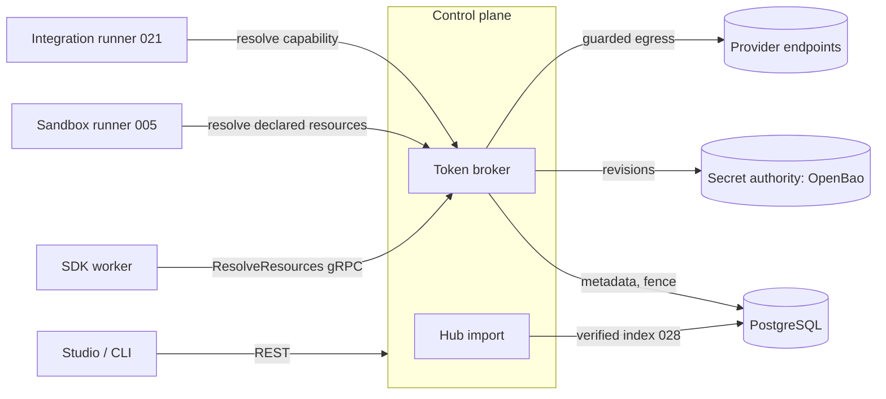

# OAuth resources and a curated integration hub

*   **Author:** Claude Code, for the owner
*   **Status:** Draft
*   **Date:** 2026-11-24

--------------------------------------------------------------------------------

## Overview

From release 0.3.0 a resource of feature 021 can hold an OAuth 2.0 credential: a person connects an account at a
provider (the authorization-code grant, with PKCE), or the platform obtains tokens for a machine client (the
client-credentials grant). A **token broker** in the control plane is the only component that talks to the provider's
token endpoint. It keeps the refresh token, the client secret and the client's key in the secret authority of feature
017 (OpenBao), refreshes one credential at a time under a fence, and gives an executor only what its task definition
declares: the resource's non-secret settings and a current access token. Executors are the integration runner of
feature 021, a sandbox runner for a script (feature 005), and an SDK worker for an activity: scripts and activities can
now declare a resource and use it, as in Windmill.

The **integration hub** is a curated set of integrations kept in this repository under `hub/`, reviewed, validated in CI
and signed into the release's index with feature 028's machinery. An integration groups an OAuth provider definition,
resource types that specialise feature 021's closed operation kinds (fixed hosts, auth, named request presets), and
script and workflow templates. An administrator imports an integration into a tenant; what is imported is data, pinned
by version and digest, and nothing in it runs in the server.

The architecture is [ADR-0122](../adr/ADR-0122-oauth-tokens-are-held-by-a-broker-in-the-control-plane-and-executors-receive-only-a-current-access-token.md)
(the broker) and [ADR-0123](../adr/ADR-0123-hub-integrations-are-signed-data-that-specialise-closed-operation-kinds-and-are-imported-as-pinned-versions.md)
(the hub). Both are Proposed. The registers are in `specs/047-oauth-integration-hub/research.md`. The principles cited by
numeral are those of [the constitution](../constitution.md), version 5.0.0 (Owner decision 2026-11-24-2), whose
"Admitted scope" names this design.

### Terms

- **Provider definition.** What the platform knows about an OAuth server: authorization, token and revocation
  endpoints, issuer, supported client authentication methods, scope catalogue, whether refresh tokens rotate, extra
  authorization parameters allowed (for example `access_type=offline`), default token lifetime. From the hub or written
  by a tenant administrator.
- **Client registration (registration).** A client at a provider: client id, the reference to its client secret or
  private key, its authentication method. Scoped to a tenant, or to the deployment and offered by the operator to
  tenants that opt in.
- **OAuth credential (credential).** The tokens of one grant for one resource: state, granted scopes, access-token
  expiry, revision pointers in the secret authority, the refresh fence. Bound to a resource's auth slot.
- **Token broker (broker).** The control-plane service that runs the flows, refreshes, revokes and serves access
  tokens to authorized executors.
- **Hub index.** A signed, versioned, expiring catalogue (feature 028, Requirements 028-039 to 028-042). This design adds
  the item kinds `OAUTH_PROVIDER` and `INTEGRATION` and gives `RESOURCE_TYPE` its meaning.
- **Request preset.** A named request a hub resource type declares (method, path template, typed parameters, body
  template), evaluated by the integration runner's `http.request` or `graphql.execute`.

## The Problem

Windmill's resources are typed JSON objects; a resource type with OAuth is connected from its UI, Windmill refreshes the
token server side, and a script receives the token inside the resource object. Its hub lets anyone publish resource
types, scripts and flows, and a workspace imports them. Many integrations are one click away.

This platform today:

- Feature 021 (approved draft) offers resource types and resources with secret slots in OpenBao, a closed set of
  operations run by an isolated integration runner, and OAuth 2.0 client credentials only. Its integration runner
  receives the client secret and requests a token on every attempt. Authorization-code flows, resources used by scripts
  and activities, and a hub are out of its scope.
- Feature 028 (approved draft) designs a curated, signed index of workflow and script templates imported as drafts.
- A script or an activity that needs an account at Google, Microsoft, GitHub or Salesforce must carry a long-lived token
  as a secret that someone copied by hand, and nobody refreshes it.

What must hold, from the constitution: secret values never reach workflow state, the journal, logs, audit records,
telemetry or ordinary responses; an executor receives only the secrets declared by its immutable task definition, all
or nothing, after a value-free audit (Principle V); a provider can do an effect twice and the platform says so
(Principle III); outbound connections are guarded (feature 009); the hub has only signed sources, imports items as
drafts and runs nothing in the server (Delivery Constraints, 5.0.0).

## Requirements

### Functional

**Providers and registrations**

- **Requirement 047-001** A tenant administrator (`oauth:client:manage`) MUST be able to create a provider definition
  (https endpoints only, hosts under the deployment's egress policy) or import one from the hub, and register a client
  for it, with the client secret or private key written to the secret authority and never returned. *Acceptance:* REST
  contract tests; a canary client secret absent from every response, log, span and audit record.
- **Requirement 047-002** An operator MUST be able to create a deployment-level registration and offer it to tenants; a
  tenant administrator opts in, and may opt out, each audited; a tenant never sees the deployment client's secret.
  *Acceptance:* the offer tests; the cross-tenant test that a tenant cannot use a registration not offered to it.
- **Requirement 047-003** The client authentication methods MUST be `client_secret_basic`, `client_secret_post` and
  `private_key_jwt` (RFC 7523, ES256 or RS256, a fresh `jti` and an expiry of at most 60 s per assertion). *Acceptance:*
  each method against the local OAuth test server.

**The authorization-code grant**

- **Requirement 047-004** A person with `resource:manage` on the namespace MUST be able to connect an account for a
  resource: the API creates a single-use authorization request (state of 32 random bytes stored as SHA-256, PKCE S256
  verifier sealed, the starting principal, the registration, the requested scopes, an expiry of 10 minutes) and returns
  the provider's authorization URL. *Acceptance:* the flow test against the local OAuth test server.
- **Requirement 047-005** The Studio's callback page MUST post `code`, `state` and, when present, `iss` to the API with
  the person's own credentials; the API MUST refuse an unknown, used, expired or other-principal `state`, an `iss` that
  is not the provider's issuer (RFC 9207), and a response whose `error` is set, before any token request. *Acceptance:*
  one test per refusal; the cross-site request test in which an attacker's `state` is completed by a victim.
- **Requirement 047-006** The exchange MUST send the verifier and the exact redirect URI, accept only a bearer token type,
  record the granted scopes (the requested ones when the response omits them), refuse a grant missing a scope the
  resource type marks required, and store the access and refresh tokens as revisions in the secret authority through
  the recoverable provisioning of feature 017 before the credential becomes `ACTIVE`. *Acceptance:* the crash tests of
  the Verification Plan.

**The client-credentials grant**

- **Requirement 047-007** A credential of the client-credentials grant MUST obtain its token through the broker, cached
  as a revision until 60 s before expiry, one request at a time per credential. Feature 021's `oauth2_client_credentials`
  scheme MUST use it: the integration runner receives the access token, never the client secret. *Acceptance:* the
  integration test of 021's `http.request` with this scheme; the canary test.

**Refresh, revocation and state**

- **Requirement 047-008** At most one refresh of a credential MUST be in flight: the broker takes a fenced lease on the
  credential with a conditional update, calls the token endpoint with a deadline shorter than the lease, writes the new
  revisions, and activates them by comparing the fence. *Acceptance:* the race test with two control planes held at a
  barrier sees one token request.
- **Requirement 047-009** A caller that needs a token while a refresh is in flight MUST receive the current access token
  if it is valid for at least 30 s more, and otherwise wait at most 10 s for the refresh, then fail retryable with
  `OAUTH_TOKEN_UNAVAILABLE`. *Acceptance:* the waiter tests.
- **Requirement 047-010** A refresh refused with `invalid_grant` MUST move the credential to `NEEDS_REAUTHORIZATION`,
  audit it and report it to the resource's managers; a step that needs that credential MUST fail retryable with
  `OAUTH_REAUTHORIZATION_REQUIRED`, so its retry policy carries it until the account is connected again. *Acceptance:*
  the reauthorization test, in which the next attempt after reconnecting succeeds.
- **Requirement 047-011** A proactive pass (leased, one replica at a time) MUST refresh, 5 minutes before expiry, the
  access tokens of credentials used in the last 24 hours, and MUST refresh a rotating refresh token unused for longer
  than the provider definition's keep-alive interval. *Acceptance:* pass tests with the database clock.
- **Requirement 047-012** Disconnecting a credential or deleting its resource MUST revoke the refresh token at the
  provider's revocation endpoint (RFC 7009) when the definition has one, at least once, recording the outcome, then
  retire its revisions. *Acceptance:* the revocation test, including a provider that is down (retried, then recorded as
  unknown, the revisions retired anyway).

**Delivery to executors**

- **Requirement 047-013** A script node, an activity definition and a `resourceOperation` node MAY declare resources by
  name (at most 8). The declaration is part of the immutable task definition; publication and admission check the
  publisher's and initiator's `resource:use` and the credential's state and scopes as feature 021 does for its nodes.
  *Acceptance:* publication refusals; admission pinning.
- **Requirement 047-014** An executor MUST receive a declared resource only through the declared-secret delivery of
  Principle V: all declared resources or none, with the current authority checks, a value-free audit committed before
  values return, and the selection revalidated after provider input or output. What it receives is the resource's
  non-secret settings and, for an OAuth credential, the access token and its expiry; never a refresh token, client secret
  or private key. *Acceptance:* the disclosure tests with canaries; the stale-lease refusal.
- **Requirement 047-015** A long step MAY ask again for a declared resource during its lease (at most 30 times per
  attempt and once per 10 s per resource) and receives the current token. *Acceptance:* the budget tests.
- **Requirement 047-016** The six SDKs MUST expose the same `resource(name)` call and the script shims of feature 005 the
  same host call, both answering with the same shape; the conformance suite covers them. *Acceptance:* the SDK
  conformance scenario `resource_access`.

**The hub**

- **Requirement 047-017** The hub's items MUST live in this repository under `hub/`, each with a review record naming
  two reviewers, and MUST be validated in CI by the platform's own codecs (the contract suite `contract_integration_hub`)
  and signed into the release's index. *Acceptance:* the suite refuses an item with an operation kind outside the closed
  set, a host that is not https, a wildcard host, an undeclared scope, a template with a secret value.
- **Requirement 047-018** The index MUST follow feature 028's format and verification (Requirements 028-039 and 028-040)
  with the item kinds `OAUTH_PROVIDER`, `RESOURCE_TYPE` (requires feature 021), `SCRIPT`, `WORKFLOW` and `INTEGRATION`
  (a group of the others). *Acceptance:* feature 028's index tests run with the new kinds.
- **Requirement 047-019** Importing a provider or a resource type MUST create an immutable tenant-scoped version with
  provenance (index, item, version, digest, signer), idempotent by key; importing a template MUST create a draft
  (Requirement 028-041); importing an integration MUST do each of its parts in one transaction and return what must be
  prepared (registrations, secrets, egress hosts). Nothing is executed. *Acceptance:* the import tests.
- **Requirement 047-020** A hub resource type MUST specialise `http_api` or `graphql`: fixed hosts, an auth scheme bound
  to a provider, a narrowed settings schema and request presets evaluated by the existing operation. *Acceptance:* the
  preset tests through the integration runner; a preset that tries to change the host is refused.
- **Requirement 047-021** A newer hub version MUST NOT change an existing resource: adoption is an explicit new
  revision. An item a later index revokes MUST NOT be importable; imported versions of it MUST get a finding, and an
  operator MAY block their new admissions, audited. *Acceptance:* the upgrade and revocation tests.
- **Requirement 047-022** The release's hub MUST contain at least these integrations: GitHub, Google (Sheets, Drive,
  Gmail send), Microsoft Graph (mail, Teams messages, SharePoint files), Slack, Atlassian (Jira), Salesforce, HubSpot,
  Notion, Zoom and a generic "OAuth 2.0 API" provider template. *Acceptance:* each passes the contract suite and the
  recorded-response tests; a run against the real provider is recorded where credentials exist and a gap where not.

**Cross-cutting**

- **Requirement 047-023** The feature MUST be switched on by the capability `oauth-broker` in the instance registry
  (ADR-0082); without it, OAuth schemes and resource declarations on scripts and activities are refused at publication.
  *Acceptance:* the capability test.
- **Requirement 047-024** Telemetry and audit as in Technical Plan 10; errors typed and value-free; a provider's error
  body never reaches a response (only its RFC 6749 `error` code from a closed list). *Acceptance:* the error contract
  tests and the metric-label test.
- **Requirement 047-025** The Studio MUST offer: registrations, the connect button and the callback page, credential
  state with reconnect, the hub browser and import; the CLI MUST list and import hub items and show credential states.
  *Acceptance:* the Studio journey and CLI contract tests.

### Non-functional

- **Non-functional requirement 047-001 (custody)** Refresh tokens, client secrets and private keys are readable only by
  the broker; a canary of each is absent from every executor response, log, span, journal entry, audit record and
  metric in the test suites.
- **Non-functional requirement 047-002 (latency targets, to be measured)** Delivery of a cached access token adds at
  most 10 ms over today's secret delivery on the development machine; a refresh adds the provider's latency plus at most
  50 ms. Benchmark criteria, not promises.
- **Non-functional requirement 047-003 (bounds)** Token responses 16 KiB (as feature 021), provider definitions 32 KiB,
  hub items 1 MiB per file (feature 028), 200 credentials per namespace, 50 registrations per tenant, 10 open
  authorization requests per person, token endpoint deadline 10 s, refresh lease 30 s.
- **Non-functional requirement 047-004 (telemetry)** No tenant, namespace, resource, provider or credential identifier
  in a metric label.

### Success criteria

- **Success criterion 047-001** A person connects a Google account in the Studio, a script reads a sheet with the
  token, the token is refreshed while a workflow waits a day, and the refresh token was never in any executor's hands.
- **Success criterion 047-002** The race, crash, canary and cross-tenant tests pass on real PostgreSQL and OpenBao.
- **Success criterion 047-003** The ten integrations of Requirement 047-022 import into a fresh tenant and each one's
  recorded-response test passes.

### User stories

- **User story 047-01** An integrator connects a provider account to a resource and uses it from a `resourceOperation`
  node, a script and an activity (CUJs 1 and 2).
- **User story 047-02** An administrator registers the tenant's client, or opts into the operator's (CUJ 3).
- **User story 047-03** A developer imports a curated integration and has a working resource type, provider and
  templates in a minute (CUJ 4).
- **User story 047-04** An operator survives a lost refresh token and a revoked hub item without surprises (CUJs 5 and
  6).

## Goals

- Windmill's OAuth convenience and hub reach, with stronger custody: refresh tokens and client secrets never leave the
  broker; refresh is single-flight; every disclosure is declared and audited.
- Scripts and activities use resources, closing the gap feature 021 left out of its scope.
- A hub that adds integrations as reviewed, signed data, not code.

## Non-Goals

- Using OAuth to sign people into the platform (feature 013, federated login).
- Token exchange to narrow a token per step (RFC 8693), sender-constrained tokens (DPoP, RFC 9449; mutual-TLS-bound
  tokens, RFC 8705), and dynamic client registration (RFC 7591): Gaps 047-001 to 047-003.
- An open marketplace, tenant publishing, ratings or payments (constitution).
- Notification channels of feature 026, which keep their own credentials in 0.3.0 (ADR-0055 rule 11b; Gap 047-004).

## Open Questions

None blocks the design. Measurements that may change a default are gaps (Gap 047-005, the proactive pass's window and
the keep-alive interval per provider).

## Owner decisions needed

None. The design follows Owner decision 2026-11-24-1 (the feature is in 0.3.0) and the 5.0.0 amendment (Owner decision
2026-11-24-2). Its product choices were taken under Owner decisions 2026-11-20-6 and 2026-11-24-4 and are recorded as
Decisions 047-001 to 047-020 in `specs/047-oauth-integration-hub/research.md`, each marked "delegate (OD-2026-11-24-4)"
with its reasoning. ADR-0122 and ADR-0123 are accepted or rejected under Owner decision 2026-11-24-4 when this design
completes its review.

## Critical User Journeys (CUJs)

### CUJ 1: Connect a Google account and read a sheet from a script

*   **Given**: a tenant that imported the Google integration and registered its own client; a namespace with the
    capability `oauth-broker` recorded.
*   **When**: an integrator creates a `google_sheets` resource, presses Connect, consents at Google, and publishes a
    Python script that declares the resource and reads a range.
*   **Then**: the Studio shows the resource `ACTIVE` with the granted scopes and the account label; each run's script
    gets the access token through its supervisor; the audit shows a value-free disclosure per attempt; the refresh token
    is in OpenBao only.

### CUJ 2: A workflow waits a day, then calls Microsoft Graph

*   **Given**: a run that sleeps 24 hours and then runs a `resourceOperation` preset `sendMail` on a Microsoft Graph
    resource.
*   **When**: the step is leased.
*   **Then**: the access token (lifetime about an hour) expired long ago; the broker refreshes once, whatever the number
    of concurrent steps, stores the rotated refresh token before activating it, and the integration runner receives the
    new access token.

### CUJ 3: The operator offers a shared client

*   **Given**: a SaaS deployment whose operator registered one Slack app for all tenants.
*   **When**: the operator offers it and a tenant administrator opts in.
*   **Then**: the tenant's people can connect Slack workspaces with that app; the tenant never sees the app's secret; an
    opt-out stops new connections and leaves existing credentials until disconnected.

### CUJ 4: Import an integration

*   **Given**: the release's hub with the Atlassian integration.
*   **When**: a developer opens the hub in the Studio, reads the integration's description and requirements, and
    imports it.
*   **Then**: the tenant gets the provider definition and the `jira` resource type as pinned versions with provenance,
    and two workflow templates as drafts; the response lists what to prepare (a registration at Atlassian, the egress
    host `api.atlassian.com`); nothing ran.

### CUJ 5: A refresh token is lost

*   **Given**: a credential at a provider that rotates refresh tokens and revokes the family on reuse.
*   **When**: a control plane crashes after the provider answered a refresh and before the new refresh token was
    written, and the next refresh uses the old one.
*   **Then**: the provider answers `invalid_grant`; the credential becomes `NEEDS_REAUTHORIZATION`, its managers are told,
    steps that need it fail retryable and wait under their retry policy; a person reconnects and the runs carry on.

### CUJ 6: A hub item is revoked

*   **Given**: a tenant that imported the HubSpot resource type 1.2.0.
*   **When**: the next release's index revokes 1.2.0 (a preset sent data to a wrong path) and adds 1.2.1.
*   **Then**: 1.2.0 cannot be imported again; the tenant's version gets a finding with the index's reason; the operator
    may block new admissions of it; resources move to 1.2.1 by a new revision.

## Technical Plan (Architecture)

### 1. Components



The broker is a module of the control plane's application layer (`crates/application/src/oauth/`) with one adapter,
`crates/infra-oauth`, that builds and sends token, revocation and client-assertion requests through
`crates/infra-egress` and parses responses in a bounded, closed way. Executors never call the broker's internals: they
call the existing delivery paths (feature 021's two-phase capability resolution for the integration runner; the
runner REST surface for scripts; the worker gRPC service for activities), which call the broker.

### 2. Data

Additive tables (`specs/047-oauth-integration-hub/data-model.md`, written with Task T047-1):

- `oauth_providers` (scope tenant or deployment, id, version, source `HUB` or `AUTHORED`, provenance, endpoints, issuer,
  methods, scope catalogue, rotation flag, keep-alive interval, default lifetime, extra parameters allowed); immutable
  versions.
- `oauth_client_registrations` (scope, id, provider version, client id, secret reference, method, state) and
  `oauth_client_offers` (registration, tenant, state, opted by, at).
- `oauth_credentials` (tenant, namespace, id, resource id, registration id, grant, state `PENDING`, `ACTIVE`,
  `NEEDS_REAUTHORIZATION`, `DISCONNECTING`, `DISCONNECTED`; granted scopes, account label classified `pii` (feature 016),
  access revision and expiry, refresh revision, refresh fence, refresh lease until, last refresh, last error code, last
  used).
- `oauth_authorization_requests` (tenant, id, state hash, sealed verifier, principal, registration, credential, scopes,
  return path, expires, used).
- Hub tables are feature 028's (`template_indexes`, `template_entries`, `template_files`, `template_imports`), with the
  new kinds, plus `tenant_resource_type_versions` (feature 021's catalogue extended with a tenant scope and provenance)
  and `hub_item_findings`.

Secret revisions use the paths of feature 017 derived from trusted identity
(`tenants/<tenant>/namespaces/<namespace>/oauth/<credential>/access/<revision>`, `.../refresh/<revision>`, and
`.../registrations/<registration>/secret/<revision>`), written once and retired after replacement.

### 3. The authorization-code flow

```mermaid
sequenceDiagram
    participant U as Person (Studio)
    participant API as Control plane
    participant P as Provider
    participant SA as Secret authority
    U->>API: POST /oauth/authorizations {resource, registration, scopes}
    API->>API: state, PKCE verifier (sealed), expiry 10 min, principal
    API-->>U: authorization URL
    U->>P: consent
    P-->>U: redirect to Studio /oauth/callback?code&state&iss
    U->>API: POST /oauth/callback {code, state, iss} (person's token)
    API->>API: state known, unused, unexpired, same principal; iss
    API->>API: mark used (commit)
    API->>P: token request (code, verifier, redirect URI, client auth)
    P-->>API: tokens
    API->>SA: write access and refresh revisions (intent, write, activate)
    API->>API: credential ACTIVE (commit, audit)
    API-->>U: credential state
```

The `state` is marked used in its own commit before the token request, so a replay cannot exchange twice. If the
control plane crashes between the token response and the secret writes, the code is spent and the credential stays
`PENDING`: the person connects again (an `oauth.authorization.incomplete` audit record says so). The redirect URI is the
deployment's Studio origin plus `/oauth/callback`, configured once (`SAGAT_STUDIO_PUBLIC_URL`) and registered at each
provider; the callback page returns the person to a path inside the Studio only. Extra authorization parameters are
those the provider definition allows, nothing else.

### 4. Refresh and the fence

```text
acquire:  UPDATE oauth_credentials SET refresh_fence = refresh_fence + 1, refresh_lease_until = now() + 30 s
          WHERE tenant_id = $1 AND id = $2 AND state = 'ACTIVE'
            AND (refresh_lease_until IS NULL OR refresh_lease_until < now())
          RETURNING refresh_fence, refresh revision, registration
call:     token endpoint, deadline 10 s (no transaction open)
store:    write the new access (and, if returned, refresh) revision: intent, provider write, activation
activate: UPDATE ... SET access revision, expiry, refresh revision, refresh_lease_until = NULL, last_refresh_at = now()
          WHERE id = $2 AND refresh_fence = $held        -- zero rows: the lease was lost; retire what was written
```

The lease (30 s) is longer than the call's deadline plus the writes, so a holder that is alive keeps it. The database
clock decides expiry (as the other passes of the platform do). A holder that loses its lease never activates; the
revisions it wrote are retired. If the provider rotated the refresh token and the holder crashed before activation, the
next holder uses the old refresh token: a provider with a grace period accepts it; one with reuse detection answers
`invalid_grant`, and the credential goes to `NEEDS_REAUTHORIZATION` (Requirement 047-010). This window cannot be closed
by the platform, and the design says so instead of hiding it.

The client-credentials grant uses the same acquire, call, store and activate steps with no refresh token.

### 5. Delivery

The declared resources of a task definition are part of its immutable definition, as declared secrets are today. At
delivery the broker returns, for each declared resource, its pinned revision's non-secret settings and, for an OAuth
credential, the access token and its expiry, refreshing first if the token expires within 120 s. The checks are those of
Principle V's ordinary delivery: current tenant and namespace scope, the exact task, instance and attempt, the
generation, the capability token and an unexpired lease; the caller's membership, worker binding and pool delivery
policy; the publisher's `resource:use` on each resource and the slot's secret access. They are revalidated after the
secret authority's read and after any token request; a value-free disclosure audit commits before values return; any
failed check or audit refuses the whole set.

- Integration runner (021): its capability resolution (021, `contracts/integration-runner.md`) gets the access token
  from the broker in its second phase.
- Scripts: a host call `resource` in the feature 005 shim protocol, served by the supervisor through a new runner route
  `POST /script-runner/resources:resolve`; the token is added to the run's redaction set (feature 005, Decision 111).
  Never in a test run.
- Activities: a new worker gRPC method `ResolveResources` beside `ResolveSecrets`, in the same limit class, with an
  additive protocol minor; the six SDKs expose `resource(name)`.

A token returned to an executor is a secret value in that executor: it is redacted from step logs (ADR-0085's
by-value redaction in the worker) and results as declared secrets are.

### 6. Providers, registrations and offers

A provider definition is validated on write: https endpoints, hosts allowed by the deployment's egress policy, a scope
catalogue of at most 200 entries, a closed set of methods. A tenant may author one; an imported one carries
provenance. A registration's secret or private key is written through feature 017's provisioning; its client id is not
a secret. A deployment registration belongs to the operator (ADR-0074's platform-operator surface) and is offered to
named tenants; a tenant opts in with `oauth:client:manage`. Credentials made with a deployment registration belong to
the tenant; an opt-out stops new connections.

### 7. The hub

The hub's source is `hub/` in this repository:

```text
hub/
  README.md
  integrations/<slug>/
    integration.json        # title, summary, maintainer, licence, requirements, items
    oauth-provider.json     # optional
    resource-types/*.json   # specialisations of http_api or graphql
    templates/              # script templates (with manifests, design 046) and workflow templates
    review.md               # the two reviewers, the date, what was checked
    fixtures/               # recorded provider responses for the contract suite
```

CI runs `contract_integration_hub`, which loads every item with the same codecs the import uses, and refuses what
Requirement 047-017 lists. The release build writes the index (feature 028's schema extended with the new kinds,
`specs/047-oauth-integration-hub/contracts/hub-items.md`) and signs it with the release key; the binary embeds the index
and its public key. Operators may configure more indexes with keys they pin (Requirement 028-039).

A hub resource type names its base kind (`http_api` or `graphql`), its fixed hosts, its auth scheme and provider, its
settings schema (a subset of the base's), its egress profile (exactly its hosts), its required and optional scopes, and
its request presets. A preset is data: a method, a path template whose variables are typed parameters, a query and body
template under the existing expression evaluator, the class (safe or effect) and its idempotency guidance (Principle III:
an effect preset says whether the provider deduplicates, by which header, or that it does not). The integration runner
evaluates a preset with its existing `http.request` or `graphql.execute`; a preset cannot change the host.

Import (Requirement 047-019) is one transaction per request: verify the index and the item again (feature 028), write
the tenant versions and drafts, write the import record and the audit. A later index that revokes an item marks it in
`template_entries`; the hub refresh pass records a `hub_item_findings` row for every tenant version of it.

### 8. Where the code goes

| Part | Place |
|---|---|
| Credential state machine, provider and registration rules | `crates/domain/src/oauth.rs` |
| Broker, flows, refresh pass, delivery, hub import | `crates/application/src/oauth/`, `crates/application/src/hub/` (with feature 028's index code) |
| Token client, client assertions, response parsing | new crate `crates/infra-oauth` |
| Tables | `crates/infra-postgres` |
| REST and the runner route | `crates/api-http/src/routes/{oauth,hub,runner}.rs` |
| `ResolveResources` | `crates/api-grpc`, the protocol contract |
| Script host call | `crates/infra-sandbox/src/protocol.rs`, `apps/sandbox-runner`, the shims |
| SDKs | `sdks/{typescript,go,python,csharp,java,rust}` |
| Studio | `frontend/apps/studio` (registrations, connect, callback, hub browser) |
| Hub item schemas and codecs | `crates/infra-schema` |
| Request presets | `crates/infra-integrations` (feature 021) |
| Hub content | `hub/` |

`scripts/check-architecture.py` gains the rule that only `crates/infra-oauth` builds token or revocation requests.

### 9. Composition with other features

- **021:** resources, types, slots, the integration runner and its capability resolution are 021's. This design adds
  the OAuth schemes' broker, tenant-scoped imported types, presets, and declarations on scripts and activities. 021 is
  buildable without it (the OAuth schemes are refused until the capability `oauth-broker` is recorded).
- **028:** the signed index and draft import are 028's (Requirements 028-039 to 028-042); whichever is built first builds
  that code once, in `crates/application/src/hub/`.
- **017 and 015:** the secret authority and its provisioning are 017's; OpenBao in the compose is 015's. The tests start
  their own OpenBao container as feature 017's do.
- **046:** script templates carry manifests and resolve under the namespace's supply-chain policy when published.
- **026:** notification channels keep their own credentials (Gap 047-004).
- **043:** importing a workflow template creates a draft; its `inputSchema` is checked at publication like any other.

### 10. Telemetry and audit

Metrics (closed labels): `oauth_token_requests_total{grant,kind,outcome}` (`kind`: exchange, refresh, client
credentials), `oauth_token_request_seconds{grant}`, `oauth_refresh_waits_total{outcome}`,
`oauth_credentials_state{state}` (a count over all tenants), `oauth_authorizations_total{outcome}`,
`hub_index_refresh_total{outcome}`, `hub_imports_total{kind,outcome}`. Spans with tenant, namespace, resource, provider and
credential as attributes. Audit (value-free): `oauth.provider.*`, `oauth.registration.*`, `oauth.offer.*`,
`oauth.authorization.started|completed|refused|incomplete`, `oauth.token.refreshed|refresh_failed`,
`oauth.credential.reauthorization_required|disconnected|revocation_unknown`, the existing disclosure record with the
resource names, `hub.imported`, `hub.item_revoked`, `hub.version_blocked`.

### 11. Errors

`422`: `OAUTH_PROVIDER_INVALID`, `OAUTH_REGISTRATION_INVALID`, `OAUTH_SCOPE_NOT_IN_CATALOGUE`,
`RESOURCE_DECLARATION_INVALID`, `HUB_ITEM_UNAVAILABLE` (with feature 028's reasons). `409`: `OAUTH_STATE_INVALID`
(unknown, used, expired or another principal's), `OAUTH_ISSUER_MISMATCH`. `502`: `OAUTH_PROVIDER_ERROR` with the RFC 6749
`error` code from the closed list (`invalid_request`, `invalid_client`, `invalid_grant`, `unauthorized_client`,
`unsupported_grant_type`, `invalid_scope`, `access_denied`, `server_error`, `temporarily_unavailable`, otherwise
`other`). Step failures: `OAUTH_REAUTHORIZATION_REQUIRED` and `OAUTH_TOKEN_UNAVAILABLE` (retryable),
`OAUTH_SCOPE_INSUFFICIENT` (not retryable).

### 12. Compatibility and rollout

Everything is additive: tables, endpoints, a gRPC method under a new protocol minor, an IR field (`resources` on script
nodes and activity definitions, refused by publication without the capability). Recording `oauth-broker` requires every
control plane, engine and runner to list it (ADR-0082). Rolling back the binaries leaves credential rows an old binary
does not read; versions that declare resources are refused by an old engine's publication but runs admitted before the
rollback fail their steps with `SCRIPT_DENIED`; the release notes say rollback is forward-only once declarations exist.

## Risks and Mitigations

| Risk | Mitigation |
|---|---|
| A compromised step keeps access to an account | It never holds the refresh token; the access token expires; disconnecting revokes at the provider |
| Two refreshes race and the provider revokes the family | The fence (Technical Plan 4); the race test |
| A crash loses a rotated refresh token | Stated window; `NEEDS_REAUTHORIZATION` with retryable steps; crash tests |
| Cross-site request forgery or code injection on the callback | `state` bound to the principal, single use, PKCE, exact redirect URI, `iss` check |
| A malicious or broken provider endpoint | https only, guarded egress, bounded and closed parsing, no redirects, a 10 s deadline |
| A hub item sends data to the wrong place | Two reviewers, CI codecs, fixed hosts, revocation by a later index, operator block |
| Deployment registrations make tenants depend on one client | Opt-in per tenant; tenant registrations stay available |

## Constitution Check

Written against version 5.0.0 (Owner decision 2026-11-24-2).

| Principle | Result | Evidence |
|---|---|---|
| I. State and retry semantics are explicit and durable | Pass | The credential's state changes commit with their audit; refresh is fenced on the row; secret writes use feature 017's recoverable intent; nothing about a run's state changes, and a step that needs a reconnect fails retryable under its policy |
| II. Modular domain, ports and adapters | Pass | Rules in the domain; the broker in the application; one adapter crate for token endpoints with an architecture rule; hub import reuses 028's module |
| III. External effects are at-least-once; sagas compensate | Pass | Token requests and revocations are calls to the provider, retried at least once and recorded; request presets that are effects declare their idempotency mechanism or that there is none |
| IV. Compatibility is versioned and pinned | Pass | Providers, types and presets are immutable versions pinned by resources; a hub update never changes a resource; additive protocol minor |
| V. Code, tenant boundary and secrets are isolated | Pass with conditions (Complexity Tracking) | The broker runs no tenant code; executors receive only declared resources through ordinary declared-secret delivery, never a refresh token, client secret or key; tenant-scoped paths and rows; deployment registrations offered per tenant; canary tests. Condition: the access token of a declared resource is delivered as a declared secret of the task, which this design reads as within Principle V's first declared set; the coordinating session confirms the 5.0.0 wording |
| VI. Observability and audit are part of the feature | Pass | Technical Plan 10 |
| VII. Events are redeliverable; inbox and outbox are the contract | n/a | No message path is added |
| VIII. Failure is tested and contracts are verified, honestly | Pass | Race, crash, canary, cross-tenant, egress and recorded-response tests; real-provider runs are gaps until credentials exist |
| Delivery Constraints | Pass | The hub is the 5.0.0 "curated integration and template hub": signed sources only, imported as data and drafts, nothing run in the server; no open marketplace |

## Complexity Tracking

| Addition | Why it is needed | Simpler alternative rejected |
|---|---|---|
| A broker making outbound calls from the control plane | The long-lived credentials need one holder that runs no tenant code and has the secret authority | Each executor refreshing: every executor holds refresh tokens and races the rotation |
| A fenced refresh state on the credential row | Providers revoke a token family on concurrent reuse | An advisory lock held across the call: a transaction open during provider I/O |
| Resources declared by scripts and activities (a new delivery shape, Principle V) | Windmill parity: scripts use connected accounts | Copying tokens into secrets by hand: nobody refreshes them |
| A new gRPC method and a new host call | Executors need the resource's settings and token in one all-or-nothing call | Overloading `ResolveSecrets`: different authorization (resource access, scopes) and shape |
| Tenant-scoped resource-type versions from the hub | Integrations as data, pinned and attributable | Adding every integration to the platform's built-in catalogue: a release per integration |

## Alternatives Considered

- **Executors refresh their own tokens** (feature 021's current client-credentials design): rejected (ADR-0122,
  option 2).
- **An OAuth secrets engine plugin in OpenBao:** rejected (ADR-0122, option 3).
- **A cookie-bound callback on the API's origin:** the platform's API is a bearer API (the Studio signs in with OIDC in
  the browser); a cookie would add a second session model. The Studio page posting with the person's token binds the
  callback to the person with what exists.
- **Executable connectors in the hub:** rejected (ADR-0123, option 3).
- **Tenant-defined resource types beside the hub:** a tenant can write an `http_api` resource with its own hosts under
  its egress policy, which covers the need without a second catalogue (decided with feature 021's Owner question 1122).

## Non-Functional Requirements

As stated under Requirements (Non-functional requirements 047-001 to 047-004). Their tests: the canary tests for 047-001;
the benchmark of Task T047-20 for 047-002; bound fixtures for 047-003; the metric-label test of Task T047-17 for
047-004.

--------------------------------------------------------------------------------

## Detailed Implementation Plan

Documentation first: Task T047-1 lands before any code. Build slices for two builders that never touch the same crate at
the same time:

- **Slice 1 (builder A): the broker.** Tasks T047-2 to T047-9. Crates `domain`, `application` (`oauth/`), `infra-oauth`
  (new), `infra-postgres`, `api-http` (`oauth` routes). Needs feature 021's resource and slot model (021's resource
  catalogue tasks) and feature 017's provisioning.
- **Slice 2 (builder B): the hub's content and its checks.** Tasks T047-10, T047-13 and T047-14. `hub/`, the item
  schemas and codecs in `crates/infra-schema` (which slice 1 does not touch), request presets in feature 021's
  `crates/infra-integrations`, the contract suite in `tests/`. Needs feature 028's index contract and feature 021's
  operation contracts, not their code.
- **Slice 3 (after both): import, delivery and surfaces.** Tasks T047-11, T047-12 and T047-15 to T047-21.
  `crates/application/src/hub/` (with feature 028's index code), `api-grpc`, `api-http` (`hub` routes),
  `infra-sandbox`, `apps/sandbox-runner`, the six SDKs, `frontend/apps/studio`, `apps/cli`, `tests/`. Slice 3 can itself
  run on two builders: server side (`application`, `api-grpc`, `api-http`, `infra-sandbox`, `apps/sandbox-runner`) and
  clients (`sdks/`, `frontend/apps/studio`, `apps/cli`) against the contracts of Task T047-1.

- [ ] T047-1 Write the contracts (`contracts/oauth.openapi.yaml`, `contracts/hub-items.md`,
  `contracts/resource-delivery.md` for the gRPC method and the host call, `contracts/errors.md`), `data-model.md`, the
  runbook draft, and the 021 and 028 cross-references, before code.
  Refs: Requirement 047-001, Requirement 047-014, Requirement 047-018, Requirement 047-024
- [ ] T047-2 Domain: credential state machine, provider and registration rules, scope rules; unit tests.
  Refs: Requirement 047-001, Requirement 047-006, Requirement 047-010
- [ ] T047-3 `crates/infra-oauth`: token, revocation and client-assertion requests over the guarded client; bounded,
  closed response parsing; the three client authentication methods; tests against a local OAuth test server.
  Refs: Requirement 047-003, Requirement 047-024
- [ ] T047-4 Migrations and grants for the OAuth tables; the down migration refuses while credentials exist.
  Refs: Requirement 047-001, Requirement 047-002
- [ ] T047-5 Providers, registrations and offers: REST, secret provisioning through feature 017, audit.
  Refs: Requirement 047-001, Requirement 047-002
- [ ] T047-6 The authorization-code flow: requests, state, PKCE, callback, exchange, provisioning, crash handling.
  Refs: Requirement 047-004, Requirement 047-005, Requirement 047-006
- [ ] T047-7 Refresh with the fence, waiters, `NEEDS_REAUTHORIZATION`, client-credentials tokens; the race and crash
  tests with barriers.
  Refs: Requirement 047-007, Requirement 047-008, Requirement 047-009, Requirement 047-010
- [ ] T047-8 The proactive pass and the keep-alive refresh on the database clock.
  Refs: Requirement 047-011
- [ ] T047-9 Disconnect and revocation; resource deletion; retirement of revisions.
  Refs: Requirement 047-012
- [ ] T047-10 Hub item schemas and codecs; the contract suite `contract_integration_hub`; the review record format.
  Refs: Requirement 047-017, Requirement 047-020
- [ ] T047-11 Index kinds `OAUTH_PROVIDER` and `INTEGRATION` in feature 028's index; the release signing step.
  Refs: Requirement 047-018
- [ ] T047-12 Import of providers, resource types, templates and integrations; provenance; idempotency; the
  preparation list; revocation findings and the operator block.
  Refs: Requirement 047-019, Requirement 047-021
- [ ] T047-13 Request presets in the integration runner's `http.request` and `graphql.execute`; the host-fixed rule.
  Refs: Requirement 047-020
- [ ] T047-14 The ten integrations of Requirement 047-022 with reviews, fixtures and recorded-response tests.
  Refs: Requirement 047-022
- [ ] T047-15 Declarations on script nodes and activity definitions in the IR; publication and admission checks.
  Refs: Requirement 047-013, Requirement 047-023
- [ ] T047-16 Delivery: the broker behind 021's capability resolution, the runner route and script host call,
  `ResolveResources`; budgets; redaction; canary tests.
  Refs: Requirement 047-014, Requirement 047-015
- [ ] T047-17 Telemetry and audit of Technical Plan 10 with the metric-label test.
  Refs: Requirement 047-024
- [ ] T047-18 SDKs: `resource(name)` in the six SDKs and the conformance scenario `resource_access`.
  Refs: Requirement 047-016
- [ ] T047-19 Studio (registrations, connect, callback page, credential state, hub browser and import) and CLI.
  Refs: Requirement 047-025
- [ ] T047-20 Benchmark of delivery and refresh, with environment and failures.
  Refs: Requirement 047-014
- [ ] T047-21 Runbook (`docs/runbooks/oauth-and-hub.md`), reference pages, quickstart, release notes.
  Refs: Requirement 047-025

#### Follow-up tasks

None yet.

### Verification Plan

- **Unit:** state machine, provider validation, preset evaluation, response parsing (oversized, malformed, wrong token
  type, unknown `error`).
- **Integration (real PostgreSQL, real OpenBao, a local OAuth test server):** the full authorization-code flow; each
  refusal of the callback; client credentials; refresh; revocation; offers; import.
- **Races (barriers, never sleeps):** two control planes acquire the same credential's refresh; a waiter during a
  refresh; a disconnect during a refresh.
- **Crashes:** after the `state` is marked used and before the exchange; after the token response and before the secret
  write; after the write and before activation; during revocation.
- **Security:** canaries for refresh token, client secret and private key in every surface; another tenant's resource,
  registration and credential indistinguishable from missing and audited; a provider endpoint on a private address
  refused; a redirect not followed; a preset that changes the host refused.
- **Conformance:** the SDK scenario `resource_access` in the six SDKs; the script host call in TypeScript and Python.
- **Contracts:** OpenAPI lint; feature 028's index tests with the new kinds; `contract_integration_hub`.
- **Benchmark:** Task T047-20.
