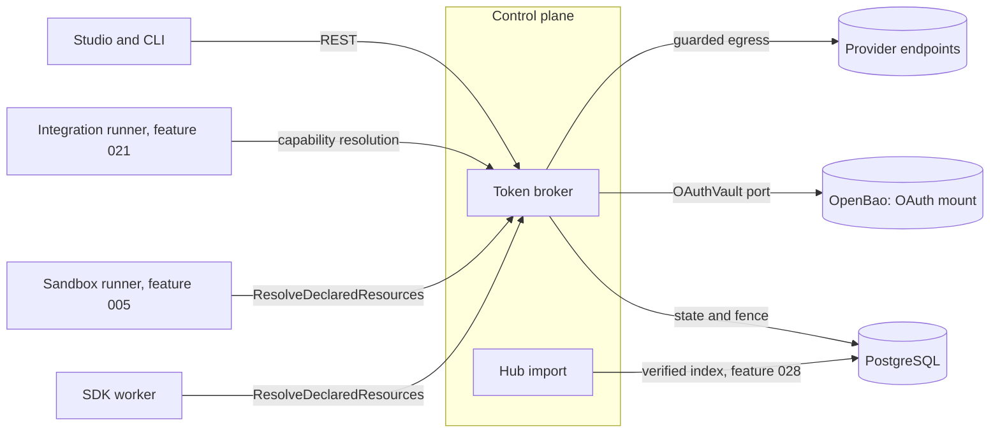

# OAuth resources and a curated integration hub

*   **Author:** Claude Code, for the owner
*   **Status:** In Review
*   **Date:** 2026-11-24

--------------------------------------------------------------------------------

## Overview

From release 0.3.0 a resource of [feature 021](../../specs/021-integration-resources-triggers/spec.md) can hold an
OAuth 2.0 credential. A person connects an account at a provider (the authorization-code grant, with PKCE), or the
platform obtains tokens for a machine client (the client-credentials grant).

A **token broker** in the control plane is the only component that talks to a provider's token, authorization or
revocation endpoint. It keeps the refresh token, the client secret and the client's private key in an OpenBao mount of
its own, which no other code path can address. It refreshes one credential at a time under a fence in PostgreSQL. It
gives an executor only what the executor's task definition declares: the resource's non-secret settings and a current
access token. The executors are the integration runner of feature 021, a sandbox runner for a script
([feature 005](../../specs/005-inline-code-sandbox/spec.md)) and an SDK worker for an activity. So scripts and
activities can now declare a resource and use it, as in Windmill, the reference product for the 0.3.0 parity scope.

The **integration hub** is a curated set of integrations kept in this repository under `hub/`. Each is reviewed by two
people, validated in continuous integration by the platform's own codecs, and signed into the release's index with
[feature 028](../../specs/028-developer-tooling/spec.md)'s machinery. An integration groups an OAuth provider
definition, resource types that narrow feature 021's operation kinds (fixed hosts, fixed authentication, named request
presets), and script and workflow templates. Importing an item creates drafts; an administrator publishes them. Nothing
in an item runs in the server.

The architecture is
[Architecture decision 0122](../adr/ADR-0122-oauth-tokens-are-held-by-a-broker-in-the-control-plane-and-executors-receive-only-a-current-access-token.md)
(the broker) and
[Architecture decision 0123](../adr/ADR-0123-hub-integrations-are-signed-data-that-specialise-closed-operation-kinds-and-are-imported-as-pinned-versions.md)
(the hub). Both are Proposed. The registers are in
[research.md](../../specs/047-oauth-integration-hub/research.md); the contracts and the data model are under
[specs/047-oauth-integration-hub/](../../specs/047-oauth-integration-hub/). Principle numbers refer to
[the constitution](../constitution.md).

### Terms

Terms of this design:

- **Provider definition.** What the platform knows about an OAuth server: its authorization, token and revocation
  endpoints, its issuer, the client authentication methods it supports, its scope catalogue, whether it rotates refresh
  tokens, whether it sends the `iss` response parameter, how long an idle refresh token lives, where the account's
  identity comes from, and which extra authorization parameters are allowed. From the hub or written by a tenant
  administrator.
- **Client registration (registration).** A client at a provider: its client identifier, a reference to its client
  secret or private key, its authentication method and its redirect URI. Owned by a tenant, or by the deployment's
  operator and offered to tenants that opt in.
- **OAuth credential (credential).** The tokens of one grant: its state, granted scopes, account subject, access-token
  expiry, token revisions and refresh fence. A credential belongs to a namespace. A feature 021 resource names it in an
  auth slot of shape `oauth_credential` (feature 021, Decision 021-001).
- **Token broker (broker).** The control-plane module (`crates/application/src/oauth/`) that runs the flows, refreshes,
  revokes and serves access tokens.
- **OAuth vault.** The broker's store for token and client secrets: an OpenBao KV version 2 mount of its own
  (`SAGAT_OAUTH_OPENBAO_MOUNT`) under an OpenBao policy only the control plane's broker token holds, reached through an
  application port only the broker uses.
- **Fence.** A counter on the credential row. Every write of the credential's state or token revisions increases it and
  checks the value it read, so a late writer changes nothing.
- **Hub index.** A signed, versioned, expiring catalogue (feature 028, Requirements 028-039 to 028-042). This design adds
  the item kinds `OAUTH_PROVIDER` and `INTEGRATION` and defines what a `RESOURCE_TYPE` item contains.
- **Request preset.** A named request a hub resource type declares (method, path template, typed parameters, a body
  template), evaluated by the integration runner's existing operation.

Terms of the platform this design uses:

- **Resource, resource type, auth slot, operation kind.** Feature 021: a resource is a namespace instance of a typed,
  versioned resource type; an auth slot is the part of its settings that names a credential or a secret; the operation
  kinds (`http.request`, `graphql.execute`, the S3 set, `smtp.send`, `slack.postMessage`) are the closed set the
  integration runner executes.
- **Capability resolution.** Feature 021's two-phase call by which the integration runner gets what one operation needs
  (`contracts/integration-runner.md` of feature 021).
- **Recoverable provisioning.** Feature 017's write of a secret: an intent row, the provider write, then activation
  (`crates/application/src/managed_secrets.rs`).
- **Declared-secret delivery.** The worker gRPC call `ResolveSecrets` by which an executor receives the secrets its task
  definition declares, all or nothing, after a value-free audit (Principle V).
- **Instance registry and capability.** The record of what each control plane and engine can do, and the operator's
  audited activation of a requirement (Architecture decision 0082, Requirement 018-052).
- **Protocol minor.** The minor version of the worker protocol a session speaks; a feature that adds a message takes the
  next free one at merge.

## The Problem

Windmill's resources are typed JSON objects. A resource type with OAuth is connected from its UI; Windmill refreshes the
token on its server; a script receives the token inside the resource object. Its hub lets anyone publish resource types,
scripts and flows, and a workspace imports them, so many integrations need no code.

This platform today:

- Feature 021 (approved draft, re-baselined on 2026-11-24) offers resource types and resources with secret slots in
  OpenBao, a closed set of operations run by an isolated integration runner, and an auth scheme `oauth` whose slot names
  a credential of this design. Until this design's broker exists, that scheme is refused (`OAUTH_BROKER_UNAVAILABLE`).
  Resources are not usable by scripts or activities.
- Feature 028 (approved draft) designs a curated, signed index of workflow and script templates imported as drafts.
- A script or an activity that needs an account at Google, Microsoft or GitHub must carry a long-lived token as a secret
  that someone copied by hand, and nobody refreshes it.

What must hold, from the constitution: secret values never reach workflow state, the journal, logs, audit records,
telemetry or ordinary responses; an executor receives only what its immutable task definition declares, all or nothing,
after a value-free audit (Principle V); a provider can do an effect twice and the platform says so (Principle III);
outbound connections are guarded (feature 009); the hub has only signed sources, imports its items as drafts and runs
nothing in the server (Delivery Constraints, as amended by version 5.0.0).

## Requirements

### Functional

#### Providers and registrations

- **Requirement 047-001** A tenant administrator (`oauth:client:manage`) MUST be able to create a provider definition or
  publish an imported one, and register a client for it. Endpoints MUST be https with a public address. The client
  secret or private key MUST be written to the OAuth vault and never returned. *Acceptance:* REST contract tests; a
  canary client secret absent from every response, log, span and audit record (`canaries_never_leave_the_broker`).
- **Requirement 047-002** A platform operator (`oauth:offer:manage`) MUST be able to create a deployment registration for
  a hub provider and offer it to named tenants. A tenant administrator opts in and may opt out; the operator may
  withdraw. Withdrawal and opt-out stop new connections at once, stop refreshes after 7 days, then disconnect and revoke
  the credentials made with it. A tenant never sees the deployment client's secret; a registration not offered to a
  tenant answers like a missing one. *Acceptance:* `offer_opt_in_opt_out_and_withdrawal`,
  `a_registration_not_offered_is_not_found`.
- **Requirement 047-003** The client authentication methods MUST be `client_secret_basic`, `client_secret_post` and
  `private_key_jwt` (RFC 7523: ES256 or RS256, one key per registration, `aud` equal to the provider's issuer, a fresh
  `jti`, at most 60 s of validity). *Acceptance:* each method against the local OAuth test server.

#### The authorization-code grant

- **Requirement 047-004** A person with `oauth:credential:manage` on the namespace MUST be able to connect an account:
  the API creates a single-use authorization request and returns the provider's authorization URL. The request holds a
  `state` of 32 random bytes (stored as its SHA-256), a PKCE S256 verifier (sealed), the starting person, the
  registration, the requested scopes, the return path and an expiry of 10 minutes. *Acceptance:*
  `authorization_code_flow_end_to_end`.
- **Requirement 047-005** The callback MUST be accepted only when all of these hold; otherwise it is refused before any
  token request:
  - the Studio's callback page posts `code`, `state` and `iss` with the person's own credentials;
  - the `state` is known, unused, unexpired and was started by the same person;
  - the callback path names the registration the `state` was created for (one redirect URI per registration);
  - `iss` equals the provider's issuer, and is present when the definition says the provider sends it (RFC 9207);
  - the person still holds `oauth:credential:manage`.

  *Acceptance:* one test per refusal, including `a_forged_callback_with_another_persons_state_is_refused` and
  `a_code_from_another_registration_is_refused`.
- **Requirement 047-006** The exchange MUST send the verifier and the exact redirect URI, accept only a bearer token type,
  record the granted scopes (the requested ones when the response omits them), refuse a grant without a scope the
  resource type marks required, and write the tokens to the OAuth vault before the credential becomes `ACTIVE`.
  *Acceptance:* the crash tests of the Verification Plan.
- **Requirement 047-007** Reconnecting a credential MUST keep its account: when the provider definition names an account
  subject, a callback that yields a different subject is refused (`OAUTH_ACCOUNT_CHANGED`); the person connects a new
  credential instead, and moving a resource to it is a new resource revision under feature 021's rules. When the
  definition names no subject, every reconnect is a new credential. *Acceptance:*
  `a_reconnect_to_another_account_is_refused`.

#### The client-credentials grant

- **Requirement 047-008** A client-credentials credential MUST obtain its tokens through the broker, one request at a
  time per credential. Feature 021's `oauth` scheme MUST receive the access token, never the client secret.
  *Acceptance:* feature 021's `http.request` with an `oauth` slot against the local OAuth test server.

#### Refresh, revocation and state

- **Requirement 047-009** At most one refreshed token set MUST be activated per fence value; a second token request for
  the same credential MUST NOT start before the first one's lease has lapsed. *Acceptance:*
  `two_control_planes_refresh_once` (a barrier at acquire), `a_holder_paused_past_its_lease_activates_nothing`.
- **Requirement 047-010** Two thresholds govern freshness (Technical Plan 4): an access token is delivered only while it
  is valid for at least 60 s more, and a refresh starts when it is valid for less than 120 s. A caller that finds a
  refresh in flight and no deliverable token MUST wait at most 10 s, then fail retryable. *Acceptance:* the waiter tests.
- **Requirement 047-011** A refresh refused with `invalid_grant` MUST move the credential to `NEEDS_REAUTHORIZATION`,
  audit it, and report it to the namespace's holders of `oauth:credential:manage`. A step that needs that credential
  MUST fail retryable with `RESOURCE_REAUTHORIZATION_REQUIRED`, so its retry policy carries it until the account is
  connected again. *Acceptance:* `the_next_attempt_after_reconnecting_succeeds`.
- **Requirement 047-012** For a provider whose refresh tokens expire when idle, a keep-alive pass MUST refresh a credential
  whose refresh token has not been used for half of that idle lifetime. *Acceptance:* the pass test on the database
  clock.
- **Requirement 047-013** Disconnecting a credential, or deleting the last resource revision that names it with a request
  to disconnect, MUST move it to `DISCONNECTING` in the same transaction. A pass MUST then revoke its newest refresh token
  at the provider's revocation endpoint (RFC 7009) when the definition has one, at least once, record the outcome
  (`REVOKED`, `NOT_SUPPORTED` or `UNKNOWN` after the last attempt), retire every revision, and end in `DISCONNECTED`.
  *Acceptance:* `disconnect_revokes_the_newest_refresh_token`, `revocation_with_the_provider_down_ends_unknown`.

#### Delivery to executors

- **Requirement 047-014** A `script` node, an `activity` node and a `resourceOperation` node MAY declare resources by name
  (at most 8). The declaration is part of the immutable task definition. Publication and admission MUST check the
  publisher's and the initiator's `resource:use`, the resource's state and the credential's state and scopes, as feature
  021 does for its node. *Acceptance:* the publication refusals; admission pinning.
- **Requirement 047-015** An executor MUST receive declared resources only through the delivery of Technical Plan 5: all
  declared resources or none, with the current authority checks, a value-free audit committed before values return, and
  the checks repeated after the OAuth vault read and after any token request. It receives the resource's non-secret
  settings and, for an OAuth credential, the access token and its expiry; never a refresh token, client secret or private
  key. *Acceptance:* `canaries_never_leave_the_broker`, `a_stale_lease_receives_nothing`.
- **Requirement 047-016** A long step MAY ask again for a declared resource during its lease: at most 30 times per
  attempt and once per 10 s per resource, counted in the database. A refused ask fails with `RESOURCE_ASK_LIMIT`
  (retryable for the step). *Acceptance:* `re_asks_are_bounded_across_control_planes`.
- **Requirement 047-017** The six SDKs MUST expose the same `resource(name)` call and the script shims the same host
  call, with the same answer shape; an activity that declares resources is leased only to a session at this design's
  protocol minor or later. A test run of a script never receives a resource: its `resource` call is refused and audited,
  as feature 005 refuses secrets in test runs. *Acceptance:* the SDK conformance scenario `resource_access`;
  `an_old_session_is_not_offered_a_declaring_activity`; `a_test_run_cannot_use_a_resource`.

#### The hub

- **Requirement 047-018** The hub's items MUST live in this repository under `hub/`, each with a review record naming two
  reviewers, and MUST be validated in continuous integration by the platform's own codecs (`contract_integration_hub`)
  and signed into the release's index. *Acceptance:* the suite refuses an item with an operation kind outside the closed
  set, a host that is not https, a host pattern outside the rules of Technical Plan 7, an undeclared scope, a template
  with a secret value.
- **Requirement 047-019** The index MUST follow feature 028's format and verification (Requirements 028-039 and 028-040)
  with the item kinds `OAUTH_PROVIDER`, `RESOURCE_TYPE` (when feature 021 is enabled), `SCRIPT`, `WORKFLOW` and
  `INTEGRATION`, and a `revoked` list of item digests with a reason class (`security` or `other`). *Acceptance:* feature
  028's index tests with the new kinds and the list.
- **Requirement 047-020** Importing (`hub:import`) MUST create drafts: a draft provider version, a draft resource-type
  version, a workflow or script draft (Requirement 028-041), each with provenance (index, item, version, digest,
  signer). An integration's parts are imported in one transaction, idempotent by the request key (the same key and body
  return the first answer; the same key with another body is `IDEMPOTENCY_KEY_REUSED`); an item version already imported
  with another digest is `409 HUB_DIGEST_CONFLICT`. A draft provider or resource type becomes usable only when a holder
  of `hub:publish` publishes it, after the same write-time checks as an authored one. Nothing is executed.
  *Acceptance:* the import tests.
- **Requirement 047-021** A hub resource type MUST narrow one of feature 021's operation kinds: fixed hosts (or a host
  bound once from the token response or the registration and checked against a pattern), a fixed authentication scheme,
  a narrowed settings schema, and request presets evaluated by the existing operation, whose effect class is the
  operation kind's or stricter. *Acceptance:* the preset tests through the integration runner;
  `a_preset_parameter_cannot_change_the_path`; `a_preset_cannot_weaken_the_effect_class`.
- **Requirement 047-022** A newer hub version MUST NOT change an existing resource: adoption is a new resource revision.
  An item a later index or the operator revokes MUST NOT be importable or publishable. Published versions of a `security`
  revocation MUST be blocked for new admissions until an operator lifts the block; for an `other` revocation they get a
  finding. *Acceptance:* `a_security_revocation_blocks_new_admissions`, `an_other_revocation_is_a_finding`.
- **Requirement 047-023** The release's hub MUST contain GitHub, Google, Microsoft Graph and the generic OAuth 2.0 API
  template; Slack, Atlassian, Salesforce, HubSpot, Notion and Zoom follow as content tasks of the release, each with
  its own review ([integrations.md](../../specs/047-oauth-integration-hub/contracts/integrations.md)). *Acceptance:* each
  passes the contract suite and its recorded-response tests; a run against the real provider is recorded where
  credentials exist, a gap where they do not.

#### Cross-cutting

- **Requirement 047-024** The feature MUST be switched on by the capability `oauth-broker-v1` for control planes and
  engines, activated by the operator (Requirement 018-052). Without it the `oauth` scheme keeps feature 021's refusal
  (`OAUTH_BROKER_UNAVAILABLE`) and resource declarations on scripts and activities are refused at publication.
  *Acceptance:* `without_the_capability_declarations_are_refused`.
- **Requirement 047-025** Telemetry and audit MUST follow Technical Plan 10. Errors MUST be typed and value-free; a
  provider's error body MUST NOT reach a response, only its RFC 6749 `error` code from a closed list. *Acceptance:* the
  error contract tests; `metric_labels_are_closed`.
- **Requirement 047-026** The Studio MUST offer registrations, the connect button and the callback page, credential state
  with reconnect and disconnect, the hub browser, import and publication; the CLI MUST list and import hub items and show
  credential states. *Acceptance:* the Studio journey tests and the CLI contract tests.

### Non-functional

- **Non-functional requirement 047-001 (custody)** Refresh tokens, client secrets and private keys are readable only by
  the broker. *Acceptance:* `canaries_never_leave_the_broker` covers every executor answer, log, span, journal entry,
  audit record and metric; `ordinary_secret_delivery_cannot_address_the_oauth_vault`.
- **Non-functional requirement 047-002 (latency targets, to be measured)** Delivery of a deliverable access token adds at
  most 10 ms over today's secret delivery on the development machine; a refresh adds the provider's latency plus at most
  50 ms. Benchmark criteria, not promises. *Acceptance:* the benchmark of Task 047-21.
- **Non-functional requirement 047-003 (bounds)** Token responses 16 KiB (as feature 021); provider definitions 32 KiB;
  hub files 1 MiB (feature 028); 200 credentials per namespace; 50 registrations per tenant; 10 open authorization
  requests per person; token endpoint deadline 10 s; refresh lease 30 s; 4 token requests in flight and 10 per second per
  registration. *Acceptance:* the bound fixtures of Tasks 047-3, 047-6 and 047-7.
- **Non-functional requirement 047-004 (telemetry)** No tenant, namespace, resource, provider, registration or credential
  identifier in a metric label. *Acceptance:* `metric_labels_are_closed`.

### Success criteria

- **Success criterion 047-001** A person connects a Google account in the Studio, a script reads a sheet with the token,
  the token is refreshed while a workflow waits a day, and no executor ever held the refresh token.
- **Success criterion 047-002** The race, crash, canary and cross-tenant tests pass on real PostgreSQL and OpenBao.
- **Success criterion 047-003** The four integrations required by Requirement 047-023 import and publish into a fresh
  tenant and each one's recorded-response test passes.

### User stories

- **User story 047-01** An integrator connects a provider account and uses it from a `resourceOperation` node, a script
  and an activity (Journeys 1 and 2).
- **User story 047-02** An administrator registers the tenant's client, or opts into the operator's (Journey 3).
- **User story 047-03** A developer imports a curated integration, and an administrator publishes it (Journey 4).
- **User story 047-04** An operator survives a lost refresh token and a revoked hub item (Journeys 5 and 6).

## Goals

- Windmill's OAuth and hub convenience with stronger custody: refresh tokens and client secrets never leave the broker;
  refresh is single-flight; every disclosure is declared and audited.
- Scripts and activities use resources, which feature 021 left out of its scope.
- A hub that adds integrations as reviewed, signed data, not code.

## Non-Goals

- Signing people into the platform with OAuth (feature 013, federated login).
- Token exchange to narrow a token per step (RFC 8693), sender-constrained tokens (RFC 9449, RFC 8705), mutual-TLS client
  authentication and dynamic client registration (RFC 7591): Gaps 047-001 to 047-003.
- An open marketplace, tenant publishing, ratings or payments (constitution).
- Notification channels of feature 026, which keep their own credentials in 0.3.0 (Gap 047-004).

## Open Questions

One question blocks approval, and it is not this design's to settle: Principle V lists two declared sets that an executor
may read, and the delivery of Technical Plan 5 (and feature 021's integration runner) needs the third that Technical
Plan 12 words. The coordinating session of release 0.3.0, which drafts the 5.0.0 amendment (pull request #275), is asked
to add it there or in an amendment that follows. Until it is merged, this design stays In Review. Measured defaults wait
on Gap 047-005.

## Owner decisions needed

None besides the amendment of the Open Questions. The design follows Owner decision 2026-11-24-1 and the 5.0.0
amendment (Owner decision 2026-11-24-2). Its choices were taken under Owner decisions 2026-11-20-6 and 2026-11-24-4 and
are recorded as Decisions 047-001 to 047-038 in research.md, each with the register's literal marker
"delegate (OD-2026-11-24-4)" and its reasoning. Architecture decisions 0122 and 0123 are accepted or rejected under Owner
decision 2026-11-24-4 when this design completes its review.

## Critical User Journeys (CUJs)

### Journey 1: Connect a Google account and read a sheet from a script

*   **Given**: a tenant that imported and published the Google integration and registered its own client; a deployment
    with `oauth-broker-v1` activated.
*   **When**: an integrator creates a credential, presses Connect, consents at Google, names the credential in a
    `google_sheets` resource, and publishes a Python script that declares the resource and reads a range.
*   **Then**: the Studio shows the credential `ACTIVE` with the granted scopes and the account; each run's script gets the
    access token at start; the audit shows a value-free disclosure per attempt; the refresh token stays in the OAuth
    vault.

### Journey 2: A workflow waits a day, then calls Microsoft Graph

*   **Given**: a run that sleeps 24 hours and then runs the preset `sendMail` on a Microsoft Graph resource.
*   **When**: the step is leased.
*   **Then**: the access token (lifetime about an hour) has expired. The broker refreshes once, however many steps ask
    at the same time, writes the rotated refresh token before activating it, and the integration runner receives the
    new access token.

### Journey 3: The operator offers a shared client

*   **Given**: a deployment whose operator registered one Slack app for its tenants.
*   **When**: the operator offers it and a tenant administrator opts in.
*   **Then**: the tenant's people connect Slack workspaces with that app; the tenant never sees the app's secret. When
    the tenant opts out, new connections stop at once, and seven days later its credentials made with that app are
    disconnected and revoked.

### Journey 4: Import and publish an integration

*   **Given**: the release's hub with the GitHub integration.
*   **When**: a developer reads its description and requirements in the Studio and imports it; an administrator
    publishes the provider and the resource type.
*   **Then**: the tenant has the provider definition and the `github` resource type as published versions with
    provenance, and two workflow templates as drafts; the import listed what to prepare (a registration at GitHub, the
    egress host `api.github.com`); nothing ran.

### Journey 5: A refresh token is lost

*   **Given**: a credential at a provider that rotates refresh tokens and revokes the family on reuse.
*   **When**: a control plane dies after the provider answered a refresh and before the new refresh token was written,
    and the next refresh uses the old one.
*   **Then**: the provider answers `invalid_grant`; the credential becomes `NEEDS_REAUTHORIZATION`; its managers are told;
    steps that need it fail retryable and wait under their retry policy; a person reconnects the same account and the
    next attempts succeed.

### Journey 6: A hub item is revoked for security

*   **Given**: a tenant that published the HubSpot resource type 1.2.0.
*   **When**: the operator's revocation feed (or the next release's index) revokes 1.2.0 with class `security` and adds
    1.2.1.
*   **Then**: 1.2.0 cannot be imported or published again; new admissions of steps whose resource pins it are refused;
    the tenant's version gets a finding with the reason; resources move to 1.2.1 by a new revision; the operator can lift
    the block, audited.

## Technical Plan (Architecture)

### 1. Components



The broker is a module of the control plane's application layer (`crates/application/src/oauth/`) with one adapter,
`crates/infra-oauth`. The adapter builds and sends token, revocation and client-assertion requests through
`crates/infra-egress` and parses responses in a bounded, closed way. The OAuth vault is an application port
(`OAuthVault`) implemented on `crates/infra-secrets`'s OpenBao client with a separate mount and a separate reference type
that ordinary secret delivery cannot build. Executors never reach the broker's internals: they call the delivery paths
of Technical Plan 5.

The broker runs inside the control plane, not as a separate service, because it needs what the control plane already
holds (the secret authority, the database, the egress client, the audit path) and no tenant code runs there. A separate
service would add a process, a credential and a network path for an isolation gain that the port boundary and the
separate OpenBao policy already give. It can be split out later, after measurement (Principle II).

### 2. Data

The tables are in [data-model.md](../../specs/047-oauth-integration-hub/data-model.md): `oauth_providers` and their
versions, `oauth_client_registrations`, `oauth_client_offers`, `oauth_credentials`, `oauth_token_revisions`,
`oauth_authorization_requests`, `oauth_delivery_asks`, `hub_resource_type_versions` (the `hub` source of feature 021's
type catalogue, Decision 021-004), `hub_item_blocks` and `hub_item_findings`, and the widened checks of feature 028's
`template_entries` and `template_imports`. The migrations take timestamps after `20270119000000`, allocated by the
coordinating session.

Vault references are `oauth/<tenant>/credentials/<credential>/<revision>`,
`oauth/<tenant>/registrations/<registration>/<revision>` and `oauth/deployment/registrations/<registration>/<revision>`.
Each revision is written once (create with version 0, as feature 017's adapter does) and destroyed after it is retired.

### 3. The authorization-code flow

```mermaid
sequenceDiagram
    participant U as Person (Studio)
    participant API as Control plane
    participant P as Provider
    participant V as OAuth vault
    U->>API: POST authorizations {credential, registration, scopes, returnTo}
    API->>API: state, sealed verifier, expiry 10 min, person (commit)
    API-->>U: authorization URL
    U->>P: consent
    P-->>U: redirect to /studio/oauth/callback/{registration}?code&state&iss
    U->>API: POST callback {registration, code, state, iss} (person's token)
    API->>API: one statement marks state used if it matches (commit)
    API->>P: token request (code, verifier, redirect URI, client authentication)
    P-->>API: tokens
    API->>V: write access and refresh revisions (pending rows first)
    API->>API: activate under the fence; credential ACTIVE (commit, audit)
    API-->>U: credential state
```

- The redirect URI of a registration is `<Studio origin>/studio/oauth/callback/<registration>`, built like the Studio's
  OIDC callback from the configured Studio origin. The person registers it at the provider. The callback page removes
  `code` and `state` from the address bar (`history.replaceState`) before any other request, sends
  `Referrer-Policy: no-referrer`, and is kept out of front-end telemetry.
- The callback's check and mark are one statement: `UPDATE oauth_authorization_requests SET used_at = now() WHERE
  state_hash = $1 AND registration_id = $2 AND principal = $3 AND used_at IS NULL AND expires_at > now() RETURNING ...`.
  A repeat by the same person after success returns the credential's state; anything else is `409 OAUTH_STATE_INVALID`.
- The verifier is sealed with the application key ring of feature 009 (AES-256-GCM, the tenant and the request as
  associated data). Expired requests are deleted by the hourly broker pass. The limit of 10 open requests per person is
  counted under a per-person advisory lock in the creating transaction.
- The account subject comes from where the provider definition says: the `id_token`'s `sub` (OpenID providers), a
  userinfo field, a token-response field (Slack's `authed_user.id`), or none. It is stored as an HMAC under the tenant,
  with a display label classified `pii` (feature 016) that never enters audit records, spans or logs.
- If the control plane dies after the token response and before the vault writes, the code is spent and the credential
  stays as it was (`PENDING` for a first connection). An `oauth.authorization.incomplete` record says so, and the person
  connects again.

### 4. Freshness, refresh and the fence

Two thresholds: an access token is **deliverable** while it is valid for at least 60 s more, and a refresh is **due**
when it is valid for less than 120 s. Expiry is the database time returned by the acquiring statement plus
`expires_in`; a token without `expires_in` is deliverable until revoked or refused. A client-credentials credential has
no refresh token; its "refresh" is a new client-credentials request.

Every writer of a credential's state or revisions (callback completion, refresh activation, reauthorization, disconnect)
increases `fence` and compares the value it read. A refresh:

1. **Acquire** (one statement, no transaction held afterwards): increase the fence and set `lease_until = now() + 30 s`
   where the tenant and credential match, the state is `ACTIVE`, the access revision equals the one the caller saw, and
   no unexpired lease is held; it returns the fence, `now()` and the refresh revision. A caller that acquires nothing
   rereads the row: a new deliverable token means another holder refreshed.
2. **Adopt** a pending refresh: if `oauth_token_revisions` holds a `PENDING` refresh revision from an earlier fence whose
   vault write is complete and no later activation exists, activate it instead of calling the provider. This closes the
   window between a vault write and an activation; only the gap between the provider's answer and the vault write
   remains (Gap 047-007).
3. **Call** the token endpoint, only if less than 15 s have passed since acquire (by the monotonic clock from the
   acquire), with a deadline of 10 s.
4. **Store** the new revisions: insert `PENDING` revision rows under the fence, then write the vault, each write with a
   deadline of 5 s. If the stores would end later than 25 s after acquire, extend the lease by 30 s with a statement that
   compares the fence; if that fails, stop.
5. **Activate** (one transaction): where the tenant, credential, fence and state `ACTIVE` match, point to the new
   revisions, set the expiry, clear the lease, mark the old revisions `RETIRED`. Zero rows means another writer moved
   the fence: the pending revisions stay for adoption or for the disconnect's revocation.

Provider answers: `invalid_grant` moves the credential to `NEEDS_REAUTHORIZATION` (fence compared); `invalid_client` and
`unauthorized_client` mark the registration `BROKEN` and its credentials `NEEDS_REAUTHORIZATION`; `invalid_scope` keeps
the credential and fails the step with `OAUTH_SCOPE_INSUFFICIENT`; `429`, `temporarily_unavailable`, `server_error` and
transport failures are retryable, honouring `Retry-After`. Per registration, at most 4 token requests are in flight and
10 per second, so one tenant cannot exhaust a shared client's provider quota for others.

Waiters poll the credential row every 200 ms for at most 10 s and fail at once when the state leaves `ACTIVE`.
`last_used_at` is written at most once per 10 minutes per credential. The keep-alive pass (Requirement 047-012) runs every
15 minutes on one control plane at a time (a lease row in `oauth_passes`), in batches of 100, through the same acquire
and activate steps.

### 5. Delivery

A task definition's declared resources are part of the immutable definition, as declared secrets are. On delivery the
broker, for each declared resource, reads its pinned revision's non-secret settings and, for an OAuth credential, the
deliverable access token (refreshing first when it is due). The checks are those of ordinary delivery under Principle V:

- current tenant and namespace scope;
- the exact task, instance and attempt, the generation, the capability token and an unexpired lease;
- the caller's membership, worker binding and pool-delivery policy;
- the publisher's `resource:use` on each resource and the credential's state `ACTIVE`.

They are repeated after the vault read and after any token request. A value-free disclosure audit commits before values
return. A failed check or audit refuses the whole set.

- **Integration runner (feature 021).** Its capability resolution asks the broker in its second phase, with no
  transaction open (feature 021, `contracts/integration-runner.md`, Decision 021-001).
- **Scripts.** The sandbox runner calls the worker gRPC method `ResolveDeclaredResources` before it starts the script,
  as it calls `ResolveSecrets` today, and adds every token to the run's redaction set. A mid-run ask is a host call
  `resource` on the shim protocol, which the supervisor forwards as another `ResolveDeclaredResources` for one resource;
  the supervisor adds the new token to the redaction set before answering. Test runs are refused.
- **Activities.** The same gRPC method, in a limit class of its own (Requirement 047-016's budget), under this design's
  protocol minor; the six SDKs expose `resource(name)`.

The method's messages are in
[resource-delivery.md](../../specs/047-oauth-integration-hub/contracts/resource-delivery.md). It is separate from feature
021's `ResolveResource`, which only the integration runner's role may call (Architecture decision 0055, decision 3), and
from `ResolveSecrets`, whose authorization and shape differ. Re-asks are counted in `oauth_delivery_asks` (tenant,
attempt, resource) with one conditional increment each.

Step-facing codes are feature 021's, with one addition this design owns
([errors.md](../../specs/047-oauth-integration-hub/contracts/errors.md)): broker or vault unavailable is
`CAPABILITY_UNAVAILABLE` (retryable); `NEEDS_REAUTHORIZATION` is `RESOURCE_REAUTHORIZATION_REQUIRED` (retryable, added to
feature 021's closed list); `DISCONNECTED` or a revoked authority is `RESOURCE_UNAVAILABLE` (not retryable); missing
scopes are `OAUTH_SCOPE_INSUFFICIENT` (not retryable).

### 6. Providers, registrations, offers and egress

A provider definition is checked on write and on publication: https endpoints with public addresses, a scope catalogue
of at most 200 entries, the closed set of methods, the subject source, the extra parameters. A tenant may author one; an
imported one carries provenance and is a draft until published. A deployment registration belongs to the operator (the
platform-operator surface of Architecture decision 0074, Proposed; until it is accepted, operator registrations and offers
are refused and Requirement 047-002 waits) and can name only a published hub provider. A registration's secret or key is
written to the OAuth vault by the broker as the system actor `oauth-broker`; it is not a namespace secret, does not count
in the secrets quota, and is bounded by the registration quota.

Egress: every call of the broker for a credential is checked against the egress policy of the credential's namespace
(`crates/application/src/egress.rs`; deny by default), intersected with the hub item's fixed hosts when the provider is
a hub item. Connecting a credential refuses a provider whose endpoints that policy does not allow. Redirects are never
followed. Feature 021's clause 11(e) of Architecture decision 0055 is what admits a tenant-defined token endpoint here.

### 7. The hub

The hub's source is `hub/` in this repository, beside feature 028's `templates/catalog/`; the release build signs one
index from both.

```text
hub/
  README.md
  integrations/<slug>/
    integration.json        # title, summary, maintainer, licence, requirements, parts
    oauth-provider.json     # optional
    resource-types/*.json   # narrowings of feature 021's operation kinds
    templates/              # script templates (with manifests, design 046) and workflow templates
    review.md               # the two reviewers, the date, what was checked
    fixtures/               # recorded provider responses for the contract suite
```

Item schemas are in [hub-items.md](../../specs/047-oauth-integration-hub/contracts/hub-items.md); the codecs live in
`crates/infra-schema` behind an application port (`HubItemCodec`), used by the contract suite, the import and the
publication. A hub resource type names its base operation kind, its hosts, its authentication scheme and provider, its
settings schema (a subset of the base's), its scopes and its presets.

- **Hosts.** Fixed https hosts, or one host pattern with a single leftmost label wildcard under a fixed registrable domain
  (`*.my.salesforce.com`), whose value is bound once per credential from the token response (`instance_url`) or the
  registration (a Microsoft directory identifier), checked against the pattern, and never taken from step input.
- **Presets.** A method, a path template whose variables are typed parameters, a query and body template under the
  existing expression evaluator. Each path variable is percent-encoded as exactly one segment; dot segments are refused;
  the normalised path must match the template. The effect class is the operation kind's for that method or stricter,
  never weaker; an effect preset states whether the provider deduplicates and by which header (Principle III).

Import and publication (Requirement 047-020) each are one transaction: verify the index and the item again (feature 028),
write the drafts or publish them, write the import record and the audit. Revocation reaches a deployment through the next
release's index, through operator indexes, or through an optional revocation feed: a list of item digests and reason
classes signed with the release key, fetched daily from a URL the operator configures. With the feed configured, a
revocation is effective within 24 hours. An operator (`hub:version:block`) may also block an item digest directly.

The index code is feature 028's (`crates/domain/src/templates.rs`, `crates/application/src/templates.rs`, Tasks
T028-062 to T028-066). This design extends it: two kinds, the `revoked` list and the revocation feed. If this design's
hub slice is built before feature 028's, it waits for those tasks; it does not rebuild them.

### 8. Where the code goes

| Part | Place | Action |
|---|---|---|
| Credential state machine, provider and registration rules | `crates/domain/src/oauth.rs` | Create |
| Broker, flows, passes, delivery; `OAuthVault` and `HubItemCodec` ports; hub import and publication | `crates/application/src/oauth/`, `crates/application/src/templates.rs` (feature 028's module, extended) | Create, Modify |
| Token, revocation and client-assertion requests; response parsing | `crates/infra-oauth` (new adapter crate) | Create |
| The OAuth vault | `crates/infra-secrets/src/openbao.rs` (a second mount and reference type) | Modify |
| Hub item schemas and codecs | `crates/infra-schema/src/hub/` | Create |
| Request presets | `crates/infra-integrations` (feature 021's) | Modify |
| IR declarations on `script` and `activity` nodes | `crates/infra-ir/src/convert.rs`, `crates/infra-ir/src/diff.rs`, `crates/domain` (the node types) | Modify |
| Publication and admission checks | `crates/application/src/publishing.rs`, `crates/application/src/runs/` | Modify |
| Tables | `crates/infra-postgres` (migrations, `storage-classification.json`) | Create, Modify |
| REST and route registration | `crates/api-http/src/routes/{oauth,hub}.rs`, `crates/api-http/src/lib.rs` | Create, Modify |
| `ResolveDeclaredResources` | `crates/api-grpc` (`service.rs`, `limits.rs`), `specs/001-platform-foundation/contracts/worker.proto` and its baseline, the SDKs' proto copies | Modify |
| Script host call and redaction | `crates/infra-sandbox/src/protocol.rs`, `apps/sandbox-runner/src/{lib,host}.rs`, the shims | Modify |
| SDKs | `sdks/{typescript,go,python,dotnet,java,rust}` | Modify |
| Studio | `frontend/apps/studio/src/features/{oauth,hub}/`, the callback route | Create |
| CLI | `apps/cli` | Modify |
| Hub content | `hub/` | Create |

`scripts/check-architecture.py` gains two text rules with negative tests: the literal `grant_type=` and the OAuth client
crates appear only in `crates/infra-oauth`, with one recorded exemption (feature 021's Google Pub/Sub and Azure Service
Bus stream credentials in `crates/infra-integrations`, which are connector credentials, not tenant OAuth); and only
`crates/application/src/oauth/` names the `OAuthVault` port.

### 9. Composition with other features

- **021:** resources, types, slots, the integration runner and its capability resolution are feature 021's. This design
  provides the credential its `oauth` scheme names, the `hub` source of its type catalogue, presets, declarations on
  scripts and activities, and the code `RESOURCE_REAUTHORIZATION_REQUIRED`. Feature 021 ships without this design (its
  `oauth` scheme is refused until `oauth-broker-v1`); no runner-visible client secret exists to migrate. This design
  depends on feature 021's Tasks T021-005, T021-012, T021-017, T021-023 and T021-085 (feature 021, Gap 1152).
- **028:** the index machinery is feature 028's (Technical Plan 7).
- **017 and 015:** the OpenBao client is feature 017's; OpenBao in the compose is feature 015's; the tests start their own
  OpenBao container, as feature 017's do.
- **046:** script templates carry manifests and resolve under the namespace's supply-chain policy when published.
- **026:** notification channels keep their own credentials (Gap 047-004).
- **043:** an imported workflow draft's `inputSchema` is checked at publication like any other.

### 10. Telemetry and audit

Metrics (closed labels): `oauth_token_requests_total{grant,kind,outcome}` (`kind`: `exchange`, `refresh`,
`client_credentials`, `revocation`; `outcome`: `ok`, `invalid_grant`, `client_error`, `retryable`),
`oauth_token_request_seconds{grant}`, `oauth_refresh_waits_total{outcome}`, `oauth_credentials{state}`,
`oauth_authorizations_total{outcome}`, `oauth_deliveries_total{path,outcome}` (`path`: `integration`, `script`,
`activity`), `hub_index_refresh_total{outcome}`, `hub_imports_total{kind,outcome}`, `hub_blocked_admissions_total`.
Spans carry tenant, namespace, resource, provider and credential identifiers. Audit records (value-free; no account
label): `oauth.provider.*`, `oauth.registration.*`, `oauth.offer.*`, `oauth.authorization.started|completed|refused|
incomplete`, `oauth.token.refreshed|refresh_failed`, `oauth.credential.reauthorization_required|disconnected|
revocation_unknown|account_changed_refused`, the disclosure record with the resource names, `hub.imported`,
`hub.published`, `hub.item_revoked`, `hub.version_blocked|unblocked`.

### 11. Contracts

REST routes, permissions and errors: [rest-api.md](../../specs/047-oauth-integration-hub/contracts/rest-api.md); the
delivery messages: resource-delivery.md; hub items: hub-items.md; the initial integrations with their hosts, scopes and
presets: integrations.md; errors and their mapping per executor path: errors.md.

### 12. The constitutional condition

Principle V allows an executor to read two declared sets: the secrets an ordinary task declares, and a managed database
capability's selected credential. Delivering a declared resource's settings and access token to a script, an activity or
feature 021's integration runner is a third set. This design proposes this wording, to sit after the managed database
bullet:

> - A declared resource may disclose, to the lease-owning executor of a step whose immutable task definition declares
>   it, the non-secret settings of its pinned revision and the values its slots bind: the declared secrets, and for an
>   OAuth credential only its current access token, never a refresh token, client secret or private key. The
>   publisher's and initiator's permission to use the resource and the secret-access rules of its slots MUST authorize
>   that disclosure.

The validations of "Both paths" then apply to all three. Feature 021's integration runner needs the same set (its slots
bind secrets and credentials). The coordinating session is asked to carry it into pull request #275 or a following
amendment.

### 13. Compatibility and rollout

Tables, endpoints, a gRPC method under a new protocol minor and an IR field are added; nothing existing changes meaning.
Activating `oauth-broker-v1` requires every control plane and engine to list it. Rollback: an old engine refuses to
publish versions that declare resources. Runs admitted before a rollback whose steps declare resources cannot be served
by old binaries; their steps fail with `CAPABILITY_UNAVAILABLE`, retryable, until the binaries roll forward. So once
declarations exist, roll forward only; the release notes say so.

### 14. Delivery phases

All phases are in 0.3.0; each has its own acceptance.

- **Phase A, the broker:** tables, the vault, the flows, refresh, revocation, feature 021's `oauth` scheme served.
  Acceptance: Requirements 047-001, 047-003 to 047-013, Success criterion 047-002.
- **Phase B, delivery to scripts and activities:** declarations, `ResolveDeclaredResources`, the host call, the six SDKs.
  Acceptance: Requirements 047-014 to 047-017.
- **Phase C, the hub:** item codecs, the four required integrations, import, publication, revocation. Acceptance:
  Requirements 047-018 to 047-023, Success criterion 047-003.
- **Phase D, offers and surfaces:** deployment registrations (after Architecture decision 0074), Studio, CLI, the
  remaining integrations, benchmark. Acceptance: Requirements 047-002, 047-026, Success criterion 047-001.

## Risks and Mitigations

| Risk | Mitigation |
|---|---|
| A compromised step keeps access to an account | It never holds the refresh token; the access token expires; disconnecting revokes at the provider |
| Connecting an account delegates it to everyone with `resource:use` on the resource | Connecting needs `oauth:credential:manage`; the account is shown on the credential; a reconnect cannot change the account |
| Two refreshes race and the provider revokes the family | The fence; acquire compares the access revision; the paused-holder test |
| A crash loses a rotated refresh token | Adoption closes the window after the vault write; the remaining window is stated (Gap 047-007); steps wait retryable |
| Mix-up, code injection or a forged callback | One redirect URI per registration, `state` bound to the person and registration, PKCE, `iss` required where supported |
| A malicious or broken provider endpoint | https and public addresses only, the namespace egress policy, bounded closed parsing, no redirects, deadlines |
| One tenant exhausts a shared client's quota | Per-registration in-flight and rate limits; `Retry-After` honoured |
| Token endpoint load grows with credentials | Refresh only when due or for keep-alive; batches; the keep-alive pass on one replica; a metric per outcome |
| A hub item sends data to the wrong place | Two reviewers, continuous-integration codecs, fixed hosts, path encoding; a security revocation blocks new admissions within 24 hours with the feed |
| One redirect URI per registration must be registered at the provider | The registration form shows it; the runbook lists it per integration |
| Revocation at the provider fails | At least once with retries, then `UNKNOWN` recorded and audited; the revisions are destroyed anyway |
| Rollback once declarations exist | Forward-only; steps fail retryable until binaries roll forward |
| Deployment registrations depend on a Proposed architecture decision | They wait for Architecture decision 0074; tenant registrations do not |

## Constitution Check

Written against version 5.0.0 (Owner decision 2026-11-24-2, pull request #275), whose "Admitted scope" names this design
for the hub. The Principle V row depends on the wording of Technical Plan 12.

| Principle | Result | Evidence |
|---|---|---|
| I. State and retry semantics are explicit and durable | Pass | Every state and revision write of a credential compares and increases the fence; refresh takes a lease with no transaction held during provider calls; vault writes use pending rows that a later holder adopts; a step that needs a reconnect fails retryable under its policy |
| II. Modular domain, ports and adapters | Pass | Rules in the domain; the broker in the application behind `OAuthVault` and `HubItemCodec` ports; one adapter crate for token endpoints with text rules; the hub reuses feature 028's modules |
| III. External effects are at-least-once; sagas compensate | Pass | Token requests and revocations are provider calls retried at least once and recorded; effect presets state their deduplication or that there is none, and never weaken their class |
| IV. Compatibility is versioned and pinned | Pass | Providers, types and presets are immutable published versions pinned by resources; a hub update never changes a resource; an additive protocol minor |
| V. Code, tenant boundary and secrets are isolated | Pass with conditions | The broker runs no tenant code; refresh tokens, client secrets and keys stay in a mount only the broker can address; tenant-scoped rows and paths; registrations not offered answer like missing ones. Condition: the third declared set of Technical Plan 12 is added to Principle V before approval |
| VI. Observability and audit are part of the feature | Pass | Technical Plan 10 |
| VII. Events are redeliverable; inbox and outbox are the contract | Not applicable | No message path is added |
| VIII. Failure is tested and contracts are verified, honestly | Pass | Race, pause, crash, canary, cross-tenant, egress and recorded-response tests; real-provider runs are gaps until credentials exist |
| Delivery Constraints | Pass | The hub has only signed sources (the release index, operator indexes, the signed revocation feed), imports drafts, publishes under the same checks as authored content and runs nothing in the server |

## Complexity Tracking

| Addition | Why it is needed | Simpler alternative rejected |
|---|---|---|
| A broker making outbound calls from the control plane | The long-lived credentials need one holder that runs no tenant code and reaches the secret authority | Each executor refreshing: every executor holds refresh tokens and races the rotation |
| A fenced credential row with pending revisions | Providers revoke a token family on concurrent reuse, and a stored token must survive a crash | An advisory lock held across the call: a transaction open during provider calls |
| A third declared set under Principle V (Technical Plan 12) | Windmill parity: scripts and activities use connected accounts | Copying tokens into secrets by hand: nobody refreshes them |
| A separate OpenBao mount and reference type | Custody enforced by addressing, not only by a module boundary | Feature 017's ordinary paths: ordinary delivery could address the tokens |
| A gRPC method and a host call | Executors need settings and a token in one all-or-nothing call | Overloading `ResolveSecrets`: different authorization and shape |
| Tenant-scoped hub type versions | Feature 021's `hub` source needs rows; its platform types are code | A release per integration |

## Alternatives Considered

- **Executors refresh their own tokens** (feature 021's first design). Rejected: every executor would hold the client
  secret and the refresh token, and concurrent attempts would race the rotation.
- **An OAuth secrets engine plugin in OpenBao.** Rejected: a third-party plugin in the secret store's trust base, the
  feature tied to OpenBao, and no control of the egress policy or the audit.
- **A separate token-broker service.** Rejected for 0.3.0: it needs the same database, secret authority and egress, so it
  adds a process and a credential for little isolation; the ports keep the split possible after measurement.
- **A cookie-bound callback on the API's origin.** Rejected: the API is a bearer API and the Studio signs in with OIDC in
  the browser; a cookie would add a second session model.
- **Executable connectors in the hub.** Rejected: each would be code in the integration runner's trust base, reviewed per
  item; a richer integration is a script template.
- **Hub imports active at once.** Rejected in review: the constitution admits imported items as drafts under the same
  publication rules.
- **Tenant-defined resource types beside the hub.** Rejected with feature 021's Owner question 1122: an `http_api`
  resource with the tenant's own hosts under its egress policy covers the need.
- **No operator-offered registrations.** Rejected: Windmill configures OAuth per instance, and a hosted deployment needs
  one-click onboarding; offers are opt-in per tenant and wait for Architecture decision 0074.

## Non-Functional Requirements

As stated under Requirements, each with its acceptance.

--------------------------------------------------------------------------------

## Detailed Implementation Plan

Documentation first: the contracts and the data model are written at this commit; Task 047-1 lands the rest. Each task
names its files; its tests are written first and seen failing. Builder A owns `crates/domain`, `crates/application`,
`crates/infra-oauth`, `crates/infra-postgres`, `crates/infra-secrets` and `crates/api-http`. Builder B owns `hub/`,
`crates/infra-schema`, `crates/infra-integrations`, `crates/infra-ir`, `crates/api-grpc`, `crates/infra-sandbox`,
`apps/sandbox-runner`, `sdks/`, `frontend/apps/studio` and `apps/cli`. Feature 021's Tasks T021-005, T021-012, T021-017,
T021-023 and T021-085 come first; the hub phase also needs feature 028's Tasks T028-062 to T028-066.

| Phase and step | Builder A | Builder B |
|---|---|---|
| Phase A, step 1 | Tasks 047-2, 047-3, 047-4 | Task 047-10 (item codecs), Task 047-11 (presets) |
| Phase A, step 2 | Tasks 047-5, 047-6, 047-7 | Task 047-14 (IR declarations, protocol messages) |
| Phase A, step 3 | Tasks 047-8, 047-9 | Task 047-12 (the four integrations' content) |
| Phase B | Task 047-15 (delivery server side) | Tasks 047-16, 047-17 (scripts, SDKs) |
| Phase C | Task 047-13 (import, publication, revocation) | Task 047-18 (hub Studio and CLI) |
| Phase D | Task 047-19 (offers), Task 047-20 (control-plane telemetry) | Tasks 047-21, 047-22, 047-23 |

- [ ] T047-1 Land the documents not yet written: the OpenAPI additions from `contracts/rest-api.md`, the worker protocol
  additions to `specs/001-platform-foundation/contracts/worker.proto`, the runbook draft `docs/runbooks/oauth-and-hub.md`,
  the cross-references in features 021 and 028, and the row `RESOURCE_REAUTHORIZATION_REQUIRED` in feature 021's
  `contracts/error-reasons.md`. Test: `contract_oauth_hub` lints the OpenAPI.
  Refs: Requirement 047-025
- [ ] T047-2 Domain: credential state machine (every transition with its fence rule), provider, registration and scope
  rules, subject sources. File: `crates/domain/src/oauth.rs`. Tests: `transitions_*`, `provider_rules_*`.
  Refs: Requirement 047-006, Requirement 047-007, Requirement 047-011
- [ ] T047-3 `crates/infra-oauth`: token, revocation and client-assertion requests over the guarded client, bounded and
  closed response parsing, the three client authentication methods, per-registration limits. Tests against the local
  OAuth test server (a fixture server in `tests/support/oauth_server.rs`, built on the existing test HTTP support):
  `methods_*`, `oversized_or_malformed_responses_are_refused`, `redirects_are_not_followed`.
  Refs: Requirement 047-003, Requirement 047-025, Non-functional requirement 047-003
- [ ] T047-4 Migrations, grants and storage classification of `data-model.md`; the capability `oauth-broker-v1` (the
  registry checks); the OAuth vault mount and reference type in `crates/infra-secrets/src/openbao.rs`. Tests: the
  privilege audit of `integration_platform_foundation`, `ordinary_secret_delivery_cannot_address_the_oauth_vault`,
  `without_the_capability_declarations_are_refused`.
  Refs: Requirement 047-024, Non-functional requirement 047-001
- [ ] T047-5 Providers and registrations: REST, write-time checks, vault writes as `oauth-broker`, audit. Files:
  `crates/application/src/oauth/providers.rs`, `crates/api-http/src/routes/oauth.rs`. Tests: the REST contract tests,
  `canaries_never_leave_the_broker` (registration part).
  Refs: Requirement 047-001
- [ ] T047-6 The authorization-code flow: requests with sealed verifiers, the per-person limit, the callback statement,
  the exchange, subjects, reconnects. File: `crates/application/src/oauth/authorization.rs`. Tests:
  `authorization_code_flow_end_to_end`, `a_forged_callback_with_another_persons_state_is_refused`,
  `a_code_from_another_registration_is_refused`, `a_double_submit_exchanges_once`,
  `a_reconnect_to_another_account_is_refused`, the crash after `state` is marked used.
  Refs: Requirement 047-004, Requirement 047-005, Requirement 047-006, Requirement 047-007
- [ ] T047-7 Refresh: acquire, adopt, call, store, activate; waiters; provider answers; client-credentials tokens. File:
  `crates/application/src/oauth/refresh.rs`. Tests: `two_control_planes_refresh_once`,
  `a_holder_paused_past_its_lease_activates_nothing`, `a_pending_revision_is_adopted_after_a_crash`,
  `expiry_counts_from_the_acquire`, `waiters_fail_at_once_on_invalid_grant`, `a_disconnect_during_a_refresh_wins`.
  Refs: Requirement 047-008, Requirement 047-009, Requirement 047-010, Requirement 047-011
- [ ] T047-8 The broker passes on the database clock: keep-alive, expired requests, revocation and retirement, with
  their lease rows. File: `crates/application/src/oauth/passes.rs`. Tests: `keep_alive_refreshes_idle_tokens`,
  `disconnect_revokes_the_newest_refresh_token`, `revocation_with_the_provider_down_ends_unknown`.
  Refs: Requirement 047-012, Requirement 047-013
- [ ] T047-9 Feature 021's `oauth` scheme served by the broker in the capability resolution; resource deletion moving a
  credential to `DISCONNECTING` in its transaction. Files: `crates/application/src/oauth/delivery.rs` and feature 021's
  resolution module. Test: feature 021's `http.request` with an `oauth` slot against the test server.
  Refs: Requirement 047-008, Requirement 047-013
- [ ] T047-10 Hub item schemas and codecs in `crates/infra-schema/src/hub/`, host patterns, preset path rules, effect
  classes; the contract suite `contract_integration_hub` over `hub/`; the review record format. Tests:
  `contract_integration_hub` refusal fixtures.
  Refs: Requirement 047-018, Requirement 047-021
- [ ] T047-11 Request presets in feature 021's `http.request` and `graphql.execute` (`crates/infra-integrations`). Tests:
  `a_preset_parameter_cannot_change_the_path`, `a_preset_cannot_weaken_the_effect_class`, `bound_host_from_token_response`.
  Refs: Requirement 047-021
- [ ] T047-12 The four required integrations (GitHub, Google, Microsoft Graph, the generic template) with reviews,
  fixtures and recorded-response tests.
  Refs: Requirement 047-023, Success criterion 047-003
- [ ] T047-13 Import, publication and revocation in feature 028's `crates/application/src/templates.rs` (two kinds, the
  `revoked` list, the feed), the hub routes, blocks and findings. Tests: `import_creates_drafts_with_provenance`,
  `import_is_idempotent_by_key`, `a_digest_conflict_is_refused`, `publication_runs_the_authored_checks`,
  `a_security_revocation_blocks_new_admissions`, `an_other_revocation_is_a_finding`.
  Refs: Requirement 047-019, Requirement 047-020, Requirement 047-022
- [ ] T047-14 IR declarations on `script` and `activity` nodes (`crates/infra-ir/src/convert.rs`, `diff.rs`) and the
  protocol messages in `crates/api-grpc` and `worker.proto`. Tests: `declarations_round_trip`, the publication refusals.
  Refs: Requirement 047-014
- [ ] T047-15 Delivery server side: `ResolveDeclaredResources`, its limit class, re-ask counting, the checks and audit,
  lease gating by protocol minor. Files: `crates/application/src/oauth/delivery.rs`, `crates/api-grpc/src/{service,limits}.rs`.
  Tests: `canaries_never_leave_the_broker`, `a_stale_lease_receives_nothing`, `re_asks_are_bounded_across_control_planes`,
  `an_old_session_is_not_offered_a_declaring_activity`.
  Refs: Requirement 047-015, Requirement 047-016, Requirement 047-017
- [ ] T047-16 Scripts: the runner's start-time resolution, the `resource` host call, the growing redaction set, the test-run
  refusal. Files: `crates/infra-sandbox/src/protocol.rs`, `apps/sandbox-runner/src/{lib,host}.rs`, the shims. Tests:
  `a_mid_run_token_is_redacted`, `a_test_run_cannot_use_a_resource`.
  Refs: Requirement 047-015, Requirement 047-017
- [ ] T047-17 SDKs: `resource(name)` in the six SDKs and the conformance scenario `resource_access`.
  Refs: Requirement 047-017
- [ ] T047-18 Studio (`frontend/apps/studio/src/features/{oauth,hub}/`, the callback route under `/studio/oauth/callback/`)
  and CLI (`sagat oauth`, `sagat hub`), with the Studio journey tests (the existing Playwright setup) and CLI contract
  tests.
  Refs: Requirement 047-026
- [ ] T047-19 Operator registrations and offers, after Architecture decision 0074 is accepted: opt-in, opt-out,
  withdrawal. Tests: `offer_opt_in_opt_out_and_withdrawal`, `a_registration_not_offered_is_not_found`.
  Refs: Requirement 047-002
- [ ] T047-20 Control-plane telemetry and audit of Technical Plan 10. Test: `metric_labels_are_closed`.
  Refs: Requirement 047-025, Non-functional requirement 047-004
- [ ] T047-21 Benchmark of delivery and refresh (`tests/performance/reports/oauth-broker.md`) with environment and
  failures.
  Refs: Non-functional requirement 047-002, Success criterion 047-001
- [ ] T047-22 The remaining integrations (Slack, Atlassian, Salesforce, HubSpot, Notion, Zoom), each with its review,
  fixtures and tests.
  Refs: Requirement 047-023
- [ ] T047-23 Runbook, reference pages, quickstart, release notes.
  Refs: Requirement 047-026

#### Follow-up tasks

None yet.

### Verification Plan

- **Unit:** the state machine and its fence rules, provider validation, preset evaluation and path encoding, response
  parsing (oversized, malformed, wrong token type, unknown `error`).
- **Integration (real PostgreSQL, real OpenBao, the local OAuth test server):** the authorization-code flow and each
  callback refusal; client credentials; refresh; revocation; offers; import and publication; delivery on the three paths.
- **Races (barriers, never sleeps):** two control planes acquire one credential; a caller acquires after another
  activated; a waiter during a refresh; a disconnect and a reconnect during a refresh, in both orders; a double callback.
- **Pauses and crashes:** a holder paused past its lease; a crash after `state` is marked used and before the exchange
  (the person reconnects); after the token response and before the vault write (Gap 047-007, reauthorization); after the
  vault write and before activation (the next holder adopts); during revocation (the pass resumes, ends `UNKNOWN` after
  the last attempt).
- **Security:** canaries in every surface; another tenant's resource, registration and credential indistinguishable from
  missing and audited; a provider endpoint on a private address refused; a redirect not followed; a preset that changes
  the path refused; ordinary secret delivery cannot address the OAuth vault.
- **Conformance:** the SDK scenario `resource_access` in the six SDKs; the script host call in TypeScript and Python; an
  old protocol minor refused.
- **Contracts:** OpenAPI lint; feature 028's index tests with the new kinds; `contract_integration_hub`.
- **Benchmark:** Task 047-21.
