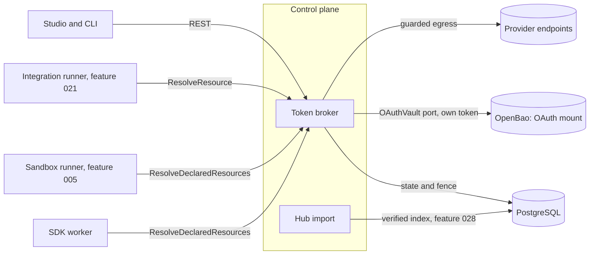

# OAuth resources and a curated integration hub

*   **Author:** Claude Code, for the owner
*   **Status:** In Review
*   **Date:** 2026-11-25

--------------------------------------------------------------------------------

## Overview

From release 0.3.0 a resource of [feature 021](../../specs/021-integration-resources-triggers/spec.md) can hold an
OAuth 2.0 credential. A person connects an account at a provider (the authorization-code grant, with PKCE), or the
platform obtains tokens for a tenant's machine client (the client-credentials grant).

A **token broker** in the control plane is the only component that talks to a provider's token, authorization,
revocation or userinfo endpoint. It keeps refresh tokens, client secrets and private keys in an OpenBao mount of its
own, under a token and a policy no other code path holds. It refreshes one credential at a time under a fence in
PostgreSQL. It gives an executor only what the executor's task definition declares: the resource's non-secret settings,
the secrets its slots bind, and for an OAuth credential a current access token. The executors are the integration
runner of feature 021, a sandbox runner for a script ([feature 005](../../specs/005-inline-code-sandbox/spec.md)) and an
SDK worker for an activity, so scripts and activities can declare a resource and use it, as in Windmill, the reference
product for the 0.3.0 parity scope.

The **integration hub** is a curated set of integrations kept in this repository under `hub/`. Each is reviewed by two
people, validated in continuous integration by the platform's own codecs, and signed into the release's index with
[feature 028](../../specs/028-developer-tooling/spec.md)'s machinery. An integration groups an OAuth provider
definition, resource types that narrow feature 021's operation kinds (fixed hosts, fixed authentication, named request
presets), and script and workflow templates. Importing creates drafts; an administrator publishes them. Nothing in an item
runs in the server.

The architecture is
[Architecture decision 0122](../adr/ADR-0122-oauth-tokens-are-held-by-a-broker-in-the-control-plane-and-executors-receive-only-a-current-access-token.md)
(the broker) and
[Architecture decision 0123](../adr/ADR-0123-hub-integrations-are-signed-data-that-specialise-closed-operation-kinds-and-are-imported-as-pinned-versions.md)
(the hub), both Proposed. The registers are in [research.md](../../specs/047-oauth-integration-hub/research.md); the
contracts, the data model with its statements and the timing table are under
[specs/047-oauth-integration-hub/](../../specs/047-oauth-integration-hub/). Principle numbers refer to
[the constitution](../constitution.md).

### Terms

Terms of this design:

- **Provider definition.** What the platform knows about an OAuth server: its endpoints and issuer, the client
  authentication methods it supports, its API hosts, its scope catalogue, whether it rotates refresh tokens, whether it
  sends the `iss` response parameter, how long an idle refresh token lives, where the account's identity comes from, and
  the extra authorization parameters allowed. Tenant-scoped, from the hub or authored.
- **Client registration (registration).** A client at a provider: its client identifier, the reference to its client
  secret or private key, its method and its redirect URI. Owned by a tenant, or by the deployment's operator and offered
  to tenants that opt in.
- **OAuth credential (credential).** The tokens of one grant: state, granted scopes, account subject, grant epoch, token
  revisions, fence. It belongs to a namespace; a feature 021 resource names it in a slot of shape `oauth_credential`.
- **Token broker (broker).** The control-plane module that runs the flows, refreshes, revokes and serves tokens.
- **OAuth vault.** An OpenBao KV version 2 mount of its own (`SAGAT_OAUTH_OPENBAO_MOUNT`), reached with a token of its
  own (`SAGAT_OAUTH_OPENBAO_TOKEN_FILE`) whose policy allows create, read and destroy on that mount only, through an
  application port only the broker uses.
- **Fence; grant epoch.** A counter on the credential row that every writer increases; a refresh activates only if the
  fence it acquired is still current. The grant epoch increases on every completed connection, so a refresh from an
  earlier connection is never adopted into a later one.
- **Hub index.** Feature 028's signed, versioned, expiring catalogue (Requirements 028-039 to 028-042), extended here with
  the item kinds `OAUTH_PROVIDER` and `INTEGRATION`, a definition of `RESOURCE_TYPE` items, and a `revoked` list.
- **Request preset.** A named request a hub resource type declares, evaluated by the integration runner's existing
  operation.

Terms of the platform:

- **Resource, resource type, slot, operation kind.** Feature 021: a resource is a namespace instance of a typed, versioned
  resource type; a slot is the part of its settings that binds a secret or a credential; the operation kinds
  (`http.request`, `graphql.execute`, the S3 set, `smtp.send`, `slack.postMessage`) are the closed set the integration
  runner executes.
- **Capability resolution.** Feature 021's two-phase `ResolveResource` call by which the integration runner gets what one
  operation needs, bound to the runner's lease-owning session (feature 021, `contracts/integration-runner.md`).
- **Ordinary delivery.** The worker gRPC call `ResolveSecrets`: an executor presents the task's capability token (a
  bearer credential for one attempt) and its own identity; the platform checks the tenant and namespace, the exact task,
  instance, attempt and generation (the attempt's lease counter), the caller's membership, its worker or activity
  binding, the pool-delivery policy and the publisher's secret access, then commits a value-free audit and returns the
  declared secrets (Principle V).
- **Instance registry and capability.** The record of what each control plane and engine can do, and the operator's
  audited activation of a requirement (Architecture decision 0082, Requirement 018-052). A binary that lacks a recorded
  requirement serves nothing.
- **Platform-operator surface.** The listener of Architecture decision 0074 (Proposed) through which platform operators
  act, separate from the tenant API.
- **Protocol minor.** The minor version of the worker protocol a session speaks.

## The Problem

Windmill's resources are typed JSON objects. A resource type with OAuth is connected from its UI; Windmill refreshes the
token on its server; a script receives the token inside the resource object. Its hub lets anyone publish resource types,
scripts and flows, and a workspace imports them, so many integrations need no code.

This platform today:

- Feature 021 (approved draft, re-baselined on 2026-11-24) offers resource types and resources with secret slots in
  OpenBao, a closed set of operations run by an isolated integration runner, and an auth scheme `oauth` whose slot names a
  credential of this design. Until this design's broker exists, that scheme is refused (`OAUTH_BROKER_UNAVAILABLE`).
  Resources are not usable by scripts or activities.
- Feature 028 (approved draft) designs a curated, signed index of workflow and script templates imported as drafts.
- A script or activity that needs an account at Google, Microsoft or GitHub carries a long-lived token as a secret that
  someone copied by hand, and nobody refreshes it.

What must hold, from the constitution: secret values never reach workflow state, the journal, logs, audit records,
telemetry or ordinary responses; an executor receives only what its immutable task definition declares, all or nothing,
after a value-free audit (Principle V); a provider can do an effect twice and the platform says so (Principle III);
outbound connections are guarded (feature 009); the hub has only signed sources, imports items as drafts and runs nothing
in the server (Delivery Constraints, as amended by version 5.0.0).

## Requirements

### Functional

#### Providers and registrations

- **Requirement 047-001** A tenant administrator (`oauth:client:manage`) MUST be able to author a provider definition,
  and register a client for any published provider. Endpoints MUST be https with public addresses; the definition MUST
  list its API hosts. The client secret or private key MUST be written to the OAuth vault and never returned; rotating it
  writes a new revision. *Acceptance:* the REST contract tests; `canaries_never_leave_the_broker`.
- **Requirement 047-002** A platform operator (`oauth:offer:manage`, on the platform-operator surface) MUST be able to
  create a deployment registration for a published hub provider and offer it to named tenants. A tenant administrator
  opts in and may opt out; the operator may withdraw. Withdrawal and opt-out stop new connections at once, stop refreshes
  after 7 days, then disconnect and revoke the credentials made with it. A deployment registration MUST NOT serve the
  client-credentials grant. A registration not offered to a tenant answers like a missing one. *Acceptance:*
  `offer_opt_in_opt_out_and_withdrawal`, `a_registration_not_offered_is_not_found`,
  `client_credentials_on_a_deployment_registration_is_refused`.
- **Requirement 047-003** The client authentication methods MUST be `client_secret_basic`, `client_secret_post` and
  `private_key_jwt` (RFC 7523: ES256 or RS256, one key per registration, `aud` the provider's issuer, a fresh `jti`, at
  most 60 s of validity). *Acceptance:* each method against the local OAuth test server.

#### The authorization-code grant

- **Requirement 047-004** A person with `oauth:credential:manage` on the namespace MUST be able to connect an account to
  a credential that is not disconnecting or disconnected: the API creates a single-use authorization request (a `state`
  of 32 random bytes stored as its SHA-256, a sealed PKCE S256 verifier, the person, the credential's own registration, the
  requested scopes, a checked return path, an expiry of 10 minutes) and returns the provider's authorization URL.
  *Acceptance:* `authorization_code_flow_end_to_end`.
- **Requirement 047-005** The callback MUST be accepted only when all of these hold, checked in this order; otherwise it
  is refused before any token request:
  1. the Studio's callback page posts `code`, `state` and `iss` with the person's own credentials, to the tenant of the
     request;
  2. the `state` is known, unused, unexpired, of that tenant, and was started by the same person, for the registration the
     callback path names;
  3. `iss` equals the provider's issuer, and is present when the definition says the provider sends it (RFC 9207);
  4. the person still holds `oauth:credential:manage`, the credential is not disconnecting or disconnected, and an offered
     registration is still opted in.

  *Acceptance:* one test per refusal, including `a_forged_callback_with_another_persons_state_is_refused` and
  `a_code_from_another_registration_is_refused`.
- **Requirement 047-006** The exchange MUST send the verifier and the exact redirect URI, accept only a bearer token type,
  validate an `id_token`'s `iss` and `aud` before reading its subject, record the granted scopes (the requested ones when
  the response omits them), refuse a grant without a scope the resource type marks required, and write the tokens to the
  vault before the credential becomes `ACTIVE`. *Acceptance:* the crash tests of the Verification Plan.
- **Requirement 047-007** A reconnect MUST keep the account: when the definition names an account subject, a callback that
  yields another subject is refused (`OAUTH_ACCOUNT_CHANGED`); when it names none, a reconnect of a credential that has
  been active is refused, and the person connects a new credential. Moving a resource to a new credential is a new
  resource revision under feature 021's rules. *Acceptance:* `a_reconnect_to_another_account_is_refused`.

#### The client-credentials grant

- **Requirement 047-008** A client-credentials credential is created `ACTIVE` with no token, on a tenant registration
  only; its tokens come from the broker, one request at a time per credential. Feature 021's `oauth` scheme MUST receive
  the access token, never the client secret. *Acceptance:* feature 021's `http.request` with an `oauth` slot against the
  local OAuth test server; `the_first_client_credentials_token_is_acquired`.

#### Refresh, revocation and state

- **Requirement 047-009** At most one refreshed token set MUST be activated per fence value, and a second token request
  for a credential MUST NOT start before the first one's lease has lapsed. Once a provider has answered, the broker MUST
  store what it answered before anything else. *Acceptance:* `two_control_planes_refresh_once`,
  `a_holder_paused_past_its_lease_activates_nothing`, `a_disconnect_between_answer_and_store_revokes_the_new_token`,
  `a_withdrawn_offer_cannot_be_opted_into`.
- **Requirement 047-010** Two thresholds govern freshness: an access token is delivered only while it is valid for at
  least 60 s more, and a refresh is due when it is valid for less than 120 s. A caller that finds a refresh in flight and
  no deliverable token waits at most 10 s, acquiring itself if the holder's lease lapses, then fails retryable.
  *Acceptance:* the waiter tests.
- **Requirement 047-011** A refresh refused with `invalid_grant` MUST move the credential to `NEEDS_REAUTHORIZATION`,
  audit it and report it to the namespace's holders of `oauth:credential:manage`; a step that needs it fails retryable
  with `RESOURCE_REAUTHORIZATION_REQUIRED`, so it waits under its retry policy (and fails when that policy is exhausted)
  until the same account is connected again. Repeated `invalid_client` answers
  (three within 10 minutes) mark the registration `BROKEN`; a step fails the same way until an administrator rotates the
  registration's secret. *Acceptance:* `the_next_attempt_after_reconnecting_succeeds`,
  `a_rotated_secret_restores_a_broken_registration`.
- **Requirement 047-012** For a provider whose refresh tokens expire when idle, a pass MUST refresh a credential whose
  refresh token has not been used for half that lifetime. *Acceptance:* `keep_alive_refreshes_idle_tokens`.
- **Requirement 047-013** Disconnecting a credential, or deleting with a disconnect request the last resource revision
  that names it, MUST move it to `DISCONNECTING` in that transaction. A pass MUST then, once no refresh lease is held,
  revoke at the provider (RFC 7009) every refresh revision of the credential that has a vault entry, pending ones
  included, record the outcome (`REVOKED`, `NOT_SUPPORTED`, or `UNKNOWN` after the last attempt), destroy every revision
  and end in `DISCONNECTED`. A `PENDING` revision stored after that (a holder whose lease lapsed during its call) MUST
  be revoked and destroyed by the sweeper, which takes every `PENDING` row of a `DISCONNECTING` or `DISCONNECTED`
  credential and every `PENDING` row older than the lease plus the store deadlines; such a late row downgrades
  `revocation_outcome` until it is revoked, and is audited. *Acceptance:* `disconnect_revokes_every_refresh_revision`,
  `revocation_with_the_provider_down_ends_unknown`, `a_holder_crashing_after_a_late_store_leaves_no_live_token`.

#### Delivery to executors

- **Requirement 047-014** A `script` node, an `activity` node and a `resourceOperation` node MAY declare resources by name
  (at most 8); the declaration is part of the immutable task definition. Publication and admission MUST check what
  feature 021's resolution checks: the publisher's and the initiator's `resource:use`, `resource:effect` (always for a
  declaration on a script or an activity, because a raw token can do any effect), the slots' secret-access rules, the
  resource's state, the credential's state and scopes. *Acceptance:* the publication refusals; admission pinning.
- **Requirement 047-015** An executor MUST receive declared resources only through the delivery of Technical Plan 5: all or
  nothing, the same checks again at delivery and after the vault read and any token request, and a value-free audit
  committed before values return. It receives settings, the secrets its slots bind, and for an OAuth credential the access
  token and its expiry; never a refresh token, client secret or private key. *Acceptance:* `canaries_never_leave_the_broker`,
  `a_stale_lease_receives_nothing`, `a_revoked_initiator_receives_nothing`.
- **Requirement 047-016** An attempt MAY call delivery at most twice with every declared resource (its start and one
  retry) and re-ask for one resource at most 30 times per hour of the attempt's life and once per 10 s per resource,
  counted in the database. A re-ask may ask for a refresh after the provider refused the token (`forceRefresh`), which
  the broker honours once per access revision. A
  refused ask fails with `RESOURCE_ASK_LIMIT` (retryable for the step). *Acceptance:*
  `re_asks_are_bounded_across_control_planes`.
- **Requirement 047-017** The six SDKs MUST expose the same `resource(name)` call and the script shims the same host call;
  an activity that declares resources is leased only to a session at this design's protocol minor or later; a test run of
  a script never receives a resource (its `resource` call is refused with `SCRIPT_DENIED`, reason `RESOURCES_IN_TEST_RUN`,
  and audited). *Acceptance:* the SDK conformance
  scenario `resource_access`; `an_old_session_is_not_offered_a_declaring_activity`; `a_test_run_cannot_use_a_resource`.
- **Requirement 047-018** An `oauth_credential` slot MUST bind only in a resource whose hosts are among the credential's
  provider's API hosts, and binding it needs `oauth:credential:manage`, audited. *Acceptance:*
  `a_credential_cannot_be_bound_to_a_foreign_host`.

#### The hub

- **Requirement 047-019** The hub's items MUST live in this repository under `hub/`, each with a review record naming two
  reviewers, validated in continuous integration by the platform's own codecs (`contract_integration_hub`) and signed into
  the release's index. *Acceptance:* the suite refuses an item with an operation kind outside the closed set, a host that
  is not https, a host pattern outside Technical Plan 7, an undeclared scope, a template with a secret value.
- **Requirement 047-020** The index MUST follow feature 028's format and verification (Requirements 028-039 and 028-040),
  with the kinds `OAUTH_PROVIDER`, `RESOURCE_TYPE` (when feature 021 is enabled), `SCRIPT`, `WORKFLOW` and `INTEGRATION`,
  and a `revoked` list of item digests with a class (`security` or `other`). Revocations travel in any configured index,
  including a revocations-only index the release publishes. *Acceptance:* feature 028's index tests with the new kinds and
  the list.
- **Requirement 047-021** Importing MUST create drafts through feature 028's routes: draft provider and resource-type
  versions (with `hub:import`), workflow and script drafts (with feature 028's permissions), each with provenance. An
  integration's parts are imported in one transaction under one request key; the same key and body return the first
  answer, the same key with another body is `IDEMPOTENCY_KEY_REUSED`, an item version already imported with another
  digest is `HUB_DIGEST_CONFLICT`. A draft provider or resource type is usable only once a holder of `hub:publish`
  publishes it, after the authored checks. *Acceptance:* the import tests.
- **Requirement 047-022** A hub resource type MUST narrow one of feature 021's operation kinds: fixed hosts or one bound
  host pattern (Technical Plan 7), a fixed authentication scheme, a narrowed settings schema, presets whose path variables
  are single encoded segments and whose effect class is the kind's or stricter. *Acceptance:*
  `a_preset_parameter_cannot_change_the_path`, `a_preset_cannot_weaken_the_effect_class`.
- **Requirement 047-023** A newer hub version MUST NOT change an existing resource. A revoked item MUST NOT be importable
  or publishable. A `security` revocation MUST block new admissions of steps whose resources pin a published version of
  it and refuse its deliveries to runs already admitted, with a finding, until an operator lifts it; an `other` revocation gives a finding only. *Acceptance:*
  `a_security_revocation_blocks_new_admissions`, `an_other_revocation_is_a_finding`.
- **Requirement 047-024** The release's hub MUST contain GitHub, Google, Microsoft Graph and the generic OAuth 2.0 API
  template; Slack, Atlassian, Salesforce, HubSpot, Notion and Zoom follow as content tasks of the release
  ([integrations.md](../../specs/047-oauth-integration-hub/contracts/integrations.md)). *Acceptance:* each passes the
  contract suite and its recorded-response tests; a real-provider run is recorded where credentials exist, a gap where not.

#### Cross-cutting

- **Requirement 047-025** The capability `oauth-broker-v1` of control planes and engines, activated by the operator, MUST
  switch the feature on. Without it the `oauth` scheme keeps feature 021's refusal (`OAUTH_BROKER_UNAVAILABLE`),
  declarations on scripts and activities are refused at publication, and imported providers can be drafts and published
  but not used. *Acceptance:* `without_the_capability_declarations_are_refused`.
- **Requirement 047-026** Telemetry and audit MUST follow [telemetry.md](../../specs/047-oauth-integration-hub/contracts/telemetry.md);
  errors MUST be typed and value-free, and a provider's error body MUST NOT reach a response, only its RFC 6749 `error`
  code from a closed list. *Acceptance:* the error contract tests; `metric_labels_are_closed`.
- **Requirement 047-027** The Studio MUST offer registrations, the connect button and the callback page, credential state
  with reconnect and disconnect, the hub browser, import and publication; the CLI MUST list and import hub items and show
  credential states. *Acceptance:* the Studio journey tests and the CLI contract tests.

### Non-functional

- **Non-functional requirement 047-001 (custody)** Refresh tokens, client secrets and private keys are readable only by the
  broker. *Acceptance:* `canaries_never_leave_the_broker` over every executor answer, log, span, journal entry, audit
  record and metric; `ordinary_token_is_refused_on_the_oauth_mount` against a real OpenBao.
- **Non-functional requirement 047-002 (latency targets, to be measured)** Delivery of a deliverable access token adds at
  most 10 ms over today's secret delivery on the development machine; a refresh adds the provider's latency plus at most
  50 ms. Benchmark criteria, not promises. *Acceptance:* the benchmark of Task 047-21.
- **Non-functional requirement 047-003 (bounds)** The bounds and timings are in
  [timings.md](../../specs/047-oauth-integration-hub/contracts/timings.md). *Acceptance:* the bound fixtures of Tasks
  047-3, 047-6 and 047-7.
- **Non-functional requirement 047-004 (telemetry)** No tenant, namespace, resource, provider, registration or credential
  identifier in a metric label. *Acceptance:* `metric_labels_are_closed`.

### Success criteria

- **Success criterion 047-001** A person connects a Google account in the Studio, a script reads a sheet with the token,
  the token is refreshed while a workflow waits a day, and no executor ever held the refresh token.
- **Success criterion 047-002** The race, crash, canary and cross-tenant tests pass on real PostgreSQL and OpenBao.
- **Success criterion 047-003** The four integrations required by Requirement 047-024 import and publish into a fresh
  tenant and each one's recorded-response test passes.

### User stories

- **User story 047-01** An integrator connects an account and uses it from a `resourceOperation` node, a script and an
  activity (Journeys 1 and 2).
- **User story 047-02** An administrator registers the tenant's client, or opts into the operator's (Journey 3).
- **User story 047-03** A developer imports a curated integration, and an administrator publishes it (Journey 4).
- **User story 047-04** An operator survives a lost refresh token and a revoked hub item (Journeys 5 and 6).

## Goals

- Windmill's OAuth and hub convenience with stronger custody: refresh tokens and client secrets never leave the broker;
  refresh is single-flight; every disclosure is declared and audited.
- Scripts and activities use resources, which feature 021 left out of its scope.
- A hub that adds integrations as reviewed, signed data, not code.

## Non-Goals

- Signing people into the platform with OAuth (feature 013).
- Token exchange to narrow a token per step (RFC 8693), sender-constrained tokens (RFC 9449, RFC 8705), mutual-TLS client
  authentication and dynamic client registration (RFC 7591): Gaps 047-001 to 047-003.
- An open marketplace, tenant publishing, ratings or payments.
- Notification channels of feature 026, which keep their own credentials in 0.3.0 (Gap 047-004).

## Open Questions

None blocks the design. Principle V listed two declared sets an executor may read; delivering a declared resource (to a
script, an activity, or feature 021's integration runner) is a third, worded in Technical Plan 12. Constitution 5.0.0
(pull request #275, merged) admits the curated hub, and the owner approved the third declared set for constitution 5.1.0
(Owner decision 2026-11-25-3), drafted from Technical Plan 12's wording. This design's approval is conditional on 5.1.0
merging: until it merges, no task of this design that delivers a declared resource is built, and feature 021's
integration runner waits on the same clause (feature 021, Decision 021-022).

## Owner decisions needed

None open. The design follows Owner decision 2026-11-24-1, the 5.0.0 amendment (Owner decision 2026-11-24-2) and the
third declared set of 5.1.0 (Owner decision 2026-11-25-3); its choices were taken under Owner decisions 2026-11-20-6 and
2026-11-24-4 and are recorded as Decisions 047-001 to 047-061 in research.md, with the register's literal marker
"delegate (OD-2026-11-24-4)". Architecture decisions 0122 and 0123 are accepted with the approval of this design, under
Owner decision 2026-11-24-4 (Owner decision 2026-11-24-320), on the approval rule of Owner decision 2026-11-25-2 (pull
request 284).

## Critical User Journeys (CUJs)

The heading is the template's; the journeys are numbered in words.

### Journey 1: Connect a Google account and read a sheet from a script

*   **Given**: a tenant that imported and published the Google integration and registered its own client; a deployment
    with `oauth-broker-v1` activated.
*   **When**: an integrator creates a credential, presses Connect, consents at Google, binds the credential in a
    `google_sheets` resource, and publishes a Python script that declares the resource and reads a range.
*   **Then**: the Studio shows the credential `ACTIVE` with the granted scopes and the account; each run's script gets the
    access token at start; the audit shows a value-free disclosure per attempt; the refresh token stays in the vault.

### Journey 2: A workflow waits a day, then calls Microsoft Graph

*   **Given**: a run that sleeps 24 hours and then runs the preset `sendMail` on a Microsoft Graph resource.
*   **When**: the step is leased.
*   **Then**: the access token (lifetime about an hour) has expired. The broker refreshes once, however many steps ask,
    stores the rotated refresh token before activating it, and the integration runner receives the new access token.

### Journey 3: The operator offers a shared client

*   **Given**: a deployment whose operator registered one Slack app for its tenants.
*   **When**: the operator offers it and a tenant administrator opts in.
*   **Then**: the tenant's people connect Slack workspaces with that app; the tenant never sees the app's secret. When the
    tenant opts out, new connections stop at once, and seven days later its credentials made with that app are
    disconnected and revoked.

### Journey 4: Import and publish an integration

*   **Given**: the release's hub with the GitHub integration.
*   **When**: a developer reads its description and requirements in the Studio and imports it; an administrator publishes
    the provider and the resource type.
*   **Then**: the tenant has the provider and the `github` resource type as published versions with provenance, and two
    workflow templates as drafts; the import listed what to prepare (a registration at GitHub, the egress host
    `api.github.com`); nothing ran.

### Journey 5: A refresh token is lost

*   **Given**: a credential at a provider that rotates refresh tokens and revokes the family on reuse.
*   **When**: a control plane dies after the provider answered a refresh and before the answer was stored, and the next
    refresh uses the old refresh token.
*   **Then**: the provider answers `invalid_grant`; the credential becomes `NEEDS_REAUTHORIZATION`; its managers are told;
    steps that need it fail retryable and wait; a person reconnects the same account and the next attempts succeed.

### Journey 6: A hub item is revoked for security

*   **Given**: a tenant that published the HubSpot resource type 1.2.0.
*   **When**: the release's revocations index revokes 1.2.0 with class `security` and adds 1.2.1.
*   **Then**: 1.2.0 cannot be imported or published again; new admissions of steps whose resource pins it are refused; the
    tenant's version gets a finding with the reason; resources move to 1.2.1 by a new revision; an operator can lift the
    block, audited.

## Technical Plan (Architecture)

### 1. Components



The broker is a module of the control plane's application layer (`crates/application/src/oauth/`) with one adapter,
`crates/infra-oauth`, that builds and sends token, revocation, userinfo and client-assertion requests through
`crates/infra-egress` and parses responses in a bounded, closed way. The OAuth vault is the application port `OAuthVault`,
implemented in `crates/infra-secrets` with the second mount, the second token and a reference type ordinary delivery cannot
build. Waiting and deadlines go through a `Waiter` port implemented in `apps/control-plane`, so the application stays
free of a runtime; the passes are loops in `apps/control-plane` that call application functions, each claiming its batch
with `FOR UPDATE SKIP LOCKED`.

The broker runs inside the control plane, not as a separate service, because it needs what the control plane already
holds (the database, the egress client, the audit path) and no tenant code runs there. A separate service would add a
process, a credential and a network path for an isolation gain that the port boundary and the separate OpenBao token and
policy already give. It can be split out later, after measurement (Principle II).

### 2. Data

The tables, their keys and the statements are in
[data-model.md](../../specs/047-oauth-integration-hub/data-model.md). Tenant tables have `tenant_id` first in every key;
deployment registrations and offers are separate tables (`oauth_deployment_registrations`, `oauth_deployment_offers`) with
no tenant column. Vault references are `oauth/<tenant>/credentials/<credential>/<revision>`,
`oauth/<tenant>/registrations/<registration>/<revision>` and `oauth/deployment/registrations/<registration>/<revision>`,
each written once and destroyed after it is retired. Migrations take timestamps after `20270119000000`, allocated by the
coordinating session.

### 3. The authorization-code flow

```mermaid
sequenceDiagram
    participant U as Person (Studio)
    participant API as Control plane
    participant P as Provider
    participant V as OAuth vault
    U->>API: POST authorizations {credential, scopes, returnTo}
    API->>API: state, sealed verifier, expiry 10 min, person (commit)
    API-->>U: authorization URL
    U->>P: consent
    P-->>U: redirect to /studio/oauth/callback/{registration}?code&state&iss
    U->>API: POST callback {registration, code, state, iss} (person's token)
    API->>API: one statement checks and marks the state (commit)
    API->>P: token request (code, verifier, redirect URI, client authentication)
    P-->>API: tokens
    API->>API: pending revision rows (exchange origin, expiry, scopes)
    API->>V: write the revisions; mark them written
    API->>API: complete under the fence: ACTIVE, grant epoch + 1 (commit, audit)
    API-->>U: credential state
```

- The redirect URI of a registration is `<Studio origin>/studio/oauth/callback/<registration>`, built like the Studio's
  OIDC callback from the configured Studio origin; the person registers it at the provider. The callback page removes
  `code` and `state` from the address bar before any other request, sends `Referrer-Policy: no-referrer`, and is kept out
  of front-end telemetry.
- The callback's check and mark are one statement with the tenant, the state hash, the registration, the person, unused
  and unexpired as predicates. A repeat by the same person after success returns the credential's state; anything else is
  `409 OAUTH_STATE_INVALID`. The state is checked before `iss`, so a refused callback reveals nothing about another
  registration.
- The verifier is sealed with the application key ring of feature 009 (AES-256-GCM; the tenant and the request as
  associated data). The return path must be a path inside the Studio: it starts with `/studio/`, has no scheme, no `//`,
  no `\`, no encoded separator, and is compared after normalising.
- The account subject comes from where the definition says: an `id_token` received from the token endpoint over TLS (its
  `iss` and `aud` checked), a userinfo field, a token-response field, or none. It is stored as an HMAC under the tenant, with
  a display label classified `pii` (feature 016) that never enters audit records, spans or logs.
- A control plane that dies after the token response and before the store leaves the request used and the credential
  unchanged; the hourly broker pass finds used requests with no completed exchange after 10 minutes and writes
  `oauth.authorization.incomplete`; the person connects again.

### 4. Freshness, refresh and the fence

An access token is **deliverable** while it is valid for at least 60 s more and a refresh is **due** when it is valid for
less than 120 s. Expiry is the database time of the statement that stored the token plus `expires_in` (the definition's
`defaultLifetimeSeconds`, or one hour, when the response has none).

Every writer increases the fence with a state predicate, so a person's disconnect or reconnect never fails because a
refresh moved the fence; only a refresh's activation compares the fence it acquired. Terminal states (`DISCONNECTING`,
`DISCONNECTED`) refuse connections, callbacks and acquires. Every statement takes the credential row first, and any
transaction that also touches feature 021's resource rows takes the credential row before them.

A refresh (the statements are in data-model.md):

1. **Acquire.** The broker reads its monotonic clock, then one statement increases the fence and sets a 30 s lease if the
   credential is `ACTIVE`, its registration is usable (an offered one still opted in), the access revision is the one the
   caller saw (`IS NOT DISTINCT FROM`, so a client-credentials credential with no token yet acquires), no unexpired lease
   is held, and the registration's and the tenant's request windows have room. A caller that acquires nothing rereads the
   row.
2. **Adopt.** A `PENDING` refresh revision of the same grant epoch from an earlier fence whose vault write is marked, or
   whose write-once vault reference is present when probed, is activated instead of calling the provider. A row whose
   reference is absent is marked abandoned.
3. **Call** the token endpoint, only if less than 15 s have passed since before the acquire on a clock that keeps counting
   while a virtual machine is suspended (`CLOCK_BOOTTIME` on Linux), with a deadline of 10 s. A timeout is an unknown outcome: the provider may have rotated the token (Gap 047-007).
4. **Store**, unconditionally once the provider answered: insert `PENDING` rows (origin `REFRESH`, the held fence, the
   grant epoch, the expiry and scopes), write the vault (5 s per write), mark the rows written. If the writes would end later
   than 25 s after the acquire, the holder extends its lease once by a statement that compares its fence; the store goes on
   either way.
5. **Activate**, one transaction: where the tenant, the credential, the held fence and the state `ACTIVE` match, point to
   the new revisions, set the expiry, clear the lease, retire the old and every lower-fence pending row. If no row matches:
   when the credential is `DISCONNECTING` or `DISCONNECTED`, the holder revokes the new refresh token itself and retires
   it; otherwise the pending rows stay for adoption.
6. A holder that fails clears its own lease with a statement that compares its fence.

Provider answers: `invalid_grant` moves the credential to `NEEDS_REAUTHORIZATION`; `invalid_client` and
`unauthorized_client` count toward `BROKEN` (three within 10 minutes) and leave the credentials as they are; `invalid_scope`
fails the step with `OAUTH_SCOPE_INSUFFICIENT`; `429`, `temporarily_unavailable`, `server_error` and transport failures are
retryable, honouring `Retry-After`. Request windows are rows in PostgreSQL per registration (4 in flight, 10 per second)
and, on a deployment registration, per tenant (1 in flight and 10 divided by the number of opted-in tenants per second,
at least 1), so neither control planes nor tenants multiply the limit; a caller past the window waits like a waiter. A
request in flight is an unexpired lease, counted from the credential rows of the registration (`lease_until > now()`)
under the registration's window row lock, never a counter, so a crashed holder frees its slot when its lease lapses. Every broker call to a registration goes
through the windows: refreshes, code exchanges, userinfo calls and the revocation pass's calls.

Waiters poll the credential row with a backoff from 200 ms to 1 s for at most 10 s, acquire themselves once the holder's lease lapses, and fail
at once when the state leaves `ACTIVE`. The keep-alive pass reads `refresh_used_at`. A provider refusal reported by an executor (an `AUTHENTICATION` failure of feature 021, or a `forceRefresh` re-ask) marks
the access revision stale, so the next delivery refreshes. With the default limits a registration allows 10 refreshes
per second, which with one-hour tokens covers tens of thousands of active credentials; the benchmark of Task 047-21
measures it. A sweeper destroys retired and abandoned refresh revisions in the vault only: it never revokes them at the provider,
because a provider that returns the same refresh value on refresh, or revokes the whole grant when any of its tokens is
revoked, would lose the live grant. The provider is called only on a disconnect (Requirement 047-013), and for an
abandoned revision only when its value hash differs from the active one's and the provider definition declares
`revocation: "per-token"`. A credential holds at most 8 revisions not destroyed, and past that a refresh fails
retryable with an alarm. Tests drive the monotonic clock and the waiter through injected test doubles of the
`Waiter` port, never sleeps.

### 5. Delivery

The declared resources of a task definition are part of the immutable definition. At delivery the broker runs feature
021's resolution checks, the same function, for each declared resource: tenant and namespace scope; the exact task,
instance, attempt and generation, the capability token and an unexpired lease; the caller's membership, binding and
pool-delivery policy; the publisher's and the initiator's `resource:use` and `resource:effect`; each slot's secret access;
the resource's state; the credential's state, registration and scopes. It reads the pinned revision's settings, the slots'
secrets and the deliverable access token (refreshing first when it is due), repeats the checks after the vault read and
after any token request, commits a value-free disclosure audit, then returns. A failed check or audit refuses the whole
set.

- **Integration runner (feature 021).** `ResolveResource`, bound to the runner's lease-owning session as feature 021
  specifies, asks the broker in its second phase with no transaction open.
- **Scripts.** The sandbox runner calls the worker gRPC method `ResolveDeclaredResources` before it starts the script, as
  it calls `ResolveSecrets` today, and adds every token to the run's redaction set. A mid-run ask is the `resource` host
  call of the shim protocol, which the supervisor forwards as `ResolveDeclaredResources` for one resource; the supervisor
  adds the new token to the redaction set before answering. Test runs are refused.
- **Activities.** The same method, in the limit class `resource_delivery` (stated in `sdks/SPEC.md`), under this design's
  protocol minor; the six SDKs expose `resource(name)`.

Scripts and activities use ordinary delivery's binding: the capability token as a bearer credential with the caller's own
authorities. The integration runner uses feature 021's session binding. The method's messages are in
[resource-delivery.md](../../specs/047-oauth-integration-hub/contracts/resource-delivery.md). Counting is one per-attempt
row (`oauth_delivery_attempts`: full calls, re-asks) and one per-resource time, each changed by one conditional increment;
the broker's daily pass deletes the rows of attempts finished more than 7 days ago.

Step-facing codes are feature 021's vocabulary with three rows this design adds there
([errors.md](../../specs/047-oauth-integration-hub/contracts/errors.md)): `RESOURCE_REAUTHORIZATION_REQUIRED`
(retryable), `OAUTH_SCOPE_INSUFFICIENT` (not retryable) and `RESOURCE_ASK_LIMIT` (retryable).

### 6. Providers, registrations, offers and egress

A provider definition is checked on write and on publication: https endpoints with public addresses, API hosts, a scope
catalogue of at most 200, the closed set of methods, the subject source, the extra parameters. A tenant authors one
(`oauth:client:manage`, which also publishes it) or imports one (`hub:import`, published by `hub:publish`). A deployment
registration belongs to the platform operator and names a hub provider version the operator imported at deployment scope;
until Architecture decision 0074 is accepted, deployment registrations and offers are refused, and tenant registrations do
not wait for it. A registration's secret or key is written to the vault by the broker as the system actor `oauth-broker`;
it is not a namespace secret and is bounded by the registration quota.

Every broker call for a credential is checked against the egress policy of the credential's namespace
(`crates/application/src/egress.rs`; deny by default), intersected with the hub item's hosts when the provider is a hub
item; connecting refuses a provider whose endpoints that policy does not allow; redirects are never followed. The calls
are those clause 11(e) of Architecture decision 0055 places in the broker (RFC 6749 grants), plus RFC 7009 revocation and
an OIDC userinfo call, which Architecture decision 0122 adds to that clause.

### 7. The hub

The hub's source is `hub/` in this repository, beside feature 028's `templates/catalog/`; the release build signs one
index from both, and publishes a revocations-only index signed with the same key, which deployments configure as an
operator index by default (the Helm value names it; an operator may remove it).

```text
hub/
  README.md
  integrations/<slug>/
    integration.json        # title, summary, maintainer, licence, requirements, parts
    oauth-provider.json     # optional
    resource-types/*.json   # narrowings of feature 021's operation kinds
    templates/              # script templates (with manifests, design 046) and workflow templates
    review.md               # the two reviewers, the date, what was checked
    fixtures/               # recorded provider responses for the contract suite
```

Item schemas are in [hub-items.md](../../specs/047-oauth-integration-hub/contracts/hub-items.md); the codecs live in
`crates/infra-schema` behind the application port `HubItemCodec`.

- **Hosts.** Fixed https hosts, or one host pattern with a single leftmost-label wildcard under a fixed registrable
  domain (`*.my.salesforce.com`), bound once per credential from the token response (`instance_url`, which must be an https
  origin with no port, user information or path) or the registration (a Microsoft directory identifier, one path segment of
  a closed syntax), and never from step input.
- **Presets.** A method, a path template whose variables are typed parameters, query and body templates under the existing
  expression evaluator. Each path variable is percent-encoded as exactly one segment; dot segments are refused; the
  normalised path must match the template. The effect class is the operation kind's for that method or stricter; an effect
  preset states whether the provider deduplicates and by which header (Principle III).

Import and publication use feature 028's routes and module (`crates/application/src/templates.rs`, Tasks T028-062 to
T028-066), which this design extends with the two kinds, the `revoked` list and the tenant-wide import of providers and
types. A `security` revocation writes a block (`hub_item_blocks`) through a definer function the runtime role may call
during an index refresh; lifting a block is an operator act on the platform-operator surface, and until Architecture
decision 0074 is accepted it is the schema-owner command `control-plane hub unblock <digest>`, as Architecture decision
0082's operator commands are.

### 8. Where the code goes

| Part | Place | Action |
|---|---|---|
| Credential state machine, provider and registration rules | `crates/domain/src/oauth.rs` | Create |
| Broker, flows, delivery; `OAuthVault`, `HubItemCodec` and `Waiter` ports | `crates/application/src/oauth/` | Create |
| Hub import, publication, revocation | `crates/application/src/templates.rs` (feature 028's) | Modify |
| Pass loops and the `Waiter` implementation | `apps/control-plane` | Modify |
| Token, revocation, userinfo and client-assertion requests | `crates/infra-oauth` (new adapter crate) | Create |
| The OAuth vault: second mount, second token, reference type | `crates/infra-secrets/src/openbao.rs` | Modify |
| Hub item codecs | `crates/infra-schema/src/hub/` | Create |
| Presets | `crates/infra-integrations` (feature 021's) | Modify |
| IR declarations on `script` and `activity` nodes | `crates/infra-ir/src/convert.rs`, `crates/infra-ir/src/diff.rs`, `crates/domain` (node types) | Modify |
| Publication and admission checks | `crates/application/src/publishing.rs`, `crates/application/src/runs/` | Modify |
| Tables | `crates/infra-postgres` (migrations, `storage-classification.json`) | Create, Modify |
| REST and route registration | `crates/api-http/src/routes/oauth.rs`, feature 028's template routes, `crates/api-http/src/lib.rs` | Create, Modify |
| `ResolveDeclaredResources` | `crates/api-grpc/src/{service,limits}.rs`, `specs/001-platform-foundation/contracts/worker.proto` and its baseline, the SDKs' proto copies, `sdks/SPEC.md` | Modify |
| Script host call and redaction | `crates/infra-sandbox/src/protocol.rs`, `apps/sandbox-runner/src/{lib,host}.rs`, the shims in `runners/` | Modify |
| SDKs | `sdks/{typescript,go,python,dotnet,java,rust}` | Modify |
| Studio and CLI | `frontend/apps/studio/src/features/{oauth,hub}/`, the callback route, `apps/cli` | Create, Modify |
| OpenBao policy and token provisioning | `infra/helm`, `infra/docker` (with feature 015's OpenBao service), `docs/runbooks/oauth-and-hub.md` | Modify |
| Hub content | `hub/` | Create |

`scripts/check-architecture.py` gains rules with negative tests: the string literal `"grant_type"` (found with the script's
existing Rust string-literal scan) appears only in `crates/infra-oauth`, with one recorded exemption (feature 021's Google
Pub/Sub and Azure Service Bus connector credentials in `crates/infra-integrations`); the `OAuthVault` port is named only in
`crates/application/src/oauth/`, its implementation in `crates/infra-secrets` and the composition root. A test with a
barrier inside the OAuth test server checks `pg_stat_activity` that no transaction of the broker is open during a token
request. These are listed in Architecture decision 0122's "Enforced by".

### 9. Composition with other features

- **021:** resources, types, slots, the integration runner and `ResolveResource` are feature 021's. This design provides
  the credential its `oauth` scheme names, the binding rule of Requirement 047-018, the `hub` source of its type catalogue,
  presets, declarations on scripts and activities, and three step-facing codes. It depends on feature 021's Tasks
  T021-005, T021-012, T021-017, T021-023 and T021-085 (feature 021, Gap 1152), and Task 047-1 edits feature 021's
  `error-reasons.md`, `integration-runner.md` and `resource-types.md` accordingly.
- **028:** the index machinery and routes are feature 028's; this design waits for Tasks T028-062 to T028-066.
- **017 and 015:** the OpenBao client is feature 017's; OpenBao in the compose is feature 015's; the tests start their own
  OpenBao container, as feature 017's do.
- **046:** script templates carry manifests and resolve under the namespace's supply-chain policy when published.
- **026:** notification channels keep their own credentials (Gap 047-004).
- **043:** an imported workflow draft's `inputSchema` is checked at publication like any other.

### 10. Telemetry and audit

Metric and audit names are in telemetry.md, split by builder. Labels are closed; tenant, namespace, resource, provider,
registration and credential identifiers are span attributes. Audit records are value-free and never carry the account
label.

### 11. Contracts

REST routes, permissions and errors: [rest-api.md](../../specs/047-oauth-integration-hub/contracts/rest-api.md); delivery:
resource-delivery.md; hub items: hub-items.md; the initial integrations: integrations.md; errors per path: errors.md;
timings and bounds: timings.md; telemetry: telemetry.md.

### 12. The constitutional condition

This design proposes the following text for Principle V, as a third bullet of the executor-read exception, and the
replacement of the sentence that begins "Both paths":

> - A declared resource may disclose, to the executor of a step whose immutable task definition declares it, the
>   non-secret settings of its pinned revision and the values its slots bind at that revision: their secrets, and for an
>   OAuth credential only its current access token, never a refresh token, client secret or private key. The authenticated
>   caller's current membership, worker/activity binding and pool-delivery policy, the publisher's and initiator's
>   permission to use the resource and to cause effects through it, and the secret-access rules of its slots MUST
>   authorize that disclosure. Delivery to a managed integration runner is bound like managed database delivery; delivery
>   to an ordinary worker or a sandbox runner is bound like ordinary delivery.
>
> Every path MUST validate current tenant/namespace scope, exact task/instance/attempt identity, generation, matching
> capability token and unexpired lease. Ordinary delivery uses that token as a bearer capability together with the
> current caller's authorities above; it does not additionally bind disclosure to the original lease-owning worker
> session. Managed delivery (database and integration runner) MUST also verify the recorded lease-owning executor subject
> and live session.

The rest of the principle (revalidation after provider input or output, the value-free audit before values, fail closed)
applies unchanged to all three. Feature 021's integration runner needs the same set; its research records the dependency
(Decision 021-022). The owner approved this set for constitution 5.1.0 (Owner decision 2026-11-25-3), drafted from this
wording; this design's approval is conditional on 5.1.0 merging.

### 13. Compatibility and rollout

Tables, endpoints, a gRPC method under a new protocol minor and an IR field are added; nothing existing changes meaning.
Activating `oauth-broker-v1` requires every control plane and engine to list it, and a binary that lacks a recorded
requirement serves nothing (Architecture decision 0082), so a rollback of the binaries requires the operator to remove the
requirement first. After that, an old control plane answers `ResolveDeclaredResources` with `UNIMPLEMENTED`, which the SDKs
and shims map to a retryable `CAPABILITY_UNAVAILABLE` (a conformance case), so steps wait until the binaries roll forward;
the release notes say to roll forward only once declarations exist.

### 14. Delivery phases

All phases are in 0.3.0; each has its own acceptance. Work of a later phase may start early on its own crates; its
acceptance stays with its phase.

- **Phase A, the broker:** tables, the vault, providers and tenant registrations, the flows, refresh, revocation, feature
  021's `oauth` scheme served. Acceptance: Requirements 047-001, 047-003 to 047-013, 047-018, 047-025; Success criterion
  047-002.
- **Phase B, delivery to scripts and activities:** declarations, `ResolveDeclaredResources`, the host call, the six SDKs.
  Acceptance: Requirements 047-014 to 047-017.
- **Phase C, the hub:** codecs, the four required integrations, import, publication, revocation. Acceptance: Requirements
  047-019 to 047-024; Success criterion 047-003.
- **Phase D, offers and surfaces:** deployment registrations (after Architecture decision 0074), Studio, CLI, the
  remaining integrations, the benchmark. Acceptance: Requirements 047-002, 047-026, 047-027; Success criterion 047-001.

## Risks and Mitigations

| Risk | Mitigation |
|---|---|
| A compromised step keeps access to an account | It never holds the refresh token; the access token expires; disconnecting revokes at the provider. Residual: a provider whose tokens never expire and that has no revocation endpoint (GitHub OAuth applications); the hub's GitHub integration uses GitHub App user tokens, which expire, and GitHub's grant-revocation call |
| A script or activity uses its raw token for anything its scopes allow, outside the hub's presets and, for an activity, outside guarded egress | Declarations need `resource:effect`; hub narrowing binds only the integration runner, and the Studio says so; a broker-side proxy is the later alternative (Gap 047-008) |
| Connecting delegates an account to everyone who may use the resource | Connecting and binding need `oauth:credential:manage`; the account is shown; a reconnect cannot change it; binding only to the provider's hosts |
| Two refreshes race and the provider revokes the family | The fence; acquire compares the access revision; the paused-holder test. Residual: a timeout of a token call is an unknown outcome (Gap 047-007) |
| A crash loses a rotated refresh token | Store first once answered; adoption; the remaining window is the gap from answer to store (Gap 047-007); steps wait retryable |
| A disconnect races a refresh | Every writer moves the fence; a holder that loses activation to a disconnect revokes what it got; the pass revokes pending revisions too |
| Mix-up, code injection, forged callbacks | One redirect URI per registration; `state` bound to tenant, person and registration; PKCE; `iss` required where sent |
| A malicious or broken provider endpoint | https, public addresses, the namespace egress policy, bounded closed parsing, no redirects, deadlines |
| One tenant exhausts a shared client's quota | Request windows in PostgreSQL per registration and per tenant |
| Token endpoint load grows with credentials | Refresh only when due or for keep-alive; batches; a metric per outcome |
| A hub item sends data to the wrong place | Two reviewers, codecs in continuous integration, fixed hosts, path encoding; a security revocation in the revocations index blocks new admissions at the next refresh |
| One redirect URI per registration to register at the provider | Shown by the registration form; the runbook lists it per integration |
| Revocation at the provider fails | At least once with retries, then `UNKNOWN`, audited; revisions destroyed anyway |
| Rollback once declarations exist | Remove the requirement first; steps fail retryable until binaries roll forward |
| Offers depend on a Proposed architecture decision | They wait for it; tenant registrations do not |

## Constitution Check

Written against version 5.0.0 (Owner decision 2026-11-24-2, pull request #275, merged), whose "Admitted scope" names this
design for the hub, and the 5.1.0 amendment the owner approved (Owner decision 2026-11-25-3), which adds Technical Plan
12's declared set to Principle V; the Principle V row holds once 5.1.0 merges, the condition of this design's approval.

| Principle | Result | Evidence |
|---|---|---|
| I. State and retry semantics are explicit and durable | Pass | Every credential write moves the fence with a state predicate; refresh activation compares its fence; no transaction is open during provider calls (a test checks it); answers are stored before anything else; adoption; a step that needs a reconnect fails retryable |
| II. Modular domain, ports and adapters | Pass | Rules in the domain; the broker behind `OAuthVault`, `HubItemCodec` and `Waiter`; one adapter crate for token endpoints; checks with negative tests; feature 028's modules reused |
| III. External effects are at-least-once; sagas compensate | Pass | Token requests and revocations are provider calls retried at least once and recorded; effect presets state their deduplication and never weaken their class |
| IV. Compatibility is versioned and pinned | Pass | Providers, types and presets are immutable published versions pinned by resources; a hub update never changes a resource; an additive protocol minor |
| V. Code, tenant boundary and secrets are isolated | Pass with conditions | The broker runs no tenant code; long-lived secrets in a mount only the broker's token reaches; tenant-scoped keys and paths; deployment registrations refuse client credentials; credentials bind only to their provider's hosts. Condition: the third declared set of Technical Plan 12 is in Principle V before approval |
| VI. Observability and audit are part of the feature | Pass | telemetry.md |
| VII. Events are redeliverable; inbox and outbox are the contract | Not applicable | No message path is added |
| VIII. Failure is tested and contracts are verified, honestly | Pass | Race, pause, crash, canary, cross-tenant, egress and recorded-response tests; real-provider runs are gaps until credentials exist |
| Delivery Constraints | Pass | Signed sources only (the release index, operator indexes including the revocations index), drafts on import, publication under the authored checks, nothing run in the server |

## Complexity Tracking

| Addition | Why it is needed | Simpler alternative rejected |
|---|---|---|
| A broker making outbound calls from the control plane | The long-lived credentials need one holder that runs no tenant code | Each executor refreshing: every executor holds refresh tokens and races the rotation |
| A fenced credential row with pending revisions and a grant epoch | Providers revoke a family on concurrent reuse, and a stored token must survive a crash | An advisory lock across the call: a transaction open during provider calls |
| A third declared set under Principle V (Technical Plan 12) | Scripts and activities use connected accounts | Copying tokens into secrets by hand: nobody refreshes them |
| A separate OpenBao mount, token and policy | Custody enforced by OpenBao, not only by a module boundary | Feature 017's paths: ordinary delivery could address the tokens |
| A gRPC method and a host call | Settings, secrets and a token in one all-or-nothing call | Overloading `ResolveSecrets`: other authorization and shape |
| Request windows in PostgreSQL | Limits that neither replicas nor tenants multiply | Per-process limiters |
| Tenant-scoped hub type versions | Feature 021's `hub` source needs rows; its platform types are code | A release per integration |

## Alternatives Considered

- **Executors refresh their own tokens** (feature 021's first design): every executor would hold the client secret and the
  refresh token, and concurrent attempts would race the rotation. Rejected.
- **An OAuth secrets engine plugin in OpenBao:** a third-party plugin in the secret store's trust base, the feature tied to
  OpenBao, no control of egress or audit. Rejected.
- **A separate token-broker service:** the same database, egress and audit needs; a process and a credential more for
  little isolation; the ports keep the split possible. Rejected for 0.3.0.
- **A cookie-bound callback on the API's origin:** a second session model beside the Studio's OIDC bearer tokens. Rejected.
- **Executable connectors in the hub:** code in the integration runner's trust base per item. Rejected; richer
  integrations are script templates.
- **Hub imports active at once:** the constitution admits imported items as drafts. Rejected.
- **A revocation feed of its own:** a new fetcher and trust path where feature 028's operator indexes suffice. Rejected in
  review for a revocations-only index.
- **Per-process rate limits:** replicas and tenants multiply them. Rejected in review.
- **A broker-side proxy that injects the token into each request, so that executors never hold it:** the strongest custody
  for scripts and activities, but every request of every script would pass through the control plane, which would then own
  its egress, size and latency. Not in 0.3.0 (Gap 047-008).
- **Tenant-defined resource types beside the hub:** an `http_api` resource under the tenant's egress policy covers the
  need (feature 021, Owner question 1122). Rejected.
- **No operator-offered registrations:** Windmill configures OAuth per instance and hosted deployments need one-click
  onboarding; offers are opt-in and wait for Architecture decision 0074. Rejected.

## Non-Functional Requirements

As stated under Requirements, each with its acceptance.

--------------------------------------------------------------------------------

## Detailed Implementation Plan

Documentation first: the contracts and the data model are written at this commit; Task 047-1 lands the rest. Each task
names its files and tests; tests are written first and seen failing. Builder A owns `crates/domain`, `crates/application`,
`crates/infra-oauth`, `crates/infra-postgres`, `crates/infra-secrets`, `crates/api-http`, `apps/control-plane` and
`infra/`. Builder B owns `hub/`, `crates/infra-schema`, `crates/infra-integrations`, `crates/infra-ir`, `crates/api-grpc`,
`crates/infra-sandbox`, `apps/sandbox-runner`, `runners/`, `sdks/`, `frontend/apps/studio`, `apps/cli` and
`tests/performance/`. Feature 021's Tasks T021-005, T021-012, T021-017, T021-023 and T021-085 come first; the hub needs
feature 028's Tasks T028-062 to T028-066.

| Phase and step | Builder A | Builder B |
|---|---|---|
| Phase A, step 1 | Tasks 047-1, 047-2, 047-3, 047-4 | Task 047-10 (item codecs, started early for Phase C) |
| Phase A, step 2 | Tasks 047-5, 047-6, 047-7 | Task 047-14 (IR declarations and protocol messages, for Phase B) |
| Phase A, step 3 | Tasks 047-8, 047-9 | Task 047-11 (presets, for Phase C) |
| Phase B | Task 047-15 | Tasks 047-16, 047-17 |
| Phase C | Task 047-13 | Tasks 047-12, 047-18 (hub screens) |
| Phase D | Tasks 047-19, 047-20 | Tasks 047-18 (the rest), 047-21, 047-22, 047-23 |

- [ ] T047-1 Land the documents not yet written: the OpenAPI additions from `contracts/rest-api.md`; the worker protocol
  additions to `specs/001-platform-foundation/contracts/worker.proto` and `sdks/SPEC.md`; the runbook draft
  `docs/runbooks/oauth-and-hub.md`; the cross-references in features 021 and 028, with the three step-facing rows in
  feature 021's `contracts/error-reasons.md`, the broker mapping in its `contracts/integration-runner.md` and the binding
  rule in its `contracts/resource-types.md`. Test: `contract_oauth_hub` lints the OpenAPI.
  Refs: Requirement 047-026
- [ ] T047-2 Domain: the credential state machine with every transition's fence rule and terminal refusals, provider,
  registration and scope rules, subject sources, the host-binding parse rules. File: `crates/domain/src/oauth.rs`. Tests:
  `transitions_*`, `provider_rules_*`, `bound_host_rules_*`.
  Refs: Requirement 047-006, Requirement 047-007, Requirement 047-011
- [ ] T047-3 `crates/infra-oauth`: token, revocation, userinfo and client-assertion requests over the guarded client;
  bounded, closed parsing; the three methods. Tests against the local OAuth test server (`tests/support/oauth_server.rs`,
  on the existing test HTTP support): `methods_*`, `oversized_or_malformed_responses_are_refused`,
  `redirects_are_not_followed`.
  Refs: Requirement 047-003, Requirement 047-026, Non-functional requirement 047-003
- [ ] T047-4 Migrations, grants and storage classification of data-model.md; the capability `oauth-broker-v1` in the
  three capability constraints; the OAuth vault's second mount, token and reference type; the OpenBao policy and token in
  Helm and the runbook. Tests: the privilege audit of `integration_platform_foundation`,
  `ordinary_token_is_refused_on_the_oauth_mount`, `without_the_capability_declarations_are_refused`,
  `a_credential_names_exactly_one_registration`, `hub_record_revocation_never_lifts_a_block`.
  Refs: Requirement 047-025, Non-functional requirement 047-001
- [ ] T047-5 Providers and tenant registrations: REST, write-time checks, vault writes as `oauth-broker`, secret rotation,
  audit. Files: `crates/application/src/oauth/providers.rs`, `crates/api-http/src/routes/oauth.rs`. Tests: the REST contract
  tests, `canaries_never_leave_the_broker` (registrations), `a_rotated_secret_restores_a_broken_registration`.
  Refs: Requirement 047-001, Requirement 047-011
- [ ] T047-6 The authorization-code flow: requests, the return-path rule, sealed verifiers, the per-person limit, the
  callback statement and its order, the exchange with `id_token` checks, subjects, reconnects, the incomplete-authorization
  pass. File: `crates/application/src/oauth/authorization.rs`. Tests: `authorization_code_flow_end_to_end`,
  `a_forged_callback_with_another_persons_state_is_refused`, `a_code_from_another_registration_is_refused`,
  `a_double_submit_exchanges_once`, `a_reconnect_to_another_account_is_refused`, `a_terminal_credential_refuses_a_callback`.
  Refs: Requirement 047-004, Requirement 047-005, Requirement 047-006, Requirement 047-007
- [ ] T047-7 Refresh: acquire, adopt (with the vault probe), call, store, activate, lease clearing; waiters; request windows;
  provider answers; client-credentials tokens; the sweeper. Files: `crates/application/src/oauth/refresh.rs`,
  `apps/control-plane`. Tests: `two_control_planes_refresh_once`, `a_holder_paused_past_its_lease_activates_nothing`,
  `a_pending_revision_is_adopted_after_a_crash`, `a_disconnect_between_answer_and_store_revokes_the_new_token`,
  `the_first_client_credentials_token_is_acquired`, `waiters_acquire_after_a_crashed_holder`,
  `one_tenant_cannot_starve_a_shared_registration`, `no_transaction_is_open_during_a_token_request`,
  `a_crashed_holder_frees_its_window_slot`.
  Refs: Requirement 047-008, Requirement 047-009, Requirement 047-010, Requirement 047-011
- [ ] T047-8 The broker passes: keep-alive, expired and incomplete requests, revocation and destruction, withdrawal
  disconnects, delivery-row cleanup. Files: `crates/application/src/oauth/passes.rs`, `apps/control-plane`. Tests:
  `keep_alive_refreshes_idle_tokens`, `disconnect_revokes_every_refresh_revision`,
  `revocation_with_the_provider_down_ends_unknown`, `withdrawal_disconnects_after_seven_days`,
  `a_holder_crashing_after_a_late_store_leaves_no_live_token`, `a_retired_revision_is_never_revoked_at_the_provider`.
  Refs: Requirement 047-012, Requirement 047-013
- [ ] T047-9 Feature 021's `oauth` scheme served by the broker inside `ResolveResource`; the binding rule; resource deletion
  moving a credential to `DISCONNECTING` with the credential row locked first. Files:
  `crates/application/src/oauth/delivery.rs` and feature 021's resolution module. Tests: feature 021's `http.request` with an
  `oauth` slot, `a_credential_cannot_be_bound_to_a_foreign_host`, `two_deletions_of_resources_naming_one_credential_disconnect_once`.
  Refs: Requirement 047-008, Requirement 047-013, Requirement 047-018
- [ ] T047-10 Hub item schemas and codecs in `crates/infra-schema/src/hub/`, host patterns, preset path rules, effect
  classes; the suite `contract_integration_hub` over `hub/`; the review record format.
  Refs: Requirement 047-019, Requirement 047-022
- [ ] T047-11 Presets in feature 021's operations (`crates/infra-integrations`). Tests:
  `a_preset_parameter_cannot_change_the_path`, `a_preset_cannot_weaken_the_effect_class`, `bound_host_from_token_response`.
  Refs: Requirement 047-022
- [ ] T047-12 The four required integrations with reviews, fixtures and recorded-response tests.
  Refs: Requirement 047-024, Success criterion 047-003
- [ ] T047-13 Import, publication and revocation in feature 028's module and routes: the kinds, the `revoked` list, the
  revocations index, tenant-wide imports with `NULLS NOT DISTINCT` keys, the definer function for blocks, the schema-owner
  unblock command. Tests: `import_creates_drafts_with_provenance`, `import_is_idempotent_by_key`,
  `a_digest_conflict_is_refused`, `publication_runs_the_authored_checks`, `a_security_revocation_blocks_new_admissions`,
  `an_other_revocation_is_a_finding`.
  Refs: Requirement 047-020, Requirement 047-021, Requirement 047-023
- [ ] T047-14 IR declarations on `script` and `activity` nodes (`crates/infra-ir/src/convert.rs`, `diff.rs`) and the
  protocol messages in `crates/api-grpc`. Tests: `declarations_round_trip`, the publication refusals.
  Refs: Requirement 047-014
- [ ] T047-15 Delivery server side: `ResolveDeclaredResources` with feature 021's checks, its limit class, per-attempt
  counting, the audit, lease gating by protocol minor. Files: `crates/application/src/oauth/delivery.rs`. Tests:
  `canaries_never_leave_the_broker`, `a_stale_lease_receives_nothing`, `a_revoked_initiator_receives_nothing`,
  `re_asks_are_bounded_across_control_planes`, `an_old_session_is_not_offered_a_declaring_activity`.
  Refs: Requirement 047-015, Requirement 047-016, Requirement 047-017
- [ ] T047-16 Scripts: start-time resolution, the `resource` host call, the growing redaction set, the test-run refusal,
  `UNIMPLEMENTED` mapped to `CAPABILITY_UNAVAILABLE`. Files: `crates/infra-sandbox/src/protocol.rs`,
  `apps/sandbox-runner/src/{lib,host}.rs`, the shims. Tests: `a_mid_run_token_is_redacted`, `a_test_run_cannot_use_a_resource`.
  Refs: Requirement 047-015, Requirement 047-017
- [ ] T047-17 SDKs: `resource(name)` in the six SDKs, the `UNIMPLEMENTED` mapping, the conformance scenario
  `resource_access` with an old-minor case.
  Refs: Requirement 047-017
- [ ] T047-18 Studio (`frontend/apps/studio/src/features/{oauth,hub}/`, the callback route) and CLI (`sagat oauth`,
  `sagat hub`), with Studio journey tests (the existing Playwright setup) and CLI contract tests.
  Refs: Requirement 047-027
- [ ] T047-19 Deployment registrations and offers on the platform-operator surface, after Architecture decision 0074 is
  accepted. Tests: `offer_opt_in_opt_out_and_withdrawal`, `a_registration_not_offered_is_not_found`,
  `client_credentials_on_a_deployment_registration_is_refused`.
  Refs: Requirement 047-002
- [ ] T047-20 The control plane's metrics and audit records of telemetry.md. Test: `metric_labels_are_closed`.
  Refs: Requirement 047-026, Non-functional requirement 047-004
- [ ] T047-21 Benchmark of delivery and refresh (`tests/performance/reports/oauth-broker.md`) with environment and
  failures.
  Refs: Non-functional requirement 047-002, Success criterion 047-001
- [ ] T047-22 The remaining integrations (Slack, Atlassian, Salesforce, HubSpot, Notion, Zoom), each with its review,
  fixtures and tests.
  Refs: Requirement 047-024
- [ ] T047-23 Runbook, reference pages, quickstart, release notes.
  Refs: Requirement 047-027

#### Follow-up tasks

None yet.

### Verification Plan

- **Unit:** the state machine and its fence rules, provider validation, host-binding parsing, preset evaluation and path
  encoding, response parsing (oversized, malformed, wrong token type, unknown `error`).
- **Integration (real PostgreSQL, real OpenBao, the local OAuth test server):** the authorization-code flow and each
  callback refusal; client credentials from the first token; refresh; revocation; offers; import and publication; delivery
  on the three paths; the ordinary OpenBao token refused on the OAuth mount.
- **Races (barriers and injected clocks, never sleeps):** two control planes acquire one credential; a caller acquires
  after another activated; a waiter during a refresh and after a crashed holder; a disconnect and a reconnect during a
  refresh, in both orders; a disconnect between the provider's answer and the store; a double callback; two deletions of
  resources naming one credential.
- **Pauses and crashes:** a holder paused past its lease; a crash after `state` is marked and before the exchange (the
  incomplete record; the person reconnects); after the provider's answer and before the store (Gap 047-007,
  reauthorization); after the vault write and before its mark (the probe adopts); after the mark and before activation
  (adoption); during revocation (the pass resumes and ends `UNKNOWN` after the last attempt).
- **Security:** canaries in every surface; another tenant's resource, registration and credential indistinguishable from
  missing and audited; a provider endpoint on a private address refused; a redirect not followed; a preset that changes the
  path refused; a credential bound to a foreign host refused; client credentials on a deployment registration refused.
- **Conformance:** the SDK scenario `resource_access` in the six SDKs; the script host call in TypeScript and Python; an
  old protocol minor and `UNIMPLEMENTED` handled.
- **Contracts:** OpenAPI lint; feature 028's index tests with the new kinds; `contract_integration_hub`.
- **Benchmark:** Task 047-21.
