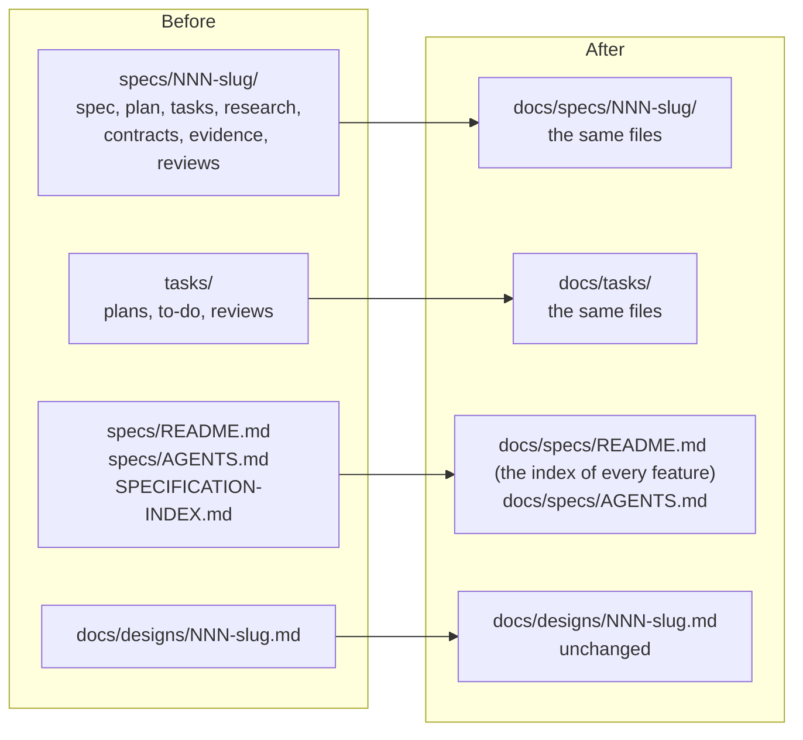

# Plan: move `specs/` under `docs/` and rename the identifiers to words

**Status:** proposed, not started. Nothing in this plan has been run. The numbers below were measured on `develop` at
`99992c70` (2026-11-20) with `git grep`; they are pattern counts, so they are upper bounds that the dry run will
refine.

## Why

On 2026-11-20 the owner asked for three things (recorded in [owner decisions](../owner-decisions.md) by pull request
#256, together with constitution 4.7.0):

1. `docs/` holds all the documentation, the specifications and the diagrams, written for people.
2. Documents and code comments write words in full, not abbreviations.
3. "Rename everything": the stable identifiers become words and a number (`T022-064` becomes `Task 022-064`).

Today the specifications of features 001 to 037 live in `specs/`, outside `docs/`, and about 38,800 places cite an
identifier in its old form. Both changes touch the same files, so they are done together, once, by script.

## When

- **After** pull requests #237 (feature 022), #241 (feature 041) and #226 (feature 018) merge into `develop`, and after
  #256 (the rule and the identifier scheme) merges.
- **Before** release 0.3.0 is cut, so that the release notes, the runbooks and the tags of 0.3.0 already use the new
  paths and the new forms.
- In **one pull request**, from a fresh branch of `develop`, merged with nothing else merging that day. Every open
  branch is told the day before (see "Open branches" below).

## The target layout

- `specs/<feature>/` moves to `docs/specs/<feature>/` with `git mv`, file for file, so `git log --follow` keeps each
  file's history. Nothing inside a feature folder is reorganized in this pull request: one change at a time.
- `SPECIFICATION-INDEX.md` and `specs/README.md` merge into `docs/specs/README.md`, the index of every feature. The
  feature table of [`docs/README.md`](../README.md) links it.
- `specs/AGENTS.md` and `specs/CLAUDE.md` move with the folder, as the nested agent instructions of `docs/specs/`.
- Design docs stay in `docs/designs/`. Merging a feature's design doc and its specification folder into one place is a
  later, separate decision.
- `tasks/` (33 files: the cross-cutting completion plan, a to-do list and older review notes) moves to `docs/tasks/` in
  the same pass, with `git mv` and the same link rewrite, because the owner wants all documentation in one place.
  Decided: delegate (OD-2026-11-20-6), 2026-11-20.

## What refers to `specs/` today

Measured with `git grep 'specs/'` on `develop`:

| Where | Files | Occurrences | What breaks if it is not updated |
|---|---|---|---|
| `docs/` | 126 | 660 | links in documents |
| `specs/` itself | 248 | 1,307 | links between feature documents, now one folder deeper |
| `tasks/` (moves too) | 24 | 380 | links |
| `SPECIFICATION-INDEX.md` and `README.md` | 2 | 94 | links |
| `crates/` and `apps/` | 17 | 22 | the build: `crates/api-grpc/build.rs` compiles `worker.proto` from `../../specs/001-platform-foundation/contracts`; `crates/infra-ir/src/schema.rs` embeds `workflow.schema.json` with `include_str!`; comments |
| `tests/` | 49 | 59 | the contract suites read the contracts by path (`tests/support/contract.rs` and others); `tests/integration/schedules-bulk-operations/instances.rs` embeds `data-model.md` with `include_str!` |
| `scripts/` | 10 | 41 | `select-test-targets.py` (the contract rule matches `specs/<feature>/contracts/`), `next-feature-id.py` (reads `specs/` to find the next number), `check-agent-config.py`, `check-design-docs.py`, `test-released-sdk-compat.sh`, and their tests |
| `.github/` | 2 | 6 | the release CI lints `openapi.yaml`, compiles `worker.proto`, validates `events.asyncapi.yaml` and `workflow.schema.json` by path; the pull request template |
| `frontend/` | 7 | 13 | `npm run api` and `npm run check:api` in the Studio generate and check the API types from `openapi.yaml` by path |
| `sdks/` | 10 | 17 | the sync and generate scripts of the Go, Python, C# and Java SDKs copy `worker.proto`; `sdks/SPEC.md` |
| `infra/`, `runners/`, `examples/` | 6 | 9 | `infra/docker/Dockerfile` copies the contracts into the image; comments |

The full list of code-side files is produced by the dry run (below) and attached to the pull request.

**One path must not change:** `scripts/test-released-sdk-compat.sh` runs `git archive <release commit> sdks
specs/001-platform-foundation/contracts`. That commit is an already released one, where the contracts are still under
`specs/`. The script needs both paths: the old one for releases cut before the move, the new one after.

## The identifier rename

The scheme is in [`identifier-scheme.md`](identifier-scheme.md) (pull request #256). Measured occurrences of the old
forms:

| Kind | Old form | New form | Files | Occurrences | In `docs/` | In `specs/` | In code, tests, scripts, SDKs, CI |
|---|---|---|---|---|---|---|---|
| Owner decision | `OD-2026-11-20-10` | `Owner decision 2026-11-20-10` | 149 | 1,306 | 970 | 271 | 63 |
| Architecture decision | `ADR-0097` | `Architecture decision 0097` | 648 | 4,346 | 1,482 | 2,537 | 278 |
| Non-functional requirement | `NFR-010-001` | `Non-functional requirement 010-001` | 87 | 358 | 31 | 275 | 32 |
| Requirement | `FR-022-035` | `Requirement 022-035` | 984 | 6,794 | 1,014 | 4,563 | 1,127 |
| Requirement, feature-local | `FR-001` | `Requirement NNN-001` (with its feature) | 10 | 18 | 2 | 16 | 0 |
| Success criterion | `SC-022-012` | `Success criterion 022-012` | 279 | 1,680 | 294 | 1,197 | 89 |
| User story | `US02` | `User story 022-02` | 371 | 3,049 | 124 | 2,661 | 248 |
| Task | `T022-064` | `Task 022-064` | 869 | 8,045 | 1,839 | 5,380 | 647 |
| Task of a design without a number | `TEGM-3` | `Task EGM-3` | 5 | 91 | 56 | 0 | 35 |
| Decision | `D041-119`, `D1810` | `Decision 041-119`, `Decision 1810` | 754 | 7,078 | 913 | 5,036 | 1,127 |
| Gap | `G022-015`, `G708` | `Gap 022-015`, `Gap 708` | 598 | 4,614 | 781 | 3,345 | 455 |
| Owner question | `O041-040`, `O1710` | `Owner question 041-040`, `Owner question 1710` | 257 | 1,508 | 506 | 943 | 50 |

In all: 38,792 occurrences in 1,840 files (one pattern over every tracked text file). Many files hold several kinds,
so the file counts of the rows add up to more than 1,840.

The same pull request also writes out the abbreviations that are not identifiers (`rule R8`, `architecture B1`,
`slice S5` and the others): `python3 scripts/check-plain-words.py --all` finds 308 on `develop` with #256, outside the
review reports.

## What is never renamed

| What | Why | How the script avoids it |
|---|---|---|
| Database migrations (`crates/infra-postgres/migrations/`: 135 occurrences in 61 files) | SQLx checksums every applied migration; changing even a comment breaks the upgrade of every existing database | the folder is excluded |
| Wire values, error codes, values stored in the database | changing them breaks clients, stored runs and older readers | the script never edits string literals in code; a literal that cites an identifier in prose is listed for a person to decide |
| Test function names (102 Rust test names carry an identifier) | evidence lines of approved design docs and validation reports cite them, and evidence lines are never edited | identifiers in code are renamed only in comments |
| Contract files (`specs/<feature>/contracts/`: 921 occurrences in 140 files) | the OpenAPI document feeds the Studio's generated types and pinned baselines; a description change must be read, not blessed | renamed, then `npm run api` and `npm run check:api` and the contract suites are run and their diff read; a pinned baseline that changes stops the pull request |
| Review reports (`*.reviews/`, `specs/<feature>/reviews/`: 2,432 occurrences) | they are the reviewers' own words, hashed in the approval record of each design doc | the folders are excluded |
| Quotations: the owner's words, quoted output | they are records | text in double quotes and fenced code blocks is excluded |
| Commit messages, tags, pull request texts | history is not rewritten | out of the tree |
| URLs, and the file names of architecture decision records (`ADR-NNNN-slug.md`) | links from outside the repository (release notes, pull requests) cannot be rewritten | link targets and paths are excluded |
| `vendor/` and generated files (`docs/reference/`) | not ours, or regenerated from the code | excluded; the reference is regenerated after the rename |

## The script

`scripts/rename-identifiers.py`, written and tested in its own pull request before the sweep day:

- **Driven by the table**: it reads the old and new forms from `identifier-scheme.md`, so the document stays the single
  source (constitution, Documentation first).
- **Deterministic and idempotent**: the patterns are applied longest first (`NFR-` before `FR-`, `OD-` before a bare
  `D`); a new form never matches an old pattern, so a second run changes nothing. A test runs it twice on the same
  fixture and compares.
- **A user story gets its feature** from the folder it is in (`specs/022-*/` gives `User story 022-02`). A bare `US02`
  outside a feature folder is not guessed; it is listed for a person.
- **Dry run first**: `--dry-run` writes a report (per file and per kind, the count and every changed line) and a unified
  diff to a scratch folder, and changes nothing. `--apply` writes the files.
- **Moves and links**: a second mode moves `specs/` with `git mv` and rewrites every relative Markdown link: each link is
  resolved against the file's old location and made relative to its new one, so a link that left the moved folder keeps
  pointing at the same file.
- **Tests** in `scripts/tests/`: one fixture per kind; the excluded regions (fences, quotes, links, string literals,
  migrations, reviews); idempotency; the link rewrite in both directions; a user story with and without a feature.

## The tools that parse identifiers or paths

Each changes in the sweep pull request, with its tests, together with the text it reads:

| Tool | What changes |
|---|---|
| `scripts/check-design-docs.py` | the task line (`TASK_RE`), the owner-decision ID (`OD_ID_RE`), the task-number rules, `Owner-gate:` and `Accepted:` parsing, the feature-number rule that reads `specs/NNN-*`; and Rule 3, the body rule of an approved doc: its normalization maps the old forms to the new ones before comparing, so the rename alone does not turn design docs 041 and 043 back into drafts |
| `scripts/next-feature-id.py` | reads `docs/specs/` and `docs/designs/` |
| `scripts/select-test-targets.py` | the contract rule matches `docs/specs/<feature>/contracts/` |
| `scripts/check-agent-config.py` | `PATH_SCAN_FILES`, and the heading rule of architecture decision records (`# Architecture decision NNNN`) |
| `scripts/check-plain-words.py` | nothing in the code: `identifier-scheme.md` changes `Sweep: pending` to `Sweep: done`, and from then on the old forms are refused in added lines |
| `scripts/check-docs-index.py` | `docs/specs/` gets an index that links every feature folder |
| `crates/api-grpc/build.rs`, `crates/infra-ir/src/schema.rs`, `tests/support/contract.rs` and the other suites that read a contract | the new path |
| `.github/workflows/ci.yml`, `infra/docker/Dockerfile` | the new path |
| `frontend/apps/studio/package.json`, `scripts/check-api.mjs` | the new path |
| the SDK sync and generate scripts | the new path |
| `.github/pull_request_template.md`, the skills in `.claude/skills/` | the new forms |

## The steps on the day

1. Check that #237, #241, #226 and #256 are merged and that nothing else is about to merge. Cut the branch from
   `develop`.
2. Run the script with `--dry-run`. Read the report: every listed string literal, every bare user story, every change in
   a contract file.
3. Commit 1, the documents: `identifier-scheme.md` says `Sweep: done`; this plan says done; the index of `docs/specs/`.
4. Commit 2, the move: `git mv specs docs/specs`, `git mv tasks docs/tasks`, the link rewrite, and the two pointer files
   (below). Nothing else in this commit, so that `git` sees pure renames.
5. Commit 3, the rename: `--apply`.
6. Commit 4, the tools and the code paths of the table above.
7. Run everything the release runs (the pull request changes `.github/workflows`, so the CI runs the whole stack
   anyway): every `scripts/check-*.py` and the script tests, `cargo build` (the gRPC build reads the contract), the
   contract suites, `npm run api` and `npm run check:api` in the Studio, the SDK sync scripts and the six-language
   conformance suite, and `SAGAT_DOCS_BLESS=1` for `docs/reference` after reading its diff.
8. Merge with `--no-ff`. Tell every open branch.

## Open branches

Every branch open on the day conflicts in nearly every document it touched. That is why the sweep waits for the three
large branches. For a branch still open afterwards:

1. On the branch, merge `develop` as it was just before the sweep, if not done already.
2. Run the same script on the branch (`--apply`, then the move). It is deterministic, so it produces the same text the
   sweep produced for the same lines.
3. Commit, then merge `develop` after the sweep. What still conflicts is what the branch really changed.

The script and this recipe are tested on a copy of one open branch before the day.

## Risks

- **Links from outside break**: GitHub release notes, pull request descriptions and issues that link to `specs/...` or
  `tasks/...`. A one-line `specs/README.md` that points to `docs/specs/`, and a one-line `tasks/README.md` that points to
  `docs/tasks/`, stay for one release after the move, so an old link lands somewhere; neither is a document. Both are
  removed in the release after the one the move ships in. Decided: delegate (OD-2026-11-20-6), 2026-11-20.
  `scripts/check-docs-index.py` reads only `docs/`, so the two pointers do not trouble it.
- **A wrong guess of a user story's feature** in a file outside a feature folder: none is guessed; the report lists
  them.
- **A string literal that a test compares** and that cites an identifier: string literals are not edited; the report
  lists them for a person.
- **Size of the review**: about 1,300 moved files and about 1,840 edited ones. The pull request description gives the
  counts per kind and per folder from the report, and the reviewer reads the report and a sample of each kind, not every
  line.
- **Rollback**: revert the merge commit. Nothing outside the repository changes, and no database or wire value is
  touched.
