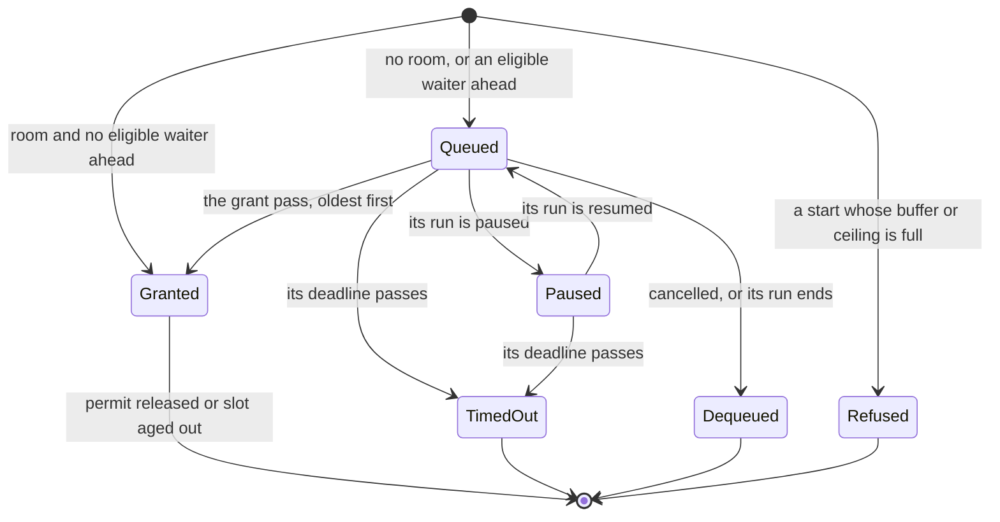

# Runbook: flow control (feature 022)

For operators of a deployment that turns on concurrency keys or rate limits. Sections 1 to 4 cover the two things the
owner decided on 2026-11-19: how the digest key of the flow-control keys is rotated, including in an emergency
(OD-2026-11-19-2), and how far the namespace's live-keys ceiling can be passed (OD-2026-11-19-4); section 1.3 says what
the digest-key commands do not have yet. Sections 5 and 6 cover queued runs and rate limits, with the life of a waiter in
section 5.1; section 7 the activation of the two capabilities; sections 8 to 10 and 14 the four alerts; section 11 how
to read the key listings during an incident; section 12 the clocks; section 13 what happens when a limit or a namespace
ceiling is lowered or raised; section 15 the scheduler's flow-control actions and their counters (tasks T022-061,
T022-082 and T022-088). How the gates work inside the engine is in
[execution semantics](../architecture/execution-semantics.md#flow-control-gates-feature-022-release-030).

Design: [ADR-0093](../adr/ADR-0093-the-flow-control-digest-key-is-rotated-per-key-with-live-rows.md) (decisions 1 to 5),
ADR-0056 decision 7 (its last sentence superseded), decisions D022-042, D022-043, D022-046 and D022-047, gaps G1190,
G1193, G1196 and G022-002 in [`specs/022-flow-control-step-policies/research.md`](../../specs/022-flow-control-step-policies/research.md).

## 1. The digest key

A concurrency or rate-limit key value is never stored: the database keeps an HMAC digest of it under a deployment key, in
one row per key (`concurrency_semaphores`, `rate_limit_windows`). Every process that decides a gate (control plane,
execution engine, scheduler replica) holds the key ring, and `flow_control_key_versions` says which version is in force:

| State | Meaning |
|---|---|
| `ACTIVE` | new key rows are filed under it; one at most |
| `RETIRING` | rows filed under it still decide their keys; a key that has such a row keeps using it; one at most |
| `RETIRED` | no decision digests under it again, and it never becomes active again; rows a force left under it drain on their own |

Only the operator (not the runtime role `sagat_app`) can run the commands below.

### 1.1 Giving the processes the key ring (D022-057)

The ring is a file, never an environment value: `SAGAT_FLOW_CONTROL_DIGEST_KEYS_FILE` names it, and it holds
`version:hex[,version:hex...]`, each key 32 random bytes in hexadecimal (at most 16 KiB). Make one version:

```sh
umask 077 && printf '1:%s\n' "$(openssl rand -hex 32)" > flow-control.keys
# the images run as uid and gid 10001 (infra/docker/Dockerfile; the chart's fsGroup): on a Linux host let that group read it
sudo chgrp 10001 flow-control.keys && chmod 0640 flow-control.keys
```

Give the **same** file to every control plane and every execution engine: on Kubernetes a Secret with the key
`flow-control.keys` named by `flowControl.digestKeys.existingSecret` (the chart mounts it read-only under
`/etc/sagat/flow-control/`); with the local stack the overlay `infra/docker/compose.flow-control.yaml` mounts
`infra/docker/flow-control.keys`. A process logs and prints only the versions of its ring.

A process refuses to start when:

- `SAGAT_FLOW_CONTROL_CONCURRENCY_KEYS_ENABLED` (or the rate switch) is `true` and no file is named, or the file cannot be
  read, is larger than 16 KiB, is not a ring, or holds no key (the error names the variable, never the content);
- the database has a version in force (active, or retiring during a rotation) that the file lacks.

With the ring set, a process lists `flow-control-concurrency-v1` and `flow-control-rate-v1` in the instance registry (its
switches decide only what it admits, D022-062), and only then can the fleet activation of step 3 of 1.2 (or of section 6)
pass. A process of an older build does not list `flow-control-rate-v1`: the activation of `rate-limits` is refused while one
is live.

### 1.2 Turning concurrency keys on

**Not in production before T022-104 and T022-111 are ticked** (G022-015, G022-014). Built on 2026-11-25 (D022-085):
publication refuses a key over a `secret` field (`FLOW_CONTROL_KEY_SECRET`) and warns one over a `pii` field, an
unclassified one included (`FLOW_CONTROL_KEY_PII`); a run shows its key's label to a caller who may disclose every field
the key reads (public: every reader; internal: a role that reads internal payloads; pii: the reveal grant). The key
listings show keys, by label with whole instants, only to callers with the namespace's reveal grant; every other reader
gets one row per pool, scope and group (`view: GROUPS`: keys, holders or grants, waiters, oldest wait, whole instants),
which links no run to another (D022-061, D022-086).

**Turning the switch off** stops new gated publications and starts; keep the key file mounted so that what was admitted
drains: a process with the switches off that is given the file still lists the gate (so a fleet that requires it keeps
serving), grants queued waiters, releases delayed gated starts and decides gated steps (FR-022-031, D022-062). Without
the file a process does not list the gate: once the activation requires it, the registry refuses that process and it
serves nothing, and its queued waiters can only time out. Every process that holds the file checks it against the
versions in force at start, switched on or off. A child run that a draining run starts is a new start: it is refused
`CAPABILITY_DISABLED` (its node's typed failure is T022-102).

1. Make the ring (1.1) and give it to every control plane and engine, with `SAGAT_FLOW_CONTROL_CONCURRENCY_KEYS_ENABLED=true`;
   restart them.
2. `SELECT * FROM flow_control_key_activate(1::smallint, '<your name>');` (expect `ACTIVATED`), as the schema owner.
3. `control-plane flow-control-activate --capability concurrency-keys --operator <you>`: refused, naming the instances,
   while a live process does not list the capability (section 7).

### 1.3 What the digest-key commands do not have yet (gaps G022-006, G1196 and G1193)

The digest-key commands of sections 1.2, 2 and 3 are SQL functions of the schema owner, and only that. Plainly:

- **No API, no CLI command, no span, no metric** runs or watches them (gap G022-006). `control-plane
  flow-control-activate` activates a capability for the fleet (section 7); it does not activate a key version. Run the
  functions with `psql` from your own login, as a script.
- **No record in the platform's audit trail.** An activation keeps only what its version row says:
  `SELECT version, state, activated_at, activated_by, activated_role, retired_at FROM flow_control_key_versions ORDER BY
  version;` (`activated_by` is the name you typed, `activated_role` the database role of the session; a version is
  activated once, so there is no history of earlier activations, gap G1190). A force has its own append-only record
  (section 3). Write the incident or change number of each command in your own change log.
- **No progress gauge and no alert for an open rotation** (gap G1196). To follow one, run the counts again:
  `SELECT flow_control_key_version_rows(<old>::smallint);` (the key rows the version still has) and
  `SELECT * FROM flow_control_key_version_runs(<old>::smallint);` (the runs that keep them).
- **No check that every process holds a version before it is activated** (gap G1193). A process checks its ring against
  the versions in force only when it starts. One that is already running without a version that is then activated
  refuses every gated decision as unavailable: an API caller is answered `503 UNAVAILABLE` (retryable), and its grant
  pass logs `a flow-control grant failed` and counts `scheduler_actions_total{kind="gate_grant",outcome="failed"}`. That is why step 1 of section 2 restarts every process
  with the new key **before** the activation.

What to do instead, until these exist: run the commands from your own login (never a shared owner login), as scripts with
`SET lock_timeout`, read each outcome before you commit, and keep the commands and their outcomes with your change record.

## 2. An ordinary rotation

The commands take a `smallint` version: write it `2::smallint` (a bare `2` is an `integer`, and PostgreSQL then finds no
such function). Run each command as a script, not in a psql session left open: while it waits for or holds the version
table, every gated decision of the fleet waits behind it. Start with `SET lock_timeout = '5s';` and retry when it
expires.

1. Add the new version's key to the ring of **every** process and restart them. A process without a version that is
   activated refuses every gated decision until it has it (G1193).
2. `SELECT * FROM flow_control_key_activate(<new>::smallint, '<your name>');`
   - `ACTIVATED`, `out_rows` = the key rows the old version still has (it is `RETIRING`), or 0 (it is `RETIRED` at once);
   - `ROTATION_IN_PROGRESS`, `out_rows` = rows of the version still retiring: one rotation at a time;
   - `ALREADY_ACTIVE`, `RETIRED` (a retired or replaced version is never active again).
3. The rotation ends when the retiring version's last row goes. Its rows belong to runs that hold, wait for or were
   granted a key; a run-level permit lives as long as its run, so one long run keeps a rotation open. To see them:
   `SELECT * FROM flow_control_key_version_runs(<old>::smallint);` (tenant, namespace, run, holders, waiters, grants);
   to count the key rows left, `SELECT flow_control_key_version_rows(<old>::smallint);` (nothing reports it for you,
   section 1.3).
   Wait for them, or cancel them through the API if the owner of each run agrees. Rate-limit rows drain by time: a
   run's grant and a leased step's grant are deleted by the housekeeping once their window row's longest period and one
   more minute have passed since the lease (section 6), and the window row goes with its last grant and waiter. Runs
   listed only with `grants` are such rows: cancelling them changes nothing; wait for the purge. A key in continuous use
   keeps its row under the retiring version (a decision reuses the row that exists): when its traffic never pauses for
   its window row's longest period and one minute, the rotation ends only by the force of section 3.
4. Once `SELECT * FROM flow_control_key_versions_in_force();` answers `retiring = NULL`, remove the old key from the
   rings at the next restart. The next activation records the old version `RETIRED`.

## 3. An emergency rotation (a leaked key)

When a version's key must stop being used at once, without waiting for its rows. Each command answers with a row, not
an error, so **read every outcome before `COMMIT`**, and `ROLLBACK` if one is not the one expected.

| The leaked version is | Run, in one transaction |
|---|---|
| `ACTIVE`, nothing `RETIRING` | `flow_control_key_activate(<new>)` (expect `ACTIVATED`), then `flow_control_key_force_retire(<leaked>, …)` (expect `FORCED`, or `ALREADY_RETIRED` with 0 rows when the leaked version had no row) |
| `ACTIVE`, another one `RETIRING` | `flow_control_key_force_retire(<retiring>, …)`, then `flow_control_key_activate(<new>)`, then `flow_control_key_force_retire(<leaked>, …)` — refused `FORCED_VERSION_DRAINING` while the first force's rows remain (see below) |
| `RETIRING` | `flow_control_key_force_retire(<leaked>, …)` |

```sql
SET lock_timeout = '5s';
BEGIN;
SELECT * FROM flow_control_key_activate(<new>::smallint, '<your name>');
SELECT * FROM flow_control_key_force_retire(<leaked>::smallint, '<your name>', '<reason, e.g. incident number>');
-- read both outcomes; COMMIT only if they are ACTIVATED and FORCED, or ACTIVATED with out_rows 0 and
-- ALREADY_RETIRED with out_rows 0 (see below); else ROLLBACK
COMMIT;
```

When the leaked version had no key row at all, the activation retires it at once (`ACTIVATED`, `out_rows` 0), so the
force that follows answers `ALREADY_RETIRED` with 0 rows: the key is already out of use, nothing is left to drain, and
you may commit. That path writes **no** row in `flow_control_key_forced_retirements`; the retirement is recorded only by
the version row's `retired_at` (section 1.3), so write the incident in your change record.

`flow_control_key_force_retire` answers:

- `FORCED`, with the key rows the version still had;
- `ACTIVE`: the active version is never forced, so activate a successor first;
- `FORCED_VERSION_DRAINING`, with the rows an earlier force left that have not drained. Only one forced version drains at
  a time, so a key never has more than two rows. Wait for those runs, or cancel them
  (`flow_control_key_version_runs(<earlier>::smallint)`);
- `ALREADY_RETIRED`, with the rows it still has;
- `UNKNOWN`.

A reason or name that is blank, longer than 1,000 (255) characters as typed, or holds a line break is refused. **Never
put key material or a digest in the reason**: it is kept for ever. The force waits for every decision in flight, like the
activation.

What it costs, and what to tell the tenants:

- From the commit, a key decided again is filed under the active version, so a key **may have two rows** until the old
  one drains.
- The old row keeps its holders, grants and waiters, gains no new waiter, and grants only its own waiters within its own
  limit. **A key's limit can therefore be exceeded, at any moment, by at most what its old row holds at that moment
  (holders for concurrency, counted grants for a rate limit), never more than the limit, until the old row's holders
  and waiters drain.** The excess is read at each moment and can grow back to the limit while the old row grants its
  own waiters (accepted by the owner, OD-2026-11-20-4).
- Order is kept within each row, not across the two: a new decision can be granted on the new row while older waiters
  still wait on the old one.
- The processes no longer need the retired key; remove it from the rings at the next restart. Digests computed with the
  leaked key stay in the old rows until those rows go (for rate-limit rows, not before T022-074).

Every force is recorded: `SELECT * FROM flow_control_key_forced_retirements;` (version, rows left, your name, the database
role of the session, the reason, the time). The table is append-only, and rolling back its migration is refused while it
has a row. The record is only as good as the roles: run the commands from your own login (not a shared owner login), and
never change `flow_control_key_versions` by hand — a direct `UPDATE` retires a version with no record (G022-006).

## 4. The live-keys ceilings are not exact under concurrency

The namespace's `concurrency_live_keys` ceiling refuses a step whose key would be a new semaphore beyond it, and its
`rate_limit_live_keys` ceiling one whose key would be a new rate-limit window beyond it (`FLOW_CONTROL_LIMIT`, through
the step's failure route, no attempt spent; a run's start is refused with nothing created). Each deciding transaction
counts the namespace's committed key rows of that kind under the versions in force before it creates its own, without a
namespace lock (OD-2026-11-19-4; for the rate-limit keys OD-2026-11-20-11). So, for each of the two ceilings:

- transactions that create keys at the same moment can together pass the ceiling by at most the new keys the others
  create: at most their number minus one when each creates one key; a transaction that releases several gated steps
  with distinct new keys in one commit can add more, so the bound is in keys, not transactions: at most the new keys
  the other transactions of the same moment create (accepted by the owner, OD-2026-11-20-3);
- after an emergency rotation, the rows the force left are not counted: the ceiling is passed by at most those rows,
  until they drain, and a key filed again is not refused for the row it replaces.

While the count is above the ceiling, a step whose key is new is refused; keys that exist are decided as before.

The flow-control alerts (sections 8 to 10 and 14) are listed only to a caller with the namespace's reveal grant and are
not sent to subscriptions (D022-152); `getRun`'s `rateLimit.position` and `estimatedGrantAt` are null without it
(D022-153). Every surface and its gate is listed in decision D022-151.

How close a namespace is to these ceilings is in its quota view (`GET /namespaces/{namespaceId}/quotas`): the `used` of
`concurrency_live_keys`, `rate_limit_live_keys` and `flow_control_key_waiters` is shown only to a caller who may reveal
personal data in the namespace (the reveal grant of the key listings); everyone else reads `usageWithheld: true` and no
`used`, since the live-key count changes exactly when a key's last run ends (D022-133). Give the operators who watch
these ceilings the reveal grant. That a refusal at the ceiling depends on whether a key exists is itself an oracle, an
open owner question (G022-040).

A run's start counts under the namespace's admission lock, so two starts never pass a ceiling together; a step's
readiness round takes no such lock. A rate-limit window row stays while a waiter or a grant the purge must keep uses it
(its window row's longest period and one more minute after the grant's lease), so a key used once counts for that long.
When a new rate-limit key would pass the ceiling, the deciding transaction first deletes, in its own namespace, windows
that no waiter and only grants the purge may delete keep (at most 64 grants each, never one another transaction holds),
and decides with the room that frees; a namespace never waits for another tenant's purge backlog, except for a window of
more than 64 grants (G022-018).

## 5. Queued runs (a run's start that waits for its permit)

A workflow with a top-level `concurrency` takes a permit of its key when a run is started; when the key is full the run
is created `WAITING` and queued (`concurrency.queued`), and the scheduler grants the oldest waiter when a holder ends
(`concurrency.acquired`) or fails it `CONCURRENCY_WAIT_TIMEOUT` at its queue deadline. A synchronous start is refused,
with nothing created, when the key's queue is full (`CONCURRENCY_QUEUE_FULL`), the namespace's `queued_runs` is reached or
the key would be new beyond `concurrency_live_keys` (`FLOW_CONTROL_LIMIT`). Each refusal is counted
`concurrency_acquisitions_total{scope="run",outcome="refused_full"}`.

- `queued_runs` is exact: every start holds the namespace's admission lock while it is decided (D022-051). It is read
  from the sixteen slot rows of `flow_control_counts`, which triggers on the waiter rows keep (a run that waits for both
  gates counts once; T022-105, D022-084): `SELECT sum(queued_runs) FROM flow_control_counts WHERE namespace_id =
  '<namespace>'`. Never edit them by hand: the runtime role cannot, and the owner would make the ceiling lie.
- A start delay takes its permit or queues at its release, and a reset takes a fresh permit or is refused
  `CONCURRENCY_PERMIT_UNAVAILABLE` (D022-052, D022-053). A workflow with a `forEach`, `while` or `repeatUntil` node
  beside a top-level gate is refused `BINARY_CAPABILITY_MISSING` in this build (G1197). A reset of a run whose start
  declares `rateLimit` takes a fresh slot or is refused `RATE_LIMIT_SLOT_UNAVAILABLE`, rate first (T022-086, D022-069).
- Rolling back migration `20270203000000` is refused while any run, finished or not, keeps `runs.flow_control_gates`:
  archive those runs first.
- A Signal-with-Start whose new run queues is answered `202` with `held: true`: the signal is kept in
  `flow_control_held_signals` (its payload in `payloads`, by digest) and delivered by the grant of the run's start,
  audited `run.signalled` as the caller's (T022-109, D022-087). When no step waits for it at the grant, or the run
  ends while queued (its queue timeout, a cancellation), it is dropped with an audit record `run.signal_dropped` whose
  reason says why (`NOT_WAITING_AT_GRANT`, `OUTPUT_BOUND`, `RUN_ENDED`). The held signals of a namespace:
  `SELECT run_id, name, held_at FROM flow_control_held_signals WHERE tenant_id = '<tenant>' AND namespace_id =
  '<namespace>' ORDER BY held_at`. Rolling back migration `20270214000000` is refused while one is held: let the runs
  be granted or end first.
  A signal is held only when a `waitEvent` of its name is on the start's entry path and its payload keeps the run within
  its 4 MiB retained-output bound; otherwise the request is refused, with nothing created, as with room on the key
  (`SIGNAL_NOT_ACCEPTED_AT_START`, `QUOTA_EXCEEDED`; D022-126). `flow_control_held_signals_total{outcome}` counts the
  held, delivered and dropped signals (`held`, `delivered`, `dropped_not_waiting`, `dropped_output_bound`,
  `dropped_run_ended`, `dropped_delivery_failed`; D022-127): a steady `dropped_not_waiting` means the branch the grant
  takes does not reach the wait.
- A waiter whose grant keeps failing (a version this build cannot read, a row a constraint refuses, an execution error;
  not a busy run or a failure that clears on its own) is skipped by every pass and logged `a flow-control grant failed`
  with its run, counted `scheduler_actions_total{kind="gate_grant",outcome="failed"}`, and recorded in
  `flow_control_grant_failures` with the class of its failure (`UNREADABLE_DEFINITION`, `REFUSED`, `EXECUTION`,
  `INTERNAL`) and its first instant. While it has that row it does not count ahead of the younger waiters, which are
  granted past it (D022-124); the pass still tries it first, and the first try that decides it deletes the row. The
  failing waiters of a namespace: `SELECT run_id, node, attempt, failure, first_failed_at FROM
  flow_control_grant_failures WHERE tenant_id = '<tenant>' AND namespace_id = '<namespace>' ORDER BY first_failed_at`.
  Fix the cause (roll the build forward, drop the refusing object) or cancel the run; never delete the row by hand
  while the cause remains (the next pass writes it again).

### 5.1 The life of a waiter

A run's start or a step that a gate cannot admit at once becomes a **waiter**: one row per gate it waits for
(`concurrency_waiters`, `rate_limit_waiters`), one deadline (the earlier of its gates'), and the run or step `WAITING`.
The same life holds for both gates and both levels (ADR-0089 decisions 1 and 5; the events of
[`contracts/journal-events.md`](../../specs/022-flow-control-step-policies/contracts/journal-events.md)).



| State | What the journal and the rows say | What an operator sees |
|---|---|---|
| Granted | `concurrency.acquired` or `rate_limit.granted` (`from_queue` true when the pass granted it); holder or grant row; waiter rows gone, all gates in one commit | a run gets its first tasks, a step becomes `READY` |
| Queued | `concurrency.queued` or `rate_limit.queued` with its `queue_deadline_us`; waiter row; a run's start counts once in `queued_runs` | `Run.concurrency.state` or `Run.rateLimit.state` `WAITING`; a step's `waitingOn`; the key listings' `waiters` |
| Paused | the waiter row stays; grants skip it until the resume (ADR-0096); its deadline keeps running (gaps G022-008 and G022-012) | the run's pause; a long pause can end in a timeout |
| Timed out | `*.wait_timed_out` of the gate that refuses it at the deadline (rate first when both do) and `*.dequeued` of the other, in one commit | a run `FAILED` with `CONCURRENCY_WAIT_TIMEOUT` or `RATE_LIMIT_WAIT_TIMEOUT`, without its failure handler; a step fails through its failure route, no attempt spent |
| Dequeued | `concurrency.dequeued` or `rate_limit.dequeued` in the commit that cancels or ends its run; no permit, no slot used | the run's cancellation or end |
| Refused | nothing is written: a synchronous start is answered `429 QUOTA_EXCEEDED` (`CONCURRENCY_QUEUE_FULL`, `RATE_LIMIT_QUEUE_FULL`, `FLOW_CONTROL_LIMIT`); an event or cron start stays pending under its retry | the caller's answer; `refused_full` in the decision counters. A step is never refused for a full buffer: it fails `FLOW_CONTROL_LIMIT` (a new key beyond the live-keys ceiling) or `FLOW_CONTROL_KEY_INVALID` through its failure route |

After a grant: a permit is released by its holder's end (`concurrency.released`); a slot has no release event and simply
stops counting once its window has passed (section 6). A granted step that leaves `READY` without being leased (a pause,
a hold for review, a cancellation) gives back what it holds in that commit (`concurrency.released`,
`rate_limit.returned`) and, on a pause, asks again at the back of its key's queue when its run is resumed (ADR-0096).
A grant and a timeout or a cancellation that race are decided by the first commit; the other finds nothing to do.

## 6. Rate limits (T022-072, T022-074, T022-077)

**Not in production before T022-080, T022-104 and T022-113, and gap G022-018** (ADR-0088's fault suite; G022-015;
T022-113: the rate twins of the run creators split from T022-086, the reset of a rate-limited run, which is done
(D022-069 item 7); G022-018: the deployment-wide purge scans every grant a call, in no order,
and has no backlog gauge). Task T022-114 (gap G022-019, a `CANCEL_SOURCE` reset on a full key) is deliberately not a
gate: the strategy is off by default and its failure is recorded (D022-069 item 8); since D022-079 a request whose key's window is full when it arrives is refused `RATE_LIMIT_SLOT_UNAVAILABLE` before the source is cancelled (advisory: retry it once a slot stops counting, or use `REQUIRE_TERMINAL`). The consistency check of the rate tables across runs (T022-079) and
the lock-order barriers (T022-081) are done. Finish the rolling upgrade before resetting a rate-limited run: a replica built
before T022-086 cannot read the `restored` copy of a `rate_limit.*` event, and for the same reason never roll an engine
back past T022-086 once a rate-limited run was reset (D022-069 item 6). A refused reset counts `refused_reset` in each
family its start declares, not only in the gate that refused it. Finish the rolling upgrade before setting any `rate_limit_*` limit (an older
replica's quota listing refuses a name it does not know, G1192); rolling back migration `20270206000000` refuses while one
is set.

A process with the ring lists `flow-control-rate-v1` beside the concurrency gate. Turn it on as 1.2, with
`SAGAT_FLOW_CONTROL_RATE_LIMITS_ENABLED=true` and `control-plane flow-control-activate --capability rate-limits --operator <you>`
(section 7).

**The deployment files (decision D022-118).** Each gate has its own switch, set alike on the control plane and the
engine:

- Helm: `flowControl.concurrencyKeys` and `flowControl.rateLimits`, each off by default; either one on needs
  `flowControl.digestKeys.existingSecret` (the render fails without it, as the processes would refuse to start);
- compose: `SAGAT_FLOW_CONTROL_RATE_LIMITS_ENABLED` beside the concurrency variable in `compose.yaml` (default
  `false`); the local overlay `compose.flow-control.yaml` turns both on with the key file.

A switch only lets a process serve the gate. Nothing is admitted until the operator activates the capability for the
fleet (section 7).

- A run's start that declares `rateLimit` takes a slot of its key when it is admitted, or is buffered `WAITING`
  (`rate_limit.queued`); a run's slot counts from its grant and is never given back: it stops counting after its window.
  A synchronous start is refused `RATE_LIMIT_QUEUE_FULL` when its key's buffer (`flow_control_key_waiters`) or the
  namespace's `queued_runs` is full, rate first for a start that also declares `concurrency`, and `FLOW_CONTROL_LIMIT`
  (`rate_limit_live_keys`) when its key would be a new window beyond the namespace's ceiling.
- A step's slot counts while it is granted and not leased, then for its window from the lease. The scheduler copies the
  lease instant from the journal each tick (`scheduler_actions_total{kind="rate_lease"}`, `outcome` `done` or `failed`);
  a late copy only keeps a slot longer, and a waiter is visited at the latest one copy after its slot frees. With no
  worker, at most `limit` granted steps of a key wait unleased.
- The effective limit is the lowest of the declaration and the namespace's `rate_limit_per_second` (20 at most until the
  published benchmark), `rate_limit_per_minute` (6,000) or `rate_limit_per_hour` (10,000), by the declaration's window.
- The housekeeping deletes a grant once its window row's longest period and one more minute have passed since its lease
  (`scheduler_actions_total{kind="rate_purge"}`), at most 64 keys and 500 grants a key a call, skipping a key another
  transaction holds. A window row counts against `rate_limit_live_keys` until it goes; a decision that needs room
reclaims its own namespace's purgeable windows first (section 4). To see the backlog of a namespace: `SELECT count(*)
FROM rate_limit_grants g JOIN rate_limit_windows w USING (tenant_id, namespace_id, pool, limit_scope, group_name,
key_digest) WHERE g.namespace_id = '<namespace>' AND g.leased_at + make_interval(secs => w.max_period_ms / 1000.0 + 60)
< clock_timestamp();`.
  A definition published later with a longer window on the same group and key (`RATE_LIMIT_MISMATCH` warns at
  publication) does not count the grants already deleted, so in its first window it may be admitted up to that many
  early (G022-017): give definitions that share a group the same window.

## 7. Activating the capabilities

Concurrency keys and rate limits are two capabilities of the fleet, each recorded in the instance-capability registry
of feature 018 ([instance registry runbook](instance-registry.md)) and required of every control plane and every
execution engine (FR-022-053, ADR-0089 decision 6):

| Command name | Registry capability | Switch of each process |
|---|---|---|
| `concurrency-keys` | `flow-control-concurrency-v1` | `SAGAT_FLOW_CONTROL_CONCURRENCY_KEYS_ENABLED` |
| `rate-limits` | `flow-control-rate-v1` | `SAGAT_FLOW_CONTROL_RATE_LIMITS_ENABLED` |

Both switches are off when unset (`true`, `1` or `yes` turn one on; anything but a boolean stops the process at start).
A process lists both capabilities whenever it holds the key ring of section 1.1, whatever its switches (D022-062), so a
switched-off process that drains stays in a fleet that requires the gates. The switch decides only whether new gated
work is admitted.

What a definition that declares `concurrency` or `rateLimit` meets, in this order (D022-057):

1. the switch of its capability is off on the process that decides: publication and starts are refused
   `422 VALIDATION_FAILED`, `details.reason` `CAPABILITY_DISABLED`;
2. the capability is not activated for the fleet: refused `422 VALIDATION_FAILED`, `FLOW_CONTROL_ACTIVATION_PENDING`,
   before any version or run exists;
3. after the activation, a process that does not list the capability serves nothing: every call is
   `503 UNAVAILABLE`, `BINARY_CAPABILITY_MISSING` (the [instance registry runbook](instance-registry.md), section 2).

To activate, after the ring and the switch are on every process and the digest key version is active (section 1.2,
steps 1 and 2), run as the schema-owning database role:

```sh
control-plane flow-control-activate --capability concurrency-keys --operator <your name>
control-plane flow-control-activate --capability rate-limits --operator <your name>
```

| It prints | Meaning |
|---|---|
| `<capability> is activated for the fleet (requirement epoch <n>).` | recorded and audited; every process learns it within one heartbeat |
| `<capability> was activated before; nothing was done.` | already recorded |
| `<n> live control plane(s) or engine(s) do not run the <capability> gate (instance ids: ...). ... Nothing was changed.` | a live process lacks the ring or is of an older build: give it the ring, or upgrade or stop it, and run the command again |
| `permission denied: the activation calls functions the runtime role may not execute. ...` | run it with the schema-owning role, not `sagat_app` |

An activation of an empty fleet is refused too: with no live process, nothing would serve after it. **Do not activate in
production before the gates of sections 1.2 and 6 are closed.** To take a capability back, switch it off and keep the key
file mounted so that what was admitted drains (section 1.2); removing the requirement is the rollback of the
[instance registry runbook](instance-registry.md).

## 8. Alert `CONCURRENCY_QUEUE_STUCK` (the plan's `concurrency_queue_stuck`)

**Warning.** Raised by the engine's monitor (task T022-082; plan, "Observability": "oldest waiter older than its key's
longest holder by a threshold while capacity is zero").

**Meaning.** A concurrency key of the namespace has no room (its holders are at the limit of its oldest eligible waiter)
and that waiter queued more than the threshold before the key's oldest current holder took its permit: every permit it
waits for was given, after it queued, to someone else. Eligible is the grant routine's word: not paused, not past its
deadline, of a live run. The limit is the lower of the waiter's declaration and the namespace's current
`concurrency_limit`, as the grant routine decides it (D022-074), read once a look per namespace. `items` is the number
of keys of the group in the condition; `oldestSeconds` how long the longest of their waiters has waited. The **subject** is the key's group (`=<workflow>` or `=<workflow>/<node>` when derived); an
alert never carries a key's value or its label. One alert per group, with the number of keys in that condition.

This is the plan's condition, as the monitor reads it (`crates/infra-postgres/src/operations.rs`, `STUCK_ALERT_SQL`).
Decision D022-077 item 7 had worded it "a waiter older than the threshold and no grant in that time"; the two differ
when a holder was granted recently, long after the waiter queued: the alert fires then too, because that grant also
went past the waiter (decision D022-117).

**Threshold.** `SAGAT_ALERT_UNCLAIMED_SECS` (300 by default), the time the monitor already gives a step that no worker
takes: both say "work waits while other work is served". The monitor looks every `SAGAT_MONITOR_INTERVAL_SECS` (30).

**Confirm.** `GET /namespaces/{namespaceId}/concurrency-keys?group=<group>` (section 11): `holders`, `waiters`,
`oldestWaitSince`, `oldestHolderSince`. In SQL, as the operator:

```sql
SELECT s.permit_scope, s.group_name, s.holders, s.waiters, s.oldest_wait_at, h.oldest_holder_at
  FROM concurrency_semaphores s
  CROSS JOIN LATERAL (SELECT min(acquired_at) AS oldest_holder_at FROM concurrency_holders h
                       WHERE h.tenant_id = s.tenant_id AND h.namespace_id = s.namespace_id AND h.pool = s.pool
                         AND h.holder_scope = s.permit_scope AND h.group_name = s.group_name
                         AND h.key_digest = s.key_digest) h
 WHERE s.namespace_id = '<namespace>' AND s.waiters > 0
 ORDER BY s.oldest_wait_at;
-- the waiters of one group, oldest first: their own limit (the declaration their version pins, else the limit they
-- were filed with), their deadline and their run's status
SELECT w.run_id, w.node, coalesce(w.pinned_limit, w.declared_limit) AS own_limit, w.enqueued_at, w.deadline_at, r.status
  FROM concurrency_waiters w JOIN runs r ON r.tenant_id = w.tenant_id AND r.id = w.run_id
 WHERE w.namespace_id = '<namespace>' AND w.group_name = '<group>'
 ORDER BY w.enqueued_at, w.run_id, w.node LIMIT 20;
```

Never copy `key_digest` out of the database: it is the key's identity under the deployment's key.

**Likely causes.**

- The oldest waiter's own limit is lower than that of the waiters behind it: definitions that share an explicit group
  with different limits (publication warned `CONCURRENCY_LIMIT_MISMATCH`). By design an older waiter refused by its own
  lower limit does not block a younger one (D1196), so a busy key can keep it waiting up to its deadline.
- The namespace's `concurrency_limit` was lowered below the holders (section 13): nobody is granted until the holders
  fall below it.
- A waiter of a run that already ended. That is an invariant breach: the pass skips it, logs `a flow-control waiter of a
  run that ended: an invariant breach, skipped` and counts `scheduler_actions_total{kind="gate_grant",outcome="orphan"}`;
  it is not counted ahead of anyone, and alert `FLOW_CONTROL_WAITER_ORPHANED` fires for its group (section 14).

**Not this alert.** A holder that never ends (a run in `MANUAL_REVIEW` keeps its permit, a long attempt keeps a step's)
leaves `oldestHolderSince` older than every waiter: the waiters time out at their deadline (`CONCURRENCY_WAIT_TIMEOUT`,
default `queueTimeoutMs` 600,000 ms). Settle the review ([alerts runbook](alerts.md#review-pending)) or the attempt.

**Safe actions.** Give the definitions that share the group one limit (publish a new version), or move the one with the
lower limit to a group of its own; cancel a waiting run with its owner's agreement (`POST /runs/{runId}/operations`
`CANCEL`: it leaves the queue in that transaction, `concurrency.dequeued`); or let it reach its deadline. Nothing is
lost while it waits: the run is durable and holds no worker.

**Never.** Change or delete rows of `concurrency_semaphores`, `concurrency_holders` or `concurrency_waiters` by hand: the
counters are kept by triggers, the rows must equal the journals (`verify_run`, invariants 1 and 2), and a deleted holder
admits one run more than the limit. Never activate a new digest key version to "reset" a key (section 2), and never
remove the fleet requirement to unblock a queue: it stops gating every key.

**Over when** no key of the group is in the condition; the alert resolves at the next look.

## 9. Alert `RATE_LIMIT_GRANT_LAGGING` (the plan's `rate_limit_grant_lagging`)

**Critical.** Raised by the engine's monitor (task T022-082; FR-022-049; plan, "Observability (rate limits)").

**Meaning.** A rate-limit key of the namespace has had waiters and a slot that may be free for longer than the
threshold, and no grant pass has served it: the pass is not keeping up, or no live replica holds the key's home shard.
The monitor reads it from the key's next-eligible hint, which the gate keeps under the key's lock and which is early,
never late (plan, "The grant pass, by key"): a window row with `waiters > 0` whose `next_eligible_at` is older than the
threshold has been due at least that long, and **no grant of the key was made in that time either**. The second
condition keeps a busy key out: a pass that grants part of a queue longer than it reads (256 waiters) leaves the hint
due on purpose, so that the next pass comes back, while a pass that grants nothing rests the key and moves its hint. The
**subject** is the key's group. A healthy pass serves a due key within `1.2 I + 2 D` (`I` the scheduler's idle pause,
`SAGAT_SCHEDULER_INTERVAL_MS`, 500 ms by default; `D` one tick), and within two passes when more keys are due than one
pass visits (decision D022-073 item 5; SC-022-017).

**Threshold.** `SAGAT_ALERT_LEASE_GRACE_SECS` (60 by default), the grace the monitor already gives the scheduler to take
back an expired lease: both say "the scheduler has not done what a tick does".

**Metric.** `rate_limit_grant_lag_seconds` (histogram, no label): for each slot the grant pass grants from the buffer,
the time from the instant the key became due (its next-eligible hint as the pass selected it, or the waiter's queueing
if later) to the grant. The hint is early and never late, so the figure is the most the slot can have been free with
the waiter present (decision D022-083). Beside it `rate_limit_wait_seconds{scope}` (from a waiter's queueing to its
grant), `scheduler_actions_total{kind="gate_grant"}` and `{kind="rate_lease"}` by `outcome`, and the deployment-wide
scheduler rules of [`infra/observability/alerts.yaml`](../../infra/observability/alerts.yaml) (shard ownership,
scheduler lag).

**Confirm.**

```sql
SELECT w.limit_scope, w.group_name, w.waiters, w.live_grants, w.next_eligible_at,
       clock_timestamp() - w.next_eligible_at AS due_for, g.last_grant_at, w.key_shard
  FROM rate_limit_windows w
  CROSS JOIN LATERAL (SELECT max(granted_at) AS last_grant_at FROM rate_limit_grants g
                       WHERE g.tenant_id = w.tenant_id AND g.namespace_id = w.namespace_id AND g.pool = w.pool
                         AND g.limit_scope = w.limit_scope AND g.group_name = w.group_name
                         AND g.key_digest = w.key_digest) g
 WHERE w.namespace_id = '<namespace>' AND w.waiters > 0
   AND w.next_eligible_at < clock_timestamp() - interval '60 seconds'
   AND (g.last_grant_at IS NULL OR g.last_grant_at < clock_timestamp() - interval '60 seconds')
 ORDER BY w.next_eligible_at;
```

The same question for a concurrency key (the plan defines no alert for it) is the same query on `concurrency_semaphores`.

**Likely causes.**

- No engine runs, none reaches the database, or none holds the key's home shard (`key_shard`, 0 to 63): see
  [shard ownership in the scaling runbook](scaling.md). The engine's `/livez` fails when its scheduler stops ticking.
- The engine that holds the shard has no key ring: it logs `this process has no flow-control digest key ring: it grants
  no queued step` and grants nothing of any key (section 1.1).
- The pass fails every tick: `scheduler_actions_total{kind="gate_grant",outcome="failed"}` rises; the engine's log says
  why (a database error, a statement timeout).
- More keys are due than one pass visits, for a long time: the pass shares them between tenants fairly and visits a
  bounded number a tick (gap G1174, benchmark T022-089).

**Not this alert: a database clock that went back.** Grants counted "in the future" keep the key full and its hint in
the future, so the key under-delivers without this alert (gap G1183). The plan says this alert also covers "the clock
went back"; as built it cannot, because the hint it reads moves into the future with the grants (decision D022-117).
Section 12 says how to see it.

**Safe actions.** Make an engine that holds the ring run and reach the database; it takes the shards and grants by
itself. Nothing is lost while the pass is late: every waiter stays buffered with its deadline; the first pass grants at
most `limit` a key a window, in admission order; a waiter past its deadline ends `RATE_LIMIT_WAIT_TIMEOUT` (a run
`FAILED`, a step through its failure route, no attempt spent).

**Never.** Insert or delete `rate_limit_grants` or `rate_limit_waiters` rows, or set `next_eligible_at`, by hand: the
grants are the window and must equal the journals (`verify_run`, invariants 8 to 10). Never start an engine without the
key ring to "help": it grants nothing and, once the requirement is recorded, serves nothing.

**Over when** no window of the namespace has been due for longer than the threshold.

## 10. Alert `RATE_LIMIT_QUEUE_SATURATED` (the plan's `rate_limit_queue_saturated`)

**Warning.** Raised by the engine's monitor (task T022-082; FR-022-049; plan, "Observability (rate limits)": "a key's
waiters above 80% of its ceiling").

**Meaning.** A rate-limit key's buffer of run starts is more than 80% full: its waiters are above 80% of the namespace's
effective `flow_control_key_waiters` (100 by default, 10,000 at most, and always below the effective `queued_runs`;
plan, "Ceilings, revised"). Starts arrive faster than the key's limit lets them start, and the buffer absorbs the
difference. Only run starts are bounded per key: step waiters are at most one per run and gated node, and a step never
fails for a full buffer (FR-022-042), so the alert looks at `limit_scope = 'RUN'` only. The **subject** is the key's
group. When the buffer is full, a synchronous start is refused `429 QUOTA_EXCEEDED`, `RATE_LIMIT_QUEUE_FULL`, with
nothing created; an event or a cron start stays pending under its retry (the inbox keeps it); a namespace whose
`queued_runs` is full refuses the same way.

**Threshold.** 80% of the effective ceiling, as the plan says; no setting.

**Metric.** `rate_limit_waiters{scope="run"}` (gauge, deployment-wide, set by the monitor every look from the key rows'
counters), and `rate_limit_decisions_total{scope="run",outcome="queued"}` against `{outcome="granted_from_queue"}`
(arrivals against starts) and `{outcome="refused_full"}` (refusals, once full).

**Confirm.** `GET /namespaces/{namespaceId}/rate-limit-keys` (section 11): `waiters`, `queuedRuns`, `nextSlotAt`. In SQL:

```sql
SELECT group_name, waiters, live_grants, oldest_wait_at
  FROM rate_limit_windows
 WHERE namespace_id = '<namespace>' AND limit_scope = 'RUN' AND waiters > 0
 ORDER BY waiters DESC LIMIT 20;
```

**Likely causes.** A burst or a steady arrival rate above the key's limit (a backfill, a replay of events, a schedule
that fires more often than the limit allows); a limit lowered by a new version or a namespace ceiling (section 13); many
starts on one key that could be spread over several (the key expression is too coarse).

**Safe actions.** Decide with the owner of the workflow whether the downstream system can take more: if it can, raise
the declared limit (a new version) or the namespace's ceiling of its window (`rate_limit_per_second`, at most 20 until
the benchmark of SC-022-029 is published, `rate_limit_per_minute`, `rate_limit_per_hour`); raise
`flow_control_key_waiters` (at most 10,000, always below `queued_runs`) to buffer a longer burst; give `queueTimeoutMs`
a value that matches how long a start may wait. If it cannot, the refusals are the gate working: tell the callers to
retry later, or slow the source.

**Never.** Raise a ceiling above what the downstream system accepts: the limit is what protects it. Never cancel buffered
runs in bulk without their owners' agreement.

**Over when** no run-scope key of the namespace is above 80% of its ceiling.

## 11. Reading the key listings during an incident

Two pages list a namespace's keys, by label only, with permission `ops:read` (FR-022-022, FR-022-048):

```text
GET /namespaces/{namespaceId}/concurrency-keys?group=<group>&limit=<1..200>&cursor=<nextCursor>
GET /namespaces/{namespaceId}/rate-limit-keys?group=<group>&limit=<1..200>&cursor=<nextCursor>
```

`limit` is 50 by default and at most 200; `group` is an explicit group or a derived one (`=<workflow>`,
`=<workflow>/<node>`). Keys come oldest wait first; keys nobody waits for come last. Each page is read in one
`REPEATABLE READ READ ONLY` snapshot with a 2 s statement timeout, and its cost is bounded by its own keys, never by the
namespace's (plan, "Visibility of the rate gate").

| Field | Concurrency page | Rate-limit page |
|---|---|---|
| `queuedRuns` | the namespace's queued runs, both gates (the count `queued_runs` is judged by) | the same |
| `pool`, `scope`, `group` | `ORDINARY` (or `DRAFT_TEST`), `RUN` or `STEP`, the group | the same |
| `keyLabel` | 12 hexadecimal digits of the key's digest, only for a caller with the namespace's reveal grant; `null` otherwise | the same |
| `holders` / `grantsInWindow` | permits held now (a granted, unleased step counts) | grants that count over the row's longest window now (an unleased grant counts) |
| `unleasedGrants` | — | step grants no worker has leased yet: at most the key's `limit` |
| `waiters` | waiters of the key | waiters of the key |
| `oldestWaitSince` | when its oldest waiter queued | the same |
| `oldestHolderSince` / `nextSlotAt` | when its oldest holder took its permit | when the next counted grant stops counting for one of its first 256 waiters; `null` when nobody waits, when a grant is unleased, or when there is room already (the next pass grants) |

The table above is the page of a caller with the namespace's reveal grant (`view: KEYS`, one row per key in `items`).
Every other caller reads `view: GROUPS`: `items` is empty and `groups` holds one row per pool, scope and group, with
`holders`, `waiters`, `oldestWaitSince` and `oldestHolderSince` (concurrency) or `grantsInWindow`, `unleasedGrants`,
`waiters` and `oldestWaitSince` (rate limits) summed over the group's keys, whole instants (D022-061, D022-086). A group
row never says how many keys the group has, nor when its next slot frees: both would tell which runs share a key. A
page of groups holds at most 5 groups, each summed whole over all its keys in the page's one snapshot, whatever its size
and whether or not the listing is filtered: a group is never split across pages, the cursor names only the place between
two groups, and `spansPages` is always `false` (deprecated, D022-131). A very large group (up to the namespace's
`concurrency_live_keys`, at most 100,000 keys) still reads within the 2 s timeout; a page that does not is a `503`. A cursor is sealed for its namespace, its
kind of listing and the digest key version in force: an altered, foreign, other group's or forcibly retired one is a
`400`, and so is one more than fifteen minutes old or stamped more than a minute ahead of the reader's clock (read the listing again without a cursor, D022-100, D022-129); an invalid group is a `422`; a page that cannot be read in 2 s is a `503` (retry it). Another tenant's namespace
is a `404`.

One run: `GET /runs/{runId}` shows `concurrency` (`state` `HOLDING` or `WAITING`, `pool`, `group`, `keyLabel`, `since`,
`queueDeadline`) and `rateLimit` (`state` `GRANTED` while its slot counts or `WAITING`, `pool`, `group`, `keyLabel`,
the `limit` and `per` it is decided with, `since`, `queueDeadline`, and for a waiting run `position`, 1 being next, and
`estimatedGrantAt`). A run listing shows the same fields without `position` and `estimatedGrantAt`. The estimate is
never a promise; it is `null` when it cannot be computed, beyond one window, while the run also waits for a permit, when
the run is paused, at or after its deadline, and for a caller without the reveal grant. A step that waits shows
`waitingOn` `rate_limit` or `concurrency` in the run's graph.

| You see | It means | Look at |
|---|---|---|
| `waiters` grows, `holders` at the limit, `oldestHolderSince` old | a holder does not end | that holder's run: a review, a long attempt (section 8, "Not this alert") |
| `waiters` grows, `oldestWaitSince` old, holders are recent | the oldest waiter is passed over | section 8 |
| `nextSlotAt` in the past, waiters present | the key is due and no pass served it | section 9 |
| `unleasedGrants` equals the limit | granted steps wait for a worker; no further grant until one leases | the workers of the activity ([alerts runbook](alerts.md#step-unclaimed)) |
| `waiters` near the namespace's `flow_control_key_waiters` | the buffer is close to refusing starts | section 10 |
| `nextSlotAt` later than now plus the key's longest window | a grant is recorded in the future: the database clock went back | section 12 |

## 12. The database clock and the replicas' clocks

Every instant a gate decides with is the database's `clock_timestamp()`, read in a statement after the deciding
transaction has locked the key's row, and that instant is the one recorded (NFR-022-008, D022-027). A replica's own
clock never decides, remembers or shortens a grant (ADR-0088 decision 1): replicas whose clocks disagree grant the same
waiters (SC-022-023; `fault_flow_control_step_policies` `rate_limits::replicas_with_offset_process_clocks_grant_on_the_database_clock`,
ten minutes apart). A replica's clock paces only when its passes run (the idle pause, jittered by up to 20%), never what
they decide. The instance registry's liveness is on the database clock too.

**The database clock moves backwards** (a failover to a server whose clock is behind): grants recorded "in the future"
keep counting, so a key grants nothing more until the clock passes them; it under-delivers and never exceeds its limit
(spec, edge cases of US07; `rate_limits::a_database_clock_set_back_grants_nothing_until_it_catches_up`). No alert says
why (gap G1183): the key's hint is in the future, so `RATE_LIMIT_GRANT_LAGGING` stays quiet. To see it:

```sql
SELECT clock_timestamp() AS now,
       (SELECT max(leased_at) FROM rate_limit_grants) AS newest_counted_instant,
       (SELECT count(*) FROM rate_limit_grants WHERE leased_at > clock_timestamp()) AS grants_in_the_future;
```

A grant in the future means the clock went back. Fix the time source of the database server; the keys go on by
themselves once its clock passes the recorded instants. The same clock decides the queue deadlines (`deadline_at`), so
a clock set back also delays the timeouts. **Never** rewrite `granted_at` or `leased_at` to "catch up": a lease instant
is written once, the consistency check compares the rows with the journals, and an instant moved back frees slots
early, which is the one thing the gate must never do.

**The database clock jumps forward**: grants stop counting at once and up to `limit` more starts of a key may follow in
less real time than the window. The guarantee is stated on the database clock (FR-022-040), so a forward jump is an
incident of the database server, not of the gate.

## 13. Lowering or raising a limit or a namespace ceiling

Nothing granted is ever revoked: a held permit stays until its holder ends, a grant counts until it ages out (FR-022-021,
FR-022-046; ADR-0056 decision 7). What a lowered value changes is the next decision.

- **A new version with a lower `limit`** applies to the runs of that version. Runs of older versions keep the limit
  they were filed with (their holder and waiter rows), and each acquirer compares the key's count with its own limit:
  an older waiter at its own lower limit does not block a younger one whose limit admits it (spec, edge cases of US02
  and US07; `lifecycle::a_lowered_limit_revokes_nothing_and_applies_to_the_next_start`).
- **A lower namespace ceiling** (`concurrency_limit`; `rate_limit_per_second`, `rate_limit_per_minute`,
  `rate_limit_per_hour` for the declarations of that window length) applies at once to the waiters already queued:
  admission and the grant routine decide every waiter, and count every waiter ahead, against the lower of its own
  limit (the declaration its version pins, else its filed limit) and the namespace's current ceiling (decisions
  D022-071 for a slot and D022-074 for a permit). A key above the
  new ceiling grants nothing until its holders end or its grants age out. `Run.rateLimit.limit` and the estimate of a
  waiting run follow the current ceiling (D022-075 item 3). Evidence:
  `lifecycle::a_lowered_concurrency_ceiling_applies_to_the_queued_starts_and_revokes_no_permit`,
  `rate_limits::a_lowered_policy_ceiling_slows_later_grants_and_revokes_none`,
  `rate_rest::a_lowered_ceiling_moves_the_estimate_and_the_limit_a_waiting_run_shows`.
- **A raised ceiling** applies to the waiters already queued too, up to their own declaration: each waiter row keeps the
  limit its run's version declares (`pinned_limit`), and every decision bounds it by the lower of that and the current
  ceiling (decision D022-076 item 7, which reversed D022-071 item 3 and D022-075 item 7; decision D022-078 item 1,
  migration `20270213000000`). A row written before that migration has no `pinned_limit` and keeps its filed limit (its
  declaration clamped at its admission) as its bound: an under-delivery, never an over-grant. Evidence:
  `lifecycle::a_raised_concurrency_ceiling_applies_to_the_queued_starts_up_to_their_declaration`,
  `rate_gate::a_raised_ceiling_applies_to_the_buffered_starts_up_to_their_declaration`.
- **A lower queue ceiling** (`flow_control_key_waiters`, `queued_runs`, `concurrency_live_keys`, `rate_limit_live_keys`)
  is judged when a start or a step would queue or create a key; the waiters and keys already there stay, with their
  deadlines, and new ones are refused until the count is below the ceiling (section 4 for the live keys).
- A ceiling of zero refuses every new start that needs it (`FLOW_CONTROL_LIMIT`, `details.limit` names the resource).

The ceilings are quota resources of the namespace (a namespace's value, else the tenant's default, else the
deployment's), changed through the quota policy of feature 009; each change is audited by the existing quota-policy
audit, and no flow-control audit action is added (plan, "Observability (rate limits)").

## 14. Alert `FLOW_CONTROL_WAITER_ORPHANED` (the plan's `flow_control_waiter_orphaned`)

**Critical.** Raised by the engine's monitor (task T022-082; decision D022-077 item 4; invariant 12 of
`specs/022-flow-control-step-policies/data-model.md`; gap G022-005).

**Meaning.** A waiter row of a concurrency key or a rate-limit key belongs to a run that ended. No path of the platform
leaves one: every end of a run gives back its gates in the same commit. It is an invariant breach, so any one is a
condition, whatever its age. The grant pass skips such a waiter, logs `a flow-control waiter of a run that ended: an
invariant breach, skipped` and counts `scheduler_actions_total{kind="gate_grant",outcome="orphan"}`; it is not counted
ahead of anyone, so no waiter is held back by it. The **subject** is the waiter's group; `items` the orphaned waiters
of the group; `oldestSeconds` how long ago the oldest queued.

**Threshold.** None: one orphaned waiter is the condition.

**Confirm.**

```sql
SELECT 'concurrency' AS gate, w.group_name, w.run_id, w.node, w.enqueued_at, r.status, r.finished_at
  FROM concurrency_waiters w JOIN runs r ON r.tenant_id = w.tenant_id AND r.id = w.run_id
 WHERE w.namespace_id = '<namespace>' AND r.finished_at IS NOT NULL
UNION ALL
SELECT 'rate', w.group_name, w.run_id, w.node, w.enqueued_at, r.status, r.finished_at
  FROM rate_limit_waiters w JOIN runs r ON r.tenant_id = w.tenant_id AND r.id = w.run_id
 WHERE w.namespace_id = '<namespace>' AND r.finished_at IS NOT NULL;
```

**Likely causes.** A row written or kept by hand (a restore of part of the database, an edit against section 8's
**Never**); a defect of the platform, which is what the alert is for: keep the run's journal
(`GET /runs/{runId}/events`) and the rows above for the report.

**Safe actions.** The waiter holds nothing and is never granted, so nothing is over-admitted while it stays; its key's
counter of waiters counts it, so it takes one place of the key's buffer (section 10), and an orphan of a run's start
(`node = ''`) also holds one unit of the namespace's `queued_runs` (`flow_control_counts`), so it takes one place of that
ceiling too. Report it first. Then, as the schema-owning role, delete the waiter row, naming its tenant (the primary key
begins with it, and an identifier alone could name another tenant's row): `DELETE FROM concurrency_waiters` (or
`rate_limit_waiters`) `WHERE tenant_id = '<tenant>' AND run_id = '<run>' AND node = '<node>'`. The triggers keep the
key's counters and the namespace's queued runs in step, and a key left empty is deleted at the commit.

There is no API or command for this removal, and the delete writes no audit record (gap G022-037; the specification's
NFR-022-005 asks an audited API for every operator action). Keep the row you deleted (its tenant, namespace, run, node,
group and `enqueued_at`, never its `key_digest`), your name and the incident number in your change record, and delete
one row per statement, naming the tenant.

**Never.** Delete a waiter row of a run that has not ended: that run would wait for ever with nothing to grant it.

**Over when** no waiter of an ended run is left in the namespace.

## 15. The scheduler's flow-control actions

Each scheduler tick runs, on the shards its replica holds, the timeout routine, the lease recording and then the grant
pass; the housekeeping purges old grants (sections 5.1 and 6; transactions T23, T25, T26 and T27 of the plan). Each is
counted in the existing family `scheduler_actions_total{kind, outcome}` (gap G022-005 asked for this list):

| `kind` | What one count is | `outcome` values |
|---|---|---|
| `gate_grant` | one waiter the grant pass tried | `done` granted; `skipped` refused by a gate now, past its deadline, held back behind an older refusal of its key, or its run locked, paused or stopping (the key keeps its hint, the next pass comes back); `orphan` a waiter of a run that ended (section 14); `fenced` the replica lost the key's home shard; `failed` the grant's transaction failed (a failure that clears on its own, such as the database unavailable, a timeout or a deadlock, ends the key's pass; any other skips the waiter and the pass goes on, decision D022-090); `unsupported` this process has no key ring and grants nothing (section 9) |
| `gate_timeout` | one waiter past its deadline | `done` timed out (section 5.1); `skipped` a grant or a cancellation committed first, or the run no longer waits; `fenced` the replica lost the run's shard; `failed` the transaction failed (the engine logs `a flow-control timeout failed`) |
| `rate_lease` | lease instants copied from the journal onto step grants | `done` counts the grants recorded; `failed` counts one failed statement (the engine logs `the lease instants of granted slots could not be recorded`). A late copy keeps a slot longer and never frees one early |
| `rate_purge` | grants deleted past their window row's longest period and one minute | `done` only: a failed purge is logged `could not purge aged rate-limit grants` and not counted (gap G022-018) |

What to read in them:

- `gate_grant` with `failed` rising: the engine's log line `a flow-control grant failed` names the run; a database that
  is down or slow shows in the other scheduler counters too. With `unsupported`: give that engine the key ring.
- `gate_grant` with `orphan`: alert `FLOW_CONTROL_WAITER_ORPHANED` (section 14).
- `gate_timeout` with `done` rising for one workflow: its waiters reach their deadline; see sections 8 and 10 for why
  the key does not serve them, or give `queueTimeoutMs` a value that matches how long a start may wait.
- `rate_lease` with `failed`: step slots count longer than their window until the copy succeeds; keys under-deliver
  and never over-grant.
- `rate_purge` flat at zero while traffic runs: nothing was old enough, or the purge fails; read the engine's log, and
  the backlog query of section 6.
