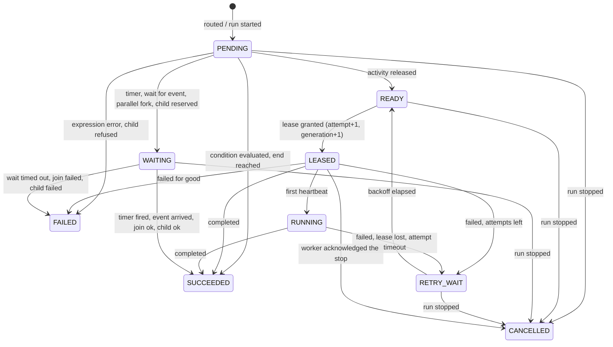

# Data Model: Durable execution engine and scheduler

## Context

Ensure DAG progress, checkpoints, suspension, retries and failure recovery without re-executing commits.

Data ownership follows the bounded contexts of `docs/architecture/overview.md`. The physical schema is in `crates/infra-postgres/migrations/20261009000000_definitions` and `20261009000100_execution` (up and down); `contracts/schema.sql` of feature 001 is the illustrative reference.

## Entities and observable state

| Entity | Table | Notes |
|---|---|---|
| Workflow, WorkflowVersion | `workflows`, `workflow_versions` | Immutable once published (trigger-enforced); the canonical document and its SHA-256 digest are stored; a version is addressed by `(workflow, number)` and pinned by runs through its id. |
| Run | `runs` | One row per run: status, `run_version` (number of journal events applied), stop reason/code, pause flag, input digest, deadline, correlation and trace ids, and, for a child run, the parent link (below). `root_run_id` names the root of the tree the run belongs to (its own id for a root run). |
| JournalEvent | `run_events` | Append-only (`ENABLE ALWAYS` trigger), `(tenant, run, seq)` primary key, one sequence per run; `event_type`, `node`, `attempt`, the event's own fields in `detail`, `payload_digest` for outputs, `actor` (`user:`, `worker:`, `system:`) and trace id. |
| Step (and its timer or subscription) | `steps` | The current state of each node of each run, written in the same transaction as the events that produced it. A `WAITING` step *is* the timer, the event subscription, the parallel join or the child wait: they are rows with partial indexes, which is why a suspended run costs about 2.4 KiB and no process. |
| Lease | columns of `steps` | `lease_token_hash` (SHA-256 only), `lease_expires_at`, `attempt_deadline_at`, `leased_by`, `generation`. |
| Payload | `payloads` | Content-addressed (`(tenant, digest)`), at most 256 KiB, append-only. Run inputs and step outputs. |
| Worker session | `worker_sessions` | Hash of the session token, the identity that opened it, advertised activities, `max_inflight`, expiry. One live session per `(tenant, identity, worker name)` (unique index): registering again replaces the token and keeps the id; an identity holds at most 32. |
| Outbox | `event_outbox` | Written with the change it announces (`task.ready`, `run.finished`); `next_attempt_at`, `attempt_count`, `last_error_code`, `delivered_at`. A `BEFORE DELETE` trigger (`ENABLE ALWAYS`) refuses to delete a message that is not delivered, whoever asks. |
| Idempotency record | `command_dedupe` | `(tenant, scope, key)` with a hash of the request and the result to replay. |
| Audit | `audit_records` | Operator actions (start, cancel, pause, resume, signal) and child starts (`system:engine`). |

## Run and step state machines

A run is `RUNNING`, `WAITING` (nothing runnable: every active step waits), `PAUSED`, `CANCELLING` (winding down) or terminal (`SUCCEEDED`, `FAILED`, `CANCELLED`, `TIMED_OUT`). The journal vocabulary has 26 events: `run.started`, `step.routed`, `step.released`, `step.leased`, `step.started`, `step.completed`, `step.retry_scheduled`, `step.retry_due`, `step.failed`, `condition.evaluated`, `timer.started`, `timer.fired`, `wait.started`, `wait.satisfied`, `wait.timed_out`, `parallel.forked`, `parallel.joined`, `child.started`, `child.finished`, `end.reached`, `step.cancel_requested`, `step.cancelled`, `run.paused`, `run.resumed`, `run.stop_requested`, `run.finished`.

## Child runs

`runs.parent_run_id`, `parent_node`, `cancel_policy` (`PROPAGATE`, `REQUEST_CANCEL`, `DETACH`) and `depth` (0 to 16, 8 enforced) record the link, which never changes. `parent_settled` (the parent no longer waits) and `parent_cancel` (the parent was stopped under a cascading policy) are written by the parent under its own lock. `steps.child_run_id` keeps the reserved run after the step ends; `child_started` and `child_input` exist only until the child has been created. Decision D36 in `research.md` explains the protocol and why no transaction holds two run locks. `runs.root_run_id` (indexed with the tenant) names the tree; D37 limits a tree to 1024 runs.

## Invariants

- Every tenant-scoped row carries `tenant_id` and every foreign key is the composite `(tenant_id, id)`: the database refuses a run, step, event, payload reference or parent link that points into another tenant. The tenant is never a request parameter (D4).
- A run changes only inside one transaction that holds its row lock; the journal, the projections, the outbox, the audit record and the idempotency record commit together or not at all (FR-002-003).
- The journal is append-only and the published version is immutable (triggers, `ENABLE ALWAYS`); `run_version` equals the sequence of the last event and guards the run row (`UPDATE ... WHERE run_version = $loaded`).
- A lease report needs attempt, generation and token; a stale holder changes nothing (D27).
- The state is derived: replaying the journal reproduces the projections (`verify_run`, proven after every random action by the property tests).
- Every time comparison uses the database clock (D28).
- `steps_waiting_consistent`: a step is `WAITING` exactly when it has a waiting kind; `steps_lease_consistent`: it is leased exactly when it has a token hash.
- No payload larger than 256 KiB is stored inline (check constraint); bigger ones need the blob store (G19).
- A run keeps at most 4 MiB of step outputs and signal payloads, and a tree at most 1024 runs (D37); a ready step is re-announced at most five times (`steps.hint_count`, D39).

## Lock order

Run row first, then its step rows; never two run rows in one transaction. The only transaction that touches another run is a parent's, and only to set the two flags of a child, which never locks a parent. `SKIP LOCKED` is used wherever many workers compete (task claims, outbox claims). Creating a child additionally takes `pg_advisory_xact_lock` on the tree (`run-tree:<tenant>:<root>`) after the parent's row lock and before any insert; nothing else waits for anything while holding it, so it cannot deadlock.

## Migrations

Additive, with a tested `down`. The runtime role `sagat_app` receives only what it needs: `SELECT, INSERT` on `payloads` and `run_events`; `SELECT, INSERT, UPDATE` on `runs` and `steps`; `SELECT, INSERT, UPDATE, DELETE` on `event_outbox` (to purge delivered messages) and `worker_sessions` (expiry); never `UPDATE` or `DELETE` on the journal, payloads, versions or audit. The startup guard (`verify_least_privilege`) also refuses a role that owns, or can rewrite, `run_events`, `payloads` or `workflow_versions`.
