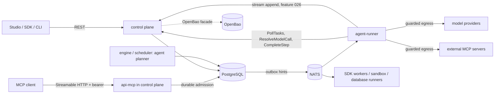

# Implementation plan — 025 AI agents and MCP

**Branch**: `feature/025-ai-agents-mcp` | **Date**: 2026-10-26 | **Spec**: [spec.md](spec.md)

Status: Proposed — not started.

## Summary

Add LLM provider resources, an engine-driven `agent` node whose model calls and tool calls are
durable derived steps, a managed `agent-runner` executor for model and MCP client calls, an MCP
server endpoint that admits declared exposures as durable runs, and Studio/SDK surfaces. Everything
reuses the existing admission transaction, leases and fences, OpenBao facade, approval machinery,
classification levels, quotas and outbox. Two decisions are recorded as proposed ADRs:
[ADR-0059](../../docs/adr/ADR-0059-agent-steps-are-engine-driven-loops-of-durable-derived-steps.md)
(execution model, budgets, prompt data rules) and
[ADR-0060](../../docs/adr/ADR-0060-mcp-exposes-declared-tools-and-calls-pinned-tools.md) (MCP trust
boundaries). Decisions, gaps and owner questions: [research.md](research.md).

## Technical Context

**Language/Version**: Rust 1.98 (`rust-toolchain.toml`); the existing locked TypeScript, Go, Python,
.NET and Java SDK toolchains; React Studio.

**Primary Dependencies**: existing Tokio, Axum, tonic, SQLx, `reqwest` behind `crates/infra-egress`,
OpenBao KV v2 adapter, JSON Schema adapter. New, to pin and review in T025-011: an MCP JSON-RPC
implementation or a minimal in-repo codec (prefer in-repo over a broad SDK, decided by a spike with
a written comparison), an SSE parser, and an AWS SigV4 signer for Bedrock (G1291). No provider SDK
enters the domain or application crates.

**Storage**: PostgreSQL authority for catalogs, pins, agent steps, turns, tool calls, receipts and
transcript metadata; transcript bodies are retained `payloads` rows or blob claim-checks (ADR-0023).
NATS carries hints only.

**Testing**: Rust unit and property tests; real PostgreSQL integration and fault suites; real
OpenBao for credentials; `apps/dev-model-provider` for deterministic model and MCP behaviour;
five-SDK conformance; a real-browser Studio journey; opt-in real-provider smoke tests that are
never the sole evidence of a guarantee.

**Target Platform**: existing single-region Linux containers, Docker Compose and Helm.

**Project Type**: modular monolith with two new adapter crates and two new apps.

**Performance Goals**: measure, do not promise (NFR-025-007): activation and turn-scheduling
transaction time, `ResolveModelCall` latency, runner overhead per call excluding provider time,
MCP admission latency, journal and transcript bytes per turn, at 1/16/64 concurrent agents.

**Constraints**: no user code or provider I/O in control plane or scheduler; domain without
`serde_json` business types (transcript bodies are opaque validated JSON documents passed through
ports); Error.code closed; additive contracts; finite ceilings below.

**Scale/Scope**: nine user stories, 47 FRs; agents root-only; text modality only.

## Constitution Check

These are design checks, not implementation approvals or test results.

| Principle | Before research | After design | Evidence / future gate |
|---|---|---|---|
| I — durable atomic transitions | Pass | Pass | Transaction table below; turns and tool calls are derived steps; fault tests T025-021, T025-033. |
| II — pure domain, inward dependencies | Justified | Justified | Planner and budgets in `crates/domain`; providers and MCP in new adapter crates, checked by the restricted-dependents map (T025-073). Two new processes (`apps/agent-runner`, `apps/dev-model-provider`) are justified under principle V in Complexity Tracking, with 017's `database-runner` as precedent (coordinator C21). |
| III — at-least-once effects, honest compensation | Pass | Pass | Stable tool keys, unknown outcome to reconciliation or manual review, reverse-order tool compensation, model calls re-billed and said so; T025-027, T025-029. |
| IV — pinned versions, five SDKs | Pass | Pass | Provider revision and MCP snapshot pinned at admission; additive IR and minor; T025-065, T025-066. |
| V — isolated code, tenant and secrets | Pass | Pass | `agent-runner` separate process without DB/OpenBao/signing keys, enforced by the restricted-dependents check; transcript level against provider and MCP ceilings; canaries; T025-016, T025-040, T025-042, T025-073. |
| VI — OTel, audit, typed errors | Pass | Pass | Spans, fixed-label metrics, audit actions and error table below; T025-064. |
| VII — inbox/outbox, redelivery | Pass | Pass | Every schedule writes outbox in its transaction; NATS hints only; MCP calls deduplicated by receipt; T025-021, T025-050. |
| VIII — failure tested, contracts verified | Pass | Pass | Failure matrix and verification plan; contract lint/compat tests; nothing ticked without evidence. |

Governance: ADR-0059 and ADR-0060 are Proposed; implementation starts only after owner acceptance
and answers to O1280–O1282. Any divergence needs a new ADR.

## Project Structure

### Documentation (this feature)

```text
specs/025-ai-agents-mcp/
├── spec.md · plan.md · research.md · data-model.md · quickstart.md · tasks.md
├── checklists/requirements.md
└── contracts/
    ├── README.md · agent-node.schema.json · model-turn.schema.json · ai-api.openapi.yaml
    ├── agent-runner-protocol.md · mcp-server.md · mcp-client.md
    ├── agent-stream-events.md · errors.md · conformance.md
```

### Source placement (existing paths verified; new ones marked)

```text
crates/domain/src/workflow.rs                 # NodeId: model_call/tool_call derived ids, parse_stored
crates/domain/src/agent.rs, agent/            # new: declaration, tools, budgets, planner, transcript ids
crates/domain/src/ai_provider.rs              # new: kinds, model entries, prices, data level
crates/domain/src/mcp.rs                      # new: exposures, snapshot digests, token scope
crates/domain/src/identity.rs                 # six permissions, role agent-runner
crates/domain/src/quota.rs                    # AI quota resources
crates/application/src/agents.rs, agents/     # new: activation, completion, tools, approvals, cancel
crates/application/src/ai_providers.rs        # new: catalog, probe admission
crates/application/src/agent_capability.rs    # new: ResolveModelCall / ResolveMcpCall use cases
crates/application/src/agent_transcripts.rs   # new: audited disclosure
crates/application/src/mcp_{servers,exposures,tokens,calls}.rs   # new
crates/infra-postgres/src/{agents,ai_providers,mcp}.rs + migrations/   # new
crates/infra-postgres/storage-classification.json
crates/infra-ir/src/agent.rs                  # new codec; classification_check.rs extended
crates/infra-schema/src/                      # closed output/tool-input schema validation
crates/infra-egress/src/lib.rs                # bounded incremental body reader
crates/infra-ai/                              # new adapter: anthropic, openai_compatible, bedrock,
                                              #   azure, canonical turn mapping, sse, mcp_client
crates/api-grpc/src/agent.rs                  # new: ResolveModelCall, ResolveMcpCall
crates/api-http/src/routes/{ai_providers,mcp_servers,mcp_exposures,mcp_tokens,
                            agent_transcripts,agent_tool_calls}.rs   # new
crates/api-mcp/                               # new adapter: Streamable HTTP JSON-RPC, PRM, tasks
crates/scheduler/                             # agent deadline timers
crates/telemetry/src/{metrics,span}.rs
apps/agent-runner/                            # new managed executor
apps/dev-model-provider/                      # new, development only
apps/control-plane/                           # mounts api-mcp
frontend/apps/studio/src/features/ai/         # new screens; workflows/AgentFields.tsx; runs/Agent*.tsx
sdks/typescript/src/agent.ts · sdks/go/workflow/agent.go · sdks/python/sagat_octopus_orchestrator/agent.py
sdks/dotnet/src/SagatOctopusOrchestrator.Sdk/Workflows/FlowAgent.cs
sdks/java/sdk/src/main/java/dev/sagatoctopusorchestrator/sdk/workflow/AgentOptions.java
tests/{contract,integration,fault,e2e,performance}/ai-agents-mcp/   # new suites
tests/contract/sdk-conformance/scenarios/agent-*.json
docs/runbooks/{ai-agents,agent-runner,mcp}.md # new
infra/docker/Dockerfile · infra/docker/compose.ai.yaml (new overlay, like compose.database.yaml) · infra/helm/templates/
```

`crates/infra-ai` and `crates/api-mcp` are classified as adapters by `scripts/check-architecture.py`
(`infra-*`, `api-*`). Only `apps/agent-runner` depends on `crates/infra-ai`; the control plane
depends on `crates/api-mcp` and never on `crates/infra-ai`. The layer rules cannot express this;
T025-073 adds a restricted-crate → allowed-dependents map to `scripts/check-architecture.py`
(`sagat-infra-ai` → `{sagat-agent-runner}`, `sagat-api-mcp` → `{sagat-control-plane}`) with its
negative tests.

## Architecture



The planner is a pure domain function: given the committed agent state and one event (activation,
model completion, tool completion, approval outcome, deadline, cancellation) it returns typed
commands (schedule model call with reservation, plan tool calls, open approvals, append refusal
results, finish with output, fail with code). The application applies the commands in the same
transaction as the event (as `advance` does for sagas). The runner never decides what happens next.

### Transaction boundaries

All new transactions use `BeginSafely::begin_safely` (ADR-0014).

| Transition | Commits together | Why |
|---|---|---|
| Run admission | run, provider-revision and MCP-snapshot pins per agent node, request receipt, initial journal, tasks, outbox, audit | A run never starts without its pins. |
| Agent activation | `agent_steps` row with effective budgets and deadline timer, turn 1 after a reservation pre-check, derived step `~m1` READY, journal `agent.started`, outbox hint | A step that could not afford one call fails before anything is queued. |
| Model-call claim (every attempt, first or retry) | existing claim transaction; AI concurrency = count of live `sagat.ai.*` leases under the namespace and tenant locks; the attempt's reservation row and the reserved counters of `agent_steps` and `ai_usage_daily`; or, when the reservation does not fit, the derived step and agent failed with `AI_BUDGET_EXHAUSTED` and no lease (the `RUN_DATA_LIMIT` preflight precedent) | Retries and in-flight calls can never overshoot a budget or the daily quota; expiry frees concurrency without a counter. |
| `ResolveModelCall` | phase 1: lease, session, binding, pins, current status and rights read in a run transaction, closed before OpenBao I/O; phase 2: same fences, credential pin and `secret.resolved` audit | No provider I/O under a lock; revocation between phases discards the value. |
| Model-call completion | step SUCCEEDED (fenced), response stored, the attempt's reservation settled with reported usage (agent and daily rows), journal `agent.turn_completed`, then exactly one of: tool calls (derived steps READY + outbox, approvals + timers, refusal results); final output validated and the node completed with its successors READY + outbox; a repair turn after a reservation pre-check; a failure routed to `onError` | The decision about what follows is in the transaction that records the answer. |
| Tool-call completion | derived step terminal, result stored, journal; if last of its turn: reservation pre-check + `~m(n+1)` READY + outbox, or `AI_BUDGET_EXHAUSTED` | Parallel completions serialize on the run row; exactly one schedules. |
| Model-call attempt failure or lease expiry | existing failure or expiry transaction plus the attempt reservation: released for a provider error response (G1294), converted to charged-unknown for a lost response, timeout or expiry; retry scheduled under the retry policy (its own reservation comes at its claim) | Unknown usage is never refunded. |
| Tool approval outcome | feature-014 decision or expiry transaction plus tool step READY + outbox, or a refusal result (and the next turn if it was the last), or agent failure | First commit wins against expiry and cancellation. |
| Cancellation / deadline | existing cancellation transaction or timer firing, agent step terminal, approvals cancelled, in-flight reservations kept | Losing races are audited no-ops. |
| MCP call | receipt (if keyed), exposure revision pin, run admission as above, audit `mcp.tool_called` | A retried call with the same key returns the same run. |
| Catalog writes | revision, head, audit (namespace AI catalog lock) | Optimistic concurrency, no lost edits. |
| Transcript read | audit `payload.pii_revealed` (reason `agent-transcript-v1:<node>`, never collapsed) before any byte is returned | Disclosure is evidenced. |
| Snapshot refresh completion | snapshot rows, resource head pointer, audit `mcp.tools_refreshed` | Authors never see half a snapshot. |

**Lock order.** Admission follows the merged order whose home is ADR-0050 (coordinator C4, to be
written by 018): provider and MCP-server heads take slot 4 (catalog heads and pins, after 017
connection, 021 resource and variable and 024 asset heads, before 030 service-endpoint heads), their
secrets slot 5, and `ai_usage_daily` slot 8 (quota and usage rows last). Every engine, approval and
claim transaction that touches agent rows on an existing run uses one order: the
run row under its shard fence (ADR-0020; feature 014 approval transactions already lock the run
before the request, `crates/infra-postgres/src/approval_progress.rs`) → an existing approval request
row → `agent_steps` → `agent_turns` and attempt reservations → `agent_tool_calls` → payload rows →
the namespace's `ai_usage_daily` row last (it is the only row shared by many runs). The claim
transaction takes the namespace and tenant concurrency locks in the claim's existing policy-lock
position. No transaction holds a lock across network I/O.

### Authorization

| Operation | Required (all current at the call) |
|---|---|
| Create, revise, pause, delete, probe providers and external MCP servers | `ai:manage`; inline secret creation also `secret:manage` |
| Publish a workflow with an agent node | `definition:publish`, `ai:use`, `secret:use` and the ACL of every pinned credential, model in allowlist, transcript-level checks against provider and MCP ceilings and output/approval/child floors, `write` tools with approval or `approval: "none"` |
| Start a run with an agent | `run:start`; publisher and initiator hold `ai:use`. Initiator: the human starter; for MCP-admitted runs the OAuth subject or the scoped token's minter; for 026 public-link runs the link's creating principal, re-checked at admission; system triggers use the publisher (017); no determinable initiator fails admission (D1312) |
| Set a provider's `maxPromptClassification` or an MCP server's `maxArgumentClassification` to `pii` | `ai:manage` and the namespace reveal grant, rechecked at each `pii` resolution; revocation pauses the resource (D1637) |
| List or call MCP tools when 029 is enabled | the 029 access evaluator decides visibility of exposures and targets in addition to the rows below |
| Read a transcript or the `sagat.agent.tokens` stream text | `run:read`, `payload:read-internal`, namespace reveal grant (the feature-016 `pii` audience) |
| View a tool-call input for approval | `approval:read`, eligibility, ADR-0033 level rights per field |
| Decide a tool-call approval | `approval:decide` and the request's eligibility policy |
| Manage exposures | `mcp:expose`, plus `run:start` on the target and the rights of the declared result level; the target version has no `approval: "none"` write tool |
| Mint, list, revoke scoped MCP tokens | `mcp:token:manage`; scope ⊆ exposures the minter may call |
| Call an MCP tool | `mcp:call`, exposure in token scope, `run:start`, rights of the declared result level |
| Poll or cancel an MCP task | `mcp:call`, token scope, exposure state and result-level rights re-checked on every `tasks/get` and `tasks/cancel`; cancel also `run:operate` |
| Claim and resolve agent-runner tasks | role `agent-runner` (`worker:execute`, `ai:execute`) and a current binding |

Default grants (O1281): `admin` all human AI/MCP permissions; `developer` `ai:use`, `mcp:call`,
`mcp:token:manage`; `operator` `mcp:call`; `viewer`, `worker`, `runner`, `database-runner` none;
`agent-runner` `worker:execute`, `ai:execute`. Transcripts need the reveal grant, which no role holds.
The catalog grows from 48 to 54 permissions and from seven to eight roles.

## Finite ceilings

Defaults are provisional until the owner ratifies them with the single default tier (G42 precedent).

| Resource | Default | Hard ceiling |
|---|---:|---:|
| Turns per agent step (`maxTurns`) | 16 | 64 |
| Tool calls per agent step (`maxToolCalls`) | 32 | 256 |
| Parallel tool calls per turn | 4 | 16 |
| Repair turns (`maxRepairTurns`) | 1 | 3 |
| Tools per agent node / MCP servers per node | 16 / 2 | 64 / 8 |
| Input tokens per agent step | 200,000 | 2,000,000 |
| Output tokens per agent step | 32,768 | 262,144 |
| `maxOutputTokens` per model call | 4,096 | 65,536 |
| Agent wall time (`timeoutMs`, includes approval waits) | 10 min | 24 h |
| Model-call attempt deadline | 120 s | 15 min |
| Model-call attempts (retry policy) | 5 | 10 |
| Tool call deadline (MCP; other kinds keep their own) | 30 s | 5 min |
| Instructions / prompt literal | 32 KiB / 32 KiB | 128 KiB / 128 KiB |
| Context entries / bytes after evaluation | 16 / 256 KiB | 32 / 1 MiB |
| Tool description / input schema | 1 KiB / 16 KiB | 4 KiB / 64 KiB |
| `outputSchema` bytes / depth | 16 KiB / 8 | 64 KiB / 16 |
| Tool result returned to the model | 64 KiB | 256 KiB |
| Transcript retained bytes per agent step | 4 MiB | 16 MiB |
| Concurrent model calls per namespace / tenant | 16 / 64 | 64 / 256 |
| Tokens per namespace per UTC day | 5,000,000 | 1,000,000,000 |
| Estimated cost per namespace per UTC day (priced models) | unset = only token bounds apply | operator-set |
| Providers / MCP servers per namespace | 20 / 20 | 200 / 200 |
| Models per provider revision | 16 | 64 |
| Snapshot tools per MCP server | 128 | 1,024 |
| Exposures per namespace | 50 | 500 |
| Scoped MCP tokens per namespace / lifetime | 50 / 30 days | 500 / 90 days |
| MCP request body / projected result | 256 KiB / 256 KiB | 1 MiB / 256 KiB (ADR-0031 bound) |
| MCP bounded wait | 10 s | 30 s |
| MCP calls per token | 10/s, burst 20 | operator-set, existing API rate quota also applies |
| Concurrent waiting MCP calls per namespace | 16 | 64 (beyond it a call returns a task or run handle at once) |
| MCP idempotency receipt window | 24 h | 24 h |
| Stream events / bytes per model call (with 026; deltas coalesced to at most one event per 100 ms or 1 KiB) | 1,024 / 1 MiB | 4,096 / 4 MiB |
| Reserved-channel (`sagat.agent.tokens`) events / bytes per run | effective `maxTurns` × per-call caps, summed over the version's streaming agent nodes (16,384 / 16 MiB for one agent at defaults) | the sum is clamped to 026's reserved pool: 65,536 events / 32 MiB by default, 131,072 / 64 MiB hard, under 026's per-run ceiling of 262,144 / 128 MiB over both pools (`specs/026-invocation-human-surfaces/plan.md`, Finite ceilings) |

The daily cost row is a deliberate exception to "every resource has a default": cost is optional
because prices are optional; token budgets and the daily token quota are always finite.

## Failure and recovery matrix

| Failure | Expected state | Handling and test |
|---|---|---|
| Runner dies before calling the provider | lease expires | retry, generation + 1; nothing billed beyond the reservation |
| Runner dies after the provider answered, before completion | lease expires | model asked again; first commit wins; both charged (T025-021) |
| `429`/`500`/`504`/`529`, stream error after `200` | attempt failed, retryable | backoff honouring `retry-after`; budget exhausted → typed failure |
| `400`, `401`, `403`, `413`, refusal | non-retryable | `AI_REQUEST_INVALID`, `AI_PROVIDER_AUTH`, `AI_CONTEXT_TOO_LARGE`, `AI_MODEL_REFUSED` via `onError` |
| OpenBao sealed or unreachable | `AI_CREDENTIAL_UNAVAILABLE`, retryable | no fallback, bounded retries (017 behaviour) |
| Egress denied | non-retryable `AI_DESTINATION_DENIED` failure | audited `egress.denied` |
| Tool worker dies after its effect | unknown or retried | same key; `write` → reconcile/manual review (T025-027) |
| Two tool completions at once | serialized | exactly one next turn (T025-026) |
| Approval vs expiry vs cancel | first commit wins | 50-round races (T025-033) |
| Deadline vs last tool result | first commit wins | audited no-op loser |
| NATS down | transitions persist | outbox re-emitted; runner polls (T025-021) |
| PostgreSQL down | nothing confirmed | runner reports retry with same key |
| Blob store down while storing a large response | completion fails retryably | response re-requested; reservation kept |
| Audit write fails on transcript read | no bytes returned | T025-041 |
| MCP client timeout after send | `OUTCOME_UNKNOWN` | manual review for `write` (T025-057) |
| MCP tool definition drift | `AI_TOOL_CHANGED` | not sent (T025-056) |
| MCP server: lost response, client retries with key | same run | receipt replay (T025-050) |
| Lost model response, then retry near the budget | retry claim refused | `AI_BUDGET_EXHAUSTED`; settled + reserved ≤ limit for the agent and the daily row (T025-021) |
| Runner killed holding leases | leases expire | concurrency free again; reservations charged-unknown (T025-021) |
| External MCP server advertises another token endpoint | call refused before the secret is sent | `AI_MCP_AUTH`, audit `mcp.oauth_metadata_changed` (T025-058) |
| Saga compensation of a tool fails | manual review | `COMPENSATION_FAILED` path of feature 003 |

## Observability

**Spans** (attributes use existing `sagat.*` names plus `sagat.agent.turn`, `sagat.agent.call`,
`sagat.ai.provider_kind`; model id and provider request id appear on spans, never on metrics; OTel
GenAI conventions only where stable, with content capture off): journal-derived
`workflow.agent.step`, `workflow.agent.turn`, `workflow.agent.tool_call`; live `ai.resolve`
(gRPC), `ai.model_call` and child `ai.provider.request` (runner), `ai.provider.probe`,
`mcp.server.request`, `mcp.client.call`, `mcp.tools.refresh`.

**Metrics** (closed label values only): `ai_model_calls_total{provider_kind,outcome}`,
`ai_model_call_duration_seconds{provider_kind,outcome}`, `ai_tokens_total{provider_kind,direction}`
(`input|output|cache_read|cache_write`), `agent_steps_total{outcome}`, `agent_turns_total{outcome}`,
`agent_tool_calls_total{kind,outcome}`, `agent_budget_exhausted_total{budget}`
(`turns|tool_calls|input_tokens|output_tokens|cost|wall_time`),
`agent_tool_approval_wait_seconds{outcome}`, `agent_runner_attempts_total{activity,outcome}`
(`model|mcp|probe|refresh`), `mcp_server_requests_total{method,outcome}` (`discover|tools_list|
tools_call|tasks_get|tasks_cancel|other`), `mcp_server_request_duration_seconds{method}`,
`mcp_client_calls_total{outcome}`, `mcp_token_auth_failures_total{reason}`; quota refusals reuse
`quota_exceeded_total{limit}`.

**Audit actions**: new `ai.provider_created|changed|paused|deleted|probed`,
`mcp.server_created|changed|paused|deleted`, `mcp.tools_refreshed`, `mcp.tool_changed`,
`mcp.oauth_metadata_changed`,
`ai.prompt_refused`, `ai.budget_exhausted`, `ai.tool_denied`, `mcp.exposure_created|changed|deleted`,
`mcp.token_minted|revoked`, `ai.pii_egress` (one per attempt whose transcript level is `pii`, D1637),
`mcp.tool_called`, `mcp.result_disclosed`, `mcp.call_denied`; reused
`secret.resolved`, `egress.denied`, `payload.pii_revealed`, `payload.reveal_denied`, `approval.*`,
`run.*` and `access.denied.*`. Audit records carry ids, names, outcomes, reason codes and digests,
never prompt, response, argument or credential content.

**Logs**: redacted structured logs; the runner suppresses provider SDK/HTTP debug targets; panic
hook without payload (017 precedent).

## Migration, compatibility and rollback

Expand-only migrations allocated at implementation time after the latest merged version.
`approval_requests` gains `owner_kind` (default `NODE`) and relaxed constraints only for the new kind
(G1289). The IR stays `sagat-octopus-orchestrator.io/v1`; `agent` is gated by an enabled capability.
The worker protocol gains one additive minor; older workers are never offered `sagat.ai.*` tasks and
ordinary activity tools need no protocol change. OpenAPI gains routes and schemas; MCP is a separate
versioned surface. Rollback: disable agent publication and admission and the MCP endpoint; keep the
engine, runner and readers until agent runs drain; never drop agent tables while runs reference them.
If 021 is accepted first, 025 creates no catalog tables. If 025 ships first, one migration moves its
catalog rows and `run_ai_bindings` into 021's tables (same ids, names, revisions and pins) and drops
the 025 tables; the catalogs never coexist (D1283, coordinator C22).

Cross-feature registrations (G1635): journal event reset rules in 018's registry (D1635: `REFUSE`
inside an open agent loop, `REMATERIALIZE` after `agent.finished`); content stores in 020's registry,
purged with the run's content (D1638); encoded positions in 031's registry (D1636); time columns in
`crates/infra-postgres/time-classification.json` (028: agent and approval deadlines `workflow_due`,
budget windows, reservations, receipts, handles and token expiry `infrastructure`); MCP token
handling in 032's key inventory (no key; SHA-256 lookup); MCP visibility through the 029 evaluator.

## Complexity Tracking

| Addition | Why needed | Simpler alternative rejected because |
|---|---|---|
| `apps/agent-runner` and machine role | Principle V: model prompts and tool calls are tenant-authored requests that carry third-party credentials and return untrusted content, so they are sent only by a managed executor holding one attempt's capability (coordinator C3 (a)); precedent: 017's `apps/database-runner` (ADR-0035), split out for the same reason | running calls in the engine or control plane violates principle V; reusing `database-runner` or 021's `integration-runner` would hand model-provider credentials to a process whose capability and egress policy serve other destinations |
| `crates/infra-ai` | provider wire adapters and MCP client hold clients and sockets | putting them in `infra-egress` would make the guard crate provider-aware |
| `crates/api-mcp` | separate wire protocol (JSON-RPC over Streamable HTTP) with its own versioning, like `api-grpc` | folding it into `api-http` mixes two protocol lifecycles in one adapter |
| `apps/dev-model-provider` | Principle V (test-only code isolated from production) and the owner's self-contained-infrastructure decision (2026-10-17 item 5): a development-only process, refused outside `SAGAT_ENV=dev` and absent from production images, as `apps/dev-idp` (ADR-0019) | mocking inside tests would not exercise the real runner, egress and protocol path; a provider simulator inside a production binary would ship test code |
| New tables for turns and tool calls | per-call durable identity, budgets and evidence | encoding them only as journal events would make budget checks scan the journal |

## Delivery sequence

1. Foundation: ADR acceptance, contracts, domain types and planner, migrations, permissions, the
   architecture check (T025-001..010, T025-073).
2. US01: provider catalog, runner, `ResolveModelCall`, model calls, structured output (T025-011..024).
3. US02: tools of every kind, idempotency, parallel turns, sagas (T025-025..031).
4. US03 approvals, then US04 budgets and quotas, then US05 data protection (T025-032..043).
5. US06 MCP server, US07 MCP client (T025-044..058, T025-074).
6. US08 Studio timeline and streaming, US09 assistant (T025-059..063).
7. Gates: five SDKs, telemetry, security battery, performance, runbooks, demo, cross-feature
   amendments and registrations (T025-064..072, T025-075..081).

A story ships only with its own gates; unchecked tasks are not promises.

## Verification plan

New targets `contract_ai_agents_mcp`, `integration_ai_agents_mcp`, `fault_ai_agents_mcp`,
`e2e_ai_agents_mcp` and `perf_ai_agents_mcp` in `tests/Cargo.toml`, plus SDK conformance scenarios.
Required evidence: crash at each commit point in the transaction table; duplicate claim and
completion; lost broker hint; timeout-versus-signal, approval-versus-expiry and
deadline-versus-completion races; failed compensation of a tool; restart of engine, control plane
and runner; tenant isolation over every new route, gRPC call and MCP method; quota and ceiling
exhaustion including a lost response followed by a retry and a killed runner; secret,
classification and MCP-argument canaries; loosened-annotation and unattended-write publication
fixtures; a 16-turn streaming scenario within the reserved-channel budget; reset points inside and
after an agent loop; encoded-field fixtures with 031's codes; reveal-grant revocation pausing a `pii`
provider; egress battery; MCP conformance with an independent
client library at both protocol revisions; five-SDK parity; real-browser Studio journey; measured
performance report. Opt-in real-provider smoke tests are reported separately and never replace these.
