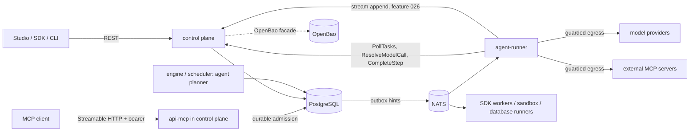

# Implementation plan — 025 AI agents and MCP

**Branch**: `feature/025-ai-agents-mcp` | **Date**: 2026-10-26 | **Spec**: [spec.md](spec.md)

Status: Approved for implementation (Owner decision 2026-11-11-1), in release 0.3.0 (Owner decision
2026-11-24-1); Architecture decisions 0059 and 0060 accepted (delegate, Owner decisions 2026-11-26-123
and 2026-11-26-124); not started. Revised 2026-11-26 against `develop` at `3f22b612` after an
independent audit, and on 2026-11-27 after the security review of that date (Decision 025-016).

## Summary

Add LLM provider resources, an engine-driven `agent` node whose model calls and tool calls are
durable derived steps, a managed `agent-runner` executor for model and MCP client calls, an MCP
server endpoint that admits declared exposures as durable runs, and Studio/SDK surfaces. Everything
reuses the existing admission transaction and its run-input gate (design 043), leases and fences,
managed kinds and runner profiles (feature 035), OpenBao facade, approval machinery, classification
levels and egress ceilings, quotas and outbox. Two decisions are recorded as accepted architecture
decisions:
[ADR-0059](../../docs/adr/ADR-0059-agent-steps-are-engine-driven-loops-of-durable-derived-steps.md)
(execution model, budgets, prompt data rules) and
[ADR-0060](../../docs/adr/ADR-0060-mcp-exposes-declared-tools-and-calls-pinned-tools.md) (MCP trust
boundaries). Decisions, gaps and owner questions: [research.md](research.md).

## Technical Context

**Language/Version**: Rust 1.100.0 (`rust-toolchain.toml`); the existing locked TypeScript, Go,
Python, .NET, Java and Rust SDK toolchains; React Studio.

**Primary Dependencies**: existing Tokio, Axum, tonic, SQLx, `reqwest` behind `crates/infra-egress`,
OpenBao KV v2 adapter, JSON Schema adapter. New, to pin and review in T025-011: an MCP JSON-RPC
implementation or a minimal in-repo codec (prefer in-repo over a broad SDK, decided by a spike with
a written comparison), and an SSE parser; the spike also verifies that `aws-bedrock` accepts an Amazon
Bedrock API key as a bearer token (G1291). An AWS SigV4 signer enters only when Gap 025-001 closes,
because SigV4 needs a signing key in the runner. No provider SDK
enters the domain or application crates.

**Storage**: PostgreSQL authority for catalogs, pins, agent steps, turns, tool calls, receipts and
transcript metadata; transcript bodies are retained `payloads` rows or blob claim-checks (ADR-0023).
NATS carries hints only.

**Testing**: Rust unit and property tests; real PostgreSQL integration and fault suites; real
OpenBao for credentials; `apps/dev-model-provider` for deterministic model and MCP behaviour;
six-SDK conformance; a real-browser Studio journey; opt-in real-provider smoke tests that are
never the sole evidence of a guarantee.

**Target Platform**: existing single-region Linux containers, Docker Compose and Helm.

**Project Type**: modular monolith with two new adapter crates and two new apps.

**Performance Goals**: measure, do not promise (NFR-025-007): activation and turn-scheduling
transaction time, `ResolveModelCall` latency, runner overhead per call excluding provider time,
MCP admission latency, journal and transcript bytes per turn, at 1/16/64 concurrent agents.

**Constraints**: no user code or provider I/O in control plane or scheduler; domain without
`serde_json` business types (transcript bodies are opaque validated JSON documents passed through
ports); Error.code closed; additive contracts; finite ceilings below.

**Scale/Scope**: nine user stories, 47 FRs; agents root-only; text modality only.

## Constitution Check

These are design checks, not implementation approvals or test results.

| Principle | Before research | After design | Evidence / future gate |
|---|---|---|---|
| I — durable atomic transitions | Pass | Pass | Transaction table below; turns and tool calls are derived steps; fault tests T025-021, T025-033. |
| II — pure domain, inward dependencies | Justified | Justified | Planner and budgets in `crates/domain`; providers and MCP in new adapter crates, checked by extending the restricted-dependent rules that `scripts/check-architecture.py` already has (Task 025-073). Managed kinds, egress ceilings and the run-input validator are reused, not duplicated. Two new processes (`apps/agent-runner`, `apps/dev-model-provider`) are justified under principle V in Complexity Tracking, with 017's `database-runner` as precedent (coordinator C21). |
| III — at-least-once effects, honest compensation | Pass | Pass | Stable tool keys, unknown outcome to reconciliation or manual review, reverse-order tool compensation, model calls re-billed and said so; T025-027, T025-029. |
| IV — pinned versions, six SDKs | Pass | Pass | Provider revision, MCP-server revision and MCP snapshot recorded in the published version and copied into the run at admission (Decision 025-016); additive IR and the next free protocol minor; agents are graph-model only (Decision 025-012); Tasks 025-065, 025-066 and 025-088 (Rust). |
| V — isolated code, tenant and secrets | Pass with conditions | Pass with conditions | `agent-runner` separate process without DB/OpenBao/signing keys or container engine, enforced by the architecture check; its credential disclosure fits Principle V's first declared set (Complexity Tracking, Decision 025-001); transcript level against provider and MCP ceilings; canaries; Tasks 025-016, 025-017, 025-040, 025-042, 025-073. Conditions: the publication-time and delivery-time `secret:use` checks and the binding-profile check are proven by Tasks 025-009, 025-017 and 025-083 before any provider credential is delivered; only modes that deliver a static API key or bearer token are offered, the materialized node of every AI kind has no `secrets` and `ResolveSecrets` refuses managed leases (Tasks 025-017, 025-091); OAuth MCP servers and the provider modes that need a client secret or a signing key (`azure-entra-client-credentials`, `aws-access-key`) stay refused until constitution 5.1.0, whose third declared set the owner approved (Owner decision 2026-11-25-3), merges and design 047's broker issues access tokens (Gap 025-001; the alternative is Owner question 025-001). |
| VI — OTel, audit, typed errors | Pass | Pass | Spans, fixed-label metrics, audit actions and error table below; T025-064. |
| VII — inbox/outbox, redelivery | Pass | Pass | Every schedule writes outbox in its transaction; NATS hints only; MCP calls deduplicated by receipt; T025-021, T025-050. |
| VIII — failure tested, contracts verified | Pass | Pass | Failure matrix and verification plan; contract lint/compat tests; nothing ticked without evidence. |

Governance: Architecture decisions 0059 and 0060 are accepted (delegate, Owner decisions 2026-11-26-123
and 2026-11-26-124, under Owner decision 2026-11-24-4); Owner questions 1280 to 1282 are decided (Owner
decisions 2026-11-26-120 to 2026-11-26-122). Any divergence needs a new architecture decision.

## Project Structure

### Documentation (this feature)

```text
specs/025-ai-agents-mcp/
├── spec.md · plan.md · research.md · data-model.md · quickstart.md · tasks.md
├── checklists/requirements.md
└── contracts/
    ├── README.md · agent-node.schema.json · model-turn.schema.json · ai-api.openapi.yaml
    ├── agent-runner-protocol.md · mcp-server.md · mcp-client.md
    ├── agent-stream-events.md · errors.md · conformance.md
```

### Source placement (existing paths verified; new ones marked)

```text
crates/domain/src/workflow.rs                 # NodeId: model_call/tool_call derived ids, parse_stored
crates/domain/src/agent.rs, agent/            # new: declaration, tools, budgets, planner, transcript ids
crates/domain/src/ai_provider.rs              # new: kinds, model entries, prices, data level
crates/domain/src/mcp.rs                      # new: exposures, snapshot digests, token scope
crates/domain/src/identity.rs                 # six permissions (55 to 61), role agent-runner (eighth)
crates/domain/src/database.rs                 # ManagedKind::{AiModel, AiMcp, AiProbe, AiMcpRefresh}
crates/domain/src/binding.rs                  # BindingProfile::Agent
crates/domain/src/classification.rs           # EgressCeiling reused for provider and MCP ceilings (no change)
crates/domain/src/execution/reset.rs          # reset-rule arms of the agent events
crates/domain/src/quota.rs                    # AI quota resources (ai_runner_concurrency, ...)
crates/application/src/instances.rs           # Capability::{AiAgentsV1, McpServerV1}
crates/application/tests/managed_kind_sites.rs  # extended to the AI kinds
crates/application/src/agents.rs, agents/     # new: activation, completion, tools, approvals, cancel
crates/application/src/ai_providers.rs        # new: catalog, probe admission
crates/application/src/agent_capability.rs    # new: ResolveModelCall / ResolveMcpCall use cases
crates/application/src/agent_transcripts.rs   # new: audited disclosure
crates/application/src/mcp_{servers,exposures,tokens,calls}.rs   # new
crates/infra-postgres/src/{agents,ai_usage_leases,mcp}.rs + migrations/   # new (catalog rows are 021's)
crates/infra-postgres/storage-classification.json
crates/infra-ir/src/agent.rs                  # new codec; classification_check.rs extended
crates/infra-schema/src/run_input/            # RunInputValidator reused for tool inputs and answers
crates/infra-egress/src/lib.rs                # ResponseBody gains a bounded incremental variant
crates/infra-ai/                              # new adapter: anthropic, openai_compatible, bedrock,
                                              #   azure, canonical turn mapping, sse, mcp_client
crates/api-grpc/src/agent.rs                  # new: ResolveModelCall, ResolveMcpCall
crates/api-http/src/routes/{ai_providers,mcp_servers,mcp_exposures,mcp_tokens,
                            agent_transcripts,agent_tool_calls}.rs   # new
crates/api-mcp/                               # new adapter: Streamable HTTP JSON-RPC, PRM, tasks
crates/scheduler/                             # agent deadline timers
crates/telemetry/src/{metrics,span}.rs
apps/agent-runner/                            # new managed executor
apps/dev-model-provider/                      # new, development only
apps/control-plane/                           # mounts api-mcp
frontend/apps/studio/src/features/ai/         # new screens; workflows/AgentFields.tsx; runs/Agent*.tsx
sdks/typescript/src/agent.ts · sdks/go/workflow/agent.go · sdks/python/sagat_octopus_orchestrator/agent.py
sdks/dotnet/src/SagatOctopusOrchestrator.Sdk/Workflows/FlowAgent.cs
sdks/java/sdk/src/main/java/dev/sagatoctopusorchestrator/sdk/workflow/AgentOptions.java
sdks/rust/src/workflow/agent.rs · sdks/rust/src/client/agents.rs
sdks/error-catalog.json (and every SDK's embedded copy) · sdks/SPEC.md sections 2 and 9
tests/{contract,integration,fault,e2e,performance}/ai-agents-mcp/   # new suites
tests/contract/sdk-conformance/scenarios/agent-*.json
docs/runbooks/{ai-agents,agent-runner,mcp}.md # new
infra/docker/Dockerfile · infra/docker/compose.ai.yaml (new overlay, layered on compose.database.yaml and its OpenBao) · infra/helm/templates/
```

`crates/infra-ai` and `crates/api-mcp` are classified as adapters by `scripts/check-architecture.py`
(`infra-*`, `api-*`). Only `apps/agent-runner` depends on `crates/infra-ai`; the control plane
depends on `crates/api-mcp` and never on `crates/infra-ai`. The script already has both kinds of rule
this needs (lines 60-67): a crate only some packages may use (`ICEBERG_CRATE` with
`ICEBERG_TEST_ONLY_PACKAGES`) and packages that may not use a crate (`LAKE_RUNNER_PACKAGES` with
`CONTAINER_ENGINE_CRATES`). Task 025-073 extends those patterns: `sagat-infra-ai` usable only by
`sagat-agent-runner` (and `sagat-tests`), `sagat-api-mcp` only by `sagat-control-plane` (and
`sagat-tests`), and `sagat-agent-runner` and `sagat-infra-ai` added to the packages that may not link a
container engine, each with its negative test in `scripts/tests/test_check_architecture.py`.

## Architecture



The planner is a pure domain function: given the committed agent state and one event (activation,
model completion, tool completion, approval outcome, deadline, cancellation) it returns typed
commands (schedule model call with reservation, plan tool calls, open approvals, append refusal
results, finish with output, fail with code). The application applies the commands in the same
transaction as the event (as `advance` does for sagas). The runner never decides what happens next.

### Transaction boundaries

All new transactions use `BeginSafely::begin_safely` (ADR-0014).

| Transition | Commits together | Why |
|---|---|---|
| Publication of a version with agents | version, its recorded provider revision per agent node and MCP-server revision and snapshot per `mcp` tool, its effective output levels and its unattended flag (Decision 025-016), audit | What publication checked is what every run uses. |
| Run admission | run, provider-revision and MCP-snapshot pins per agent node copied from the version, the recheck of the current ceilings and allowlists against the transcript level (`AI_DESTINATION_RESTRICTED` otherwise), the remote-root origin for an MCP or public-link root, request receipt, initial journal, tasks, outbox, audit | A run never starts without its pins, nor past a ceiling an administrator lowered. |
| Child admission (child node or `child` tool) | existing child admission plus, for a child under an active-version policy, the check of the child version's recorded output levels against the parent's carrier, and, when the run carries the remote-root origin, the refusal of an unattended child version; the origin copied to the child | An inherited level and the unattended rule hold at every depth. |
| Agent activation | `agent_steps` row with effective budgets and deadline timer, turn 1 after a reservation pre-check, derived step `~m1` READY, journal `agent.started`, outbox hint | A step that could not afford one call fails before anything is queued. |
| Model-call claim (every attempt, first or retry) | existing claim transaction; only for a `sagat.ai.*` claim: runner concurrency = count of live `sagat.ai.*` leases under the namespace and tenant locks; for `sagat.ai.model` the attempt's reservation row, the reserved counters of `agent_steps` and a charge to the claiming backend's own `ai_usage_leases` row (a refill from `ai_usage_daily` only when that lease is short, Decision 025-010); or, when the reservation does not fit, the derived step and agent failed with `AI_BUDGET_EXHAUSTED` and no lease (the `RUN_DATA_LIMIT` preflight precedent). Ordinary claims add no statement (design 038 budget, Decision 025-009) | Retries and in-flight calls can never overshoot a budget or the daily quota; expiry frees concurrency without a counter; no shared row is written at every claim. |
| `ResolveModelCall` | phase 1: lease, session, binding, pins, current status, current ceiling and allowlist against the transcript level, and rights read in a run transaction, closed before OpenBao I/O; phase 2: same fences and rechecks, credential pin and `secret.resolved` audit | No provider I/O under a lock; revocation or a lowered ceiling between phases discards the value. |
| Model-call completion | step SUCCEEDED (fenced), response stored, the attempt's reservation settled with reported usage (the agent row and the writer's own usage lease), journal `agent.turn_completed`, then exactly one of: tool calls (derived steps READY + outbox, approvals + timers, refusal results); final output validated and the node completed with its successors READY + outbox; a repair turn after a reservation pre-check; a failure routed to `onError` | The decision about what follows is in the transaction that records the answer. |
| Tool-call completion | derived step terminal, result stored, journal; if last of its turn: reservation pre-check + `~m(n+1)` READY + outbox, or `AI_BUDGET_EXHAUSTED` | Parallel completions serialize on the run row; exactly one schedules. |
| Model-call attempt failure or lease expiry | existing failure or expiry transaction plus the attempt reservation: released for a provider error response (G1294), converted to charged-unknown for a lost response, timeout or expiry; retry scheduled under the retry policy (its own reservation comes at its claim) | Unknown usage is never refunded. |
| Tool approval outcome | feature-014 decision or expiry transaction plus tool step READY + outbox, or a refusal result (and the next turn if it was the last), or agent failure; a decision whose decider's current rights would withhold any input field is refused (`APPROVAL_INPUT_WITHHELD`) with its denial audit and no other write | First commit wins against expiry and cancellation; nobody approves arguments they cannot see. |
| Cancellation / deadline | existing cancellation transaction or timer firing, agent step terminal, approvals cancelled, in-flight reservations kept | Losing races are audited no-ops. |
| MCP call | authorization first; the per-caller agent-run count under the caller's lock; the design 043 run-input gate (a `CheckedRunInput` of the arguments against the target version's `inputSchema`; a new row of the gate's table, Decision 025-006), receipt (if keyed; keyed by tenant, namespace, caller as the credential identity, exposure and key), exposure revision pin, remote-root origin, run admission through the existing `create`, audit `mcp.tool_called`; before a result is returned, a read-only recheck of the credential and rights | A retried call with the same key, credential and exposure returns the same run; no second validation path; a revoked credential receives nothing. |
| Catalog writes | revision, head, audit (namespace AI catalog lock) | Optimistic concurrency, no lost edits. |
| Transcript read | audit `payload.pii_revealed` (reason `agent-transcript-v1:<node>`, never collapsed) before any byte is returned | Disclosure is evidenced. |
| Snapshot refresh completion | snapshot rows, resource head pointer, audit `mcp.tools_refreshed` | Authors never see half a snapshot. |

**Lock order.** Admission follows Architecture decision 0050 decision 7 (accepted; feature 018 is
merged), which already names 025's slots: provider and MCP-server heads in slot 4b (catalog heads and
pins, after 017 connection, 021 resource and variable and 024 asset heads, before the 030
service-endpoint head), their secrets in slot 5, and `ai_usage_daily` in slot 8b (quota and usage rows
last). A usage-lease refill locks `ai_usage_daily` (8b) and then the writer's own `ai_usage_leases` row
`NOWAIT`, which no other writer holds (Architecture decision 0097 decision 4). Every engine, approval and
claim transaction that touches agent rows on an existing run uses one order: the
run row under its shard fence (ADR-0020; feature 014 approval transactions already lock the run
before the request, `crates/infra-postgres/src/approval_progress.rs`) → an existing approval request
row → `agent_steps` → `agent_turns` and attempt reservations → `agent_tool_calls` → payload rows →
the writer's own usage lease, and on a refill the namespace's `ai_usage_daily` row before it (slot 8b,
the only row shared by many runs, last of the shared rows). The claim
transaction takes the namespace and tenant concurrency locks in the claim's existing policy-lock
position. No transaction holds a lock across network I/O.

### Authorization

| Operation | Required (all current at the call) |
|---|---|
| Create or revise providers and external MCP servers | `ai:manage` and `secret:use` with the access list of every referenced secret (the secrets become declared secrets of every task definition that pins the revision); inline secret creation also `secret:manage` |
| Pause or delete providers and external MCP servers | `ai:manage` |
| Probe a provider or refresh an MCP server's tools | `ai:manage` and `run:start` (it admits a private run through `start_private`) |
| Publish a workflow with an agent node | the platform requirement `ai-agents-v1` recorded; `definition:publish`, `ai:use`, `secret:use` and the access list of every credential secret of every provider and MCP-server revision the version pins (recorded in the version; checked again at every delivery, Requirement 025-003), model in allowlist, transcript-level checks against provider and MCP ceilings and output/approval/child floors, inherited output levels of workflow and child outputs, no `secret` tool input field, `write` tools with approval or `approval: "none"`, `child` tools and database `execute` tools never `read` or `"none"` without a policy, `mcp` tools `read` without a policy only on a read-only snapshot annotation |
| Start a run with an agent | `run:start`; publisher and initiator hold `ai:use`. Initiator: the human starter; for MCP-admitted runs the OAuth subject or the scoped token's minter; for 026 public-link runs the link's creating principal, re-checked at admission; system triggers use the publisher (017); no determinable initiator fails admission (D1312) |
| Set a provider's `maxPromptClassification` or an MCP server's `maxArgumentClassification` to `pii` | `ai:manage` and the namespace reveal grant; the grant of that administrator (the actor of the revision that set `pii`) is rechecked at each `pii` resolution; its revocation, or that administrator leaving the namespace, pauses the resource until a grant holder saves a new revision (D1637) |
| List or call MCP tools when 029 is enabled | the 029 access evaluator decides visibility of exposures and targets in addition to the rows below |
| Read a transcript or the `sagat.agent.tokens` stream text | `run:read`, `payload:read-internal`, namespace reveal grant (the feature-016 `pii` audience) |
| View a tool-call input for approval | `approval:read`, eligibility, ADR-0033 level rights per field |
| Decide a tool-call approval | `approval:decide`, the request's eligibility policy, and current rights that disclose every field of the tool input (`APPROVAL_INPUT_WITHHELD` otherwise) |
| Read a provider, an external MCP server or an exposure (`getAiProvider`, `getMcpServer`, `getMcpExposure` and their lists) | `namespace:read` |
| Create or revise an exposure | `mcp:expose`, plus `run:start` on the target and the rights of the declared result level; the target version is not unattended (at any child depth) |
| Disable or delete an exposure | `mcp:expose` |
| Mint or list scoped MCP tokens | `mcp:token:manage`; scope ⊆ exposures the minter may call, resolved to exposure identifiers at mint; an `ai:manage` holder lists every token of the namespace, others their own |
| Revoke a scoped MCP token | its minter with `mcp:token:manage`, or any `ai:manage` holder |
| Call an MCP tool | `mcp:call`, exposure in token scope, `run:start`, rights of the declared result level |
| Poll or cancel an MCP task | `mcp:call`, token scope, exposure state and result-level rights re-checked on every `tasks/get` and `tasks/cancel`; cancel also `run:operate` |
| Claim and resolve agent-runner tasks | role `agent-runner` (`worker:execute`, `ai:execute`), a current binding of `BindingProfile::Agent` for the reserved activity, the pool-delivery policy of every secret, the recorded lease-owning executor subject and live session; plus the publisher's current `secret:use` on every declared secret and the initiator's `ai:use` (Principle V's first declared set, Decision 025-001) |

Default grants (Owner decision 2026-11-26-121, answering Owner question 1281): `admin` all human
AI/MCP permissions; `developer` `ai:use`, `mcp:call`, `mcp:token:manage`; `operator` `mcp:call`;
`viewer`, `worker`, `runner`, `database-runner` none; `agent-runner` `worker:execute`, `ai:execute` and
never `database:execute`. Transcripts need the reveal grant, which no role holds. The catalog grows
from 55 to 61 permissions (`Permission::ALL`, `crates/domain/src/identity.rs`) and from seven to eight
roles.

## Finite ceilings

Defaults are provisional until the owner ratifies them with the single default tier (G42 precedent).

| Resource | Default | Hard ceiling |
|---|---:|---:|
| Turns per agent step (`maxTurns`) | 16 | 64 |
| Tool calls per agent step (`maxToolCalls`) | 32 | 256 |
| Parallel tool calls per turn | 4 | 16 |
| Repair turns (`maxRepairTurns`) | 1 | 3 |
| Tools per agent node / MCP servers per node | 16 / 2 | 64 / 8 |
| Input tokens per agent step | 200,000 | 2,000,000 |
| Output tokens per agent step | 32,768 | 262,144 |
| `maxOutputTokens` per model call | 4,096 | 65,536 |
| Agent wall time (`timeoutMs`, includes approval waits) | 10 min | 24 h |
| Model-call attempt deadline | 120 s | 15 min |
| Model-call attempts (retry policy) | 5 | 10 |
| Tool call deadline (MCP; other kinds keep their own) | 30 s | 5 min |
| Instructions / prompt literal | 32 KiB / 32 KiB | 128 KiB / 128 KiB |
| Context entries / bytes after evaluation | 16 / 256 KiB | 32 / 1 MiB |
| Tool description / input schema | 1 KiB / 16 KiB | 4 KiB / 64 KiB |
| `outputSchema` bytes / depth | 16 KiB / 8 | 64 KiB / 16 |
| Tool result returned to the model | 64 KiB | 256 KiB |
| Transcript retained bytes per agent step | 4 MiB | 16 MiB |
| Concurrent agent-runner attempts per namespace / tenant (`ai_runner_concurrency`, every `sagat.ai.*` lease) | 16 / 64 | 64 / 256 |
| Tokens per namespace per UTC day | 5,000,000 | 1,000,000,000 |
| Estimated cost per namespace per UTC day (priced models) | unset = only token bounds apply | operator-set |
| Providers / MCP servers per namespace | 20 / 20 | 200 / 200 |
| Models per provider revision | 16 | 64 |
| Snapshot tools per MCP server | 128 | 1,024 |
| Exposures per namespace | 50 | 500 |
| Scoped MCP tokens per namespace / lifetime | 50 / 30 days | 500 / 90 days |
| MCP request body / projected result | 256 KiB / 256 KiB | 1 MiB / 256 KiB (ADR-0031 bound) |
| MCP bounded wait | 10 s | 30 s |
| MCP calls per token | 10/s, burst 20 | operator-set, existing API rate quota also applies |
| Concurrent waiting MCP calls per namespace | 16 | 64 (beyond it a call returns a task or run handle at once) |
| Live agent runs per MCP caller (`mcp_agent_runs_per_caller`; runs whose target version can contain agents, counted per credential identity) | 4 | 64 |
| Daily tokens per exposure (`maxDailyTokens`, optional) | unset = only the namespace's daily tokens apply | the namespace's daily token limit |
| MCP idempotency receipt window | 24 h | 24 h |
| Stream events / bytes per model call (with 026; deltas coalesced to at most one event per 100 ms or 1 KiB) | 1,024 / 1 MiB | 4,096 / 4 MiB |
| Reserved-channel (`sagat.agent.tokens`) events / bytes per run | effective `maxTurns` × per-call caps, summed over the version's streaming agent nodes (16,384 / 16 MiB for one agent at defaults) | the sum is clamped to 026's reserved pool: 65,536 events / 32 MiB by default, 131,072 / 64 MiB hard, under 026's per-run ceiling of 262,144 / 128 MiB over both pools (`specs/026-invocation-human-surfaces/plan.md`, Finite ceilings) |

The daily cost row is a deliberate exception to "every resource has a default": cost is optional
because prices are optional; token budgets and the daily token quota are always finite.

## Failure and recovery matrix

| Failure | Expected state | Handling and test |
|---|---|---|
| Runner dies before calling the provider | lease expires | retry, generation + 1; nothing billed beyond the reservation |
| Runner dies after the provider answered, before completion | lease expires | model asked again; first commit wins; both charged (T025-021) |
| `429`/`500`/`504`/`529`, stream error after `200` | attempt failed, retryable | backoff honouring `retry-after`; budget exhausted → typed failure |
| `400`, `401`, `403`, `413`, refusal | non-retryable | `AI_REQUEST_INVALID`, `AI_PROVIDER_AUTH`, `AI_CONTEXT_TOO_LARGE`, `AI_MODEL_REFUSED` via `onError` |
| OpenBao sealed or unreachable | `AI_CREDENTIAL_UNAVAILABLE`, retryable | no fallback, bounded retries (017 behaviour) |
| Egress denied | non-retryable `AI_DESTINATION_DENIED` failure | audited `egress.denied` |
| Tool worker dies after its effect | unknown or retried | same key; `write` → reconcile/manual review (T025-027) |
| Two tool completions at once | serialized | exactly one next turn (T025-026) |
| Approval vs expiry vs cancel | first commit wins | 50-round races (T025-033) |
| Deadline vs last tool result | first commit wins | audited no-op loser |
| NATS down | transitions persist | outbox re-emitted; runner polls (T025-021) |
| PostgreSQL down | nothing confirmed | runner reports retry with same key |
| Blob store down while storing a large response | completion fails retryably | response re-requested; reservation kept |
| Audit write fails on transcript read | no bytes returned | T025-041 |
| MCP client timeout after send | `OUTCOME_UNKNOWN` | manual review for `write` (T025-057) |
| MCP tool definition drift | `AI_TOOL_CHANGED` | not sent (T025-056) |
| MCP server: lost response, client retries with key | same run | receipt replay (T025-050) |
| Lost model response, then retry near the budget | retry claim refused | `AI_BUDGET_EXHAUSTED`; settled + reserved ≤ limit for the agent and for the daily budget (folded usage plus leases) (T025-021) |
| Runner killed holding leases | leases expire | concurrency free again; reservations charged-unknown (T025-021) |
| Server backend holding a usage lease ends | its lease's room is unused | the purge pass folds the ended backend's lease back into `ai_usage_daily` (Architecture decision 0097 decision 1; Task 025-086) |
| Step-log report or carry from the agent runner | refused or ignored | design 041 checks P1, T7 and C0 (Task 025-084) |
| External MCP server advertises another token endpoint (OAuth servers, once Gap 025-001 closes) | call refused before any credential is used | `AI_MCP_AUTH`, audit `mcp.oauth_metadata_changed` (T025-058) |
| Saga compensation of a tool fails | manual review | `COMPENSATION_FAILED` path of feature 003 |
| Provider or MCP endpoint answers `3xx` (the probe included) | attempt failed, no hop | `AI_DESTINATION_DENIED`, audited `egress.denied`; no credential reaches the target (T025-012, T025-016) |
| Administrator lowers a ceiling or removes a model after publication | next admission or resolution refused | `AI_DESTINATION_RESTRICTED` at admission, `CLASSIFICATION_EGRESS_REFUSED` or `AI_CAPABILITY_UNAVAILABLE` before dispatch (T025-097) |
| Scoped token revoked while a call waits | no result returned | answered as an unknown tool after the recheck (T025-048) |

## Observability

**Spans** (attributes use existing `sagat.*` names plus `sagat.agent.turn`, `sagat.agent.call`,
`sagat.ai.provider_kind`; the pinned model id and the provider request id appear on spans, never on
metrics; a tool name on a span is a declared name or `UNKNOWN_TOOL`; the model the provider reports
appears only as `sagat.ai.model_substituted` (`true`/`false`); the provider request id only when it
matches `^[A-Za-z0-9._:-]{1,128}$`; no string the model wrote, the provider's tool-use id included,
reaches a span (Decision 025-016); OTel
GenAI conventions only where stable, with content capture off): journal-derived
`workflow.agent.step`, `workflow.agent.turn`, `workflow.agent.tool_call`; live `ai.resolve`
(gRPC), `ai.model_call` and child `ai.provider.request` (runner), `ai.provider.probe`,
`mcp.server.request`, `mcp.client.call`, `mcp.tools.refresh`.

**Metrics** (closed label values only): `ai_model_calls_total{provider_kind,outcome}`,
`ai_model_call_duration_seconds{provider_kind,outcome}`, `ai_tokens_total{provider_kind,direction}`
(`input|output|cache_read|cache_write`), `agent_steps_total{outcome}`, `agent_turns_total{outcome}`,
`agent_tool_calls_total{kind,outcome}`, `agent_budget_exhausted_total{budget}`
(`turns|tool_calls|input_tokens|output_tokens|cost|wall_time`),
`agent_tool_approval_wait_seconds{outcome}`, `agent_runner_attempts_total{activity,outcome}`
(`model|mcp|probe|refresh`), `mcp_server_requests_total{method,outcome}` (`discover|tools_list|
tools_call|tasks_get|tasks_cancel|other`), `mcp_server_request_duration_seconds{method}`,
`mcp_client_calls_total{outcome}`, `mcp_token_auth_failures_total{reason}`; quota refusals reuse
`quota_exceeded_total{limit}`.

**Audit actions**: new `ai.provider_created|changed|paused|deleted|probed`,
`mcp.server_created|changed|paused|deleted`, `mcp.tools_refreshed`, `mcp.tool_changed`,
`mcp.oauth_metadata_changed`,
`ai.prompt_refused`, `ai.budget_exhausted`, `ai.tool_denied`, `mcp.exposure_created|changed|deleted`,
`mcp.token_minted|revoked`, `ai.pii_egress` (one per attempt whose transcript level is `pii`, D1637),
`mcp.tool_called`, `mcp.result_disclosed`, `mcp.call_denied`, `ai.approval_input_withheld` (a refused
tool-call decision, Decision 025-016); reused
`secret.resolved`, `egress.denied`, `payload.pii_revealed`, `payload.reveal_denied`, `approval.*`,
`run.*` and `access.denied.*`. Audit records carry ids, names, outcomes, reason codes and digests,
never prompt, response, argument or credential content. Each new action needs its row in design 040's
audit-to-OCSF mapping (`docs/designs/040-ocsf-event-standard.md`, Technical Plan 1: an arm of the
exhaustive `match` in `crates/domain/src/audit_ocsf.rs` and a regenerated `docs/reference/ocsf-mapping.md`);
Task 025-090 adds them once design 040 is built (Gap 025-003).

**Logs**: redacted structured logs; the runner suppresses provider SDK/HTTP debug targets; panic
hook without payload (017 precedent).

## Migration, compatibility and rollback

Expand-only migrations allocated at implementation time after the latest merged version.
`approval_requests` gains `owner_kind` (default `NODE`) and relaxed constraints only for the new kind
(G1289). The IR stays `sagat-octopus-orchestrator.io/v1`; `agent` is gated by the instance-registry
capability `ai-agents-v1` and the MCP endpoint by `mcp-server-v1` (Architecture decision 0082; one
migration extends the closed capability CHECKs, Task 025-082). The worker protocol gains one additive
minor, the next free one of the register in `sdks/SPEC.md` section 9 when the contract merges (1.7 is
feature 041's; Gap 1280); the agent runner negotiates it, and with it 1.7, but never sends step logs and
its registration carries no `StepLogPolicy` (Decision 025-005). Older workers are never offered
`sagat.ai.*` tasks and ordinary activity tools need no protocol change. OpenAPI gains routes and
schemas; MCP is a separate versioned surface. The managed-step failure codes become `worker`-origin
entries of `sdks/error-catalog.json` (Task 025-087). Rollback: disable agent publication and admission
and the MCP endpoint (the operator removes the requirement); keep the engine, runner and readers until
agent runs drain; never drop agent tables while runs reference them. Providers and MCP servers are 021
resource types and 025 creates no catalog tables (Owner decision 2026-11-26-122, D1283, coordinator
C22).

Cross-feature registrations: journal event reset rules as arms of the code registry
`crates/domain/src/execution/reset.rs` (018 merged; D1635: `ResetRule::Refuse { until:
Some("agent.finished") }` for every open-loop event, `ResetRule::Rematerialize` for `agent.finished`;
Task 025-078); and, in registries still drafts (G1635), content stores in 020's registry, purged with
the run's content (D1638); encoded positions in 031's registry (D1636); time columns in
`crates/infra-postgres/time-classification.json` (to be created by 028: agent and approval deadlines
`workflow_due`, budget windows, leases, reservations, receipts, handles and token expiry
`infrastructure`); MCP token handling in 032's key inventory (no key; SHA-256 lookup); MCP visibility
through the 029 evaluator when 029 is enabled; audit actions in design 040's OCSF mapping (Gap
025-003).

## Complexity Tracking

| Addition | Why needed | Simpler alternative rejected because |
|---|---|---|
| `apps/agent-runner` | Principle V: model prompts and tool calls are tenant-authored requests that carry third-party credentials and return untrusted content, so they are sent only by an isolated executor holding one attempt's capability; precedent: 017's `apps/database-runner` (ADR-0035), split out for the same reason. It does not rest on Architecture decision 0055 decision 11, which is still proposed (Owner question 1123) | running calls in the engine or control plane violates principle V; reusing `database-runner` or 021's `integration-runner` would hand model-provider credentials to a process whose capability and egress policy serve other destinations |
| New machine role `agent-runner` (with `BindingProfile::Agent` and the AI `ManagedKind` variants) | The agent runner parses untrusted model and MCP output and reaches the public internet; it must never hold `database:execute` nor a database credential, which the `database-runner` role holds (Decision 025-003) | a new profile under `Role::DatabaseRunner`, as the lake runner did (Architecture decision 0071 decision 1), would leave one role, and one stolen token, able to ask for both database and provider credentials |
| Credential disclosure under Principle V's first declared set | The first set covers "the secrets declared by its immutable task definition"; the task definition of a model or MCP call is the agent node plus the provider and MCP-server revisions the published version pins, so their secrets are declared by the publisher exactly as an activity's are, checked with `secret:use` at publication and at delivery, all or nothing, under membership, binding (`BindingProfile::Agent`) and pool-delivery policy (Decision 025-001). Only static API keys and bearer tokens are delivered this way. OAuth MCP servers and the provider modes that need a client secret or a signing key, which constitution 5.1.0's third declared set (approved by the owner, Owner decision 2026-11-25-3, not yet merged) excludes for declared resources, wait for that set to merge and for design 047's broker to issue access tokens (Gap 025-001; Owner question 025-001 asks whether the first set may cover them instead) | proposing a further declared set would widen Principle V beyond what the owner approved; treating the runner as the managed database set would require `database:execute`, which it must never hold |
| `ai_usage_leases` | the daily usage row is shared by every claim, completion and expiry of a namespace (Decision 025-010) | writing `ai_usage_daily` at every commit queues them; Architecture decision 0097 removed the same queue for step logs |
| `crates/infra-ai` | provider wire adapters and MCP client hold clients and sockets | putting them in `infra-egress` would make the guard crate provider-aware |
| `crates/api-mcp` | separate wire protocol (JSON-RPC over Streamable HTTP) with its own versioning, like `api-grpc` | folding it into `api-http` mixes two protocol lifecycles in one adapter |
| `apps/dev-model-provider` | Principle V (test-only code isolated from production) and the owner's self-contained-infrastructure decision (2026-10-17 item 5): a development-only process, refused outside `SAGAT_ENV=dev` and absent from production images, as `apps/dev-idp` (ADR-0019) | mocking inside tests would not exercise the real runner, egress and protocol path; a provider simulator inside a production binary would ship test code |
| New tables for turns and tool calls | per-call durable identity, budgets and evidence | encoding them only as journal events would make budget checks scan the journal |

## Delivery sequence

The build is cut into slices and two parallel lanes in [tasks.md, "Build slices"](tasks.md#build-slices);
the story order below is the order inside those lanes.

1. Foundation: contracts, domain types and planner, migrations, permissions, the
   architecture check (T025-001..010, T025-073, T025-082, T025-083, T025-087).
2. US01: provider catalog, runner, `ResolveModelCall`, model calls, structured output (T025-011..024).
3. US02: tools of every kind, idempotency, parallel turns, sagas (T025-025..031).
4. US03 approvals, then US04 budgets and quotas, then US05 data protection (T025-032..043).
5. US06 MCP server, US07 MCP client (T025-044..058, T025-074).
6. US08 Studio timeline and streaming, US09 assistant (T025-059..063).
7. Gates: six SDKs, telemetry, security battery, performance, runbooks, demo, cross-feature
   amendments and registrations (T025-064..072, T025-075..081, T025-084..090).
8. The rules added by the security review of 2026-11-27 (T025-093..099) land in the slices that own
   their code (tasks.md, "Build slices") and block the gates of their stories.

A story ships only with its own gates; unchecked tasks are not promises.

## Verification plan

New targets `contract_ai_agents_mcp`, `integration_ai_agents_mcp`, `fault_ai_agents_mcp`,
`e2e_ai_agents_mcp` and `perf_ai_agents_mcp` in `tests/Cargo.toml`, plus SDK conformance scenarios.
Required evidence: crash at each commit point in the transaction table; duplicate claim and
completion; lost broker hint; timeout-versus-signal, approval-versus-expiry and
deadline-versus-completion races; failed compensation of a tool; restart of engine, control plane
and runner; tenant isolation over every new route, gRPC call and MCP method; quota and ceiling
exhaustion including a lost response followed by a retry and a killed runner; secret,
classification and MCP-argument canaries (encoded forms included); loosened-annotation fixtures,
inherited output levels through `end.outputExpr` and child outputs, and transitive unattended-write
fixtures at publication, exposure and child admission; blind tool-call approval refused; ceilings
lowered after publication; redirects refused on the probe; `ResolveSecrets` refused for managed leases;
undeclared tool names absent from run-read surfaces; MCP receipts per credential and exposure, the
recheck before a result and batch refusal; a 16-turn streaming scenario within the reserved-channel budget; reset points inside and
after an agent loop; encoded-field fixtures with 031's codes; reveal-grant revocation pausing a `pii`
provider; egress battery; MCP conformance with an independent
client library at both protocol revisions; six-SDK parity; the claim and transition budget of design
038 with ordinary statement counts unchanged; step logs refused for the agent runner
(`integration_step_logs`); real-browser Studio journey; measured
performance report. Opt-in real-provider smoke tests are reported separately and never replace these.
