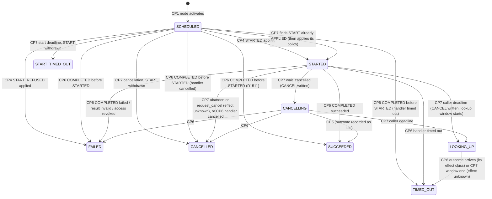

# Data model — feature 030 cross-namespace service operations

Proposed, not implemented. Table and column names are design names; exact migration timestamps are
allocated at implementation time. Every table carries `tenant_id`; every reference to a namespace,
run, workflow version or other row of this feature is a composite foreign key that includes
`tenant_id`, so no row can join two tenants (FR-030-025). Grants are to the runtime role `sagat_app`
only; immutable tables have an `ALWAYS` trigger refusing `UPDATE` and the role has no `UPDATE` on them.

## Entities and ownership

| Entity | Owner (who mutates it) | Table |
|---|---|---|
| Service | handler namespace, management API | `services` |
| Service revision | handler namespace, immutable | `service_revisions` |
| Service endpoint | handler namespace, management API | `service_endpoints` |
| Endpoint revision | handler namespace, immutable | `service_endpoint_revisions` |
| Allow-list entry | handler namespace, management API | `service_endpoint_callers` |
| Caller pin | caller publication, immutable | `workflow_version_service_pins` |
| Service call (caller record) | caller run transactions only | `service_operations` |
| Operation execution (handler record) | handler admission and handler run transactions only | `service_operation_executions` |
| Operation message | inserted by the sender; consumed by the receiver | `service_operation_messages` |

## State machines

### Caller record (`service_operations.state`)

A terminal record's state never changes. A `COMPLETED` or `START_REFUSED` that arrives for a terminal
record is `DISCARDED` (audited); a discarded `COMPLETED` writes its outcome code and effect class once
into `late_outcome_code`, `late_effect`, `late_outcome_at` for lookup (evidence, not state). A `STARTED`
is never discarded: for any record past `SCHEDULED` it is a no-op `APPLIED`, so a late, duplicate or
redriven `STARTED` cannot alter a call that a `COMPLETED` already settled (D1511). The start deadline and a cancellation take the `START` row lock: when the
`START` is still `PENDING` they withdraw it, so no handler run can exist; when it is already `APPLIED`
the handler run exists, the start deadline is void, the record moves to `STARTED` (the handler run id
is derived), a cancellation then applies its policy as from `STARTED`, and the later `STARTED` message
is applied as a no-op. Without `startTimeoutMs` the start deadline equals the deadline. The caller step
follows the record: `WAITING` (kind `SERVICE_CALL`) while `SCHEDULED`, `STARTED`, `CANCELLING` or
`LOOKING_UP`, then `SUCCEEDED` with output or `FAILED`/`CANCELLED` with the code of
[contracts/errors.md](contracts/errors.md). Every terminal state records an `effect` (`none`, `failed`,
`applied`, `partial`, `unknown`); an effect-possible failure is planned for compensation in a saga or
puts the step in manual review (`step.needs_review`) outside one (D1512).

### Handler record (`service_operation_executions.state`)

`ACTIVE` → `CANCEL_REQUESTED` (CP8) → `COMPLETED` (CP5); `ACTIVE` → `COMPLETED` (CP5). The handler run
keeps its own status independently; `COMPLETED` records the operation outcome sent.

### Message (`service_operation_messages.state`)

| Kind | Direction | States | Consumed by |
|---|---|---|---|
| `START` | caller → handler | `PENDING` → `APPLIED` (CP2) \| `REFUSED` (CP3) \| `WITHDRAWN` (CP7) | admission pass, handler run shard |
| `CANCEL` | caller → handler | `PENDING` → `APPLIED` (CP8) \| `DEAD` → `PENDING` (redrive) | cancellation pass, handler run shard |
| `STARTED` | handler → caller | `PENDING` → `APPLIED` (a no-op past `SCHEDULED`) \| `DEAD` → `PENDING` (redrive) | notification pass, caller run shard |
| `START_REFUSED` | handler → caller | `PENDING` → `APPLIED` \| `DISCARDED` \| `DEAD` | notification pass, caller run shard |
| `COMPLETED` | handler → caller | `PENDING` → `APPLIED` \| `DISCARDED` \| `DEAD` | notification pass, caller run shard |

A `START` never goes `DEAD`: room deferrals consume no attempts and the caller's start deadline or
deadline withdraws it.

## Tables

### `services`

| Column | Type | Notes |
|---|---|---|
| `tenant_id`, `id` | uuid | PK `(tenant_id, id)` |
| `namespace_id` | uuid | handler namespace; FK `(tenant_id, namespace_id)` → `namespaces` |
| `name` | text | slug; unique `(tenant_id, namespace_id, name)` |
| `current_revision` | integer | ≥ 1 |
| `state` | text | `ACTIVE`, `DELETED` (tombstone, never revived) |
| `created_by`, `created_at`, `updated_at` | text, timestamptz | |

Grants: `SELECT, INSERT, UPDATE`. Storage: `name`, `created_by` protected (bounded).

### `service_revisions` (immutable)

`(tenant_id, service_id, revision)` PK; FK `(tenant_id, service_id)` → `services`; `digest bytea(32)`
unique `(tenant_id, service_id, digest)`; `document jsonb` (the canonical `Service` document, ≤ 1 MiB);
`operations text[]` (names, for indexed checks); `published_by`, `published_at`, `request_id` with a
unique receipt `(tenant_id, service_id, published_by, request_id)`. Grants: `SELECT, INSERT`.
Storage: `document` **content** (charged to `tenant_content_bytes` by the manifest trigger).

### `service_endpoints`

| Column | Type | Notes |
|---|---|---|
| `tenant_id`, `id` | uuid | PK |
| `name` | text | slug; unique `(tenant_id, name)` among non-deleted rows (partial unique index) |
| `namespace_id` | uuid | handler namespace (FK) |
| `service_id` | uuid | FK `(tenant_id, service_id)` → `services`, same namespace (check by trigger) |
| `current_revision` | integer | head; deferred FK to `service_endpoint_revisions` |
| `state` | text | `ACTIVE`, `PAUSED`, `DELETED` |
| `allow_list_version` | bigint | incremented with every allow-list change |
| `created_by`, `created_at`, `updated_at` | | |

Grants: `SELECT, INSERT, UPDATE`. Index: `(tenant_id, namespace_id)`.

### `service_endpoint_revisions` (immutable)

`(tenant_id, endpoint_id, revision)` PK; `served_revisions integer[]` (1–4, each FK-checked by trigger
against `service_revisions` of the endpoint's service); `bindings jsonb` (per served revision and
operation: workflow name, policy `pinned`/`active`, version number; ≤ 128 entries); `max_concurrent`,
`starts_per_second` (integers within ceilings); `state` requested; `actor`, `request_id`, `created_at`;
unique receipt `(tenant_id, endpoint_id, actor, request_id)`. At most 1,000 ordinary revisions plus a
final tombstone. Storage: `bindings` content.

### `service_endpoint_callers`

`(tenant_id, endpoint_id, caller_namespace_id)` PK; FK `(tenant_id, endpoint_id)` →
`service_endpoints`; FK `(tenant_id, caller_namespace_id)` → `namespaces (tenant_id, id)`; `added_by`,
`added_at`. A row for a namespace of another tenant cannot exist. Grants: `SELECT, INSERT, DELETE`.
Count bounded by the endpoint ceiling (trigger).

### `workflow_version_service_pins` (immutable)

`(tenant_id, workflow_version_id, node_id)` PK; FK to the workflow version; `endpoint_id`, `service_id`,
`contract_revision`, `contract_digest`, `operation`; FK `(tenant_id, service_id, contract_revision)` →
`service_revisions`. Written in the caller publication transaction. Grants: `SELECT, INSERT`.

### `service_operations` (caller record)

| Column | Type | Notes |
|---|---|---|
| `tenant_id`, `id` | uuid | PK; `id` is the derived operation id |
| `caller_namespace_id`, `caller_run_id`, `caller_node`, `attempt` | uuid, uuid, text, smallint | FK `(tenant_id, caller_run_id)` → `runs`; unique `(tenant_id, caller_run_id, caller_node, attempt)` (root path only in the first increment; `attempt` 1..16, D1513) |
| `endpoint_id`, `endpoint_revision` | uuid, integer | endpoint revision current at scheduling (evidence only) |
| `service_id`, `contract_revision`, `operation` | | from the pin |
| `handler_namespace_id` | uuid | copied from the endpoint at scheduling |
| `handler_run_id` | uuid | derived; set when `STARTED` is applied |
| `mode`, `cancel_policy` | text | closed enums |
| `state`, `outcome_code`, `effect` | text | state machine above; code from the closed list or a declared code; effect class (closed set) on terminal states |
| `lookup_deadline_at` | timestamptz | set on `LOOKING_UP` |
| `late_outcome_code`, `late_effect`, `late_outcome_at` | text, text, timestamptz | written once by a discarded `COMPLETED`; never changes `state` |
| `input_digest`, `result_digest` | bytea(32) | FK `(tenant_id, digest)` → `payloads`; result only on success |
| `deadline_at`, `start_deadline_at` | timestamptz | workflow time (028 catalog) |
| `call_depth` | smallint | 1..8 |
| `created_at`, `started_at`, `finished_at` | timestamptz | |

Indexes: `(tenant_id, caller_namespace_id, state, created_at)` for listings; partial
`(tenant_id, caller_namespace_id) WHERE state IN ('SCHEDULED','STARTED','CANCELLING')` for the
pending-call quota count. Grants: `SELECT, INSERT, UPDATE`. Storage: all columns protected (ids,
codes, digests, bounded names).

### `service_operation_executions` (handler record)

`(tenant_id, operation_id)` PK; `handler_namespace_id`; `handler_run_id` unique
`(tenant_id, handler_run_id)`, FK → `runs`; `endpoint_id`, `endpoint_revision`, `contract_revision`,
`operation`; `caller_namespace_id`, `caller_run_id`, `caller_node` (link only, no FK to the caller run,
which may be purged first); `state`; `cancel_requested_at`; `outcome_code`; `result_disclosed boolean`;
`created_at`, `completed_at`. Index: `(tenant_id, handler_namespace_id, state, created_at)`; partial
`(tenant_id, endpoint_id) WHERE state <> 'COMPLETED'` for endpoint concurrency. Grants:
`SELECT, INSERT, UPDATE`. Storage: protected.

### `service_operation_messages`

| Column | Type | Notes |
|---|---|---|
| `tenant_id`, `id` | uuid | PK |
| `operation_id`, `kind` | uuid, text | unique `(tenant_id, operation_id, kind)` — the inbox key |
| `from_namespace_id`, `to_namespace_id` | uuid | composite FKs to `namespaces` |
| `shard` | smallint | `run_shard` of the receiving run (handler run id for `START`/`CANCEL`, caller run for notifications) |
| `state` | text | see above |
| `attempts`, `next_attempt_at`, `deferral_reason` | integer, timestamptz, text | `deferral_reason` closed set |
| `outcome_code`, `effect`, `result_digest`, `result_disclosed`, `handler_run_id` | | notification content; no value, only digest; `result_digest` FK `(tenant_id, result_digest)` → `payloads` |
| `input_digest` (FK → `payloads`), `deadline_at`, `start_deadline_at`, `call_depth`, `endpoint_id`, `contract_revision`, `operation`, `trace_id`, `parent_span_id` | | `START` only (check constraint by kind), so that admission reads no caller-side row |
| `cancel_policy` | text | `CANCEL` only |
| `created_at`, `settled_at` | timestamptz | |

Indexes: partial `(shard, next_attempt_at) WHERE state = 'PENDING'` per kind group (one for
`START`/`CANCEL`, one for notifications); `(tenant_id, to_namespace_id) WHERE state = 'DEAD'` for the
alert; `(settled_at) WHERE state <> 'PENDING'` for the purge. Grants: `SELECT, INSERT, UPDATE, DELETE`
(delete only through the purge, which selects settled rows). Storage: protected.

### Changes to existing tables

- `runs.service_call_depth smallint NOT NULL DEFAULT 0 CHECK (service_call_depth BETWEEN 0 AND 8)`;
  child creation copies the parent's value; handler admission sets caller depth + 1.
- Step wait kind gains `SERVICE_CALL` (the step row is the timer of both deadlines, as for children).
- `quota_limits.resource` gains `services`, `service_endpoints`, `service_operations_active`
  (handler namespace), `service_calls_pending` (caller namespace); per-run active calls and per-endpoint
  concurrency are bounded by the endpoint and run rows within the operator ceiling.
- `quota_rate_buckets.resource` gains `service_starts_per_second` with source kind `SERVICE_ENDPOINT`.
- Payload rows are reused: the operation input digest becomes the handler run's `input_digest`; the
  handler run's `result_digest` is the `COMPLETED` message's `result_digest`. Content-addressed rows
  are charged once per tenant (ADR-0027).
- `crates/infra-postgres/storage-classification.json` gains every new variable-size column with its
  class (`content` for `service_revisions.document` and `service_endpoint_revisions.bindings`,
  `protected_system` for bounded names, codes and arrays, each with its bound and test).

## Journal vocabulary (additive)

Caller run: `service_call.scheduled {node, operationId, endpointId, service, operation, mode,
contractRevision, inputDigest, deadlineAt, startDeadlineAt}`, `service_call.started {node,
operationId, handlerNamespaceId, handlerRunId}`, `service_call.cancel_requested {node, operationId,
policy, reason?, lookupDeadlineAt?}` (`reason: "deadline"` when a caller deadline starts the outcome
lookup), `service_call.finished {node, operationId, attempt, outcome, effect, code?, resultDigest?}`;
an effect-possible failure is followed in the same transaction by the existing `step.needs_review` or
the saga's compensation planning.

Handler run: `run.started` gains an optional `cause: {kind: "serviceOperation", operationId,
callerNamespaceId, callerRunId, callerNode, endpointId}`; `service_operation.cancel_requested
{operationId}`; `service_operation.completed {operationId, outcome, code?, resultDisclosed}` (before
`run.finished`, same transaction). No event carries a value; `service_call.finished` is a payload
event for feature 016 only through its `resultDigest`, judged by the pinned operation output schema.

## Reset rules (018 registry, C1, D1516)

| Event type | Rule |
|---|---|
| `service_call.scheduled`, `service_call.started`, `service_call.cancel_requested`, `service_call.finished` of a call whose `service_call.finished` is in the prefix | `COPY` — operation id kept as provenance; the reset run creates no `service_operations` row, message or handler run |
| any `service_call.*` of a call without `service_call.finished` in the prefix | `REFUSE` (018's eligibility already excludes a waiting step) |
| `service_operation.cancel_requested`, `service_operation.completed` (handler run) | `EXCLUDE` |
| `run.started` field `cause` (handler run) | `COPY` as provenance; the reset run has no `service_operation_executions` row and sends no `COMPLETED` |

## Time classes (028 catalog, C13, D1518)

Workflow time: `service_operations.deadline_at`, `start_deadline_at`, `lookup_deadline_at`,
`created_at`, `started_at`, `finished_at`; message `deadline_at`, `start_deadline_at`;
`service_operation_executions.created_at`, `completed_at`. Infrastructure time: message
`next_attempt_at`, `created_at`, `settled_at`; `late_outcome_at`; registry `created_at`, `updated_at`,
`published_at`, `added_at`. A predicate never compares the two classes: the deadline passes compare
workflow-time columns with workflow time, the delivery and purge passes infrastructure-time columns
with infrastructure time. Each column is listed in `crates/infra-postgres/time-classification.json`
(proposed by 028) by T030-070.

## Content store (020 registry, C8, D1518)

| Store | Run provenance | Purge | Erasure |
|---|---|---|---|
| `service_operation_messages` (`input_digest`, `result_digest`) | caller run (`START`, notifications) and handler run (`COMPLETED`) through `operation_id` | 7 days after `settled_at` (this feature's loop) | 020's erasure of either run calls this feature's hook: settled messages of the run's operations are deleted; a pending notification to an erased caller is marked `DISCARDED` and deleted; a `START` of an erased caller cannot be pending (the caller is terminal) |
| `service_operations` (`input_digest`, `result_digest`) | caller run | with the caller run | with the caller run; the handler record keeps link ids only |

Both digest columns are foreign keys to `payloads`, so 020's reference discovery finds them; the
messages are also listed in `crates/infra-postgres/run-content-references.json` (proposed by 020) with
the hook above.

## Retention

- Settled messages are deleted 7 days after `settled_at` (deployment setting up to 30), in bounded
  batches, one tenant per transaction. `PENDING` and `DEAD` rows are never purged.
- Caller and handler records live as long as their run; deleting a run (existing retention) deletes
  its record; the other side keeps its own record and link ids.
- Services, revisions, endpoints and endpoint revisions are retained; delete is a tombstone. A
  revision referenced by a pin or a served list is never deleted.
- Audit records follow the existing audit retention.
