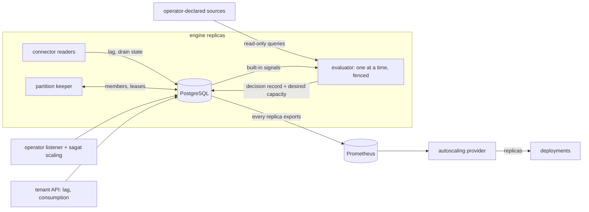

# Implementation Plan: Elastic scaling driven by telemetry

**Branch:** `feature/036-elastic-scaling` | **Date:** 2026-10-28 | **Spec:** [`spec.md`](./spec.md)

**Input:** the specification and its five clarifications (O1703, O1706–O1709). Decisions are `D1700…`, gaps `G1700…`, owner questions `O1710…` in [`research.md`](./research.md); the design records are ADR-0072 to ADR-0074 (proposed).

## Summary

Turn telemetry into capacity decisions that an operator declares by configuration or through a management interface, and hand both the signals and the decisions to the autoscaling provider (KEDA or another). The first delivery (O1709) closes the loop for consumers: lag per connector (Kafka, NATS, SQS), balanced Kafka partitions, a policy model with a deterministic evaluator, explanation of every decision, safety rules, pulled sources, and the export to the provider.

**Technical approach.**

- A **pure domain module** (`scaling`) holds the model and one deterministic function, `evaluate`, from (policy version, samples, current state, ceilings, time) to a decision record. Rank-based partition targets are pure too. Everything else is an adapter around them.
- One **evaluator loop in the engine**, under a lease with a fence in the decision's transaction, collects signals (built-in from the database, pulled from operator-declared sources), evaluates every policy, records the decision with its inputs, and writes the desired capacity. The platform applies nothing in the orchestrator (that is the optional applier of a later delivery).
- **Every replica exports** the desired capacity and the signal states as Prometheus series read from database state, so the value persists while the evaluator is down (hold) and the chart's autoscaler follows `authority="authoritative"` series only.
- **Lag** is measured where the data already is: Kafka's fetch returns the high watermark (today discarded), NATS has consumer info, SQS has queue attributes. The connector reports why it is not draining (behind, blocked, **rate-limited**, paused, failing).
- **Balanced Kafka assignment** replaces first-come leases: replicas announce themselves in a membership table, each computes its target from its rank (floor or ceil), gives back what exceeds it and takes free partitions up to it. Positions and admission stay one commit (ADR-0002, ADR-0012).
- **Management interface**: tenant endpoints on the existing API (lag, consumption), and an **operator listener** with its own principal for policies, sources, signals, overrides and decisions (O1710, default recommended). `sagat scaling` is a client of it.

**Finding that reshaped the plan** (confirmed in code, `research.md` D1710): a connector's `ratePerSecond` already holds across replicas through a shared bucket, so a connector at its rate limit gains nothing from more readers. The drain state and the scale-out rule account for it, and the spec and `docs/runbooks/events.md` are corrected.

## Technical Context

- **Language/Version:** Rust stable pinned by `rust-toolchain.toml`; Helm templates; Python only for repository checks.
- **Primary Dependencies (existing):** Tokio, Axum, tonic, SQLx, `metrics` 0.24 with the Prometheus exporter, `reqwest` 0.13 (through `infra-egress`), `rskafka` 0.6.0 (vendored, zstd patch only), `async-nats` 0.50.0, `aws-sigv4`. **New dependencies: none in the domain** (`thiserror`, `time`, `uuid`, `zeroize` only; `proptest` is already a dev-dependency). One new adapter crate, `infra-signals`, no new third-party crate.
- **Storage:** PostgreSQL (CI uses 16). Three additive migrations from `20261226000000` (the highest on any branch is `20261225000000`): the scaling tables, the connector lag and members, and the `connector_parallelism` quota. NATS is not involved in scaling.
- **Testing:** `cargo test` with real PostgreSQL (Testcontainers) and real brokers (`tests/support/brokers.rs`: Kafka, ElasticMQ for SQS; `nats.rs`); `proptest` for the decision function; `helm template` contract test; kind, Cilium and KEDA end-to-end by extending `tests/e2e/scalability-ha/kubernetes/run.sh` (G247).
- **Target Platform:** Linux containers on Kubernetes; Docker Compose for development (no Kafka or SQS emulator in Compose, tests start their own).
- **Project Type:** modular Rust monorepo, Helm chart, operator CLI.
- **Performance Goals:** criteria, not promises. Overhead of the machinery is bounded and reported (NFR-036-PERF): the evaluator reads once per interval; each lag holder writes one row per connector per sampling interval; each replica reads the desired state once per sampling interval.
- **Constraints:** single region; positions and admission stay one commit; no tenant, namespace, connector, run or activity label on a metric (ADR-0017, enforced by `no_metric_is_labelled_with_something_that_grows_with_the_data`); the domain crate accepts four dependencies only (`scripts/check-architecture.py`); the operator surface is off by default; nothing here changes delivery guarantees.
- **Scale/Scope:** at most 64 signals and 32 policies (bounds the label values), 256 partitions per connector and 20 connectors per tenant (existing limits), at most 64 engine replicas (existing ceiling).

## Constitution Check

*Re-evaluated after Phase 1 design: unchanged, no violation.*

- [x] **I. State and retry semantics.** PostgreSQL holds every scaling fact; a decision is recorded with its inputs in one transaction that the evaluator's fence guards (`D1701`). No transition, timer or lease semantics change. The Kafka position and the admission of its events stay one commit (`D1707`). A stale evaluator's decision is refused, never merged.
- [x] **II. Modular domain, ports and adapters.** `crates/domain/src/scaling/` is pure; ports in `crates/application`; loops in `crates/scheduler`; adapters in `infra-postgres`, `infra-connectors`, the new `infra-signals` and `api-http`. `infra-signals` is an adapter by its `infra-` prefix, so `scripts/check-architecture.py` needs no change and enforces its layer edges (`D1700`).
- [x] **III. External effects.** No new external effect in the first delivery. Pulled sources are read-only queries. The applier (later) is idempotent by decision identity and at-least-once.
- [x] **IV. Compatibility.** Additive tables and columns; existing metrics, alerts, settings and the connector API keep their meaning; mixed versions are safe because an engine without the keeper only competes for free partition leases and the fences hold (`D1708`); the SDKs do not change (O1708). Contract changes are versioned (OpenAPI fragment, JSON Schema).
- [x] **V. Tenant boundary and secrets.** Lag is per namespace and another tenant's connector is a missing one; tenants never write a policy (O1703). Sources are operator-only, allowlisted, redirect-free, bounded and read-only; credentials are file names resolved at use, never stored (`D1716`, `D1717`). Release-blocking risks named: SSRF through a source destination, cross-tenant lag read, a credential in a record, an operator token reaching the tenant door or the reverse. Each has a security test (SC-036-013, SC-036-018, SC-036-020). The evaluator re-validates every definition against the configuration-only limits at each evaluation, so rows written by a compromised role cannot take a unit past them (`D1732`, SC-036-021). *Reviewed against `checklists/security.md` on 2026-10-28; the spec was amended (FR-036-062 to FR-036-068).*
- [x] **VI. Observability and audit.** Traces on evaluation and handover; metrics without high-cardinality labels (`contracts/metrics.md`); platform-scope changes audited in a new append-only trail because the tenant audit needs a tenant (`D1714`); typed errors.
- [x] **VII. Events are redeliverable.** Acknowledgement after the inbox is unchanged. Backpressure and dead letters are untouched; the new drain states make backpressure and rate limiting visible. Duplicates after a handover are answered by the inbox, as today.
- [x] **VIII. Failure is tested.** The test plan below lists the crash points; results will be reported as they are.
- [x] **Delivery constraints.** Technology baseline unchanged; targets are criteria; the operator listener ships off by default.

Complexity Tracking at the end justifies the three costs that need it.

## Delivery slices (O1709)

| Slice | Stories | Content |
|---|---|---|
| **1 — first delivery** | US01, US02, US03, US04, US05, US06, US10, US13 | everything in this plan marked M1–M8 |
| 2 | US07, US09 | signals and scaling for the other roles; the engine split into selectable roles; the dispatcher and delivery division and the claim path, **on benchmark evidence** |
| 3 | US08, US12, US11 | hot tunables and resource policies; the optional applier; the benchmark on separate machines |

Slices 2 and 3 are listed so that slice 1 leaves them room; their design is not fixed here. What is undecided is marked in [Pending decisions](#pending-decisions-marked-as-such).

## Architecture of slice 1



| Piece | Where | Notes |
|---|---|---|
| Model, `evaluate`, rank-based targets, role catalogue | `crates/domain/src/scaling/` | pure; property tests |
| Ports and services (management, tenant lag, evaluator tick) | `crates/application/src/scaling.rs`; loop in `crates/scheduler/src/scaling.rs` | the monitor is the pattern |
| Stores and migrations | `crates/infra-postgres/src/scaling.rs`, `connectors.rs`; two migrations | |
| Lag probes, drain state, balanced assignment, hot parallelism | `crates/infra-connectors/src/{lag,kafka,nats,sqs,supervisor,ingest}.rs` | `ConnectorRuntime` gains methods |
| Pulled sources and the operator egress guard | new `crates/infra-signals/` | implements the `infra-egress` `Guard` seam |
| Tenant endpoints | `crates/api-http/src/routes/` + OpenAPI fragment | `x-implemented: '036'` |
| Operator listener, principal, routes | `apps/control-plane`, `crates/api-http` | off by default (`D1713`, ADR-0074) |
| `sagat scaling …` | `apps/cli` | REST client only |
| Evaluator, exporter | `apps/execution-engine/src/lib.rs`, settings | supervised as critical tasks |
| Chart | `infra/helm` | ConfigMap, env, `platform` autoscaling mode, egress |

**Evaluation order** (recorded in every decision, `contracts/evaluation.md`): usable signals → raw demand → stabilization → step → bounds with overrides → hold or freeze → role ceiling → database budget → cost ceiling → mode. Safety ceilings are last, so no override can pass them.

## Project Structure

### Documentation (this feature)

```text
specs/036-elastic-scaling/
├── spec.md              # with the five clarifications and the planning correction
├── plan.md              # this file
├── research.md          # D1700–D1734, G1700–G1718, O1710
├── data-model.md        # entities, tables, state transitions
├── quickstart.md        # runnable validation scenarios
├── contracts/
│   ├── README.md
│   ├── evaluation.md                       # formulas, clamp order, golden vectors
│   ├── signals-catalogue.md                # built-in signals of slice 1
│   ├── metrics.md                          # new series, labels, rules
│   ├── scaling-config.schema.json          # the configuration document
│   ├── tenant-scaling.openapi-fragment.yaml
│   └── operator-scaling.openapi.yaml       # the operator listener
├── checklists/requirements.md
└── tasks.md             # /speckit-tasks
```

### Source Code (repository root)

```text
crates/domain/src/scaling/                    signal, policy, decision, evaluate, assignment, role, lag
crates/application/src/scaling.rs             ports, ScalingService, ConnectorLagService
crates/scheduler/src/scaling.rs               evaluator tick, exporter, config sync
crates/infra-postgres/src/scaling.rs          stores (policies, signals, decisions, desired, overrides, audit)
crates/infra-postgres/src/connectors.rs       members, release, lag rows, drain state, tuning
crates/infra-postgres/migrations/20261226000000_scaling_core.{up,down}.sql
crates/infra-postgres/migrations/20261226000100_connector_lag_members.{up,down}.sql
crates/infra-postgres/migrations/20261226000200_connector_parallelism_quota.{up,down}.sql
crates/domain/src/quota.rs, crates/application/src/quotas.rs, crates/infra-postgres/src/quotas.rs   the quota connector_parallelism (D1712)
crates/infra-postgres/storage-classification.json
crates/infra-connectors/src/lag.rs            LagProbe and the three kinds
crates/infra-connectors/src/{kafka,nats,sqs,supervisor,ingest}.rs   changed
crates/infra-signals/                         MetricsQuerySource, BrokerQueueSource, OperatorGuard
crates/api-http/src/routes/{connectors_lag,operator_scaling}.rs
apps/control-plane/src/{config,lib}.rs        operator listener, config
apps/execution-engine/src/{lib,settings}.rs   evaluator, exporter, keeper wiring
apps/cli/src/scaling.rs                       sagat scaling …
infra/helm/                                   templates, values, examples/ha.yaml
specs/001-platform-foundation/contracts/openapi.yaml   tenant fragment merged
docs/runbooks/{scaling,events,security-governance}.md  ADR index, roadmap, owner-decisions
tests/integration/elastic-scaling/            real PostgreSQL and brokers
tests/fault/elastic-scaling/                  crash points
tests/contract/elastic-scaling/               OpenAPI, chart, config schema, metrics, architecture
tests/security/elastic-scaling/               SSRF, cross-tenant, credentials
tests/e2e/elastic-scaling/                    engine processes; kind and KEDA via the G247 script
tests/performance/scalability-ha/             lag control loop section (slice 1), separate machines (slice 3)
```

**Structure Decision.** No new application crate: the engine's loops already live in `crates/scheduler` and the application ports in `crates/application`. One new adapter crate (`infra-signals`) because the operator's outbound policy is a different trust boundary from the tenant's egress policy and must not live next to it.

## Implementation phases (slice 1)

Order follows dependency; each milestone ends with the evidence that closes its tasks.

1. **M1 — Pure model and evaluator** (FR-014–017, 021, 026, 027, 039, 043–046, 007). Types, validation, `evaluate`, rank-based targets, role catalogue. Evidence: unit tests, `proptest` properties (`SC-036-007`), the golden vectors of `contracts/evaluation.md`.
2. **M2 — Persistence** (FR-018, 020, 025, 028, 031). Migration `20261226000000`, stores, retention, the platform audit trail, privilege audit and storage classification. Evidence: migrate, roll back, re-migrate; `runtime_privileges`; reruns with `SAGAT_TEST_AS_RUNTIME_ROLE=1`.
3. **M3 — Lag and drain state** (FR-001–003, 005, 006, 013). Migration `20261226000100`; `LagProbe` for the three kinds; `Outcome::Backlogged` split; the correction of the runbook. Evidence: real Kafka, NATS and ElasticMQ (`SC-036-001`).
4. **M4 — Balanced assignment** (FR-007–011). Membership, keeper, release, readers started only for assigned partitions. Evidence: 12 partitions, 1→3→1 replicas, crash and clean stop (`SC-036-002`, `SC-036-003`).
5. **M5 — Evaluator, publication, chart** (FR-004 for slice 1, 017, 029–031, 043–048, 061, 064). Evaluator under lease with fence, config sync, re-validation of every definition against the configuration-only limits at each evaluation (`D1732`), exporter, chart mode `platform`. Evidence: integration and fault tests; `helm template` contract.
6. **M6 — Management interface** (FR-019, 020, 022–025, 047, 062, 063, 065, 066, 068; tenant: FR-002, 012, 023). Operator listener and principal (token audience and lifetime, peers, rate limit, refusal audit), routes, `sagat scaling`, tenant lag and consumption, hot parallelism, the `connector_parallelism` quota (`D1712`). Evidence: contract tests per `x-implemented: '036'` operation, parity test (`SC-036-005`), isolation tests (`SC-036-013`).
7. **M7 — Pulled sources** (FR-056–060, 067). `infra-signals`, the guard, file-name credentials and their rotation, the test operation. Evidence: security tests (`SC-036-018`), source kinds (`SC-036-017`).
8. **M8 — Evidence and documentation.** The kind and KEDA end-to-end (`SC-036-019`), the lag control-loop measurement on the available environment (`SC-036-004`), runbooks, alerts (NFR-036-OPS), `docs/traceability.md`, ADR acceptance.

## Test plan (Constitution VIII)

| Failure point | Test | Kind |
|---|---|---|
| Reader killed mid-batch during a partition handover | no loss, no duplicate admitted, position forward only | fault, real Kafka |
| Clean stop and crash of a holder | partitions move within the rebalance time and the lease time | fault |
| Broker redelivery and lost acknowledgement | inbox answers `DUPLICATE`; lag converges | integration, real brokers |
| Evaluator killed between collecting and recording | no partial decision; the next holder decides | fault |
| Two evaluators at once | exactly one decision in force (`FR-036-031`) | fault, held lock |
| Telemetry outage and stale signals | hold, condition raised, no scale-in | integration, property |
| Rolling upgrade, mixed versions | old engine and new keeper coexist, no partition read twice | fault |
| Tenant floods a shared signal | cost ceiling and step hold; dominance flagged | integration |
| Config unreadable or invalid | last valid version stays | integration |
| Source: SSRF, redirect, oversize, slow, NaN, plain-text credentials | refused at declaration or first query | security |
| Cross-tenant read of lag or write of consumption | indistinguishable from missing, audited | security |
| Rate-limited and blocked connectors | no scale-out decided | integration |

Races use held locks and barriers, never sleeps (AGENTS rule 18). A golden or generated file changes only after reading the diff.

## Data Model / Contracts

- [`data-model.md`](./data-model.md)
- [`contracts/`](./contracts/README.md)
- ADRs: [ADR-0072](../../docs/adr/ADR-0072-scaling-decisions-are-deterministic-recorded-and-published-not-applied-by-the-platform.md), [ADR-0073](../../docs/adr/ADR-0073-connector-partitions-are-shared-by-rank-and-lag-says-why-a-consumer-is-not-draining.md), [ADR-0074](../../docs/adr/ADR-0074-platform-operators-act-through-their-own-listener-and-outside-data-comes-from-allowlisted-sources.md) (proposed).

## Risks & Mitigations

- **Security risk: pulled sources are outbound calls chosen by configuration.** Operator-only; destination allowlist in configuration only (the API cannot widen it); no redirects; every resolved address checked; credentials are file names; bounded time and size; read-only. Adversarial tests first (`D1716`).
- **Security risk: the operator listener is a new authority.** Off by default; separate audience and principal; network policy peers explicit; hard ceilings are configuration-only so a compromised API cannot lift them, the evaluator re-validates every definition against them at each evaluation, tokens live at most an hour and are rate limited (`G1706`, `G1707`, `D1732`, `D1733`).
- **Operational risk: the provider reads a series that is absent or `NaN`.** Desired capacity is exported from stored state and persists; raw signals export `NaN` when unavailable; the real behaviour is proved in the kind and KEDA test, not assumed (`G1703`).
- **Functional risk: scale-out for lag that cannot be drained.** Drain state excludes blocked and rate-limited connectors; the ceiling for useful readers is recorded (`D1711`).
- **Compatibility risk: a hand-written rate statement was wrong.** Corrected in the spec and the runbook; no behaviour changes.
- **Performance risk: decision records grow.** Identical consecutive decisions coalesce into one row with a repeat count (`D1721`); 14 days retention.
- **Delivery risk: slice 1 is large (eight stories).** Milestones are independently testable; the operator surface (M6) and pulled sources (M7) are the ones to cut last if the owner must.

## Complexity Tracking

| Decision | Cost | Justification |
|---|---|---|
| New adapter crate `infra-signals` | one more crate in the workspace | the operator's outbound policy is a different trust boundary from the tenant's; putting it in `infra-egress` or `infra-connectors` would blur a security line |
| A second listener and principal for operators | new authority, new attack surface, a second OpenAPI document | there is no platform-operator principal on the REST API today and operator actions run as owner-role commands; a tenant listener must never accept an operator (`O1710` records the alternatives) |
| A platform audit trail apart from the tenant audit | one more append-only table | the tenant audit requires a tenant and a pseudo-tenant would receive quotas and appear in listings |

## Pending decisions (marked as such)

These are placeholders, not designs (AGENTS rule 11):

- **O1710** — operator identity for the management interface (the default in this plan is the separate listener; the owner decides).
- **Slice 2:** how the event dispatcher and the delivery worker are divided (decided on the benchmark of FR-036-033), whether the claim path is the limit (FR-036-034), the load-aware shard share (FR-036-035), how engine roles are selected (ADR to write).
- **Slice 3:** how a connection-budget tunable is applied to a pool that is fixed at creation (`G1712`), the applier's permissions and manifest, the benchmark topology.
- **Tenant custom signals** are not published in slice 1 (`G1700`).
